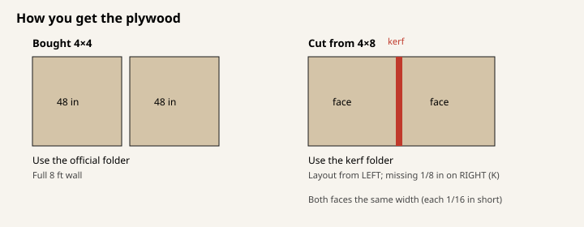
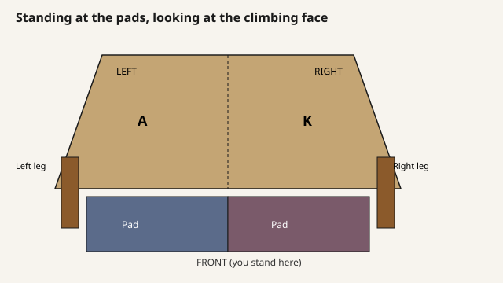

# Selected baseline reference packet

For ongoing compact bolted-frame engineering and builder-support work, start at the
**[main development summary and revision map](bolted-frame-development/README.md)**.
Its [active builder reading path](bolted-frame-development/README.md#active-builder-reading-path)
identifies the geometry, source-bound shop records, overrides and remaining holds.
The current geometry is **`v10-standard-4x6-top-and-sides-development-v1`**:
[standard 4×6 top-and-sides local viewer](http://127.0.0.1:8780/fea/generated/v10-standard-side-stock-v1/viewer/preview-v2.html?model=eoere-standard-4x6-top-and-sides-preview&view=rear&holds=off)
([serving instructions](../CONTRIBUTING.md#software-walkthrough)).
The [owner's constraint](bolted-frame-development/owner-frame-v10/owner-standard-side-4x6-v1.json)
is implemented: both sides and top are actual **88.9 × 139.7 mm**.
The [fresh matched evaluation](bolted-frame-development/owner-frame-v10/standard-side-stock-evaluation.json)
contains six cases and both replays, net sections, grip, rear-joint geometry and clearance checks.
Declared vector indices are **0.998500 left side, 0.951121 right side and 0.575366 top**.
All **15 bearing diagnostic rows across eight bolts** remain; complete connection,
splitting, fitting/hardware and physical qualifications remain unresolved.
There are 116 stacks, 44 spacers, 24 angles and 66 Hillman axes.
The [current provisional wood plan](bolted-frame-development/owner-frame-v10/standard-stock-planning.md)
and [planning CSV](bolted-frame-development/owner-frame-v10/buying-list-current.csv) supersede the old 4×8 side-stock basket.
Lengths remain provisional and custom packers unapproved. No purchase, fabrication,
climbing or structural release. Failed probes and deeper-side evidence remain history.

The [portable source map](../site/eoere-v10-candidate13-provenance.json)
preserves the isolated package's original hashes and status snapshots. The
maintained index identifies the integrated development model. The
[preserved V9 viewer](http://127.0.0.1:8767/?model=eoere-owner-frame-v9-development&view=rear)
and earlier candidates retain their own geometry and evidence. The
[builder plan](bolted-frame-development/builder-plan.md) routes current planning
records separately from historical assembly instructions.

The instructions below belong to the selected screw-and-bracket baseline,
`compact-floor-flush-development`, governed by
[current-candidate.json](../current-candidate.json). They preserve that baseline's
conditional shop packet and evidence. Earlier models and results remain in the
[design-history catalog](history/design-history.md).

## Which documents are current?

Use candidate and revision identifiers, rather than a filename containing
“current,” to choose instructions. The maintained entry points below route to
the applicable records; frozen packets preserve what was known when issued.

| Scope | Reading path | How to use it |
| --- | --- | --- |
| Active compact bolted development | [Summary and revision map](bolted-frame-development/README.md), [builder plan](bolted-frame-development/builder-plan.md), [task ledger](wood-joints-mvp/completion-ledger.md#current-v10-candidate13) | Standard 4×6 top and sides, revision v10-standard-4x6-top-and-sides-development-v1; left-side vector index 0.998500, 15 diagnostic rows/eight bolts. Connection and physical qualifications remain open; no purchase or physical release. |
| Selected screw-and-bracket baseline | This page, [working set](selected-working-set.md), [recorded applicability](current-candidate-status.md) | Separate twelve-bolt / 24-ML24Z design. The six recorded passes precede two later clip translations; current-layout mechanics applicability is unverified. |
| Purchased components and shared references | [Purchased plywood](purchased-materials.md), [Hillman screws](current-panel-screw-purchase.md), [hold hardware](moonboard-hold-hardware.md), [LED reference](led-wiring-reference.md), [pads](current-crash-pad-construction.md), [orientation](orientation.md) | Component identity and recorded owner policy; use the active candidate's placement tables and retain each reference's observation limits. |
| Earlier design and procurement assumptions | [V1 materials](materials.md), [round-frame cost ledger](material-costs.md), [baseline design basis](current-design-basis.md) | Historical or baseline-specific inventories, quantities and dated prices; no current bolted-frame shopping list is implied. |
| Earlier development plans | [Bolted-candidate plan](bolted-candidate-plan.md), [V4 plan](bolted-candidate-simple-joints-v4.md), [history catalog](history/design-history.md) | Earlier wood-block, barrel-nut and other revisions. Their “current” labels and next actions describe their own snapshots. |
| Earlier installation and joint screens | [SPAX kicker review](kicker-screw-placement-review.md), [top-joint inventory](joint-boundary-dispositions.md) | Historical products and layouts. Use current Hillman policy and the current builder coordinates; no earlier resistance transfers. |
| Inspection record template | [Inspection and maintenance](inspection-maintenance.md) | Earlier program format; it does not add a new approval gate or supply a current inspection schedule. |

The current builder plan identifies the later hardware/access overrides to
the issued shop packet. Older source-bound text stays byte-identical where
current evidence depends on it; its issue-time status is not today's task queue.

## 1. Baseline plywood variants

| You have | Open |
| --- | --- |
| Bought **4×4** sheets (or Mini kit panels) | [https://mckayreedmoore.github.io/mini-moonboard/](https://mckayreedmoore.github.io/mini-moonboard/) · [cut sheets](https://github.com/mckayreedmoore/mini-moonboard/tree/master/docs/floor-flush-construction) |
| **Cut 4×8** sheets | [https://mckayreedmoore.github.io/mini-moonboard/?model=compact-floor-flush-kerf-right](https://mckayreedmoore.github.io/mini-moonboard/?model=compact-floor-flush-kerf-right) · [cut sheets](https://github.com/mckayreedmoore/mini-moonboard/tree/master/docs/floor-flush-construction-kerf-right) |

Or open the first 3D link and pick the matching line under **Design**.
Details: [Which plywood packet](floor-flush-width-option.md).

## 2. Baseline cut, drill and assembly records

1. [Shop checklist](floor-flush-shop-checklist.md)
2. [Assembly guide](floor-flush-assembly-guide.md)
3. The cut-sheet folder from step 1

Supporting baseline references: [orientation](orientation.md) (left is A, right is K),
[hold hardware](moonboard-hold-hardware.md), [LED routing](led-wiring-reference.md),
[panel screws](current-panel-screw-purchase.md), [pads](current-crash-pad-construction.md),
[later insert option](screw-repair-inserts.md).

## 3. Baseline calculations and conditions

[Build package](floor-flush-build-package.md) ·
[Master plan](floor-runner-mvp-master-plan.md) ·
[Completion ledger](floor-runner-mvp-completion-ledger.md)

## Reading paths

For baseline shop records, use the matching **4×4** or **4×8** folder, the
**checklist** and the **assembly guide** together. Read their recorded conditions.
For the active development lane, return to the [compact bolted-frame summary](bolted-frame-development/README.md).
For earlier ideas and the writeup, use [history/](history/).
