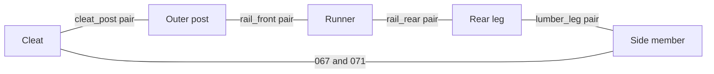

# Compact bolted frame development and completion ledger

The [active entry and revision map](../bolted-frame-development/README.md)
now use `compact-bolted-frame-development`. The source-bound evidence candidate
remains `compact-floor-flush-eoere-bolted-development`; frozen geometry IDs,
receipts and paths are unchanged. The selected baseline keeps its own authority.

**Primary cleat development approach: bolted plywood gussets.** The owner's
[plywood selection](#plywood-cleat-development-choice) supersedes further
retained-solid-cleat resistance research as the main route. Current geometry
and frozen timber results retain their recorded scope while the plywood
connection checks proceed.

## Engineering closure beyond the assessment

**The preserved 2×6-post conditional numerical evaluation is complete** for
`eoere-raised-kicker-screws-v1` with `eoere-selected-purchase-hardware-v1`, extra
grid off. Current first-order forces, bounded joint/member comparisons and the
engineering assessment have reached their recorded calculation/reporting
endpoints. Their unknown capacities and applicability limits are reported
outcomes of that completed scope.

| Numerical stage | Recorded completion and usable result |
| --- | --- |
| [Current frame forces](#current-geometry-and-selected-hardware-six-case-forces) | **Complete: six of six current first-order cases admitted.** Equilibrium, applied-load work, owner routing and recovery checks pass; maximum residual 5.521612e-6 N against the unchanged 1e-5-N gate. |
| [Current joint/hardware comparisons](#current-joint-and-finished-member-references) | **Bounded evaluation complete.** All 100 shafts, 22 fittings and 66 screws are covered in each case, including 92 two-member bolt references and eight mixed-stack statics. The [ordinary-pair group bound](#ordinary-two-member-group-factor-bound) covers 552 Cg-only comparisons with maximum 0.922961 and no exceedances; complete geometry and joint resistance remain separate. Affine raw-yield trials cover all 48 mixed-stack/case combinations; later [vector statics tests](#representative-joint-vector-statics-tests) add three meshes each, with maximum refined raw index 0.202230. Nominal heel and axial washer comparisons are complete. The [front runner/post screen](#current-front-runnerpost-end-and-outer-edge-qualification) closes full-value end and outer-edge distances for four bolts/eight wood occurrences. |
| [Finished timber and stability references](#current-joint-and-finished-member-references) | **Bounded evaluation complete.** Thirty-eight exact finished planes/228 same-case comparisons, gross stability sensitivities and floor-resultant screens are recorded. Later local timber queries add the cleat opening bounds, compression-event census and six rail cuts. The [simultaneous cleat calculation](#cleat-transverse-wrenches-and-the-three-qualification-limits) includes both normal-force moments in 12 member/case records and 24 point-action traces. The [retained-reference audit](#retained-cleat-reference-audit) adds 24 shear comparisons and 24 normal-hypothesis comparisons, without exceedances. The later [continuous-load boundary witnesses](#necessary-boundary-stress-witnesses-for-the-continuous-cleat-loads) record separate prescribed-pressure/C16 failures; complete physical resistance and restraint remain unqualified. |
| [Engineering assessment](#engineering-assessment-and-acceptance-decisions) | **Assessment complete.** Recorded loads, all 150 owners' active-action floor paths, finite-arm contact diagnostics and effective-length domain requirements are checked. Four full-span domain exceptions and all missing acceptance inputs remain disclosed. |
| Later finite-motion method extension | **Saved-pose diagnostic scope complete.** The v5 record composes all 9,450 coordinates/150 owners/835 loads per case; all six owner-work checks and 132 fitting heel checks pass. Its explicit finite-equilibrium flags remain false: these checks do not replace the admitted first-order fields or constitute a finite-equilibrium solve. |

The owner initially requested complete engineering qualification with only
panel/screw exceedances deferred. On October 12, after the remaining unsupported
bases were identified, the owner explicitly selected **“Keep the current design
and its qualification limits.”** That investigation, documentation and
publication task is complete at `e2ddd1a0`, with successful exact-revision CI
and Pages deployment. The owner subsequently requested completing the remaining
items with a new goal. **The three engineering qualifications remain open;
the full numerical-completion objective remains unachieved under the owner's
permission to research and make reasonable assumptions. Engineering acceptance
is not established.** The current design remains the
analysis target while applicable methods, missing inputs and any required
model changes are identified. Physical demand and movement,
complete fitting/joint resistance and finished timber strength/stability remain
unqualified as recorded in the
[remaining-work table](#factory-alternatives-and-remaining-engineering-inputs).
They do not reopen the completed conditional numerical stages above. Actual
build fit remains excluded, all observations stay blank, and the reviewed
geometry, purchased screw policy and no-slip floor assumption are preserved.
The qualification continuation below reuses existing cached solids and current
actions. Its representative vector bearing/bending tests solve local statics
under those fixed actions; they do not change the model, rerun frame mechanics
or supply physical release.

The current [proportionate decision](#proportionate-qualification-decision)
closes the bounded continuation with explicit acceptable, failed or unsupported
detail outcomes. The owner has since authorized a new
[full engineering completion goal](#practical-engineering-completion-goal).
Its remaining joint, member and response checks remain in scope. The current
[input and scope boundary](#current-engineering-input-boundary) records why
completion is blocked. Earlier
custom-model queues retain their issue-time scope; the new goal uses practical
engineering methods and the existing evidence rather than commissioning
another modeling campaign.

The earlier read-only progress audit checks the revision-index bindings, exact
case/state/field joins and all **1,524 force, 1,561 component and 1,687 finite
source pins**, with **1,695 distinct files** verified across their overlapping
unions and result bindings. It also authenticates **13 current supplemental
records in its scope** against the existing digest table, confirms the 38/228 section
counts and recomputes both heel exceedance counts from the saved reference
arrays. No frozen result or source bytes change. The maintained status here
supersedes recent summaries that presented these completed evaluations only
as unfinished engineering work.

### Completed investigations and applicability

The evidence search also confirms the following completed investigations.
Their source revisions and method limits explain which results remain usable;
these subjects must not be described as uninvestigated.

| Completed investigation | Usable result and applicability limit |
| --- | --- |
| [Eoere member-restraint return paths](hypotheses/hl35-candidate/thin-frame-comparison/eoere-successor-v1/bounded-strength-v1/revised-base-audit-v1/README.md#member-restraint-and-the-attachment-path) | The earlier base-v3 audit maps screws, panels and other receivers for all four long members. Candidate maximum station gaps are 358.383–870.150 mm, below the 1,905-mm weak-column domain limit. This establishes identifiable geometric return paths, while their lateral stiffness/strength and end-restraint credit remain unqualified. Its older case actions are not current selected-hardware forces. |
| [Frame rank/seating assessment](hypotheses/mvp-resume-2026-10-01/upper-corner-screw-layout/frame-stability.md) and [coupled motion bounds](hypotheses/mvp-resume-2026-10-01/upper-corner-screw-layout/joint-frame-motion-bounds.md) | Fixed-force clearance seating and motion bounds were completed for the earlier 104-bolt wood-joint frame. Bounded seating is an affirmative result within those laws. Its geometry, coordinate chart and contact laws differ from the current 100-bolt Eoere frame; its motion values do not transfer as current bounds. |
| [Full-length member sensitivity](hypotheses/mvp-resume-2026-10-01/upper-corner-screw-layout/member-restraint-completion.md) and [all-joint splitting assessment](hypotheses/mvp-resume-2026-10-01/upper-corner-screw-layout/all-joint-splitting/README.md) | Earlier member kernels, splitting demands and candidate transfer paths were evaluated. The sources explicitly retain conditional domain exclusions and unqualified complete splitting resistance. They are completed sensitivity/path assessments for their frozen timber/block model, not an adopted capacity for the current Eoere joints. |
| [Coupled bearing/bolt-bending method benchmark](hypotheses/hl35-candidate/thin-frame-comparison/eoere-successor-v1/bounded-strength-v1/connected-stack-followup-v1/limit-analysis-method-v1/README.md) and [guarded correction](hypotheses/hl35-candidate/thin-frame-comparison/eoere-successor-v1/bounded-strength-v1/connected-stack-followup-v1/limit-analysis-method-v1/evidence-correction-v1/review-fix-v2/README.md) | All 15 synthetic cases at three discretizations pass independent field checks and byte replay. This completes a useful raw scalar statics benchmark; it uses no candidate fields and establishes neither current mixed-stack compatibility nor adjusted complete-joint resistance. Current mixed-stack raw trials are separately complete below. |

For the current frame, the **56.603761-mm interaction-point motion is a
computed diagnostic with no adopted movement limit**, not a failed movement
criterion. The **four full-span effective-length exceptions are method-domain
limits**, not demonstrated buckling failures. The mapped restraint route uses
screw lateral bearing and panel in-plane stiffness, so its qualification
overlaps panel/attachment behavior; it is not a separate demonstrated
non-panel failure. The assessment permits an applicable physical treatment
or justified conservative bound and does not prescribe a particular solver.

Completed conditional bolt and washer checks remain usable. The 92 two-member
bolt references already include the purchase-root treatment where required;
their maximum unadjusted demand/reference is **0.631248**. The separate bolt-metal
first-yield diagnostic peaks at **0.513229**. Across all six current cases, axial
washer comparisons peak at **0.319358 nominal / 0.685364 adverse catalog geometry**
against the assumed 33-ksi steel marker, with no axial reference exceedance.
All **112 nominal wood washer seats** have modeled annular support. The
[thread and washer interpretation](#online-specifications-for-selected-hardware)
records the calculation scope. Product-profile/material assumptions and
eccentric contact/prying remain explicit within complete-joint qualification;
the completed calculations do not need repeating solely because a catalog
yield minimum is absent.
The later [three-dimensional axial transfer construction](#current-axial-washer-and-spacer-transfer)
adds continuous normal-pressure, shear and hoop-stress bounds for all current
washer ends and the eight spacer paths under explicit steel/contact hypotheses.

The owner's existing working heel assumption is **6.35-mm thickness and
6.35-mm inside radius**. It has already been assessed against all six current
saved fields: **0 of 528 heel reference exceedances**, maximum **0.992604**,
about **0.740% below** the conditional marker. The retained 6-mm/6-mm
sensitivity has seven exceeded rows and a maximum of **1.107141**. Both
scenarios have inside radius equal to thickness, so radius equality alone
does not explain the different results. The remaining fitting work concerns
dimensional/material applicability and complete joint behavior; the nominal
heel comparison is complete within its fixed-action scope.

### Current front runner/post end and outer-edge qualification

The owner's continuation request is addressed first at the governing two-wood
bolt reference. The [placement reducer](../../scripts/eoere_front_bolt_placement.py)
reuses the authenticated current field/component intake and the existing end
factor helper, under [frozen inputs](hypotheses/hl35-candidate/thin-frame-comparison/eoere-successor-v1/selected-hardware-v1/current-response-v1/joint-closure-v1/front-bolt-placement-inputs-v1.json).
It covers `rail_front_bolt_left_1`, `_left_2`, `_right_1` and `_right_2` on
both front runner/post arrangements: **eight bolt/wood occurrences on four
members**, with all **24 bolt/case references** bound to their own six saved
states. The strict cached-solid query confirms all six exterior stock planes
and four cylindrical bore faces per member; the rear floor bevel is included
over each full wood-bearing interval. No source geometry is rebuilt.

All eight occurrences pass both reversible distance screens. Minimum grain
end distance is **70.172141 mm**, exceeding the **66.675-mm (7D)** full-value
softwood tension criterion. Minimum outer cross-grain edge distance is
**41.597141 mm**, exceeding the conservative **38.100-mm (4D)** loaded-edge
criterion. Both grain directions and both external edges are checked, so
reversed actions cannot select away the shorter distance. The minimum margin
is **3.497141 mm**. The pinned official [NDS 2024](https://awc.org/resources/2024-nds/), Chapter 12, §12.5.1 and
Tables 12.5.1A/C support these end/outer-edge screens.

This closes those placement limits for the four front bolts. The existing
**0.631248** maximum unadjusted bolt reference is unchanged. The separate
**1.262496** sensitivity obtained by imposing a 0.5 geometry factor is
**not established by these end/outer-edge distances**; it remains a
non-adopted sensitivity. Complete `Cdelta`, `Cg`, adjusted joint resistance,
signed row/group ownership, oblique shear area, interacting holes and local
fracture are not established by this screen. No complete-joint pass is claimed.

The immutable input is **95,767 bytes**, SHA-256
`44833a616f970dd42dbeb37c4904dfa32672fa323740acf0a98699e12afd9757`.
Its 477 method/execution references bind reused source and installed module
bytes without copying dependencies or unchanged assets. The **368,644-byte**
raw result stays in the ignored engineering-closure output folder, with all
**2,083 source pins** verified. The original pinned tests stay unchanged;
[additional reversal controls](../../tests/test_eoere_front_bolt_reversals.py)
cover inadequate distances at either end and either edge. Current source
inputs and this raw result remain active; no archive or prune is performed.

Reproduction and focused checks (use a fresh output path; existing records
refuse overwrites):

```sh
uv run python -B -m scripts.eoere_front_bolt_placement --out fea/generated/selected-hardware-followup-v1/engineering-closure-v1/current-front-bolt-placement-v1-replay.json
uv run pytest -q tests/test_eoere_front_bolt_placement.py tests/test_eoere_front_bolt_reversals.py
uv run ruff check scripts/eoere_front_bolt_placement.py tests/test_eoere_front_bolt_placement.py tests/test_eoere_front_bolt_reversals.py
```

All **16 tests** and Ruff pass. The replay is byte-identical to the recorded
result. The development revision checker, local file links and diff whitespace
checks pass; the active summary stays at 150 lines. Two independent review
passes are complete: the first identified missing opposite-side regression
coverage, now supplied without changing the pinned tests; the final
correctness, testing and architecture reviews report no substantial findings.
Independent saved-coordinate arithmetic confirms all eight screens and all
24 case joins. The original force, component and assessment hashes remain
unchanged. No staging, commit or push accompanies this continuation.

The remaining qualification review also reuses the existing current cleat
opening queries: maximum necessary transverse opening is **27.917423 N** at
Y = **−105.85 mm** in `a12-forward`. The retained X-axis bolts do not cross
that Y-normal plane, and no resisting traction/fracture basis is qualified.
The small force alone cannot establish a pass. The pinned official
[NDS 2024](https://awc.org/resources/2024-nds/), Chapter 3, §3.8.2, directs avoiding perpendicular tension and considering
sufficient mechanical reinforcement when it cannot be avoided; it supplies
no generic sawn-lumber perpendicular-tension allowable. These are necessary
force-only bounds, not complete crack-plane/couple checks or a quantified
physical failure. Closing this limit needs an applicable current fracture
or supported mechanical transfer basis. No cleat remedy or new bolt is added.

#### Outer-profile end and edge inventory for all current wood bores

The [all-bore adapter](../../scripts/eoere_bolt_outer_geometry.py) addresses
the uncovered geometric inventory rather than repeating the front proof.
The [predeclared input](hypotheses/hl35-candidate/thin-frame-comparison/eoere-successor-v1/selected-hardware-v1/current-response-v1/joint-closure-v1/bolt-outer-geometry-inputs-v1.json)
extends the outer-profile analysis to **120 wood-bore occurrences on 22
current timbers**, with all six same-geometry fields authenticated. It retains
100 bolts, their two own diameters and all 66 Hillman axes. No source profile,
cached solid, force, native model or viewer changes.

The original front helper requires two end planes and a U-direction bore.
That domain does not cover compound ends, the header's V-direction bore,
changed union extents or the separately recorded finished cleat polygon.
The new reader takes a convex hull of the source vertices, preserving old
end-offset metadata unchanged; each cleat uses its **finished sloping YZ
polygon**, not the rectangular full-height analysis blank. The [SciPy
ConvexHull equations](https://docs.scipy.org/doc/scipy/reference/generated/scipy.spatial.ConvexHull.html)
provide the plane representation. Runtime SciPy **1.18.1**, NumPy **2.5.2**,
CadQuery **2.8.0** and OCP **7.9.3.1.1** are pinned; the online SciPy manual
currently labels itself 1.18.0, and the known-answer controls confirm the
used behavior on the pinned installation.

Grain-end distances minimize every source end halfspace over the complete
own bearing interval. The cross-grain edge direction is the remaining stock
transverse axis after identifying the actual bore direction. All **22 cached
finished solids** have every corresponding outer hull plane present on their
planar faces. Maximum cached-vertex hull violation is **5.172e-10 mm**.
The two rear legs retain two additional planar cut faces each; curved faces
and all extra cuts remain explicit. Vertex containment is a diagnostic, not
a proof of the full curved boundary or a continuous timber ligament.

| Inventory result | Meaning |
| --- | --- |
| **46 / 120** occurrences below the conservative reversible 7D end marker | 36 at **65.0875 mm**, four at **38.9 mm**, four cleat occurrences at **60.3 mm** and two at **45.284053 mm**. These counts are marker misses, not adopted failures. |
| **52 / 120** occurrences have square-end profile orientation | The frozen helper gives 36 partial component trials: **0.976190** for 32 occurrences and **0.583427** for four post occurrences; the remaining 16 are full-value. No complete Cdelta is assigned. |
| **68 / 120** occurrences retain sloping-end formula limits | Their square-end helper values are unadopted trials. The original front-eight full-value proof remains unchanged. |
| **6 / 120** occurrences below the conservative both-edges 4D marker | Four 9.525-mm side/principal occurrences have the nearer edge at **29.108028 mm** versus 38.1 mm; two 12.7-mm leg-bolt side occurrences have **43.399172 mm** versus 50.8 mm. Loaded and unloaded directions must be distinguished before applying code requirements. |

The official [NDS Chapter 12](https://awc.org/resources/2024-nds/), printed
pp.97–99, §12.5.1.2 and Tables 12.5.1A/C, distinguishes partial end factors,
loaded/unloaded edges, complete connected-group minima and oblique shear
area. A missed reversible marker does not establish a resistance exceedance.
The [signed action followup](#signed-force-component-end-and-edge-followup)
now joins the **actual signed same-case wood actions** to those directions,
retaining their couples; no full factor is assigned from unsigned minima.
Internal cuts, interacting bores, row/group
ownership, local brittle behavior, complete resistance and physical demand
qualification remain separate. No remedy or new design is proposed.

Input size is **4,937 bytes**, SHA-256
`5dbe23fad17601f776b360b861e31bd058f431e72341b61ba47dd930e2261942`.
The active ignored `current-bolt-outer-geometry-attempt01.json` is
**608,112 bytes**, SHA-256
`f066d3d68efa67944350c4c5ffcef38d334a1f2ae97f10b30f395c1a919ef084`,
with **1,613 verified source pins**, in the existing engineering-closure folder.
The consumer and test add **24,864 bytes**. All **23 focused controls** and
Ruff pass, including compound ends, band minima, both bore directions,
metadata preservation, cleat slope, rigid pose and incomplete face evidence.
Readiness correctness, testing and architecture reviews report no substantial
findings. Inputs, cached solids and previous studies stay active; no new
native/elastic/frame solve, CAD rebuild, actual fit, staging, publication,
archive or prune occurs. The three engineering qualifications remain
unestablished and the full goal stays active.

```sh
OPENBLAS_NUM_THREADS=1 OMP_NUM_THREADS=1 uv run python -B -m scripts.eoere_bolt_outer_geometry --out fea/generated/selected-hardware-followup-v1/engineering-closure-v1/current-bolt-outer-geometry-replay.json
uv run pytest -q tests/test_eoere_bolt_outer_geometry.py
uv run ruff check scripts/eoere_bolt_outer_geometry.py tests/test_eoere_bolt_outer_geometry.py
```

Fresh-path replay is byte-identical. Final saved-output correctness,
testing/evidence and architecture reviews report no substantial findings;
independent coordinate arithmetic agrees for all 120 occurrences within
**2.84e-13 mm** and reproduces the prior front-eight screens. The portable
text export passes **398 controls in 15 retained-design modules**, with
the same **nine explicit recovered-evidence deselections** and no recovered
array/kernel copies. All **220 development/documentation checks**, **70
changed local links / 32 Markdown fragments**, the 150-line summary and
whitespace checks pass. Fifteen active completed records bind **2,698
distinct unchanged source/result pins**. The old raw evidence, foreign
working files/index and rejected proposal remain preserved; staging is empty.
This completes the geometric-inventory stage. The following signed-action
stage retains its separate component and complete-qualification boundaries.

#### Signed force-component end and edge followup

The [directional consumer](../../scripts/eoere_bolt_directional_geometry.py)
answers which reversible end/edge marker misses matter for the **signed
force components** in the six saved cases. Its [declared v2 input](hypotheses/hl35-candidate/thin-frame-comparison/eoere-successor-v1/selected-hardware-v1/current-response-v1/joint-closure-v1/bolt-directional-geometry-inputs-v2.json)
reuses all 120 frozen wood-bore occurrences and their own wood actions.
Each action keeps its original bearing midpoint, full force, end-capture
contribution and free couple. The consumer neither queries solids nor
produces new frame forces.

The pinned [NDS Chapter 12](https://awc.org/resources/2024-nds/),
Tables 12.5.1A/C and §12.5.1.2, distinguishes loaded/unloaded edges and
parallel tension/compression end distances. The projected perpendicular
component uses **4D at its loaded edge and 1.5D at its unloaded edge**.
The parallel component points toward a tension end or away from a compression
end. A **1e-5-N** direction gate is a comparison convention, not a physical
force-error bound: unresolved cross components retain a null edge screen;
unresolved parallel signs retain the conservative tension-end requirement.
Square-end partial factors remain conditional component values; sloping-end
formula values remain unadopted trials.

| Signed component result | Recorded outcome |
| --- | --- |
| **720** wood occurrence/case comparisons | All 120 own occurrences in each of six cases; 100 bolts and 66 Hillman axes unchanged. |
| **697** resolved perpendicular-component screens | **One loaded-edge marker miss**, no unloaded-edge misses. The other **23** screens are unresolved, not passed. |
| **276** ordinary connection/case end-trial minima | Each includes both physical bolts and every own wood host in its pair. **177** full-value trials, **87** at approximately 0.976190 and **12** at 0.583427; no below-minimum null end trial. These are not complete Cdelta values. |

The sole resolved loaded-edge miss is **`eoere_bolt_067` / `base_side_left`
in `a1-rear`**. Its declared grain/cross-edge components are **−2.012197 /
+33.974952 N**. The force points toward the **29.108028-mm** edge, below
the **38.1-mm** component marker, with required/actual ratio **1.308917**.
The opposite edge is **110.591972 mm**, above its **14.2875-mm** unloaded
marker. The original free couple has norm **621.891816 Nmm** and remains
in the record. The 29.108028-mm sloping-cut distance was already recorded
in the [earlier build-package geometry study](#build-package-completion);
this followup adds the current signed case join, not a new geometric conflict.

The **0.583427** connection minima apply to both left/right outer post–cleat
pairs in every case, across both bolts and both wood members. Eleven mixed
wood occurrence/case records retain partial sloping-end trials; none is
adopted by the ordinary-pair minimum. All eight mixed axes remain covered
by their own action screens and separate mixed-stack evidence.

A projected-component marker miss means this declared sufficient screen
does not pass. It establishes neither physical fracture nor a complete-code
joint failure. Conversely, a net-force marker pass does not establish
eligibility: opposing bearing pressures and free couples may load both
sides. Oblique shear area, row spacing, long-bearing parallel edge rules,
internal cuts/bores, local brittle resistance and full contact/yield behavior
remain separate. Complete Cdelta, joint/member resistance and physical
demand qualification remain unestablished. No remedy or model change follows.

The v2 input is **6,631 bytes**, SHA-256
`a4f0986f1a8b06aa92b7906820a82ff1c7fb5d06d27144a325b761d2c07153eb`.
Before first execution, review identified two transitive grouping/vector
helpers missing from the input source pins. V2 binds and checks their loaded
and on-disk bytes before and after evaluation. The unused [v1 input](hypotheses/hl35-candidate/thin-frame-comparison/eoere-successor-v1/selected-hardware-v1/current-response-v1/joint-closure-v1/bolt-directional-geometry-inputs-v1.json)
stays unchanged at **5,724 bytes**, SHA-256
`ecf9fa59815a7aa5900dd863ad33069a7acd925b12ca266d8455cc5a4a7bf7b9`;
no result was produced under it. All **36 focused controls** and Ruff pass,
including load reversal, unresolved directions, sloping limits, complete
pair minima, pose invariance and transitive-source refusal. The fresh three
readiness reviews report no substantial findings.

The active ignored `current-bolt-directional-geometry-attempt01.json` is
**4,454,502 bytes**, SHA-256
`d8048f146ed31a972925f97e7ea8250ebb6de90129e0d09ec58f0788388338a5`,
with **1,622 verified source pins**, in the existing engineering-closure
folder. Source and test add **24,790 bytes**; inputs need targeted force-add
if published. Reproduction uses a fresh output path:

```sh
OPENBLAS_NUM_THREADS=1 OMP_NUM_THREADS=1 uv run python -B -m scripts.eoere_bolt_directional_geometry --out fea/generated/selected-hardware-followup-v1/engineering-closure-v1/current-bolt-directional-geometry-replay.json
uv run pytest -q tests/test_eoere_bolt_directional_geometry.py
uv run ruff check scripts/eoere_bolt_directional_geometry.py tests/test_eoere_bolt_directional_geometry.py
```

Fresh-path replay is byte-identical. The portable text export passes **434
controls in 16 retained-design modules**, with the same **nine explicit
recovered-evidence deselections** and no recovered array/kernel copies.
Final saved-output correctness, testing/evidence and architecture reviews
report no substantial findings. Independent projections agree for all 720
own source actions within **2.27e-13 N** and reproduce all 276 pair minima.
All **220 development/documentation checks**, **76 changed local links /
35 Markdown fragments**, the 150-line summary and whitespace checks pass.
Sixteen completed records bind **2,703 distinct unchanged source/result
pins**. Inputs, earlier raw studies and rejected-proposal history remain
active; foreign working files/index are preserved and staging is empty.
No native/elastic/frame solve, CAD rebuild, actual-fit work, archive, prune,
commit or push occurs. This completes the signed-component stage; all three
broader engineering qualifications remain unestablished and the full
numerical-completion goal stays active.

#### Front bolt pair row and group scope

The [current group adapter](../../scripts/eoere_front_bolt_group_scope.py)
addresses the specific question left by the passing front end/outer-edge
screens: whether the two diagonal bolt pairs can inherit a complete geometry
factor or an aligned-row group factor. It reuses those frozen finished-face
checks, all six current fields and the existing
[row-spacing helper](../../fea/leg_bolt_pattern_search.py). No cached solid,
geometry or frame response is rebuilt.

The source-verified NDS 2024 Chapter 12, printed pp.98–99,
§12.5.1.2–3 and Tables 12.5.1B/D, distinguishes spacing within and between
rows. Figure 12G makes the perpendicular-load row separation a distance
**along grain**; the parallel-load between-row distance is across grain.
The [pinned primary chapter](hypotheses/upper-block-strength-2026-10-01/source-cache/chapter12-2024-awc-20260911.pdf)
is read directly, including both rendered diagrams. The separate
[Chapter 11](hypotheses/upper-block-strength-2026-10-01/source-cache/chapter11-2024-awc-20260911.pdf),
printed p.74, §11.3.6.2, defines a group-action row relative to load direction.
An arbitrary grain-axis row or scalar sum of bolt magnitudes does not supply
that classification.

Both current pairs have **39.500000-mm diagonal spacing**, but only
**27.930718 mm** in each grain and cross-grain projection. The lesser main/
total-side wood bearing length is **38.1 mm**, giving `ell/D = 4` for the
nominal **9.525-mm** bolts. The combined **76.2-mm grip** is not substituted
for that lesser length. The existing helper gives the perpendicular branch
`(5*38.1 + 10*9.525)/8 = 35.718750 mm`.

| Cardinal row-spacing marker | Current projected distance and result |
| --- | --- |
| Parallel-to-grain load: 1.5D between rows, measured across grain | 27.930718 mm versus 14.287500 mm; **13.643218-mm positive margin**. |
| Perpendicular-to-grain load: Table 12.5.1D branch, measured along grain | 27.930718 mm versus 35.718750 mm; **7.788032-mm shortfall** on all four pair/member records. |

This is a **recorded cardinal geometry-screen shortfall**, not an adopted
oblique-load failure or a completed `Cdelta` calculation. All **48 own
bolt/member actions** are oblique to grain. The adapter retains their signed
three-component forces and aggregate-point couples, and recovers **24
complete group wrenches** about the physical pair midpoints. Neither those
group lateral resultants nor the individual lateral actions align with the
diagonal pair. No equal sharing, universal `Cg=1`, direction-independent
spacing substitution or complete joint resistance is adopted.

The previous eight passing end/outer-edge screens and **0.631248** maximum
unadjusted front bolt ratio remain unchanged. The row result explains why
those completed checks alone cannot establish a complete adjusted joint
reference. It supplies no reason to transfer the unadopted 0.5 geometry
factor sensitivity into an adopted failure. The owner-directed current
design is retained; no remedy is developed.

Reproduction uses a fresh output path:

```sh
uv run python -B -m scripts.eoere_front_bolt_group_scope --out fea/generated/selected-hardware-followup-v1/engineering-closure-v1/current-front-bolt-group-scope-replay.json
uv run pytest -q tests/test_eoere_front_bolt_group_scope.py tests/test_eoere_front_bolt_placement.py tests/test_eoere_front_bolt_reversals.py
uv run ruff check scripts/eoere_front_bolt_group_scope.py tests/test_eoere_front_bolt_group_scope.py
```

All **30 focused tests** and Ruff pass, including source-point group moment,
opposing-force/zero-resultant, shaft reversal and invalid-geometry controls.
The active result is
`fea/generated/selected-hardware-followup-v1/engineering-closure-v1/current-front-bolt-group-scope-attempt03.json`:
**433,246 bytes**, SHA-256
`9c8e9a693ba20c93b81b66babd872ed98300a5057091d0647fc967a1498f8c27`,
with **2,425 verified source pins**. No new permanent solid, mesh or copied
reference asset is added.
Independent inch-unit spacing arithmetic agrees within **8.527e-14 mm**.
The 48 signed aggregate actions replay exactly; independent reconstruction
from 144 original point actions recovers all 24 group wrenches within
**1.82e-12 N/Nmm**. All six source parameter/scenario/support records remain
identical, and the 100-bolt/66-screw counts are independently confirmed.
Raw output and the superseded test/method snapshots remain active in the
ignored engineering-closure folder. No prior frozen source bytes are changed.
A fresh replay is byte-identical. All **220 development/documentation checks**,
31 changed local links, 16 changed Markdown fragments and whitespace checks
pass. Final independent correctness, testing and architecture reviews report
no substantial findings; the reviewed artifact identity is recorded above.
All 23 foreign files, 20,484 foreign index entries and five rejected-proposal
files are preserved. Shared staging stays empty; no commit or push occurs.
The completed same-case row-factor continuation below uses the actual load
directions and NDS staggered-row
definition; complete oblique joint resistance and the existing material/
response limits stay separate.

##### Same-case isolated lateral row factor

The [row-factor adapter](../../scripts/eoere_front_bolt_row_factor.py)
resolves the isolated front lateral component's group-action factor without
assuming an aligned two-bolt row. NDS §11.3.6.2 merges adjacent staggered
load-aligned rows only when their separation is **strictly less than one
quarter** of the parallel offset. The complete current 100-shaft census
confirms exactly two shafts between each front post/runner receiver pair;
neither another shared shaft nor a third bearing member is omitted.

All **24 own pair/member/case classifications** remain two unmerged rows,
each containing one fastener. The check covers **72 fixed source directions**:
24 group lateral resultants and both individual lateral actions for each.
The minimum between-row/parallel-offset ratio is **0.973815**, above 0.25;
the minimum unmerged-row margin is **20.483074 mm**. The original signed
forces, source points and complete group moments are retained. The individual
direction checks are classification sensitivities, not a force redistribution.

For a single-fastener row, NDS Eq.11.3-1 gives `Cg = 1` independently of
positive main/side EA and slip modulus. Thus **Cg = 1 is supported for the
isolated front lateral-resultant component** in all six current cases, without
guessing those stiffness inputs. The **24 existing bolt/case comparisons**
retain their maximum **0.631247965** ratio after this Cg-only adjustment.
The complete geometry factor remains unset, including the preceding
perpendicular cardinal marker shortfall and actual oblique-load interpretation.
No simultaneous axial/couple, local brittle-mode, physical force-sharing or
complete-joint resistance is supplied by a lateral row factor. No group factor
is transferred to the other 96 shafts.

The raw result is active and ignored at
`fea/generated/selected-hardware-followup-v1/engineering-closure-v1/current-front-bolt-row-factor-attempt01.json`:
**469,458 bytes**, SHA-256
`8c0fa0e0f2f307741b9d21d4a221211fec32af6065b02304e2f49d5c69ee7dca`,
with **2,428 source pins**. The preceding group audit, cleat reference audit
and all original inputs remain unchanged. All **51 focused tests**, including
21 new quarter-boundary, reversal, incomplete/third-member census,
zero-resultant and differing-direction controls, and Ruff pass.
Independent direct Y–Z dot/cross-product arithmetic reproduces all 72
classifications within **1.066e-14 mm**, and all 24 original component
reference ratios replay exactly. Correctness, testing and architecture
reviews report no substantial findings within this component scope.

Reproduction uses a fresh output:

```sh
uv run python -B -m scripts.eoere_front_bolt_row_factor --out fea/generated/selected-hardware-followup-v1/engineering-closure-v1/current-front-bolt-row-factor-replay.json
uv run pytest -q tests/test_eoere_front_bolt_row_factor.py tests/test_eoere_front_bolt_group_scope.py tests/test_eoere_front_bolt_placement.py tests/test_eoere_front_bolt_reversals.py
uv run ruff check scripts/eoere_front_bolt_row_factor.py tests/test_eoere_front_bolt_row_factor.py
```

#### Ordinary two-member group-factor bound

The [ordinary-pair adapter](../../scripts/eoere_two_member_group_bound.py)
extends the group-factor comparison to all **92 ordinary two-member shafts**.
The authenticated complete census finds **38 wood/steel and eight wood/wood
connections**, each containing exactly two same-diameter parallel shafts.
No additional mixed shaft connects the same pair of bearing members. The
eight three-member mixed stacks retain their separate vector-statics and
unestablished complete-resistance scope.

For NDS Eq.11.3-1 with two fasteners, let `R` be the lesser EA ratio and `m`
the equation's slip parameter. Positive EA/slip/spacing inputs give
`0 < R <= 1` and `0 < m < 1`. With `Q = 1 + (R-1)*m + m² > 0`, the equation
simplifies to `Cg = (1+R)*(1+m²)/(2Q)`. Its two bound certificates are:

```text
Cg - 0.5 = [R*(1+m²) + (1-R)*m] / (2Q) >= 0
1 - Cg   = (1-R)*(1-m)² / (2Q)         >= 0
```

Thus a two-fastener row has **0.5 <= Cg <= 1** for every positive stiffness
input; singleton rows have `Cg=1`. At most two shafts can belong to a row
within each identified ordinary connection. This supplies a conservative
**Cg lower bound**, without guessing steel/wood EA or asserting actual force
sharing. It is a bound on the code adjustment equation, not on physical
joint stiffness or current frame demand. The existing
[equation helper](../../fea/reinforced_timber_resistance.py) is reused for 18
wood/wood and wood/steel known-answer fixtures; nine exact-rational tests
verify the original equation, simplified form and both bound certificates.

All **552 ordinary shaft/case comparisons** retain their original lateral
demands and six-mode references. The 24 front comparisons use their
source-qualified isolated `Cg=1`; the remaining **528 comparisons** use
the conservative **Cg >= 0.5** floor, without assigning an actual Cg.
There are **zero Cg-only reference exceedances**. The maximum index is
**0.922961143**, at `lumber_leg_bolt_left_2` in `a12-rear`. The preceding
unadjusted maximum **0.631247965** remains correct for its different reference.

This completes the declared ordinary-component group-factor comparison.
**Complete Cdelta remains unset**; its geometry questions and the recorded
front cardinal marker shortfall are unchanged. The 0.5 group-factor floor
is distinct from the earlier **unadopted Cdelta=0.5** sensitivity. This result
does not combine axial/couple duties, prove local brittle/group transfer,
adjust the eight mixed stacks, qualify physical response or establish a
complete joint/member capacity. No exceedance is removed by redesign or
reduced demand, and the 66-screw deferral remains in force.

The active ignored result is
`fea/generated/selected-hardware-followup-v1/engineering-closure-v1/current-two-member-group-bound-attempt01.json`:
**738,492 bytes**, SHA-256
`03a60d37f623de7cc034dff076e6fbf9068f3f9023db9908cb3889c9802ce56c`,
with **2,431 source pins**. All **71 focused tests** and Ruff pass, including
20 new exact-algebra, omitted/shared/mixed/duplicate-axis census, diameter,
direction, bearing-interval and conservative-exceedance controls. No frozen
input or prior result is changed, and no new permanent mesh/solid/reference
asset is introduced.
Independent reconstruction confirms all 46 pair censuses and all 552
same-case comparisons, including the governing witness. Correctness,
testing and architecture reviews report no substantial findings within this
factor-bound scope.

Reproduction uses a fresh output:

```sh
uv run python -B -m scripts.eoere_two_member_group_bound --out fea/generated/selected-hardware-followup-v1/engineering-closure-v1/current-two-member-group-bound-replay.json
uv run pytest -q tests/test_eoere_two_member_group_bound.py tests/test_eoere_front_bolt_row_factor.py tests/test_eoere_front_bolt_group_scope.py tests/test_eoere_front_bolt_placement.py tests/test_eoere_front_bolt_reversals.py
uv run ruff check scripts/eoere_two_member_group_bound.py tests/test_eoere_two_member_group_bound.py
```

Both the isolated-front and ordinary-pair producers replay byte-identically.
All **2,431 source pins**, three earlier raw results, five rejected-proposal
files, 23 foreign files and 20,484 foreign index entries remain unchanged.
All **220 development/documentation checks**, 37 changed local links,
19 changed Markdown fragments and whitespace checks pass. Shared staging
remains empty; this continuation performs no commit, push, archive or prune.
The new raw outputs and their source inputs stay active.

<a id="current-square-pair-nominal-placement"></a>
**Square ordinary wood/steel pairs: nominal placement references complete.**
Twenty of the 46 ordinary pairs have square-ended receivers and a regular
50.8-mm cross-grain pattern. Their **40 axes / 240 case comparisons** now
use the existing six-mode reference and **Cg ≥ 0.5**, with a conservative
**nominal-placement Cdelta of 0.97**. All pass; the maximum is **0.616955**
at `eoere_bolt_001 / a12-left`. The other **26 ordinary pairs / 52 axes** and
eight mixed axes receive no new factor or resistance.

The [2024 NDS](https://awc.org/resources/2024-nds/), printed pp.97–99,
§12.5.1 and Tables 12.5.1A–D, supplies the placement rules. Each selected
wood bearing is 38.1 mm long, with nominal D9.525 and a shaft perpendicular
to grain. Their smallest grain-end distance is **65.0875 mm**: its reversible
toward-end factor is approximately **0.976190**, above the **0.97 used**.
Both ends exceed 3.5D. Every outer edge exceeds **4D = 38.1 mm**; the minimum
is **44.449999987 mm**. Wood bearing `ell/D≈4` also closes the parallel-edge
branch without the long-bearing addition. Maximum row spread is **50.8 mm**,
below 127 mm. A **1e-6-mm numerical enclosure** is applied to calculated
distances; it is not an actual manufacturing tolerance or an observation.

The [2018 Commentary](https://awc.org/wp-content/uploads/2021/10/AWC_NDS2018-withCommentary_20200827_AWCWebsite_Commentary.pdf),
C12.5.1.2–.3, printed p.264, explains that attached-steel spacing controls a
wood row loaded perpendicular to grain and that only wood lengths enter
`ell/D`. It also states the lack of a universal oblique-edge rule. For these
square, regular patterns, use the stricter cardinal end/edge distances
reversibly as the declared **engineering placement assumption**. This assigns
the nominal outer-placement part of the lateral reference; it does not supply
a complete arbitrary-angle/eccentric local-fracture rule or qualify force sharing.

All **44 existing bores on the ten selected wood receivers** are included in
**94 neighbor-pair checks**, including four mixed header bores solely as
neighbors. The 50.8-mm cross-grain rows exceed the **3D** within-row wood
minimum and **1.5D** parallel-load between-row minimum. Other grain stations
are sufficiently separated for the **4D** parallel within-row and guarded
**35.718751-mm** perpendicular between-row requirements. No other attachment
on those receivers is omitted to obtain a passing pitch.

The [AISC 360-22 publisher text, mirrored by SSI](https://welovesteelconstruction.ssi-steel.com/wp-content/uploads/2024/08/Specification-AISC-360-22_Specification-for-Structural-Steel-Buildings.pdf),
§J3.4, printed p.138 / PDF p.206, supplies attached-steel minimum center
spacing **8D/3 = 25.4 mm** and clear spacing **D = 9.525 mm**. All **120 hole
pairs** on the twenty corresponding four-hole flanges satisfy both, including
their unused near holes: minimum center/clear distances are **41.275 /
31.275 mm**, before the enclosure. The factory steel-hole model stays **10 mm**. This is a
detailing check; steel bearing/tearout, prying and Grade 5 qualification are
not established by minimum spacing.

Reuse the [half-rail shear results](#current-rail-end-connection-shear) and
[remaining rectangular receiver results](#current-remaining-rectangular-connection-shear)
for the matching member, two axes and case. All **120 own NDS member-shear
comparisons** pass, maximum **0.885777** at right outer top-rail pair
`017/018 / k12-right`. No shear, frame or CAD calculation is repeated.

| Selected family | Pairs | Lateral comparisons | Member-shear comparisons reused | Maximum group/placement lateral index | Maximum member-shear index |
| --- | ---: | ---: | ---: | ---: | ---: |
| Header | 2 | 24 | 12 | 0.477201 | 0.303949 |
| Top rail | 4 | 48 | 24 | **0.616955** | **0.885777** |
| Six half rails | 12 | 144 | 72 | 0.308853 | 0.411073 |
| Two center posts | 2 | 24 | 12 | 0.003684 | 0.055126 |

Values round upward. These close the stated nominal placement/reference
duty for the twenty pairs under the declared assumption. All original signed
forces, free couples and axial captures remain in their frozen fields.
NDS Table 12.5.1C footnote 2, §12.6.3 local stresses, finished cuts/bores,
brittle transfer, combined axial/lateral/couple behavior, seats, restraint and
response retain their own duties. Complete joint/member resistance stays
null; the six channel machining holds and four failed post/leg comparisons
are unchanged. The retained corners and full engineering goal stay active.

Independent Decimal arithmetic checks both ends of every full wood bearing
against the source outer planes, all 94 neighbor pairs, 120 steel-hole pairs,
240 original component joins and 120 existing shear joins. All **13 direct
pins** pass. Maximum lateral-index difference is **5.307e-17**. Producer/checker
replays are byte-identical; scoped Ruff passes. Python **3.12.3** and its
standard library suffice; shared-cache PyMuPDF **1.26.4** only reads manuals.
All **220 affected Node checks**, **eight added-line local links/fragments**,
three artifact hash/byte rows, twenty numeric table cells and whitespace
checks pass. The maintained summary stays at **150 lines**.

The existing ignored closure folder retains **340,709 arithmetic-evidence
bytes**. Manuals, finished profiles, fields and prior failures are reused and
stay active. No tracked asset, dependency, native/frame solve, CAD query/rebuild,
physical operation, archive or pruning is added.

| File in the existing closure folder | Bytes | SHA-256 |
| --- | ---: | --- |
| `current-square-pair-placement-v1.py` | 12,908 | `83d87959e749036da11b4d8e91a7eb1647d1bff2b73dc064b06f00f606f779b6` |
| `current-square-pair-placement-attempt01.json` | 318,242 | `67add295dcf0a9b48a7253d19a508c4cded8a45d7274d8309bf7fa2653de0ed6` |
| `current-square-pair-placement-verification-v1.json` | 9,559 | `60f3fd41228f55738c6b7a7a299851a10d1641932ea63b3611b9ca590a08272c` |

```sh
uv run python -B fea/generated/selected-hardware-followup-v1/engineering-closure-v1/current-square-pair-placement-v1.py /tmp/eoere-square-pair-placement-replay.json
```

The result embeds `reproduction_python_source`; verification embeds
`verification_python_source`. Run from the repository root with a fresh
output filename. No complete connection or historical resistance is reclassified.

<a id="current-prismatic-pair-nominal-placement"></a>
**Regular wood/steel placement extension: 36 pairs carried through V4.**
The active nominal-placement registry now combines the preceding twenty
square-ended pairs with **sixteen additional locally prismatic pairs**.
Together they cover **72 axes**, **432 lateral references** and **216 member-shear
references per allocation**, all passing under their recorded assumptions.
The original and coupled V4 allocations give the same values for these
references. Maximum combined indices remain **0.616955 lateral / 0.885777
member shear**. This extends the earlier record's scope; its frozen bytes
and twenty-pair result remain unchanged.

Reuse the [existing mitered-receiver census](#current-mitered-prismatic-connection-shear)
and [nominal placement basis](#current-square-pair-nominal-placement).
The source's common full-depth rectangular core is obtained from every
end half-plane over the complete cross-section. **Fourteen** new groups
have at least **103.187499977 mm** to either core end, exceeding 7D = 66.675 mm.
The other **two**, upper center-principal pairs `007/011` and `008/012`, are
controlled by their **square upper end**, approximately 65.0875 mm away.
The same conservative **Cdelta,placement = 0.97** is below their calculated
end factor. No reduced factor is extrapolated onto a sloping end.

Each complete nominal cross-section over the checked 7D grain envelope lies
within the source outer planes under the existing **1e-6-mm coordinate
enclosure**. Maximum computed plane violation is **7.652e-7 mm**. This is a
nominal placement description; internal voids, local fracture and actual
wood remain separate. The retained lower wedges still need their local
checks. The published equivalent-shear-area
clause concerns loading at an angle to the fastener axis; no broader
sloping-end rule is inferred from it.

The four receivers retain **44 bores**, including twelve outside these new
pairs. All **208 neighbor pairs containing a selected bore** are checked.
Other connection bands are separated by at least **214.894668 mm** along
grain; their own placement/resistance dispositions are not reclassified.
Own paired rows remain 50.8 mm apart. The largest whole-receiver row spread
is bounded by **67.192802 mm**. For the longer 88.9-mm side bearings,
the parallel-edge half-spread requirement is at most **33.596401 mm**;
the reversible 4D = **38.1 mm** edge requirement still governs and is met.

The attached flanges have **96 hole-pair distances** matching the already
checked opposite-arm patterns on the same fittings. The maximum distance
difference is **1.107e-9 mm**, within the numerical enclosure. Direct checks
also retain the AISC center/clear spacing minima, including unused near holes.
This reuses the nominal 10-mm factory-hole model and establishes no new
fitting strength, material qualification or prying resistance.

| Additional family | Pairs | Lateral comparisons | Member-shear comparisons reused | Maximum group/placement lateral index | Maximum member-shear index |
| --- | ---: | ---: | ---: | ---: | ---: |
| Two side members | 8 | 96 | 48 | **0.369598** | **0.610933** |
| Two center principals | 8 | 96 | 48 | 0.173238 | 0.106128 |

Values round upward. The new lateral maximum is `006 / a12-left`; the
member-shear maximum is left side pair `006/010 / a12-rear`. Their **192
lateral comparisons** use the unchanged six-mode values, Cg lower bound
0.5 and nominal placement factor 0.97. All **96 own member-shear comparisons**
are joined directly to the existing prismatic-band result without another
force recovery, frame solve or CAD calculation.

The V4 binding checks all **72 regular shaft axes** against the actual raw
port increments: none changes. Its changed host ports lie outside the
**96 new receiver bands**, and each band's complete incremental prefix
wrench is zero. **48 side-member checks** include the two changed ports;
48 center-principal checks have no own increment. The twenty earlier pairs'
ten receivers have no changed ports, preserving their 120 shear comparisons.
Thus the combined 432/216 numerical references carry through V4 without
transferring its separate C16/divisor-2 or bore/shaft working-law passes.
This does not establish compatible physical pressure sharing or response.

**Ten ordinary groups remain outside this placement scope:** two lower
diagonal principal/angle groups `068/072` and `069/073`, plus eight wood/wood
groups. The diagonal receiver bands remain clipped, with the recorded
short-edge/projected-row questions. The eight mixed stacks retain their
own duties. Full local/eccentric splitting, finished cuts, axial seats,
combined transfer and response remain open. The six channel machining holds,
four failed post/leg comparisons, retained geometry/hardware and full
engineering goal are unchanged.
Next check the two straight post/cleat groups on their own two-wood basis,
then the six staggered starting-frame pairs and the two clipped diagonal pairs.

Independent Decimal arithmetic reconstructs all sixteen core intervals
from source planes, the complete 7D envelopes, both edges, neighboring bands,
attached steel patterns, 192 original component joins and 96 existing shear
joins. It independently verifies the V4 prefix wrenches and combined coverage.
All **17 direct pins** pass. Maximum core-coordinate difference is
**2.433e-13 mm**, lateral-index difference **4.188e-17**, and V4 prefix-wrench
difference **zero**. Producer/checker replays are byte-identical; scoped Ruff
passes. Python **3.12.3** and its standard library suffice; existing pure
placement helpers are reused.
All **220 affected Node checks**, **eight added-line local links/fragments**,
three artifact hash/byte rows, ten numeric table cells, combined source/V4
coverage, the **150-line** summary and whitespace checks pass.

The existing ignored closure folder retains **346,633 arithmetic-evidence
bytes**. Both placement packets, their sources and prior failed results stay
active; none is archived or pruned. No manual copy, tracked asset, dependency,
native/frame solve, CAD query/rebuild, geometry change or physical operation
is added.

| File in the existing closure folder | Bytes | SHA-256 |
| --- | ---: | --- |
| `current-prismatic-pair-placement-v1.py` | 14,518 | `cd7cce1c54776f98faec496053389456e26f438f73f02506cb75179616c9ddfe` |
| `current-prismatic-pair-placement-attempt01.json` | 317,406 | `3ed61735b8d05ea45f8abc58a2cad884e30ae10e9cb0da72764429b15001a5e9` |
| `current-prismatic-pair-placement-verification-v1.json` | 14,709 | `3f13999e25eb7432f347687ad0fde4ae21fb8610394335e5b60912ee0507f28c` |

```sh
uv run python -B fea/generated/selected-hardware-followup-v1/engineering-closure-v1/current-prismatic-pair-placement-v1.py /tmp/eoere-prismatic-pair-placement-replay.json
```

The result embeds `reproduction_python_source`; verification embeds
`verification_python_source`. Run from the repository root with a fresh
output filename. No complete connection resistance is assigned.

<a id="current-post-cleat-nominal-placement"></a>
**Straight post/cleat pairs: nominal placement and shear references.** The
two retained lower wood/wood pairs add **four axes / 24 lateral comparisons**
and **24 member-shear comparisons**. They pass the recorded component
references in the source and V4 allocations. Combined with the preceding
packets, active nominal-placement coverage is **38 ordinary pairs / 76 axes**,
with **456 lateral and 240 member-shear references per allocation**.

The [NDS 2024 placement rules](https://awc.org/resources/2024-nds/),
Table 12.5.1A, printed p.98, and the [existing group bound](#ordinary-two-member-group-factor-bound)
are applied to **both wood receivers**. Each bearing is 38.1 mm long, with nominal D9.525 and
`ell/D≈4`. The post's square upper end is **38.9 mm** from the bolt axes,
above the **3.5D = 33.3375-mm** minimum. Its calculated reversible end factor
is **0.583427**. Use the conservative **Cdelta,placement = 0.58** for both
bolts and both members, with the unchanged **Cg ≥ 0.5** lower bound.

The cleat's square bottom is **60.3 mm** away; its **0.904387** end component
does not govern. The existing full-width cleat core reaches Z334.398106 mm,
so the sloping top is clear of the lower group's 7D envelope. No reduced
sloping-end factor is adopted. Paired rows remain **50.8 mm** apart, above
the conservative two-wood 4D spacing. Both outer edges are at least **44.45 mm**,
above 4D = 38.1 mm. The same **1e-6-mm numerical enclosure** and stricter
cardinal placement assumption apply; actual tolerances remain unobserved.
All **twenty neighbor-band checks** include the other front-post and upper
cleat bores. Their separate connection duties remain unchanged.

| Side | Lateral comparisons | Receiver-shear comparisons reused | Maximum group/placement lateral index | Maximum post-shear index | Maximum cleat-shear index |
| --- | ---: | ---: | ---: | ---: | ---: |
| Left | 12 | 12 | **0.993476** | 0.485836 | 0.249632 |
| Right | 12 | 12 | 0.744709 | 0.357263 | 0.180450 |

Values round upward. The governing lateral row is
`cleat_post_bolt_left_2 / a12-forward`: **369.256034 N** against the unchanged
**1,281.659016-N** six-mode value multiplied by `0.5*0.58`. The ratio is
only about **0.65% below this nominal reference**; no physical reserve or
complete-corner acceptance is inferred from it. The nominal placement
factor controls these component comparisons without increasing a material
value, changing loads or selecting a favorable actual Cg.

Reuse twelve [outer-post upper-pair shear results](#current-front-end-connection-shear)
and twelve [rectangular lower-cleat results](#retained-cleat-reference-audit).
The latter's current field/state and complete force/couple aliases are
rejoined exactly. Their No.2 shear reference is reused; the separate
transverse-tension hypothesis in that older audit is not credited.
The V4 increments affect none of these four shafts. They lie above the lower
cleat bands and leave all **24 whole/prefix member-wrench comparisons**
unchanged; the posts have no increment. Thus the new 24/24 references carry
through V4. The separate five-member `a1-rear` loop changes these lower bolts
and receives no new reference from this worksheet.

**Eight ordinary groups remain:** six staggered starting-frame pairs and
two clipped diagonal principal/angle pairs. The eight mixed stacks remain
separate. Local interacting bolt/screw holes, splitting, complete 3D
force/couple transfer, axial seats, fittings and response remain open.
Passing the upper post/cleat checks does not clear the existing lower-post
failures, left rear-foot failure or six channel machining holds. Both retained
corners, all 100 bolts/66 Hillman axes and the full engineering goal remain.

The independent Decimal check derives the two-wood distances directly from
the current profiles and coordinates, checks all 24 original lateral joins,
24 reused shear joins, twenty neighbor bands and 24 V4 invariants. All
**21 direct pins** pass. The direct minimum end factor is **0.583427071616**;
maximum lateral-index difference is **8.817e-17**, and V4 wrench difference
is **zero**. Producer/checker replays are byte-identical; scoped Ruff passes.
Python **3.12.3** and its standard library suffice.
All **220 affected Node checks**, **nine added-line local links/fragments**,
three artifact hash/byte rows, ten numeric table cells, combined coverage,
the **150-line** summary and whitespace checks pass.

The existing ignored closure folder retains **96,385 arithmetic-evidence
bytes**. The preceding packets, sources, failed criteria and these records
stay active; none is archived or pruned. No manual copy, tracked asset,
dependency, native/frame solve, CAD query/rebuild or physical operation is added.

| File in the existing closure folder | Bytes | SHA-256 |
| --- | ---: | --- |
| `current-post-cleat-placement-v1.py` | 15,591 | `82afed0ac7fe79972fc6d7d05cd4de7083a5c19eedd877bdb752927b50c07306` |
| `current-post-cleat-placement-attempt01.json` | 70,966 | `a7b29bfe4a1de0cfbbbbb6edf73f1a5954b2515d62bf624723016610f97f82e3` |
| `current-post-cleat-placement-verification-v1.json` | 9,828 | `d1eb1e2268d8c4b2935c095f95a15c2505e520f66b5a01943c70df551195a6f1` |

```sh
uv run python -B fea/generated/selected-hardware-followup-v1/engineering-closure-v1/current-post-cleat-placement-v1.py /tmp/eoere-post-cleat-placement-replay.json
```

The result embeds `reproduction_python_source`; verification embeds
`verification_python_source`. Run from the repository root with a fresh
output filename. Complete corner/joint/member resistance remains null.

<a id="current-staggered-pair-placement-method-scope"></a>
**Placement-method disposition for the last eight ordinary pairs.** Reuse
the current outer-profile inventory, physical two-member group census and
three preceding placement packets. All **46 ordinary pairs / 92 axes** now
have a scope disposition for the same stricter-cardinal sufficient method:
**38 pairs / 76 axes** have the recorded nominal references; **eight pairs /
16 axes** fall outside that method. The eight mixed axes remain separate.
This completes the method-scope inventory, while actual oblique/eccentric
placement and complete joint resistance remain unresolved.

The pinned [NDS 2024 Chapter 12](hypotheses/upper-block-strength-2026-10-01/source-cache/chapter12-2024-awc-20260911.pdf),
Table 12.5.1D, printed p.99, uses the lesser wood main/total-side length.
For the 3/8-inch pairs, `ell=38.1` gives the perpendicular-load marker
`(5*ell+10D)/8 = 35.718750 mm`. The rear foot's other receiver is **50.8 mm**
thick; using the lesser **38.1 mm** remains correct. For the 1/2-inch side/leg
pairs, `ell=88.9` and `ell/D=7` give **5D = 63.500000 mm**.

| Pair family, both sides | Wood receiver | Grain offset, mm | Perpendicular row marker, mm | Marker shortfall, mm |
| --- | --- | ---: | ---: | ---: |
| Front runner/post | Floor runner | 27.930718 | 35.718750 | 7.788032 |
| Front runner/post | Outer post | 27.930718 | 35.718750 | 7.788032 |
| Rear runner/leg | Floor runner | 34.000000 | 35.718750 | 1.718750 |
| Rear runner/leg | Rear leg | 35.804155 | 35.718750 | **−0.085405** |
| Side/leg | Side member | 52.195504 | 63.500000 | 11.304496 |
| Side/leg | Rear leg | 47.179895 | 63.500000 | 16.320105 |
| Lower diagonal principal/angle | Principal | 32.653611 | 35.718750 | 3.065139 |

Dimensions round to nearest six decimals. Twelve of fourteen receiver/pair
rows miss this sufficient marker; each of the eight physical pairs has at
least one such receiver. The two rear-leg rows' small positive clearance
does not qualify their floor receivers. Four existing reversible 4D edge
markers also miss: `068/069` at **29.108028 mm** versus 38.1 mm and the two
first side/leg bores at **43.399172 mm** versus 50.8 mm. Actual signed actions,
distributed reversals and free couples retain their earlier records.

These cardinal marker misses establish neither adopted oblique-load failure
nor a reduced resistance. Section 12.5.1.3 supplies no between-row reduction;
**do not use offset/required spacing as Cdelta**. The [front load-aligned
Cg result](#same-case-isolated-lateral-row-factor) and [geometry applicability
review](#geometry-factor-source-and-applicability-followup) retain their scope.
The uniform cardinal route cannot qualify these eight pairs; another repeat
of the same geometry calculation would not resolve their actual loading.
The next engineering inference is an applicable oblique/eccentric local
connection treatment, preserving both receivers and complete signed actions.
No nominal-placement reference is added and no structural hold is cleared.

The rechecked [CWC lecture, PDF pp.116–117](https://cwc.ca/wp-content/uploads/2025/08/CWC-Lecture-6-Design-of-connections1.pdf),
also gives separate cardinal placement diagrams. Its [oblique four-bolt
example](https://cwc.ca/wp-content/uploads/2025/03/Connections-Sample-Design.pdf)
retains separate yielding and brittle checks for its own layout and resultant
force. Neither directly supplies an NDS spacing interpolation or transfer
rule for these staggered pairs and their independent bore moments. The
existing CWC cache is reused; no example capacity is transferred.

The independent Decimal worksheet uses shaft origins rather than the
producer's wood-port points. All **fourteen rows**, **nine direct source pins**
and the disjoint **76 + 16 + 8 = 100-axis** accounting pass. Maximum geometry/
ratio difference is **6.25e-15**; left/right geometry differences are zero.
This geometric symmetry is not force-case symmetry. Both replays are
byte-identical and scoped Ruff passes with Python **3.12.3**.
All **220 affected Node checks**, eleven added-line local links/ten fragments,
six artifact hash/byte rows, 21 numeric dimension cells, the **150-line**
summary and whitespace checks pass.
The first producer guard incorrectly required different receivers to have
equal thickness; the checker initially mixed two connections in the same
timber during its symmetry comparison. Both stops and their exact sources
are retained. V2 corrects only those bookkeeping guards; the lesser-length
rule, inputs and engineering criteria remain unchanged.

The existing ignored closure folder retains **42,670 bytes** for this scope
decision. These records and their predecessors stay active; nothing is
archived or pruned. No dependency, manual copy, tracked asset, native/frame
solve, CAD rebuild, geometry change or physical operation is added.

| File in the existing closure folder | Bytes | SHA-256 |
| --- | ---: | --- |
| `current-staggered-placement-scope-v1.py` | 7,861 | `2b2b4f89f4c82283820edaca900d23e5d821a59259ba2f8a08a3942560125882` |
| `current-staggered-placement-scope-attempt01-stop.json` | 1,097 | `d535a06ed913c733f752873aab6a7b051eff0acc141c2e99773094a21040b16c` |
| `current-staggered-placement-scope-v2.py` | 1,668 | `30bcf52dfc1237b3e27e1b37501dbf7ec9cfe19cb3af8fbfc76b7e2e6ecb45c1` |
| `current-staggered-placement-scope-attempt02.json` | 17,336 | `4673d5b89b788341218010a4a093985d9ea82553d605483b6306501df691364f` |
| `current-staggered-placement-scope-check-attempt01-stop.json` | 6,750 | `467e3271a5162e8e531df9533b9b81e8aee749232b41bf3409b9ea6c01143232` |
| `current-staggered-placement-scope-verification-v2.json` | 7,958 | `0ceb89c96ac89fbc5219f568469423486bce296fb773c80be5df7de407bf5dcc` |

```sh
uv run python -B fea/generated/selected-hardware-followup-v1/engineering-closure-v1/current-staggered-placement-scope-v2.py /tmp/eoere-staggered-placement-scope-replay.json
```

The result embeds the V2 reproduction source and pins its preserved V1;
verification embeds its complete checker source. Use a fresh output path.
The full engineering goal remains active and unachieved.

##### Geometry-factor source and applicability followup

The pinned NDS 2024 Chapter 12, printed pp.96–99, distinguishes **load angle
to the fastener axis** (§12.3.9 and Figure 12E) from load angle to grain.
Its §12.1.2.2, printed p.81, defines end distance from a square-cut end. The
sloping-cleat helper trials therefore retain their recorded applicability
limit; this review assigns no sloping-end reduction factor.
The lateral component uses the own wood bearing lengths; the axial component
requires bearing support. Section 12.5.1.2 permits reductions for end
distance, equivalent end shear area and spacing within a row. Section
12.5.1.3 separately requires edge and between-row spacing compliance; it
does not supply a reduced geometry factor for the preceding between-row
marker shortfall. In particular, `27.930718/35.718750` is not an adopted Cdelta.

The publisher's [2018 NDS Commentary](https://awc.org/wp-content/uploads/2021/10/AWC_NDS2018-withCommentary_20200827_AWCWebsite_Commentary.pdf),
C12.5.1–C12.6.2, printed pp.263–264 and 266, explains the inclined-member
end shear area and permits interpolation of tension end distances. It also
identifies limits of oblique edge-distance guidance and requires accounting
for eccentric member/group loading. This earlier commentary explains the
method; the pinned 2024 specification remains the calculation authority.

The eight frozen front bearing occurrences have grain perpendicular to their
shaft axes, and their end planes do not incline through the 38.1-mm bearing
thickness. Rechecking those coordinates gives a minimum rectangular
grain-end area of **2,673.558575 mm²**, versus the conservative `7D * ell`
marker **2,540.317500 mm²**, a ratio of **1.052450560**. This is an arithmetic
restatement of the already passing end-distance screen, not another joint
capacity. The front floor bevel, oblique in-plane actions, source couples and
recorded perpendicular row marker remain represented. Neither the inclined
member diagram nor the separate Cg row classification resolves their complete
geometry or local splitting resistance. No new reference exceedance, adopted
failure, universal Cdelta or geometry remedy follows from this source audit.

The complete-cleat material/transfer basis, complete combined-joint/local
resistance method and physical stiffness/contact/restraint law or conservative
demand bound remain missing, as detailed below. These same limits have
persisted through the completed cleat, vector-statics and group-factor
investigations. Repeating admitted frame cases or scalar component checks
cannot establish those inputs. The preceding numerical-completion goal was therefore
**blocked on those evidence bases**, with the current design and its limits
retained. Resumption needs an applicable supported material/connection method
or validated response bound; it does not require a blanket external sign-off
or authorize a new design, native/frame rerun, actual-fit work or panel/screw
remedy. The completed conditional numerical stages remain complete.

This source followup changes only the maintained summary and ledger. All
**220 development/documentation checks**, **40 changed local links / 22
Markdown fragments**, summary length and whitespace checks pass. Rehashing
the four recent reference/group results verifies **2,442 distinct source
pins** unchanged; the prior vector-statics result, five rejected-proposal
files, 23 foreign files and 20,484 foreign index entries are also unchanged.
No producer, frozen evidence, CAD, mesh or native/frame solution is modified.
Inputs and ignored raw results stay active, and shared staging remains empty.
No commit, push, archive or prune occurs in this followup.
Final independent correctness, testing/evidence and architecture reviews
report no substantial findings.

### Owner-authorized assumptions for full numerical completion

The owner requested a new goal for full completion, directed online research
where uncertain and explicitly authorized reasonable assumptions. The new
goal is **active**. It retains the current 100-bolt design, 66 Hillman axes,
rejected-tie history, panel/screw deferral and excluded actual-fit work. It
allows a conditional numerical conclusion under a declared material and
connection model; it does not establish observations or manufacturer ratings.

The first question is whether the complete six-component cleat cut wrench
can satisfy a declared intact-section strength model, including both normal
moments, parallel and rolling shear, and torque. The saved normal field alone
does not answer that question. This extends the existing cut/reference packet
without repeating its CAD queries or the six admitted frame cases.

The [Swedish Wood 2022 formulas](https://www.swedishwood.com/siteassets/5-publikationer/pdfer/sw-design-of-timber-structures-vol2-2022.pdf),
pp.7–11, provide a traceable candidate C16 strength envelope: characteristic
transverse tension **0.4 MPa**, transverse compression **2.2 MPa** and parallel
shear **3.2 MPa**, with an approximate solid-timber rolling-shear reference
**0.8 MPa**. Its duration/service factors and material partial coefficient
are stated separately. Any assumed C16 envelope is an additional numerical
material hypothesis; the NLGA export mapping does not automatically assign
the project's DF-L No.2 stock to that class. A factored-wrench scenario must
also be explicit rather than relabeling the nominal fields as EC5 ULS cases.

The existing COST reference, printed p.155, specifically cautions against
using general EN338 transverse tensile strength as the complete resistance
of a perpendicular-loaded connection. The intact-section comparison will
therefore retain separate bore, fracture and complete-cleat dispositions.
Further work will evaluate those local modes and current combined joints,
then the supported stiffness/contact laws or conservative response bounds.
Assumptions and sensitivity ranges must be recorded before accepting their
results; computed exceedances are retained without redesign.

#### Complete cleat cut-wrench reference under declared assumptions

The [section-reference adapter](../../scripts/eoere_cleat_section_reference.py)
reuses the frozen current cleat wrench and exact intact rectangle. Its
[material/scenario input](hypotheses/hl35-candidate/thin-frame-comparison/eoere-successor-v1/selected-hardware-v1/current-response-v1/joint-closure-v1/conditional-material-assumptions-v1.json)
assumes the stated C16 strength envelope for this numerical section model.
The working engineering divisor is **2**, giving transverse tension/
compression references **0.2 / 1.1 MPa**, parallel shear **1.072 MPa** after
the explicit 0.67 reduction, and rolling shear **0.4 MPa**. Divisors 1.5
and 3 and a uniform 1.5 wrench magnification are sensitivities. These are
declared engineering references; they are not NDS allowables, observations
or a characteristic-to-ASD conversion. The existing nominal case loads
are retained, including their recorded twice-bodyweight climber scenario.

Let `p=Z`, `q=X`, with half-spans `b=height/2`, `a=width/2`, normalized
coordinates `u=p/b`, `v=q/a` and area `A`. In the saved right-handed Y,Z,X
basis the traction field is:

```text
sigma = N/A + Mp*q/Iq - Mq*p/Ip
phi = C*(1-u²)*(1-v²), C = 9*T/(32*a*b)
tau_p = (1.5*Vp/A - 2*C*v/a)*(1-u²)
tau_q = (1.5*Vq/A + 2*C*u/b)*(1-v²)
U = max(sigma/Ft, -sigma/Fc) + abs(tau_p)/Fv + abs(tau_q)/Fr
```

The signed force/moment integrals recover **all six original section
resultants**. Torsional shear has zero transverse divergence, and shear
normal to the rectangle's sides vanishes. The positive linear interaction
rule is an explicit additional material-model assumption. Eight degree-(2,2)
polynomials represent its continuous maximum. Exact-rational Bernstein
subdivision supplies lower/upper bounds and actual witness points, rather
than treating a sampled maximum as a continuous bound.

All **24 current traces × six scenarios = 144 comparisons** are complete.
For the working reference, **20 traces satisfy the construction and four
exceed it**. The governing left-cleat `a12-left` index is enclosed by
**1.509999191–1.510001723**. Both one-sided traces are retained for every
member/case; they are not counted as separate load cases.

| Strength divisor / whole-wrench multiplier | Maximum interaction interval | Exceeded traces / 24 |
| --- | --- | ---: |
| **2 / 1, working reference** | **1.509999191–1.510001723** | **4** |
| 1.5 / 1 | 1.132499393–1.132501293 | 4 |
| 3 / 1 | 2.264998786–2.265002585 | 4 |
| 2 / 1.5 | 2.264998786–2.265002585 | 4 |
| 1.5 / 1.5 | 1.698749090–1.698751939 | 4 |
| 3 / 1.5 | 3.397498179–3.397503878 | 10 |

This completes the declared **intact-section reference calculation**. A
construction exceedance means that this field and interaction hypothesis do
not demonstrate resistance; it proves neither physical failure nor failure
of every possible stress field. The field is not a compatible three-dimensional
elastic solution. Bore concentration, crack initiation/propagation, complete
cleat/joint/member resistance and physical response remain separate work.
No new geometry, tie, remedy, force reduction or release is inferred.

The active ignored result is
`fea/generated/selected-hardware-followup-v1/engineering-closure-v1/current-cleat-section-reference-attempt02.json`:
**410,870 bytes**, SHA-256
`d6117cf16bd0cbbe56f9d99e056f1abe12450093129a6f6b3c9089f0226f2364`,
with **2,094 source pins**. Input SHA-256 is
`62683a42e9d6c693cc90446ea8ef43d189b704481c9a93320dc59a6c85873eb8`.
The new manual is cached once alongside the existing COST volume:
`source-cache/swedish-wood-design-vol2-2022.pdf`, **3,744,213 bytes**, SHA-256
`98d0bf2e406ce743217578af31ffe4d464a40bccd317d38a8c918715e7452f75`.
Both source PDFs and the raw comparison remain ignored and active. No
permanent copied reference, CAD or mesh is added. The new input JSON needs
targeted force-add if later published.

Reproduction uses a fresh output path:

```sh
uv run python -B -m scripts.eoere_cleat_section_reference --out fea/generated/selected-hardware-followup-v1/engineering-closure-v1/current-cleat-section-reference-replay.json
uv run pytest -q tests/test_eoere_cleat_section_reference.py tests/test_eoere_cleat_reference_audit.py tests/test_eoere_cleat_transverse_wrench.py tests/test_eoere_cleat_actions.py
uv run ruff check scripts/eoere_cleat_section_reference.py tests/test_eoere_cleat_section_reference.py
```

All **69 focused tests**, including 33 new independent quadrature,
six-resultant sign, side-traction, torsional-divergence, continuous interior
maximum, subdivision, reversal and assumption/refusal controls, and Ruff pass.
The assumptions digest is computed from the exact bytes parsed before intake
and is reused throughout the result; a drift-during-intake regression rejects
changed input before any comparison. That control failed before the fix and
passes afterward. All 144 numerical outcomes are unchanged by the correction.
Attempt01 (**410,870 bytes**, SHA-256
`fbddf0adb6520b567fb31b0838677e4382ed095092eca6f834114a51db464348`)
and its byte-identical replay remain preserved. Their original producer/test
bytes and mapping are retained in the ignored
`cleat-section-reference-attempt01-superseded-sources/` folder, with
`superseded.json` identifying both snapshots. The input remains unchanged.
Attempt02 replays byte-identically. Independent integration recovers all six
resultants on all 24 traces; all 144 scenario scalings and statuses agree,
and direct witness arithmetic differs by at most **2.221e-16**. Final
correctness, testing/evidence and architecture reviews report no substantial
findings. All **220 development/documentation checks**, **44 changed local
links / 24 Markdown fragments**, summary length and whitespace checks pass.
The active five-result source union verifies **2,447 distinct pins**; all
2,094 superseded bindings verify using the recorded two-source snapshot
mapping. Earlier raw results, five rejected-proposal files, 23 foreign files
and 20,484 foreign index entries remain unchanged. Shared staging remains
empty. Inputs, source caches and raw results stay active; no commit, push,
archive, prune or mesh materialization occurs.
The full numerical-completion goal stays **active** for the local fracture,
combined-joint/member and response questions under the authorized assumptions.

An owner-requested independent material/work review verifies the C16 table
and rolling-shear approximation against the pinned Swedish Wood source,
printed pp.7–11, and the **0.67 bending-shear width factor**, p.25. Using that
factor over the constructed parallel-shear field, including its torque term,
is an explicit engineering choice. The source's `kmod/gammaM` design scaling
is distinct from the working divisor 2 and positive linear interaction. No
observed C16 assignment or DF-L No.2 transverse design resistance is inferred.

Independent physical-coordinate arithmetic rejoins all **24 traces / 144
scenario scalings**. On the governing left-cleat `a12-left` edge, its closed-form
quadratic maximum is **1.509999228510014**, within the frozen Bernstein interval
**1.509999191–1.510001723**. The terms are **0.813229054 transverse tension +
0.696770175 parallel shear + 0 rolling shear**. Thus 1.510 is arithmetically
correct for that field and hypothesis; threshold 1 is the assumed interaction
boundary, not qualified complete-connection acceptance. The characteristic
envelope without the divisor gives 0.755 and is not adopted as a design pass.
The summary now names the C16/divisor/interaction assumptions beside 1.510.

The additional three review scopes report no substantial calculation, testing
or provenance defects in their **25-file bounded target**. Their testing review
passes **233 small controls**, excluding two CAD toy tests, and checks the saved
section scenarios, 144 mixed fields, 1,536 fracture summary comparisons and
552 ordinary-bolt comparisons. All **23 frozen target files / 2,094 section
source pins** remain unchanged. This additional review did not repeat the
separate full finite-body field audit or cover then-unfinished reduction work.
The active ignored `material-assumption-review-v1/` folder retains
`independent-section-witness-audit.json`, **15,840 bytes**, SHA-256
`4cca9f437e1eb586d5372a29d070534ce4a4d3f71bfe821283f009cfe2da1f9b`,
and `governing-edge-closed-form.json`, **826 bytes**, SHA-256
`07adbcde8b26694fef7cd85ce17fdf08bcecd6099a9ae1306fa7c167819c420f`,
in the existing engineering-closure output tree. Geometry, rejected tie,
deferred panel/screw remedies and false acceptance flags are preserved.

The reference-origin review checks the pinned NDS Supplement Table 4A,
printed p.34: non-North DF-L/Douglas Fir/Western Larch No.2 has **Fv=180 psi
(1.241056313 MPa)** and **Fc90=625 psi (4.309223308 MPa)** for the recorded
normal-duration, dry-service basis. Its Ft=575 psi is parallel to grain.
Chapter 3, p.21, §3.4.4.1 and Eqs.3.4-6/7 support the rectangular
bending-member connection-shear component; they do not supply the complete
sloping cleat's normal/shear/torque capacity. The historical **Ft90=0.5 MPa
and Gc=0.1 N/mm** first appear as explicit unmeasured project assumptions
in `splitting-capacity-completion.py`, committed in `b89f3de4` on October 4.
The later 0.05-N/mm value is an adverse sensitivity. USDA's 2021 Wood Handbook,
Chapter 5, Tables 5–1/5–2 supplies the Douglas-fir elastic ratios and Poisson
data used with the project-selected EL=11032 MPa; these are an unmeasured
elastic scenario rather than observed properties of the stock. The exact
review is `material-assumption-review-v1/cleat-reference-provenance.json`,
**3,034 bytes**, SHA-256
`8b13c35a1db91e7a1a507e8ed83e629688b297d0d485281f97d194456de08028`.
Its source bindings and the 2,092/2,094 reference closures verify unchanged.

##### Necessary complete-wrench bounds for the intact cleat section

The [section-dual consumer](../../scripts/eoere_cleat_section_dual.py) asks
whether the **1.510 construction exceedance** proves that every possible
section traction must exceed the same strength hypothesis. Its [predeclared
input](hypotheses/hl35-candidate/thin-frame-comparison/eoere-successor-v1/selected-hardware-v1/current-response-v1/joint-closure-v1/cleat-section-dual-inputs-v1.json)
reuses all 24 current one-sided cut wrenches, the intact rectangle, original
C16-envelope/divisor scenarios and positive linear interaction. No reference
is raised, failed construction removed, force changed or new design introduced.

The unit traction set for the existing interaction is the convex hull of
the six signed normal/parallel-shear/rolling-shear intercepts. For any six
dual components in N,Vp,Vq,T,Mp,Mq order, the traction weights are:

```text
a_normal = lambda_N + q*lambda_Mp - p*lambda_Mq
a_parallel = lambda_Vp - q*lambda_T
a_rolling = lambda_Vq + p*lambda_T
h = max(Ft*a_normal, -Fc*a_normal,
        Fv*a_parallel, -Fv*a_parallel, Fr*a_rolling, -Fr*a_rolling)
necessary interaction lower bound = lambda.dot(saved_wrench) / integral(h dA)
```

This follows directly from the [support-function definition and convexity
rules](https://web.stanford.edu/~boyd/cvxbook/bv_cvxslides.pdf), slides 3.18,
3.21–3.22. A [six-variable SLSQP search](https://docs.scipy.org/doc/scipy/reference/optimize.minimize-slsqp.html)
chooses a finite multiplier; it is not a frame/mechanics solve. The final
certificate independently clips the entire rectangle into affine maximum
cells, then integrates each with **exact rational arithmetic**. Duplicate
pieces count once, cell areas sum exactly to the rectangle and all six force/
moment signs remain. Optimizer termination supplies no proof of optimality;
any certified multiplier gives a valid necessary lower bound. Runtime NumPy
**2.5.2** and SciPy **1.18.1** are pinned; the online SciPy manual labels
itself 1.18.0, and known-answer controls verify the used behavior.

All **24 traces × six scenarios = 144 comparisons** are complete. The old
exact constructive upper bound is preserved, so the smallest possible
pointwise interaction for the declared section traction model lies between
the new necessary bound and that old construction bound.

| Divisor / whole-wrench multiplier | Largest necessary lower bound | Preserved largest construction upper | Disposition across 24 traces |
| --- | ---: | ---: | --- |
| **2 / 1, working** | **0.442787** | **1.510002** | 20 preserve a within-reference construction; **four remain unresolved**. |
| 1.5 / 1 | 0.332090 | 1.132501 | 20 preserve a within-reference construction; four unresolved. |
| 3 / 1 | 0.664181 | 2.265003 | 20 preserve a within-reference construction; four unresolved. |
| 2 / 1.5 | 0.664181 | 2.265003 | 20 preserve a within-reference construction; four unresolved. |
| 1.5 / 1.5 | 0.498136 | 1.698752 | 20 preserve a within-reference construction; four unresolved. |
| 3 / 1.5 | 0.996271 | 3.397504 | 14 preserve a within-reference construction; ten unresolved. |

No necessary-bound witness exceeds one. **A lower bound below one is not a
pass**, and neither is optimizer success. The four working unresolved traces
are both sides of the left `a12-left` cut and right `k12-right` cut. Their old
construction exceedances remain unchanged. The largest necessary bound and
construction upper both occur at the left `a12-left` cut. Closing an unresolved
section comparison requires an applicable sufficient traction construction
or a necessary bound above one; an exact residual correction to a candidate
section field is one available mathematical followup. Neither route alone
qualifies three-dimensional compatibility, bore/notch fracture, the complete
cleat, combined joints/members or physical stiffness/contact/restraint.
No remedy or physical failure is inferred, and all three broader qualifications
remain unestablished.
The following sufficient construction now closes those comparisons **within
the section-only traction law**; this dual-bound record remains unchanged.

Input size is **4,688 bytes**, SHA-256
`ec255450b3825ae28473c7170a68dee2dea0d8236f7281633264f83ad14868e9`.
The active ignored `current-cleat-section-dual-attempt01.json` is
**860,018 bytes**, SHA-256
`4f9d162ab4fd3e95a225130ba706cd01875e01aab975da4692b7e37b1cc43d61`,
with **2,098 verified source pins**, in the existing engineering-closure
folder. The source and test add **26,532 bytes**; input needs targeted force-add
if published. All **36 focused controls** and Ruff pass, including independent
traction work, exact pure force/asymmetric bending/torque limits, dense
integration, convexity, optimizer non-success and near-one dispositions.
The three readiness reviews report no substantial findings. Reproduction
uses a fresh output path:

```sh
OPENBLAS_NUM_THREADS=1 OMP_NUM_THREADS=1 uv run python -B -m scripts.eoere_cleat_section_dual --out fea/generated/selected-hardware-followup-v1/engineering-closure-v1/current-cleat-section-dual-replay.json
uv run pytest -q tests/test_eoere_cleat_section_dual.py
uv run ruff check scripts/eoere_cleat_section_dual.py tests/test_eoere_cleat_section_dual.py
```

Fresh-path replay is byte-identical. All **470 portable controls in 17
retained-design modules** pass, with the same **nine explicit recovered-
evidence deselections** and no recovered array/kernel copies. Final saved-
output correctness, testing/evidence and architecture reviews report no
substantial findings. Independent exact triangle integration and dominance
checks agree for all **120 support cells**, all 24 source traces and all
144 scenario scalings/dispositions. All **220
development/documentation checks**, **79 changed local links / 36 Markdown
fragments**, the 150-line summary and whitespace checks pass. Seventeen
completed records bind **2,707 distinct unchanged source/result pins**.
Existing sources,
fields, operators, raw studies and rejected-proposal files stay active.
Foreign working files/index are unchanged and shared staging remains empty.
Current geometry, 100 bolts/66 Hillman axes, panel/screw deferral, excluded
actual fit and blank observations are preserved. No native/elastic/frame
solve, CAD rebuild, staging, commit, push, archive or prune occurs. The full
numerical-completion goal stays active for the named section, local brittle,
combined-joint/member and response qualifications.

##### Corrected section tractions under the unchanged strength hypothesis

The [traction consumer](../../scripts/eoere_cleat_section_traction.py) answers
the sufficient-construction question left by the dual-bound stage. Its
[predeclared input](hypotheses/hl35-candidate/thin-frame-comparison/eoere-successor-v1/selected-hardware-v1/current-response-v1/joint-closure-v1/cleat-section-traction-inputs-v1.json)
reuses the **24 frozen cut wrenches and 120 support cells**, with the same
C16-envelope hypothesis, positive linear interaction, references, six
divisor/load scenarios and threshold one. It produces no new frame forces,
optimization, CAD/solid query or geometry change.

Each support cell takes its signed normal, parallel-shear or rolling-shear
strength-axis intercept, with **unit pointwise interaction**. Exact cell area
and first moments give all six resultants `R`. Scale this field by the old
necessary-bound value `mu`, retain the full residual `W - mu*R`, and carry
that residual with the existing normal/parabolic-shear/torsion polynomials.
Exact integration recovers **every original force and moment with zero
remainder**; no small residual is discarded. Convexity and positive
homogeneity of the declared interaction give the pointwise sufficient bound:

```text
t_corrected = mu*t_support_cells + t_polynomial(W - mu*R)
U(t_corrected) <= mu + max(U(t_polynomial))
```

The [convexity rules](https://web.stanford.edu/~boyd/cvxbook/bv_cvxslides.pdf),
combined with this law's positive homogeneity, justify subadditivity even
with asymmetric tension/compression references. The correction's continuous
maximum uses the existing **exact-rational Bernstein helper**, unchanged
1e-5 enclosure tolerance and 100,000-cell budget. The largest base correction
upper is **5.501170e-6**; this is an arithmetic construction bound, not a
physical stress-error allowance or a relaxed acceptance threshold.

All **144 section-only comparisons satisfy the stated pointwise law**.
The governing left `a12-left` working interaction is enclosed by
**0.442787274–0.442792617**. Both one-sided traces and the complete normal/
shear/torque wrench remain included.

| Divisor / whole-wrench multiplier | Largest necessary lower | Largest sufficient construction upper | Within section-only law / 24 |
| --- | ---: | ---: | ---: |
| **2 / 1, working** | **0.442787274** | **0.442792617** | **24** |
| 1.5 / 1 | 0.332090455 | 0.332094463 | 24 |
| 3 / 1 | 0.664180911 | 0.664188926 | 24 |
| 2 / 1.5 | 0.664180911 | 0.664188926 | 24 |
| 1.5 / 1.5 | 0.498135683 | 0.498141694 | 24 |
| 3 / 1.5 | 0.996271366 | 0.996283389 | 24 |

This closes the **relaxed section traction comparison**, including the four
previously undecided working traces. The old polynomial construction's
**1.510** working maximum and all four/ten exceeded scenario traces remain
unchanged in their frozen record. The new field changes the mathematical
traction construction, not the frame or material hypothesis. Its sufficient
certificate applies to measurable section tractions carrying six resultant
integrals; it does **not** impose continuity, compatible 3D displacements,
full volume equilibrium or free-side-face conditions. It cannot inherit the
old polynomial field's side-boundary or torsional-divergence properties.
In particular, feasibility of this relaxation does not prove a physically
applicable stress field or brittle timber resistance. Complete cleat,
joint/member and stiffness/contact/restraint qualifications remain open;
local bore/notch/fracture, force applicability and the existing numerical
field guards retain their limits. No structural pass or physical release
is inferred, and no remedy is introduced.

Input size is **4,767 bytes**, SHA-256
`8eaf9c34a32b40a0ada1dae6f44f36122ce0661b40fe3fa630446a58b9168f3c`.
The active ignored `current-cleat-section-traction-attempt01.json` is
**1,095,249 bytes**, SHA-256
`518b2342c65312b5c06b87efaaa6fe78bf6f7da9cb682fbc343d0e136a508076`,
with **2,102 verified source pins**, in the existing engineering-closure
folder. Source and test add **26,305 bytes**; input needs targeted force-add
if published. All **37 focused controls** and Ruff pass, including exact
uniform force/asymmetric bending/torque limits, six nonzero residual
components, independent Gauss and triangle integration, certificate drift,
continuous upper bounds, exact thresholds and loaded-helper refusal.
All three readiness reviews report no substantial findings. Reproduction
uses a fresh output path:

```sh
OPENBLAS_NUM_THREADS=1 OMP_NUM_THREADS=1 uv run python -B -m scripts.eoere_cleat_section_traction --out fea/generated/selected-hardware-followup-v1/engineering-closure-v1/current-cleat-section-traction-replay.json
uv run pytest -q tests/test_eoere_cleat_section_traction.py
uv run ruff check scripts/eoere_cleat_section_traction.py tests/test_eoere_cleat_section_traction.py
```

Fresh-path replay is byte-identical. All **507 portable controls in 18
retained-design modules** pass, with the same **nine explicit recovered-
evidence deselections** and no recovered array/kernel copies. Final saved-
output correctness, testing/evidence and architecture reviews report no
substantial findings. Independent exact integration verifies all 24 complete
wrenches, all continuous correction enclosures and all 144 scenario scalings
and dispositions. All **220 development/documentation checks**, **82 changed
local links / 37 Markdown fragments**, the 150-line summary and whitespace
checks pass. Eighteen completed records bind **2,711 distinct unchanged
source/result pins**. Foreign working files/index are unchanged and shared
staging remains empty. Earlier
sources, results, fields, operators and rejected-proposal history stay active.
Current geometry, 100 bolts/66 Hillman axes, panel/screw deferral, excluded
actual fit and blank observations remain preserved. No native/elastic/frame
solve, archive, prune, staging, commit or push occurs. The full goal remains
active for the broader cleat, combined-joint/member and physical-response
qualification requirements; this section-only pass does not close them.

##### What the section certificate still cannot establish

The remaining question is whether the saved section and finite-body records
already supply a rigorous three-dimensional qualification, rather than
another section comparison. They do not. The governing **0.442793** upper
is a sufficient certificate in the relaxed traction space; it is neither an
elastic stress maximum nor a lower bound on complete brittle resistance.
Carrying six cut integrals does not establish equilibrium at every point,
traction continuity between volume elements or the prescribed boundary loads.

[Botti and Riedlbeck](https://arxiv.org/html/1710.06649v1), Construction 3.1,
Theorems 4.1 and 4.3, provide a possible numerical-error route through
equilibrated volume stress reconstruction and separate discretization,
linearization, quadrature and load-oscillation terms. The saved nodal fields
and operators can be inputs to that work; they do not contain that stress
reconstruction or its evaluated bounds. Adapting the method requires the
current orthotropic law, mesh and load/boundary representation to satisfy
its hypotheses. It cannot be applied to a cut-only field or inferred from
the small algebraic `K*U-F` residual.

[Di Pietro, Fontana and Kazymyrenko](https://arxiv.org/html/2109.11944v1),
Definition 3 and Theorems 4 and 7, distinguish a continuum residual bound
from an energy-error bound with a contact boundary term. Their stated
problem uses isotropic elasticity, a rigid frictionless contact foundation
and Nitsche enforcement. The current orthotropic bore-cloud calculation
and connected spring frame are different problems. Dropping the boundary
term, assuming saturation because two grids look close, or transferring
that theorem without an applicability derivation would not qualify them.

The three remaining dependencies are therefore specific numerical proofs:

| Qualification | Existing result that remains usable | Exact missing inference |
| --- | --- | --- |
| Complete cleat opening/shear/torque and fracture | All 144 relaxed section comparisons satisfy the declared law; the finite-body energy references are below both assumed Gc values. The later [compatible volume-work trial](#compatible-volume-virtual-work-bound-for-the-retained-cleat) gives an inconclusive necessary lower bound. The [bore-wall pressure study](#original-cleat-bore-wrenches-and-boundary-stress-traces) constructs traces within the working C16 limit in 40 of 48 bore/cases, with eight inconclusive. The later [continuous-load boundary witnesses](#necessary-boundary-stress-witnesses-for-the-continuous-cleat-loads) certify necessary failures of the separate prescribed-pressure/C16 combinations: working lowers **1.795704 / 2.539343 / 2.976406**. | An applicable complete load-path and brittle-resistance treatment under declared material/load hypotheses. The [continuous pressure-width certificate](#continuous-pressure-width-family-and-complete-model-negative-disposition) now rejects the complete prescribed-load C16 stress-domain criterion for every independently selected half-angle in [30°,90°], with working uniform lower **1.237095**. No further interior solution can establish acceptance for this failed family; its physical applicability remains unproved. Boundary traces alone do not establish interior equilibrium, inter-bore/washer/face transfer or fracture resistance. Reliance on the old elastic crack fields still requires resolving their failed mesh guards and stress-error/geometry/load-cloud limits; a separately applicable conservative engineering treatment can replace that reliance. |
| Complete combined joint and finished-member resistance | Current scalar checks, 552 Cg-only comparisons, signed geometry inventory, 144 mixed-stack statics fields and 432 reduced-reference comparisons are complete; the later [continuous bound](#necessary-continuous-bearingbending-bound-for-the-working-mixed-stack) proves the working lateral-model exceedance unavoidable at saved actions. Its [original-load transfer](#mixed-stack-necessary-test-at-comparator-equilibrium) now gives necessary lower **1.004750** at every certified control-comparator equilibrium for **bolt 067 in `a12-forward`**. The [continuous rail section construction](#continuous-six-wrench-section-bounds-through-the-top-rail-bores) satisfies all **102 declared section-law comparisons**, including three disconnected bore-region corridors and all source-event traces. | A complete applicable resistance/transfer treatment covering simultaneous axial, lateral and couple duties, local brittle modes and three-dimensional transfer in the finished disconnected sections. Continuous section feasibility supplies no complete-volume or fracture certificate. The conditional bearing/bending model failure supplies no complete physical resistance or demand bound. |
| Stiffness/contact/restraint applicability | Current scalar stiffness comparisons, six first-order fields, saved-pose work checks and reaction calculations are complete. The [certified core](#constructed-invariant-elastic-core-and-literal-saved-matrix-check) and [exact-original-load bounds](#original-load-reaction-enclosures-for-the-certified-comparator) now establish comparator existence and reaction enclosures; both credited legs bear in all six control cases, with normal lower bounds **>569 N**. | Supported current complete-joint/contact laws or a conservative physical response bound and directional restraint credit. The [bulk material definition](#complete-joint-and-contact-law-selection) now supplies reciprocal three-dimensional wood/steel inputs and objective finite-work controls on current sources, with 44 individual orientation bindings. The contact-work definition maps all 835 loads per case and 100 nominal stack chains, with exact shared-parent affine-work checks and a finite three-dimensional pair identity. Uniform gravity definitions cover 530 analytic metal domains and 22 numerical timber-moment contracts. The other 66 timber actions now have contained finite-spread hypotheses, with source force and affine work retained; saved linear work for all 217 panel actions per case is authenticated. Bounded objective panel/bulk screw work is now defined for all 66 own axes and 198 finite-spread scenarios, preserving source datums and full director work. It supplies no measured stiffness or physical demand bound. The finite external-work definition now restores all 36 panel/case registrations and 72 saved correction terms, with no correction solve or candidate response evaluation. A complete physical law/bound and directional applicability remain missing; the [proportionate decision](#proportionate-qualification-decision) below supersedes the custom model implementation queue. The literal rounded matrices fail the old PSD/kernel premise; the new proof applies to their explicitly distinct invariant comparator. The two wider trial families do not certify leg bearing or the mean-land marker, and are not physical extrema. The later [continuous-contact controls](#continuous-normal-contact-and-the-centroid-coefficient-family-limit) show that centroid coefficient changes cannot universally upper-bound the isolated distributed normal term on all 88 patches; a whole-system bound using other terms remains possible. The [actual saved-pose traces](#continuous-normal-contact-bounds-at-the-saved-current-poses) now enclose all 528 patch states and certify 65 missed-centroid material regions under the hypothetical distributed law, without changed-law equilibrium or physical demand bounds. The [continuous-normal existence transfer](#continuous-normal-contact-existence-under-the-same-registered-core) now proves original-load existence for integrated flange beds on the same core. The later [refined finite-area dual bounds](#continuous-normal-model-reaction-bounds-from-finite-area-dual-pressures) now certify all 672 uniform-mean wood-land reference comparisons under that fixed continuous-bed member, with governing upper **0.670210**. The composite registered-kernel refinement now certifies both legs bearing in all six continuous-bed cases, with smallest lower **77.756295 N**. The bolt-067 comparison remains inconclusive. At the earlier gap, the certificate family cannot certify an exceedance through any of the 800 registered rigid-kernel directions, with necessary-lower ceiling **0.999786**. A fixed scalar energy bound now lowers only the `a12-forward` gap to **194.993455 Nmm**, crossing the necessary threshold; the unprojected interval remains **[0, 8.198378]**, inconclusive. This supplies no resistance pass or achieved exceedance. Finite diagnostic poses remain unbalanced. Physical stiffness/contact, finite geometry, actual no-slip support and complete resistance remain unqualified. |

These are method and inference limits under the current numerical scope,
not requirements to observe bought stock, inspect a build, test floor
friction or add blanket external sign-off. Material hypotheses are already
declared; adding another arbitrary scalar safety factor cannot repair an
unproved load path, continuum error bound or restraint law. The cited error
estimators are possible routes, not mandatory techniques; an applicable
conservative engineering treatment may supply the missing evidence. The new source
review runs no calculation, solver or geometry change. Completed comparisons
and all recorded exceedances remain complete and preserved; the broader
goal remains active with these three qualifications unestablished.
Independent correctness, testing/evidence and architecture scope reviews
confirm these distinctions and find no overlooked complete qualification
record. Rechecked documentation, changed links, source/result pins and
foreign-file/index preservation pass with the same counts recorded above.

The later [continuous mixed-stack certificate](#necessary-continuous-bearingbending-bound-for-the-working-mixed-stack)
answers its bounded question: the working divisor-5 exceedance is unavoidable
for every continuous lateral bearing/bending field under that hypothesis.
It uses the unchanged member forces, first moments and shaft point actions,
rather than inferring infeasibility from a failed witness or finite grid
optimum. Axial/torsional, brittle and physical-sharing coverage remain
separate. The compatible cleat volume-work study below answers another
bounded question without treating its inconclusive lower bound as a pass.

#### Published cleat fracture method: mean-stress length domain

The next question is whether a published stress-averaging fracture route can
use the declared strength hypotheses on these small finished cleats, before
spending work on a new stress field. [Aquino et al. (2026)](https://link.springer.com/article/10.1617/s11527-026-03157-7),
§3.2.1, Eqs.22–24, relates the averaging length to orthotropic elastic moduli,
opening/sliding fracture energies and transverse tensile/shear strengths.
Its planar criterion does not itself cover the current rolling-shear torque.
The source's calibrated spruce properties are not assigned to current DF-L
No.2 stock.

The [domain adapter](../../scripts/eoere_cleat_fracture_domain.py) and
[frozen input](hypotheses/hl35-candidate/thin-frame-comparison/eoere-successor-v1/selected-hardware-v1/current-response-v1/joint-closure-v1/cleat-fracture-domain-inputs-v1.json)
reuse both current finished YZ polygons and all eight current bore centers.
All **12 member/case geometry joins** agree. The **32 representative
grain-parallel bore-tangent rays**, in both directions, have optimistic
available lengths **39.135349–254.061339 mm**. No bore, cut or frame case is
recomputed. These rays are length bounds, not the paper's computed stress
paths, and do not exhaust every possible crack surface.

Both existing unmeasured elastic bindings, grain-L/normal-R and
grain-L/normal-T, are evaluated. Strengths retain the frozen section
hypothesis, with divisors 1.5, 2 and 3. Opening energy **0.1 N/mm** and equal
sliding energy reuse the historical declared energy hypothesis; opening
energy **0.05 N/mm** is an adverse sensitivity. A separate sliding/opening
energy ratio **3.5** follows the paper's spruce-model convention as a
sensitivity. These energies are additional numerical assumptions, not
current material measurements or lower bounds established by the paper.

For the published generalized moduli `EI`, `EII`, fracture energies `GI`,
`GII`, strengths `ft`, `fv` and nonnegative mixed-mode magnitude `k`, direct
substitution gives:

```text
xI  = (2/pi)*EI*GI/ft²
xII = (2/pi)*EII*GII/fv²
q = sqrt(EI*GI/(EII*GII)), r = fv/ft
x(k) = xI*(1+k²/r²)/(1+q*k)²
min(k>=0) x(k) = 1/(1/xI+1/xII), attained at k=q*r²
```

The minimum follows analytically from Cauchy–Schwarz; no sampled mode ratio
is treated as a global bound. If this minimum exceeds a ray's available
length, **no nonnegative opening/sliding ratio fits that ray using the
unmodified construction**. A shorter minimum only leaves some ratio possible;
it is not a fracture-capacity pass or a computed current stress ratio.

All **24 material/orientation scenarios × 32 rays = 768 domain comparisons**
are complete. At the working section-strength divisor of 2:

| Opening energy / sliding-to-opening ratio | Minimum required length across both bindings | Rays too short, each binding / 32 |
| --- | --- | ---: |
| 0.05 N/mm / 1 | 113.140004–115.767279 mm | 16 |
| 0.05 N/mm / 3.5 | 303.114736–305.924842 mm | 32 |
| 0.1 N/mm / 1, historical equal-energy hypothesis | 226.280008–231.534558 mm | 28 |
| 0.1 N/mm / 3.5 | 606.229472–611.849685 mm | 32 |

Lowering energy can shorten the averaging length while weakening fracture
resistance; it is not a remedy or a reason to select a favorable hypothesis.
The source method would need a supported finite-body treatment where the
required length does not fit, current compatible stress averages, and
coverage of width-varying opening and rolling-shear/mode-III effects. This
screen disposes of direct use on the stated rays under the listed scenarios;
it proves neither physical failure nor that every other fracture method is
inapplicable. Complete cleat/fracture resistance, combined joints/members
and physical applicability remain unestablished. The overall goal stays
**active**; no new geometry or native/frame run is authorized by this result.

The active ignored result is
`fea/generated/selected-hardware-followup-v1/engineering-closure-v1/current-cleat-fracture-domain-attempt01.json`:
**774,504 bytes**, SHA-256
`ca9c4466a5ba4a8c7c2540979e3cbb1d8a2063281eb799396ce6ff86eaee4e36`,
with **2,097 source pins**. Input SHA-256 is
`1a856b56d750af9552ef3bdb5d54536627475819e7b7861abd9398cdc5a8e894`.
The primary article is cached once, ignored, as
`source-cache/aquino-2026-mean-stress.html`, **527,254 bytes**, SHA-256
`5476fea58e23652eb3c6a0db3a33daa6f090f85d415fe5b0ed1e3f8328dd87e7`.
Inputs, raw result and cache stay active; no archive/prune, staging or
publication occurs. The new input JSON needs targeted force-add if published.

```sh
uv run python -B -m scripts.eoere_cleat_fracture_domain --out fea/generated/selected-hardware-followup-v1/engineering-closure-v1/current-cleat-fracture-domain-replay.json
uv run pytest -q tests/test_eoere_cleat_fracture_domain.py
uv run ruff check scripts/eoere_cleat_fracture_domain.py tests/test_eoere_cleat_fracture_domain.py
```

All **32 focused controls** and Ruff pass: independent direct evaluation of
the published mixed-mode equations, attained minima and pure-mode limits,
isotropic elastic reduction, energy/strength scaling, sloping-end rays,
invalid geometry/material refusal and exact parsed-input digest binding.
Independent direct-equation numerical minimization agrees across all 24
scenarios within **4.441e-16 relative error**; separate sloping-line
intersection arithmetic checks all 768 ray comparisons within
**2.843e-13 mm**. All classifications and energy ceilings agree.
Correctness, testing/evidence and architecture reviews report no substantial
findings. Fresh-path reproduction is byte-identical. All **220 current
development/documentation checks**, **47 changed local links / 25 Markdown
fragments**, 150-line summary and whitespace checks pass. The active
six-result union verifies **2,453 distinct source pins** unchanged. All
23 foreign files and 20,484 foreign index entries remain preserved; shared
staging is empty. The old section/raw results and rejected proposal remain
active and unchanged. This stage adds two small producer/test files and one
input; the larger source snapshot and raw result stay ignored. It does not
mark the broader full-completion goal complete or blocked.

#### Current finite-body cleat bore-flaw comparisons

The next bounded question is whether the current complete cleat actions give
large mixed-mode energy release in representative bore-seeded flaws where
the preceding mean-stress length construction does not fit. The
[local adapter](../../scripts/eoere_cleat_finite_body.py) reuses the existing
validated C3D20 Python kernel, both current finished sloping profiles and
all eight actual model bores. This is a local Python/SciPy elastic calculation;
no external native executable, frame solve, CAD rebuild or physical work occurs.
It does not transfer historical case forces or joint acceptance.

The [active v4 input](hypotheses/hl35-candidate/thin-frame-comparison/eoere-successor-v1/selected-hardware-v1/current-response-v1/joint-closure-v1/cleat-finite-body-inputs-v4.json)
freezes the following hypotheses before the completed runs:

- All original individual bearing, axial-seat, contact and self-weight forces
  and free couples remain, without a balancing correction or artificial support.
  Self-weight retains its source centroid and a local nodal cloud; it is not a
  recovered uniform continuum body load.
- Four full-width, grain-parallel bore flaws per cleat start at the bore radius
  plus 5 mm at both tips; each tip is separately extended to 10 mm. These are
  **16 physical bore/tip paths**, not an exhaustive crack-surface inventory.
- Both existing unmeasured R/T elastic bindings, both bore planes, **15-mm and
  10-mm field grids**, 15/30-mm load-cloud radius increments and both coincident
  source-point side selections are evaluated. Every source wrench is preserved;
  the physical force clouds stay identical across intact and crack states.
- The declared common energy hypotheses are **0.1 N/mm** and adverse
  **0.05 N/mm**, shared across modes. The sampled intact tension reference is
  **0.2 MPa** from the preceding divisor-2 scenario. These are numerical material
  hypotheses, not measured DF-L properties, catalog ratings or proven minima.
- A free seam gives `(Ufinal-Uinitial)/added_sound_area`. The fixed-load contact
  upper reference is `(Ufinal-Uintact)/added_sound_area`, including the initial
  flaw's release. It bounds the stated contact comparison at fixed prescribed
  actions; it does not bound connected-frame force redistribution.
- A **20% two-grid change guard** uses
  `abs(fine-coarse)/max(abs(fine),abs(coarse),1e-8)`. Both grids retain the same
  staircase bore approximation; resolved bore-volume and global-volume guards
  do not establish exact curved-face stresses or continuum convergence.

All **eight jobs, 56 configuration operators, 2,688 full-field states and
1,536 finite-crack comparisons** are complete. An assembled full-seam operator
is closed outside each declared crack by a tested Boolean congruence. Sharing
an operator between cleats requires bit-identical independently generated local
meshes; each side retains its own six current actions and bore identities.
Actual added sound area independently subtracts cylinder chords and agrees
with the mesh census within 1e-6 mm². All saved fields satisfy the unchanged
1e-5-N equilibrium gate; the largest residual is **1.4846941e-8 N**.

| Recorded comparison | Maximum over both grids and all hypotheses | Disposition |
| --- | ---: | --- |
| Free-face energy release | **0.009318584 N/mm** | No comparison exceeds either assumed energy threshold. |
| Fixed-action contact upper reference | **0.018778286 N/mm** | Maximum / 0.05-N/mm adverse hypothesis is **0.375566**; no reference exceedance. |
| Sampled intact transverse tension / 0.2 MPa | **112.796069** | Large sampled reference exceedance; this is not a converged initiation capacity or established physical failure. |
| Free-face energy two-grid guard | **165 / 768 fail**, maximum change **44.8140%** | Complete-family mesh qualification is not established. |
| Contact-upper energy two-grid guard | **220 / 768 fail**, maximum change **42.6442%** | Complete-family mesh qualification is not established. |
| Unique intact-stress two-grid guard | **153 / 192 fail**, maximum change **89.1550%** | Sampled peaks cannot qualify initiation resistance. |

Both energy maxima occur at the left cleat's `eoere_bolt_067` high grain tip
in `a12-left`, with the 15-mm grid, 15-mm radius increment and negative side
selection. The 10-mm-grid maxima are **0.006020813 / 0.014046894 N/mm** for the
free/contact references. Lower fine-grid values do not supply a numerical error
bound. The intact peak samples 27 integration points per retained element;
checking its witness does not prove a continuous global stress maximum.

The bounded experiment is complete, with **failed mesh guards and stress
reference exceedances retained**. It does not close complete cleat/fracture
resistance. A defensible next refinement would test field/load-cloud sensitivity
and initiation on the existing geometry, with unchanged gates and explicit
material hypotheses; more fracture paths and joint/member interactions remain
separate. The broader full-completion goal stays **active**. No change to the
100 bolts, 66 screws, deferred panel/screw remedies, no-slip assumption or blank
observations follows from these results.

The [saved-field auditor](../../scripts/eoere_cleat_finite_body_audit.py)
independently coalesces matrix entries, checks every saved displacement/force
field, strain/work equality, all 384 intact stress witnesses, all 1,536 energy
calculations and all two-grid classifications, without another factorization.
It independently enforces fixed physical loads against the intact field and
job declaration, and saved seam-node equivalence against each declared crack
interval. NumPy **2.5.2** and SciPy **1.18.1** are enforced and recorded, with
the shared lockfile pinned. The [SciPy sparse-factorization manual](https://docs.scipy.org/doc/scipy/reference/generated/scipy.sparse.linalg.splu.html)
currently labels itself 1.18.0; exact installed versions and analytical kernel
controls supply the recorded implementation basis.

The active ignored job folder is
`fea/generated/selected-hardware-followup-v1/engineering-closure-v1/cleat-finite-body-attempt04/`:
**143 files / 834,012,723 bytes**. Its full operators and fields are retained
for reuse and explain this raw volume; no bulky permanent viewer/reference
assets are added. The active input SHA-256 is
`0f1d551f4fa746fce953bd7910371d70d472a4f70f6ce0ecf9948fc04ac0cb18`.
The completed audit binds every job result, operator and field digest:
`current-cleat-finite-body-audit-attempt03.json`, **1,542,594 bytes**, SHA-256
`773ff0f2cb3a201a0eaca727cbc155e717ebd7ff67222eb066c63f5c036b070e`,
with **2,189 source/evidence pins**, in the same engineering-closure folder.

Failed preflights remain recoverable: attempt01's 20-mm load clouds failed
the existing node-count gate, leading to 15/10-mm grids; attempt02's source
census stopped on an interpreter dependency and then two unbound repository
helpers before assembly. Attempt03 saved all seven job00 fields but stopped
at the final lazy-import seal. V4 binds that helper; attempt04/job00 reuses
those exact saved arrays, independently reassembles and checks the operator,
and validates all fields without repeating their factorization. Stop records,
source snapshots and earlier input versions remain preserved. These input
versions are method/provenance changes, not physical design revisions.

Auditor attempts01/02 and their exact source snapshots are also retained.
Independent review required explicit cross-state load invariance, crack-topology
identity and auditor runtime binding; the corrected consumer changes no model
producer, frozen job or numerical outcome. No raw runs are pruned or archived.

```sh
OPENBLAS_NUM_THREADS=1 OMP_NUM_THREADS=1 uv run python -B -m scripts.eoere_cleat_finite_body --job 0 --out fea/generated/selected-hardware-followup-v1/engineering-closure-v1/cleat-finite-body-replay/job00
OPENBLAS_NUM_THREADS=1 OMP_NUM_THREADS=1 uv run python -B -m scripts.eoere_cleat_finite_body_audit --jobs fea/generated/selected-hardware-followup-v1/engineering-closure-v1/cleat-finite-body-attempt04 --out fea/generated/selected-hardware-followup-v1/engineering-closure-v1/current-cleat-finite-body-audit-replay.json
uv run pytest -q tests/test_eoere_cleat_finite_body.py tests/test_eoere_cleat_finite_body_audit.py
uv run ruff check scripts/eoere_cleat_finite_body.py scripts/eoere_cleat_finite_body_audit.py tests/test_eoere_cleat_finite_body.py tests/test_eoere_cleat_finite_body_audit.py
```

Use fresh destinations and serialize jobs 0–7 for a full local reproduction;
the lane lock serializes elastic execution. The audit command alone reuses all
completed fields. Inputs and raw evidence stay active and ignored; the input
JSON requires targeted force-add if published. Shared staging and other
sessions' work remain untouched.

All **51 focused controls** and Ruff pass, including affine strain-energy
checks in both material frames, direct/congruence assembly equivalence, saved
field recovery, physical wrench preservation, true sound area, non-nested
energy refusal, changed-load refusal, equal-area swapped-crack refusal and
runtime mismatch refusal. All **220 development/documentation checks**, **51
changed local links / 26 Markdown fragments**, summary line limit and whitespace
checks pass. The seven preceding completed records verify **2,523 distinct
source pins** unchanged. All 23 foreign files, 20,484 foreign index entries
and five rejected-proposal files remain unchanged; shared staging is empty.
The four new producer/auditor/test files total **70,314 bytes**. Review and
reproduction do not repeat a frame solve or an elastic factorization.
Final correctness, testing/evidence and architecture reviews report no
substantial findings. Fresh-path saved-field audit reproduction is
byte-identical to attempt03, including all failed classifications.

##### Finer-field comparison on the retained cleat

The failed 15/10-mm guards justify one specific followup: does a **10→7.5-mm
field refinement** stabilize the same bore-flaw energy and sampled initiation
comparisons? The [thin refinement adapter](../../scripts/eoere_cleat_field_refinement.py)
reuses the frozen producer and saved-field auditor helpers. The
[refinement input](hypotheses/hl35-candidate/thin-frame-comparison/eoere-successor-v1/selected-hardware-v1/current-response-v1/joint-closure-v1/cleat-field-grid-refinement-inputs-v1.json)
binds the completed audit, original 10-mm jobs 4–7 and historical method record.
Only field-grid size changes: geometry, signed actions and couples, material
bindings, force-cloud hypotheses, flaw intervals, energy thresholds and the
20% guard stay fixed. This is another local Python calculation, with the same
exclusive lane lock; no frame/native solve, CAD rebuild or redesign is added.

All **four preparations** authenticate **2,194 source pins** apiece and retain
seven configurations with 48 own member/case/cloud columns. Full-seam meshes
have **4,758 elements and 23,831/23,871 nodes**, within the unchanged resource
caps. True flaw areas agree with the original grids within 1e-6 mm². All
physical force-cloud fingerprints remain fixed across crack configurations.
These preparation records precede the separately completed responses below.
The input is **4,044 bytes**, SHA-256
`8081f3e74ef6a844f157603321fe19bc9466e3b47e6eceb9945318843356a6c5`.
The active ignored folder is
`fea/generated/selected-hardware-followup-v1/engineering-closure-v1/cleat-field-refinement-preparation-attempt01/`;
job00–03 result digests are respectively
`791de8f03a95083a077fc25f8ae3af7260b41b3865a761942e2058cdc0884d0a`,
`96ebce174d0fbe648acb49ffa48b0817c8616511f40da0872156885def62d59b`,
`cf384cec1b630888bca0b3389f4ff5e32b1a5cfcd60a6b0bec87af396f87602e`,
and `f85187c153d1bb236b59cce975e8132ef8c49bce6d28d1519d45cbc1b7ee5d6a`.
All **66 preparation/model/audit controls** and Ruff pass; the three independent
readiness reviews report no substantial findings. Completed kernel and coupon
method controls are reused rather than rerun. Complete cleat resistance and
physical demand bounds remain unestablished.

All **four response jobs, 28 configuration operators, 1,344 new full-field
states and 768 additional finite-crack comparisons** are now complete. The
[finer saved-field consumer](../../scripts/eoere_cleat_field_refinement_audit.py)
independently coalesces matrix entries, checks all new fields and 192 intact
stress witnesses, recomputes each energy from the saved arrays and pairs exact
own identities with the 768 authenticated 10-mm comparisons. It runs no
factorization or frame solve. All new fields pass the unchanged equilibrium
gate; maximum residual is **1.6495264e-8 N**.

| 7.5-mm result or 10→7.5-mm check | Recorded outcome | Disposition |
| --- | ---: | --- |
| Maximum free-face energy release | **0.009208767 N/mm** | No exceedance of either assumed Gc. |
| Maximum fixed-action contact upper reference | **0.024466409 N/mm** | **0.489328** of the adverse 0.05-N/mm hypothesis; no energy-reference exceedance. |
| Maximum sampled intact tension / 0.2 MPa | **24.711194** | Sampled reference exceeded; continuum initiation resistance remains unqualified. |
| Free-face energy guard | **236 / 768 fail**, maximum **47.0520%** change | Complete-family energy convergence is not established. |
| Contact-upper energy guard | **296 / 768 fail**, maximum **51.6617%** change | Complete-family energy convergence is not established. |
| Unique intact-stress guard | **67 / 192 fail**, maximum **49.6782%** change | Fewer misses than the earlier pair, but initiation qualification still does not pass. |

Both energy maxima are the left cleat's `eoere_bolt_067` **low** tip in
`a12-left`, swapped R/T, 15-mm cloud increment and negative side. The intact
stress maximum uses the positive side. The new energy guard misses increase
relative to the earlier pair; the lower sampled stress and fewer stress
misses do not supply an error bound. External wrenches and cloud rules stay
fixed, while their nodal approximation changes with the grid. The declared
grain-pitch cap is now 30 mm rather than 40 mm, and the fixed radial cylinder
partitions retain their staircase approximation. This closes the specific
refinement question with **failed convergence guards retained**, rather than
qualifying complete fracture resistance or a changed force branch.

The active ignored response folder is
`fea/generated/selected-hardware-followup-v1/engineering-closure-v1/cleat-field-refinement-attempt01/`,
**80 files / 1,034,410,034 bytes**. Full operators and fields are needed for the
independent checks and remain active; no permanent bulky assets are added.
The completed consumer record is `current-cleat-field-refinement-audit-attempt01.json`,
**1,536,167 bytes**, SHA-256
`29f3a8f17590464c9b10f3e951fa00525b4d84efefe111383015381420812d9b`,
with **2,236 source/evidence pins**. Its fresh-path saved-field replay is
byte-identical. Original 10-mm responses are reused without another elastic
solve. Producer/test snapshots and all preparation records stay preserved.

All **100 refinement/model/consumer controls** pass with recovered inputs;
three independent consumer reviews report no substantial findings. The
portable validation additionally tests the thirteen retained-design
qualification modules in an export of tracked text plus owned code/inputs,
containing no recovered fields, solids, operators or kernel: **326 pass,
nine recovered-kernel cases deselected**. Those nine cases pass locally in
the **136-control** refinement/stiffness group with the explicit recovery
opt-in. The three function entries are recorded in
[the existing recovered-test inventory](../../tests/recovered-evidence.txt);
frozen producer/test/kernel bytes are unchanged. Ordinary CI keeps algebra,
identity, source-guard and pairing checks, without silently skipping missing
files in the opt-in. [Contributor instructions](../../CONTRIBUTING.md) now
date the earlier 387/216 counts to their published revision.

```sh
OPENBLAS_NUM_THREADS=1 OMP_NUM_THREADS=1 uv run python -B -m scripts.eoere_cleat_field_refinement --job 0 --out fea/generated/selected-hardware-followup-v1/engineering-closure-v1/cleat-field-refinement-replay/job00
OPENBLAS_NUM_THREADS=1 OMP_NUM_THREADS=1 uv run python -B -m scripts.eoere_cleat_field_refinement_audit --jobs fea/generated/selected-hardware-followup-v1/engineering-closure-v1/cleat-field-refinement-attempt01 --out fea/generated/selected-hardware-followup-v1/engineering-closure-v1/current-cleat-field-refinement-audit-replay.json
uv run pytest --include-recovered-evidence -q tests/test_eoere_cleat_field_refinement.py tests/test_eoere_cleat_field_refinement_audit.py tests/test_eoere_cleat_finite_body.py tests/test_eoere_cleat_finite_body_audit.py
```

Use fresh output directories and serialize response jobs 0–3. The consumer
command alone reuses completed fields. The broader goal remains active for
complete combined-joint/member resistance and supported physical response;
these guards are not weakened and no redesign follows from them.

##### Continuous surface and body loads for the retained cleat

Another refinement of the old nodal clouds would retain an unresolved load
functional. This stage instead defines continuous prescribed loads on the
current finished surfaces and volume before another interior-field study.
The [surface-load producer](../../scripts/eoere_cleat_surface_loads.py) and
[verified-buffer consumer](../../scripts/eoere_cleat_surface_consumer.py) reuse
the authenticated 7.5-mm job-00 action records and all six original fields.
The [active v2 input](hypotheses/hl35-candidate/thin-frame-comparison/eoere-successor-v1/selected-hardware-v1/current-response-v1/joint-closure-v1/cleat-continuous-load-inputs-v2.json)
retains both current cleats, all **100 bolts / 66 Hillman axes**, extra grid
off and blank observations. No frame/native/local elastic response is run.

The declared local load functional is
`L(v) = sum(surface integrals of traction dot v) + volume integral of body force dot v`.
Every source force and moment is retained individually, so rigid virtual
work agrees. Its work for general nonlinear trial fields intentionally
differs from the old nodal-cloud functional. The pressure shapes below are
**unobserved loading hypotheses**, not a solution enforcing bolt clearance,
washer bending, simultaneous contact compatibility or joint stiffness.

| Current source family | Continuous definition and retained scope |
| --- | --- |
| **96** lateral bore-point actions | Each force becomes frictionless, compressive radial pressure on its own circular bore. Its uniform axial band is the largest band symmetric about that source Gauss station inside the 38.1-mm cleat: **16.102955 mm** long. With angle `phi` from the own force direction and contact half-angle `beta`, pressure is `p0*cos(pi*phi/(2*beta))` for `abs(phi)<=beta`, zero elsewhere. Separate **30° / 60° / 90°** half-angle hypotheses are retained; they do not enclose every physical footprint. |
| **48** own wood-side axial captures | Uniform compression on the own nominal washer annulus, using its selected hardware ID/OD. Each annulus is checked against the finished profile, own bore and other bores. Existing washer resistance comparisons remain in force; this stage defines their local applied load. |
| **360** timber-contact actions, including zero rows | Uniform normal compression over each own trimmed area cell. Nine captured finished BREP sources reproduce all **eight shared patches / 60 cells** with unchanged area, centroid and identity. The implicit domain is the exact shared patch intersected with its recorded plane-grid box. **24 cells are genuinely clipped**; their domains remain trimmed. |
| **12** self-weight actions | Uniform body-force density on the own sloping prism minus all four full circular bores. Independent analytic volume and first moments recover the original gravity centroid and wrench. No extra support, preload, friction or balancing action is added. |

For a bore band of length `l` and radius `r`, normalize with
`p0 = abs(F)/(r*l*I_beta)`, where
`I_beta = integral[-beta,beta](cos(pi*phi/(2*beta))*cos(phi)) dphi`.
The three values are **3*sqrt(3)/8, 6/5 and pi/2**. Symmetry cancels the
orthogonal resultant; every radial traction passes through the bore axis,
and the symmetric axial band retains the original source first moment.
The 96 bands include **81 nonzero** rows; **109 / 360** contact rows are
nonzero. The source's free couples are all zero; the adapter refuses a new
nonzero free couple without a corresponding surface treatment.

The largest prescribed bore pressure is **9.168486 / 4.962589 / 3.791139 MPa**
for the three half-angle hypotheses, at the left cleat's
`cleat_post_bolt_left_2/point/1` in `a12-forward`. Maximum annulus and trimmed
cell pressures are **0.954089 / 0.196929 MPa**. These are prescribed demand
values. They establish no full-tensor stress, material reference comparison,
fracture result, pressure compatibility or physical peak-pressure bound.
The individual rigid-wrench recovery error is at most **2.274e-13 Nmm**;
whole-body residuals are at most **9.286e-10 N / 1.164e-6 Nmm**, within the
unchanged 1e-7-N / 1e-5-Nmm source-action gates.

V1's independently reviewed arithmetic and geometry agree, but review found
an execution-provenance defect: ordinary imports could use cached helper code
after its on-disk source was hashed. V1 producer, tests, input, result and
byte-identical replay remain preserved. V2 executes the captured verified
producer, atlas and partition buffers in private modules, routing helper
imports to those instances. Its adversarial cache control records **eight
unbound cached-helper calls in v1 / zero in v2**, with identical surface rows.
Every v2 geometry, load, pressure and wrench row also equals the v1 result.

The active result in the existing ignored engineering-closure folder is
`current-cleat-continuous-load-attempt02.json`, **385,969 bytes**, SHA-256
`02787666d4d08b5dd5348b41b8d54a93d2192365a8b360604e09b937e19b0f2f`,
with **26 direct source/evidence pins**. Its input pins shared NumPy
**2.5.2**, CadQuery **2.8.0**, OCP **7.9.3.1.1** and the existing lockfile.
The earlier refinement audit supplies the retained seed's broader evidence
closure; this stage does not claim a fresh rehash of that complete bank.
No mesh, copied solid/manual/dependency, stiffness coefficient or material
property is added. Existing source assets and both load packets remain active;
nothing is archived or pruned.

All **24 portable controls** and Ruff pass, including force/moment/rigid-work
surface integration, annulus and volume integration, unsupported-footprint
refusals, captured-buffer substitution and cached-helper bypass. The same
24 controls pass in a four-file export with no recovered candidate assets.
The final correctness, testing and architecture reviews report no substantial
findings. Fresh-path v2 replay is byte-identical. The **220 Node
documentation/development checks**, scoped **85 local-target / 53 Markdown
fragment** checks and whitespace check pass; the development summary stays
**150 lines**. This validation does not rerun the old response or qualification
suite or convert load-definition completion into engineering acceptance.

The next cleat field or bound must use a stated continuous load functional,
retain complete interior equilibrium and address the failed stress/energy
guards or supply an applicable conservative replacement. This load definition
alone leaves complete cleat resistance, combined joint/member resistance and
physical stiffness/contact/restraint applicability **unestablished**. The
bolt-067 declared lateral failure remains recorded. The full goal stays active,
the current design is unchanged, panel/screw exceedances stay deferred and
actual build fit remains excluded.

```sh
OPENBLAS_NUM_THREADS=1 OMP_NUM_THREADS=1 uv run python -B -m scripts.eoere_cleat_surface_consumer --inputs docs/wood-joints-mvp/hypotheses/hl35-candidate/thin-frame-comparison/eoere-successor-v1/selected-hardware-v1/current-response-v1/joint-closure-v1/cleat-continuous-load-inputs-v2.json --out fea/generated/selected-hardware-followup-v1/engineering-closure-v1/current-cleat-continuous-load-replay.json
uv run pytest -q tests/test_eoere_cleat_surface_loads.py tests/test_eoere_cleat_surface_consumer.py
uv run ruff check scripts/eoere_cleat_surface_loads.py scripts/eoere_cleat_surface_consumer.py tests/test_eoere_cleat_surface_loads.py tests/test_eoere_cleat_surface_consumer.py
```

##### Necessary boundary-stress witnesses for the continuous cleat loads

The [boundary-witness consumer](../../scripts/eoere_cleat_traction_consumer.py)
evaluates the continuous loads against the **unchanged** six-component C16
stress hypothesis before an interior response is attempted. The
[active v2 input](hypotheses/hl35-candidate/thin-frame-comparison/eoere-successor-v1/selected-hardware-v1/current-response-v1/joint-closure-v1/cleat-traction-witness-inputs-v2.json)
binds the complete continuous-load v2 packet, checked current response,
retained material input and exact helper sources. The two current cleats,
six own cases, 100 bolts and 66 Hillman axes remain fixed. This is a
necessary stress-domain test; no elastic, fracture, CAD or frame solve occurs.

[Cauchy's stress/traction relation](https://solidmechanics.org/Text/Chapter2_3/Chapter2_3.php)
requires `sigma*(-n)=p*n` on a frictionless bore, where `n` points radially
into the wood and `p>=0`. Therefore `-n.sigma.n=p`. For the retained convex
stress domain `K`, its support `h(E)=sup(sigma in K)(sigma:E)` gives the
necessary condition **`p<=h(-n tensor n)`**. The [existing exact support
helper](../../scripts/eoere_cleat_virtual_work.py) retains every symmetric
stress component. This test imposes no pure-radial stress tensor and leaves
the other stresses free to help equilibrium. For local radial direction
`n=(c,0,s)`, its six work coefficients are
`(-c*c,0,-s*s,0,-2*c*s,0)`; the doubled shear coefficient is retained.

The [retained C16 source](https://www.swedishwood.com/siteassets/5-publikationer/pdfer/sw-design-of-timber-structures-vol2-2022.pdf),
Table 3.3, printed p.10, and the preceding full-tensor hypothesis remain
separate: the table supplies characteristic class values, while the
pointwise positive-linear interaction, shear/rolling references, uniform
divisors **1.5/2/3**, working **2**, and load factors **1/1.5** remain
engineering assumptions. They are not measured wood, a DF-L class assignment,
an NDS embedment allowable or a complete fracture law.

A floating quarter-circle search chooses one witness per nonzero band and
pressure shape. Captured pure definitions provide the rational circle chart,
stress support and Machin-series pi enclosure. Exact integer square-root
bounds enclose the pressure functions. The peak-normalization interval
covers both exact own-wrench normalization and the stored floating peak.
Acceptance uses only a rational **pressure lower / support upper** over
the complete selected arc and the middle half of its axial band. Each
witness has positive area; the minimum certified patch area exceeds
**0.024150 mm²**. A lower above one rules out that declared load/strength
combination. A smaller lower is inconclusive and proves no safe patch or
complete angular maximum.

All **1,728 comparisons** are complete: 96 source bands × three pressure
shapes × six material/load scenarios, including **270 zero-action rows**.
The following entries give the largest selected certified lower, rounded
down to six decimals, followed by the number of certified failed bands.
Each column/scenario has **81 nonzero / 15 zero** bands; other nonzero
bands remain inconclusive.

| Strength divisor / load factor | 30° half-angle | 60° half-angle | 90° half-angle |
| --- | ---: | ---: | ---: |
| 1.5 / 1 | **1.346778 (2)** | **1.904507 (6)** | **2.232304 (16)** |
| **2 / 1 — working** | **1.795704 (5)** | **2.539343 (6)** | **2.976406 (21)** |
| 3 / 1 | **2.693557 (16)** | **3.809014 (13)** | **4.464609 (27)** |
| 1.5 / 1.5 | **2.020168 (8)** | **2.856761 (6)** | **3.348457 (22)** |
| 2 / 1.5 | **2.693557 (16)** | **3.809014 (13)** | **4.464609 (27)** |
| 3 / 1.5 | **4.040336 (25)** | **5.713522 (29)** | **6.696914 (37)** |

All three working pressure families have a failed necessary witness in
`a12-forward` at the left cleat. The largest 60°/90° lower uses
`cleat_post_bolt_left_2/point/1`; the 30° lower uses
`cleat_post_bolt_left_1/point/1`. The governing 90° patch has prescribed
pressure **above 2.902187 MPa** while its complete stress-domain support
is **below 0.975065 MPa**, over **more than 0.039373 mm²**. Unknown interior
stress components cannot rescue that declared combination. This is a
finite-area traction contradiction, independent of the old sampled stress
peaks and failed mesh guards.

These are **new conditional reference failures**, not observations of wood
failure. The prescribed arcs/bands and hard pointwise C16 domain have no
established physical applicability. Existing NDS bearing comparisons,
historical section references, optimized existential bore-wall traces and
fracture studies retain their own outcomes. Their different pressure and
failure hypotheses explain why their results are not interchangeable.
This finding does not retroactively change those comparisons or select a
remedy. Another interior solution under these failed combinations cannot
prove the same stress-law criterion passes; the remaining cleat question
needs an applicable interface/material treatment or conservative physical
demand/resistance bound. Complete physical cleat, combined joint/member and
stiffness/contact/restraint qualification remain unestablished under the
full active goal. Panel/screw exceedances remain deferred; actual fit is
excluded and the design remains unchanged.

Review found a generic threshold defect in the preserved
[v1 certificate callable](../../scripts/eoere_cleat_traction_witness.py): a
positive floating scenario factor could round an exact lower of **1** to
**1.0000000000000002** and falsely classify a strict failure. The saved
production already used exact Fraction scenarios, so its rows remain valid.
V2 executes the captured v1 buffer with an adapter converting both scenario
arguments to positive exact Fractions before arithmetic. Ordinary float
arguments retain their exact binary value; **1.5 equals 3/2**. Exact-unity
and adjacent rational controls cover positional and keyword calls. Every
current v2 row and summary equals v1; the original source/test/input/result,
replay and reproduced threshold counterexample remain preserved.

The active ignored result is `current-cleat-traction-witness-attempt02.json`
in the existing engineering-closure folder, **4,038,019 bytes**, SHA-256
`fc8cbb3ae4025e61cdac70ca3657c0e84160e491620fe069b8323606a22ad226`,
with **43 direct source/evidence pins**. The exact patch fractions and
scenario rows account for its size; no permanent bulky asset or copied
dependency/manual/solid is added. Original continuous loads, crack fields,
source assets and failed comparisons remain active and unchanged. Nothing
is archived or pruned.

```sh
OPENBLAS_NUM_THREADS=1 OMP_NUM_THREADS=1 uv run python -B -m scripts.eoere_cleat_traction_consumer --inputs docs/wood-joints-mvp/hypotheses/hl35-candidate/thin-frame-comparison/eoere-successor-v1/selected-hardware-v1/current-response-v1/joint-closure-v1/cleat-traction-witness-inputs-v2.json --out fea/generated/selected-hardware-followup-v1/engineering-closure-v1/current-cleat-traction-witness-replay.json
uv run pytest -q tests/test_eoere_cleat_traction_witness.py tests/test_eoere_cleat_traction_consumer.py
uv run ruff check scripts/eoere_cleat_traction_witness.py scripts/eoere_cleat_traction_consumer.py tests/test_eoere_cleat_traction_witness.py tests/test_eoere_cleat_traction_consumer.py
```

All **41 focused tests** pass in the checkout and an eight-file portable
export using the shared dependencies; Ruff passes. The active v2 replay is
byte-identical to its issued result. All **220 development/documentation
Node checks**, **90 scoped local targets** and **54 Markdown fragments**
pass; the development summary remains **150 lines**. Fresh independent
correctness, testing and architecture reviews report no substantial findings
after the exact-scenario correction. These checks validate this conditional
packet and preserve the full qualification goal as active.

##### Continuous pressure-width family and complete-model negative disposition

The [pressure-family consumer](../../scripts/eoere_cleat_pressure_family.py)
answers whether choosing an intermediate bore-pressure width can avoid the
preceding conditional failure. The [frozen input](hypotheses/hl35-candidate/thin-frame-comparison/eoere-successor-v1/selected-hardware-v1/current-response-v1/joint-closure-v1/cleat-pressure-family-inputs-v1.json)
allows **every real half-angle from 30° through 90°**, chosen independently
at each band. Each pressure remains uniform along its own axial band and
is normalized exactly to its own signed source force. The angular shape,
axial profile and hard full-tensor C16 domain remain declared hypotheses;
this extension does not calibrate contact or assign physical wood strength.

One unchanged band suffices: left cleat, `a12-forward`,
`cleat_post_bolt_left_1/point/1`, force **(−196.230010, 0, 199.978817) N**
in the retained local basis. Its own radius is **5.159375 mm** and its
axial interval is **2.947045–19.050000 mm**. Complete bore-wrench allocation,
all other surface/body actions and the current 100-bolt/66-Hillman design
remain as recorded in the continuous-load packet.

For offset angle `phi` from that force and half-angle `beta`, let
`f_beta(phi)=cos(pi*phi/(2*beta))` inside the arc and zero outside. It
increases pointwise with beta. Its projected resultant integral
`J(beta)=integral(f_beta(phi)*cos(phi) dphi)` also increases over this range,
since `cos(phi)>=0` on the combined support. Therefore, throughout any
window `[beta0,beta1]` and a patch strictly inside beta0:

```text
p_beta(phi) >= |F|*f_beta0(phi)/(radius*band_length*J(beta1))
J(30°)=3*sqrt(3)/8; J(45°)=2*sqrt(2)/3
J(60°)=6/5; J(90°)=pi/2
```

Exact endpoint identities and the existing rational normal/sqrt/pi/support
helpers give three finite-area bounds. Saved arcs choose the patches;
the complete intervals and strict inequalities decide their validity.
The full stress-domain support retains all six stress components through
[Cauchy's traction relation](https://solidmechanics.org/Text/Chapter2_3/Chapter2_3.php).
The [C16 table](https://www.swedishwood.com/siteassets/5-publikationer/pdfer/sw-design-of-timber-structures-vol2-2022.pdf)
and additional interaction/divisor assumptions retain their preceding limits.

| Entire half-angle window | Working necessary index lower, rounded down | Certified patch area lower, rounded down |
| --- | ---: | ---: |
| 30°–45° | **1.237095** | **0.038383 mm²** |
| 45°–60° | **1.868408** | **0.039373 mm²** |
| 60°–90° | **1.753984** | **0.039373 mm²** |

Thus the working divisor-2, load-factor-1 family necessarily fails for
**every real half-angle in [30°,90°]**, with uniform lower **1.237095**.
The same band covers all three windows, so independent widths at other
bands cannot remove the contradiction. Five of the six retained material/
load scenarios have a uniform lower above one. The divisor-1.5/load-1
scenario has lower **0.927821** and remains inconclusive for this continuous
family; its three earlier discrete-width failures stay preserved.
Other angular shapes, axial profiles, redistributed source actions and
material laws are outside this certificate.

This supplies a **complete negative decision for that prescribed-load,
pointwise C16 stress-domain criterion**: no interior stress field satisfying
it can carry the necessary boundary traction. More interior equilibrium,
combined opening/shear/torque or brittle constraints cannot restore the
same failed combination. It supplies no full failure load or physical
cleat resistance, and transfers no failure to the earlier existential
bore-wall traces, NDS bearing references or other material/contact models.

The same logical distinction applies to the separately recorded mixed-
stack result: a complete joint criterion that **retains the tested lateral
caps and action definitions** cannot pass when their necessary lower is
**1.004750** at every control-comparator equilibrium for bolt 067 in
`a12-forward`. Adding simultaneous-duty constraints only restricts that
same admissible set. A different coupled law that changes those caps or
source actions requires its own proof; physical applicability is not
inherited. These conditional negative model decisions need no additional
interior solution to determine rejection. Complete physical cleat/joint/
finished-member resistance and stiffness/restraint applicability remain
open under the full goal. No remedy or new design is developed;
panel/screw exceedances remain deferred and actual fit remains excluded.

The ignored `current-cleat-pressure-family-attempt01.json` in the existing
engineering-closure folder is **24,186 bytes**, SHA-256
`28bd9d6ec8f960fe34f65914d389db1970ffb27103c9c174ee054eafbdebae0c`,
with **47 direct pins**; its replay is byte-identical. Source/test/input
total **22,055 bytes**. All **20 focused controls** pass in the checkout
and a seven-file portable export using shared dependencies; Ruff passes.
No prior frozen file, field or solid is changed, no copied reference or
dependency is added, and nothing is archived or pruned. Inputs/results
remain active; the ignored input needs targeted force-add if published.

```sh
OPENBLAS_NUM_THREADS=1 OMP_NUM_THREADS=1 uv run python -B -m scripts.eoere_cleat_pressure_family --inputs docs/wood-joints-mvp/hypotheses/hl35-candidate/thin-frame-comparison/eoere-successor-v1/selected-hardware-v1/current-response-v1/joint-closure-v1/cleat-pressure-family-inputs-v1.json --out fea/generated/selected-hardware-followup-v1/engineering-closure-v1/current-cleat-pressure-family-replay.json
uv run pytest -q tests/test_eoere_cleat_pressure_family.py
uv run ruff check scripts/eoere_cleat_pressure_family.py tests/test_eoere_cleat_pressure_family.py
```

All **220 development/documentation Node checks**, **108 scoped local
references** and **69 Markdown fragments** pass; the summary stays
**150 lines**. Independent correctness, testing and architecture reviews
report no substantial findings, including separate exact reconstruction of
all three window certificates, six scenario scalings and 47 source pins.
The preceding saved-pose trace packet and its 44 pins remain unchanged.
Foreign files/index, rejected-proposal bytes and sourcing text are preserved;
shared staging stays empty. No native/frame/contact-equilibrium/CAD solve,
geometry/hardware change, staging, commit, push, archive or prune occurs.
This is progress under the full active engineering goal, with conditional
negative decisions and complete physical qualification kept distinct.

##### Independent full engineering evaluation of the completed current evidence

The owner requested a full independent evaluation of the retained development
work. One three-reviewer pass covers numerical/mechanics correctness,
testing/evidence and architecture/engineering claims. No substantial in-scope
finding remains. All 56 completed target files retain their frozen bytes;
2,702 unique retained source pins across nine packets match. Independent
checks reconstruct all 96 bore bands, 24 section correction fields, 144
section comparisons, 264 ideal-bend certificates, the mixed-stack necessary
interval and 528 saved contact states. Fresh focused verification passes
396 Python controls and 214 development plus six documentation Node checks.

The review confirms the **negative conditional model decisions**: the working
prescribed-pressure/C16 family necessarily fails over all real half-angles
30–90 degrees (lower 1.237095), and bolt 067 in `a12-forward` fails the declared
divisor-5 lateral/control-comparator family (lower 1.004750). More interior
constraints cannot make either unchanged failed hypothesis pass. Neither is
physical failure or an NDS bearing/ASD rejection. Earlier relaxed section and
bore constructions, ideal plastic bend results and historical fracture
comparisons keep their distinct scopes; they do not combine into complete
joint acceptance. The selected screw/bracket baseline remains separate.

The practical priority is a supported complete contact/joint law or
conservative demand treatment, including directional restraint and the
56.6-mm first-order motion's physical/finite-geometry/serviceability
applicability. Use the existing coverage table for complete failure-mode
decisions, reusing component evidence and applicable conventional conservative
methods. Full steel flange/seat/interface, wood inter-bore/washer transfer,
local fracture and finished-member resistance remain unestablished. Panel/
screw exceedances stay deferred, actual fit excluded and observations blank;
the no-slip assumption stays unverified. No new physical test or blanket
sign-off requirement is introduced. The separate continuous-normal existence
and reaction-bound packets are excluded from this completed review and
retain their own recorded validation.

The active ignored [evaluation record](../../fea/generated/selected-hardware-followup-v1/engineering-closure-v1/full-engineering-review-v1/evaluation.json)
binds the target, review outcomes, independent receipts, commands and limits.
Its SHA-256 is `80802f0cc18c01c305f888e132120699fac6ae32ca4b6d063400d8afefeb89bb`.
Keep this review and all source/evidence inputs active; nothing is nominated
for archival or pruning. No native/response solve, CAD rebuild, geometry
change, staging or commit occurs in this review.

##### Compatible volume virtual-work bound for the retained cleat

The [exact helper](../../scripts/eoere_cleat_virtual_work.py) and
[saved-field adapter](../../scripts/eoere_cleat_virtual_work_audit.py) ask
whether compatible three-dimensional virtual displacements can prove a
necessary strength exceedance without relying on unconverged stress peaks.
The [predeclared input](hypotheses/hl35-candidate/thin-frame-comparison/eoere-successor-v1/selected-hardware-v1/current-response-v1/joint-closure-v1/cleat-volume-work-inputs-v1.json)
binds the existing 7.5-mm job-00 intact fields, all 48 own case/member/cloud
labels, material/source closure and pinned NumPy **2.5.2** / SciPy **1.18.1**.
No response solve, changed frame force, CAD rebuild or new mesh is involved.

The homogeneous grain-aligned strength hypothesis extends the existing
section interaction to all six stress components:

```text
sum_i max(sigma_i/Ft_i, -sigma_i/Fc_i)
  + abs(tau_gu)/Fv + abs(tau_gv)/Fv + abs(tau_uv)/Fr <= 1
```

The [C16 source table](https://www.swedishwood.com/siteassets/5-publikationer/pdfer/sw-design-of-timber-structures-vol2-2022.pdf),
Table 3.3, printed p.10, supplies parallel tension/compression **8.5/17 MPa**
and transverse **0.4/2.2 MPa**. Parallel shear retains the declared
**3.2×0.67=2.144 MPa** reference and rolling shear the prior **0.8 MPa**
hypothesis. Uniform divisors **1.5/2/3**, working **2**, and load factors
**1/1.5** remain explicit. This pointwise positive-linear envelope is an
engineering hypothesis, not a full published timber fracture criterion,
an NDS allowable, observed stock or an automatic DF-L No.2 class mapping.

For compatible virtual displacement `v`, equilibrium requires
`L(v)=integral(sigma:epsilon(v))`. The stress-domain support function `h`
therefore gives the necessary inequality `L(v)<=integral(h(epsilon(v)))`.
The production load assumption is specifically **`L(v)=saved_F dot v` on
the compatible C3D20 virtual space**. Preserved forces and moments alone
do not establish that functional for nonlinear trial fields, actual bore
pressure or a continuum body-load distribution. It remains a conditional
local load model, with original frame-demand applicability separate.

Each own cleat has **4,758 stored elements / 23,392 nodes**. Exact geometry
checks retain **4,416** monotone separable mapped boxes entirely inside the
nominal trapezoid and outside all four finite cylinders. They exclude **258**
profile/bore-intersecting cells and **84** nonseparable stored maps without
snapping coordinates. Exact coordinate intervals certify no positive-volume
overlap; duplicate cells and inconsistent shared faces are refused.
All selected-submesh boundary nodes and every excluded-cell node have zero
virtual displacement, leaving **13,695 free / 8,298 boundary nodes** per
cleat. This gives a compatible zero extension through the remaining wood.

The method retains the stored binary coordinates and displacements exactly.
For these diagonal quadratic maps, `det(J)*epsilon(v)` is polynomial with
degree at most three per natural coordinate. Positive homogeneity permits
integrating `h(det(J)*epsilon(v))` on the reference cube. Exact tensor
Bernstein coefficients give a convex upper integral and Jensen lower
integral; engineering shear strains preserve the correct work factors.
Saved U only chooses arbitrary trials. Its convergence and elastic stress
recovery are not used to establish this one-sided inequality.

Floating screening considers all **48** masked intact U columns and selects
column **42**, left cleat / `k12-right`, 30-mm cloud increment and coincident
side +1. Only that selected trial is certified exactly, over **4,416 nonzero
elements**. Its positive work is **13.010424215 Nmm**; the unscaled support
integral is enclosed by **4,478.642764–6,928.588297 Nmm**.

| Strength divisor | Load factor 1: necessary lower | Load factor 1.5: necessary lower |
| --- | ---: | ---: |
| 1.5 | **0.002816683** | **0.004225024** |
| **2, working** | **0.003755577** | **0.005633366** |
| 3 | **0.005633366** | **0.008450049** |

**All six results are inconclusive.** A lower bound below one is neither
feasibility, a utilization value nor a safety margin. No compatible-field
strength failure is established by this trial family; it also provides no
equilibrated full-volume stress construction, exhaustive fracture proof or
physical cleat qualification. The stronger existing section evidence and
the separate unavoidable working mixed-stack exceedance remain preserved.
Repeating this unchanged trial family would not resolve those missing
inferences. A complete applicable stress/fracture certificate or a stronger
necessary failure proof is still needed; the full goal remains active.

The frozen input is **8,116 bytes**, SHA-256
`0538af65f509b44176bfa9f659f2c16ac7c60618024f568d446cb9e39cc22ccf`.
The active ignored `current-cleat-volume-work-attempt01.json` is
**387,761 bytes**, SHA-256
`3513f124739444587f5287ac58cbe5409abc6fbcd210e7a04abbb8aaaf40916e`,
with **2,206 verified source pins**. Source/test add **41,681 bytes**;
the input needs targeted force-add if published. All **53 focused controls**
and Ruff pass, including coupled independent volume/boundary work, rigid
modes, asymmetric support, exact binary values, nonconforming/duplicate
refusals, zero interface traces and source/hypothesis drift. Three readiness
reviews find no substantial findings. The portable export passes **599
controls in 21 retained-design modules**, with the same nine explicit
recovered-evidence deselections and no recovered array/kernel copies.
Fresh-path replay is byte-identical. Final independent correctness,
testing/evidence and architecture reviews report no substantial findings;
independent reconstruction confirms the mask, virtual-field hash, work,
support integral and all six scenario scalings. All **220 development/
documentation checks**, **91 changed local links / 42 Markdown fragments**,
the 150-line summary and whitespace checks pass. Twenty completed records
verify **2,721 distinct unchanged source/result pins**. The 23 foreign files,
20,484 foreign index entries and five rejected-proposal files remain
preserved; shared staging is empty and HEAD is unchanged.

```sh
OPENBLAS_NUM_THREADS=1 OMP_NUM_THREADS=1 uv run python -B -m scripts.eoere_cleat_virtual_work_audit --out fea/generated/selected-hardware-followup-v1/engineering-closure-v1/current-cleat-volume-work-replay.json
uv run pytest -q tests/test_eoere_cleat_virtual_work.py tests/test_eoere_cleat_virtual_work_audit.py
uv run ruff check scripts/eoere_cleat_virtual_work.py scripts/eoere_cleat_virtual_work_audit.py tests/test_eoere_cleat_virtual_work.py tests/test_eoere_cleat_virtual_work_audit.py
```

The source mesh/F/U, current six-case fields, raw result, frozen hypotheses
and prior evidence remain active. Geometry, 100 bolts/66 Hillman axes,
panel/screw deferral, excluded actual fit, no-slip assumption and blank
observations are preserved. No physical qualification, release, redesign,
staging, publication, archive or prune follows from this result.

#### Mixed-stack saved fields under reduced material references

The next question is how the completed mixed-stack bearing/bending witnesses
compare with explicitly reduced material references, without repeating their
LPs or changing their original signed member forces and couples. The
[new consumer](../../scripts/eoere_joint_reference_reductions.py) and
[frozen hypotheses](hypotheses/hl35-candidate/thin-frame-comparison/eoere-successor-v1/selected-hardware-v1/current-response-v1/joint-closure-v1/mixed-uniform-material-reduction-inputs-v1.json)
reuse all 48 current stack/case combinations, their three stored grids and
the previous independent integration of all 144 fields.

[NDS Table 12.3.1B in the publisher's errata](https://web-media.awc.org/wp-content/uploads/2025/03/31134949/2024-NDS-Errata-and-Addenda-03.28.25.pdf)
gives mode terms `3.2*Ktheta`, `3.6*Ktheta`, `4*Ktheta`, with
`Ktheta=1+theta/360`, for 0–90° and the applicable ¼–1-in diameter branch.
The affine angle dependence gives the exact table range **3.2–5**. Every
current mixed shaft's body and purchase-root reference lies in that branch.
The existing source-backed helper reproduces these endpoints; the cached
2024 chapter and current March 2026 errata stay unchanged.

That range **motivates a uniform-reference hypothesis**, rather than proving
an ASD conversion for these asymmetric three-member stacks with independent
forces and couples. The working trial divides every raw bearing-density cap
and bolt plastic-moment cap by **5**; divisors **3.2 and 4** are sensitivities.
The inherited G0.50, Fyb92,000-psi and Fu370-MPa raw hypotheses remain the
source references. No current material assignment, group factor or complete
joint capacity is supplied by selecting a divisor.

All **432 comparisons** are complete: eight stacks × six cases × three stored
grids × three reference hypotheses. Bearing norms and continuous moment
quadratic maxima are recomputed from saved fields. Uniform division of both
cap types multiplies their witness indices by the divisor; the original
densities, forces, couples and moments are unchanged. At the 32-cell grid:

| Uniform reference divisor | Maximum certified witness index | Exceeding saved witnesses / 48 |
| --- | ---: | ---: |
| 3.2, sensitivity | **0.647136894** | 0 |
| 4, sensitivity | **0.808921118** | 0 |
| 5, working hypothesis | **1.011151397** | 1 |

All maxima are `eoere_bolt_067` in `a12-forward`. Its working bearing index
is **1.011151397**, and continuous bending index **1.006394825**. The same
stack/case exceeds on all three stored grids. This is an **exceedance of the
chosen reduced-reference witness**, not physical failure or proof that every
continuous statics field fails. The original raw **0.202230279** result is
unchanged and correct for its original references. No favorable divisor or
new distribution is selected to remove the working exceedance.

This completes the declared reduction comparison. A supported generalized
design reduction, group/oblique geometry, local splitting/brittle transfer,
axial/torsional/washer/fitting interactions and physical compatibility remain
within the broader complete-joint qualification. No complete-joint acceptance
follows from a low sensitivity index or the table's maximum coefficient.
The full goal stays active; the design and panel/screw deferral are unchanged.

The active ignored result is
`fea/generated/selected-hardware-followup-v1/engineering-closure-v1/current-mixed-uniform-material-reduction-attempt02.json`:
**1,224,064 bytes**, SHA-256
`f6949ebc771638ba5b621d810a453bb4010072e23e6e628a5dc869b22fee2814`,
with **2,094 source pins**. Input SHA-256 is
`b317bc03ba015e8b5f9fd838a5609c4ab6cc413525347586a66dc605223fe1d3`.
The unchanged saved-field verification remains `f301d89a…`; all 144 source
fields were independently integrated in that previous completed stage.
Runtime NumPy **2.5.2** and SciPy **1.18.1** are enforced and recorded.

The first consumer run stopped on the original integrator's representation:
all **9,144 stored moment segments** have a four-row coefficient array with
an exactly zero cubic row. The corrected consumer accepts that representation
unchanged and refuses a nonzero cubic row. Its initial source/test snapshots
and stop record remain in `mixed-uniform-reduction-attempt01-stop01/`, with
stop SHA-256 `70a26862f9018bb6f572f9f8757aa12ed103bdfa8c20056e1d396c7bac15686b`.
That original stop incorrectly inferred a completed comparison from output
file existence: attempt01 contains only the bridge's **FAILED** receipt,
SHA-256 `6e1ab7c99d59964e88e94fa34a8fc5a0f02ddb2ac02795aceab193e6965f1115`.
The hash-bound `stop-correction01.json`, SHA-256
`2315e6c850248b4d776384e3200f2abdc5cd129583ac7e1946a628397681c89e`,
sets comparison completion false while preserving both original records.
No source field, original producer, hypothesis input or numerical gate changes.

```sh
uv run python -B -m scripts.eoere_joint_reference_reductions --out fea/generated/selected-hardware-followup-v1/engineering-closure-v1/current-mixed-uniform-material-reduction-replay.json
uv run pytest -q tests/test_eoere_joint_reference_reductions.py
uv run ruff check --no-cache scripts/eoere_joint_reference_reductions.py tests/test_eoere_joint_reference_reductions.py
```

All **31 focused controls** and Ruff pass, including unchanged field values,
an independent interior quadratic maximum, exact threshold behavior, source
diameter-branch refusal, invalid/understated fields, padded source format,
changed scope/acceptance refusal and imported-helper source binding.
The two new consumer/test files total **18,995 bytes**; input and raw result
stay active and ignored, with targeted input force-add needed if published.
No LP, elastic, native, frame or CAD solve, actual-fit work, archive/prune,
shared staging or publication occurs.
Final correctness, testing/evidence and architecture reviews report no
substantial findings. All 432 scalings and classifications independently
agree within roundoff, and fresh-path replay is byte-identical. All **220
development/documentation checks**, **54 changed local links / 27 Markdown
fragments**, the 150-line summary and whitespace checks pass. The nine active
completed records verify **2,627 distinct source/evidence pins** unchanged;
23 foreign files, 20,484 foreign index entries and five rejected-proposal files
remain preserved, with shared staging empty.

##### Necessary continuous bearing/bending bound for the working mixed stack

The [continuous-bound adapter](../../scripts/eoere_mixed_continuous_bound.py)
answers whether the recorded `eoere_bolt_067` / `a12-forward` working
exceedance can be avoided by another lateral bearing/bending field. Its
[predeclared input](hypotheses/hl35-candidate/thin-frame-comparison/eoere-successor-v1/selected-hardware-v1/current-response-v1/joint-closure-v1/mixed-continuous-bound-inputs-v1.json)
retains every own member force and first moment, point force/free couple,
interval, raw cap and uniform divisor from the preceding comparison. The
exact selected-argument digest is
`814b0834c2dd1c5979e4f20cdbe6dd702e82265756904285b0752396e1218869`.
No field, frame demand, hardware or reference divisor changes.

For two-component density `q(s)`, define `R(y,z)=(-z,y)` and the point-action
moment `P(t)`. The complete bending moment is
`M(t)=P(t)+integral(R*q(s)*(t-s)_+)`. Arbitrary member force/first-moment
and selected moment-cut multipliers give the exact virtual-work identity:

```text
a_i(s) = lambda_F_i + (s-mid_i)*lambda_J_i + sum(R^T*nu_j*(t_j-s)_+)
B = sum(lambda_F_i.F_i + lambda_J_i.J_i) - sum(nu_j.P(t_j))
  = sum(integral(a_i.q_i)) - sum(nu_j.M(t_j))
abs(B) <= u * [sum(cap_i*integral(norm(a_i))) + sum(capM_j*norm(nu_j))]
```

This inequality covers **every measurable vector density over the continuous
bearing domain** under the declared circular bearing/bending references. It does not restrict the
density to saved cells or polygon facets. The existing 32-cell/32-facet
statics LP is reused once to select arbitrary multipliers; its finite optimum
is not the continuous certificate. [SciPy's documented marginals](https://docs.scipy.org/doc/scipy/reference/optimize.linprog-highs-ds.html)
are mapped back to dimensional multipliers. Pinned runtime is NumPy **2.5.2**,
SciPy **1.18.1** and HiGHS **1.12.0**; the online API page reports 1.18.0.
The LP's two intercepted callbacks are restored on success or failure.

Support coefficients are affine between selected cuts. Exact-rational Jensen
lower and chord upper integrals, with outward 24-decimal square-root bounds,
enclose their complete continuous norms. The declared total bearing-support
gap is **1e-6**, with a 100,000-cell budget per piece. All tiny nonzero terms
are retained. The current certificate uses **four affine pieces / four
integration cells** and one moment cut at **73.486700897 mm**, including the
own point-action trace. All four JSON inputs bind the actual bytes parsed,
and inherited source pins are checked before and after candidate execution.

| Uniform reference divisor | Necessary continuous index lower | Preserved saved-witness index | Necessary disposition |
| --- | ---: | ---: | --- |
| 3.2, sensitivity | **0.644020753** | 0.647136894 | Lower bound alone does not prove feasibility. |
| 4, sensitivity | **0.805025941** | 0.808921118 | Same lower-bound limit. |
| **5, working** | **1.006282427** | **1.011151397** | **No continuous lateral bearing/bending field satisfies this hypothesis.** |

The exact working lower fraction is strictly above one; no tolerance or
rounding decision changes that outcome. This makes the previously recorded
working exceedance **unavoidable within this declared model**. The saved
witness alone did not establish that result. The original 432 comparisons and raw witness
are unchanged. The uniform divisor remains an engineering hypothesis, not
an established generalized ASD conversion. This is not physical failure or
a complete joint/member resistance value: axial/torsional, washer/fitting,
group/geometry/brittle transfer and supported physical demand still retain
their recorded limits. No favorable divisor, redistribution remedy, redesign
or release is introduced; the broader goal remains active.

The input is **4,833 bytes**, SHA-256
`4a77aef055f5388f6d074061edabbb2a7dfb6c8faa5a1ad70a1c912d8cb0ada4`.
The active ignored `current-mixed-continuous-bound-attempt01.json` is
**462,484 bytes**, SHA-256
`c3f688b750a31e3f825b1fa2fed77e8381534c9101de7ae6160ade5c60b53d9f`,
with **2,098 verified source pins**, in the engineering-closure folder.
Fresh-path replay is byte-identical. Source/test add **32,667 bytes**;
input needs targeted force-add if published. All **39 focused controls**
and Ruff pass, including independent noncollinear Simpson work integration,
point-couple jumps, exact zero crossings, outward bounds, budget refusal,
callback restoration, scope/loaded-helper/source drift and transient consumed-
byte drift. Readiness reviews report no remaining substantial findings.

```sh
OPENBLAS_NUM_THREADS=1 OMP_NUM_THREADS=1 uv run python -B -m scripts.eoere_mixed_continuous_bound --out fea/generated/selected-hardware-followup-v1/engineering-closure-v1/current-mixed-continuous-bound-replay.json
uv run pytest -q tests/test_eoere_mixed_continuous_bound.py
uv run ruff check scripts/eoere_mixed_continuous_bound.py tests/test_eoere_mixed_continuous_bound.py
```

All **546 portable controls in 19 retained-design modules** pass, with the
same **nine explicit recovered-evidence deselections** and no recovered
array/kernel copies. Final saved-output correctness, testing/evidence and
architecture reviews report no substantial findings. Independent exact
support reconstruction and a separate whole-member prefix/tail bound
confirm the working exceedance. All **220 development/documentation checks**,
**86 changed local links / 39 Markdown fragments**, the 150-line summary and
whitespace checks pass. Nineteen completed records bind **2,715 distinct
unchanged source/result pins**. Foreign working files/index are unchanged
and shared staging remains empty. Inputs, fields, operators, raw records and rejected
proposal history remain active. No external native, elastic or frame solve,
CAD rebuild, actual-fit work, archive, prune, staging, commit or push occurs.
Current geometry, 100 bolts/66 Hillman axes, panel/screw deferral, no-slip
assumption and blank observations remain preserved.

#### Current connection stiffness references and restraint applicability

The [current scalar adapter](../../scripts/eoere_connection_stiffness_references.py)
answers a separate method question: what do published lateral-slip and axial
expressions imply for the **current bolt dimensions**, and can those results
qualify the source springs or directional restraint? It authenticates all six
current cases and their unchanged spring descriptors, rather than transferring
PB02 dimensions. The frozen inventory has **96 nominal 9.525-mm bolts and four
12.7-mm leg bolts**, **120 wood bearing occurrences / 240 quadrature samples**
and **16 ordinary wood/wood axes**. The 112 wood washer seats are a different
census. Each axis retains its own purchase-root floor: **7.31774 / 9.9949 mm**.

[USDA/FPL](https://research.fs.usda.gov/download/treesearch/50078.pdf), printed
p.4, gives `Kser = rho_mean^1.5*d/23` for predrilled dowel service slip, with
clearance travel separate and an approximate service region below 40% of
maximum load. The existing **460/480/500/520-kg/m³ trials** remain sensitivities
around the model's 500-kg/m³ mass prior, not observed density extrema. The
[NDS errata](https://awc.org/wp-content/uploads/2026/03/2024-NDS-Errata-and-Addenda-03.23.26.pdf),
p.7, supports the wood/wood group-action expression `gamma=180000*D^1.5 lb/in`.
Its normative role remains group action. Neither expression assigns a full
three-dimensional law to the present wood/steel or mixed stacks.

| Current scalar reference | Computed result | Applicability |
| --- | ---: | --- |
| EC5 wood-dowel service marker, 9.525-mm diameter | **4,085.770–4,910.686 N/mm**, 4,630.119 at density 500 | Per fastener and shear plane; no current complete-joint assignment. |
| Same marker, four 12.7-mm leg bolts | **5,447.693–6,547.581 N/mm**, 6,173.492 at 500 | Own larger diameter retained. |
| NDS ordinary wood/wood group-action gamma | **7,238.892 / 11,145.004 N/mm** | Sixteen own axes; neither resistance nor a general physical spring. |
| Integrated source wood foundation, uniform translation | **1,000.000–2,333.333 N/mm** over 120 occurrences | Sum of two own quadrature springs; shaft bending and relative member compliance remain separate. |
| Steel-only EA/L, full nominal body / full own-root circle | **105,367–293,716 / 62,191–173,361 N/mm** | E=205,000 MPa; own modeled pressure-face distances 49.7332–184.15 mm. No delivered free length, head/thread, washer or wood compliance is inferred. |
| Illustrative steel + two existing 1,000-N/mm captures in series | **497.639–499.150 / 496.012–498.562 N/mm** | One-dimensional hypothesis only; maximum body-to-own-root change is **0.326812%** under these fixed capture springs. |

The [published axial-series model](https://link.springer.com/article/10.1186/s10086-022-02038-1)
supports separating bolt and seat compliances. Its tested wood/washer values
do not belong to this design. The [washer-embedment study](https://link.springer.com/article/10.1186/s10086-021-01973-9)
also distinguishes plate bending, wood embedment and initial clearance.
The small illustrative root sensitivity therefore credits the current capture
hypothesis only; it does not turn that hypothesis into a physical stiffness
bound or transfer a strength pass to full-thread hardware.

The retained orthotropic scenario supplies one genuine **model-only normal
modulus enclosure** for every direction and R/T rotation. Engineering
compliance is converted to Kelvin tensor coordinates using
`S_K = D^-1*S_engineering*D^-1`, where shear entries of D are sqrt(2).
For unit n, the Frobenius norm of `n tensor n` is one; Rayleigh bounds give
`1/lambda_max(S_K) <= E(n) <= 1/lambda_min(S_K)`. The result is
**154.448–11,324.299 MPa**. Dividing by the current 1-N/mm³ wood-bedding
coefficient implies homogeneous compression depths **154.448–11,324.299 mm**.
Those implied depths are not selected contact depths or calibrated local
compliance. Positive definiteness and this tensor enclosure do not establish
properties of the stock or bound connected-frame force redistribution.

This completes **400 service-slip scalar references, 200 steel axial
references and the current source-law/census comparison**, with the normal
modulus enclosure separately proven. It changes no spring or frame response.
Supported axial seats, pressure/prying, timber contact, finished-member
stiffness and panel/attachment restraint remain outside these scalar methods.
An arbitrary stiffness sweep or multiplication by contact-sample count would
not close those limits. The 56.6-mm movement remains a diagnostic with no
adopted failure limit, and the four effective-length flags remain domain
exceptions. Actual fit, no-slip support and panel/screw deferral are unchanged.

The [active v2 input](hypotheses/hl35-candidate/thin-frame-comparison/eoere-successor-v1/selected-hardware-v1/current-response-v1/joint-closure-v1/connection-stiffness-reference-inputs-v2.json)
is **6,455 bytes**, SHA-256
`f19fe6a6223257300b2849ad1d33b5a89af557b11a8b5f9bb6db230f58c7bfad`.
The active ignored result is `current-connection-stiffness-references-attempt02.json`,
**484,059 bytes**, SHA-256
`e27b4736ccfb09c5242090ddcf393677386e95feb4049d0c3f0361941461fb5c`,
with **1,621 verified source pins**, in the existing engineering-closure folder.
Readiness review corrected an initial bearing/washer census confusion before
execution. Attempt01 then stopped because its uniform small-bolt root guard
refused the four larger leg axes. Its failed receipt, original v1 input and
exact producer/test snapshots remain preserved; stop manifest SHA-256 is
`053d2dcac1bde500180589ae367065230abc6eb1e65f69a53bc6cca88c09ce19`.
V2 binds those records and each own root, with no geometry or material rewrite.
All **36 focused controls** and Ruff pass. The final correctness, testing and
architecture reviews report no substantial findings. Fresh-path replay is
byte-identical to attempt02; no native/frame/elastic solve, CAD work, staging, archive or prune
occurs in this scalar stage. Raw inputs and all preceding evidence stay active.

```sh
OPENBLAS_NUM_THREADS=1 OMP_NUM_THREADS=1 uv run python -B -m scripts.eoere_connection_stiffness_references --out fea/generated/selected-hardware-followup-v1/engineering-closure-v1/current-connection-stiffness-references-replay.json
uv run pytest -q tests/test_eoere_connection_stiffness_references.py
uv run ruff check scripts/eoere_connection_stiffness_references.py tests/test_eoere_connection_stiffness_references.py
```

##### Complete joint and contact law selection

The question is whether a supported joint/contact law can replace the
unqualified scalar priors or justify a conservative demand enclosure. The
constituent review, bulk-law definition and contact/load mapping below establish **no
complete current law or physical response bound**. The other strength-review session
confirms that its historical cleat/material audit contains no additional
current joint-law result. Earlier frame08/action03 geometry and actions cannot
fill that gap.

The existing finite composition is checked at its **current v5**, rather than
the preserved failed v1–v4 attempts. Its source is
[eoere_current_finite_frame.py](../../scripts/eoere_current_finite_frame.py),
SHA-256 `b42e91768c211c661918239f1223accbee574e8a18e299d1fda43f89c88b3788`;
the frozen `current-finite-frame-v5.json` has SHA-256
`1ab541095e902ca50c18db11b92543b54786bd3ff332429c1a673fea95717f55`.
All six owner-work checks pass and all six finite-equilibrium flags remain
false. `restore_mechanics` reconstructs 22 timber beam operators from gross
width/depth rectangles; the 22 fittings reuse their gross four-strip
operators. Their reference-matrix matches validate faithful restoration.
Exact finished solids already enter the timber contact domains, so it would
be incorrect to say finished geometry is absent. That geometry does not
replace the gross elastic operators with finished-member or holed/formed
fitting stiffness. Another evaluation of those same diagnostic poses would
not establish the missing joint law.

| Published constituent treatment | What can be reused; what still needs a current mapping |
| --- | --- |
| [Matsubara and Teranishi (2022), Eqs.3–10 and Methods](https://link.springer.com/article/10.1186/s10086-022-02038-1) | Bolt and washer/embedment compliances combine in series. Their washer stiffness was obtained from tests on their species, specimens and square washers. Their equivalent bolt lengths are a usable method under declared applicability; neither their measured seat values nor the bolt-only formula supplies the current eccentric washer/flange/wood law. A physical test is not made mandatory: an applicable numerical or conservative mechanical treatment may supply the seat compliance. |
| [Matsubara et al. (2022), Eqs.2–11 and discussion](https://link.springer.com/article/10.1186/s10086-022-02060-3) | The sequential-tightening model takes measured washer embedment stiffness as an input. Its Japanese-cedar/M12/35×4.5-mm-washer tests and assumed deformation-decay profile do not supply the current seat law. The authors identify limits from nearby-washer geometry changes and omit relaxation from the formula. It therefore supplies neither a general eccentric axial/lateral/couple stiffness nor a current pretension credit. The completed washer resistance checks remain separate. |
| [Liu et al. (2020), Elastic stiffness, Eqs.8–32](https://link.springer.com/article/10.1186/s10086-020-01931-x) | Beam-on-foundation theory retains dowel bending and a wood-foundation parameter. This example uses symmetric slotted-in steel plates and loading parallel to grain; its stiffness derivation excludes nut/washer restraint and takes bearing stiffness as an input. It cannot directly replace the asymmetric mixed stacks' simultaneous axial/lateral/couple response or derive the missing foundation input from the current low strength indices. |
| [Tanahashi et al. (2008), §2.1–2.3, PDF pp.2–4](https://www.iitk.ac.in/nicee/wcee/article/14_S12-015.PDF) | The Pasternak model includes lateral spreading, finite length and rotational embedment. The illustrated wood rests on a rigid base; its characteristic parameter and strain-profile parameter require their own material/geometry basis. The reported yellow-cedar parameter choices are not assigned to current DF-L or the C16 hypothesis. This is a possible constituent model to map, not a published justification for the current 1-N/mm³ bedding, 1,000-N/mm captures or 40,000-N/mm flange prior. |
| [Teranishi et al. (2021), FE model and Eqs.1–2](https://link.springer.com/article/10.1186/s10086-021-01973-9) | Coupled washer bending, wood embedment and surface contact are represented. The rigid bottom, friction, material and specimen choices belong to that study. Its orthotropic elastic part is usable in an appropriately defined contact model. Its Hill plasticity alone cannot represent the retained wood hypothesis's different tensile/compressive limits or brittle crack growth. It is not adopted as complete cleat or combined-joint resistance. |

The last distinction can be checked without a candidate solve. Hill's
quadratic stress term in that paper is unchanged by `sigma -> -sigma` and
vanishes for a purely hydrostatic stress. A model calibrated only to the
working C16 transverse compression hypothesis, **2.2/2 = 1.1 MPa**, therefore
gives the same uniaxial index for opposite signs. At a synthetic ±1-MPa
stress it gives **10/11**, whereas the recorded transverse tension hypothesis
**0.4/2 = 0.2 MPa** gives **5** in tension. These are **material-law controls**,
not candidate stresses, new joint exceedances or physical material data.
They rule out using that symmetric plastic criterion by itself for the full
wood qualification; they do not invalidate its separate elastic/indentation
use. Adding a tensile initiation criterion still needs an applicable
fracture/softening treatment before claiming crack-growth resistance.

The supported next action is a complete current interface treatment, retaining
the actual shared shafts, washer/flange/backing interactions, signed couples
and finished-member boundary conditions. It must state which constitutive
and geometry assumptions it adopts, and how the resulting operator or demand
bound relates to the existing scalar/strip comparator. Material hypotheses
may remain explicit and unobserved, as the owner authorized. A prediction
from a chosen model is distinct from an enclosure covering a physical-law
family; the earlier arbitrary coefficient ranges do not become physical
extrema because a constituent formula exists.

Current geometry, completed numerical comparisons and the failed bolt-067
lateral hypothesis remain preserved. That source/model-selection review ran
no candidate mechanics or new frame/native solve, added no material property,
spring value, capacity or copied reference asset, and introduced no physical
test, actual-fit inspection or blanket sign-off prerequisite. The complete
cleat, combined joint/member and physical applicability qualifications remain
open under the full active goal; panel/screw exceedances remain deferred.

For that source review, the exact-arithmetic material controls, **220
documentation/development Node checks**, and **81 local targets / 52 Markdown
fragments** passed; the development summary remained **150 lines**. Independent
correctness, testing and architecture reviews reported no substantial findings.
Its existing input/result packets and source assets remained unchanged, and
that review added no raw run or copied reference asset and archived or pruned
nothing.

**Bulk material definition on the retained geometry.** The subsequent
[material checker](../../scripts/eoere_continuum_material_law.py) and
[input consumer](../../scripts/eoere_continuum_material_consumer.py) define
the three-dimensional bulk law and its finite-work convention. This is
**constitutive-input progress, not an evaluated assembled joint/contact law**.
All six current fields contain identical retained geometry/hardware records;
the checker freshly authenticates their 28 finished timber/panel solid sources.
The census remains 22 timbers, six panels, 22 fittings, 100 bolt axes,
66 Hillman axes, 508 metal roles and 88 flange-interface seeds. No source
forces, geometry, hardware or observations change.

The existing [orthotropic scenario](orthotropic-material-scenario.md) and
authenticated cached FPL 2021 chapter, Tables 5-1/5-2, supply clear-wood ratios
and three independent Poisson ratios. Scale all six elastic moduli uniformly
to the current export's longitudinal **11,031.612 MPa**. The resulting
`(EL,ER,ET,GLR,GLT,GRT)` values are
**(11031.612, 750.149616, 551.5806, 706.023168, 860.465736, 77.221284) MPa**,
with `(nuLR,nuLT,nuRT)=(0.292,0.449,0.390)`; derive reverse ratios by reciprocity.
This combines the current grade response reference with unmeasured clear-wood
ratios as an explicit hypothesis. The separately tabulated reverse Poisson
measurements are not independent inputs to this reciprocal law. Steel retains
**E=200,000 MPa, nu=0.3**. Exact Sylvester minors and positive shear entries
prove positive compliance without an inverse, eigenvalue calculation or
factorization. The 44 individual orientation bindings retain each timber's
grain/section frame and its right-handed R/T swap; they do not enclose all
growth-ring angles or all `2^22` assembly combinations.

Use `F=I+Grad(u)`, `J=det(F)>0`, `E=(F^T F-I)/2`, engineering strain entries
`(E11,E22,E33,2E12,2E13,2E23)` and symmetric second Piola stress `S`.
For reciprocal compliance `C`, the mixed density is
`L=E_v.S_v-S_v.C.S_v/2`, with compatibility `E_v=C.S_v`, `P=F.S` and
`sigma=F.S.F^T/J`. A nonstationary mixed value is not physical strain energy.
The exact controls check reciprocity, both Poisson contractions, all three
shear work factors, rigid rotations, a compatible known state, superposed
rotation and all nine first-Piola work derivatives. This Saint-Venant–Kirchhoff
idealization does not establish finite incremental stability, global convexity,
an admissible strain range, equilibrium or physical applicability. Retain the
six-component signed C16 gauge/divisor 2 and the unmeasured **Gc=0.1 / 0.05 N/mm**
references separately. Neither a stress-measure conversion nor these parameters
alone supplies a complete brittle-resistance treatment.

The [frozen v1 input](hypotheses/hl35-candidate/thin-frame-comparison/eoere-successor-v1/selected-hardware-v1/current-response-v1/joint-closure-v1/continuum-material-law-inputs-v1.json)
and [v2 consumer input](hypotheses/hl35-candidate/thin-frame-comparison/eoere-successor-v1/selected-hardware-v1/current-response-v1/joint-closure-v1/continuum-material-law-inputs-v2.json)
record the remaining assembly work: common paired-surface contact and loads;
partial-thread/head/nut/washer/spacer engagement; holed-flange/wood transfer;
work-consistent body/accessory loading; fracture; finite geometry and directional
restraint. The nonadhesive frictionless contact target is `g>=0, p>=0, p*g=0`,
with forces and couples from the same pressure field. Bulk-resolved compliance
must not double-count the old fitted bedding/capture springs. The earlier
prescribed cleat pressure family is not adopted as an equilibrium pressure.
The 66 Hillman stiffness priors remain explicit inherited hypotheses, without
SPAX/SDS transfer; their strength exceedances stay deferred. Retain the same
no-slip support hypothesis, without claiming an observed floor or anchor.

Frozen files are preserved in `continuum-material-law-source-v1/v2` under the
existing raw closure folder. Six source/test/input files total **39,564 bytes**:

| File | SHA-256 |
| --- | --- |
| `scripts/eoere_continuum_material_law.py` | `33a5fc73e4ab33290412dcec07d03a2bc3c5f55c65942db3dcb11a17057b9b82` |
| `tests/test_eoere_continuum_material_law.py` | `aa912fbd4b2fb260d4974114edd2d952bff75fe6488a88e509b430b9c51575c8` |
| `continuum-material-law-inputs-v1.json` | `f06f4ef48988684e705079f9dc565f125b49763b99b22b949d78fc75831710a2` |
| `scripts/eoere_continuum_material_consumer.py` | `277bba35ab395dd9083dc2dd61fbc07af21ee5ae322f2d162ad0f79c604d504a` |
| `tests/test_eoere_continuum_material_consumer.py` | `7c2491b11fc402976964219749d28792e334214c39ba9e76cdb7cd455e7e54d4` |
| `continuum-material-law-inputs-v2.json` | `1a606676c275235c9107317048e4e4d9ab65713494135486cee21d462d6bf5e0` |

The first v1 invocation stopped at an input guard comparing stored text `"2"`
with numeric `2`, before issuing a result. Preserve
`current-continuum-material-law-stopped01.json`, SHA-256
`b7042a37784de933239255d104e1770d5c94f3fe65aa96654624a57aacd25906`.
The consumer adapts exactly that one admission comparison to read exact rational
text; reversing the adaptation restores the entire frozen driver AST. All
captured inputs and constitutive arithmetic remain unchanged. This was an input
admission stop, not a mechanical failure. The issued attempt02 and replay02 are
byte-identical **55,212-byte** records, SHA-256
`8874f97aba516fa28c8021759b55897ec82474032efe95edb0d5d5abf09adc16`,
with **52 direct source pins**. No attempt01 result exists.

Reproduce with the existing pinned Python 3.12.3 / NumPy 2.5.2 / SciPy 1.18.1
environment and a fresh temporary output directory, preserving the issued
records. No solver, contact equilibrium, native/frame run or CAD rebuild occurs:

```sh
eoere_material_replay_dir=$(mktemp -d /tmp/eoere-material-replay.XXXXXX)
OPENBLAS_NUM_THREADS=1 OMP_NUM_THREADS=1 uv run python -B -m scripts.eoere_continuum_material_consumer --inputs docs/wood-joints-mvp/hypotheses/hl35-candidate/thin-frame-comparison/eoere-successor-v1/selected-hardware-v1/current-response-v1/joint-closure-v1/continuum-material-law-inputs-v2.json --out "$eoere_material_replay_dir/result.json"
uv run pytest -q tests/test_eoere_continuum_material_law.py tests/test_eoere_continuum_material_consumer.py
uv run ruff check scripts/eoere_continuum_material_law.py scripts/eoere_continuum_material_consumer.py tests/test_eoere_continuum_material_law.py tests/test_eoere_continuum_material_consumer.py
```

All **43 new / 227 combined controls**, including a **47-text-file portable
export** using shared dependencies, and Ruff pass. The **220 Node checks**,
**137 scoped local references / 76 Markdown fragments** and **150-line**
development summary also pass. Earlier packets, the stopped
attempt, original sources and rejected proposal remain active and unchanged.
The bulk definitions and controls stay active for the next assembled treatment;
temporary control exports may be archived later under the existing workflow.
Nothing is archived or pruned here. **Complete cleat, combined joint/member and
physical stiffness/contact/restraint qualifications remain open**; the full goal
stays active, actual fit stays excluded and observations stay blank.

**Contact work and source-load mapping.** The
[contact/work checker](../../scripts/eoere_coupled_contact_work.py) now maps
the retained source loads and nominal stack interfaces before coupled
evaluation. Each of the six cases retains **835 load identities**. Splitting
the 100 shaft parents into their 508 recorded material roles, alongside the
50 other owners, gives **558 ownership targets**; heads and shafts remain
parts of the same 100 bolts. All forces and application points stay unchanged.
For every shared parent, all 12 coefficients of `L(a+B*x)` are preserved
exactly. This certificate applies to shared-parent affine virtual fields;
it does not equate independent new role deformations with the earlier beam
kinematics or transfer comparator reaction bounds. The 834 static loads are
identical across the six cases, with each original climber action retained.

The **100 nominal axial chains** contain **208 host-bore pairs**
(120 wood / 88 steel), **208 loose-metal bore pairs** (200 washers / eight
spacers) and **408 axial seat pairs**. The **200 head/shaft and nut/shaft
connections** still require their actual mechanical idealization. Initial
host-bore radial gaps are **0.2375 mm** at 88 steel interfaces,
**0.396875 mm** at 96 wood interfaces and **0.79375 mm** at 24 wood interfaces.
Stored centroid and axial-chain residuals are respectively below
**1.83e-13 / 1.83e-9 mm**, within the predeclared **1e-7-mm source-roundoff
gate**. These checks describe the recorded nominal geometry; delivered shank,
thread engagement, pressure, actual tolerances and physical contact remain
unqualified. The full-thread-root sensitivity stays non-adopted.

[Bower §8.8](https://solidmechanics.org/Text/Chapter8_8/Chapter8_8.php)
describes constraint work and a two-dimensional hard frictionless contact
example with changing geometry. The following three-dimensional pair
identity is derived here. For slave point `p`, master vertices `a,b,c`,
`e1=b-a`, `e2=c-a`, `x=p-a` and `m=e1 cross e2`, define:

```text
H = m.x; physical signed gap = H/|m|
DpH = m; DbH = e2 cross x; DcH = x cross e1
DaH = -DpH-DbH-DcH
H>=0, lambda>=0, lambda*H=0; forces = +lambda*DH
```

`H` has units mm³. Its scaled multiplier has units N/mm², but physical
pressure still needs a quadrature/tributary-area mapping; the slave resultant
magnitude is `lambda*|m|`. At contact, the master reactions use the same
multiplier and projection weights. Exact controls check all 12 gap derivatives,
finite tilted rotations, net force and spatial moment, including off-contact
changing-normal terms. Degenerate faces, outside projections, penetration,
tension and separated pairs with pressure are rejected. This supplies one-pair
kinematics and work, while complete 3D search, edge/edge events, surface
discretization and continuum nonpenetration remain open. No current multiplier
or pressure is computed.

The load map separates **552 timber/fitting/metal-role gravity actions**,
**66 other point actions on timbers** and **217 reduced-panel loads**.
[Bower §8.1](https://solidmechanics.org/Text/Chapter8_1/Chapter8_1.php)
derives body/traction load vectors from virtual work. A solid treatment must
declare its volume or finite-port distributions and retain the original total
force and first moment, with further modal work or load-oscillation treatment
where needed. It must not add density-derived weight in parallel with the
recorded nominal/catalog loads. All **22 sharp-L fitting mass centroids** lie
outside their gross material: local `u,v` are approximately **24.609716 mm**,
both greater than the **6.35-mm** flange thickness. Their resultant points
therefore need a distribution/coupling rather than literal solid nodes.

A separate linearized control illustrates why resultant bookkeeping alone
does not establish a continuum load law. On an interior cube, take
`u_n=n*product(max(1-|x_i|/epsilon,0))*e1`, `epsilon=1/n²`.
Then `integral(|Grad u_n|²)=8/3`, `integral(|u_n|²)=8/(27*n^4)`, while a unit
point-force work grows as `n`. Point evaluation is unbounded in that
three-dimensional **linearized H1** space. The tent need not satisfy finite
`J>0`; it proves neither an obstruction for the finite Saint-Venant–Kirchhoff
law nor a current candidate failure. The selected finite model still needs
an applicable declared load functional.

The [frozen input](hypotheses/hl35-candidate/thin-frame-comparison/eoere-successor-v1/selected-hardware-v1/current-response-v1/joint-closure-v1/coupled-contact-work-inputs-v1.json)
records these limits and remaining assembly work. The current pair mappings,
bulk definitions and original source fields stay active. The following packets define the continuous load maps and finite panel
external work. Head/nut/thread idealizations, paired-surface search and brittle
behavior would still be needed if this custom bulk-model route were pursued.
The [proportionate qualification decision](#proportionate-qualification-decision)
sets the current engineering priorities without prescribing that route. The 66 Hillman
stiffness priors, panel/screw strength deferral, current support/no-slip
assumptions and blank observations retain their limits. **All three full
qualifications remain open.**

The three frozen source/test/input files total **39,122 bytes** and are
preserved in `coupled-contact-work-source-v1` in the existing raw closure folder:

| File | SHA-256 |
| --- | --- |
| `scripts/eoere_coupled_contact_work.py` | `abea0f9b501f09a4b314f97dce241318b09f9ea022a94c6471c39f4703784ccf` |
| `tests/test_eoere_coupled_contact_work.py` | `cce949f102e7772e588f511338b71ffba12a57ce30cb354f9613d4f99d59c684` |
| `coupled-contact-work-inputs-v1.json` | `c9a141500be57057270a093365efb2b29eacb8491e2997928ec415da7c945776` |

The issued `current-coupled-contact-work-attempt01.json` and replay01 are
byte-identical **593,684-byte** records, SHA-256
`6aecf610cfdd7661b4b9e50d69e87f495bbad47642d979f0fb51dc80a112b177`,
with **59 direct source pins**. The pinned environment remains Python 3.12.3 /
NumPy 2.5.2 / SciPy 1.18.1. Reproduce into a fresh temporary directory:

```sh
eoere_contact_replay_dir=$(mktemp -d /tmp/eoere-contact-replay.XXXXXX)
OPENBLAS_NUM_THREADS=1 OMP_NUM_THREADS=1 uv run python -B -m scripts.eoere_coupled_contact_work --inputs docs/wood-joints-mvp/hypotheses/hl35-candidate/thin-frame-comparison/eoere-successor-v1/selected-hardware-v1/current-response-v1/joint-closure-v1/coupled-contact-work-inputs-v1.json --out "$eoere_contact_replay_dir/result.json"
uv run pytest -q tests/test_eoere_coupled_contact_work.py
uv run ruff check scripts/eoere_coupled_contact_work.py tests/test_eoere_coupled_contact_work.py
```

All **41 new / 268 combined controls**, a **50-text-file portable export**
using shared dependencies, and Ruff pass. The **220 Node checks**,
**139 scoped local references / 76 Markdown fragments** and **150-line**
development summary also pass. These compact sources retain the
derivation, controls and reproducible source mapping; the larger raw mapping
and temporary exports stay ignored. Earlier packets and other sessions' work
remain unchanged. No current response, contact-equilibrium/native/frame solve,
optimization, inverse matrix, factorization, CAD rebuild or redesign occurs.
Nothing is staged, committed, archived or pruned; the full goal stays active.

**Distributed gravity on the retained reference domains.** The
[gravity-work checker](../../scripts/eoere_distributed_gravity.py) now defines
**530 analytically normalized metal gravity laws** (22 sharp eight-hole L
fittings and 508 nominal shaft/head/nut/washer/spacer roles), plus **22 saved
numerical timber-moment contracts**. All **552 source gravity actions** are
covered, once each, in the six unchanged case bindings. No density-derived
weight is added. The fitting catalog mass remains the basis; normalization
does not substitute a bulk-steel mass or claim an observed density.

For each reference domain `D`, the declared uniform dead-load functional is:

```text
V_D = integral_D 1 dV; C_D = integral_D x dV / V_D
L_D(v) = F_D . integral_D v dV / V_D
b_D = F_D / V_D; potential = -L_D(u)
|L_D(v)| <= |F_D|/sqrt(V_D) * ||v||_L2(D)
L_D(a+B*x) - F_D.(a+B*p_source) = sum_ij F_i*B_ij*(C_j-p_source,j)
```

The last two statements follow directly from Cauchy–Schwarz and integration;
the `|F|²/V` coefficient is an **L2 load-functional norm squared**, not strain
energy, stiffness or resistance. The earlier
[Bower body-load work reference](https://solidmechanics.org/Text/Chapter8_1/Chapter8_1.php)
remains applicable to load-vector construction. The sharp-L moments integrate
two boxes minus their overlap and all eight full circular holes. Nominal metal
roles use circular, annular and solid/bored hexagonal prism integrals.
The stored charts are exactly orthogonal in binary-rational arithmetic but
slightly nonunit; their actual positive determinants are retained in volume
normalization. No matrix inverse or new geometry is needed.

The **22 timber contracts use authenticated saved numerical finished volumes
and centroids**, with their BREP references. They are **not certified exact
geometric integrals**: future solid/mesh quadrature must recheck the resultant
and centroid. The observed-versus-older-metadata volume differences are
retained, largest **1.12e-8 mm³**, within the existing **1e-5-mm³ numerical
volume gate** used by the cleat gravity helper. The source centroid consistency
gate remains **1e-7 mm**. Neither gate is a physical tolerance qualification.

Analytic gravity first moments are compared with the original source points;
**exact equality is not claimed**. The maximum centroid discrepancy is
**1.825565e-13 mm**. Every affine-work coefficient difference is enclosed;
the largest absolute coefficient in the total gravity difference is below
**5.32e-12 Nmm**. A separate symmetric-prism control has identical resultant
and centroid work but different quadratic virtual work. Thus these tiny
affine differences do **not** bound arbitrary old beam/modal work or transfer
prior comparator reaction bounds.

The [frozen gravity input](hypotheses/hl35-candidate/thin-frame-comparison/eoere-successor-v1/selected-hardware-v1/current-response-v1/joint-closure-v1/distributed-gravity-inputs-v1.json)
keeps the sharp-reference/ideal-bend distinction and nominal partial-thread
limits explicit. At that frozen stage the **66 other timber actions** still
needed finite attachment distributions; the followup below now supplies explicit
spread hypotheses. The **217 panel actions per case** retain reduced panel work
pending objective bulk coupling. Head/shaft continuity, nut/thread engagement, complete
contact search, brittle treatment and coupled evaluation remain open. Old
bedding/capture compliance must not be added in parallel with resolved bulk
compliance. **All three full qualifications remain open; the full goal stays
active.** Panel/screw exceedances remain deferred and actual fit is excluded.

The three frozen source/test/input files total **39,260 bytes**, preserved in
`distributed-gravity-source-v1` in the existing raw closure folder:

| File | SHA-256 |
| --- | --- |
| `scripts/eoere_distributed_gravity.py` | `137fa551309d833a285b0242bc4482c411c5481e831beab03f371dba8ec1b988` |
| `tests/test_eoere_distributed_gravity.py` | `eff44dbbe1bc83f1ca463f343d240da85a290da19f97ddb25b528d8002e39712` |
| `distributed-gravity-inputs-v1.json` | `eca5fb6664492c8fc17c6815d368daa06b0a1225e53812336ab56377485c1b74` |

Issued `current-distributed-gravity-attempt01.json` and replay01 are
byte-identical **1,871,910-byte** records, SHA-256
`68ca4a665ddcb4585b120b9dadd109d4f0f81a89e82602914a629e341834bb62`,
with **66 direct source pins**. Reproduce into a fresh temporary directory:

```sh
eoere_gravity_replay_dir=$(mktemp -d /tmp/eoere-gravity-replay.XXXXXX)
OPENBLAS_NUM_THREADS=1 OMP_NUM_THREADS=1 uv run python -B -m scripts.eoere_distributed_gravity --inputs docs/wood-joints-mvp/hypotheses/hl35-candidate/thin-frame-comparison/eoere-successor-v1/selected-hardware-v1/current-response-v1/joint-closure-v1/distributed-gravity-inputs-v1.json --out "$eoere_gravity_replay_dir/result.json"
uv run pytest -q tests/test_eoere_distributed_gravity.py
uv run ruff check scripts/eoere_distributed_gravity.py tests/test_eoere_distributed_gravity.py
```

All **44 new / 312 combined controls**, a **55-text-file portable export**
with shared dependencies, and Ruff pass. The **220 Node checks**, **141 scoped
local references / 76 Markdown fragments** and **150-line** development summary
also pass. Readiness review found and corrected
an accepted-float interval-enclosure defect before freezing; exact endpoint
normalization and a containment regression now cover both load and chart
helpers. No stopped production or replacement of issued evidence occurred.
Compact source definitions, existing material/contact mappings and all current
fields stay active; larger raw results and temporary exports remain ignored.
No response, contact-equilibrium/native/frame solve, optimization, inverse
matrix, factorization, CAD rebuild or redesign occurs. Nothing is staged,
committed, archived or pruned; other sessions' work remains preserved.

**Remaining load work and the panel-coupling boundary.** The
[remaining-load checker](../../scripts/eoere_remaining_load_work.py) now supplies
finite volume gravity hypotheses for all **66 timber metal-share actions**,
joined one-for-one to their own current Hillman axes and receivers. Every
unchanged source point lies inside its recorded finished timber; the smallest
numerical distance to any boundary shell is **15.232744 mm**. The **16 receiver
solids** retain their exact source hashes, strict single-child compound/solid
proofs, locations, orientations and complete topology. Inner shells are included.
Only cached-solid classification and boundary-distance queries are made;
no candidate geometry is rebuilt.

For a world-axis cube of half-width `r` centered at the source point `p`, use
`b=F/(8*r³)`. The explicit **0.5 / 1 / 2-mm half-width sensitivities** preserve
the source resultant and all 12 affine-work coefficients exactly. Their squared
L2 load norms are `|F|²/(8*r³)`. The numerical containment condition is
`3*r²<(d-1e-7 mm)²`; its smallest squared margin is **>220.0364 mm²**.
The distance queries and padding are numerical geometry checks, **not certified
exact distances, actual fit or observed material**. The cubes are integration
supports, not screws, drilled voids, physical density or connection-stiffness
claims. The existing body-load work method remains the basis. A quadratic
control changes its cube mean by `r²/3`, so arbitrary old beam/modal work and
comparator bounds do not transfer.

The same checker authenticates the original saved generalized load rows for
all **217 panel source actions per case**. Six cases contain **36 panel
registrations / 13,068 coefficients**, represented compactly by **12 distinct
363-coefficient vectors**. Each retained panel functional is explicitly
`L(q_panel)=f_saved.q_panel`, with potential `-L`; every original **linear
coefficient-space** load work is preserved. The saved NPZ force/generator
arrays are checked for shape, float64 type and content hash before exact
binary-rational arithmetic. Against the six saved rigid-generator columns,
the largest source-wrench discrepancies are below **9.04e-13 N / 1.34e-9 Nmm**,
within separate predeclared **1e-7-N / 1e-5-Nmm numerical gates**. These are
work-consistency gates, not new structural acceptance limits.

Those linear rows already include the source's generalized rigid-wrench
correction. It is preserved without recomputing an inverse or assigning it
an invented physical traction. This **does not adopt an objective finite
panel/bulk coupling**. The existing
[finite panel adapter](../../scripts/thin_bolted_finite_panel_adapter.py)
remains relevant prior evidence: its finite director ports, mass/aperture
measures and separate correction potentials require their current mapping
and full coupled work accounting. Keeping a saved load vector alone does not
supply that mapping or prove finite-motion physical applicability.

Together with the prior 552 material-gravity laws, the new definitions account
for **all 835 source actions exactly once in every case**. Missing, duplicate,
extra and cross-owned source identities are rejected. The
[frozen input](hypotheses/hl35-candidate/thin-frame-comparison/eoere-successor-v1/selected-hardware-v1/current-response-v1/joint-closure-v1/remaining-load-work-inputs-v1.json)
retains the load-space limits. Next, complete objective panel/bulk load and
interface work, the 200 head/shaft and nut/shaft connections, complete contact
search, brittle treatment and assembled evaluation. **All three full
qualifications remain open; the full goal stays active.** Panel/screw strength
exceedances remain deferred, actual fit is excluded and observations stay blank.

Three frozen source/test/input files total **34,369 bytes**, preserved in
`remaining-load-work-source-v1` in the existing raw closure folder:

| File | SHA-256 |
| --- | --- |
| `scripts/eoere_remaining_load_work.py` | `eb078177a9e10a6ae3728058953436065704fc7ad8b2cd137b2e7cef26b12082` |
| `tests/test_eoere_remaining_load_work.py` | `56989ef0192a75b3b7c27c64e3650dc5ce29c598fd7f44770cb19bf190c5d4ba` |
| `remaining-load-work-inputs-v1.json` | `2403d27fbfab1342c4efb46953bceda7973a5abccc93adb90ccb4862baf4219e` |

Issued `current-remaining-load-work-attempt01.json` and replay01 are
byte-identical **1,035,313-byte** records, SHA-256
`4c3b160cd2adf174ddc6a8badad283e672e847805fe1cfbde03046e076af4363`,
with **84 direct source pins**. Reproduce into a fresh temporary directory:

```sh
eoere_load_work_replay_dir=$(mktemp -d /tmp/eoere-load-work-replay.XXXXXX)
OPENBLAS_NUM_THREADS=1 OMP_NUM_THREADS=1 uv run python -B -m scripts.eoere_remaining_load_work --inputs docs/wood-joints-mvp/hypotheses/hl35-candidate/thin-frame-comparison/eoere-successor-v1/selected-hardware-v1/current-response-v1/joint-closure-v1/remaining-load-work-inputs-v1.json --out "$eoere_load_work_replay_dir/result.json"
uv run pytest -q tests/test_eoere_remaining_load_work.py
uv run ruff check scripts/eoere_remaining_load_work.py tests/test_eoere_remaining_load_work.py
```

All **38 new / 350 combined controls**, a **60-text-file portable export**
using shared dependencies, and Ruff pass. The **220 Node checks**, **144 scoped
local references / 76 Markdown fragments** and **150-line** summary also pass.
The compact sources and existing material/contact/load records stay active;
larger raw results and temporary
exports remain ignored. No response, native/frame/contact-equilibrium solve,
optimization, matrix inverse/factorization, CAD rebuild or redesign occurs.
Nothing is staged, committed, archived or pruned; earlier frozen evidence and
other sessions' work remain preserved.


**Objective panel-to-bulk screw work.** The
[interface definition](../../scripts/eoere_panel_bulk_coupling.py) and
[source-datum consumer](../../scripts/eoere_panel_bulk_consumer.py) now define
bounded finite work for all **66 own panel/receiver axes**, six panels and
16 finished timber receivers. The **198 cube sensitivities** reuse the
preceding contained 0.5/1/2-mm supports without another geometry query or
changed screw station. Their source-point-to-integration-center distance is
approximately **31.75 mm**. No saved displacement, candidate response or
assembled stiffness is evaluated.

For cube `D`, center `C`, unchanged screw datum `p` and timber placement
`chi`, define `T(chi)=mean_D(chi)+mean_D(Grad(chi))*(p-C)`. This linear map
is exact for every affine placement. For any proper common rotation `R`
and translation `t`, `T(R*chi+t)=R*T(chi)+t`. Its finite bound is
`|T(v)| <= V^(-1/2)*(||v||_L2(D)+|p-C|*||Grad(v)||_L2(D))`, so it needs
no literal point evaluation of a three-dimensional H1 field. The means are
functionals of the **same timber placement**, not independent physical
degrees of freedom. All twelve mean/gradient arguments in the local
chain-rule control must therefore be composed with that field in a later
assembled model.

Receiver force work is `F.T(v)`. An equivalent reference weak representation
is body force `F/V` on `D` plus traction `(F/V)*((p-C).N_D)` on its boundary.
The boundary term has zero resultant and supplies the offset moment; under
finite placement the combined spatial moment is `T(chi) cross F`.
That internal integration surface is not a timber cut or an inferred physical
screw pressure. The small spread and affine extension are **unmeasured
numerical coupling assumptions**. They change nonaffine work and establish
no physical force-redistribution bound, local pressure, resistance or
embedment calibration. The
[Abaqus coupling manual](https://docs.software.vt.edu/abaqusv2025/English/SIMACAECSTRefMap/simacst-c-coupling.htm)
supports the distinction between distributing and rigid coupling and the need
to retain force/moment work. This particular volume/mean-gradient map is a
project derivation; it is not that program's coupling algorithm or a product
qualification.

The panel side reuses the frozen objective projected 9/5-mm ring port and
complete normal derivatives. Its existing tension-only axial and zero-gap
lateral potential retains **ka=kl=1000 N/mm** as generic numerical priors.
The panel owns the director, including its full couple work. No Hillman,
SPAX or SDS stiffness/resistance transfer or independent screw-moment capacity
is credited. Four-point ring Gauss nodes are computed by scalar radicals;
the mathematical rule is unchanged, but old eigensolver bit identity is
not asserted. The frozen runtime embedding is reused with its single
library determinant evaluated by the scalar triple product, without an
inverse or factorization.

The first all-station attempt stopped at its original **1e-7-mm datum gate**:
24 upper-panel source datums differ from the projected-ring midsurface by
at most **4.498e-7 mm**. V1 source/test/input bytes, the diagnostic and the
no-output stop remain preserved; stop-receipt SHA-256 is
`950fe63c2b2fe3b7b08d063c59b1b1410c9f11cdb44f6e6b22b189ee27aef836`.
V2 preserves every original source point and the original gates using
`ring(q)+point(q,p)-point(q,ring_reference)`, with both frozen Kirchhoff
point-port gradients and Hessians. This transports the complete datum offset
objectively; it neither widens the gate nor moves an axis. There is no issued
attempt01 or replay01 result.

An independent read-only comparison with all 66 saved panel portions of the
linear screw `B` rows finds a largest absolute coefficient difference
**<0.006070076078**. The finite projected-ring axial averaging is a different
numerical hypothesis from those saved current linear rows. The saved load
vectors and correction potentials stay unchanged; old screw operators,
first-order actions, comparator bounds and resistance results are **not
transferred** to this coupling. The numerical datum map supplies no actual-fit
observation.

All 66 stations pass known zero/reference, common finite-rotation, positive
and negative axial-slip and owner force/moment work controls. The zero-slip common rigid motion has maximum
position discrepancy **<1.40e-12 mm**; slip-control energy discrepancy
is **<6.76e-10 Nmm**, rotated force discrepancy **<2.29e-9 N**, and owner
rotation-work residual **<3.22e-10 Nmm**. These stay within the predeclared
method gates; none is a structural acceptance limit. Derivative controls
include a larger synthetic datum offset, both panel handednesses, the complete
Hessian and a deliberately omitted-director-work failure.

The active
[v2 input](hypotheses/hl35-candidate/thin-frame-comparison/eoere-successor-v1/selected-hardware-v1/current-response-v1/joint-closure-v1/panel-bulk-coupling-inputs-v2.json)
binds the failed source stage and current mapping. Six frozen source/test/input
files total **58,185 bytes** in `panel-bulk-coupling-source-v1` and
`panel-bulk-coupling-source-v2` in the existing raw closure folder:

| File | SHA-256 |
| --- | --- |
| `scripts/eoere_panel_bulk_coupling.py` | `8efacb2503ae09795f3f9dc2d792bb4e61264c06bfdf1a51731c573f4560e79d` |
| `tests/test_eoere_panel_bulk_coupling.py` | `07ae4a710b1932cc8c4d860c962cb0e5f76a94b8548e2db45a6dc414960ac470` |
| `panel-bulk-coupling-inputs-v1.json` | `f159f4e693c7f6beb195bebd68d560cc28a4125d06858d25ebd00dfb5355a1ad` |
| `scripts/eoere_panel_bulk_consumer.py` | `6f6275882feea7dcaba06446af67c3b12fc7e4e82479ac727a70a4dcabc21716` |
| `tests/test_eoere_panel_bulk_consumer.py` | `53b687b6bb76dc00fa5408dfb4bff09546aa793d85c40b10401a8c10fe756135` |
| `panel-bulk-coupling-inputs-v2.json` | `d9ab22c1f017929b5df39dcc06ced4746c1ab289cf61e46c18df0029e2e91777` |

Issued `current-panel-bulk-coupling-attempt02.json` and replay02 are
byte-identical **622,190-byte** records, SHA-256
`b24d52dc23b134977b81f57327e61dda7eb921b20f82ab2b24ae7f8325b4a570`,
with **102 direct source pins**. Reproduce in a fresh temporary directory:

```sh
eoere_panel_bulk_replay_dir=$(mktemp -d /tmp/eoere-panel-bulk-replay.XXXXXX)
OPENBLAS_NUM_THREADS=1 OMP_NUM_THREADS=1 uv run python -B -m scripts.eoere_panel_bulk_consumer --inputs docs/wood-joints-mvp/hypotheses/hl35-candidate/thin-frame-comparison/eoere-successor-v1/selected-hardware-v1/current-response-v1/joint-closure-v1/panel-bulk-coupling-inputs-v2.json --out "$eoere_panel_bulk_replay_dir/result.json"
uv run pytest -q tests/test_eoere_panel_bulk_coupling.py tests/test_eoere_panel_bulk_consumer.py
uv run ruff check scripts/eoere_panel_bulk_coupling.py scripts/eoere_panel_bulk_consumer.py tests/test_eoere_panel_bulk_coupling.py tests/test_eoere_panel_bulk_consumer.py
```

All **32 new / 382 combined controls**, a **71-text-file portable export**
using shared dependencies, and Ruff pass. Final independent correctness,
testing and architecture reviews report no substantial findings. The compact
source definitions and existing material/contact/load evidence stay active. Raw records, the failed
attempt and temporary exports remain ignored; nothing is archived or pruned.
The finite load restoration below completes the external-work definition.
The proportionate method decision below supersedes the earlier custom-model
implementation queue; the 200 head/shaft and nut/shaft connections, contact
search and fracture machinery are gaps in that possible model, not mandatory
new tasks. **All three full qualifications remain open; the full goal stays active.** Panel/screw
exceedances remain deferred and actual fit remains excluded. No new candidate
response, native/frame/contact-equilibrium solve, optimization, inverse,
factorization, CAD rebuild, redesign, staging, commit or push occurs.

**Saved finite panel loads and corrections.** The
[load-restoration checker](../../scripts/eoere_finite_panel_loads.py) restores
all **36 own panel/case registrations**, covering the original **217 physical
panel actions per case**, without evaluating a candidate response. It reuses
the frozen finite adapter's complete external-work method, with exactly one
data-access substitution: read the saved reference mass mean instead of
recomputing that same mean from quadrature. Neither its constructor nor its
correction-generation solve is called. The six saved mass coefficient rows,
runtime panel frames, signed point offsets and optional accessory edge ports
remain unchanged. One uniform selfweight and the remaining point loads are
counted once; the previously defined 618 bulk actions complete all 835 source
identities in each case.

The **72 generalized correction terms** retain both own kinds,
`retained_rigid_RHS` and `reference_port_alignment`, with all 363 coefficients
per vector preserved. Their **24 distinct vectors** are stored once by digest.
Their potentials, zero Hessians and current rigid-generator wrenches remain
explicit numerical work terms; no physical point-force or pressure
interpretation is invented. Uniform gravity held fixed does work during a
common translation/rotation, so the physical potential is checked against
that known work rather than required to be invariant. The synthetic controls
also retain correction work separately and check nonuniform-field gradients
and geometric Hessians. No saved response displacement is evaluated.

All 36 restored reference force vectors match their authenticated saved
linear counterparts within **2.843e-14 N**, against the unchanged **1e-5-N**
gate. Mass normalization and first-moment discrepancies are at most
**3.331e-16 / 1.433e-11 mm**, against **1e-12 / 1e-7 mm** gates.
Translation and common-rotation potential errors are below
**3.903e-10 / 2.562e-9 Nmm**. Owner force/moment work residuals are below
**9.009e-13 N / 2.911e-9 Nmm**; the method gates are **1e-7 N / 1e-5 Nmm**.
These are restoration/work checks, not structural acceptance criteria.

The [frozen input](hypotheses/hl35-candidate/thin-frame-comparison/eoere-successor-v1/selected-hardware-v1/current-response-v1/joint-closure-v1/finite-panel-load-inputs-v1.json)
and two source/test files total **32,232 bytes** in
`finite-panel-load-source-v1` in the existing ignored closure folder:

| File | SHA-256 |
| --- | --- |
| `scripts/eoere_finite_panel_loads.py` | `8d21a30051dc8716bd9c7ee4ffcf65de15ca1200db614c127e77e3c938d704da` |
| `tests/test_eoere_finite_panel_loads.py` | `a57b45db313bdfc346fff0d7bbff2b2ab4b25472e50ba5e0b1fb0438778c3a88` |
| `finite-panel-load-inputs-v1.json` | `47abb56babe2e38563e6a05e29d797e9552377e66478c575eb20b9b8ca2663e1` |

Issued `current-finite-panel-load-work-attempt01.json` and replay01 are
byte-identical **441,337-byte** records, SHA-256
`382da06cfc82509fefe8d6dac8cf536393f9d849d58e03cd606bd7872d85af95`,
with **107 direct source pins**. Reproduce in a fresh temporary directory:

```sh
eoere_panel_load_replay_dir=$(mktemp -d /tmp/eoere-panel-load-replay.XXXXXX)
OPENBLAS_NUM_THREADS=1 OMP_NUM_THREADS=1 uv run python -B -m scripts.eoere_finite_panel_loads --inputs docs/wood-joints-mvp/hypotheses/hl35-candidate/thin-frame-comparison/eoere-successor-v1/selected-hardware-v1/current-response-v1/joint-closure-v1/finite-panel-load-inputs-v1.json --out "$eoere_panel_load_replay_dir/result.json"
uv run pytest -q tests/test_eoere_finite_panel_loads.py
uv run ruff check scripts/eoere_finite_panel_loads.py tests/test_eoere_finite_panel_loads.py
```

All **23 new / 405 combined controls**, a **74-text-file portable export**
using shared dependencies, and Ruff pass. The compact definitions, original
sources and ignored raw records stay active; temporary portable exports are
eligible for later archive review, with no archive or prune here. This is a
completed setup packet. It supplies neither assembled equilibrium nor a
physical demand bound and closes none of the three full qualifications.
The issue-time next steps in frozen input/result records remain historical
plans; the current engineering decision follows.

###### Proportionate qualification decision

The owner reaffirmed this bounded engineering direction after the broader
qualification work had expanded into custom model development. The original
six-case calculation and bounded component/member assessment **did reach
their numerical end states**. The later request reopened three broader
qualifications; it did not invalidate those completed calculations. Their
remaining null capacities and unsupported physical applicability must not be
described as unfinished original force or reference calculations.

The full-engineering review and the existing coverage table above are the
starting point. More synthetic controls or custom contact/fracture machinery
do not by themselves answer the design question. Retain every completed
component result and both failed model families. The shortest applicable
route and the current endpoint for each remaining duty are:

| Duty | Conventional or representative treatment to prefer | Current decision and exact missing inference |
| --- | --- | --- |
| Complete cleat normal/shear/torque and local brittle resistance | A matching receiving-member splitting calculation plus explicit allocation of all six wrench components; otherwise a representative complete-joint resistance treatment with the same bores, seats, contacts and grain. | **Complete resistance unsupported.** All 144 relaxed section comparisons satisfy their declared law, but they do not supply local brittle resistance. The width-varying normal moment contributes to the **295.602493-N necessary tensile resultant**; substituting the **27.917423-N opening force** into a planar beam formula would omit that duty. The prescribed-pressure/C16 family is **failed and closed**, with necessary lower **1.237095** throughout its 30–90° half-angle family. No refined interior solution of that same family can qualify it. |
| Ordinary and mixed wood/bolt joints | Reuse the current NDS two-member checks and own geometry/group reductions; use a common-shaft treatment for unequal mixed-plane forces and their signed moments. | **Existing component checks complete; complete joint resistance unsupported.** The 552 Cg-only comparisons pass, maximum **0.922961**. Missing complete Cdelta/local brittle coverage is not repaired by an arbitrary factor. The mixed-stack divisor-5 lateral model is **failed and closed** at saved actions (**1.006282**) and under its control-comparator transfer (**1.004750**); neither result establishes physical or NDS-ASD failure. Axial/couple transfer and the applicable adjusted resistance basis remain missing. |
| Bolt metal, washers, formed fittings and wood seats | Retain the completed metal/washer/heel and hole-bearing/net-section checks; address only the remaining simultaneous plate/contact/prying and rupture duties with a matching conventional mechanical model. | **Completed comparisons remain usable; complete fitting/seat transfer unsupported.** Bolt metal **0.513229**, original axial washer references **0.319358 / 0.685364** and ideal-bend uppers **0.952732 / 0.979325** retain their scope. The later [3D axial washer/spacer construction](#current-axial-washer-and-spacer-transfer) supplies matched normal fields at all ends, maximum **0.910969** under its working steel hypothesis and factor 1.67. Remaining transfer passes through the holed flanges and timber interior under the complete wrenches. A force-only block-shear substitution does not cover those moments. |
| Finished members and credited restraint | Reuse the current NDS §3.9 member calculations, §3.1.2 net-section comparisons and historical profile/restraint kernels on current actions. No bespoke continuum model is required. | **Existing calculations complete within their recorded assumptions:** 264 NDS interaction witnesses, no reference exceedances; 34 compression witnesses lie outside the reported slenderness domain. The 38 selected net planes do not inventory every critical section required by §3.1.2.1–.2. Remaining bounded work is the governing net-section/recess and §3.3.3/§3.7 endpoint/restraint worksheet below, with specific applicability exceptions. |
| Stiffness/contact, finite geometry and movement applicability | Start from the already tabulated lateral slip references and bolt/washer series compliance, then a supported complete-joint law or conservative response bound. A new full continuum model is optional. | **Physical applicability unsupported.** The existing comparator and continuous-bed bounds qualify their named model families only. Published bolt-only or lateral-slip values do not bound the eccentric seats, simultaneous couples, contact changes and directional panel restraint. The **56.603761-mm** first-order motion has no adopted failure limit; finite v5 poses remain unbalanced. A matching complete law/bound is missing, rather than another equilibrium residual check. |

**Online guidance and evaluation of the completed work.** A fresh primary-
source search supports the detail-level distinctions above. The
[CWC/WoodWorks standard-connection guide](https://cwc.ca/wp-content/uploads/2025/12/WW-StandardConnections_Issue1-Rev0.pdf),
printed pages 2–3 and 5, favors clear load paths and practical standard
details, addresses cross-grain splitting, and distinguishes a shear hanger's
duty from axial, lateral and torsional transfer. Its Canadian mass-timber,
gravity-only details supply engineering principles here, not capacities or
acceptance of this sawn-lumber frame. The
[CWC connection example](https://cwc.ca/wp-content/uploads/2025/03/Connections-Sample-Design.pdf)
likewise checks yielding, parallel brittle modes and transverse splitting
separately; its own force allocation cannot replace the present cleat wrench.

The [AWC commentary](https://awc.org/wp-content/uploads/2021/10/AWC_NDS2018-withCommentary_20200827_AWCWebsite_Commentary.pdf),
C3.8.2 and C11.1.3, explains why small-clear transverse-tension measurements
do not supply a general sawn-lumber design value. C12.3.8 retains equal side-
member loading even for its asymmetric three-member shortcut; C12.3.9 also
requires the interior member's combined loading to be checked. The
[AWC TR12 general dowel equations](https://web-media.awc.org/wp-content/uploads/2021/12/17210714/AWC-TR12-1510.pdf),
§1.1–1.3, address lateral dowel yielding with the applicable reductions and
other connection/member limits. These already-reviewed methods are useful,
but neither creates a missing transverse resistance or complete seat/couple
capacity. The 2018 commentary is explanatory; the pinned 2024 NDS remains
the calculation basis.

The [2021 FPL fastenings chapter](https://research.fs.usda.gov/treesearch/62253),
under bolt load/slip and group action, provides lateral slip references.
The [WoodWorks connection index](https://www.woodworks.org/wp-content/uploads/wood_solution_paper_Index_Mass_Timber_Connections_05.2024.pdf),
printed page 8, explicitly separates capacity rankings from member and
connection deflections. Neither supplies the current complete eccentric-seat
response law. This supports retaining strength and movement applicability as
separate questions; it does not establish that the recorded 56.6-mm motion
fails an unadopted deflection limit.

**Engineering judgement from this reassessment:** the original numerical work
and the checked tasks below are complete and useful. The later proliferation
of custom contact/fracture families and verification infrastructure went
beyond what should be the default next step for these remaining design
decisions. Keep those results, including their failed and inconclusive
outcomes, but do not refine a closed failed hypothesis or repeat its controls
to seek acceptance. A proportionate continuation is a free-body/load-path
allocation for each unsupported detail family and an applicable conventional
resistance, net-section or restraint worksheet using current actions. A
representative test is an alternative only where it represents the complete
detail and duty; a synthetic control is not that evidence. If the method or
inputs do not apply, record that exact limit and stop that calculation.
The scope inventory below makes one member task finite without adding a
response model. This judgement is the project's engineering interpretation
of the sources and existing results, not a published qualification of the
current design or a blanket requirement for physical testing.

**No further bulk/contact/fracture infrastructure is scheduled by this
review.** A further calculation must first name the complete duty it can
decide, its supported inputs and a pass/fail/unsupported endpoint. The
current complete qualifications remain **unsupported/open**, with the two
explicit conditional model failures retained; the full objective is unachieved.
No unsupported item is relabeled a pass or a physical failure. The current
100-bolt/66-Hillman design, original loads, no-slip hypothesis, blank
observations, actual-fit exclusion and panel/screw deferral stay unchanged.

**Current detail dispositions.** The existing six-case component files bind
all 100 physical bolt axes. The following seven families partition them
without duplication: **76 + 4 + 4 + 4 + 4 + 4 + 4 = 100**. The 24 connection
duties are the **22 formed fittings and two exterior cleat corners**; the
twelve starting frame bolts are separately retained within the four-bolt
leg/front/rear families below. The current case/state/field bindings are
unchanged. This is a decision register using completed evidence, not another
mechanics model or a queue of 100 new analyses.

“Acceptable under assumptions” below applies only to the named completed
calculation. “Failed” applies to an explicit reference/model criterion.
“Unsupported” is the endpoint where the complete detail lacks an applicable
basis; it establishes neither physical failure nor acceptance. The component
and complete-detail columns intentionally answer different questions.

**Completed work to reuse.** The following calculation and applicability tasks
are complete under their recorded inputs and assumptions. Retain their results,
including failed comparisons and unsupported method outcomes.

- [x] Six current first-order cases, with saved-field equilibrium and recovery checks.
- [x] Lateral-reference comparisons for all 92 ordinary bolt axes and all 552
  group-factor-only comparisons.
- [x] Current bolt-metal and axial washer comparisons, with nominal annular
  support recorded for all 112 wood washer lands.
- [x] Working nominal heel comparisons and 264 ideal-bend constructions;
  the seven exceeded t6/Ri6 heel sensitivity comparisons remain recorded.
- [x] Thirty-eight finished-section planes / 228 same-case comparisons and
  264 NDS member-interaction witnesses; retain the 34 slenderness-domain exceptions.
- [x] Full-value end and outer-edge screens for the eight front bolt/wood occurrences.
- [x] Mixed-stack lateral statics: eight stacks, six cases and three meshes,
  totaling 144 representative fields.
- [x] Current rear-recess geometry and the standard end-notch shortcut's
  depth/support applicability decision; that shortcut is unsupported for this detail.
- [x] [Rear-leg staggered-hole net-normal worksheet](#rear-leg-staggered-hole-net-normal-worksheet):
  all 24 current pair/case comparisons remain below their nominal normal reference.
- [x] [Additional staggered-pair coverage reconciliation](#additional-staggered-pair-net-normal-checks):
  36 rectangular-section comparisons and the [24 clipped-profile comparisons](#clipped-pair-net-normal-bounds)
  are below their nominal normal references. Physical end-load introduction remains unsupported.
- [x] Current bolt-station and weak-direction joins for the four long-member
  restraint duties; this completes their geometry inventory without assigning brace credit.

These check marks close the named tasks. Complete local resistance, combined
joint transfer and justified restraint remain the specific duties below.
Historical profile, stability and connection helpers remain reusable within
their method limits; changed geometry or actions need their own comparisons.

| Current detail / axes | Completed bounded decision | Complete-detail disposition and decision-changing work |
| --- | --- | --- |
| 76 single wood/steel axes, identified by the component record's `CONDITIONAL_SINGLE_WOOD_STEEL_SIX_MODE_REFERENCE` rows | **Acceptable under the recorded lateral-reference assumptions:** 456 own comparisons, maximum **0.299223**, `eoere_bolt_001 / a12-left`. | **Unsupported as complete joints.** Current geometry/group/local-wood coverage and simultaneous axial/couple/seat transfer remain missing. An applicable complete connection-rule mapping could decide that detail; rerunning its six-mode reference cannot. |
| Four `cleat_post_bolt_{left,right}_{1,2}` axes | **Acceptable under the same component assumptions:** 24 comparisons, maximum **0.288108**. | **Unsupported as complete cleat/post attachments.** Both cleats still need the full opening/shear/torque and local brittle basis. The passing component reference does not close it. |
| Four `lumber_leg_bolt_{left,right}_{1,2}` axes | **Acceptable under the component assumptions:** 24 comparisons, maximum **0.461481**. | **Unsupported as complete side/leg attachments.** Signed group/local-wood, axial/couple transfer and physical restraint credit remain unresolved; another isolated lateral calculation would not decide them. |
| Four `rail_front_bolt_{left,right}_{1,2}` axes | **Acceptable under the component assumptions:** 24 comparisons, maximum **0.631248**. All eight end/outer-edge occurrences pass their full-value screens; the 0.5-factor sensitivity is not adopted. | **Unsupported as complete front joints.** The separate row/group, local brittle and simultaneous transfer limits remain. A valid complete geometry/local-failure mapping could decide those limits; the existing **7.788-mm row-marker shortfall** is not converted to an invented Cdelta. |
| Four `rail_rear_bolt_{left,right}_{1,2}` axes | **Acceptable under the component assumptions:** 24 comparisons, maximum **0.334995**. | **Unsupported as complete runner/leg attachments.** Retain the same group/local-wood, axial/couple and restraint limits; do not infer them from the lateral margin. |
| Shared wood/two-steel axes **065, 066, 079, 080** | Their 24 own stack/case records and representative statics are **complete**; no ordinary two-member Z is assigned. | **Unsupported for complete resistance.** A matching common-shaft, simultaneous axial/lateral/couple and local-wood method is missing. The completed raw statics are reusable inputs; summing single-plane capacities or repeating their mesh study would not close this duty. |
| Shared two-wood/steel axes **067, 070, 071, 074** | Their 24 records and representative statics are **complete**. The declared divisor-5 lateral model is **failed and closed** at bolt **067 / a12-forward**, with necessary lowers **1.006282** at saved actions and **1.004750** under its control comparator. | **Unsupported for complete physical/ASD resistance.** That conditional failure is recorded without a remedy or an invented capacity. A different supported complete method would need its own applicability basis; it is not commissioned here. |

The other retained detail decisions are:

| Detail | Decision now | What would actually change it |
| --- | --- | --- |
| All 100 bolt-metal and axial washer calculations | **Acceptable under their stated component hypotheses:** metal first-yield maximum **0.513229**; original washers **0.319358 nominal / 0.685364 adverse**. The later [3D axial washer/spacer fields](#current-axial-washer-and-spacer-transfer) complete 6,000 normal-duty comparisons, maximum **0.910969**, with finite supported annuli and matched spacer pressures. | Complete flange/prying, internal wood-seat, root/notch and combined-transfer treatment, with material and response applicability. Do not repeat the completed axial fields. Delivered-part observations remain excluded. |
| All 22 formed fittings, covering the current top, horizontal-rail, center base/header and outer base-angle duties | Working t6.35/Ri6.35 component and ideal-bend calculations are **acceptable under their recorded hypotheses**. The t6/Ri6 heel sensitivity has **seven failed comparisons**, retained separately. **Complete fitting/seat resistance is unsupported.** | An applicable simultaneous flange/hole/bend/rupture and backing-contact treatment. Existing force-only bearing/net-section or ideal-bend margins do not decide those remaining duties. A product joint rating is an option, not a mandatory prerequisite. |
| Left and right exterior cleat corners | Relaxed sections are **acceptable under the declared C16 section law**; the prescribed-pressure/C16 family is **failed and closed**. **Complete cleat resistance is unsupported.** | A matching complete brittle/transfer treatment. The available beam-splitting/moment shortcuts do not cover the current width moment and geometry; the Jensen screen below supplies no Pc. A new cross-tie or other design change remains a separate owner decision. |
| All 22 finished timbers, including the cleats, holed rails and leg/runner joints | The existing **264 NDS §3.9 witnesses**, 38-plane/228-comparison record and 102 continuous rail-section comparisons are **complete within their recorded hypotheses**. **Complete member acceptance retains the specific critical-section, recess and restraint limits below.** A full 3D model is not a prerequisite. | Use §3.1.2 critical net sections and the existing profile/restraint kernels with current actions. Record the rear-recess §3.4.3/§4.4.3 applicability exception and §3.3.3/§3.7 endpoint/restraint limits explicitly; do not transfer old capacities or infer failure from a missing continuum field. |
| Six-case response, floor/no-slip assumption and panel return paths | First-order equilibrium and owner-load checks are **acceptable under the recorded model assumptions**. **Physical stiffness/contact/restraint and finite-geometry applicability are unsupported.** | A supported complete joint-response law or conservative demand bound. The 56.6-mm diagnostic has no adopted failure threshold; neither arbitrary spring ranges nor unbalanced finite poses close the question. No floor test or anchor is introduced. |
| Six panels and 66 Hillman panel/kicker axes | **Owner-deferred** panel/screw exceedances and strength remedies stay outside this decision scope. Their physical contribution to restraint is still an unsupported applicability input where credited. | No screw/panel remedy, new fastener or removal of their modeled load path is authorized by this register. |

The original bounded assessment and the specific continuation below are
**complete with their recorded dispositions**. The conventional rear-leg
worksheet closes its named nominal normal duty; it does not automatically
qualify the complete cleat, mixed joints or physical response. The existing
144 representative mixed-stack fields have reached their statics endpoint.
No further full-frame rerun, helper/proof infrastructure or custom member,
contact or fracture campaign is commissioned. A further calculation needs a
specific decision-changing question and applicable inputs. Unsupported details
retain their explicit endpoint until an applicable basis or separately approved
detail change alters it. **Design acceptance and the broader full-qualification
objective remain unachieved.**

**Conventional member basis and bounded dispositions.** Published
wood/bolt methods are the default wherever their conditions fit. The
[historical full-length worksheet](hypotheses/mvp-resume-2026-10-01/upper-corner-screw-layout/member-restraint-completion.md)
and [profile worksheet](hypotheses/mvp-resume-2026-10-01/upper-corner-screw-layout/profile-method-completion.md)
already supply the scalar kernels and their clause interpretations. Reuse
those methods and current DF-L No.2/CD1 adjusted references, with current
geometry and simultaneous actions; transfer no old force, capacity or pass.
A missing bespoke contact/stress field is not itself a member failure or a
reason to leave an applicable conventional check open.

| Rule and current evidence | Bounded decision and precise exception |
| --- | --- |
| **NDS 2024 §3.9**, combined member actions | All **264 current saved witnesses** already have NDS normal/stability interactions, with **zero reference exceedances**. **230** lie within the reported slenderness domains; **34** compression witnesses do not: 12 each on the center principals and ten on the top rail. This is completed arithmetic, not an uninvestigated subject. The header's potential full-length column flag does not invalidate its actual tension witnesses. |
| **§3.1.2.1–.2**, net sections and eccentric loads | The 38 cached-solid planes include one gross-normal governing station per member and 16 selected high-action bore stations. They are not a complete inventory of critical bore/groove/notch sections or the rule's staggered-hole deductions. All 14 census staggered-pair groups now have completed nominal normal-reference comparisons: 24 rear-leg, 36 rectangular-pair and 24 clipped-profile records. Clipped-end physical load introduction remains unsupported. Other profile families retain their existing selected-section outcomes; complete critical-section coverage remains an explicit unsupported qualification limit. An applicable conventional worksheet could change that named disposition, but no default continuum model is commissioned. |
| **§3.3.3.4–.5, §3.7.1.2–.4 and Appendix G**, end support/effective length | Full-span K=1 is already a declared, non-sway/pin-ended sensitivity, not a conservative bound on every flexible frame. Four 38.1-mm weak-axis members have spans above the **1,905-mm** column-domain length: header **2,435.225 mm**, both center principals **2,474.015 mm**, top rail **2,257.425 mm**. Their current bolt-station/direction inventory below is complete. Credit no Hillman intermediate brace or favorable shortened span without a supported return path. Where the bearing-roll and lateral-support conditions cannot be established, keep that specific restraint duty unsupported. |
| **§3.4.3.1 and §4.4.3.1**, permitted end-notch/taper shear | The two current cached rear-leg solids retain the historical outer recess: **38.1 mm removed from 88.9 mm**, **50.8 mm retained**, and **457.2-mm 1:12 runout**. This current outer-face join does not transfer historical bore/action results. For the weak-plane end-notch mapping, removal exceeds d/4 (**22.225 mm**) by **15.875 mm**; the oblique grain-end floor support also lacks the depicted end-bearing equivalence. That published notch shortcut is **unsupported for this detail**, rather than a calculated recess capacity failure or a generic all-member failure. An applicable alternative detail treatment or separate owner detailing decision would change that endpoint. |
| **§11.1.2 / Appendix E and §12.5.1**, local connection stresses and geometry | Retain the existing net/row/group and signed end/edge inventories. For an ordinary detail, a complete applicable geometry/local-stress allocation is a bounded conventional task; an unadjusted Z or isolated Cg pass does not supply it. A loaded-edge or row marker miss without an applicable oblique mapping is not automatically a code failure. The eight mixed stacks, cleat transverse opening and angle/seat interactions retain their separately identified limits. |

**Current four-member restraint geometry.** The six authenticated fields have
identical timber and shaft geometry. Project each own wood-bearing midpoint
onto its member grain axis, measured from the source member start. The largest
gaps below include the end segments. This reuses the historical restraint-map
method with current stations; no historical action, gap or brace capacity is
transferred.

| Current member | Bolt occurrences / distinct grain stations | Largest candidate gap, mm | Weak-direction transfer at the bolt |
| --- | ---: | ---: | --- |
| `base_header` | **8 / 4** | **947.100** | Shaft axial captures and seats |
| `base_principal_center_left` | **10 / 6** | **972.825** | Shaft axial captures and seats |
| `base_principal_center_right` | **10 / 6** | **972.825** | Shaft axial captures and seats |
| `base_rail_top` | **8 / 4** | **947.100** | Shaft axial captures and seats |

The candidate spacings are below 1,905 mm, but **no shortened span is credited**.
For all four members, the weak direction follows the smaller actual section
dimension and is parallel to the bolt shaft; their passing lateral Z comparisons alone do not establish
that restraint. The remaining conditions are the actual axial capture/seat or
mixed-joint return path and bearing-roll restraint required by §3.3.3.4 and
§3.7.1.2. These overlap the named connection qualifications above; they are
not four new full-frame model commissions. The header's tension witnesses
retain their existing disposition without a compression-domain refusal.

<a id="current-directional-restraint-and-column-reference"></a>
**Current directional restraint and retained-core column reference.** The
next question is what stiffness the named joint return paths need, and whether
an alternative elastic column calculation can avoid crediting intermediate
braces. Two short worksheets reuse the current force, gravity and section
kernels. They change no frame response or geometry.

The first bounds axial force on every point-action interval, including both
one-sided limits and affine selfweight: **24 member/case records / 2,934
intervals**. At the existing station groups, the sufficient unequal-bay
column-spring reference is `Ci = 2 P (1/a_left + 1/a_right)`, where P bounds
compression over the member. This follows from
`(yi-yj)^2 <= 2 yi^2 + 2 yj^2`; it recovers `4P/a` for equal bays.
The [Swedish Wood summary, printed p.51](https://www.swedishwood.com/siteassets/5-publikationer/pdfer/sw-design-of-timber-structures-vol2-2022.pdf)
gives the conventional equal-bay stiffness and stabilising-force framework.
Its `N/50` force marker is retained separately. These saved loads are not
converted to Eurocode ULS combinations, and no per-bolt equal share is assigned.
All **120 station requirements** are retained; the largest is **41.113089
N/mm**. They require independently grounded return paths and held member ends.

The second calculation uses the span between the two outermost bolt stations.
It assigns every hole and intersecting curved service-cut projection to a
constant retained section, using only **25.4 mm** of the weak thickness.
All **16 retained prisms** lie inside the four current cached finished solids.
The core's weak second moment is the sum of the individual strips' moments;
no strong-direction parallel-axis contribution is credited. Adding material
adds a positive-semidefinite centroidal area-moment matrix. This supplies a
geometric inertia floor within the plane-section beam hypothesis.

Use the existing **Emin = 3,998.959230 MPa** reference and the declared
**G = Emin/32 = 124.967476 MPa** sensitivity. The latter is not an observed
material lower bound. For the stated shear-flexible column law:

```text
Pe = pi^2 Emin Icore / L^2
S = (5/6) G Acore
Pcolumn = 1 / (1/Pe + 1/S)
```

The reciprocal shear-flexibility form is also given in
[NASA/CR-1999-208994, printed p.5, Eq.1](https://ntrs.nasa.gov/api/citations/19990017863/downloads/19990017863.pdf).
Only that beam-law form is used; its sandwich and wrinkling capacities are
not transferred. For free end rotations, independent end translation springs
each **strictly above `2P/L`**, together with `P < Pcolumn`, are sufficient
for positive energy in this specified linear column comparison. Decomposing
deflection into its end-to-end line and a zero-end function separates the
end-spring term; the zero-mean rotation inequality gives the reciprocal
flexural/shear threshold. This is an engineering comparison, not an extension
of NDS CP outside its reported slenderness domain.

| Member | Compression upper, N | Span, mm | Core Iweak, mm⁴ | Pcolumn, N | Largest P/Pcolumn | Required end C each, N/mm |
| --- | ---: | ---: | ---: | ---: | ---: | ---: |
| Header | 237.462419 | 2,127.250 | 162,590.319 | 1,411.735 | 0.168207 | >0.223258 |
| Left center principal | 408.535723 | 2,358.148 | 114,811.729 | 811.900 | 0.503186 | >0.346489 |
| Right center principal | 242.146047 | 2,358.148 | 114,811.730 | 811.900 | 0.298247 | >0.205370 |
| Top rail | 944.108840 | 2,127.250 | 162,590.319 | 1,411.735 | 0.668758 | >0.887634 |

All **24 comparisons satisfy this conditional elastic column test**. The
required G for that ideal pinned comparison, at the fixed Emin, is at most
**1.120822 MPa**. This does not qualify actual material, complete end springs,
combined normal/bending resistance, imperfections, bearing roll, torsional
stability or the physical frame response. The **34 NDS compression-domain
exceptions remain recorded**. The practical next joint check has a concrete
direction and stiffness target; the source 1,000-N/mm capture prior alone is
not that proof. No intermediate brace or new fastener is selected or credited.

**Existing-frame end/restraint disposition, without panel credit.** Reusing
the two worksheets above, the end-only elastic comparison is the smaller
remaining task: it does not need intermediate Hillman/panel braces or all
120 station springs. Its required complete end stiffnesses are below
**0.888 N/mm**. Those small targets are useful; they are not evidence that
the actual connections already provide them. Retain the stated Emin/G law,
fixed-action scope and separate normal/torsional/bearing-roll conditions.

| Member | Weak translation direction | End-station bolt axes, `eoere_bolt_` prefix | C required at **each** end, N/mm | Separate P/50 force marker, N |
| --- | --- | --- | ---: | ---: |
| Header | Global Z | 081/082 and 083/084 | **>0.223258** | 4.749249 |
| Left centre principal | Global X | 068 and 007/011 | **>0.346489** | 8.170715 |
| Right centre principal | Global X | 069 and 008/012 | **>0.205370** | 4.842921 |
| Top rail | `(0, 0.642788, 0.766044)` | 001/005 and 017/018 | **>0.887634** | 18.882177 |

The P/50 column is the already recorded educational bracing-force marker,
not an adopted ASD brace force, total joint demand or equal per-bolt share.
Every connection retains its complete original force/moment history. The
alternative intermediate-station route has maximum stiffness targets of
**3.605458 / 41.113089 / 24.368425 / 31.082967 N/mm**, respectively, with
held member ends and independently grounded returns still required.

The source topology identifies the actual bolt-based end paths:

- Header 081/082 returns through the left base angle to shared 067/071
  in the side/cleat; 083/084 returns through the right base angle to 070/074.
- Left principal base axis 068 shares its angle with nearby 072 and header
  065/066. Its top 007/011 returns through the top-centre angle to top rail
  022/023. The right counterparts are base 069, nearby 073, header 079/080,
  and top 008/012 to top rail 024/028. The nearby lower bolt is a separate
  station, not a second bolt silently placed at the end-only spring.
- Top rail 001/005 returns through its outer top angle to side 006/010;
  017/018 returns to side 009/013. The outer sides then need their existing
  leg/base/floor return paths; another flexible member is not fixed ground.

All four weak translations are parallel to their operated bolt axes.
Consequently lateral Z alone does not establish the needed axial
capture/washer/seat/angle behavior. A closed loop of intersecting timbers
does not establish independently held endpoints. The existing metal washer
compliance bound is only a constituent; it cannot bound the complete path
when wood/contact/fitting compliance and global grounding are unqualified.
Conversely, **the restraint-only comparison does not require reproducing the
original 1,000-N/mm capture prior**. Applicable current actions need their
own justified treatment; end/restraint acceptance needs the much smaller
complete-path targets above plus strength and bearing-roll support.

Direct header/post bearing is a possible parallel support, but its presence
is not an all-case bilateral restraint proof. In the saved fields all six
left seat patches are unloaded in `a12-rear`, and all six right patches are
unloaded in `k12-rear`. This observation does not demonstrate compression
failure in those cases or invalidate the header's passing tension witnesses.
NDS **3.3.3.4** still requires support against bearing rotation, and
**3.7.1.2** requires an applicable effective-length/end-fixity treatment.
The other three members' **34 compression-domain exceptions** remain
recorded; the conditional elastic comparison is not an extension of CP.

**Decision:** retain the passing conditional member comparison and assign no
new brace/end-fixity credit. The exact prerequisite is complete, independently
returned axial end restraint meeting the stated stiffness/strength targets,
with bearing-roll support, through the already identified joint families.
This overlaps the shared-stack/cleat and formed-angle return duties; it does
not commission four new member models. The narrower revision leaves the
header/top rail unchanged and restores material in the two principal blanks;
all four original finished-source hashes match the parent shop profiles.
Their existing core geometry is reusable within its stated assumptions;
no changed-frame force or joint pass transfers. All **16 / 26** source
bindings in the existing demand/core results authenticate. Independent
exact-Fraction checks reproduce **120 station stiffnesses, 24 force markers
and 24 end stiffnesses**. The topology/target review adds no producer, geometry query,
frame/native solve, physical observation or new resistance hypothesis.

**Conditional snug-seat scale check.** A single short worksheet tests
whether ordinary elastic seating could be stiff enough for those small end
targets, without assigning a new guaranteed transverse modulus. Reuse the
existing reciprocal material scenario, **ET=551.5806 / GRT=77.221284 MPa**.
For any normal direction in its R/T plane, dropping the favorable negative
Poisson term and using `cos²(theta)*sin²(theta)≤1/4` gives the conditional
uniaxial modulus floor
`E90,scenario ≥ 1/(0.5/ET+0.25/GRT) = 241.3165125 MPa`.
This is a consequence of that explicit clear-wood-ratio hypothesis, not a
published DF-L No.2 minimum or an observation of stock.

Across the **70 existing end-seat profiles**, the supported washer annulus
is at least **395.657467 mm²**. Assume a uniform compression column over that
same annulus to a held reaction plane no farther than **139.7 mm** away.
This ordinary one-dimensional seat idealization gives
`Cwood≤139.7/(E90,scenario*A)=0.001463154 mm/N`. It retains the original
washer field's uniform wood-support pressure, so no incompatible pressure
footprints are added. With the existing metal constituent upper
**0.000287961434 mm/N**, even **four such matched seats in series** have
conditional stiffness **≥142.766156 N/mm**. Four seats is a scale/budget
example, not a verified count or evaluated topology of the frame return.
All **84 relevant saved seat modes** carry positive compression, minimum
**1.099840 N** rounded downward; no source force is reversed, preload invented or positive
gap silently closed. Actual snug fit and the revised frame's contact states
remain unobserved/unestablished.

Thus local seat compression is sufficiently stiff **within the stated
idealization**. A complete-end **K=1 N/mm** could be used as a plainly
declared conditional engineering support assumption: it exceeds every
end-only column target and, after the four-seat example, leaves
**0.992995538 mm/N** of series-compliance budget. It is **not derived as a
complete-path lower bound** by this calculation. Shaft/bore slip and gaps,
formed-angle prying, member flexure, bearing roll and independent return to
the frame/floor still need their existing joint treatment. This locates the
remaining prerequisite in the complete return, rather than demanding exact
continuum seat stiffness or replication of the 1,000-N/mm source prior.
It does not close the joint or transfer the predecessor actions to K=1.

The existing ignored closure folder retains
`current-long-member-seat-screen-v1.py` / `current-long-member-seat-screen-attempt01.json`,
**4,266 / 2,779 bytes**; result SHA-256
`e64e960ec7963026bb071f9767c3c24f97827c9b6e11ba7795fa0aa1c3a277e5`.
Its four frozen source records authenticate. Independent Decimal arithmetic
reproduces the compliance/series result, 361 direct rotated-compliance
registrations respect the analytic modulus floor, and replay is
byte-identical; scoped syntax/name lint passes. This adds no geometry,
pressure-field search, frame/native solve or structural-acceptance claim.

```sh
uv run python -B fea/generated/selected-hardware-followup-v1/engineering-closure-v1/current-long-member-seat-screen-v1.py /tmp/eoere-long-member-seat-screen-replay.json
```

The first core missed **1,181.720 mm³** at each principal's existing curved
cut. Both principal families retain null comparison ratios in the first record.
V2 excludes all current curved-face projection bands before querying the
smaller core. This removes absent wood from the calculation; no physical cut
or result criterion changes.

Active files remain in the existing ignored engineering-closure folder:

| File | Bytes | SHA-256 |
| --- | ---: | --- |
| `current-axial-restraint-requirements-v1.py` | 8,827 | `ef02b5deb868c05e006710b2cabe66b5a776746c2c8754750163ef0661ef1358` |
| `current-axial-restraint-requirements-attempt01.json` | 757,278 | `81f772e7fe24e6ca706d5f0354842ba66965617573770307724a2814944584c8` |
| `current-axial-restraint-verification-v1.json` | 5,113 | `869c31748694d27de8073c1076db36486422f34cc09b104724d1ac78e9139440` |
| `current-long-member-column-core-v2.py` | 3,913 | `c3e4d86c1f987bd8c0dfee1ac3302752ce2164c64ba3625917bcfb4a2e21161d` |
| `current-long-member-column-core-attempt02.json` | 45,653 | `4f834afa42492a01b831eaf4daff8b199206d8a1f08b10f5bb8dcbf5c67ebd61` |
| `current-long-member-column-core-verification-v1.json` | 5,513 | `a489d93b6839519ec347317c4d9a5c61341d2af342f6708b6358670ee686eb23` |

The v2 input closure also retains its **9,269-byte** v1 source and
**24,620-byte** first result at their original paths. Independent direct-load
and normalized-gravity sums check all **5,868 force-interval endpoints**.
Separate world-frame prism intersections and rectangle integrals check the
16 cores; maximum relative volume error is **1.94e-15**. All **16 / 26 direct
pins** remain unchanged. Both fresh replays are byte-identical. Worksheet Ruff
checks and all 220 development/documentation checks pass. Verification records embed their complete
`verification_python_source` and recorded `verify(path, sha256)` results.

```sh
PYTHONPATH=. uv run python -B fea/generated/selected-hardware-followup-v1/engineering-closure-v1/current-axial-restraint-requirements-v1.py /tmp/eoere-axial-restraint-requirements-replay.json
PYTHONPATH=. uv run python -B fea/generated/selected-hardware-followup-v1/engineering-closure-v1/current-long-member-column-core-v2.py /tmp/eoere-long-member-column-core-replay.json
```

All current, failed and historical inputs stay active. No archive, prune,
native/frame solve, CAD rebuild, geometry change or physical operation occurs.
Complete joint/restraint qualification and the full goal remain unachieved.

<a id="current-rear-foot-bearing-and-normal-wrench-recovery"></a>
**Current rear-foot bearing and normal-wrench recovery.** The next support
question is whether ordinary mean bearing or a finite-pressure interpretation
can close the rear-end load-introduction duty using the unchanged current
actions. The earlier [bearing worksheet](hypotheses/mvp-resume-2026-10-01/upper-corner-screw-layout/permanent-bearing-completion.md)
already supplies the mean/Hankinson method and explicitly leaves pressure
recovery open. Its older permanent loads and ratios do not transfer. This
worksheet reuses the existing current footprints, six fields and frozen
`fea/reinforced_timber_resistance.py` bearing helper. No geometry query,
floor measurement or response calculation is needed.

Each nominal leg footprint is **50.8 × 143.874936 mm**, area
**7,308.846772 mm²**. All twelve leg/case combinations carry positive normal
reaction. The largest normal-only mean/reference is **0.042217** and the
largest full-resultant mean/reference is **0.040537**, both left `a12-rear`.
The latter retains the simultaneous horizontal force and its own load angle
to grain. These **24 scalar mean comparisons** have no reference exceedance;
they do not qualify local pressure, shear, the deep recess or the complete
end joint. The inherited NDS §3.10.3/CD1 material basis is unchanged. Average
bearing strength is not the identified obstacle to recovering these fixed
normal wrenches.

The source contains **48 normal-point actions**, **15 active**. In all twelve
leg/case combinations the normal center lies exactly on a front or rear edge;
nine also lie at a corner. The left leg in `a1-rear` uses the rear edge;
the other eleven use the front edge. Exact rational sums of the recorded
decimal coordinates/forces give **zero first moment about that loaded edge**.
All tangential actions are retained at Z0. Their forces cannot alter the
normal reaction's X/Y bending moments, so a friction assumption does not
resolve this particular recovery question.

For an ordinary nonnegative area pressure `p` on the nominal rectangular
foot, with inward edge distance `d`, the required edge moment is
`integral(d*p)`. A positive force requires positive pressure on positive area,
where `d > 0`, making that moment positive. The saved moment is zero.
Consequently, **no ordinary finite-area nonnegative pressure reproduces any
of these twelve exact nominal normal wrenches**. This rules out an exact
point-to-patch replacement at unchanged reactions. It does not reject point
support as a conventional analysis idealization, establish physical frame or
wood failure, or invalidate the existing conditional component calculations.

A short bounded-pressure comparison gives the scale, without assigning an
actual pressure law. For force `N`, footprint width `B` along its edge and
declared cap `pmax`, filling a strip next to that edge minimizes its moment:

```text
strip depth = N / (pmax B)
minimum inward center shift = N / (2 pmax B)
minimum Mx change at fixed N = N² / (2 pmax B)
```

Using the existing **9.491731-MPa normal-bearing reference only as a
hypothetical local cap** gives shifts **0.615071–3.036949 mm**. The largest
fixed-N moment change is **8,894.346 Nmm**, left `a12-rear`. NDS mean bearing
values are not code pointwise pressure limits or observed pressure caps;
these cap-dependent numbers are diagnostics, not physical bounds. The
cap-independent inability to reproduce an exact edge resultant remains.

**Support disposition.** Mean bearing arithmetic is complete and below its
references. A finite contact interpretation must permit reaction, moment or
pose redistribution and justify a corresponding demand envelope; simply
spreading the saved corner forces cannot establish that envelope. No new
full-frame/native solve, floor test, anchor, geometry change or mandatory
external sign-off is prescribed. The original no-slip analytical assumption
remains, with floor/pad observations excluded and blank. The d/4 notch-route
exception above and complete end-load/restraint qualifications remain open;
this result is not a substitute for them. The full goal remains active.

The source/result remain active in the existing ignored engineering-closure
folder; no evidence is archived or pruned:

| Retained file | Bytes | SHA-256 |
| --- | ---: | --- |
| `current-rear-foot-bearing-v1.py` | 9,262 | `3315af108be227b4273986320d004c36feec856a1df984d9044915d17f2cd9a0` |
| `current-rear-foot-bearing-attempt01.json` | 81,271 | `0b863e2e3b40fa3f20b0cbda9bcdc249569a60830c5eef7c449386df6427d0ca` |

Independent direct sums recover all twelve normal moments and edge centers.
Separate psi-derived material arithmetic reproduces the normal-bearing
reference exactly at recorded precision; saturated-strip integration checks
force and moment for all twelve cap comparisons. All nine source pins rehash
unchanged, Ruff passes and a fresh replay is byte-identical. All 220
development/documentation checks pass. Reproduce into a fresh output, with the repository
root on Python's import path:

```sh
PYTHONPATH=. uv run python -B fea/generated/selected-hardware-followup-v1/engineering-closure-v1/current-rear-foot-bearing-v1.py /tmp/eoere-rear-foot-bearing-replay.json
```

<a id="current-left-right-rear-foot-comparison"></a>
**Why the left rear foot governs.** The two foot connections have the same
DF-L No.2 reference, bolt geometry, 50.8-mm retained width, 139.7-mm depth
and 69.836026-mm weak loaded-edge depth. Their conservative near-end shear
reference is **733.459708 N**, using the existing arithmetic enclosures.
The difference is demand and the selected cases, not weaker left-side
timber or a different right-side resistance.

| Saved case | Left transverse shear upper, N | Left/reference | Right transverse shear upper, N | Right/reference |
| --- | ---: | ---: | ---: | ---: |
| A12 forward | 823.830509 | **1.123212** | 218.934976 | 0.298497 |
| A12 rear | 438.334839 | 0.597627 | 177.044423 | 0.241383 |
| A12 left | 658.077479 | 0.897224 | 172.806902 | 0.235606 |
| K12 right | 180.337970 | 0.245874 | 650.528009 | **0.886931** |
| K12 rear | 181.848195 | 0.247933 | 434.080634 | 0.591827 |
| A1 rear | 62.852441 | 0.085694 | 111.161906 | 0.151559 |

At A12 forward, the left foot's floor resultant has
**Fy=269.147909 N, Fz=2,355.100929 N**; the right has
**Fy=30.852092 N, Fz=793.270813 N**. The inclined leg's transverse direction
is `(0, 0.970982184, 0.239151832)`, so `Vfloor=0.970982184*Fy+0.239151832*Fz`.
This gives **824.564526 / 219.668999 N**, left/right. The small selfweight
correction below the bore gives the tabulated cut values. Thus vertical
floor reaction as well as fore/aft force contributes to the checked shear.

The saved set includes **A12 forward but no K12 forward**. The otherwise
paired upper-rear and sideward cases have much closer own-side demands.
The right foot's 0.886931 maximum consequently means only that its six
saved comparisons do not exceed this reference. It is not a right-foot
qualification under the missing forward case. Both feet need a common
supported demand/detail treatment, including the already identified missing
`k12-forward`, `a12-right`, `k12-left` and `k1-rear` cases or an applicable
conservative bound. No missing-case response is inferred by reflecting the
old answer; the assembled frame is not exactly symmetric.

The joined arithmetic is retained with the [current notch interpretation](#current-narrow-channel-strength-interpretation)
in `current-notch-foot-review-attempt01.json`, SHA-256
`7da322b4b8bbb16e300f0c313f5499c096c74f7a8801d6dad26f164cfdac2bdb`.
It independently recomputes the reference from its Fv/b/d/de inputs and
sums the original floor forces. All **1,705** existing source bindings
authenticate. The 4×6-post and narrower-opening revisions do not alter
these foot profiles; the forces remain the named predecessor's six cases.
The left-foot hold and the unadopted remedy status remain unchanged.

<a id="rear-leg-staggered-hole-net-normal-worksheet"></a>
**Current rear-leg staggered-hole net-normal worksheet.** The
[frozen worksheet](hypotheses/hl35-candidate/thin-frame-comparison/eoere-successor-v1/selected-hardware-v1/current-response-v1/joint-closure-v1/rear-leg-net-normal-v2.json)
reuses the historical rectangle area-moment kernel and current own cut actions.
Under NDS §3.1.2.2, each rear leg's foot holes count at the same critical
section: their grain spacing is **35.804155 mm**, below **4D = 38.1 mm**.
The upper pair likewise has **47.179896 mm** spacing, below **4D = 50.8 mm**.
Deduct both complete projected bore strips, retaining the actual net centroid
and both normal bending moments. Conservative net areas are **5,967.729 mm²**
at the recessed foot and **9,879.011 mm²** at the upper pair.

All **24 pair/case comparisons** are **acceptable under the recorded DF-L
No.2/CD1 compatible-plane normal-reference hypothesis**. The worksheet bounds
every one of **144 point-action intervals** across the bore windows, including
all current free couples and affine selfweight. Its separate force/moment
interval extrema form conservative reference bounds, not simultaneous stress
witnesses. Governing nominal axial-plus-bending uppers, rounded outward, are:

| Current leg / projected pair | Upper | Own governing case |
| --- | ---: | --- |
| Left recessed foot | **0.395634** | `a12-rear` |
| Right recessed foot | **0.390543** | `k12-rear` |
| Left upper pair | **0.198734** | `a12-left` |
| Right upper pair | **0.197902** | `k12-right` |

This closes the named paired-hole nominal normal check. It supplies no
`CP`/`CL`, recess shear/splitting, torsion, complete member/joint resistance or
physical restraint/demand acceptance. The separate end-notch applicability
decision above remains unchanged. Three independent reviews report no
substantial findings after binding the selected helper definitions to captured,
verified bytes; all 24 numerical records equal the preserved first trial.
The **15,263-byte source** and **42,637-byte worksheet** retain the inputs,
section properties, governing bounds and reproduction command. Raw trials
and their source versions stay active in the existing ignored numerical folder;
no frame/native solve, inverse, optimization, CAD rebuild or redesign occurs.

<a id="current-staggered-pair-coverage-census"></a>
**Current staggered-pair coverage census.** The engineering question is
whether the completed rear-leg paired-hole worksheet covers every candidate
pair identified by the current §3.1.2.2 grain-spacing screen. Reading the six
authenticated saved fields gives identical timber, shaft and own wood-bearing
point geometry in all six cases. There are **120 wood-bore occurrences** and
**58 pairs** within four nominal bolt diameters: **44** share a grain station
and **14** are staggered candidates. All screened axes are parallel within
each pair, perpendicular to their member grain and equal in nominal diameter;
none is at the 4D tolerance boundary. The four rear-leg groups match the
completed worksheet's own pair spacing and 4D thresholds. Its 24 passing
nominal normal checks stay closed.

The other **ten pair/member groups**, across eight members, are:

| Current member | Bolt pair | Grain spacing, mm | 4D, mm |
| --- | --- | ---: | ---: |
| `base_side_left` | `eoere_bolt_067` / `eoere_bolt_071` | 32.653611 | 38.1 |
| `base_principal_center_left` | `eoere_bolt_068` / `eoere_bolt_072` | 32.653611 | 38.1 |
| `base_principal_center_right` | `eoere_bolt_069` / `eoere_bolt_073` | 32.653611 | 38.1 |
| `base_side_right` | `eoere_bolt_070` / `eoere_bolt_074` | 32.653611 | 38.1 |
| `base_post_outer_left` | `rail_front_bolt_left_1` / `rail_front_bolt_left_2` | 27.930718 | 38.1 |
| `base_post_outer_right` | `rail_front_bolt_right_1` / `rail_front_bolt_right_2` | 27.930718 | 38.1 |
| `base_floor_left` | `rail_front_bolt_left_1` / `rail_front_bolt_left_2` | 27.930718 | 38.1 |
| `base_floor_right` | `rail_front_bolt_right_1` / `rail_front_bolt_right_2` | 27.930718 | 38.1 |
| `base_floor_left` | `rail_rear_bolt_left_1` / `rail_rear_bolt_left_2` | 34.000000 | 38.1 |
| `base_floor_right` | `rail_rear_bolt_right_1` / `rail_rear_bolt_right_2` | 34.000000 | 38.1 |

For each pair, the screen projects the bearing-point difference onto the
member's unit grain axis and compares its absolute value with **4D using
nominal fastener diameter**, not occupied CAD hole diameter. Cross-grain row
separation is measured perpendicular to both grain and shaft. The rule's
adjacent-row and parallel-loading applicability still require detail mapping.
This is not the different NDS §11.3.6.2 staggered-row rule used for `Cg`.
The 38 selected-plane comparisons do not themselves document the combined
projected-hole deductions for these ten groups. Historical profile studies
provide reusable kernels but use other candidates/actions; no old pass is
transferred. The present disposition is **coverage accounting required**,
not ten strength failures or a finding that all earlier section work is absent.

The bounded next action is to reconcile those groups with the existing
section inventory, then use the applicable current net-section kernel for
any uncovered groups, retaining net-centroid eccentricity and simultaneous
actions. At most this names **60 pair/case normal comparisons** before
symmetry or existing coverage is credited. It is not a complete inventory of
grooves, recesses, same-station holes or all critical sections, and it supplies
no shear, torsion, splitting, restraint or complete-member acceptance.

Reproduce the read-only census from the repository root:

```sh
uv run python -B fea/generated/selected-hardware-followup-v1/engineering-closure-v1/current-staggered-pair-census-v1.py /tmp/eoere-staggered-pair-census.json
```

The **5,580-byte source** has SHA-256
`00cc87ee7001bd76b3cd2b40c91b97a04f59e61202003ab1896df5932fb65b39`.
The **24,556-byte result**, `current-staggered-pair-census-v1.json` in that
same existing ignored closure folder, has SHA-256
`843e4c6b852ae897e8cea216e8997de3b81334352d5f7aa5ddc1b6c23f2490bd`.
It binds the completed rear-leg worksheet and all six saved-field hashes;
the common canonical geometry digest is
`1b89f5d4b187473b266dd5d157fb8e44c7a6e4d35961e087af7c885e399af70e`.
Both compact files remain active alongside the existing raw closure inputs.
Ruff and the four completed pair-spacing cross-checks pass. No mechanics
experiment, new dependency, native solve, frame solve or CAD rebuild is used.

<a id="additional-staggered-pair-net-normal-checks"></a>
**Additional staggered-pair coverage reconciliation and net-normal checks.**
The ten groups identified by the census now have explicit dispositions. This
followup asks only whether the existing constant-rectangle worksheet can
cover their combined projected-hole nominal normal duty. It reuses the frozen
rear-leg worksheet's stress coefficients and interval bounds, the historical
rectangle area-moment kernel, current own point forces/free couples and affine
selfweight. No new response, material law or capacity is developed.

Six groups fit that method. Their paired windows lie inside the saved raw
outer end planes, with no third bore crossing the window. Saved finished-volume
deductions reconcile with the declared full-width bores within 0.001 mm³.
These are authenticated nominal geometry inputs, not new solid queries or
physical observations. Deducting both full projected bore strips together
gives approximately **4,475.797 mm²** in each group; the actual projected net
centroid and both normal bending moments are retained. The existing selected
planes intersect at most one physical bore at a time and do not themselves
document this combined deduction.

All **36 pair/case comparisons**, covering **288 point-action intervals**, are
below the reused **DF-L No.2/CD1 compatible-plane nominal normal reference**.
The bounds retain the worksheet's independent interval extrema and geometry
guards; they are not simultaneous stress witnesses. Governing uppers rounded
outward are:

| Member / pair | Nominal normal upper | Own governing case |
| --- | ---: | --- |
| `base_floor_left` / front pair | **0.207964** | `k12-right` |
| `base_floor_right` / front pair | **0.204688** | `a12-left` |
| `base_floor_left` / rear pair | **0.109737** | `a12-left` |
| `base_floor_right` / rear pair | **0.108386** | `k12-right` |
| `base_post_outer_left` / front pair | **0.148740** | `a12-forward` |
| `base_post_outer_right` / front pair | **0.128942** | `k12-right` |

The other four groups are the lower pairs in both `base_side_*` members and
both `base_principal_center_*` members. Their paired windows intersect a raw
end-cut plane whose normal is **40° to grain**: the full rectangle's worst
plane violation is
**9.951961 mm**, rounded outward. Substituting that rectangle would credit
absent wood. Their **24 pair/case comparisons are unsupported by this constant-
rectangle method**; its frozen result assigns no reference value or strength
failure. The [clipped-profile followup](#clipped-pair-net-normal-bounds) below
now completes their nominal normal calculation with explicit varying-section
bounds. Physical load-introduction applicability stays separate. Neither
followup reopens their existing selected-plane results or commissions a
continuum model.

This closes coverage accounting for the ten census groups and the six named
rectangular groups' nominal normal calculation. It does not close all critical
sections, `CP`/`CL`, hole/notch shear, torsion, splitting, joint transfer or
physical restraint/demand applicability. The original 24 rear-leg comparisons
remain closed. Complete qualification stays unachieved; the 100-bolt/66-Hillman
geometry, optional-grid exclusion, actual-fit exclusion and panel/screw
deferral remain in force.

A separate direct free-body calculation and one-dimensional section integrals
check **828 interior samples** against the recorded bounds, with **zero
interval violations**. That sampling verifies arithmetic, not continuous
strength. The calculator also checks centroid transport against a known
axial-load answer. Both sources pass Ruff. Python **3.12.3**, NumPy **2.5.2**,
the lockfile and all **34 input/source hashes** are recorded and rechecked.
A fresh reproduction is byte-identical. All **220 development/navigation
tests** pass; these checks do not extend the engineering scope above.

The following **225,864 bytes** stay active in the existing ignored
`fea/generated/selected-hardware-followup-v1/engineering-closure-v1/` folder:

| Retained file | Bytes | SHA-256 |
| --- | ---: | --- |
| `current-staggered-pair-net-normal-v1.py` | 17,046 | `549536ab0f63fa41f5b67c4b723c8cccff55521b1d16542b48ef9ae80ba20449` |
| `current-staggered-pair-net-normal-v1.json` | 201,397 | `97349dbffc5dd081eabb5f502dbf30f3bfc8248baee2044d67cfd3be0d0be660` |
| `check-current-staggered-pair-net-normal-v1.py` | 6,637 | `6ed5890cdbede65e246b1230437b02f3a02516bf0df74ab5121fc6d0ea07718f` |
| `current-staggered-pair-net-normal-verification-v1.json` | 784 | `abca1fa48ef49ba8d8b11df2dc0e6ba2c33c4ec62c8b7c45abc1508e1aab54b1` |

Reproduce from the repository root with the active inputs present; choose a
fresh output path because the calculator refuses to replace evidence:

```sh
uv run python -B fea/generated/selected-hardware-followup-v1/engineering-closure-v1/current-staggered-pair-net-normal-v1.py --out /tmp/eoere-pair-net-normal-replay.json
uv run python -B fea/generated/selected-hardware-followup-v1/engineering-closure-v1/check-current-staggered-pair-net-normal-v1.py /tmp/eoere-pair-net-normal-replay.json
```

All existing fields, cached solids, sources and failed studies remain active.
This continuation archives and prunes nothing and runs no native/frame solve,
optimization, CAD rebuild or redesign.

<a id="clipped-pair-net-normal-bounds"></a>
**Clipped-pair nominal normal bounds.** The owner directed continuing the
remaining work. This followup addresses the four lower staggered pairs in
`base_side_left`, `base_side_right`, `base_principal_center_left` and
`base_principal_center_right`. The question is whether the saved actions meet
the existing nominal normal-reference law after both projected bore strips
and the changing end profile are included. It reuses the frozen area-moment,
cut-wrench and affine-selfweight kernels. No new response or material law is
introduced.

**Geometry and method.** Read-only queries use each current cached raw and
finished solid. The historical right-principal raw source receives its
recorded **−39.2-mm X** translation when placed in the current query frame.
All four current solids have full-width extrusion geometry; two enlarged
projected bore strips are deducted concurrently throughout each pair window.
The retained section's depth can change with grain station. The right center
principal's smaller cable channel also intersects its window and remains in
the geometry queries; it is not filled or ignored.

Twelve prism-minus-finished-solid queries find **zero missing solids and zero
missing volume** in the three common retained strips of each group. Their
minimum retained areas are **3,946.394 mm²** for the center principals and
**9,208.254 mm²** for the outer sides, rounded to the nearest 0.001 mm².
An outer projected section bounds all possible additional material. For
`S0 ⊆ S(s) ⊆ S1`, area and both centroidal second moments are at least those
of `S0`: adding material contributes its own positive central moment and a
positive parallel-axis term. The area-weighted centroid formula bounds the
remaining centroid shift. Full-width extrusion fixes the U centroid and
zero product moment. The existing interval cut wrenches then bound
`N/A + Mu·v/Ivv − Mv·u/Iuu`, with moments transported to the net centroid and
the largest lever arms taken over `S1`. This does not substitute the minimum
section's centroid or material boundary for every changing section.

All **24 pair/case comparisons**, covering **216 point-action intervals**,
are below the reused **DF-L No.2/CD1 compatible-plane nominal normal
reference**. Governing uppers rounded outward are:

| Current member / lower pair | Nominal normal upper | Own governing case |
| --- | ---: | --- |
| `base_principal_center_left` / 068–072 | **0.059531** | `a1-rear` |
| `base_principal_center_right` / 069–073 | **0.059440** | `a12-rear` |
| `base_side_left` / 067–071 | **0.089428** | `a12-forward` |
| `base_side_right` / 070–074 | **0.073338** | `k12-right` |

The clipped-pair arithmetic is now complete under that explicit normal-law
hypothesis. Together with the preserved rear-leg and rectangular-pair
worksheets, all **14 census staggered-pair groups / 84 current comparisons**
have completed nominal normal calculations. This is not a complete inventory
of critical grooves, recesses, same-station holes or all member sections.

**Applicability boundary.** The historical profile screen refuses clipped
terminal profiles because lumped point loads do not establish their traction
distribution. That physical load-introduction exception remains
**unsupported**. These finite-area nominal bounds do not supply that missing
traction basis, `CP`/`CL`, shear, torsion, splitting or complete member/joint
resistance. They establish no physical demand bound or release. The 100-bolt,
66-Hillman geometry and the panel/screw and actual-fit deferrals remain.

**Verification and recovery.** Twelve independent CAD surface integrations
of the projected finished sections agree with the area, centroid and moment
enclosures. The existing cut/stress kernels check **72 own-case section
samples** against their own interval bounds; all are enclosed, with sampled
maximum **0.053619**, rounded outward. The added-area centroid formula also
passes a known-answer check. These samples verify arithmetic and geometry;
the continuous bound uses the retained-domain inequalities above.
The source passes Ruff and rechecks all **38 input/source hashes**. The
recorded versions are Python **3.12.3**, NumPy **2.5.2**, CadQuery **2.8.0**
and OCP **7.9.3.1**, with the existing lockfile pinned.
A fresh reproduction is byte-identical. All **220 development/navigation
tests** and changed-link checks pass; they do not extend the engineering scope.

The **377,160-byte** source/result pair stays active in the existing ignored
`fea/generated/selected-hardware-followup-v1/engineering-closure-v1/` folder:

| Retained file | Bytes | SHA-256 |
| --- | ---: | --- |
| `current-clipped-pair-net-normal-v1.py` | 23,537 | `ed1375d6dbce8d66a60dbc4e7704ae00541b20d377edb39dda8d896503f8fdd1` |
| `current-clipped-pair-net-normal-v1.json` | 353,623 | `1e83cea49a213cdf31f0e12790e50a372c4e2baf0794e0c47d50fbe6839c9aba` |

Reproduce from the repository root with the active inputs and a fresh output:

```sh
uv run python -B fea/generated/selected-hardware-followup-v1/engineering-closure-v1/current-clipped-pair-net-normal-v1.py --out /tmp/eoere-clipped-pair-net-normal-replay.json
```

The earlier unsupported constant-rectangle result, all current fields, cached
solids, method sources and failed studies stay active. Nothing is archived
or pruned. This continuation runs no native/frame solve, optimization,
full-frame CAD rebuild, redesign or physical operation.

<a id="practical-engineering-completion-goal"></a>
**Practical engineering completion goal — blocked; full objective unachieved.** The owner has directed completing
the remaining work as a human design engineer would, with limited time and
little new code. After clearing the previous goal, the owner explicitly
authorized a replacement **active goal for full engineering completion**.
On October 19, following the solid-4×6-post revision and clearing the earlier
blocked goal, the owner again directed setting that full goal and continuing
as a senior design engineer with limited resources and time. The replacement
goal resumed the full objective. The earlier resumed audit below records
the remaining essential input boundary; earlier results and held operations
are preserved. Nominal post installation and fixed-axis rear-leg feasibility
have progressed, but they do not resolve the complete structural gate.
The deliverable is supported conclusions for every remaining in-scope duty;
finishing an audit or recording unresolved checks does not complete it.
Start from **`eoere-narrow-channel-openings-v1`** and reuse the authenticated actions
only within their recorded predecessor scope. Use
published design rules and completed comparisons; prepare short, inspectable
worksheets only for an inference that can change a detail's disposition.
An exact three-dimensional stress field or another custom solver is not a
prerequisite. A conventional idealization still needs an applicable basis and
must retain the governing force, moment and return path.

**Latest owner direction after the full remaining-step review.** The owner
explicitly requested a goal to complete every reviewed step, coordination
with the other running agent, and the working style of a human design
engineer with limited time and little code. A new full-completion goal was
set in the narrower-channel session. Its current blocked disposition is
recorded below. Its full scope includes current actions and load coverage,
the retained cleat and complete joints, rear feet,
notches, member/restraint exceptions, panel/Hillman load path, and one
consistent calculation/shop disposition. The earlier panel/screw deferral
no longer stops engineering assessment under this later all-steps direction;
the purchased 66-Hillman policy remains, and no replacement hardware, insert,
new axis, stock change or physical operation is selected by that assessment.
Actual observations remain excluded and blank until observed. Completion
of a worksheet or a report with unresolved structural criteria does not
satisfy the goal.

The coordinated continuing session owns its active retained-cleat, front-
connection and rear-foot studies. This session owns the current basis/load
coverage and panel/Hillman conventional assessment, reusing the existing
saved fields and source-checked helpers. Use one compact worksheet per
decision; do not repeat the existing insert/down-selection or saved-case
campaign. The earlier blocked audits retain their issue-time input findings.
The latest audit below records the present goal status and unresolved inputs.
No native/frame solve is commissioned, and no selected-baseline or frozen
evidence is changed.

The owner subsequently reaffirmed retaining the current corners and directed
pursuing the **minimum viable engineering completion**. The MVP is the
smallest calculation package that can support the original qualification
decision under the recorded loads and assumptions. It has four gates:

| MVP gate | Evidence needed | Present disposition |
| --- | --- | --- |
| **Fixed design basis** | Current geometry/hardware, six authenticated cases, material/fastener assumptions and support/load paths. | **Partial for the 4×6-post revision.** Geometry/hardware and load definitions are bound; no matching revised force response is established. The predecessor's conditional basis remains complete in its own scope. Physical observations stay excluded. |
| **Governing complete joints** | Current cleat duty and the seven existing bolt-stack families, including their fittings and seats, checked by applicable conventional methods or justified conservative mechanics. Retain simultaneous force/moment components and local brittle modes. | **Hold:** cleat splitting and complete eccentric seat/flange/common-shaft transfer are not established. Existing component results remain usable. |
| **Critical members and restraint** | Net sections at governing holes/channels/recesses, end-load transfer and justified directional restraint. Use current actions and existing profile kernels. | **Partial:** passing section/member calculations remain closed; the specific profile and restraint exceptions below remain. |
| **One consistent engineering disposition** | The same load/material/detail basis supports the joint and member gates, with shop instructions consistent with the retained model. | **Overall hold on complete qualification** until the preceding holds are resolved. A finished report containing holds does not satisfy the full goal. |

A senior-engineer continuation should decide these gates before commissioning
another refinement. New work must identify the gate and inference it can
change. No further custom contact/fracture framework, broad sensitivity
campaign or native/frame solve is part of this MVP. The owner has declined a
corner revision; missing qualification evidence supplies no physical-failure
finding and does not authorize redesign. The next decision-changing input is
an applicable retained-detail resistance/transfer treatment, rather than more
passing scalar checks or a smaller numerical equilibrium residual.

**Completion scope correction and reuse check.** The previous goal already
required full engineering completion. Treating the still-unjustified
retained-detail method as an external blocker stopped that work too early.
The owner clarified the intended endpoint and directed checking earlier work.
Method selection, applicability and justified conservative allocation remain
engineering tasks under the replacement goal. They are not themselves a
request for a new design or an unavailable external input.

The [existing historical reconciliation](#historical-reuse-and-engineering-decision-sequence)
already identifies the earlier component, fracture and joint work. Reuse that
record rather than repeat its audit. The current
[cleat adapter](#retained-cleat-reference-audit) has already rebound the old
NDS shear and normal-stress methods to both retained cleats and all six
current cases: **24 shear and 24 normal-hypothesis comparisons**, without
reference exceedances. The [current vector tests](#representative-joint-vector-statics-tests)
already extend the earlier bearing/bending benchmark to all eight shared
stacks: **48 stack/cases and 144 statics fields**. Their issued result and
independent verification hashes still match, as does the cleat adapter result.
The geometry/hardware IDs, 100-bolt count and comparison counts were rejoined
directly without rerunning their producers. These checks preserve the exact
recorded limits; they do not convert raw or assumed references into qualified
complete-joint resistance.

The earlier [combined bolt/contact study](hypotheses/mvp-resume-2026-10-01/upper-corner-screw-layout/upper-right-combined-transfer.md)
does include simultaneous lateral force, axial tension and tilted seats.
Its 72 states belong to the earlier 104-bolt timber-block frame, with a rigid
cleat and rigid washers. Reuse its mechanical reasoning where applicable,
not its loads, stiffness branches or numerical passes. The earlier
[completed MVP disposition](hypotheses/mvp-resume-2026-10-01/upper-corner-screw-layout/mvp-joint-disposition.md)
was a reduced desktop assessment with unresolved complete resistances; that
completion label did not establish the replacement goal's endpoint.

The last continuation's **31 bore windows / 186 nominal normal comparisons**
also stay closed. Current source records still have null complete resistance
and false physical-demand/structural-acceptance flags. Those are the starting
evidence state, not proof that a practical applicable method cannot be found.
The current geometry/hardware index and selected-baseline authority are unchanged.

The remaining method decisions are specific to the retained details:

| Required decision | Basis that could resolve it | Existing evidence that cannot substitute for it |
| --- | --- | --- |
| **Cleat complete resistance** | A justified conventional resistance/transfer treatment or matching complete-detail resistance evidence for the finite cleat's actual bores, seats, contacts and grain under all six current actions, including local splitting and simultaneous opening, shear and torque. | Left `a12-left` requires cut forces `(Fy,Fz,Fx) = (26.002121,-638.907238,51.278366) N` and moments `(My,Mz,Mx) = (-75100.319104,10767.114567,2168.591285) Nmm`. The necessary normal tensile resultant is **295.602493 N**. Passing relaxed sections, an assumed `Ft90` or a planar force-only splitting expression do not supply this complete basis. The recorded Jensen sufficient-length screen still meets **0/16** choices; it computes no current resistance or physical failure. |
| **Complete joints/seats and credited restraint** | Applicable common-shaft, flange/seat and local-wood transfer under the existing simultaneous force/moment histories, with a justified response/restraint interpretation. Cover the eight mixed stacks and the axial capture/seat paths used by the four long members. | Passing bolt, washer and ideal-bend comparisons remain component evidence. The failed divisor-5 lateral hypothesis is not an ASD or physical failure finding. The current complete-steel method decision leaves prying/contact transfer unresolved; no product rating, external sign-off or particular solver is made mandatory. |

The owner has already chosen to retain the corners; no further design-choice
question or rejected tie proposal is pending. Continue the applicable-method
work on that basis. A defensible conservative engineering treatment can
resolve these checks; an exact continuum certificate or mandatory physical
test is not prescribed. If a genuinely unavailable essential input or a failed
adopted criterion ultimately prevents completion, identify its exact source,
demand and consequence after finishing the engineering work that remains possible.

The later [bore-window completion](#remaining-bore-window-normal-completion)
closes the source-placement and unpaired-bore normal calculations. Notch,
end-load, other critical-section and restraint exceptions remain unfinished.
Resolving
additional nominal section arithmetic alone would not settle the governing
joint gate. Expanding custom software, rerunning the original frame or
altering a failed hypothesis to obtain a pass is outside this MVP. The full
objective remains **unachieved**. The earlier blocked stopping decision did
not close these tasks or turn the completed conditional assessment into
structural acceptance. The later input and scope disposition below retains
the full objective and all unfinished engineering duties.
All current/frozen evidence remains active; nothing is archived or pruned.

<a id="plywood-cleat-development-choice"></a>
**Owner-selected primary plywood cleat approach.** On October 20 the owner asked
for an online check of ordinary practice and directed proceeding with one
approach, then specifically asked about plywood. After reviewing the proposal
and its limits, the owner directed: **“make plywood the main approach.”**
Develop a **rectangular, bolted plywood gusset** at each existing cleat
corner. This supersedes the earlier retained-corner-only direction for these
two cleats. Further solid-timber cleat resistance searches and the rejected
Y-axis cross-ties are inactive; their inputs and failed results remain
available as reference. The
[proposal sketch](../bolted-frame-development/plywood-cleat-study.svg),
[initial sizing inputs](../bolted-frame-development/plywood-cleat-study-inputs-v1.json)
and [rectangular proposal inputs](../bolted-frame-development/plywood-cleat-rectangular-inputs-v1.json)
make this choice reviewable. It is a separate development detail; the current
model, shop instructions and selected-baseline authority are unchanged.
The full engineering goal is unachieved; the prior retained-solid-cleat input
boundary below is preserved
as the stopping record for that route, not a prerequisite for plywood work.

**Published resistance route.** APA's current
[D510F catalog entry](https://www.apawood.org/guides-tools-training/technical-document-library/technical-guides/panel-design-specification/)
identifies the September 2020 Panel Design Specification. Its
[APA-authored full text](https://wood.tcaup.umich.edu/lectures/2021/D510.pdf)
provides ASD panel tension, compression, flat bending, both shear modes and
face-bearing references. These are published panel capacities; no arbitrary
sawn-lumber `Ft90`, clear-wood mean or Eurocode-to-ASD strength conversion is
assigned. APA's
[E825E, p.3](https://www.bayarearetrofit.com/PDFs/APA%20Bolts%20in%20Plywood.pdf#page=3)
also reports bolted plywood/lumber gusset tests. Its central lumber member,
flanking gussets, placements and older design calculations differ from this
corner, so its table is evidence of a conventional tested connection family,
not a candidate load rating. Current bolts are still not a symmetric
two-side-member joint merely because two adjacent plywood leaves are used.

Use **D510F Table 5**, printed p.22, for the proposal's Group 1 plywood and
3/8-in bolts: `Fe = 5600 psi` parallel to the panel strength axis and
**3150 psi perpendicular**. The older
[AWC TR12 Appendix A.3](https://web-media.awc.org/wp-content/uploads/2021/12/17210714/AWC-TR12-1510.pdf#page=29)
supplies a larger-dowel plywood route using 5600 psi in either direction;
the proposal deliberately uses the newer directional APA values. Neither
value is an allowable bolt force. D510F's dry-use face-bearing references
are **360 psi** at 0.04-in deformation or **210 psi** at 0.02 in; retain
these separately from in-plane compression and dowel bearing. Plywood is
not automatically stronger in every direction or failure mode.

**Concrete starting detail.** Each corner uses two adjacent, independently
checked **1⅛-in Performance Category plywood leaves**, specified as APA
Rated Sturd-I-Floor **48 oc**, at least five plies, Group 1 for the bearing
basis. Both strength axes run along world Y, across the original solid
cleat grain. Each rectangular blank is **203.2 × 361.186083 mm** in Y/Z;
the nominal total thickness is **57.15 mm**. Keep the current inboard X
faces and all four bolt lines per corner; nominal growth is 19.05 mm
outward. No field glue or composite-section credit is used. The proposed
27-mm minimum actual leaf thickness is a sizing requirement, not an
observed dimension or a claimed PS 1 manufacturing tolerance. The panel
stamp, condition and thickness remain unobserved. This specification cannot
be assigned to the existing purchased face plywood without its own match.

The rectangle supplies nominal minimum Y end distance **69.85 mm**, Z edge
distance **60.3 mm** and Y bolt spacing **50.8 mm**, versus the simple
7D/4D/4D dimensions **66.675 / 38.1 / 38.1 mm**. This removes the narrow
miter from the initial placement problem. These dimensions alone do not
complete the actual group, row, net-section or loading applicability checks.
A local CAD preflight checks both original-outline and rectangular plywood
options against all 27 other composed timber/panel members per corner:
**108 member-pair checks**, with no intersection above 0.001 mm³. The
rectangular option accounts for 54 of those checks. This covers nominal
members, not hardware, LEDs, wiring, tools or installation tolerances.
No current viewer meshes or model solids are replaced.

**Sizing result and limit.** Reuse the original six-case complete cut
wrenches, transport all six components to each proposed independent leaf,
and explicitly assign equal complete-wrench sharing for this first sizing
screen. This is a statics hypothesis, not a compatible response or a bound
on actual leaf sharing. At the preserved sloping cut, a single 23/32-in
reference sheet reaches **3.931673**, two such independent sheets
**1.965866**, one 27-mm 48-oc reference sheet **1.899270**, and two
**0.949677** in the declared linear component screen. These are results
for that construction, not demonstrated physical failures or a universal
plywood thickness requirement.

The rectangular detail's **48 leaf/case/trace records** use its full
361.186083-mm cut height, narrow-piece factor **Cs = 0.695083638**, CD1 and
dry service. Normal stress is checked against the lesser of the applicable
membrane and flat-bending references; both shear components and torque stay
in the existing complete-wrench traction construction. Its maximum linear
gross-cut index is **0.742295**, left `a12-left`, with a point witness
**0.742208805**. The positive linear combination remains an engineering
sizing hypothesis, not an APA whole-joint fracture equation. This is a
useful preliminary size with published material inputs. It establishes no
revised-frame load upper, local bolt-group resistance, actual load sharing
or complete joint acceptance. Added plywood self-weight and changed contact
are not covered by the predecessor actions.

**Hardware dimensional preview.** Retain the eight cleat bolt lines, all
100 frame axes and 66 Hillman axes. Over the declared **27–28.575 mm per
leaf** interval, four **7-in upper** bolts and four **8-in lower** bolts
have positive length/nut windows under the existing catalog/ASME dimensional
box. Keep the lower stacks' two 12.7-mm factory spacers and add one existing-
type cut washer after the spacers. Minimum two-tip-pitch/nut-seating margins
are **3.810 / 6.4512 mm upper** and **7.5184 / 1.7268 mm lower**. The
7-in product is already in the current post packet; the 8-in comparison is
an ASME dimensional scenario, with no new product, price or procurement
qualification. Delivered shank/thread placement, metal/washer strength,
complete multi-member transfer, removal and access remain open. These are not
replacement shop instructions.

**Next engineering action.** Use a short conventional connection worksheet
for the upper mixed stack and lower post interface at each corner. Retain
their separate signed forces and moments. Use the directional bearing values
and independent leaf geometry to resolve bolt yield and local group/net/edge
failure modes, common-shaft and axial-seat transfer, runner contact and a
justified sharing/action basis. Complete hardware and service/tool clearance,
then decide whether to retain or revise the proposed detail before issuing a
replacement model and shop packet. Existing whole-wrench equal sharing
remains a sizing hypothesis. This changes the
engineering route from supplying an unlisted generic sawn-lumber transverse
allowable to using published plywood properties and a conventional gusset
calculation. It does not waive the complete-joint duty or any other project
hold. No native/frame solve, floor test, physical work or blanket external
sign-off is added.

The active ignored packet is
`fea/generated/selected-hardware-followup-v1/engineering-closure-v1/cleat-senior-review-v1/plywood-gusset-v1/`.
It retains the producers, original attempts, source PDFs and preview exports;
the raw packet is about **8.93 MB** and is not staged. The existing APA 2012
source is reused for comparison; the 2020 source is retained once here for
its changed directional fastener table. All report source pins authenticate,
**192 independently evaluated direct-formula witnesses** match the recorded
lower bounds within 1e-10, and all 108 member-pair results are checked.
Scoped syntax/name lint passes. All five producers replay byte-identically;
the revision check and 228 development tests pass. The frozen scratch
producers retain their original formatting; tracked application code is unchanged.
Current/frozen sources remain active; nothing is archived or pruned.

| Retained result | SHA-256 |
| --- | --- |
| `attempt01.json` — initial sizing trials | `061c39b54fff15d59f107a10197212519bf82a3540c4bc4f608679f091104bac` |
| `rectangular-attempt01.json` — selected development size | `b77ae4baf08879d586afc263651056e91f79005f12383e22a9857849893ccb8c` |
| `layout-attempt01.json` — local member intersections | `a851f4a0c0787dd3afbb95be8b82363e3a418bd4df928b347f821176c6028fbf` |
| `hardware-attempt01.json` — dimensional windows | `0dd7a16bb1d437640c54e5efab6e864b7ea40cdb717b30ddbc2c12ae09ddb233` |
| `verification-attempt01.json` — independent arithmetic and source checks | `99039bf3f2f60c9a33d30c6c2f96a82bbeb31bf124f22b09c97a0965306ee789` |

Reproduce from the repository root with fresh output paths:

```sh
PYTHONPATH=. uv run python -B fea/generated/selected-hardware-followup-v1/engineering-closure-v1/cleat-senior-review-v1/plywood-gusset-v1/screen.py /tmp/plywood-cleat-sizing.json
PYTHONPATH=. uv run python -B fea/generated/selected-hardware-followup-v1/engineering-closure-v1/cleat-senior-review-v1/plywood-gusset-v1/rectangular.py /tmp/plywood-cleat-rectangle.json
PYTHONPATH=. uv run python -B fea/generated/selected-hardware-followup-v1/engineering-closure-v1/cleat-senior-review-v1/plywood-gusset-v1/hardware.py /tmp/plywood-cleat-hardware.json
PYTHONPATH=. uv run python -B fea/generated/selected-hardware-followup-v1/engineering-closure-v1/cleat-senior-review-v1/plywood-gusset-v1/layout.py /tmp/plywood-cleat-layout.json
PYTHONPATH=. uv run python -B fea/generated/selected-hardware-followup-v1/engineering-closure-v1/cleat-senior-review-v1/plywood-gusset-v1/verify.py /tmp/plywood-cleat-verification.json
```

<a id="current-engineering-input-boundary"></a>
**Preserved retained-timber goal disposition: blocked; the full objective is unachieved.**
The later [primary plywood decision](#plywood-cleat-development-choice)
supersedes this retained-detail-only work direction. The following audit and
its evidence keep their original scope; plywood connection work is active.
The same essential retained cleat resistance and current joint force and
transfer inputs remain unavailable through three consecutive goal turns:
(1) the coordinated post/cleat/restraint review and all-face foot/cable
bounds; (2) the finite local normal-cycle check; and (3) this current-source
and acceptance-gate audit. Those turns made bounded progress without
establishing the missing complete structural basis.

The current revision index still binds **`eoere-narrow-channel-openings-v1`**
with null current response, structural assessment and engineering assessment.
The retained-cleat combination still has null complete resistance and false
acceptance, with **295.602493 N** necessary transverse tension at the
predecessor's governing complete cut. Its result, producer and **14 direct
bindings** reauthenticate. This is a lower-bound demand, not a design-force
upper or a physical failure finding. The current revised frame cannot
inherit that predecessor response or a complete pass.

The essential missing resistance input is a supported design strength and
combined transfer treatment for the finite DF-L No.2 cleat's actual
ends, two interfaces, bores, contacts and simultaneous opening/shear/moments.
The [completed source review](#current-cleat-strength-calibration-evidence)
explains why the related clear-wood means, other material populations and
force-only rules do not populate that entry. A matching code/detail method
or independently justified conservative resistance treatment could supply
it; a proprietary rating, particular solver, physical test or external
sign-off is not made mandatory. No arbitrary Ft90 or factor is assigned.

A justified current force basis and transfer through the axial captures,
seats and flanges are also missing. The [local normal-cycle example](#local-normal-prying-statics-limit)
shows that the existing normal equilibrium and bearing conditions do not preserve
the saved sufficient washer comparison for every static sharing. It does
not predict preload, physical failure or the only possible stress field.
The end-restraint screen remains conditional on its complete return path.

The [remaining-step table](#remaining-review-after-4x6-posts) keeps every
unfinished duty: current rear-foot acceptance, six central notch holds,
complete joints and member exceptions, and the reopened panel/Hillman path.
The 6×6 foot option and front-counterbore detail remain unadopted; evaluated
cable detours exceed the recorded kit budget. None closes the missing
complete joint basis. Additional section comparisons or pressure allocations
cannot supply those missing inputs. The retained-corner decision stands;
no repeat corner-choice question or rejected tie proposal is pending.

This audit does not complete the goal or call the continuing CI job stopped.
At this audit, the pushed `2d84d6a8` CI run **39369801985**, job
**118454870894**, was confirmed live in its Test step; its preceding
identity/synthetic and lint gates passed. Full CI and publication remain
pending and separate from structural qualification. All evidence and failed launches remain active
in their existing packets; nothing is archived or pruned. Actual observations
remain blank, and no geometry, physical operation or release is adopted.

**Earlier resumed-goal disposition: blocked, full objective unachieved.**
The preceding goal turn made progress by rejecting the rear cable detour
against the already identified V5 kit. This continuation closes the
[current post's nominal access/fixture checks](#current-4x6-post-installation-geometry)
and the [fixed-axis rear-leg option's bolt-window/stock feasibility](#rear-leg-6x6-fixed-axis-feasibility).
Neither changes the reviewed frame or establishes its structural resistance.

The same essential cleat-resistance gap has persisted through at least
three consecutive resumed goal turns: changed-post component checks,
additional published-method/grade review, the kit/routing investigation,
and this installation/stock followup. The four governing cleat result hashes
and all their source maps reauthenticate, including **2,087 bindings** in
the transverse-wrench record. Complete resistance entries remain null and
physical-demand/acceptance flags false. This is not completion of the full
goal, and its objective has not been narrowed to the completed worksheets.

The unavailable input is an **applicable characteristic/design resistance
basis for the retained finite DF-L No.2 cleat's splitting and simultaneous
transfer**, or a published complete-detail rule incorporating that basis.
The [source review](#current-cleat-strength-calibration-evidence) records why
the existing clear-wood/glulam/model values and force-only end rules do not
supply it. NDS §3.8.2 / Commentary C3.8.2 provides no general sawn-lumber
transverse-tension design value. The left `a12-left` source cut requires
**at least 295.602493 N** transverse tension while carrying the full recorded
force/moment wrench; this is a necessary lower bound, not a design-force
upper. There is no justified positive complete resistance to compare with
that duty under the present input basis. No physical cleat failure is inferred.

The revised post model also has **no matching response or justified current
action bound** in its maintained index. Its predecessor's six cases cannot
be relabelled, and the goal excludes commissioning another native/frame
solve. The current rear foot and six central rail cuts therefore retain
their recorded holds. The 6×6 option is unadopted, and the evaluated cable
detour is incompatible with the recorded provisional link budget.

These are essential resistance/current-action inputs, rather than a request
for another equilibrium residual, a particular solver, physical test or
outside sign-off. Further scalar or geometry-only passes cannot supply
them. Reopening full acceptance needs that matching resistance evidence and
current-action treatment, or a specifically changed design/load-path scope.
The owner has already declined a corner revision; no repeat permission
question, tie proposal or new corner is pending. Preserve the current model,
all completed checks, failed methods and deferred panel/screw work. All raw
sources stay active and recoverable; nothing is archived or pruned.

**Earlier goal disposition: blocked, full objective unachieved.** The three
consecutive stopping audits found the same governing inputs and pending
scope decision. The owner's October 19 direction superseded that goal status
with the full-completion resumption above; the following engineering
findings and source limits remain. The
[four failed NDS shear comparisons](#current-shear-failure-basis-audit) remain
frozen results for the preceding 2×6-post geometry, saved actions and
DF-L No.2/CD1 basis. On October 19 the owner authorized frame-update
proposals and then selected the [solid 4×6 outer-post revision](#current-4x6-front-post-revision).
Its twelve rectangular-core screens are below one at the saved forces,
maximum **0.722654**; matching revised demands and complete joints remain
unqualified. The left rear-foot detail is unchanged and retains its source
**1.123212** hold. The [other proposals below](#current-frame-update-proposals)
remain unadopted. Panel/screw remedies remain deferred. The
[remaining-item review](#remaining-review-after-4x6-posts) records the next
bounded work without assigning predecessor results to the new geometry.
Complete-frame acceptance remains unestablished. A proposed capacity screen
at saved scalar forces does not supply revised demands or qualify the
cleats, finished members or complete frame. A supported
alternative current force/resistance treatment could also change a failed
comparison; none is established here.

The [calibration review](#current-cleat-strength-calibration-evidence) records
the other input boundary: the available sources do not assign a matching
characteristic/design resistance to the retained finite joint's transverse
failure mode. The recorded tensile and fracture-energy numbers are known
model hypotheses, not missing numerical entries. The reviewed direct code
routes retain their end/geometry limits; mean predictions and parametric
force/couple thresholds do not supply an assigned current capacity. Full
physical joint-response and restraint bounds are also unestablished.

Complete force/couple allocation, holed-plate and timber-interior transfer,
splitting and response remain engineering work, not completed tasks or
blanket external-approval requirements. Their status is not changed by more
passing scalar comparisons or by an unavailable PDF alone. Further progress
on the retained geometry needs an applicable resistance/transfer basis;
any proposed revision needs its own geometry, hardware and complete
engineering evaluation. No new capacity, native/frame solve, physical
test or external sign-off requirement is introduced. The model, held
operations, blank observations and full completion criteria remain intact.
This disposition supersedes the issue-time goal-status wording in earlier
calculation entries; their engineering results and limits are unchanged.
The five governing result bindings recheck unchanged, and all **220 affected
development/documentation checks** pass. All evidence remains active;
no archive or prune occurs.

<a id="current-frame-update-proposals"></a>
**Owner-requested frame update proposals; 4×6 post geometry adopted below.** The October 19
request authorizes investigation and proposals while keeping panel/screw
remedies deferred. Preserve both exterior cleat shapes, the climbing surface,
all 66 Hillman stations and the 100-bolt count. The preferred rear-foot option
would move four existing axis lines; the alternatives below make the scope
tradeoffs explicit. The wider front posts have since been selected as a geometry
revision. Other proposals remain unadopted; frozen fields, failed results and
physical acceptance flags are unchanged.

**Shared-checkout coordination, October 19.** The owner has now authorized
implementing solid 4×6 stock for `base_post_outer_left` and
`base_post_outer_right` only. That geometry, its eight affected bolt stacks,
viewer overlay, bounded checks, revision-index bindings and current builder
summaries are implemented locally. Keep both cleats, the center
posts, rear legs, all axis lines and panel outlines fixed. Rear-foot and cable
proposals are not being implemented by this session. Preserve the preceding
geometry, shop packets and force results; the wider posts do not inherit their
response or complete-joint acceptance. The continuing cleat-evaluation session
was notified directly through the Codex task messenger, after identifying its
tmux pane, and acknowledged the handoff. The subsequent remaining-item review
also uses that channel for coordination. Shared staging remains untouched;
mesh materialization has ended and both required compact-asset checks pass.

<a id="current-4x6-front-post-revision"></a>
**Current solid 4×6 outer front posts.** After identifying the small upright
parts in the viewer, the owner directed replacing their 2×6 stock with solid
4×6. The implemented development revision is **`eoere-4x6-front-posts-v1`**.
It changes `base_post_outer_left` and `base_post_outer_right` to
**238.9 × 139.7 × 88.9 mm**. Each grows 50.8 mm inward from its retained
outboard mating face and has a **9.525 × 9.525 mm, 45° full-height bevel**
on its inner, kicker-facing corner. Both cleats, both center posts, rear legs, all panels,
all 100 physical bolt lines and all 66 Hillman axes remain fixed. The four
front head-side datums rebase along their existing lines; this is not a lateral
hole move. No rear-foot relocation or channel rerouting is implemented.

The [geometry receipt](hypotheses/hl35-candidate/thin-frame-comparison/eoere-successor-v1/occupied-front-posts-4x6-v1.json)
binds the preceding geometry/hardware/shop inputs, two stock profiles, eight
stack overrides and generated solids. The
[revision index](../bolted-frame-development/development-revisions.json) now
separates the new geometry from the complete preserved `preceding_revision`.
Its current-response and structural/engineering acceptance records are null:
no old response or complete-joint pass is assigned to the new geometry.

**What the change resolves at the original forces.** All twelve front-post
member/case scalar comparisons are below one against a **79.375-mm full-depth
rectangular-core reference**, using the existing DF-L No.2, Fv′=180 psi, CD1
near-end rule. The effective reference width changes from 38.099 to 79.374 mm
within the original arithmetic enclosure;
loaded-edge depth and the six saved scalar demands remain fixed. The maximum
ratio falls from **1.505549 to 0.722654**. The other formerly failed rows fall
from 1.055379 / 1.044347 to **0.506575 / 0.501280**, rounded upward.
This is a fixed-original-force comparison, not a new force distribution or
complete beveled-post/cleat/runner-joint acceptance. The core comparison does
not by itself qualify load transfer through the complete pentagonal section. Changed mass, timber stiffness,
shaft spans, capture locations and contact require a consistent revised
response and affected-joint treatment before those structural holds clear.

**Compatible nominal stacks.** The eight substitutions are:

| Four own axes | Selected bolt | Nut-side spacers | Checked minimum body / seating / two-tip-pitch margins, mm |
| --- | --- | --- | --- |
| `rail_front_bolt_left/right_1/2` | Grade 5 partial-thread 3/8-16 × **6 in**, Bolt Depot 371 | None | **27.584400 / 3.251200 / 5.842000** to the nominated interface |
| `cleat_post_bolt_left/right_1/2` | Grade 5 partial-thread 3/8-16 × **7 in**, Bolt Depot 372 | **Two 12.7-mm factory pieces** per nut, 25.4 mm total | **8.534400 / 9.601200 / 3.810000**; smooth body covers both timbers |

Use the [eight hardware overrides](hypotheses/hl35-candidate/thin-frame-comparison/eoere-successor-v1/front-posts-4x6-v1/hardware-selection.csv)
over the previous 100-row table; the other 92 selections remain unchanged.
The four shared-header stacks retain one spacer each, making **twelve factory
spacers overall**. This uses the existing 13731 spacer type, not washer packing
or custom steel. The official [6-in](https://boltdepot.com/Product-Details?product=371)
and [7-in](https://boltdepot.com/Product-Details?product=372) product pages were
checked October 19. ASME B18.2.1-2012 Table 12, printed pp.21–22 / PDF pp.31–32,
supplies the body/grip comparison. The 7-in 3/8-in column uses Lb≥5.44 in and
Lg≤5.75 in; catalog minimum length is 6.82 in. Actual delivered dimensions,
full-form engagement, spacer transfer and installation remain unverified.

**Required service-clearance correction.** The initial full rectangular
4×6 trial in `front-posts-4x6-v1/attempt04/` intersects the fixed outer kicker
T-nut flanges: **24.812261 / 68.486827 mm³**, left/right. Their lateral
bounding overlaps are **1.600 / 3.415 mm**. The earlier timber/bolt/bracket
census omitted `tnut` parts; its geometry pass was incomplete. The expanded
gate includes **all 405 current T-nuts/lights/wires**, with 810 post/service
comparisons. Both original clashes are reproduced and then cleared by the
9.525-mm bevels. Exact CAD gaps are **4.288603 / 3.005204 mm**, left/right,
with zero intersection volume. These are nominal model distances, not actual
stock tolerances or inspection. The raw failed receipt, service-failure result,
BREPs and producer snapshot remain preserved; no failed result is relabeled.
The bevel is a constant grain-length corner cut, with no half-lap, housed seat,
new fastener, or moved climbing-surface axis. The current member layout names
both corners and retains the raw 4×6 blank dimensions.

**Geometry, coordinates and stock.** Both new posts are valid single solids;
four original bore lines pass through each. The receipt records **54 exact
post/member intersection comparisons**, **16 refined metal/member queries**
after bounding-box separation, and full modeled body backing at all four
outer kicker screws. The
[sixteen receiver overrides](hypotheses/hl35-candidate/thin-frame-comparison/eoere-successor-v1/front-posts-4x6-v1/receiver-holes.csv)
and [two right-post screw-datum overrides](hypotheses/hl35-candidate/thin-frame-comparison/eoere-successor-v1/front-posts-4x6-v1/panel-screw-datums.csv)
replace old local marks; the latter update receiver U to 69.85 mm without
moving the screw axes. The maintained [member layout](../bolted-frame-development/builder-layout.md)
composes all 28 profiles, 100 stack selections and 120 receiver occurrences.
No occupancy diameter is promoted to a bit size or delivered tolerance.

Move each post blank from the old 2×6 header stick into its matching 4×6
rear-leg stick remainder. Each remainder still has **139.287012 mm** after
the added 238.9-mm piece and 3.175-mm kerf. The nominal **13-stick / 150-board-foot**
purchase allocation stays unchanged. New timber adds **1.666229 kg** at the
recorded 500-kg/m³ scenario. Old total mass, cost and 200-side installation
results retain their original scope; the revised combined totals and changed
installation are not claimed complete.

Reproduce only this bounded geometry/stack work with the existing locked
Python/CadQuery environment; choose a fresh ignored output directory:

```sh
uv run python -m scripts.eoere_front_posts_4x6 --out fea/generated/thin-bolted-current-contact-v1/eoere-successor-v1/front-posts-4x6-v1/replay01
uv run python -m scripts.eoere_builder_layout --check
node scripts/check_bolted_development.mjs
node scripts/check_eoere_front_posts_4x6.mjs /tmp/eoere-front-post-mesh-check.json
```

The permanent receipt is **98,932 bytes**, the shared base/optional viewer
patch is **103,968 bytes**, and three compact shop override tables total
**12,653 bytes**. These distinct geometry/stack inputs justify the new assets;
unchanged panels, timber, hardware, historical viewers and manuals are reused.
The final `attempt06` BREP run and its passing browser/mesh checks stay active
in the ignored `front-posts-4x6-v1/` folder. Attempts 01–05 are superseded;
retain their exact producer snapshots, failed results and comparison inputs.
They may be considered for a verified external archive in a separate cleanup;
no run is archived, removed or pruned here. The
predecessor's known failures, source-bound correction and all frozen packets
remain recoverable. No native mechanics solve or physical work is performed.

**Validation and retained scope.** The final attempt is `attempt06`.
All **166 consumed source bindings** and all six retained attempts' exact
producer snapshots authenticate. The composed builder table verifies all
22 timbers, 100 bolts and 120 receiver occurrences. **228 portable Node
development/navigation controls** and **27 focused Python controls** pass,
along with repository-wide Ruff and the CadQuery smoke check. The final
actual-mesh check, `attempt06/mesh-check02.json`, covers both 1,033- and
1,428-part scenes: 983 / 1,378 prior geometries are reused; each has 972
other-metal separation comparisons, 808 / 1,598 service separation comparisons
and the two exact CAD T-nut clearance proofs. It verifies the rendered bevel
half-planes and each complete five- or seven-piece changed bolt stack.
Separate `spacer` / `spacer_2` roles are now enforced at load time and by
portable regressions, preventing the two factory pieces from hiding a
connection in the viewer's selector. The final real-browser check,
`attempt06/browser03/browser-check.json`, passes both model choices, the
optional-grid toggle in both directions, all changed stack selections and
historical options, with no page errors or failed requests. Both retained rear
screenshots were visually inspected. It uses Bun 1.4.2, Playwright 1.59.1 and
Chromium 147.0.7727.15 through the existing shared browser runner, without
page-context code evaluation. The additional default-suite command,
`uv run python -m scripts.compact_viewer_meshes --run -- uv run pytest -q`,
was intentionally interrupted in a CadQuery shape operation after **46 min
47 s**, with **4,649 passed / 506 deselected** and no reported failures.
The full suite is incomplete; this partial run is not a full regression pass.
Its wrapper restored the compact tree. Both required mesh checks pass:
**6,823 retained files / 13,618 aliases**, with all shared URLs verified.
Changed local links/fragments and whitespace checks pass. Whole-member
resistance, matching revised demands
and actual tooling/fit stay outside these geometry and software results.

<a id="current-4x6-post-bolt-reference-followup"></a>
**Changed-post bolt worksheet at the six saved actions.** This continuation
checks whether the eight changed stacks lose their ordinary single-bolt
lateral reference, using the existing NDS six-mode helper rather than a new
mechanics model. It reproduces all **288 predecessor mode values exactly**,
then changes the bearing lengths and catalog smooth-body windows for all
**48 changed-stack/case components**. World interface points and saved shear
vectors are unchanged. These are fixed-predecessor-action comparisons, not
the revised frame's demands or a complete connection acceptance.

The current post's full bore wall is 88.9 mm, but its inner longitudinal bevel
does not support carrying over a full-width square-edge placement check.
Use **79.375 mm of rectangular post core** for the conventional comparison,
omitting the inboard 9.525 mm from bearing credit. The core retains the full
139.7-mm depth, square grain ends and existing bore stations. It meets the
same physical interface without a gap; clip the underhead bearing intervals
on the correct head/nut side. This leaves all 48 governing lateral values
unchanged to **2.274e-13 N** from the full-wall component calculation: the
38.1-mm cleat or runner controls the governing mode III component.

| Changed family, 24 cases each | Core bearing lengths in main/side order | Effective diameter and controlling mode | Saved-force comparison |
| --- | --- | --- | --- |
| Four cleat/post bolts | 38.1 / 79.375 mm | **0.369 in**, mode IIIm; no possible thread in either core bearing | Cg≥0.5 gives maximum **0.423512**; retaining the existing **0.58 nominal-placement** factor gives **0.730193**, left bolt 2 / `a12-forward`, versus the predecessor's 0.993476. |
| Four post/runner front bolts | 79.375 / 38.1 mm | **0.2881 in**, mode IIIs; possible runner thread length **9.906 mm / 26%** at the nominal stack | The existing singleton-row **Cg=1** gives maximum **0.508716**, left bolt 2 / `a12-forward`: 569.345359 N / 1119.182732 N. Complete front placement remains unassigned. |

The pinned 2024 NDS §§12.3.7.1–2 permits the full-body exception only when
the threaded bearing is no more than one quarter of the member length. The
front runner exceeds that fraction even though smooth shank reaches the
interface. Retain the thread-root diameter; the cleat bolts' seven-inch
smooth bodies cover both timbers. All calculations retain the existing
conditional **Fyb=92,000 psi** F606 basis, zero inter-member gap and separate
acute grain angles. No delivered-body, washer or thread observation is made.

The front group's within-pair bearing offsets, grain directions and saved
force directions are unchanged. The earlier **72 row-direction classifications**
therefore retain singleton rows and Cg=1 for this lateral component; no EA or
physical sharing assumption is added. An initial universal Cg≥0.5 screen
alone reaches **1.017431** at one front row; that deliberately weaker bound
is retained, not called a physical failure. The supported singleton result
settles that component comparison. For the lower cleat pairs, the core keeps
the existing 38.9-mm post end, 60.3-mm cleat bottom end, ≥44.45-mm outer
edges, 50.8-mm pair spacing and minimum ell/D=4. The earlier cardinal
**nominal-placement** comparison can therefore retain 0.58 and the universal
Cg≥0.5 floor. None of this assigns complete oblique/eccentric Cdelta,
splitting, free-couple/axial transfer, timber-interior resistance or revised
response. No localization of actual bearing to the core is claimed.

The existing ignored closure folder retains the compact calculation at
`front-posts-4x6-fixed-actions-attempt01/` (**216,298 bytes**, six files).
Its three result bindings are:

| Record | SHA-256 |
| --- | --- |
| `result.json`, 48 full-wall components / 288 reproduced old modes | `31fa512e2483bfeb843cd63dd71787621c15cfc56c3997fc366c6e25ef9e851d` |
| `row-factor-followup.json`, four unchanged pair-offset proofs / 48 Cg components | `3daa4e25de42df1b7c743d52ea44c2d9d53f6a2a41886a24a298c99409a33c9b` |
| `core-bearing-followup.json`, 48 core components / 24 lower nominal-placement comparisons | `85d10e2719ad651ebf7f02e0e28fe9d3c8a4a5beca4f95124fc67726929826f2` |

The results bind all consumed geometry, override tables, six component files,
material/helper sources and exact worksheet bytes. The final **23 direct
bindings** authenticate. Python 3.12.3 and the existing pure Python helpers
suffice; no new permanent producer, test framework or dependency is added.
From the repository root, reproduce with fresh output filenames:

```sh
PYTHONPATH=. uv run python fea/generated/selected-hardware-followup-v1/engineering-closure-v1/front-posts-4x6-fixed-actions-attempt01/worksheet.py /tmp/eoere-4x6-bolt-components-replay.json
uv run python fea/generated/selected-hardware-followup-v1/engineering-closure-v1/front-posts-4x6-fixed-actions-attempt01/row-factor-followup.py /tmp/eoere-4x6-bolt-Cg-replay.json
PYTHONPATH=. uv run python fea/generated/selected-hardware-followup-v1/engineering-closure-v1/front-posts-4x6-fixed-actions-attempt01/core-bearing-followup.py /tmp/eoere-4x6-bolt-core-replay.json
```

Only this changed-input component arithmetic is closed. The full engineering
goal stays active and unachieved. Keep all source fields, failed references,
the rear-foot/channel holds and deferred panel/screw remedies active; no
geometry, mesh, physical work, archive or prune occurs in this continuation.
All three worksheet replays are byte-identical. An independent join checks
all 48 source-cut shear norms, unique case/axis records, component maxima and
the 23 direct source bindings. **228 portable development/navigation controls**,
**85 existing yield/group controls**, current revision validation, local
summary links/fragments and whitespace checks pass. The development summary
is **147 lines**. No broad suite or historical producer is repeated, and no
shared file is staged or committed by this continuation.

<a id="current-4x6-post-conventional-review"></a>
**Conventional structural review of the two 4×6 front posts.** The
owner-requested independent review uses ordinary section, connection and
stability calculations. It retains the current 238.9 × 139.7 × 88.9-mm
bevelled posts and builds one conservative envelope over both posts and all
six saved predecessor cases. The full added timber weight per post is also
allowed. The absolute force envelope is **303.435 / 817.274 / 1,805.596 N**
in X/Y/Z; the moment envelope about each new blank centre is
**59,854.211 / 50,249.788 / 42,658.158 Nmm**. These are conditional design
inputs, not a demonstration that the changed frame or missing mirror cases
are bounded by them.

The net-section comparison deducts all four projected bolt bands and a
full-depth 6.35-mm screw band at every section, omits the bevel-side strip,
and encloses the changing centroid and section moments. The separate
principal-axis bending sum retains an additional square-root-of-two bound.
DF-L No.2, dry, CD1 references receive no size, flat-use, repetitive-member
or duration increase. The existing nominal hardware basis remains separate.

| Conventional component | Reference upper, rounded outward | Conclusion and limit |
| --- | ---: | --- |
| All-hole net axial tension plus biaxial bending | **0.654785** | Below reference under the common saved-action envelope; local fracture is separate. |
| Net compression/biaxial stability | **0.598883** | Below reference **if K≤2** over the full 238.9-mm post; no intermediate/panel brace credit. Endpoint restraint is an explicit unresolved condition. |
| Unbored core shear plus torsion | **0.290285** | Bulk-section comparison; not bore-zone or splitting resistance. |
| Own washer mean timber bearing, 48 occurrences | **0.185809** | Nominal supported washer annulus and saved capture actions. |
| Near-end member shear | **0.722654** | Reused 79.375-mm core comparison at its saved scalar forces. |
| Changed bolt Cg-only / cleat nominal-placement references | **0.508716 / 0.730193** | Retain the existing material, action and placement scope; not complete adjusted connection capacities. |

**Design decision: retain the 4×6 post stock.** These calculations provide
no reason for another timber enlargement. Complete front-post assembly
acceptance still requires the actual staggered front pair's oblique geometry
and local-stress treatment, the retained cleat/post opening/load-introduction
basis, and applicable current actions/restraint. The pair's along-grain
separation is **27.930718 mm** versus a **35.718750-mm** perpendicular-load
row benchmark; the actual eccentric/oblique group is not automatically
classified as that cardinal case. This is an unresolved conventional
connection mapping, not a demonstrated physical failure or a demand for an
exact continuum field. The [retained cleat decision](#conventional-cleat-completion-decision)
remains separate. Missing `k12-forward`, `a12-right`, `k12-left` and `k1-rear`
actions are not supplied by combining the six existing cases' maxima.

The compact ignored packet is `front-posts-senior-review-v1/` in the existing
engineering-closure folder. Authoritative `followup01.json` SHA-256 is
`ae180da342e5ff27682995e3db936de35b5fc276f66d9f73a1717d3ff83739f6`.
Its **41 source bindings** authenticate. Exact-Fraction sums of eight
rectangles per post reproduce the area and section moments within
2.30e-16 relative difference; independent 50-digit Decimal arithmetic
reproduces the tension sum and compression root within 1e-14. Both worksheet
replays are byte-identical and scoped syntax/name lint passes. The initial seven
raw files, **95,578 bytes**, including the initial source-pin stop snapshot,
stay active; no native/frame solve, geometry change, archive or prune occurs.

```sh
PYTHONPATH=. uv run python -B fea/generated/selected-hardware-followup-v1/engineering-closure-v1/front-posts-senior-review-v1/worksheet.py /tmp/eoere-front-post-senior-review.json
PYTHONPATH=. uv run python -B fea/generated/selected-hardware-followup-v1/engineering-closure-v1/front-posts-senior-review-v1/followup.py /tmp/eoere-front-post-senior-followup.json
```

<a id="front-runner-counterbore-detail-option"></a>
**Front connection: a conventional counterbore detail, not an adopted cut.**
The saved front-bolt forces all contain a perpendicular-to-grain component;
the 27.930718-mm projected between-row separation does not meet the
35.718750-mm perpendicular-load benchmark at the present bearing length.
NDS 12.5.1.2 permits specified end/in-row reductions, but 12.5.1.3 provides
no corresponding Cdelta reduction for this between-row shortfall. The
singleton Cg=1 classification does not waive it. This identifies a detail
to remedy rather than a reason to enlarge the posts again.

The bounded option keeps every bolt line and all 66 Hillman axes. In each
outboard runner, counterbore only the two front nut seats to **Ø28.575 ×
14.2875 mm deep** (1⅛ in × 9/16 in), leaving **23.8125 mm** of wood bearing
length. NDS 12.3.5.1 and Table 12.5.1D's member-length definition then give
a **26.789063-mm** row minimum, with **1.141655 mm** nominal margin. The
actual minimum bolt end/outer-edge distances remain **70.172141 /
41.597141 mm**, exceeding the compared 7D/4D minima. The four cavities
remain separate and closed to the runner's ends and top/bottom edges.

For a practical nut position, use **two existing-type 12.7-mm factory
spacers per changed nut** and four **3/8–16 × 6½-in Aspen
BO051-3816X612** bolts. The four bolt lengths replace the current six-inch
front selections only in this proposal; the eight added spacers would
bring the present twelve-spacer layout to twenty. The initial one-spacer
study left a catalog-minimum nut only **0.0381 mm** proud of the raw runner
face and is retained as an unsuccessful practical detail, despite nominal
CAD clearance. The two-spacer version leaves at least **12.7381 mm** proud.
Its catalog-window margins are **10.1219 mm** of smooth body past both wood
receivers, **8.0137 mm** for full nut seating, and **5.3975 mm** beyond the
two-pitch tip requirement. ASME's changed length/tolerance band is included;
the earlier six-inch tip margin is not transferred.

| Same-action conventional comparison | Reference upper, rounded outward |
| --- | ---: |
| Cartesian sum of the two published lateral yield references | **0.611295** |
| Runner net axial/bending section with both projected cavities deducted | **0.778318** |
| Runner reduced-width near-end member shear | **0.852317** |
| Washer-seat mean bearing, limited to the spacer's direct footprint | **0.435361** |

The yield references are **1,307.365 / 1,138.717 N**, retaining the existing
conditional **92-ksi bolt bending-yield basis**; the minimum delivered
body window permits the recorded body diameter at both wood receivers.
The nominal maximum catalog washer annulus fits the cavity and retains full
timber support, with **1.2065 mm** radial wall clearance. The bearing check
credits only the **188.035979-mm² direct spacer footprint**, rather than
requiring the washer to spread load through its overhang. Its CD1,
625-psi Fc⊥ reference is **810.289022 N**, versus **352.768183 N** maximum
saved axial capture. The result `counterbore-seat-footprint01.json`, SHA-256
`8ebcfc17df45ab500d1a65fae5f3c4a5c139573cd5d358d1cdf23760cdc3faa8`,
retains all 24 comparisons and independent Decimal reproduction. These are useful
component results under the saved forces, not complete connection or
current-frame acceptance. No new cut, hardware purchase, index selection
or builder instruction is issued by this proposal. The cleat return path,
applicable current actions, endpoint restraint, local splitting and the
remaining frame duties still require their own engineering conclusions.

The existing `front-posts-senior-review-v1/` packet retains
`counterbore-feasibility.py` / `counterbore-feasibility01.json`; the result
SHA-256 is
`7b7045d89a95a393b43e310e1f89576b292694a3ae94fbbaec189ebabdc8d1d4`.
The final two-spacer nominal geometry/access result is
`counterbore-practical-complete-access-attempt01/result.json`, SHA-256
`5a86e753aedf245071a88390b6870fac8d45f19b7cbc2bf65457fc274ed3e63e`.
The parent authenticates all **40 / 88** respective source bindings and
independently reproduces the row minimum and margin using Decimal arithmetic.
Both runner cuts remain valid single solids with the expected removed
volume; all twenty changed metal bodies clear the complete current model.
All **84 own-stack pair** comparisons are clear. The proposed model has
**1,041 parts** versus the current 1,033.

All **twelve affected operation sides** pass the eight production nominal
access/removal criteria, using **202 tool-envelope queries / 472 exact
obstacle refinements**. This explicitly reruns all four front **head-side
withdrawals with the new 165.1-mm shaft**; reusing the shorter operated
bolt's removal envelope would have omitted a changed input. The other fresh
sides are the four front nuts and four neighboring cleat/post sides.
For unchanged operations, **55,900** old-query/new-metal bounding-box
comparisons find only **21** possible intersections, all in those already
rerun neighboring cleat sides. Thus the remaining **188 of 200** previous
sides retain applicability; existing rejected poses remain rejected. The
reuse result `counterbore-two-spacer-access-reuse01.json`, SHA-256
`9ce7573e1658ae4f88df8b4d8ddbb11ed0b01e19556a5aed96febd7fc0810b82`,
has **23 authenticated source bindings**. Its part geometry and the final
twelve-side packet are byte-identical. Five rerun sides still require the
existing supported off-floor setup; no actual temporary setup is qualified.
Physical tools, delivered hardware, cutting tolerances and observations
retain the existing separate checklist boundary.
The access result concerns bolt operations. The four removed outer-face
annuli do not inherit the current drill-guide ring-support proof. An
ordinary controlled flat-bottom counterbore, with a stated cut/drill sequence
or suitable piloted/guide-supported tool, remains a local shop-detail task
before adopting this option. The positive nominal margins are not a new
manufacturing-tolerance allowance. See the existing packet's
`counterbore-practical-shop-limits.md` for that boundary.

Retain the source worksheets, nominal CAD outputs and failed practical
variant as active evidence; no archive or prune occurs.

```sh
PYTHONPATH=. uv run python -B fea/generated/selected-hardware-followup-v1/engineering-closure-v1/front-posts-senior-review-v1/counterbore-feasibility.py /tmp/eoere-front-counterbore-feasibility.json
```

For a deliberately requested nominal CAD replay, use the existing launcher
and a fresh ignored output directory within the same packet; routine
documentation verification does not require it:

```sh
PYTHONPATH=. uv run python -B fea/generated/selected-hardware-followup-v1/engineering-closure-v1/front-posts-senior-review-v1/counterbore-practical-complete-access.py fea/generated/selected-hardware-followup-v1/engineering-closure-v1/front-posts-senior-review-v1/counterbore-practical-complete-access-replay01
```

<a id="current-4x6-post-installation-geometry"></a>
**Current 4×6-post installation geometry.** Reusing the unchanged production
tool-envelope loop against the composed **1,033-part current model**, extra
grid off, checks all **200 bolt sides**, including the sixteen sides of the
eight changed stacks. This replaces reliance on the predecessor's access
pass for the changed geometry. The old production file remains byte-identical;
the ignored launcher executes its authenticated loop with current axes,
selections and cached solids. No frame model or mechanics solver is added.

| Nominal operation | Clear sides | Scope |
| --- | ---: | --- |
| Seated 50.8-mm socket | 176 / 200 | Retain all 24 conflicts and use the checked wrench alternative. |
| Seated 25.4-mm socket | 200 / 200 | Seating only; no complete driver approach is established. |
| Complete box-wrench axial insertion and continuous 60° turn | 200 / 200 | One common orientation per side; generic 152.4 × 19.05-mm handle, up to 6.35 mm thick. |
| Static opposite-side counterhold | 200 / 200 | Separate recorded orientation. |
| Full headward shaft/head withdrawal and nut/spacer removal | 200 / 200 | Supported frame stage before panels, screws, T-nuts, LEDs and wires. |

**Builder correction: `eoere_bolt_081`, nut side.** Use **90° working /
complete-insertion orientation and 60° static counterhold**, in the retained
table's angle convention. The wider left post obstructs the old 60° working
sweep and 30° static pose by **1,473.977 / 1,468.110 mm³**, respectively.
The new poses clear. The other **199** recorded working/counterhold
orientations and all per-side floor-clearance values remain unchanged.
Twelve sides still need an independently supported raised/reoriented setup;
the lowest reference envelope is **93.221730 mm below Z0**. No actual tool,
temporary support, tolerance or handling sequence is qualified.

Each changed cleat/post nut now has two spacers. The operated stack's second
spacer is explicitly excluded from its own tool/removal query; neighboring
spacers remain obstacles. A separate four-mm³ overlap control verifies this
distinction. The existing total-spacer removal cylinder conservatively
encloses both individual pieces' axial sweeps. All eight changed stacks
retain the same catalog-bounded **22.1488-mm** nut-entry cavity as their
predecessor rows. This does not qualify delivered thread forms or tools.

The unchanged finished-face method also checks the **sixteen changed receiver
rows**, using their current datums and the bevelled post solids. The other
**104** footprints are reused only after authenticating their unchanged
axes, profiles and source results. All **120** guide rings and two-pad
choices have nominal finished-wood support; all pad offsets remain unchanged.
All 100 reach/alignment requirements are recomputed. Changed 127-mm paths
need **152.4 mm usable bit projection below the chuck** with the recorded
19.05-mm guide and 6.35-mm backer. The frame maximum remains **203.2 mm**;
the old assumed 0.02-mm guide play still leaves only **0.011771 mm** minimum
radial reserve. Actual guide precision, clamp retention and drilling setup
remain unverified; observation cells stay blank.

Raw evidence remains in the existing ignored closure folder's
`front-posts-4x6-access-v1/`. Access `attempt01/result.json` SHA-256 is
`914d33d57285c3c4619900bedb882190d03f041c70b9097a671d1b343cd69f64`;
`fixtures-attempt01.json` is
`94f9c4706de7f423508a848799febe0c1ee8b98bd01747d772ddd89aa4f63e01`.
The access result binds **353 source entries, 2,795 envelope queries and
7,409 exact intersections**; the fixture result binds **36 sources**.
Existing **25 tool/fixture method controls** pass. Both result/source maps,
all output hashes and the complete side/receiver censuses authenticate.
The fixture launch's initial syntax failure is preserved in
`fixtures-source-stop01.py` / `fixtures-stop01.json`; it preceded all fixture
execution. The frozen access launcher retains one unused `math` import;
syntax/name lint passes with that explicit local exception. No source witness
is changed merely to satisfy lint. The nine raw files total **2,764,092 bytes**;
no viewer mesh, native/frame solve, physical operation, archive or prune occurs.

```sh
PYTHONPATH=. uv run python fea/generated/selected-hardware-followup-v1/engineering-closure-v1/front-posts-4x6-access-v1/replay.py fea/generated/selected-hardware-followup-v1/engineering-closure-v1/front-posts-4x6-access-v1/replay01
PYTHONPATH=. uv run python fea/generated/selected-hardware-followup-v1/engineering-closure-v1/front-posts-4x6-access-v1/fixtures.py /tmp/eoere-current-post-fixtures-replay.json
```

Only the named nominal geometry checks are closed. Current-frame actions,
complete joints, actual installation and the structural holds stay separate.

<a id="current-narrow-channel-tool-applicability"></a>
**Tool and fixture applicability after narrowing the openings.** The
restored wood is now checked against the preceding post revision's nominal
tool poses. The authenticated production loop regenerates the same **2,795
tool envelopes / 200 bolt-side arrangements**. Enclosing the restored wood
by the complete old channel voids gives **89,440** conservative box
comparisons. Their **44** possible overlaps receive exact intersections
against the actual new-minus-old timber; **all have zero intersection
volume**. None of the preceding selected access poses is obstructed. Bolt
081 retains its 90° working / 60° counterhold correction and the existing
raised-setup requirements remain.

All eight changed timbers retain the preceding stock profiles, receiver
lines and outer faces, and contain their old finished material. The old
normal-census solids match the shop sources by hash. Material containment
therefore preserves the **120** previously supported guide-ring and pad
choices; drilling reach/alignment dimensions are unchanged. This closes
nominal applicability to `eoere-narrow-channel-openings-v1`, original grid
off. Actual tooling, tolerances, clamp retention and temporary support
remain unobserved, and no structural acceptance follows.

The two new files remain active beside the original access evidence:
`front-posts-4x6-access-v1/narrow-channels.py` (**8,307 bytes**, SHA-256
`aa1aa686c5b59a7f2a44b0a49f352536bea84434e325306115ec51b8b231f3f9`)
and `narrow-channels-attempt01.json` (**97,717 bytes**, SHA-256
`833e5939e6102f96925c09365acbcb97cfe76b93297c671f703f6de91c558d6a`).
All **496** source bindings authenticate; the original access choices and
query order are retained. Python 3.12.3 / CadQuery 2.8.0 reuse the original
tool helpers; no frame rebuild, mechanics solve, new dependency, physical
operation or mesh materialization occurs.

```sh
PYTHONPATH=. uv run python -B fea/generated/selected-hardware-followup-v1/engineering-closure-v1/front-posts-4x6-access-v1/narrow-channels.py /tmp/eoere-narrow-channel-access-replay.json
```

<a id="rear-leg-6x6-fixed-axis-feasibility"></a>
**Rear foot with all bolt lines retained: existing 6×6 alternative.** The
preferred four-hole translation conflicts with the active goal's fixed-axis
scope. This followup makes the already proposed solid-6×6 alternative more
concrete without changing the reviewed model. Specify **139.7 × 139.7 mm**
rear-leg stock, growing **50.8 mm outboard on each side** while preserving
the inner faces, existing recess and 1:12 return. The proposed residual foot
width becomes **101.6 mm**. Runners, cleats, panel outlines, all 100 bolt
lines and 66 Hillman axes stay fixed in the proposal.

Reusing the twelve frozen foot/case rows and the existing NDS Eq.3.4-6
scaling, with the separate **170-psi DF-L No.2 post/timber shear basis**,
again gives maximum **0.594636**, versus the source **1.123212**. This is
the existing original-force screen, not a new response or full-joint pass.
The wider stock needs its own other material properties, member/end transfer,
stiffness, floor footprint and complete engineering treatment; the dimension
lumber grade values do not automatically transfer.

Eight changed stacks have two dimensional families. Supplier-authored
drawings identify zinc-plated SAE J429 Grade 5 cap-screw leads; retain the
current nuts/washer specification only within its existing limits. Applying
the reused catalog-window helper to the nominal proposed grips gives:

| Four axes per family | Product drawing / nominal bolt | Grip | Minimum two-tip-pitch margin | Minimum nut-seating margin | Minimum body beyond first receiver interface |
| --- | --- | ---: | ---: | ---: | ---: |
| Upper leg pairs | [Aspen BO051-1213X1012](https://www.aspenfasteners.com/content/2D_PDF/product81/BO051-1213X1012.PDF), **½-13 × 10½ in** | 228.6 mm | 11.535508 mm | 4.368800 mm | 126.695200 mm |
| Rear-foot pairs | [Aspen BO051-3816X612](https://www.aspenfasteners.com/content/2D_PDF/product81/BO051-3816X612.PDF), **⅜-16 × 6½ in** | 139.7 mm | 3.810000 mm | 9.601200 mm | 84.734400 mm |

The existing [ASME B18.2.1-2012 source](https://www.wanhong-fastener.com/wp-content/uploads/2025/04/ASME-B18.2.1-2012.pdf),
§4.7 printed p.19, explicitly supplies the formula for lengths absent from
Table 12. For the unlisted 10½-in length, `LG,max=9.00 in` and rounded
`LB,min=8.62 in`; the 6½-in values are **5.25 / 4.94 in**. Table 13, printed
p.23, gives **+0/−0.18 in** for both lengths. The recovered PDF matches
the existing catalog's source hash; the named formula is used rather than
interpolating a shank length or calling minimum thread length delivered shank.
The first-interface targets include the maximum catalog head-washer
thickness. They do not assert full smooth-body bearing through either leg,
bolt strength, finished-coating conformance, delivered fit or installation.

The **10-in upper** and **6-in foot** lengths miss the same conservative
two-tip-pitch condition by **1.164492 / 6.858000 mm**. The original worksheet's
six-inch control retained the longer bolt's −0.18-in tolerance and therefore
reported an overconservative −8.89 mm. A separate correction uses the frozen
six-inch catalog's proper −0.10-in tolerance. Both proposed longer-length
windows are unchanged; the original record is preserved.

Nominal stock nesting still uses **13 sticks**, now **166 board feet**
instead of 150. Replace the two 4×6 × 8-ft leg sticks with 6×6 × 8-ft sticks.
Move each unchanged 238.9-mm outer-post blank to its same-side **4×6 rim's
10-ft-stick offcut**; each then has **206.624 mm** remaining after the
recorded kerf/end trims. This avoids ripping 6×6 post stock and transferring
its grade to the current 4×6 posts. All 22 timber blanks remain assigned;
this is not inspected usable-stock or a new purchase/cost instruction.

The existing ignored closure folder contains
`rear-leg-6x6-fixed-axis-v1/worksheet.py`, `attempt01.json` and
`shorter-control-correction.json`. The two JSON result hashes are respectively
`05029b2e14e5bb15827968d03cd3066fc25304c20aecc4d9adeeae4e6c9f12b0`
and `61d42e587c3b2f64147fe3f4707f14d3e3d71f6174ad41174df41f62587692e7`.
The result binds thirteen source files and reuses the existing window helper;
independent exact-Fraction checks reproduce its dimensional extrema. A
fresh worksheet replay is byte-identical. The two supplier PDFs and review
renders remain ignored; the recovered **1,387,466-byte** ASME source is kept
once in the existing `method-source-cache/`, SHA-256
`c3b36b05e45149816941ae0d3e3e17c808831ce4d93f9f082424d9ecebaaa0a6`.
No CAD solids, viewer assets, revised force fields or native solves are
generated. All geometry, source failures and physical-observation blanks
remain unchanged; this proposal clears no current operation or full goal.

```sh
PYTHONPATH=. uv run python fea/generated/selected-hardware-followup-v1/engineering-closure-v1/rear-leg-6x6-fixed-axis-v1/worksheet.py /tmp/eoere-rear-6x6-feasibility-replay.json
```

<a id="rear-foot-global-statics-component-bound"></a>
**6×6 option: a common end-shear bound from global statics.** The old
0.594636 screen used predecessor forces. A conventional free-body bound
now addresses the specific transverse resultant **below the foot bolt
pair**, including the proposed mirror directions, without assuming that old
reaction sharing survives the changed frame. The option remains unadopted.

Retain the recorded analytical support model: only the two rear-leg
centroids supply horizontal reactions, at equal Y; all other supports are
vertical/compression-only and no floor free couples are supplied. Global
equilibrium gives `RyL+RyR=-Fy` and `xL*RyL+xR*RyR=-Mz-y0*Fx`.
Thus these two Y reactions follow from statics, independently of frame
stiffness or the unknown division of X reactions. The formula reproduces
all six saved fields. For the proposed outboard growth, the floor-centroid
X coordinates become **−1308.1 / 1304.925 mm**, with the same
**Y=1568.009015 mm**.

Evaluate the rectangle enclosing the A12/K12/A1/K1 load points in the
four cardinal 300-N horizontal directions. The sixteen endpoint/direction
checks bound every point in that rectangle by affine dependence. The
largest absolute foot Ry is **266.831546 N**; use **270 N**. This covers the
ten named existing/proposed cases for this component, not every hold or
arbitrary simultaneous horizontal directions. The nominal added-weight
upper is **219.583 N**, including gross rear-leg growth strips, the recorded
post growth, all sixteen replacement bolts counted as additional mass,
eight whole extra spacers and restored channel material. The existing
4,376.845379-N vertical load plus that bound is **4,596.428344 N**; use
**4,600 N**. Any individual nonnegative vertical reaction is no greater.
For the later [two-spacer front-counterbore option](#front-runner-counterbore-detail-option),
allow twelve extra spacers relative to the saved predecessor instead of eight.
The same whole-cylinder bound adds **2.126076 N**, giving total nominal
weight **4,598.554418 N**, still below 4,600 N. Thus that practical variant
does not consume the stated shear bound's remaining weight allowance; the
original eight-spacer frozen result remains unchanged.

The leg's transverse direction gives the conservative below-pair bound:

```text
|V| ≤ 0.970982184 × 270 + 0.239151832 × 4600 = 1362.263617 N
Vr' ≥ (2/3) Fv' b de³/d² = 1385.437529 N
V/Vr' ≤ 0.983274
```

Here Fv′ is the distinct **170-psi 6×6 post/timber** value, b≥101.599 mm,
de≥69.835026 mm and d≤139.701001 mm. The smaller loaded-edge reference is
used for either force sign. Gravity below the pair reduces the governing
positive bound; even the whole gross leg weight gives a smaller opposite-
sign bound. The existing contact forces act along X and contribute zero
to this Y/Z component.

**Scope:** this supplies a supported component action bound within the
declared analytical model, assuming an admissible compression-only support
equilibrium exists and the proposed contact topology is retained. It does
not establish that equilibrium's stability or physical floor behavior,
individual bore/bolt loads, every inside-pair cut, axial capture, local
splitting, complete leg/runner acceptance or current-frame response.
No old full-case pass transfers to the new section and no physical failure
of the right foot is inferred. The current 4×6 foot and its hold are unchanged.

The existing `rear-leg-6x6-fixed-axis-v1/` packet now retains
`global-foot-bound.py` / `global-foot-bound-attempt01.json`,
**9,224 / 10,070 bytes**. Result SHA-256 is
`d3d91410b36a0daa494078577374bab3bb9d501c3725a7160fe5737eef8ff710`.
An independent reviewer derives the two-reaction formula separately,
reproduces the sixteen extremes within **1.91e-14 N**, and checks zero
disabled tangents/free couples, nonnegative vertical normals, both leg
directions/de values, the zero transverse projection of every leg-face
contact and the nominal mass bounds. Reproduction is byte-identical;
scoped syntax/name lint passes. Inputs and these worksheets stay active;
no frame/native solve, new geometry, archive or prune occurs.

```sh
uv run python -B fea/generated/selected-hardware-followup-v1/engineering-closure-v1/rear-leg-6x6-fixed-axis-v1/global-foot-bound.py /tmp/eoere-global-foot-bound-replay.json
```

**All-face extension using vertical first moments.** The narrower current
frame still has no complete action bound. For the unadopted 6×6 option's
specific below-pair shear, global statics now covers the enclosing box of
all six panel faces at the recorded **100-mm normal hold lever**, the same
**2,224.110808-N** downward action, and **any horizontal direction with
magnitude ≤300 N**. It does not rely on the ten named directions alone.

Let nonnegative floor normals be Ni. Then `sum(Ni)=W` and
`sum(xi*Ni)=My_external`. With every floor-normal X between −1360 and
1360 mm, the preserved inner foot edges give:

```text
N_left  ≤ (1360 W − My_external)/(1360 − (−1257.299))
N_right ≤ (My_external + 1360 W)/(1254.124 + 1360)
My_external = My_gravity + z Fx + x P
```

Combine each bound with the yaw-derived Ry and
`V ≤ 0.970982184 |Ry| + 0.239151832 N`. For each sign of Ry the expression
is affine in Fx/Fy. Its exact maximum on the horizontal force disk is
`C + 300 hypot(cx,cy)`. The resulting function is convex in load position,
so the eight enclosing-box corners suffice: **32 side/sign/corner rows**.
The upper is **1,369.318306 N / 1,385.437529 N = 0.988365247**; round the
reported upper outward to **0.988366**. Thus the supported component bound
has only about **1.16% reference margin**, not a generous joint reserve.

The declared nominal envelope is **W≤4600 N**, old gravity-row X movement
≤100 mm and added weight ≤225 N at |X|≤2000 mm. It bounds the absolute
gravity first moment at **2,066,682.277 Nmm**. The existing proposal plus
the front-counterbore variant's extra spacers is **221.709 N**, below that
added-weight allowance. A gross proposed leg weighs **194.112 N** or less;
the opposite-sign shear bound is also below the reference. The final
proposed geometry must satisfy every envelope, preserve the two-centroid
horizontal support topology and admit compression-only equilibrium.
This proves no individual-bore force, inside-pair cut, splitting, axial
capture, stability, actual floor behavior or complete joint/frame pass.
The current 4×6 foot's hold and the unadopted status remain unchanged.

The same ignored rear-leg packet retains `all-face-reaction-bound-v1.py`,
`all-face-reaction-bound-attempt03.json` and the independent verification.
Result SHA-256 is
`4bc9bc6cf81a66af7e3b7baa61bfb10eb2810355cf1d6018ef741a84af81fb52`.
All **14 pins** and the producer authenticate; independently solving force,
yaw and vertical first-moment balance at all 32 extremes agrees within
**4.55e-13 N**. The external My/Mz formulas also recover all six source-case
moments within **5e-10 Nmm**. Two preserved source/stop pairs record a missing-field
guard and a moment check tighter than the source's existing 0.1-Nmm
admission; correcting those intake checks changes no engineering criterion.
These sources/results remain active, with no new maintained framework,
CAD rebuild, frame solve, archive or pruning.

```sh
uv run python -B fea/generated/selected-hardware-followup-v1/engineering-closure-v1/rear-leg-6x6-fixed-axis-v1/all-face-reaction-bound-v1.py /tmp/eoere-all-face-foot-bound-replay.json
```

<a id="central-cable-bypass-and-known-kit"></a>
**Six central rail notches: rear-detour study and existing kit identity.**
The question was whether omitting the six held cuts and passing the cables
behind intact rails could retain the corners, panel outlines, 100 bolt lines
and 66 Hillman axes. The CAD study preserves those features, but its route
exceeds the existing harness budget. **Reject this detour as the current-kit
remedy; none of the six machining holds is cleared.** The development index,
reviewed model, drawings and shop instructions remain unchanged.

The [September 11 product verification](../history/round-material-led-verification.md#current-official-led-purchase-basis)
already identifies **Mini MoonBoard V5, SKU 60-171-V5** and expressly closes
the product-selection question. Three 50-LED strings are the recorded
development configuration, not a new received-kit inspection. The
[routing reference](../led-wiring-reference.json) retains the owner's
approximately **304.8-mm bulb-base spacing**; the
[round-passage reference](../round-service-wiring-reference.json) retains the
reported **12.7-mm maximum harness diameter**. Do not ask the owner to repeat
the kit identity or replace these measurements with panel-grid spacing.

Moon's [V5 guide](https://moonclimbing.com/media/moonboard-pdf/MB_LED_Installation_V5%2050%20LED%20Nov%202025.pdf),
printed pp.1, 4–7, documents pack-end joins, an LED1 input extension and the
PWR1 supplementary feed at the end of string two. All six target spans are
**inside strings**, away from joins 50/100. Those documented extensions
therefore do not establish longer internal links. The damaged-bulb repair
procedure is not a selected rerouting modification. The supplied intact
harness remains the basis; no cutting, splicing, replacement harness or
generic JST extension is adopted. The guide was reread through the web tool;
a direct file download returned HTTP 403, so its current bytes were not
rehash-verified. The existing reference retains its original PDF hash.

| Symmetric rails and spans | Zero-radius rear-detour lower bound | Modeled rounded route | Excess over recorded 304.8 mm |
| --- | ---: | ---: | ---: |
| Bottom, C1–C2 / I1–I2 | 342.364 mm | 404.461 mm | 99.661 mm |
| Lower service, C6–C7 / I6–I7 | 353.055 mm | 412.358 mm | 107.558 mm |
| Upper service, C7–C8 / I7–I8 | 362.280 mm | 418.719 mm | 113.919 mm |

The lower bound follows the rear corners of each 38.1-mm-wide,
139.7-mm-deep rail with zero cable thickness, bend radius and clearance;
it applies to this rear-detour family. The explicit routes use the existing
4-mm cable envelope and 8-mm bend radius. The exploratory **457.2-mm usable
budget** is a geometric allowance, not a compatible product selection.
Even the idealized lower bounds exceed the recorded provisional budget.

The raw study is
`fea/generated/selected-hardware-followup-v1/engineering-closure-v1/central-cable-bypass-v1/`.
`attempt03/result.json` SHA-256 is
`e05763242ad1d1c35296c6bff65a391e8abe7f354b4f032070e7fe97d9b86d8c`;
`attempt03/verification.json` is
`fc92400b31d3fc4de0fd8ef67517042c068ac82cdd072e55aaac8f4226b0bfe9`;
`kit-applicability.json` is
`5be16d35c34b044f8d0835eae702ef6aecf50d4b55b1a4fec91128e38188b75d`.
The last receipt binds the existing kit sources, study and review sketch.
All **209 direct geometry bindings** authenticate. Six new raw-stock rail
solids omit only their named central cuts: the comparison loses no old wood,
restores **47,552.448 mm³**, and retains all **24 own bolt bores**. Across the
current 1,033-part bank, 44 exact cable/part queries and six restored-material
queries find no unintended solid intersections. Twenty LED/neighbor-wire
contacts remain confined to full 10-mm endpoint spheres. Independent checks
retain twelve LED endpoints and measure **14.300 mm** minimum cable/own-rail
gap. These are geometry results, not complete installation or resistance.

Attempts 01/02 retain their sources, twelve generated solids each and failed
validation receipts. The first used a hemisphere where a full endpoint sphere
was intended; the second attempted a Boolean cut on an empty intersection.
Attempt03 fixes those checks and reuses the byte-identical attempt02 solids;
it does not rerun a frame or native solve. Original reconstruction checks in
01/02 were below 0.01 mm³; the reuse result explicitly records that field as
null, with independent saved-solid checks instead. Keep the rejected study,
both validation failures and existing sources recoverable; nothing is pruned
or archived. No meshes are materialized or added to the viewer.

Reproduce the geometry and revalidation into a fresh ignored directory with
the existing producer and preserved attempt02 solids:

```sh
PYTHONPATH=. uv run python fea/generated/selected-hardware-followup-v1/engineering-closure-v1/central-cable-bypass-v1/producer.py fea/generated/selected-hardware-followup-v1/engineering-closure-v1/central-cable-bypass-v1/replay01 fea/generated/selected-hardware-followup-v1/engineering-closure-v1/central-cable-bypass-v1/attempt02
```

**Next decision:** retain the known kit and evaluate a supported current-cut
treatment or a specifically identified service/frame detail compatible with
the intact approximately 12-inch links, before another geometry experiment.
The six notch-location holds, other channel applicability, complete cleat
resistance and matching current-frame response remain unresolved. A passing
CAD clearance check does not complete the full engineering goal.
All 209 geometry and 15 applicability-source bindings, twelve proposed
solid bindings, **228 development/navigation controls**, 92 local links,
revision validation, focused syntax/name lint and whitespace checks pass.
The summary remains **147 lines**. The ignored study retains **37 files /
843,968 bytes**, including its failed checks; no permanent CAD assets, new
dependency, staging, commit or push is added by this study.

**Front-plane sideways crossing: cheap harness-length rejection.** Before
another CAD experiment, reuse the same six cable endpoints and the existing
frame-support enclosures. A crossing outside every possible middle third
must skirt the union of those bands. Even with **zero cable diameter,
zero notch length, sharp bends and no endpoint leads**, the shortest
front-plane route reaches a band boundary, crosses the rail's full 38.1-mm
width, then returns to the other LED. The lower bound is the sum of those
two straight diagonals and 38.1 mm.

| Rail pair | Left lower bound | Right lower bound |
| --- | ---: | ---: |
| Bottom | 454.750 mm | 469.402 mm |
| Lower service | 462.838 mm | 477.239 mm |
| Upper service | 469.657 mm | 483.833 mm |

All exceed the recorded **304.8-mm** link budget. Reject this robust
sideways-detour family too; no current notch hold is cleared. Even avoiding
only the intersection common to all middle thirds exceeds the budget in
five of six spans. A favorably established support position or a different
service/frame detail remains a distinct question, not a qualified shortcut.
The calculation uses the **analysis datum**, joined back to the existing
wire X; the right rail's shop datum is different and is not substituted.
The changed short front posts lie below these rails and add no rail support.

The same ignored cable packet retains `side-step-length-v1.py` and
`side-step-length01.json`, **3,892 / 6,039 bytes**; result SHA-256 is
`0611869d01bec503e70b79c4cb6d479a8da66101cb34fffa8d54beef8ba55367`.
Input/producer hashes and all ten original span-source bindings authenticate;
independent world-coordinate distances reproduce all twelve lower bounds.
No CAD, new route, cut, policy change, source replacement or pruning occurs.

```sh
uv run python -B fea/generated/selected-hardware-followup-v1/engineering-closure-v1/central-cable-bypass-v1/side-step-length-v1.py /tmp/eoere-side-step-length-replay.json
```

<a id="current-narrow-channel-revision"></a>
**Owner-directed narrower notch openings.** The owner authorized decreasing
notch sizes while retaining the recorded wire measurements. The implemented
geometry revision is **`eoere-narrow-channel-openings-v1`**, composed on
`eoere-4x6-front-posts-v1`. All **32 base-grid front openings** are narrowed
from **20.427677 to 14 mm** along the receiving member's grain. Their rounded
R6.35 cap, N8 centre and **N14.35 rear depth** remain fixed. Every cable
route, endpoint, modeled connector, panel, cleat, stock blank, 100 bolt line
and 66 Hillman axes is retained. In the optional grid, these same base-grid
openings narrow; its additional grid-only cuts retain their preceding scope.

The [recorded harness reference](../round-service-wiring-reference.json)
states a **12.7-mm maximum outside diameter** and approximately **304.8 mm
between bulb bases**. The 4-mm cable body, rear projection, connector length
and bend radius remain model assumptions. The revised front opening retains
the 12.7-mm nominal envelope and forward lifting corridor. It removes the
extra wings of the original circular front sweep; it is a width reduction,
not a claim that a shallower notch clears the largest recorded harness.
Delivered fit, feed access and machining allowances remain unverified.

The [new geometry receipt](hypotheses/hl35-candidate/thin-frame-comparison/eoere-successor-v1/occupied-narrow-channels-v1.json),
[32 revised datum rows](hypotheses/hl35-candidate/thin-frame-comparison/eoere-successor-v1/narrow-channels-v1/service-channel-datums.csv)
and [local profile](hypotheses/hl35-candidate/thin-frame-comparison/eoere-successor-v1/narrow-channels-v1/channel-profile.svg)
bind the change. The revision index preserves the whole preceding v2 index
under `preceding_revision`; its new v3 current geometry has no matched force
response or structural acceptance. The eight existing stack overrides stay
on their own 4×6-post hardware basis. Earlier viewers, source files and
failed studies remain available.

Eight raw-profile reconstructions reproduce the existing finished timbers
within **0.01 mm³**, including every own bolt bore. Both new variants retain
all prior timber material as subsets. The base frame restores **40,273.249
mm³** of timber. Complete **1,033- and 1,428-part** banks give **8,256 / 11,416**
added-material pair comparisons, refined to **52 / 77 exact CAD queries**;
all have less than 1e-6 mm³ unintended intersection. These include the
existing wires, T-nuts, lights, panels, other timbers and metal. Nominal part
counts and all service geometry stay unchanged. This is CAD geometry and
original-force method context; no frame or native mechanics solve runs.

The deepest section is unchanged, so the previous depth-based percentage
examples below are not new strength results for this narrower profile.
The **six central notch-location failures remain held**. Normal, local
splitting/shear/torque, response and complete joint acceptance retain their
own scopes. The rejected longer-cable detour is not adopted. The left rear
foot and complete cleat resistance remain unresolved.

Reproduce with the existing locked environment into a fresh ignored folder:

```sh
uv run python -m scripts.eoere_narrow_channels --out fea/generated/thin-bolted-current-contact-v1/eoere-successor-v1/narrow-channels-v1/replay01
uv run python -m scripts.eoere_builder_layout --check
node scripts/check_bolted_development.mjs
```

The active geometry run is `narrow-channels-v1/attempt03`. Attempts 01/02
retain exact producer snapshots and stop records for a missing bounds-helper
attribute and an incomplete optional-grid bounds census. Attempt02's eight
base solids are retained. No failed result is relabeled and no raw attempt
is archived or pruned. The two compact viewer variants share one mesh patch;
unchanged meshes and source manuals are reused. Other agents' cleat, stock,
bolt and tooling work, observations and staging remain intact.

Focused verification passes **234 development/navigation controls**, **27
builder/panel-reference/hardware tests**, touched-file Ruff checks, all **258
consumed-source hashes**, the preceding index's canonical identity and **190
local entry/shop-document links**. The composed layout verifies 22 timbers,
100 axes and 120 receiver rows. The ignored `attempt03/check-mesh.mjs` loads
both actual scene chains: **1,025 / 1,420 unchanged parts** retain their
fabrication and mesh arrays; all sixteen replacement meshes match CAD bounds
within 0.11 mm and volume within **0.25%**. Wrong encoded, decoded and receipt
hashes are rejected. The environment is Python **3.12.3** / CadQuery **2.8.0**.
The two compact-tree checks retain **6,823 files / 13,618 aliases**; no STL
materialization is needed. No broad historical suite or mechanics run repeats.

The bounded Bun/Gwen browser check also passes with Chromium
**147.0.7727.15**, Playwright **1.59.1** and Bun **1.4.2**. Both rear-view
captures were inspected; the extra-grid toggle works both ways, the existing
seven- and five-piece bolt-stack selections work, historical options remain
listed, and no page errors or failed asset requests occur. No page-context
code evaluation is used. Its result is
`attempt03/browser01/browser-check.json`, SHA-256
`c2920b05493f74b4c46c4c07e9f1f7868647a046b853227433fae156d59a9f2f`.
The ignored `attempt03/check-browser.cjs` retains the command's source;
the local server and browser are stopped after validation.

Permanent generated bytes are the **106,640-byte receipt**, **502,262-byte
shared scene patch**, **37,236-byte datum table** and **1,742-byte profile**.
The scene contains the sixteen changed timber meshes for the two variants;
unchanged geometry stays in its existing shared layers. The active summary
is **148 lines**. Current receipts, raw reproductions and failed attempts
stay active: the three attempts total **41 files / 3,002,379 bytes**.
No new archive, pruning, staging, commit or push occurs here.

<a id="current-narrow-channel-strength-interpretation"></a>
**Beam strength with the narrower openings.** At the six saved predecessor
load cases, **all 48 nominal axial/bending comparisons remain below the
unchanged references**, maximum **0.480823**, governing in the left bottom
half-rail, A1 rear. This is the existing continuous enclosure over all
32 channels and their intervening spans, with all own bore projections
deducted. Narrowing each opening from 20.427677 to 14 mm restores material
inside the same gross section and leaves the 14.35-mm-depth deduction
unchanged. The existing minimum retained-strip and centroid enclosures still
cover that geometry at the same actions; no new stress-field calculation
or transfer of a complete structural pass is needed for this conclusion.

At the deepest cut the remaining nominal depth is **125.35 mm**, and
`Snet/Sgross=(125.35/139.7)^2=0.805111`: about **19.49%** of the rectangular
strong-axis section modulus is removed there. That percentage is unchanged
by narrowing the mouth. It is not a reduction in whole-frame capacity, and
the 0.480823 comparison is not an independently qualified safety factor.

**The beam normal references pass at those loads; the notch detail remains
held.** NDS 2024 §§3.2.3/4.4.3.2 requires the retained single-span cuts to
be in an outer third. All six central locations remain in the middle
third. Their rounded roots, depth below d/6 and the auxiliary **0.335919**
planar slit reference do not remove that location failure or establish
complete local splitting/shear/torsion resistance. Updated frame actions,
member restraint and complete detail acceptance remain separate duties.

The small joined worksheet `current-notch-foot-review-v1.py` and
`current-notch-foot-review-attempt01.json` remain active in the existing
ignored engineering-closure folder: **7,812 / 285,727 bytes**. The producer
SHA-256 is `1ef98434075c51b0da986379a627d50bbcc3557c7bf633b28127e3c2182dfa06`;
the result is `7da322b4b8bbb16e300f0c313f5499c096c74f7a8801d6dad26f164cfdac2bdb`.
It reuses the frozen normal/location/shear records and the current geometry
receipt, preserves their own limits, and introduces no new material law,
load redistribution, CAD/frame/native solve or geometry change. All
**1,705 source bindings** authenticate; these raw inputs stay active and
no archive or prune occurs.

```sh
uv run python -B fea/generated/selected-hardware-followup-v1/engineering-closure-v1/current-notch-foot-review-v1.py /tmp/eoere-notch-foot-review-replay.json
```

<a id="current-panel-hillman-conventional-disposition"></a>
**Reopened panel/Hillman assessment: decide the whole attachment.** The
owner's later all-steps goal reopens engineering assessment of this load
path. Retain the purchased **66 Hillman 42605** policy and existing axes;
the earlier deferral no longer stops assessment. The completed insert
studies already answer the simple sizing question and are reused.

| Necessary same-action check | Existing result | Engineering consequence |
| --- | --- | --- |
| Timber withdrawal | Governing upper-left rim screw has **1492.869 N tension and 704.395 N lateral together**. Generic #10, G=0.50, CD1 withdrawal allows **1072.630 N** even with all 45.24375 mm gross penetration treated as effective thread; **62.969535 mm** is required. | This conditional design reference rejects the retained length at that action. Do not calculate an elaborate lateral interaction to turn a failed necessary withdrawal check into a pass. It is not a measured Hillman failure load. |
| Flush plywood head | The existing 9-mm generic reference is **580.292 N**, ratio **2.572615**. A favorable 12-mm head with no countersink loss gives **818.560 N**, still below the same tension. | A stronger insert or longer screw alone cannot resolve the plywood head. Do not extrapolate the helper beyond its 12.7-mm head domain to qualify a large washer. |
| Panel itself | The corrected census retains **27/144** exceeded references, maximum bending **4.613400** and rolling shear **2.451860**. | Changing anchorage alone does not qualify the panel/support load path. Keep the actual support, hold-load introduction and changed attachment stiffness in the same assessment. |

These are necessary negative screens under the recorded predecessor/CD1
basis, not product ratings or a current-frame action envelope. Equal division
among 66 screws is not justified. An unchanged-station insert conversion
still needs applicable timber/edge/combined-load resistance and a compatible
flush head; the reviewed product/fit results do not supply those together.

AWC's [wood-screw commentary](https://awc.org/wp-content/uploads/2021/10/AWC_NDS2018-withCommentary_20200827_AWCWebsite_Commentary.pdf),
C12.1.5.1, also distinguishes dimensional conformance from screw metal
strength: B18.6.1 does not specify that strength, and the designer must
specify the bending-yield input and check tensile stress at the root.
The [purchased-product record](../current-panel-screw-purchase.md) provides
neither those properties nor the actual head/root/thread dimensions.
Thus assuming a standard #10 shape alone cannot complete the generic method.
This is a specific input boundary, not a requirement for a proprietary rating
where an applicable generic method and its inputs can be established.

**Next decision-changing work:** establish a compatible panel/support and
flush-head/anchorage detail with simultaneous actions, then reconcile its
stiffness/restraint with the frame. If it requires another screw, moved
station, insert, through-bolt or face detail, show that concrete change before
adoption; the full-goal direction does not silently replace the purchased
hardware policy. Further insert catalogue breadth, ultimate-test ratios or
repeating the completed 396 action comparisons will not resolve this path.
No hardware, geometry, physical observation, frame/native solve or new
software framework is introduced by this assessment.

<a id="panel-corner-handcheck"></a>
**Panel corner: conventional free body and fastening-density comparison.**
The owner authorized a short hand check to distinguish a plausible local
load concentration from an arithmetic or reference mismatch. This worksheet
uses only `main_upper_left` / `a12-rear` from the authenticated six-case
**2×6-post predecessor**, `eoere-raised-kicker-screws-v1`. It gives no current
response for `eoere-narrow-channel-openings-v1` and changes no geometry,
hardware, physical observations or acceptance flags.

Resolve the saved hold force `(0,300,−2224.110808) N` into the panel plane.
It has **1659.444 N outward** and **1510.931 N downslope**. The assumed
100-mm projection from the climbing face is **109.128125 mm from the panel
midplane**, including half the assumed plywood thickness. Its moment is
therefore **164.885 N·m**. A pure normal-force couple across the adjacent
rim-screw spacing of **358.383 mm** would require **460.080 N**. That is a
component illustration; it is not an additional load to add to the saved
screw forces, which already include the applied hold moment.

The complete panel free body retains all **51 applied load rows**, including
its assigned accessory weight, all twelve screw vectors and 196 contact
stations. Maximum recovered force/moment residuals are **7.94e−7 N /
0.000596 N·mm**. It gives:

| Same saved state | Result |
| --- | ---: |
| Complete outward panel load | **1825.905681 N** |
| Sum of twelve screw tensions | **3025.289893 N** |
| Outward force from compression against the backing | **1199.384213 N** |
| Largest two screw tensions | **1492.868838 / 1042.405853 N** |
| Fraction carried by those two screws | **83.8027%** of total screw tension |
| Reused generic plywood pull-through reference, CD1 | **580.292408 N** |

Thus `sum(T) − sum(C) = 1825.905681 N`: compression against the framing and
tension at the heads form local prying couples. This explains why dividing
the external normal load equally among twelve screws misses the saved
action. The **2.572615** governing head ratio is a **plywood pull-through**
reference, not demonstrated steel-head rupture or a Hillman product rating.

Two small normal-statics calculations expose the load-sharing question.
With no backing pressure and only the nearby `rim_3`, `rim_4` and `edge_2`
ties, force and both normal-force moments balance at **61.803 / 540.458 /
1223.645 N**, respectively. That simple concentration already gives a
**2.108669** generic head ratio. Conversely, all twelve ties can balance
those same three normal resultants at **297.974545 N each**, with
1364.845757 / 384.943096 N of compression at two existing lower contact
stations. An affine nonnegative weighting of all 196 contact stations
proves that value is the minimum possible largest tie force **for this
restricted normal-statics problem**. These are separate algebraic examples:
neither establishes compatible panel deformation, allowable contact pressure,
combined lateral resistance or return of the changed forces into the frame.
They do not replace the saved elastic solution or demonstrate it is overly
conservative. Equilibrium alone does not require its 1492.869-N peak.

A one-dimensional plywood scale check projects the nearby rim/rail tie
locations onto X, separated by **365.075 mm**, and applies only the hold's
outward force between them. The resulting peak strip moment is
**151443.943 N·mm**. At the retained strong-axis bending reference of
**287.280979 N·mm/mm**, an effective strip width of **527.163 mm** would be
needed. No such width is assigned: the projection omits the ties' actual
65.95-mm upslope difference, hold moment, finite load footprint, holes,
two-dimensional plate sharing and frame motion. It is an illustration of
the spreading duty, not a panel pass, a physical stress bound or a new APA
effective-width rule. The existing bending/rolling-shear findings remain.

The [Metolius home-wall guide, PDF p.6](https://www.metoliusclimbing.com/pdf/How-to-Build-a-Home-Bouldering-Wall.pdf#page=6)
specifies #8 × 2-in deck screws approximately **6 in apart around the panel
perimeter and along every joist/stud**, with blocking at panel joints.
The present four main panels have **twelve screws each**. A nominal 4×4
six-inch perimeter benchmark has roughly **32 per panel**, before interior
attachments: about **146 total** including the unchanged eighteen kicker
screws. That is a comparison of fastening density, not a proposed installed
axis schedule, a Hillman substitution, a proof of adequate capacity or an
exception to the retained 66-screw policy. The earlier backing-only test
kept twelve screws; the historical 98-screw trials kept their own candidate,
placement and failed-reference scope. Neither resolves this different
benchmark or supplies a passing remedy.

**Engineering conclusion:** the saved high head loads are mechanically
plausible and their arithmetic reproduces. Their concentration depends on
how the panel, screws and backing deform together. The next useful decision
is a supported panel/attachment load-sharing treatment at the loaded corner,
including a justified finite hold-load footprint and the existing moment, with plywood
bending and rolling shear checked alongside each screw. If the conventional
denser attachment route is pursued, present a complete receiver-supported
schedule for review before changing the screw-count policy. A stronger screw
or insert alone does not resolve the demonstrated panel/head duties.

The existing ignored engineering-closure packet now retains
`panel-corner-handcheck-v1/handcheck.py`, `attempt02.json` and
`decimal_audit.py` / `decimal-audit01.json`. Result SHA-256 is
`dcb35736def8dfbec4da50af3c015173730fa059a749f5a4dea157f7a995d958`.
All **ten consumed source pins** authenticate; a fresh replay is byte-identical.
An independent 50-digit Decimal recovery reproduces the head reference and
both normal allocations within **7.56e−10 N·mm**. Exact rational checks cover
the three balance equations and nonnegative-weight certificate on the
recorded decimal projections. The initial admission-key STOP and source
snapshot remain recoverable; it executed no mechanics calculation. One
**1,630,438-byte** primary guide is kept once in the shared ignored
`engineering-closure-v1/source-cache/`, SHA-256
`1d099f436911fe9559fe17367fa04bc8675bdebab7d9c0378a3501c60cc91309`.
All evidence stays active; no archive, pruning, CAD or response solve occurs.

```sh
PYTHONPATH=. uv run python -B fea/generated/selected-hardware-followup-v1/engineering-closure-v1/panel-corner-handcheck-v1/handcheck.py /tmp/panel-corner-handcheck.json
uv run python -B fea/generated/selected-hardware-followup-v1/engineering-closure-v1/panel-corner-handcheck-v1/decimal_audit.py /tmp/panel-corner-decimal-audit.json
```

<a id="remaining-review-after-4x6-posts"></a>
**Full remaining-step evaluation.** The target is now
**`eoere-narrow-channel-openings-v1`**, original grid off, including the
4×6-post hardware overrides. Geometry, source identity and nominal shop
planning are well developed. Complete structural validation still has major
open duties. The current index has null response, structural-assessment and
engineering-assessment entries, with fabrication and climbing release false.
Except for the explicitly identified global-statics bound, numerical ratios
below retain the **six saved 2×6-post predecessor cases**. They identify
correction targets and usable component evidence;
they do not predict the revised frame or qualify a complete joint.

Retain the completed post geometry/eight-stack selection, nominal stock
allocation, narrower channel geometry and source/viewer checks. The named
front-post near-end shear screen improves **1.505549 → 0.722654** at saved
forces. The coordinated tool followup in row 8 closes nominal applicability
for the newer channel material. The optional grid, Z180 proposal and insert
conversion retain their separate, unadopted scopes.

The review keeps the recorded **250-lb climber, 2× downward multiplier,
300-N horizontal force, 25-kg accessories, DF-L No.2/dry-service and no-slip
floor assumptions**. The six cases do not establish a dynamic spectrum or
an all-hold load envelope. In particular, `a12-forward` has no matching
`k12-forward` in that set. A lower saved right-foot ratio cannot establish
adequacy under the missing mirrored loading. The four already proposed
coverage cases are `k12-forward`, `a12-right`, `k12-left` and `k1-rear`;
they remain proposals, rather than automatically commissioned solves.

| Validation duty / priority | Evidence and present limit | Smallest useful deliverable / closing condition |
| --- | --- | --- |
| **1. Current design basis, load coverage and actions** — prerequisite for final joint/member acceptance | Six authenticated predecessor states and their force recovery are usable. The changed posts, stacks and channel sections have no justified current-action bound. Existing C16/divisor and contact/stiffness hypotheses remain separate from adopted DF-L design resistances. | One basis sheet fixes the current revision, materials, design format, load envelope and support assumptions. A transparent statics/compatibility treatment or justified conservative action envelope covers each governing detail, including moments and reaction sharing. Explicitly disposition the four missing cases or bound them; retain any unproved load-envelope limit. No native/frame solve is authorized by this review. |
| **2. Retained cleats** — greatest method uncertainty | The [complete-cut result](#conventional-cleat-completion-decision) requires transverse tension in both cleats in all six saved cases, maximum necessary resultant **295.602493 N**. That is a lower bound, not a design-force upper. Geometry, forces/moments and passing component checks do not supply splitting resistance. | The [completed conventional combination](#cleat-conventional-combination-disposition) joins both actual interfaces and retains all 120 host wrenches, but does not establish finite cross-grain return resistance. Resolve that resistance and complete simultaneous transfer under justified actions. Start with the [existing source/applicability review](#current-cleat-strength-calibration-evidence). Accept only an applicable resistance/transfer basis. State the exact unresolved inference if a method does not cover it; repeating a closed pressure-field family or increasing an assumed transverse strength cannot close this gate. The corners remain retained. |
| **3. Rear-foot decision, both sides** — identified failure with concrete proposals | Left `lumber_leg_left`, `rail_rear_bolt_left_1/2`, retains **1.123212** in `a12-forward`. The floor resultant below the bores controls. The four-hole **+9.525-mm local-V move / +25.4-mm runner extension** screens at **0.765379**, but changes retained axis lines. The [fixed-axis 6×6 alternative](#rear-leg-6x6-fixed-axis-feasibility) screens at **0.594636** at saved forces on its distinct 170-psi basis; stock and bolt windows have been studied. The later [global-statics bound](#rear-foot-global-statics-component-bound) extends to the full six-face box and any horizontal direction within 300 N, upper **0.988366**, under its declared support/mass envelopes. It bounds only the below-pair shear. Both proposals remain unadopted. | Evaluate the proposals within their actual scope before selecting either. The shift needs a change to the fixed-axis brief and has only **1.822 mm** nominal edge reserve. The 6×6 option retains axes but changes grade-property basis, eight stacks, stock, mass/stiffness and footprint. Complete both receiver/end/edge, bearing, interior-transfer, access and current-action checks for the selected detail. A balanced 400-N sharing construction supplies no established physical sharing mechanism. |
| **4. All service channels, especially six central cuts** — failed prescriptive route | The six [middle-third location failures](#current-channel-notch-location-gate) survive the 14-mm opening revision: depth remains **14.35 mm**. Old nominal normal/slit uppers **0.480823 / 0.335919** retain their limited laws. Twelve other rail cuts depend on support location; two center-principal cuts require multistation treatment. The [rear and front-plane sideways detours](#central-cable-bypass-and-known-kit) both exceed the intact V5 link budget within their stated route/support families. | Establish an applicable finite-notch resistance/detail treatment, including other simultaneous actions, and resolve actual support placement where needed. Any service alternative must fit the existing kit and authorized geometry scope. Retain the six machining holds until the relevant criterion is resolved. The width reduction restores timber but leaves the deepest nominal net section and location unchanged; it has no demonstrated complete-strength gain. |
| **5. Common shafts, formed fittings and timber seats** — complete-load-path gap | Existing bolt, washer, bore, bearing and bend comparisons remain usable. Eight mixed stacks need simultaneous treatment. The working **t6.35/Ri6.35** heel reference is **0.992604**; the seven exceeded t6/Ri6 rows belong to a different sensitivity. Full holed-flange transfer, prying, seat return and thread-bearing behavior remain unqualified. | Close each existing detail family from timber through bolt/washer/spacer, hole ligaments and bend into its other receiver. Cover axial/lateral interaction, common-shaft bending, eccentric contact/prying and local timber modes using the actual assumed product/geometry basis. Reuse sound component worksheets; establish the missing connecting checks. Neither a factory-hole fit nor a nominal bolt length establishes strength or delivered shank. |
| **6. Finished members, oblique placement and restraint** — local exceptions plus response dependency | Five paired-edge holds, six clipped-group exceptions and eight ordinary-pair placement-method exceptions overlap existing families; they are not an additive count of failed joints. Four long members need justified restraint. The [restraint review](#current-directional-restraint-and-column-reference) identifies end targets below **0.888 N/mm** and a conditional local-seat example near **143 N/mm**; complete return and bearing-roll support remain open. The **0.668758** retained-core comparison keeps its material/end-spring assumptions. Auxiliary taper sums **1.218477 / 1.206128** retain their hypothesis. | Use the applicable oblique/end/recess and combined member rules for the named exceptions. The [four front counterbores/two-spacer option](#front-runner-counterbore-detail-option) supplies a concrete, unadopted spacing/section remedy at the saved forces; reconcile it with the supported current actions and remaining local duties. Identify a real return path, strength and sufficient directional stiffness for each credited restraint, including bearing roll/end capture. Do not infer a brace from station spacing or from unqualified panel screws. Keep no-slip as an analytical assumption; no floor-friction test or anchor is added. |
| **7. Panels and 66 Hillman attachments** — engineering assessment reopened by the full-goal direction | The [corrected panel census](#current-exceedance-calculation-audit) has **27 / 144** exceeded references, maximum bending **4.613400**, rolling shear **2.451860**. Screw proxies retain **16 head rows at nine axes**, maximum **2.572615**, and **seven effective-thread rows at three axes**, maximum **1.391784**. These are reference comparisons, not Hillman product capacities. | Use the [conventional disposition](#current-panel-hillman-conventional-disposition): the failed necessary head/thread references rule out a simple insert-only conclusion at the saved actions. Establish a compatible panel/support, flush-head and anchorage/combined-load treatment under justified current actions. Reconcile changed stiffness/restraint with the frame; retain the purchased-screw/count policy until a concrete change is reviewed. Do not repeat the completed insert search or action census. |
| **8. Current nominal tool/fixture applicability** — **closed in the coordinated followup** | The [coordinated tool/fixture followup](#current-narrow-channel-tool-applicability) extends the 4×6-post revision's result to the narrower channels. It compares all **2,795** recorded tool poses against conservative old-void boxes, then tests the **44** possible added-material intersections exactly: **zero new intrusions**. Material inclusion and retained faces/axes preserve guide/pad support. | Reuse the **200 nominal access rows and 120 supported receivers** for the current base-grid revision. This closes the restored-material applicability item; actual tools, tolerances, support and installation remain in the separate later observation duty below. |
| **9. Delivered parts, tooling and supported assembly** — later shop observations, excluded from present engineering work | Current stock allocation is nominal **13 sticks / 150 board feet**. Catalog windows, backed receivers and assembly/removal planning are documented. Actual wood/grade/cuts, bolt-body/runout, fitting thickness/radius/material, washer/spacer contact, guide/clamp precision and harness handling remain unobserved. | At the affected operation, reconcile delivered parts and supported installation with the accepted dimensions and methods. Use existing observation cells; leave them blank until observed. The 12.7-mm reported harness maximum and 14-mm front opening do not qualify bend radius, depth clearance, whole-strand handling or machining tolerance. No mandatory physical test or blanket external sign-off is introduced. |
| **10. One reconciled disposition and exact-revision software/publication checks** — final integration | The model, overrides and historical evidence are explicitly separated. Focused checks and browser/mesh checks passed for the published geometry. The previous local full suite stopped at **4,649 passes / 506 deselections** and remains incomplete. | Reconcile the final model, BOM, shop instructions, actions and covered failure modes in one disposition. Run affected software checks after changes and complete the exact-commit CI publication gate. Preserve unresolved holds in every applicable view. Passing CI establishes software consistency; it does not establish structural acceptance. |

**Critical path and practical sequencing.** First finish the design-basis,
case-coverage and cheap detail-eligibility inventory. Resolve the retained
cleat's applicable resistance and the joint/response idealization together;
these have the greatest uncertainty and determine whether further detail
refinement can support acceptance. Evaluate rear-foot and current-notch
alternatives within the retained scope alongside that work, without adopting
either. Close the remaining fitting, member and restraint exceptions using
the supported actions. The reopened panel/attachment assessment remains
necessary for full validation, followed by final package reconciliation and
the later actual shop observations.

The useful package is the existing basis sheet, force-path sketches and
short joint/member worksheets with explicit applicability, governing input,
result and closing decision. Each proposed calculation must name which row
above it can change. A method outside its material/geometry/load domain stops
that particular calculation; it does not commission another general research
or software campaign. Do not promise completion from the number of passed
tests, mesh clearances, nominal stress fields or the small size of a tensile
lower bound. No elapsed-time estimate is supported by these records.

**Review corrections and retained evidence.** The earlier recommendation to
develop the shifted foot did not state its conflict with the fixed-axis
brief. The earlier practical package's external routing is superseded by
the incompatible-kit result. Both proposals and all trial numbers remain
recoverable below. The 14-mm width change has no shallower-cut strength
credit; all earlier depth illustrations retain their hypothetical scope.
The publisher's [2018 Commentary C4.4.3, printed p.218](https://awc.org/wp-content/uploads/2021/10/AWC_NDS2018-withCommentary_20200827_AWCWebsite_Commentary.pdf#page=26)
explains why net-section arithmetic alone does not establish notch resistance
and why notch-length effects cannot be inferred solely from removed volume.
This is explanatory background, not a new capacity or replacement for the
pinned 2024 rule and its checked errata.

The earlier remaining-item check passed **228 development/navigation
controls**, its five links/fragments and whitespace checks with a **135-line**
summary. It directly aggregated 396 screw rows and 144 base panel rows,
joined the additive correction, and rechecked twelve foot-scaling rows.
Those historical verification facts remain; they are not new current-force
or full-suite results. Current and frozen evidence, cached solids, raw
attempts and failed methods stay active. Owned changes are maintained
documentation; the separate tool-applicability result is reused. No frame or
native mechanics solve, geometry change, mesh, archive or prune is added here.

The current documentation review passes **234 development/navigation controls**,
revision validation, **144 local links / 91 fragments** across the maintained
entry, builder plan and decision table, and whitespace checks. The coordinated
tool result's **496 source bindings** and producer hash authenticate independently.
The main entry
is **149 lines**. The published `a634a939` [CI run](https://github.com/mckayreedmoore/mini-moonboard/actions/runs/39361289151)
has passed the development/synthetic and lint gates and is still running its
full test step at review time; later gates and Pages publication are pending.
That observation is separate from this uncommitted documentation review and
does not convert the incomplete local full suite into a pass. Other agents'
ongoing member/cleat and tool-applicability work retains separate ownership.

The owner's one-hour engineering continuation adds the conventional post
review, a nominally checked front-counterbore option, the same-action notch
interpretation, the left/right foot comparison and a global-statics bound
for the unadopted 6×6 foot option. It also distinguishes the cleat's separate
axial return path from ordinary lap eccentricity. These results resolve
specific component questions; **the full design remains incomplete** and
the table's remaining duties retain their holds. Verification passes all
**234 development/navigation controls**, current revision validation,
**133 focused local links / 104 fragments**, source authentication,
independent arithmetic, byte-identical conventional worksheet replays and
scoped syntax/name lint. The front option includes twelve fresh nominal
operation-side checks, including longer-bolt withdrawal. No proposed cut or
hardware detail is adopted into the current geometry or shop instructions.
Frozen records, the panel/screw policy and blank Actual cells are preserved.
The existing ignored calculation/CAD packets remain active evidence; the
one-spacer front option is closed exploration. No archive or pruning occurs.

The owner's later **full-completion goal is blocked and unachieved** after
three consecutive turns with the same essential input gap. Its
continuation adds the all-face rear-foot component bound, rejects the
front-plane sideways cable detour at the recorded link budget and reopens
the panel/Hillman engineering assessment. The coordinated cleat review
also joins both actual interfaces and all 120 host wrenches; its ordinary
method combination leaves the cross-grain return resistance unresolved.
No additional scalar pass substitutes for that complete-joint duty. The
[local normal-cycle check](#local-normal-prying-statics-limit) also rules out
inheriting the saved washer reference from balance/bearing limits alone.
The foot, cable and local-cycle worksheets reproduce byte-for-byte.
Independent statics, all 234 development/navigation controls, revision
validation, current local
target/fragment checks, scoped lint and whitespace checks pass.
The summary remains 149 lines. The active ignored sources include the new
results and both preserved failed intake checks; no raw source is archived
or pruned. Full-suite CI remains pending, separate from these local checks.

<a id="senior-engineer-validation-review"></a>
**Practical validation with limited engineering time.** The owner's followup
asks how a senior design engineer would validate this project with much less
custom code. The [existing conventional decision sequence](#historical-reuse-and-engineering-decision-sequence)
and [four MVP gates](#practical-engineering-completion-goal) remain the work
structure. The useful deliverable is a compact calculation package: one
design-basis sheet, load-path/free-body sketches, governing member and joint
worksheets by actual detail family, and a drawing-linked disposition table.
These are deliverables, not a promised page count or elapsed-time estimate.

The sequence should be:

1. Fix the reviewed geometry, material/fastener assumptions, design format
   and load envelope. The recorded 250-lb climber, 2× vertical multiplier,
   300-N horizontal force and 25-kg accessories are declared analytical
   inputs, not a demonstrated dynamic or all-hold rating. Keep no-slip and
   the excluded physical observations explicit.
2. Draw the force path from hold to panel, attachment, frame joints and
   floor. Check overall equilibrium and identify the stiffness/restraint
   assumptions that determine reaction sharing. Establish a justified
   conservative force treatment for the revised frame before assigning
   predecessor passes to it.
3. Screen notch eligibility, net sections, end/edge distances, supported
   receiver material and fastener grip first. These can stop a detail before
   expensive analysis. The [delayed-detection audit](#current-exceedance-calculation-audit)
   records that basic notch-location and reduced-depth shear checks came
   after substantial numerical work; that ordering was avoidable.
4. Complete applicable conventional member and joint checks for the few
   governing detail families. Retain simultaneous forces, moments, brittle
   modes and actual return paths. For the retained cleat, method applicability
   and complete resistance come before another pressure-field refinement.
   A conventional idealization can suffice; its conservatism and scope still
   need justification. Existing corner-retention instructions stay binding.
5. Reconcile the accepted calculations with the current drawings/BOM and
   record every held detail. The deferred panel/attachment duties remain
   open in that disposition. An accepted calculation package needs covered
   failure modes, matching inputs and resolved criteria; software test counts
   alone do not establish it.

Retain the CAD, axis/backing/access checks, arithmetic helpers and frozen
evidence that already answer useful questions. New code should implement a
named calculation whose result can change a particular decision, with a
known-answer check. An additional custom contact/fracture framework or
broad replay is not the default next task. This review adds no code, solver,
geometry, physical observation or release; other agents' current bolt and
owned-LED-kit work remains separate and preserved.

**Cable-notch size and structural meaning.** The checked channel is about
14.35 mm deep in a 139.7-mm-deep, 38.1-mm-thick rail. For a rectangular
section at the deepest cut, the nominal strong-axis section-modulus ratio
is `Snet/Sgross = ((139.7-a)/139.7)^2`. This is a local geometry comparison;
it excludes root stress concentration, splitting and complete frame response.

| Illustrative depth a | Area removed at the deepest section | Nominal strong-axis section modulus lost |
| --- | ---: | ---: |
| Existing 14.35 mm | 10.27% | **19.49%** |
| 6 mm, clearance not established | 4.29% | **8.41%** |

The percentages are not percentages of lost whole-board capacity or global
stiffness. The shallower illustration improves this nominal local section;
the implemented width-only reduction leaves its deepest depth unchanged.
The existing continuous
normal-reference upper is **0.480823** across all 32 channels, and the six
central channels' planar slit reference reaches **0.335919**. Thus the
retained calculations do not establish a normal-stress overload there;
they also do not establish complete finite-notch resistance. The location
rule and local brittle/combined duties remain open. Establish the minimum
cut and feasible bypass from the owned LED kit before selecting a smaller
profile or longer cable route. A smaller central notch still needs an
applicable alternative to the failed prescriptive location route.

**Left rear-foot detail.** The recorded failure concerns the recessed leg's
reduced-depth timber shear. The earlier shifted-pair proposal retains the 4×6
legs, recess and bolt spacing, shifts both rear pairs **9.525 mm along local
positive V**, and extends each runner rear **25.4 mm**. The world translation
is approximately **9.249 mm toward the rear and 2.278 mm upward**, with no
change along grain. The source-force screen improves **1.123212 → 0.765379**.
The extension preserves the proposed runner-end screen; the nominal edge
margin is still only **1.822 mm**. Both edges, bores, seats, tooling, stock
and matching force/joint treatment need their specific checks. A solid-6×6
rear-leg alternative screens at **0.594636** under its distinct 170-psi
material basis, with larger stock and changed stacks. The 400-N redistribution
is a retained statics alternative, not an established physical load-sharing
mechanism. Moving the four rear-foot axis lines conflicts with the current
fixed-axis engineering brief; the 6×6 alternative preserves them. Both remain
unadopted, and both need their complete engineering checks.

The earlier proposed package combined **solid 4×6 front uprights, revised
rear-foot bolt placement with slightly longer runners, and external cable
routing at the six held rail channels**. The post revision is implemented;
the pair shift remains unadopted and the studied external detour is rejected
for the existing kit. Use the current remaining-step table above for the next
decisions. The preserved numbers below are capacity screens at the **original scalar shear demands**,
not revised force fields or complete-joint passes. Reuse the
[known-failure investigation](#known-failure-causes-and-correction-targets)
for the source causes and algebraic correction targets; these proposals
choose candidate dimensions and check their fixed-force consequences. The
original unbeveled 4×6 row below retains its scalar 0.645226 result; the
implemented bevel and rectangular-core screen above supersede its fit and
section assumptions:

| Proposed detail | Fixed-force screen | Scope and remaining checks |
| --- | --- | --- |
| Replace both short outer uprights with solid 4×6 stock, actual 88.9 × 139.7 mm, retaining 238.9-mm height and the outboard mating faces | All 12 front-post comparisons below one; maximum **0.645226**, versus 1.505549 | Grow inboard; keep the bolt axis lines and cleats. Reselect the eight front/post-cleat stacks for the extra **50.8-mm** timber grip. Recheck actual smooth body, seating, access, backing and complete joints; adding 50.8 mm to nominal bolt length is not a sufficient selection rule. |
| On both rear feet, translate each two-bolt pattern **9.525 mm (3/8 in) along positive local V**, and extend each runner rear **25.4 mm (1 in)** with the same miter angle | All 12 foot comparisons below one; maximum **0.765379**, versus 1.123212 | Keep the 4×6 legs, 38.1-mm recess and 1:12 return. Move `rail_rear_bolt_left_1`, `_left_2`, `_right_1`, `_right_2` through both receivers. Same nominal grip, with changed end/edge, bearing, floor and wrench checks still required. |
| Omit the six central rail notches in the proposed profiles and route those cables around the timber | Removes the six named middle-third notch-location violations | Use a service-only route with clearances to panels, hold hardware, LEDs, bolt tools and transport. Rounded roots, shallower notches or plugs do not establish restored unnotched capacity. Other channel checks retain their separate limits. |
| Alternative to thicker front posts: keep 2×6 stock, move both front pairs **14.2875 mm (9/16 in) toward negative world Y**, and extend each runner front **25.4 mm** | All 12 post screens below one; maximum **0.859404** | Moves four additional front bolt axes and retains their spacing. The extension preserves the runner end-distance screen; it is not permissible to move those holes toward the old end without checking that end distance. Less additional timber, more changed layout. |
| Alternative retaining the rear-foot axis lines: use solid 6×6 rear legs, grow outboard with the existing inboard/recess faces, leaving **101.6 mm** at the foot | Maximum **0.594636** using the separate DF-L No.2 **170-psi Table 4D** shear basis | Lower priority: larger stock, **101.6-mm** total added rear width and longer upper/foot bolt stacks. All timber-grade values, mass, member and complete-joint checks change; the old dimension-lumber strength/stiffness basis cannot transfer. |

The preferred rear-pattern translation is **(0, +9.248605, +2.277921) mm**
in world XYZ, on both sides; it leaves the leg-grain stations and pair spacing
unchanged. With the one-inch rear extension, the proposed runner's nominal
whole-depth minimum grain-end distance is about **70.690 mm**, above
**7D=66.675 mm**. Minimum cross-edge distance is about **39.922 mm**, above
**4D=38.100 mm**. These are end/edge geometry screens only, with a narrow
**1.822-mm** nominal edge margin, not drilling tolerances or a complete group
check. The front alternative's nominal runner end distance is **81.285 mm**.
Neither alternative is a redrilling instruction for already drilled stock.

The calculation retains [NDS 2024 §3.4.4.1, Eq.3.4-6, p.21](hypotheses/mvp-resume-2026-10-01/upper-corner-screw-layout/rawlocal/profile-method-completion/sources/nds2024-chapter3.pdf):
`Vr' = (2/3)*Fv'*b*de^3/d^2`. Its two directional effective depths must
both be recomputed. The [March 2026 correction](https://awc.org/wp-content/uploads/2026/03/2024-NDS-Errata-and-Addenda-03.23.26.pdf),
pp.1–2, confirms the connection-member check and unloaded-edge definition.
The existing [Supplement](hypotheses/hardware-material-specification-2026-09-30/materials-source/AWC_NDS2024-Supplement_20240719_Chapter-4-Reference-Design-Values_Website-1.pdf),
Table 4A p.34 and Table 4D p.46, distinguishes the 180-psi dimension-lumber
and 170-psi post/timber bases. The proposed 6×6 option is not a same-value
grade upgrade. Chapter 4 §4.4.3.2 p.33 supplies the retained notch-location rule.

**Remaining decisions before a revised frame can be accepted:**

| Recorded issue | Proportionate proposal |
| --- | --- |
| Cleat pressure/material-family failure and mixed bolt 067 | Keep the corners. Finish a justified simultaneous wood/bolt/seat and splitting worksheet using actual finite geometry and all force/moment components. The failed C16 pressure and divisor-5 families stay failed; changing their assumed strength or divisor merely to clear a number is not a remedy. No complete resistance is assigned by the stock screens above. |
| Five side-member upper-leg edge screens and both taper auxiliary sums | Retain the existing passing components and resolve actual signed bearing, end/recess transfer and an applicable combined criterion. The **1.218477 / 1.206128** taper sums are an additional hypothesis, not a published complete-code interaction. The proposed foot bolt move does not resolve these separate checks. |
| Seven exceeded 6-mm heel sensitivity rows | Keep the working **6.35-mm / equal-radius** geometry, whose 528 heel references are below one, with an established part/material basis. A 6-mm substitution is not covered. If the actual minimum section cannot be supported, study a thicker, fully specified fitting under the existing sourcing fallback; recheck the complete holed plate, prying and seating rather than applying a thickness multiplier to the old pass. |
| Four long-member stability-domain exceptions | Qualify the existing bolted rail/post intersections as frame restraint, including the coupled return paths. The recorded 2×6 weak-column method needs effective lengths at most **1905 mm**. Geometric station spacing alone is not a brace, and deferred panel screws supply no newly credited restraint. No rejected Y-axis ties are reintroduced. |

Before adopting a revision, recheck affected geometry, all changed stacks,
finished sections, complete joints and response under a consistent load set.
At minimum, propose the missing **`k12-forward`, `a12-right`, `k12-left` and
`k1-rear`** cases alongside the six existing cases: each upper corner then
has all four horizontal directions, and the low rearward case has its mirror.
These ten specific cases still do not establish an all-hold/load envelope.
No new frame/native solve is run or commissioned by this proposal record.
Re-nest the stock and revise costs only for the option adopted later. Actual
fit and observation cells remain excluded/blank, with the no-slip assumption explicit.

**Reproduce the four scalar screens.** The two frozen report bindings below
are unchanged. Python 3.12.3 standard-library Decimal (50 digits) and an
independent exact-Fraction path agree at all six upward-rounded decimals;
each option covers twelve own member/case rows. This compact replay uses
the latter path and the original 1e-5-N arithmetic guard:

```sh
uv run python -B - <<'PY'
import hashlib, json, math
from fractions import Fraction as Q
from pathlib import Path
b = Path('fea/generated/selected-hardware-followup-v1/engineering-closure-v1')
pins = {
    'current-front-end-connection-shear-attempt01.json': 'a42d7b5e5127f0703108315bea5fd8a0ee577e0a7690fa5988f88484e69bf2b2',
    'current-mitered-prismatic-connection-shear-attempt02.json': '7de3111e718a831b229ec42621548a50886b5af1f9ddbc0f43556ef0a6a90418',
}
packets = []
for name, sha in pins.items():
    raw = (b/name).read_bytes()
    assert hashlib.sha256(raw).hexdigest() == sha
    packets.append(json.loads(raw))
def screen(p, front, width=None, delta=(Q(0), Q(0)), factor=Q(1)):
    values = []
    for r in p['rows']:
        k = r['geometry_key']
        if front and not (k.startswith('base_post_outer_') and k.endswith('/front')):
            continue
        if not front and k not in ('lumber_leg_left/0', 'lumber_leg_right/0'):
            continue
        owner = p['geometries'][k] if front else r
        caps = []
        for t, change in zip(owner['reference_lower_positive_negative_V'], delta):
            assert t['equation'] == '3.4-6'
            c = Q(str(t['reference_n']))*factor
            if width is not None:
                c *= (width-Q(1, 1000))/Q(str(t['b_mm']))
            de = Q(str(t['de_mm']))
            caps.append(c*((de+change)/de)**3)
        key = 'maximum_strong_axis_shear_n' if front else 'lateral_shear_upper_n'
        values.append((Q(str(r[key]))+Q(1, 100000))/min(caps))
    assert len(values) == 12
    n = math.ceil(max(values)*10**6)
    return f'{n//10**6}.{n%10**6:06d}'
print('front 4x6:', screen(packets[0], True, Q('88.9')))
print('front shift:', screen(packets[0], True, delta=(Q('14.2875'), Q('-14.2875'))))
print('rear shift:', screen(packets[1], False, delta=(Q('-9.525'), Q('9.525'))))
print('rear 6x6:', screen(packets[1], False, Q('101.6'), factor=Q(170, 180)))
PY
```

These proposals change only the two maintained documents. The published
replay, independent arithmetic, unchanged five governing result bindings,
all **220 affected development/documentation checks** and whitespace checks
pass. Concurrent failure-investigation, panel-correction and insert-review
work keeps its separate ownership. All current inputs, failed trials, fields,
cached solids and recovery records remain active; this study adds no raw
artifact, dependency, CAD rebuild, archive, prune, actual inspection or
physical work.

The following three tasks are the completion sequence. The table below them
retains their present evidence and unsupported conclusions.

| Order / deliverable | Engineering question and bounded treatment | Completion condition |
| --- | --- | --- |
| **1. Complete cleat decision** | Start with the governing left-cleat `a12-left` free body already recovered below. Its **295.602493-N necessary transverse tensile resultant** includes the width moment; it is not the opening force alone. Apply a published receiving-member/local-brittle method only if it covers the actual finite cleat, grain, contacts and simultaneous duty. Reuse the passing section checks. | An applicable complete resistance basis covers the opening, shear, torque and local splitting. If it cannot be established for the retained detail, identify the exact load-path/detail decision needed; keep this task open. Do not refine the closed pressure family or substitute an assumed transverse allowable for joint resistance. |
| **2. Joint and seat worksheet by detail family** | Use the existing signed wrenches and actual lever arms for the ordinary joints, eight shared stacks and formed-angle/washer seats. Complete only the missing common-shaft, geometry/local-wood, eccentric seat and flange/prying interactions. Reuse bolt, washer and bend comparisons. Address the associated axial restraint and response assumptions in the same worksheet. | Each family has an applicable simultaneous-transfer check and a justified directional restraint/response treatment. A component pass alone does not qualify the joint. Unsupported families remain open with the exact missing resistance, assumption or detail decision named. |
| **3. Finished-member exceptions** | Bore-window normal arithmetic is now complete: **372 comparisons covering all 120 wood-bearing occurrences**. Reuse these, the 228 section comparisons and 264 member witnesses. Address the remaining critical-section, rear-recess/support and clipped-end load introduction with a matching conventional detail rule. Credit the four long-member restraints only through the paths decided in task 2. | Applicable section, notch/support, end-load and restraint checks cover the remaining exceptions. An exception outside a rule's scope needs an applicable alternative or an explicit detail decision, rather than another whole-member model. |

Use the recorded DF-L No.2/dry-service basis and each method's own adjustment
rules; retain additional material hypotheses as hypotheses. Missing physical
observations remain blank. The current geometry, 100 bolts and 66 Hillman
axes stay fixed during these checks; panel/screw remedies remain deferred.
This goal authorizes the engineering continuation, not a design change,
native/frame solve, physical operation or fabrication/climbing release.

Stop an individual calculation when its method does not cover the detail or
when an adopted criterion fails. State the specific missing input or necessary
detail decision, with the governing demand and source rule. A missing input
does not commission a generic research or software project. Full engineering
completion requires resolving those decisions; recording an unsupported item
does not turn it into a pass or complete the goal. No new code, numerical run,
asset or dependency is needed to establish this work order. Existing evidence
stays active; no archive or pruning is authorized here.

<a id="conventional-cleat-completion-decision"></a>
**Conventional cleat completion decision.** A read-only reduction of the
retained complete cut wrenches asks whether a compression-only bearing
idealization could close the cleat task without assigning a transverse-tension
resistance. It cannot: **both cleats require positive transverse tension in
all six current cases**. The necessary tensile-resultant lower bounds are:

| Current case | Left cleat, N | Right cleat, N |
| --- | ---: | ---: |
| `a12-forward` | 110.389851 | 57.010420 |
| `a12-rear` | 72.765659 | 76.418714 |
| `a12-left` | **295.602493** | 144.640467 |
| `k12-right` | 145.770665 | **293.920011** |
| `k12-rear` | 70.025244 | 74.104644 |
| `a1-rear` | 17.567440 | 28.723269 |

For cut-normal resultant `N`, width `w`, height `h` and normal-force
moments `Mz` across the width and `Mx` across the height, the existing normal
hull gives `Tmin = (N + max(abs(N), 2*abs(Mz)/w, 2*abs(Mx)/h))/2`.
Direct arithmetic reproduces all **24 recorded one-sided traces** within
1e-8 N. The complete wrench source and its **2,087 source pins** are unchanged.
This uses the existing result, not another cleat response or pressure model.

Reproduce this small worksheet from the repository root:

```sh
uv run python -B - <<'PY'
import hashlib, json, math
from pathlib import Path
p = Path('fea/generated/selected-hardware-followup-v1/engineering-closure-v1/current-cleat-transverse-wrench-v1.json')
blob = p.read_bytes()
assert hashlib.sha256(blob).hexdigest() == '7d6df246082753bf17ff1289ff7c0166f1c3e91236e9edfec07ad0180449fe8b'
a = json.loads(blob)
assert len(a['cases']) == 12
for case in a['cases']:
    g = a['geometry'][case['member']]
    values = []
    for trace in case['traces']:
        n, vz, vx, my, mz, mx = trace['required_cut_on_low_portion_n_nmm']
        t = (n + max(abs(n), 2*abs(mz)/g['width_x_mm'], 2*abs(mx)/g['height_z_mm']))/2
        assert math.isclose(t, trace['normal_hull']['minimum_tensile_normal_resultant_n'], abs_tol=1e-8)
        assert t > 0
        values.append(t)
    print(case['case_id'], case['member'], max(values))
PY
```

The [AWC bolted-connection guidance, p.1](https://awc.org/wp-content/uploads/2021/12/StructureMag-NDS2015-PracticalSolutions-1611.pdf)
explains the absence of a general NDS sawn-lumber transverse-tension allowable
and favors compression-side transfer. Its conceptual guidance does not replace
the current 2024 basis or provide a capacity here. The existing
[finite-length method screen](#proportionate-qualification-decision) and
complete load-path audit retain their limits. The positive lower bounds do
**not** prove physical failure, give a complete resistance, or size a tie:
the simultaneous shear, torque and local transfer duties remain necessary.

The owner has explicitly chosen to **retain the current corners**. The
practical next input is an applicable complete resistance/transfer treatment
for that retained detail. No new corner or extra Y-axis cross-tie is selected
or modeled. The cleat task and full goal remain open; a numerical pass is not
inferred from the small size of the necessary resultants, and an unsupported
resistance is not described as evidence that the corner will fail.

**Conventional independent review: narrow the unresolved duty.** Ordinary
NDS bolt yield, placement and reduced-depth member shear can cover an
ordinary transverse-loaded rectangular connection without separately
assigning a general sawn-lumber Ft90 value. The current lower cleat group's
saved shear calculation illustrates that completed component: with
`Fv'=1.241056 MPa, b=38.1 mm, d=139.7 mm, de=95.25 mm`, Eq.3.4-6 gives
**Vr'=1,395.813343 N** versus **348.439473 N** at left A12 forward,
ratio **0.249632**. All twelve lower-group shear comparisons pass.

The retained eccentric opening is a separate specific requirement:
**NDS 2024 §11.1.3** requires an appropriate engineering treatment for
connections inducing perpendicular-to-grain tension. Sections 11.1.2 and
12.6.3 retain the local member stress duties. The existing width moment
and **295.602493-N necessary tensile lower bound** therefore cannot be
dismissed by a bolt-yield or member-shear pass. A justified combination of
conventional methods covering the actual interfaces and opening is enough;
one all-six-component capacity formula, a general-purpose fracture solver,
exact continuum fields or separate fracture-energy measurements are not
inherent prerequisites. No reviewed combination yet closes this detail.

The upper rear grain-end distance is **45.284053 mm**: above the NDS
square-end minimum marker **33.3375 mm**, but with the sloping end's
application still unresolved. Its **4.715947-mm** miss of the Canadian
route's 50-mm scope is a method-applicability limit, not proof that the
NDS minimum or physical corner fails. Retain the corners and completed
components; the next useful calculation must resolve that eccentric
opening/load path. Another generic stress-field or pressure-width search
does not supply it, and no blanket test or external sign-off is introduced.

The independent ignored `cleat-senior-review-v1/` packet retains
`review.py` / `review.json` / `review.md`, **22,403 bytes** total.
Result SHA-256 is `e7c9bfab1ec723f7feabb2a6520f5c65920a2386d4ce114cd10eabf05923fdb6`.
All **17 source bindings**, **24 cut traces** and **12 independently
recomputed lower-group shear components** authenticate; replay is
byte-identical and scoped syntax/name lint passes. The original cleat
geometry and predecessor action scope are unchanged. The packet stays
active; no force solve, physical operation, archive or prune occurs.

```sh
uv run python -B fea/generated/selected-hardware-followup-v1/engineering-closure-v1/cleat-senior-review-v1/review.py /tmp/eoere-cleat-senior-review-replay.json
```

**Ordinary lap eccentricity versus this cleat's return path.** A targeted
followup checks that the opening requirement is not inferred merely from
ordinary single-shear thickness eccentricity. Figure 11A illustrates
offset member arrangements; the
[AWC commentary, C11.1.2–3](https://awc.org/wp-content/uploads/2021/10/AWC_NDS2018-withCommentary_20200827_AWCWebsite_Commentary.pdf#page=57)
separately discusses lap-joint axial/bending checks. That conceptual
explanation does not supply a 2024 resistance value.

At the actual left A12-left low-Y cleat free body, exterior Mz is
**−10,767.114567 Nmm**. Its dominant contribution is
**−12,760.327711 Nmm from separated axial-X capture/contact forces**,
offset by **+1,993.213144 Nmm** of bearing free couples; width offsets of
the Y resultants contribute zero. Upper bolt 067 and the lower rear
cleat/post capture apply **+420.351640 / +65.335989 N in X** at
Y=−131.25 mm. Two rear post contacts apply
**−373.381698 / −163.584297 N in X** at
Y=−152.416667 / −152.979538 mm. These are authenticated source actions,
not a new pressure field or load allocation.

The dowels run along X. **NDS 2024 §12.3.1(b)** conditions lateral EYM on
loading perpendicular to the dowel axis. Its passing Y/Z lateral references
therefore do not, by themselves, qualify this separate axial-capture and
face-pressure return through the wood. This identifies the extra eccentric
opening duty beyond an ordinary lateral-bearing couple. Conventional axial,
washer/bearing and wood-connection methods can be combined to close it;
neither a general Ft90 assignment nor a fracture solver is prescribed.
The present combination has not established that return path's resistance.

The three added `cleat-senior-review-v1/lap-joint-followup.*` files stay
active beside the unchanged original review. Result SHA-256 is
`2cc1567773b5430bfadee4ad386a401a08fc6d79894edcacb14df6e9eee9a13b`.
Independent source joins confirm both bolt axial captures; summed moments
recover the full cut moment. Replay is byte-identical and scoped lint
passes. No geometry, reaction or material resistance changes.

<a id="cleat-conventional-combination-disposition"></a>
**Conventional combination: lateral yield, axial bearing and member shear.**
The bounded closure question is whether NDS **12.3.9.1**, combined with the
existing yield, washer/seat and member-shear checks, establishes the retained
corner without a new transverse-strength hypothesis. The clause supplies a
useful ordinary design route: for its **two-member single-shear** connection,
compare the perpendicular-to-bolt component with adjusted Z and provide
bearing area for the parallel-to-bolt component. It does not waive the
member/local-stress duties in **11.1.2 / 12.6.3**, or the actual eccentric
cross-grain-opening duty in **11.1.3**. The pinned 2024 Chapter 12, printed
p.96, and Chapter 11, printed p.70, are read directly; no calculator or
foreign grade assignment is substituted.

The existing source fields establish the actual connection topology:

| Interface, both corners | Axes | Conventional scope |
| --- | --- | --- |
| Upper cleat/side | Left 067/071; right 070/074, all with `eoere_bolt_` prefix | Each common shaft has **two wood bearing ports plus one formed-angle steel port**. It is not the two-member connection assumed by 12.3.9.1, nor an automatically symmetric double-shear joint. Retain each port's own force and couple. |
| Lower cleat/post | `cleat_post_bolt_left/right_1/2` | Two wood bearing ports per shaft. The ordinary axial/lateral provision can address those component duties when its other conditions hold; it does not establish internal cleat return resistance. Changed post/grip references retain the separate 4×6 followup's limits. |

A source join retains **48 axis/case records**, containing all **96 wood**
and **24 steel** complete host wrenches, including each original force,
application point and free couple. Group-net cancellation is not used to
discard an individual bolt, seat or interface action. The **24 existing
cleat member-shear scalar comparisons** cover both connection levels in both
corners and all six saved cases. Their maximum is **0.357941**, left
`a12-forward` at the upper **Z342.0875-mm** group; the lower-group maximum
remains **0.249632**. These are passing component references, not local
splitting or complete simultaneous resistance.

**Acceptance decision: retain the corner as unqualified.** Even at these
known predecessor actions, the existing cut calculation still requires
**at least 295.602493 N** of transverse tensile resultant in the governing
left cleat. The separated axial-X capture/contact contribution to its
Mz is **−12,760.327711 Nmm**, as already decomposed above. Passing axial seat
compression and lateral yielding does not establish a wood path carrying
that eccentric opening between the actual interfaces. The exact missing
acceptance entry is an **applicable finite wood splitting/cross-grain return
resistance and combined-transfer treatment** for those actions. It is not
missing bolt coordinates, a failed bulk cleat-shear comparison, or a
demonstrated physical corner failure. NDS 11.1.3 permits appropriate
engineering procedures or tests; this decision prescribes no particular
solver, physical test or external approval. Current-frame action coverage
remains a separate necessary conclusion and cannot repair this resistance
gap by itself.

The existing `cleat-senior-review-v1/` packet retains the **5,198-byte**
`conventional-combination.py` and **68,877-byte**
`conventional-combination01.json`, result SHA-256
`eab8deccd4fb6482914a95477510c68106bb091fe3564b65ef885c977d9c55d9`.
All **14 direct source bindings** authenticate. Independent exact-Fraction
arithmetic checks all 24 shear ratios, the complete-wrench census checks
all 120 host records, and reproduction is byte-identical. Scoped syntax/name
lint passes. No force allocation, material law, geometry, native/frame
solve or full-joint pass is added. The retained inputs and failed methods
stay active; no archive or prune occurs. This closes the proposed ordinary
method-combination inference, not the owner's full completion goal.

```sh
uv run python -B fea/generated/selected-hardware-followup-v1/engineering-closure-v1/cleat-senior-review-v1/conventional-combination.py /tmp/eoere-cleat-conventional-combination-replay.json
```

<a id="existing-upper-bolt-bridge-statics"></a>
**Existing upper-bolt bridge: conventional statics.** The next retained-detail
question is whether the two existing upper bolts and their side member can
remove the central cleat cut's transverse-tension requirement without adding
an axis. They can provide a **statically admissible normal-transfer scenario**
for both cleats in all six cases. This changes the individual force shares;
the preceding positive tensile bounds remain correct for unchanged reactions.
It does not qualify the complete alternative load path.

At each existing side/cleat interface, assign inward Y forces `+P / -P` to
the cleat's low/high-Y upper bolts and opposite forces to the side member.
The two interface points have the same X/Z. Each timber's added complete
wrench is therefore zero. The common shaft still needs its own equilibrium:
move each force from the interface to its wood-bearing center and retain
`delta C = (interface - center) cross delta F`. Omitting these couples would
leave an unbalanced individual shaft, despite the balanced two-bolt group.
Their lever arms are **19.05 mm** in the cleat and **44.45 mm** in the side.

For half-width `W`, half-height `H`, inner-face sign `s` (+1 left, −1 right)
and `d = upper-bolt Z - cut-origin Z`, the modified normal components are
`N-P`, `Mz-s W P`, `Mx+d P`. The current actions satisfy `s Mz > W N`.
The infimum permitting a compression resultant in the cut rectangle is:

```text
Pmin = max(0, N, (N+s Mz/W)/2,
           (Mx+H N)/(H-d), (-Mx+H N)/(H+d))
```

Choose **P = 1.25 Pmin** solely to put the compression center inside that
rectangle. This is an explicit statics choice, not a load/resistance factor,
preload prescription or bound on actual force sharing. A uniform rectangular
compression patch centered at `(Mz_new/N_new, -Mx_new/N_new)` and contained
within the current cut carries its force and both normal moments.
All **24 one-sided normal traces** have positive-area constructions. Maximum
assigned P is **369.503116 N**, left `a12-left`, from limiting **295.602493 N**.
Its patch is **16.393628 × 128.881867 mm**, pressure **0.162578 MPa**.
The same case governs that pressure across the twelve distinct constructions.
The source shear forces and cut-normal torque remain explicit and unchanged.

The existing affine bearing method also constructs a **finite signed bearing
increment on each of 24 shafts / 48 wood ports**. It carries each added force
and couple with zero total incremental shaft wrench. The associated cubic
bending fields have maximum increment `4 P L / 27` in each wood interval;
the largest is **4,866.492891 Nmm** in the 88.9-mm side interval. This is an
additional field, not permission to combine the original bolt stress index
with a new distribution as though both were one checked response.

**Receiving-host consequence.** The side-member grain is inclined **50°**
to Y; it is not a pure parallel-grain tie. The governing P adds **237.512025 N
parallel** and **283.055809 N transverse** components there. Its added own-port
couple reaches **16,424.413507 Nmm**; the cleat addition reaches
**7,039.034360 Nmm**. All original-plus-increment wood-port forces and couples
are retained, including axial capture components. The steel-port actions,
gravity and each whole timber wrench are unchanged. No frame response or
geometry is recomputed.

The receiving-host cut also needs its own finished geometry. A grain-parallel
plane normal to the side member's V axis through the upper-pair midpoint
intersects **four other modeled bores per side**. Their axis distances are
**4.115558 mm**, below the source **5.159375-mm bore radius**. An intact
rectangle is therefore not that finished cut. The relevant left axes are
006/036/043/055 and right axes 009/039/046/058, each with the `eoere_bolt_`
prefix. These are geometric analysis inputs, not drill-bit instructions.
Use `abs(V dot (axis_point - upper_pair_midpoint))` on the current saved
shaft rows to reproduce the intersection. Mean compression in the host
does not by itself settle its normal-force moments, net paths or finite
bore/washer/backing transfer. No host strength pass follows from the bridge.

**Decision:** this removes a statics obstacle at the named cut while retaining
the 100-bolt design. Complete qualification still needs resistance and
compatible or conservatively bounded sharing for these common shafts and
the inclined host, the remaining cleat split/shear/torque paths, and their
seats. The low patch pressure alone supplies none of those. The alternative
does not select new reactions as physical demands or change the current
force authority. Continue those specific joint checks; no new corner,
cross-tie, material resistance, native solve or physical operation is adopted.

The three active files in the existing ignored engineering-closure folder
retain the complete arithmetic and independent checks:

| File | Bytes | SHA-256 |
| --- | ---: | --- |
| `current-existing-bolt-bridge-v1.py` | 9,082 | `c9f3f51dfb8170451183df64f6d1c8ac1f0363b28f420dfbc5ba9a9e04056b4e` |
| `current-existing-bolt-bridge-attempt01.json` | 128,002 | `4291ff1c1684d27b14075bd7016a8b44fd2173d5341331e03416f48b3855c503` |
| `current-existing-bolt-bridge-verification-v1.json` | 5,772 | `c8caf6fb8cddbbac05bc1e26d9690806c2c3cc910d44fc36b794880ffb54ed3f` |

Independent exterior-action/gravity sums recover all **24 modified cut
traces**. Separate endpoint integration checks all **48 port increments**;
closed-form cubic coefficients and extrema check all **24 shaft fields**.
Maximum unchanged tangential-wrench error is **3.64e-12 N/Nmm**. All eleven
direct source pins are unchanged, Ruff and all 220 development/documentation
checks pass, and a fresh replay is byte-identical. Reproduce to a fresh output:

```sh
PYTHONPATH=. uv run python -B fea/generated/selected-hardware-followup-v1/engineering-closure-v1/current-existing-bolt-bridge-v1.py /tmp/eoere-existing-bolt-bridge-replay.json
```

The verification record embeds its complete `verification_python_source`;
executing it and calling `verify(record_path, record_sha256)` reproduces the
recorded verification. Current and failed historical evidence remain active;
no source is replaced, archived or pruned. The full goal remains active.

<a id="current-coupled-normal-cut-and-interface-witness"></a>
**Coupled cleat/host normal-cut and bolt-interface witness.** The next
existing-bolt question includes the receiving side member. Its inclined-grain
normal cut has four intersecting bores, so the earlier cleat-only rectangle
does not establish that transfer. This followup constructs normal compression
on **both named cuts**, while retaining a necessary bolt-interface bending
comparison. It uses the same 100 bolts and 66 Hillman axes.

At the two upper interfaces, assign opposite Y forces P and opposite free
couples `G=(0,Gy,Gz)`, with the receiving wood taking each opposite wrench.
Transport to the actual wood-bearing centers with the full `r cross F`
couples. Every whole timber and each physical shaft has zero added complete
wrench. The steel ports, axial capture forces, external loads and current
force authority remain unchanged. The statics search varies only P, Gy and
Gz; it establishes an allocation witness, not an optimal or physical response.

The side cut uses uniform selfweight on its current finished solid. Its
lower portion contains **35.038856%** of that modeled volume, and the whole
centroid matches the source gravity datum. All original point actions remain
at their own datums. The normal-pressure constructions are:

- One contained rectangle on each cleat's central Y cut.
- Two rectangles on each side cut, at grain offsets **150 / 2,100 mm** from
  the upper-pair midpoint. Each is **100 mm** long; positive force shares
  recover the actual normal-force moment along grain. Their common X center
  carries the other normal moment.

Six thin-prism containment queries prove these pressure domains lie in the
current cached wood, avoiding its bores. All **36 patch integrals / 24 named
normal-cut wrenches** recover their required normal force and both moments.
Largest constructed pressure is **0.324925 MPa**, below the retained
**1.1-MPa C16/divisor-2 normal-compression hypothesis**. This compares only
that normal component; it supplies no combined shear/torque or fracture pass.

The shaft cut is the side/cleat interface, inside each catalog minimum smooth
body window. Its bending reference is the existing `Fyb Dbody^3/(6*5)`
working lateral hypothesis, using **0.369-inch minimum body diameter**.
All **24 actual vector-norm comparisons** are below one; maximum is
**0.986215243**, bolt **070**, `a12-left`. The polygonal LP only finds the
witness: the reported comparison checks the actual two-component moment.
Maximum P is **382.009075 N**; maximum absolute Gy/Gz are
**14,731.981226 / 4,359.084369 Nmm**.

The preserved first fixed-P/couple choice has **four interface exceedances**,
maximum **1.574292**. That rejects that allocation choice, not the retained
corner. The later witness keeps the original failed force fields and their
divisor-5 conclusions intact. V2 checks only the interface moment; the
whole-shaft and bore followup below rejects that particular allocation and
constructs another. Original section passes are not automatically transferred
to changed local shares. Axial/torsional interaction, washers/seats, other
timber cuts, complete brittle resistance, compatible sharing and physical
demand/restraint remain separate.

Active source/result/check records stay in the existing ignored closure folder:

| File | Bytes | SHA-256 |
| --- | ---: | --- |
| `current-coupled-bridge-witness-v2.py` | 17,469 | `9e600ad171839f7f5d3b97115e08b2e8c6f6fa87c57c823664d2fdb6a9b509c6` |
| `current-coupled-bridge-witness-attempt02.json` | 77,882 | `0b058650f4ab4af8a3f3ffda8eaab11eeb27ed5ab9253af09664eadaa3192c15` |
| `current-coupled-bridge-verification-v2.json` | 8,134 | `b9a6e6053431e26698458e7591ad545f89afebe35f3906df58f7b09b9c57acea` |

Independent host-port sums reproduce all **24 source interface moments**,
maximum error **1.46e-11 Nmm**. Separate pressure integrals and all **48 wood
port increments** have maximum normal-recovery / balance errors
**1.17e-10 / 5.83e-11 N/Nmm**. All **22 direct pins** remain unchanged,
the source/checker pass scoped Ruff, and the replay is byte-identical.
The verification record embeds its complete checker and `verify(path, sha256)`
result. V1 source/result/check records remain preserved. V2 retains the pinned
expected hash on every reread and corrects source formatting; all twelve
numerical records and geometry receipts are identical to V1. No source
tampering was observed or numerical exceedance removed by that correction.

```sh
PYTHONPATH=. uv run python -B fea/generated/selected-hardware-followup-v1/engineering-closure-v1/current-coupled-bridge-witness-v2.py /tmp/eoere-coupled-bridge-witness-v2-replay.json
```

**Whole-shaft/bore followup on the same axes.** The unchanged working
minimum-radial-Fe/divisor-5 hypothesis rejects V2 at bolt **070 / `a12-left`**.
Its affine pressure index is **1.642475**, and the broader established vector
method gives **1.084812**. More decisively, every signed continuous bearing
distribution satisfies `norm(integral(x q dx)) <= Q L^2/4`. The prescribed
cleat first moment requires at least **1.078518** times its working line
reference. The exact-rational certificate proves that lower bound; no mesh
refinement can rescue that allocation. This is a failed force allocation
under the declared reference, not a physical corner or ASD failure.

V3 reduces only the normal-patch search's lateral margin from eight to four
millimetres, retaining actual geometry and both material references. Its
normal patches pass, maximum **0.328017 MPa**. One existing 16-cell/32-facet
vector calculation for each of the **24 changed shaft/case fields** satisfies
22 comparisons; bolt **067 / `a12-forward`** gives **1.005596**, and
**070 / `a12-left`** gives **1.006825**. These trial records stay frozen;
their finite-grid exceedances alone do not exclude all continuous fields.

V4 changes only those two corner/case allocations. An auxiliary search on
067, with both wood couples temporarily unknown, supplies a candidate for
the forward case. Its free-couple result is not accepted as joint evidence:
the selected P/G values are rejoined to **both** bolts, and all original own
wood forces and moments are then prescribed in the final four checks.
The other revision changes Gy by **+400 Nmm**. Their retained values are:

| Corner/case | P, N | Gy, Nmm | Gz, Nmm |
| --- | ---: | ---: | ---: |
| Left / `a12-forward` | 220.000000 | −5,269.637468 | −3,959.557975 |
| Right / `a12-left` | 60.540622 | −13,050.056672 | −4,512.556832 |

All **24 V4 shaft/case lateral statics comparisons now satisfy the working
reference**, maximum **0.983499316**, bolt **070 / `a12-left`**. Twenty
unchanged fields are reused by exact record reference; only four changed
fields are recalculated. The fixed-own-moment continuous checks include
both wood bores, the steel bore, all shaft segments, the catalog body/root
transition and metal gravity. No ordinary two-member capacity is substituted.
The four header mixed axes are unchanged and retain their existing results.

The same allocation recovers all **36 positive-area normal patches / 24
named cut wrenches**. Maximum normal pressure is **0.910582 MPa**, below
the unchanged **1.1-MPa C16/divisor-2 hypothesis**; all **24 interface moments**
also pass, maximum **0.897185855**. The original six force fields stay frozen;
steel ports, axial captures, hardware, geometry and whole-timber wrenches
are unchanged. The new individual wood-port shares are a distinct allocation.
This closes a simultaneous **lateral bore/shaft plus two-cut normal statics
comparison**, not complete connection resistance or a physical demand bound.
The pressure rectangles are internal-cut stress constructions, not observed
contact areas or bolt-tightening instructions. Other local sections,
splitting, shear/torque, axial-seat/fitting interaction and compatible
restraint/response still need their own applicable conclusions.

The final independent join verifies all six own component/field bindings,
every original-plus-increment force and couple, all fixed moment constraints,
unchanged material envelopes and continuous bearing/bending extrema.
Maximum input-join discrepancy is **zero**; force/first-moment recovery
errors are at most **2.73e-12 N / 2.92e-11 Nmm**. Whole-shaft end errors are
at most **1.66e-8 N / 2.20e-6 Nmm**, inside the original gates. The separate
normal checker recovers every patch and all 48 port increments, with maximum
normal recovery **2.33e-10 N/Nmm** and body/shaft increment residual
**1.46e-11 N/Nmm**. Its 43 pins and the joined lateral checker's 45 pins
rehash unchanged. Both final producer replays are byte-identical. All seven
new worksheet/check sources pass scoped Ruff; all **220 affected development
and documentation checks**, the 150-line summary and whitespace checks pass.

The active files remain in the same ignored closure folder. Preceding V3
source/result/check files, its 24-field batch and the auxiliary search are
bound transitively by the final source-pin maps, rather than copied into
another packet. The retained negative certificate and final entrypoints are:

| File | Bytes | SHA-256 |
| --- | ---: | --- |
| `current-coupled-bearing-necessary-certificate-v1.json` | 2,963 | `7e4ef5d532ba50dbe57fcb815e439b9ebbfa9c8ee75359a54b9681e37d4bd454` |
| `current-coupled-bridge-witness-v4.py` | 6,927 | `91f0d01fd9ecad154a7d24972af941e7ab3ddb8e524e0b5349f56ccaa9b495e0` |
| `current-coupled-bridge-witness-attempt04.json` | 82,651 | `179485cac02bd8031767a7acfc3763c7131405ee0db40feac8e0b474537d1479` |
| `current-coupled-bridge-verification-v4.json` | 8,087 | `c0fe843cb27c31a3be5bf41b23b6b8a1d9d3502896c3ae5843d6eaa9d518d5a6` |
| `current-coupled-bearing-followup-v3.py` | 4,919 | `987ae4fecd91e6bf1bcf4f3b7fb14d44f34056e5f4048384ba83022c28a4ee8a` |
| `current-coupled-bearing-followup-attempt03.json` | 468,472 | `5d29c863bca79e1b0b78f10a737383a173926a40979fc5d022433705ca431c6c` |
| `current-coupled-bearing-verification-v1.py` | 7,079 | `d3865e5f33dedb3f48be9667ab470b078700bd1066f1165b5ff264cb13879df6` |
| `current-coupled-bearing-verification-v1.json` | 24,162 | `4c044898c07246308a65a7aed2f1f17c12407cffe093deaafcf5a2deff874019` |

```sh
PYTHONPATH=. OPENBLAS_NUM_THREADS=1 OMP_NUM_THREADS=1 uv run python -B fea/generated/selected-hardware-followup-v1/engineering-closure-v1/current-coupled-bridge-witness-v4.py /tmp/eoere-coupled-bridge-witness-v4-replay.json
PYTHONPATH=. OPENBLAS_NUM_THREADS=1 OMP_NUM_THREADS=1 uv run python -B fea/generated/selected-hardware-followup-v1/engineering-closure-v1/current-coupled-bearing-followup-v3.py /tmp/eoere-coupled-bearing-followup-v3-replay.json
```

Each final verification JSON embeds its full `verification_python_source`;
calling its `verify(record_path, record_sha256)` reproduces the independent
checks without another LP. Original failed pressure, original-force mixed-stack
and intermediate allocation results retain their original meanings.

<a id="current-coupled-full-wrench-cut-reference"></a>
**Simultaneous complete-cut traction reference.** The fixed V4 allocation now
has **36 complete six-component cut constructions** within the unchanged
working section law: 24 cleat traces, including both point-action boundary
allocations, and twelve receiving-side cuts. The prior worksheet established
normal transfer and lateral shaft/bore comparisons; this closes its missing
simultaneous normal/shear/torque **section-reference** comparison. All P/G
values, own port forces/couples, 100 bolts, 66 Hillman axes and current fields
remain unchanged. No new reaction sharing or frame response is selected.

Reuse the [existing traction equations](../../scripts/eoere_cleat_section_reference.py)
and their declared C16/divisor-2 law:

```text
max(sigma/Ft, -sigma/Fc) + abs(tau_grain)/Fv + abs(tau_X)/Fr <= 1
Ft=0.2, Fc=1.1, Fv=1.072, Fr=0.4 MPa
```

These remain explicit intact-section hypotheses, including the positive
linear interaction and rolling-shear reference. They are not an observed C16
assignment, an NDS conversion or complete connection-fracture resistance.

**Cleats.** Use the already contained central-cut prism, inset **0.001 mm**
from each rectangle edge: **38.098 × 277.940094 mm**. In the proper
normal/grain/X basis, let half-width be a, half-height d, A=4ad and normalized
grain/X coordinates be u/v. The reused field is:

```text
sigma     = N/A - 3*Mx*u/(A*d) + 3*Mg*v/(A*a)
tau_grain = [3*Vg/(2*A) - 9*T*v/(16*a*a*d)] * (1-u*u)
tau_X     = [3*VX/(2*A) + 9*T*u/(16*a*d*d)] * (1-v*v)
```

It recovers all six prescribed resultants, including both normal-force
moments and the cut-normal torque. The original one-sided tangential actions
are kept separately; the V4 free-couple correction is retained in T. Exact
Bernstein subdivision gives maximum upper **0.881439791**, left `a12-left`.
A separate interval proof over **1,024 boxes per trace** supplies the
independently established conservative upper **0.885776** for all 24 traces.

Every final affine field uses some **positive transverse normal stress**;
the largest is **0.089073404 MPa**. Thus this is not the earlier
compression-only normal-pressure construction. That separate normal witness
cannot be combined with this shear proof and described as one compression-only
field. Local splitting and the material applicability of transverse tension
remain explicit in the complete-joint work.

**Receiving side members.** Retain their original normal-pressure rectangles
and their complete N/Mg/Mx. Put shear on the full **88.8998 × 100-mm** regions
of the same two previously contained prisms at grain offsets **150 / 2,100 mm**.
Their X centers are zero; the normal rectangles keep their own X centers.
Opposite transverse shears recover T through the 1,950-mm separation:
`VX1=(2100*VX-T)/1950`, `VX2=(T-150*VX)/1950`.
Same-sign grain shears follow a closed-form balance of the two peak gauges;
the existing containment receipts apply. Add each original normal-pressure
gauge to the full-region shear peak as a conservative upper.
All twelve full wrenches recover exactly in source-decimal rational arithmetic;
the largest upper is **0.396433**, right `k12-right`.

| Current case | Independent cleat upper, both sides/traces | Receiving-side upper, both sides |
| --- | ---: | ---: |
| `a12-forward` | 0.530139 | 0.305449 |
| `a12-rear` | 0.290281 | 0.295238 |
| `a12-left` | 0.885776 | 0.391571 |
| `k12-right` | 0.880985 | 0.396433 |
| `k12-rear` | 0.298007 | 0.278459 |
| `a1-rear` | 0.088546 | 0.060007 |

All displayed table uppers round upward. The failed first trial is preserved:
combining the earlier cleat pressure shapes with the full shear field exceeds
the same law in six traces; even its triangular variant has a real witness
**>1.195406**. Confined host shear on the narrow normal rectangles exceeds in
two cuts, with governing peak **>4.432270**. These reject those chosen fields.
The final construction changes internal cut tractions, with the same force allocation,
geometry and criterion; no failed result is erased or relabeled as a physical
wood failure.

The independent check directly integrates all 36 constructions with 3×3 Gauss
quadrature and separately reconstructs the twelve host wrenches from the
original individual action tables and V4 increments. Maximum force, moment
and host-source rejoin differences are **4.55e-13 N, 2.33e-10 Nmm and
5.46e-11 N/Nmm**. Its **24,576 exact-rational interval boxes** establish the
cleat nonexceedance independently of the tighter Bernstein result; it does
not claim to reproduce that tighter maximum. All **48 source pins** remain
unchanged. Failed/final producer and independent-checker replays are
byte-identical; scoped Ruff passes. All **220 affected development/documentation
checks**, the complete case/member/boundary census, new internal fragment,
table values/digests, **148-line** summary and whitespace checks pass.

**Disposition:** this simultaneous section-reference duty is complete for
the fixed V4 allocation and declared law. It supplies no compatible
three-dimensional timber field, bore concentration, local split/edge or
end-load resistance, physical force sharing or restraint/response bound.
The host's intervening bores remain outside the two supported cut regions;
the calculation does not prove transfer around them through the member.
The separate short-edge and five-member-loop results retain their limits.
Complete joints and the full engineering goal remain open.

The **331,707 bytes** below remain active in the existing ignored closure
folder. Existing kernels, fields and containment receipts are reused; no
manual/dependency copy, native/frame solve, CAD rebuild, physical operation,
archive or prune occurs.

| File | Bytes | SHA-256 |
| --- | ---: | --- |
| `current-coupled-cut-traction-v1.py` | 16,029 | `62e1184528e44d47d4f761a1d58a1349c07b44e9ad77f2298e4588bc1c285b49` |
| `current-coupled-cut-traction-attempt01.json` | 142,886 | `3674135db0237b33c8112181f8562417a6d5d66c5dc23ef35c75e97da245854f` |
| `current-coupled-cut-traction-v2.py` | 7,290 | `fbdaa8e40e52f5c33ce2275cd3f6ff4f3a994344ebeb9c3ac66d936efe92bb7f` |
| `current-coupled-cut-traction-attempt02.json` | 146,891 | `61c395ee843274e2bc043fe76d1fcd6b0ad7c8dc8aa5b0a04a500dcb2945f579` |
| `current-coupled-cut-traction-verification-v1.json` | 18,611 | `1d31f6d83be266612518003c385ae463104ca1c950b8f75f39c2c59128f7377e` |

```sh
OPENBLAS_NUM_THREADS=1 OMP_NUM_THREADS=1 uv run python -B fea/generated/selected-hardware-followup-v1/engineering-closure-v1/current-coupled-cut-traction-v2.py /tmp/eoere-coupled-cut-traction-replay.json
```

Python **3.12.3** and NumPy **2.5.2** are retained. The result embeds
`reproduction_python_source`; the verification record embeds its complete
`verification_python_source`. Run the latter from the repository root with
a fresh output filename. Both perform saved-action arithmetic only.

<a id="current-short-edge-and-compression-family-bound"></a>
**Short-edge force/moment check and the compression-only route.** Passing
the V4 bearing/bending reference does not settle loaded-edge eligibility.
The existing six short-edge occurrences are 067/070 in the sides, 068/069 in
the center principals and the first left/right leg bolt in the sides. Reuse
their frozen outer-profile distances and all six current fields. Only the
067/070 wood-port actions receive the V4 increments; the other four stay
at their original actions. No geometry or strength reference changes.

For the scalar line-force component directed toward the short edge, retain
its resultant F and centered shaft-width first moment S. The earlier normal
hull argument gives the necessary positive directed resultant:

```text
T >= max(0, F, F/2 + abs(S)/L)
```

It follows from `F=T-U`, `T,U>=0` and `abs(S)<=(T+U)*L/2`. Exact rational
arithmetic checks **36 own occurrence/case records**. **20** require a
positive short-edge-directed resultant; **19** of those have net force
pointing away from the edge. A net-force-only screen misses that retained
moment duty. The largest lower is **49.491666 N**, 067/left side/`a1-rear`
under V4. These are necessary resultants, not resistance values or actual
pressure distributions. A zero lower also does not establish absence of
outward loading in the real bore.

The [NDS Chapter 12](hypotheses/upper-block-strength-2026-10-01/source-cache/chapter12-2024-awc-20260911.pdf),
Table 12.5.1C, retains the loaded/unloaded edge distinction. Here the declared
perpendicular-component screen needs **38.1 mm** at 067/070; the nearer
outer edge is **29.108028 mm**. This rules out that sufficient one-sided
screen for the named actions. It supplies no invented reduced Cdelta,
complete oblique-load failure or physical splitting conclusion.

A second free-body check asks whether moving the inward Y-force pair from
the upper bolts to the existing lower cleat/post pair can avoid this duty
while keeping both timber cuts in compression. Allow any upper pair Pu,
lower pair Pl and Y/Z interface couples, with other vertical/axial actions
and ports fixed. At the common Y cut:

```text
cleat normal force = Nc0 - Pu - Pl
post normal force  = Np0 + Pl
side short-edge component = F0 + k Pu,  k > 0
```

The governing left `a1-rear` free body has
`Nc0=1.665405 N`, `Np0=-8.817576 N`, `F0=33.974952 N` and
`k=0.766044443`. Keeping both normal forces nonpositive requires
`Pu >= Nc0+Np0`; the side's short-edge component is consequently at least
**28.496071 N**. Conversely, keeping that side component nonpositive requires
a combined cleat/post net tensile-resultant lower of **37.198979 N**.
These lower bounds ignore the additional moment constraints and cannot be
used as the complete design demand. All **12 corner/case identities** are
checked; this one case already excludes the proposed compression-only /
away-from-short-edge route, even when the lower pair is included.

**Disposition:** close that bounded route without another P/G search or
pressure refinement. Retained-detail completion needs an applicable local
edge/splitting treatment under the complete shared actions, or a justified
larger sharing path with its own checks. No corner change, lower-bolt force
allocation or new demand authority is adopted. V4's 24 passing lateral
statics comparisons retain their scope; complete resistance stays open.

Independent reductions from the original fine actions recover all 36 force /
first-moment pairs within **7.31e-14 N / 2.85e-12 Nmm**. A separate direct
sum of every current point-action table recovers all 12 cleat/post normal
force pairs exactly and verifies the pair geometry and three-body identities.
The first worksheet has nine direct pins; the second has 48 unchanged pins.
Both producer replays are byte-identical. The **136,144 bytes** below stay
active in the existing ignored closure folder, with no new dependency,
copied field, manual or model:

| File | Bytes | SHA-256 |
| --- | ---: | --- |
| `current-short-edge-moment-bound-v1.py` | 9,890 | `f2bf2f5a977cf92a47f91c538601fa53c34fe3b923674c8f743080122da59a24` |
| `current-short-edge-moment-bound-attempt01.json` | 71,173 | `5cc665f8baabff59531fbc3024b85a0a4ba6ec26f3e88421b67fe436cfa3dd93` |
| `current-short-edge-family-bound-v2.py` | 7,668 | `55384153fddcb52f4324bbe826c4f6167f863384b2b7a02eb99711700cc518c5` |
| `current-short-edge-family-bound-attempt02.json` | 29,642 | `81ccb3c5bb84751427335bce66ccb39f4849e523465abc187ded8b5af6892bce` |
| `current-short-edge-verification-v1.py` | 8,109 | `a02c27454a949701ed6f6ebd17274b16f3fdfd2a33c4544df2704fb9cae181ec` |
| `current-short-edge-verification-v1.json` | 9,662 | `dee9fc8c0b6b4f5770cb869ef27ff288e9c1073643a77f86f5fe4535f7b08fd9` |

```sh
uv run python -B fea/generated/selected-hardware-followup-v1/engineering-closure-v1/current-short-edge-moment-bound-v1.py /tmp/eoere-short-edge-moment-bound-v1-replay.json
PYTHONPATH=. uv run python -B fea/generated/selected-hardware-followup-v1/engineering-closure-v1/current-short-edge-family-bound-v2.py /tmp/eoere-short-edge-family-bound-v2-replay.json
```

The verification JSON embeds its complete `verification_python_source`;
calling `verify(records)` reproduces the saved checks without a mechanics
solve. No prior failed result is removed or relabeled as a physical failure.

<a id="current-five-member-existing-bolt-loop"></a>
**Five-member existing-bolt load path.** The preceding exclusion fixes the
other vertical actions. A wider path already exists through five timber
members and ten bolts; it needs no new part or axis:



The bounded question is whether a fixed redistribution along that loop can
carry the `a1-rear` left-side short-edge duty with the same material references.
Use a **100-N opposing vertical-force pair** at the upper bolts, giving
**5,080 Nmm about X** at each successive joint. Each joint moment comes from
two lateral forces. No individual bolt receives a new axial torque. Transfer
each force at the shared wood interface to its own bearing center with the
complete `r cross F` couple.

Three additional self-balanced Y/Z couple pairs shape the pressure fields.
The first wood's low-Y port receives the following couple, its high-Y port
the opposite, and the second wood each opposite:

| First / second wood | Gy, Nmm | Gz, Nmm |
| --- | ---: | ---: |
| Cleat / side, upper pair | −3,728.078126 | 0 |
| Cleat / post, lower pair | +3,728.078126 | 0 |
| Rear leg / side, leg pair | +10,144.400167 | +12,089.625336 |

All **five whole-timber and ten whole-shaft incremental wrenches are zero**,
maximum numerical residual **1.46e-11 N/Nmm**. The two upper steel ports,
all axial captures, gravity and the original six force fields are unchanged.
The final fields prescribe each own lateral force and couple together.

All **ten continuous affine bearing/bending comparisons** satisfy the same
minimum-radial-Fe/divisor-5 reference, maximum **0.650129398** at
`lumber_leg_bolt_left_1`. Their **22 surface fields** include the two unchanged
steel-port wrenches and each own catalog body/root transition. Both critical
side-bore affine edge components are strictly directed away from the nearer
edge throughout their full intervals:

| Side bore | Endpoint line components toward the short edge, N/mm |
| --- | --- |
| 067 | −0.166334 / −0.166334 |
| `lumber_leg_bolt_left_1` | −2.365524 / −7.096572 |

This constructs the named sufficient load-direction screen for these two
bores in this case. It does not qualify complete NDS geometry or the other
unchanged short-edge cases. The maintained affine helper's equations and
gates are reused; only its three-member count guard is widened, in the
captured consumer, to these explicitly named two/three-member stacks.
No maintained helper is modified. Reused integration kernels retain their
earlier known-answer coverage; the new source joins and full affine fields
are independently checked below.

The first consumer stops at 067 because it assigns a steel port's moment to
the interval center without datum transport. Its source and stop receipt
remain frozen. V2 adds the required transport for every surface, retaining
all loads, material references and equilibrium gates. Independent sums of
the original fine bearing/capture actions then recover all **22 final own
surface wrenches**, with force/couple errors **1.14e-13 N / 1.82e-12 Nmm**.
Direct integration reconstructs all **94 cubic bending segments**. Their
Bernstein control vectors give a continuous working bending upper
**0.557170007**; the independently checked bearing upper is **0.650129398**.
Maximum cubic-coefficient discrepancy is **8.85e-10 Nmm**. No frame/native
solve or optimality claim enters these checks.

**Receiving-member consequences.** The cleat central cut's complete
six-wrench circulation increment is zero, independently recovered within
**3.10e-12 N/Nmm**. The side cut still has compression constructions on its
two previously contained patches: pressures **0.040919 / 0.005723 MPa**,
below the unchanged 1.1-MPa reference. Their normal force and both moments
recover within **9.10e-13 N/Nmm**.

Both allocations retain transverse normal tension in the post. Its normal-hull tensile
lower is **112.338 N in the original field** and **122.970 N in the loop**.
These are lower bounds using the enclosing **38.1 × 238.9-mm** rectangle
and the most favorable possible low-half gravity moment, up to
**430.792777 Nmm**. No intact-section claim, gravity-volume split or new
CAD query is needed for this necessary test. A negative net normal force
alone does not remove that moment-driven tension. These lower resultants
are not complete design demands or splitting capacities.

**Disposition:** this closes one wider-path statics and reference comparison
on retained hardware. It preserves the cleat's named cut and supplies finite
side compression patches, while retaining the post's explicit load-introduction
and brittle-resistance duty. Changed post, runner, side and leg sections and
physical sharing/restraint need their own checks. No original section pass,
complete resistance or physical demand bound is transferred to this allocation.
The other current cases retain V4's recorded component results and limits.

All **257,608 bytes** below stay active in the existing ignored closure
folder. The 48-pin loop and 51-pin cut records rehash unchanged; both producer
replays are byte-identical. Both verification records embed their complete
checker and can be replayed without a mechanics solve.
All seven new worksheet/check sources pass scoped Ruff. All **220 affected
development/documentation checks** and whitespace checks pass; the maintained
summary is **148 lines**, within its 150-line limit.

| File | Bytes | SHA-256 |
| --- | ---: | --- |
| `current-five-member-loop-v1.py` | 15,099 | `dac88f3690f8a1b9a3ccde8fc436376f45b57f9214666dae62fbf4aafebcd998` |
| `current-five-member-loop-attempt01-stop.json` | 894 | `7bfb899602a2a81257f0c7e00fabda5f89438f6fa9ea8cb90519be260d2b501f` |
| `current-five-member-loop-v2.py` | 2,132 | `2e10f65c19c1998464f0c02d1e086e14417d52a627148222e99735e11659a3a4` |
| `current-five-member-loop-attempt02.json` | 192,265 | `12ebc54182b38b0352cc85e26cfdb98b735770d7da3a702734aeb96d933f4b72` |
| `current-five-member-loop-verification-v1.py` | 9,774 | `b3de39f441af728b95b84f14c17fd7948f5e7842ef5c2a24d72de76e8f17d275` |
| `current-five-member-loop-verification-v1.json` | 11,259 | `30444ff3a8f01c59ff551e33281d5c7f84ebe0536030e29bc94b05817948021e` |
| `current-five-member-loop-cuts-v1.py` | 8,598 | `c5386e82d230d189aef00b3eac315154c3adff2c767244b36c9a7e1b75032462` |
| `current-five-member-loop-cuts-attempt01.json` | 12,288 | `d1d6d2e82d81f96c8b3d37cb72f3d947720e5241fde977a9d4cc6caec92d8ee9` |
| `current-five-member-loop-cut-verification-v1.json` | 5,299 | `4f024f8d740464e760401faa2d950d515328e4bf63ec8ab535ee2acfcb4d1ed3` |

```sh
eoere_loop_replay_dir=$(mktemp -d /tmp/eoere-loop-replay.XXXXXX)
PYTHONPATH=. OPENBLAS_NUM_THREADS=1 OMP_NUM_THREADS=1 uv run python -B fea/generated/selected-hardware-followup-v1/engineering-closure-v1/current-five-member-loop-v2.py "$eoere_loop_replay_dir/loop.json"
PYTHONPATH=. uv run python -B fea/generated/selected-hardware-followup-v1/engineering-closure-v1/current-five-member-loop-cuts-v1.py "$eoere_loop_replay_dir/cuts.json"
```

These inputs remain active. No native/frame solve, CAD rebuild, model change,
fabrication, archive or prune occurs. The complete engineering goal remains
active and unachieved.

<a id="current-post-foot-pressure-and-contact-shape-bound"></a>
**Post-foot pressure and the remaining transverse moment.** The next bounded
question is whether finite pressure recovery removes the left `a1-rear`
post's named cut duty, while preserving each whole interface wrench. This
reuses the preceding original/loop records and their independently checked
cut wrenches. It changes no bolt, material, frame case or geometric input.

The post's normal floor force is **1,797.422292 N**, with pressure center
`X=-1202.302357 / Y=-92.360147 mm`, strictly inside its recorded footprint.
Unlike the rear-leg edge resultants, this wrench has a finite pressure
construction. Three nonoverlapping rectangles share a **33.793285-mm X
width** and **27.94-mm Y length**; their Y centers are **−152.416667,
−91.88 and −59.283333 mm**. Solve their three weights from total force,
total Y first moment and cancellation of the cut's non-gravity Mx. Their
common X center recovers the remaining normal-force moment exactly.

| Allocation | Three patch forces, N | Three pressures, MPa |
| --- | --- | --- |
| Original | 479.523692 / 453.830512 / 864.068088 | 0.507871 / 0.480659 / 0.915148 |
| Five-member loop | 424.978237 / 609.674668 / 762.769387 | 0.450101 / 0.645716 / 0.807861 |

Both constructions preserve the complete normal floor wrench **exactly**
in rational arithmetic, with tangential actions retained. The named cut's
non-gravity Mx becomes zero; allowing the entire previously bounded low-half
gravity leaves internal `Mx` in **[−430.792777, 0] Nmm**. These pressures
are statics constructions, not measured pressures, pointwise code limits or
complete support resistance. Changed post sections do not inherit old passes.

The **width moment remains unavoidable under pressure-shape changes alone**.
For either +X normal timber interface, let `Q = integral((cutY-y)*p)`, with
`p>=0`. Its lower-half contribution is
`integral(max(cutY-y,0)*p) >= max(0,Q)`. The floor-member/post interface has
`Q=3969.797723 Nmm`; the cleat/post interface has `Q=-1641.644988 Nmm`.
The original fields already attain both minima. Holding these complete
interface wrenches and the other actions fixed therefore cannot reduce the
external lower-half `Mz` below **2489.640633 Nmm**. Floor normal pressure
and gravity contribute no `Mz` or Y force to this cut.

With tension-positive `N=-8.817576 N` and an enclosing X lever radius
**R=19.050001 mm**, the normal hull gives:

```text
T >= (N + max(abs(N), abs(Mz)/R))/2 > 60.936 N
```

The displayed inputs round adversely: exact source sums give
`N >= -8.817576 N`, `Mz >= 2489.64063 Nmm` and X radius below
`19.050001 mm`; their rational lower is **60.936106995 N**. Thus the positive
result is independent of floor-pressure spreading and of shape changes on
either X-normal contact at unchanged interface wrenches. It is a necessary
tensile resultant, not the complete design action or a splitting capacity.
The earlier **112.338 / 122.970-N** lowers still apply to their frozen point
reactions; they are not universal lowers over redistributed floor pressure.

**Conventional-method implication.** The
[Swedish Wood handbook](https://www.swedishwood.com/siteassets/5-publikationer/pdfer/glulamhandbook2-240508.pdf),
printed pp.203–205, gives both the ordinary EC5 splitting rule and the German
NA cross-connection treatment. Its `he/h > 0.7` exception does not dispose
of this complete post: the cleat/post group has **he/h=0.681818** under its
net transverse force; the front group has **0.702240**. The loop leaves
both complete group force vectors unchanged but changes their X moments by
**−5080 / +5080 Nmm**. A force-only comparison or the front group's geometric
exception would omit retained moment/load-introduction duty. Applying a
conventional splitting rule still needs an explicit moment allocation and
its finite-end/group/material scope; no new capacity is adopted here.

**Disposition:** finite recovery of this one post-foot normal wrench is
complete as a statics construction. Close the pressure-shape-only route to
compression-only qualification; more pressure cells cannot remove its
remaining width moment. Next retain the full moment in the local brittle/
end-load treatment, or justify different complete interface/shaft shares
with their corresponding joint and member checks. That is engineering work
within the retained design, not an external blocker or permission to redesign.

The independent check reuses the previously verified cut record and
integrates each new patch with 2×2 Gauss points. Maximum force/first-moment,
cut-Mx and contact-bound recovery errors are **6.37e-12 N/Nmm,
3.64e-12 Nmm and 4.55e-13 Nmm**. All **54 source pins** are unchanged; a fresh
producer replay is byte-identical and scoped Ruff passes. The following
**36,602 bytes** stay active in the same ignored closure folder. They add no
dependency, copied field/manual, native/frame solve, CAD rebuild or physical
operation; no evidence is archived or pruned.

| File | Bytes | SHA-256 |
| --- | ---: | --- |
| `current-post-floor-pressure-v1.py` | 13,435 | `0246526d2a323d1d1bd25969ec583993e72fd57a7755183a23edc07c6a7dae86` |
| `current-post-floor-pressure-attempt01.json` | 16,825 | `2808e6780bc6fb4823e14e5d89ef6c8e3ca20585d511ef5169326d8ef89c9e77` |
| `current-post-floor-pressure-verification-v1.json` | 6,342 | `1af156175b03555d53616df8a1f62a0bc638aeb7097012c261fcc5fd80eb4eb6` |

```sh
PYTHONPATH=. OPENBLAS_NUM_THREADS=1 OMP_NUM_THREADS=1 uv run python -B fea/generated/selected-hardware-followup-v1/engineering-closure-v1/current-post-floor-pressure-v1.py /tmp/eoere-post-floor-pressure-v1-replay.json
```

The verification JSON embeds its complete `verification_python_source`;
calling `verify(record_path, record_sha256)` checks the pressure recovery and
bound without another mechanics solve. The full engineering goal remains
active and unachieved.

<a id="current-rear-leg-outer-core-load-entry"></a>
**Rear-leg outer-core load entry.** Before another taper calculation, check
the tempting shortcut of crediting only the continuous outer **50.8-mm**
band and ignoring the recessed inner strip. The prior paired-hole worksheet
already checks the actual foot and full-width upper sections. It does not
establish that the upper joint can introduce its complete force/couple into
that narrower band. This followup screens that inference, with no new member
calculation or geometry query.

Use all **24 original upper-leg bolt/cases**, plus the loop's **two changed
left `a1-rear` ports**. Each source upper bearing is **88.9 mm** long; the
credited outer interval is approximately **s=127.0–177.8 mm** from its own
shaft datum. Transport every own first moment to that interval's center.
For grain-projected line load q on centered length L, let its resultant be
F and first moment S. Any bounded field `abs(q)<=c` requires:

```text
abs(F) <= c L
abs(S) <= (c L² - F²/c)/4
required c >= (2 abs(S) + sqrt(4 S² + L² F²))/L²
```

A −c/+c field switching at `-F/(2c)` attains the moment bound; its integral
also supplies an exact separating certificate. This is a necessary check
for every bearing distribution, not just an affine trial.

Keep the existing minimum-radial-Fe/divisor-5 working reference. Favorably
credit the larger **12.5222-mm catalog body** throughout the core, ignoring
the less favorable own root window, and round its line cap upward to
**55.257 N/mm**. **Ten of 24 original records and one of the two loop
records exceed the necessary bearing bound.** The remaining fifteen are
inconclusive, not passes. Governing required-cap/cap ratios are:

| Allocation | Governing record | Necessary ratio |
| --- | --- | ---: |
| Original | Left upper bolt 2 / `a12-left` | **3.114471** |
| Loop | Left upper bolt 1 / `a1-rear` | **1.164782** |

The original maximum has `F=-1446.722465 N`, `S=107989.209864 Nmm` and
requires at least **172.096327 N/mm**. Its favorable cap allows at most
**26180.190980 Nmm** at that net force. The original records also require
opposed grain-bearing resultants of **115.322548–1402.410615 N** if confined
to the outer band. Ignoring the inner wood cannot silently inherit the
existing full-width joint comparisons or replace their moments with net force.

**Disposition:** close the outer-core-only shortcut at these fixed port
wrenches under the working lateral hypothesis. It does not establish failure
of the actual full-width leg, an NDS-ASD capacity failure, or rejection of
every possible core load redistribution. Retain the existing paired-hole
normal results and the actual tapered geometry. The existing
[taper helper](../../scripts/floor_taper_checks.py) already provides an EC5
notch coefficient and rectangular shear/torsion comparison; reuse those
scalar methods only after rebinding their geometry, load components and
applicability. Its historical native/sample guards and explicitly hybrid
US-ASD/EC5 comparison do not transfer a current full-member acceptance.
No new native/frame solve or generic mechanics framework is required here.

The independent check reduces the original fine bearing/capture actions,
rather than the aggregate port moments: maximum force/first-moment join
errors are **2.28e-13 N / 1.75e-10 Nmm**. All **26** saturated-field identities
and dual certificates use exact rational arithmetic; body/root cap checks
and all **51 source pins** pass. The six-case admission summary is separately
rehash-verified. Fresh-path replay is byte-identical and scoped Ruff passes.
These **78,725 bytes** stay active in the same ignored closure folder;
no field, dependency, manual or historical source is copied or pruned.

| File | Bytes | SHA-256 |
| --- | ---: | --- |
| `current-rear-leg-core-entry-v1.py` | 9,584 | `977f3e5ccef7c31a2205ff2c659a13debe242e2966ba686f1a162bc1305e017c` |
| `current-rear-leg-core-entry-attempt01.json` | 52,268 | `7948a6773220125a21d3ee4869910c803bfc1f1b8e8364cd4f1e6ce67a4d59c1` |
| `current-rear-leg-core-entry-verification-v1.json` | 16,873 | `b76451ecea6ddd0ac2520be3736a76fc7cb731c486569a8be97995f6f144edc0` |

```sh
PYTHONPATH=. OPENBLAS_NUM_THREADS=1 OMP_NUM_THREADS=1 uv run python -B fea/generated/selected-hardware-followup-v1/engineering-closure-v1/current-rear-leg-core-entry-v1.py /tmp/eoere-rear-leg-core-entry-v1-replay.json
```

The verification JSON embeds the complete checker; load it with
`__name__="verification"` and call `verify(record_path, record_sha256)`.
Both followups pass all **220 development/documentation checks**, nine
added-line local link/fragment checks and whitespace checks; the maintained
summary stays at **148 lines**. All inputs remain active.
The engineering goal remains active; no complete member resistance is claimed.

<a id="current-retained-leg-taper-normal-completion"></a>
**Continuous retained-taper normal checks.** The outer-core shortcut above
does not justify ignoring the recess. Reuse the actual recorded taper and
the historical [analytic corner-extrema method](../../scripts/flush_taper_stress_diagnostic.py)
on current actions instead. This completes the previously uncovered nominal
normal check throughout both **457.2-mm (18-in)** tapers: width increases
from **50.8 to 88.9 mm (2 to 3½ in)** at constant **139.7 mm (5½ in)** depth.
The cached cut-plane/census joins locate the grain interval at approximately
**−211.853545 to +245.346455 mm**. All four own bore envelopes are outside
that interval, with no active point force/couple inside it.

There are **13 own leg/load allocations**: both legs in the six current cases
and the changed left `a1-rear` loop. Original point forces and free couples
give constant axial force and affine moments in the taper. The earlier
quadratic-over-width-squared corner method therefore still applies to those
actions. The recorded **106.555304-N selfweight per leg** is retained through
the existing affine-density/component-interval kernel, with the moving net
centroid included. Bounds cover all four corners and every interior station;
they do not assume that the largest stress occurs at a sampled endpoint.

All **13 no-relief nominal axial-plus-bending comparisons** satisfy the
unchanged DF-L No.2/dry/CD1 reference, maximum upper **0.345938**, left
`a12-rear`. This closes the taper's named nominal normal arithmetic, without
`CP`/`CL`, stability, local shear/torsion, transition or fracture acceptance.
It supplements the 372 bore-window comparisons; those counts and results
remain unchanged.

The current fields also decide which tapered-face branch is needed.
**Three allocations are compression-only throughout that face in the
nominal model; ten have positive same-cut tensile witnesses.** The largest
witness is **1.241321 MPa**, left `a12-left`; its conservative normal upper is
**1.278643 MPa**. The `a1-rear` loop retains a positive **0.027025-MPa** witness.
These are nominal longitudinal stresses, not recovered transverse stresses
or material failures. They rule out treating every tapered face as compression-only.

**Published tapered-normal reference.** The
[Swedish Wood 2022 formulas](https://www.swedishwood.com/siteassets/5-publikationer/pdfer/sw-design-of-timber-structures-vol2-2022.pdf),
printed pp.7–10 and 26–28, provide material factors, combined normal checks
and separate tensile/compressive taper coefficients. The
[TEMTIS handbook](https://otto.vsb.cz/~acad/temtis/handbook_2_PL.pdf), §6.4.1,
also retains axial force together with bending in the tapered-member treatment.
Thus axial force is not itself a reason to discard that conventional route.
Its application below is a separate material/reference hypothesis, not a
transfer of an EC5 strength to the project's DF-L ASD schedule.

Declare **C16**, `kmod=0.6`, `gammaM=1.3` and a **1.5 multiplier on every
current stress bound, including gravity**. Characteristic bending, parallel
tension/compression, transverse tension/compression and shear are respectively
**16 / 8.5 / 17 / 0.4 / 2.2 / 3.2 MPa**. Reduce the shear reference by **0.67**
inside the taper coefficient as an additional conservative substitution.
At slope 1:12 the published coefficients become **0.752771298 in tension**
and **0.922751637 in compression**. Apply the smaller coefficient to both
bending directions, take `km=1`, and use linear no-relief axial/bending
interaction. This deliberately retains both moments and penalizes every
bending term with the less favorable tapered-face branch.

All **13 factored tapered-normal references** remain below one, maximum
upper **0.743849**, left `a12-rear`. C16 remains an unobserved additional
material hypothesis; the 1.5 multiplier is an explicit comparison scenario,
not a complete EC5 ULS load combination. This establishes the scoped
tapered-normal comparison, not actual grade applicability, complete EC5
compliance or the local support/notch/transition resistance. The earlier
`kv=1` calculation still cannot replace the remaining coupled shear,
transverse, torsion, local-transition and end-load treatment.

**Verification and disposition.** A separate reduction uses stable relative
gravity moments and quartic numerators over positive quadratic widths.
Continuous rational Bernstein bounds, with 32 subintervals per corner,
independently recover all 13 normal conclusions and face classifications.
Same-cut and off-node polynomial recovery errors are at most
**4.45e-16 / 6.10e-15 MPa**, with zero gravity-component bound misses.
The **58 source pins** remain unchanged. A separate 50-digit Decimal check
recovers the **62-pin** tapered-normal reference, with maximum coefficient,
strength and index discrepancies **1.12e-16 / 8.89e-16 MPa / 1.12e-16**.

Keep these normal calculations closed. The next taper work concerns the
combined shear/transverse/torsional field, both slope transitions and actual
support/load introduction under an applicable resistance treatment. No new
native/frame solve or generic contact/fracture framework follows from this
normal result; the full engineering goal remains active and unachieved.

The first publisher stopped on a NumPy scalar during JSON writing. Its source,
partial output and stop receipt remain frozen; that partial file is not
consumable numerical evidence. V2 changes serialization only and writes a
fully serialized payload to a fresh exclusive path. Both final producer
replays are byte-identical. The **159,613 bytes** below stay active in the
existing ignored closure folder; no field, manual, dependency installation,
native/frame solve, CAD query/rebuild, model change or physical operation is
added, and no prior evidence is archived or pruned.

| File | Bytes | SHA-256 |
| --- | ---: | --- |
| `current-leg-taper-normal-v1.py` | 15,432 | `a70d9fbaa556e9a67d159f026f5ab7623693cdfa74ef1c89e86d20bb291af17b` |
| `current-leg-taper-normal-attempt01.json` | 1,599 | `4860f87ba3ad216f30ec1138519820d5bb84263f8601a40150255e4bc7eb2f59` |
| `current-leg-taper-normal-attempt01-stop.json` | 923 | `17d603df953baff3195d9ad817df214aecef80232f79568e9e14685090cf56cf` |
| `current-leg-taper-normal-v2.py` | 1,984 | `145415f1b759db48b006112f3ee8dcfaf7f778d65c1388553958dc02db26d56f` |
| `current-leg-taper-normal-attempt02.json` | 94,239 | `a78de8d9004095965233dcf5d7165064100068f34154fa236adf44f0e835f10b` |
| `current-leg-taper-normal-verification-v1.json` | 15,827 | `c77e45f8e655d9444af2c5059c722548ff8b337c349fe95d3893247a5c3c72fd` |
| `current-leg-taper-normal-reference-v1.py` | 5,959 | `161e484039d9734674e092898e78b47a1e2a440ef3268c2e484512126e084caa` |
| `current-leg-taper-normal-reference-attempt01.json` | 19,710 | `b0c39c19c00654741bde8b1038f3477de23183ac5925bc2645bf8450d192b0a5` |
| `current-leg-taper-normal-reference-verification-v1.json` | 3,940 | `58cfd776d10e80e3d4d8c6d06e597daa9cf5945e48ffcf29f2f7a229565cebb5` |

```sh
PYTHONPATH=. OPENBLAS_NUM_THREADS=1 OMP_NUM_THREADS=1 uv run python -B fea/generated/selected-hardware-followup-v1/engineering-closure-v1/current-leg-taper-normal-v2.py /tmp/eoere-leg-taper-normal-v2-replay.json
PYTHONPATH=. uv run python -B fea/generated/selected-hardware-followup-v1/engineering-closure-v1/current-leg-taper-normal-reference-v1.py /tmp/eoere-leg-taper-normal-reference-v1-replay.json
```

Both verification JSON files embed their full checkers. Load with
`__name__="verification"` and call `verify(record_path, record_sha256)`.
The producers and embedded checkers pass scoped **Ruff E9/F**. All **220
development/documentation checks**, eight added-line local link/fragment
checks and whitespace checks pass; the maintained summary stays at **148
lines**. All inputs and stopped artifacts remain active.

<a id="current-retained-taper-shear-and-normal-notch-scope"></a>
**Retained-taper shear/torsion and normal-notch scope.** The next question
is whether the current direct shear/torque consumes the margin in the 13
completed normal references. Reuse the existing rectangular shear helper
and continuous wrench-interval kernel; retain the six original fields,
left `a1-rear` loop, every point force/free couple and affine selfweight.
This supplies current arithmetic without another frame solve.

The frozen **50.8 × 139.7-mm** rectangle is the smallest section throughout
the taper. Bound both shear components continuously, translate the torque
to the moving retained centroid, and use
`1.5*hypot(Vu,Vv)/(w*d) + 5*abs(Tc)/(d*w²)`. Independent component maxima
and minimum width penalize this **nominal prismatic reference**. They do
not establish the actual non-prismatic, orthotropic or restrained-warping
stress maximum.

The source convention needs care. The
[USDA 2021 handbook](https://research.fs.usda.gov/download/treesearch/62251.pdf),
printed p.9-13, puts `beta` in the denominator of Eq.9-24 while its Figure
9-15 plots values near 3–4.8. Do not adopt that conflicting pair or silently
invert its coefficient. The independent
[Mississippi State equations and Table A6.1](https://www.ae.msstate.edu/tupas/SA2/chA6.4_text.html)
give `tau=T/(alpha*long*short²)`, with `alpha ≥ 0.208`; coefficient 5 exceeds
`1/0.208`. That supports the stated prismatic Saint-Venant approximation,
without claiming a universal wood-anisotropy or variable-taper bound.

**All 13 nominal shear/torsion references are below one**, maximum
**0.740474**, left `a12-left`, under the unchanged explicit C16 scenario:
all actions multiplied by 1.5, `kmod=0.6`, `gammaM=1.3`, and shear reduced
by 0.67. The governing separate stress bounds are **0.051352 MPa direct
shear + 0.437134 MPa torsion**, before the action multiplier. The existing
normal references remain closed within their scope.

Adding these independent normal and shear indices linearly is an
**additional engineering comparison**, not a published complete member
criterion. Eleven upper bounds are below one; the other two have explicit
same-cut comparison witnesses at the narrow taper boundary:

| Own member / case | Normal contribution | Shear/torque contribution | Added linear witness | Continuous upper |
| --- | ---: | ---: | ---: | ---: |
| Left leg / `a12-left` | 0.516843302 | 0.701633567 | **1.218476868** | 1.266551397 |
| Right leg / `k12-right` | 0.510350867 | 0.695776308 | **1.206127175** | 1.253795900 |

These witnesses reject that added linear comparison at the retained current
fields. Combining separate extrema is not the sole cause, so tighter
intervals cannot turn this same comparison into a pass. This is a failed
auxiliary reference, with no established physical or complete-code failure
of the retained legs.

The smooth-face traction identities also retain the omitted components:
`tau_su=k*sigma_ss`, `sigma_uu=k²*sigma_ss` and `tau_uv=k*tau_sv`, with
signed slope `k=±1/12`. Insert the existing nominal normal bounds and the
new nominal shear bounds into those identities, retaining the previous
0.8-MPa characteristic rolling-shear approximation with the same material
factors. The resulting explicit linear boundary-reference upper reaches
**1.560295**; four uppers exceed one and remain inconclusive. This does not
recover an interior tapered stress field or demonstrate a boundary failure.

**A conventional normal-concentration provision is available.** The
[TEMTIS handbook](https://otto.vsb.cz/~acad/temtis/handbook_2_PL.pdf),
printed p.46, §6.5.1 and Figure 6.14, permits omitting notch concentration
effects for parallel axial loading and for tensile bending at a notch
tapered 1:10 or shallower; it also covers compressive bending. The retained
grain direction and 1:12 cut meet the named geometric conditions. Thus a
blanket demand for a separate local normal-concentration/fracture model
is unnecessary for those named actions under this published method's
scope. This does not extend the provision to torque, notch shear, the
complete biaxial interaction, end/bore load introduction or the actual
oblique floor support. Its old material table is not used; the separate
2022 C16 hypothesis above stays explicit and unobserved.

Keep the 13 nominal shear/torsion comparisons and named normal-method
disposition closed. The remaining taper task is an applicable combined
shear/transverse/torsion and support/load-introduction treatment. The
auxiliary failed linear comparison does not reopen completed normal
arithmetic or justify redesign. The full engineering goal remains active.

**Reproduction and retention.** Independent stable gravity integrals and
quartic/Bernstein bounds recover the wrench intervals continuously, with
zero enclosure misses. Same-cut and off-node recovery errors are at most
**1.10e-11 / 4.01e-11 N or Nmm**. Independent 50-digit Decimal arithmetic
recovers the rectangular comparisons and all 13 boundary-reference
scalars, the latter within **4.45e-16**. All **71 source pins** remain
unchanged and a fresh producer replay is byte-identical. The **76,136
bytes** below stay active in the existing ignored closure folder:

| File | Bytes | SHA-256 |
| --- | ---: | --- |
| `current-leg-taper-shear-reference-v1.py` | 12,668 | `2301f04b7718db2cfd8fdab090780b64ffe75db86786020c7eac94f350c01588` |
| `current-leg-taper-shear-reference-attempt01.json` | 50,140 | `3db50efd4db28669bf9a23a3c2eb7a22da4bf5c877d22039f7e31e572ca8f840` |
| `current-leg-taper-shear-reference-verification-v1.json` | 13,328 | `28465f70d49f6800e1fa2d84344d8ab5d80aef07fd63ff9cf962abbb4633440e` |

The shared `source-cache/` adds one copy of each needed primary source:

| File | Bytes | SHA-256 |
| --- | ---: | --- |
| `temtis-design-of-timber-structures-handbook2-2008.pdf` | 2,027,621 | `4f2607ceaad54872cd230a640c2fb1edddf6153a25e54197b02e9a63de27edd3` |
| `usda-2021-wood-handbook-ch9.pdf` | 3,164,540 | `1f5b4af2a17d440145ced055870261cf6501aad632815f91ccbd19b85989c789` |
| `msstate-rectangular-torsion.html` | 2,810 | `38b1538a6dbdb3887546c42acb0e8a6209bf0c211ccf100538634c3ff7c87c86` |
| `msstate-rectangular-torsion-equations.gif` | 3,955 | `948fbcf8794f68018ea79718299006d7eea5e01c1954564d1e046b7ee12da556` |
| `msstate-rectangular-torsion-table.gif` | 5,739 | `02a5d1cfa0f78a009df487ca275365444d4cc8543516645f66b418fc9cbf8cd1` |

These **5,204,665 shared-source bytes** are ignored, not new permanent
repository assets or repeated dependencies. The geometry, six fields,
existing sources and failed comparisons are unchanged; no CAD query/rebuild,
native/frame solve, physical operation, archive or prune occurs.

```sh
PYTHONPATH=. OPENBLAS_NUM_THREADS=1 OMP_NUM_THREADS=1 uv run python -B fea/generated/selected-hardware-followup-v1/engineering-closure-v1/current-leg-taper-shear-reference-v1.py /tmp/eoere-leg-taper-shear-reference-v1-replay.json
```

The verification JSON embeds its complete checker. Load with
`__name__="verification"` and call `verify(record_path, record_sha256)`.
Scoped Ruff E9/F passes with the frozen worksheet's one unused `math`
import excluded; the embedded checker passes E9/F without that exclusion.
All **220 development/documentation checks**, nine added-line local
link/fragment checks and whitespace checks pass. The maintained summary
stays at **148 lines**; all inputs, sources and failed comparisons stay active.

<a id="current-service-channel-normal-coverage"></a>
**Current service-channel normal coverage.** The remaining section question
is whether all current service channels have continuous nominal normal
coverage under the existing DF-L No.2/dry/CD1 law. This followup reuses the
clipped-profile retained-strip, centroid-enclosure and affine-gravity kernels;
it introduces no material law or response solve.

The cached-solid census identifies **216 cylindrical faces** in the 22
current timbers. **120** match the current wood-bearing bolt occurrences
uniquely by radius, line and direction. The other **96** form **32 smaller
service channels**, three cylindrical faces per channel: one in each center
principal and five in each of the six bottom/service half-rails. This joins
the recorded smaller-channel revision, including the restored right
principal; the removed eleven F-column arc cuts are not reinstated.

Use one analysis span per affected member, from its first channel boundary
through its last. In each span, deduct the full **14.35-mm front channel
band** and **every own bolt-bore projection**, including bores outside the
span, from the common retained section `S0`. This deliberate extra deduction
covers the existing simultaneous/staggered-hole envelope without selecting
favorable bore stations. Use the gross outer rectangle as `S1`, so it also
encloses the wood omitted only for this conservative analysis.

For `S0 ⊆ S(s) ⊆ S1`, adding material increases area and both central second
moments. Verified full-width extrusion fixes the U centroid and zero product
moment; the added-area centroid formula bounds the changing V centroid.
The existing normal kernel retains its centroidal moment transport and
outer-coordinate lever arms. Thus neither the minimum section's centroid
nor an uncut gross strength section replaces the actual changing section.
The bound applies to the curved finished section and to its projected-bore
net-section envelope. The independent CAD sections retain the curved channel.

**All 48 member/case comparisons are below the unchanged normal reference**,
covering the 32 channels and the intervening spans. Governing uppers rounded
outward are:

| Current member | Channels | Normal reference upper | Own case |
| --- | ---: | ---: | --- |
| Center principal, left | 1 | **0.061372** | `a1-rear` |
| Center principal, right | 1 | **0.076903** | `a12-rear` |
| Bottom half-rail, left | 5 | **0.480823** | `a1-rear` |
| Bottom half-rail, right | 5 | **0.086413** | `a12-left` |
| Lower service half-rail, left | 5 | **0.032565** | `k12-right` |
| Lower service half-rail, right | 5 | **0.034488** | `a12-left` |
| Upper service half-rail, left | 5 | **0.045131** | `k12-right` |
| Upper service half-rail, right | 5 | **0.045235** | `a12-left` |

The calculation retains all original point forces, free couples and affine
selfweight in **996 point-action intervals**. **28** common strip-prism
queries find zero missing volume and zero missing solids. **24** independent
CAD section integrations and **144** own-case section/cut checks support
the geometry and arithmetic; the maximum sampled normal reference is
**0.253622**, rounded outward. These samples verify the continuous enclosure
calculation; they are not substituted for its bounds.

**Disposition.** Nominal normal coverage of the current service-channel
regions is complete under the named plane-section hypothesis. The 372
bore-window comparisons remain closed; their coverage overlaps these spans,
so the two counts are not disjoint obligations. Permitted-notch/local stress
concentration, shear/torsion, splitting, end/bore load introduction,
`CP`/`CL`, response and complete member/joint resistance remain separate.
No physical observation, tolerance, floor condition or release is inferred.
The full engineering completion goal remains active.

**Reuse and verification.** The first attempt selected the superseded bottom
stock-envelope records and stopped at the unchanged raw-stock containment
guard. The already issued [bottom-placement correction](#remaining-bore-window-normal-completion)
resolves that source placement. V2 substitutes only its two corrected
envelope references; it creates no replacement stock or finished part and
reruns no completed bore-window calculation. It then stopped while serializing a NumPy integer,
before opening its output. Both stopped sources and receipts stay frozen.
V3 reuses the existing scalar converter without changing the geometry,
equations, reference values or placement. The fresh final replay is
byte-identical.

Independent verification builds cubic wrench polynomials from stable
relative gravity integrals and independently summed point actions. Existing
Bernstein subdivision encloses all **996 intervals**, with **zero wrench
bound misses**. An independent two-by-two normal-gradient solve recovers
all **144** saved CAD-cut comparisons within **6.87e-16**. All **1,642
producer source pins**, plus the reused Bernstein checker's own hash, remain
unchanged. The recorded tools are Python **3.12.3**, NumPy **2.5.2**,
CadQuery **2.8.0** and OCP **7.9.3.1**.

The following **1,755,621 bytes** stay active in the existing ignored
engineering-closure folder. The result retains the source census, section
enclosures, all own interval bounds and reproduction bindings; it copies no
field dataset, manual, dependency installation or viewer asset. No new
permanent generated repository artifact is added. Current sources, finished
parts, the two corrected stock caches, prior results and failures remain
unchanged; no native/frame solve, frame CAD rebuild, physical operation,
archive or prune occurs.

| File | Bytes | SHA-256 |
| --- | ---: | --- |
| `current-channel-span-normal-v1.py` | 18,782 | `7eec8168e3ce5e5bc3f4ca90c4f32c62314eace5bc2b5d587db07fd0c641f545` |
| `current-channel-span-normal-attempt01-stop.json` | 1,976 | `46aadab9fc99595f6dd159ccaac6ad687289e812601cbf429d0f5d6e581fbab8` |
| `current-channel-span-normal-v2.py` | 3,199 | `ce1bc29824d2cb9eec27bcc9224edb38ef6e2aaa4e5e2d4eb1a7229995016006` |
| `current-channel-span-normal-attempt02-stop.json` | 925 | `2b685ed169371fc954239f60c3cea5bebc7e95e6c177d5177b51d2b9c379a0c6` |
| `current-channel-span-normal-v3.py` | 1,760 | `e2e49df1d9cdc1ce898429e4d4bebdb7213be244c9e3a10017741d4aa2f80478` |
| `current-channel-span-normal-attempt03.json` | 1,720,197 | `a660c5af0c06361b46da84f5e30d0ef53be9c2ab66cd358858a1b82702c82027` |
| `current-channel-span-normal-verification-v1.json` | 8,782 | `6b23ff5a9ce505c4821c24f538acdc42ae920583cd32d90512906a44eb7e7d2a` |

```sh
PYTHONPATH=. OPENBLAS_NUM_THREADS=1 OMP_NUM_THREADS=1 uv run python -B fea/generated/selected-hardware-followup-v1/engineering-closure-v1/current-channel-span-normal-v3.py /tmp/eoere-channel-span-normal-v3-replay.json
```

The verification JSON embeds its complete checker. Load with
`__name__="verification"` and call `verify(record_path, record_sha256)`.
The three worksheet sources and embedded checker pass scoped Ruff E9/F.
All **220 development/documentation checks**, twelve added-line local
link/fragment checks and whitespace checks pass. The maintained summary
stays at **148 lines**; all current inputs and failed records stay active.

<a id="current-channel-notch-location-gate"></a>
**Service-channel notch location: six prescriptive failures.** The next
channel question is whether the existing rounded cuts are permitted notches
before applying another nominal shear/torsion calculation. Under the current
frame-supported single-span basis, the central channel in **each of the six
bottom/lower-service/upper-service half-rails fails the NDS location rule**.
This is a completed, failed prescriptive check, not a physical failure load.

The pinned [NDS 2024](https://awc.org/resources/2024-nds/), §3.2.1 and
§3.2.3, printed p.17, separates span, notch permission and the small-notch
stiffness marker. Section **4.4.3.2**, printed p.33, permits interior notches
of a single-span sawn-lumber bending member only in its **outer thirds**, at
depth no greater than **d/6**. The checked
[March 2026 errata](https://awc.org/wp-content/uploads/2026/03/2024-NDS-Errata-and-Addenda-03.23.26.pdf)
does not change that location provision. Rounded roots do not supply a
location exemption. Section 3.4.3's notched-member shear equations require
permitted notches; a low nominal stress ratio does not waive the location gate.

Reuse the current 32-channel census. Its three cylindrical faces per channel
span the complete **38.1-mm thickness** and open at the stock edge; these are
transverse notches, not enclosed holes. Their **14.35-mm** depth is below
`139.7/6 = 23.283333 mm`; their **20.427678-mm** length is below the separate
`139.7/3 = 46.566667-mm` stiffness marker. Those dimensional comparisons pass,
but do not establish permitted location.

All frame contacts and bolt bores on each affected rail lie in two end
regions. Include the complete finite contact footprints, even where they
enlarge the possible support range, and each own bore envelope. This gives
**ten enclosing regions per rail**. Effective span ends may be anywhere in
those two end regions, covering support-face/required-bearing placement
without choosing a favorable pressure centroid or end stiffness. No deferred,
unqualified panel contact or screw is credited as an intermediate bending
support. All six current cases have nonzero strong-axis bending witnesses at
the central channels, and their geometry is identical.

For left and right effective support ranges `[a0,a1]` and `[b0,b1]`, the
intersection of every possible middle third is:

```text
[(2*a1+b1)/3, (a0+2*b0)/3]
```

Each central channel lies wholly inside that intersection. The **0.001-mm**
outward enclosure on source bounds is numerical allowance, not a machining
tolerance. Using world X along these horizontal rails avoids mixing their
analysis and shop L origins:

| Rails | Guaranteed middle-third band, world X mm | Central channel, world X mm | Minimum inset including numerical allowance |
| --- | --- | --- | ---: |
| Left bottom/lower/upper | [−723.949000, −495.401000] | [−629.413839, −608.986161] | **>94.534 mm** |
| Right bottom/lower/upper | [468.209334, 708.765666] | [570.586161, 591.013839] | **>102.375 mm** |

The displayed middle-third bands round inward and channel intervals outward.
The affected records in the existing shop CSV are:

| Receiver | Held service channel |
| --- | --- |
| `base_rail_bottom_left` | `wire_025_C1_C2` |
| `base_rail_service_lower_left` | `wire_030_C6_C7` |
| `base_rail_service_upper_left` | `wire_031_C7_C8` |
| `base_rail_bottom_right` | `wire_097_I1_I2` |
| `base_rail_service_lower_right` | `wire_102_I6_I7` |
| `base_rail_service_upper_right` | `wire_103_I7_I8` |

The independent shop join uses world coordinates and preserves the CSV's
receiver L datums verbatim. Its **Actual/Disposition cells remain blank**.
Do not substitute the analysis datum's L values for those shop coordinates.

The complete location census distinguishes **six definite middle-third
failures**, **twelve rail channels in an outer third for every enclosed span**,
and **twelve whose location classification depends on the effective end
support position**. The two center-principal channels belong to members with
multiple frame attachment stations and are not classified by this single-span
argument. Outer-third location alone supplies no local notch-strength pass.
All **48 previous nominal normal comparisons**, including the 0.480823 upper,
remain unchanged; they do not establish notch permission.

**Disposition:** machining the six named channels is **on hold** in the
[maintained builder plan](../bolted-frame-development/builder-plan.md).
Retain the current geometry, drawings, shop records, 100 bolt axes and 66
Hillman axes. Approving these cuts under the retained geometry needs an
applicable alternative-detail basis; further nominal stress refinement cannot
turn this failed prescriptive route into a pass. No redesign or blanket
external sign-off prerequisite is introduced. Other joint/member work and
the full engineering goal remain active.

The existing [USDA Wood Handbook, Chapter 9](https://research.fs.usda.gov/treesearch/62251),
printed p.9–12, Eq.9–21/Figure 9–14, supplies a planar slit crack-initiation
criterion in M and V, with coefficients described as conservative for most
softwoods. It is an available reference, rather than another net-section
stress calculation. Applying it to the finite rounded channels still needs
a justified geometry/strength-format mapping and coverage of their other
simultaneous actions; that alone supplies no NDS notch-location permission.
The [planar followup](#current-central-channel-slit-reference) below supplies
the current M/V binding; it issues no machining release. The existing shared
chapter PDF and its recorded hash are reused.

The independent check reconstructs all **60 support enclosures in world X**
from the original source tables and checks all four extreme support-end pairs
for each rail channel. The inequalities are affine in the support endpoints,
so the extreme-pair checks cover every intermediate choice. It reproduces
all **30 rail-channel classifications**, confirms **36 strong-axis bending
case witnesses**, and joins all six held cuts uniquely to the shop CSV.
All **eleven input bindings and the producer** remain unchanged. Producer
and independent-checker replays are byte-identical; scoped Ruff passes.
All **220 development/documentation checks**, **17** added-line local links
including **16** fragments, artifact digest/size checks and whitespace checks
pass. The maintained summary stays at **150 lines**.

These **109,568 bytes** remain active in the existing ignored closure folder:

| File | Bytes | SHA-256 |
| --- | ---: | --- |
| `current-channel-notch-location-v1.py` | 13,228 | `2cb6e083980dbb21badd25e9eb003d69d8d32a51766f427cd182f381d792562e` |
| `current-channel-notch-location-attempt01.json` | 84,176 | `bf285bb3b4278c6c5af228fefb7f3a7432e32271dc62726bdb8efdd3e6f3394f` |
| `current-channel-notch-location-verification-v1.json` | 12,164 | `f4be47b23b15ec6854db62cc34fb09b50d936fff8c6f9de6c4d1ed4c03fb7005` |

```sh
uv run python -B fea/generated/selected-hardware-followup-v1/engineering-closure-v1/current-channel-notch-location-v1.py /tmp/eoere-channel-notch-location-replay.json
```

Python **3.12.3** and its standard library suffice. The result embeds
`reproduction_python_source`; the verification record embeds its full
`verification_python_source`. Run the latter from the repository root with a
fresh output filename. Existing sources, normal results, manuals and failed
experiments stay active; nothing is archived or pruned. No native/frame solve,
CAD rebuild, new dependency, copied manual or physical observation is added.

<a id="current-central-channel-slit-reference"></a>
**Six central channels: bounded planar slit reference.** Apply the already
identified [USDA Wood Handbook, Chapter 9](https://research.fs.usda.gov/treesearch/62251),
printed p.9–12, Eq.9–21 / Figure 9–14, to the six held central-channel M/V
pairs in all six current cases. Reuse the checked channel geometry and
continuous six-wrench intervals; no new frame, native or CAD calculation.

For the auxiliary slit model, use numerical geometry enclosures
**h≥139.699 mm**, **b≥38.099 mm**, **a≤14.351 mm**, so **a/h<0.11**.
Coarse upward Figure 9–14 readings over that depth band give the recorded
boxes **A_t,A_c≤0.025** and **B≤0.05**, in `(MPa sqrt(mm))^-1`.
The plot's readings **0.25 / 0.5** multiply `1e-4` in
`(kPa sqrt(mm))^-1`; converting to MPa supplies those boxes. These are
graphical readings, not published table entries or a new DF-L No.2 allowable.
Use the larger A box for either bending sign:

```text
U = sqrt(h) * [A*6*abs(M)/(b*h^2) + B*3*abs(V)/(2*b*h)]
```

Each channel band is enclosed by its own saved parent interval; retaining
that complete interval can only overbound the selected M/V values. Their
cut origins match the gross beam centers within **3.742e-10 mm**. Add a
**1e-6-mm** axial-force moment-arm allowance, **1e-3 Nmm** moment allowance
and **1e-5 N** shear allowance; bound `1/sqrt(h)` upward by exact squaring.
These are arithmetic controls, not observed stock or cutting tolerances.

| Held central channel's member | Governing source case | Upper planar slit reference |
| --- | --- | ---: |
| Bottom half-rail, left | `a1-rear` | **0.335919** |
| Bottom half-rail, right | `a12-left` | 0.055893 |
| Lower service half-rail, left | `k12-right` | 0.020354 |
| Lower service half-rail, right | `a12-left` | 0.020983 |
| Upper service half-rail, left | `k12-right` | 0.025478 |
| Upper service half-rail, right | `a12-left` | 0.026174 |

All **36** comparisons are below one on the unchanged nominal action basis.
This evaluates the published planar reference. A compatible design action
multiplier lambda and strength fraction eta would have the sufficient
reference condition
`lambda*U_upper <= eta`; neither conversion is assigned here.

**Disposition:** the M/V reference does not itself exclude this alternative,
but it does not qualify the actual finite rounded notch. Each real channel
is approximately **20.428 mm long / 14.350 mm deep**. Its complete geometry
must have an applicable conservative mapping before the slit coefficients
can establish resistance. Moreover, **all four other wrench components** —
grain force, weak-direction shear, torque and weak-axis moment — are nonzero
in **every one of the 36 records** and remain explicitly saved. They receive
no resistance from Eq.9–21. The six failed NDS location checks and machining
holds remain unchanged; no allowable climber load, complete member pass,
physical observation or release follows. The full engineering goal stays active.

An independent **80-digit Decimal** check rejoins all six authenticated fields,
all 36 parent intervals, target bands and complete component bounds. It uses
the original printed formula and independently checks the unit conversion,
origin transport and reference maxima. Maximum index difference is **1e-81**;
the deliberate square-root enclosure adds at most **2.278e-6** to U. All
**14 source bindings** pass. Producer/checker replays are byte-identical;
scoped Ruff, all **220** targeted development/documentation checks, changed
links, numeric/artifact tables and whitespace checks pass. The summary stays
150 lines. Standard-library Python **3.12.3** performs the arithmetic; cached
PyMuPDF **1.26.4** only inspects the existing chapter's figure and units.

These **116,911 active bytes** stay in the existing ignored closure folder.
The existing channel census, interval verification, pure square-root helper
and shared manual are reused. No dependency, copied manual, physical/model
change, archive or pruning is added:

| File | Bytes | SHA-256 |
| --- | ---: | --- |
| `current-central-channel-slit-reference-v1.py` | 10,477 | `70edc5d41feb81bd1201639b65dbb4f2891a65aa7cb7d964cea2023b6a4fb55b` |
| `current-central-channel-slit-reference-attempt01.json` | 77,625 | `b13c0aa7da017f793619bb4666b21c882f5dfc8d9f1cd78dc3bf23d58fd22850` |
| `current-central-channel-slit-reference-verification-v1.json` | 28,809 | `8a3e8c03c87fa78b1e92125566e37bc05fbe3a7383ca343a03c4ef6762f845e4` |

```sh
uv run python -B fea/generated/selected-hardware-followup-v1/engineering-closure-v1/current-central-channel-slit-reference-v1.py /tmp/eoere-central-channel-slit-replay.json
```

The records embed complete producer/checker sources. Use fresh outputs from
the repository root. All prior/current sources and failed evidence stay active.

<a id="current-side-positive-bearing"></a>
**Two paired-edge cases: positive-side bearing with complete lateral shaft statics.**
Four fixed leg/side bolt-case fields now satisfy the unchanged working lateral
reference while keeping the side-member transverse pressure strictly positive.
The governing index is **0.959308599053**, displayed upward as **0.959309**.
This answers whether those two cases can retain both forces and width moments
with one-sided side bearing. The [original shear census](#current-mitered-prismatic-connection-shear)
stays **315 passes / four failures / five held comparisons**, with six clipped
groups outside the assigned rule. A statics alternative does not establish the
actual pressure distribution, early brittle behavior or complete joint resistance.

The previous continuous one-sided-pressure bound already excludes that route
for both side bores in left `a12-forward`, left `a12-rear` and right `k12-rear`
under its declared working cap. Those six exclusions remain closed. For left
`a12-left` and right `k12-right`, its four scalar inequalities were inconclusive.
This followup uses the [existing vector-bearing method](../../scripts/eoere_joint_vector_tests.py)
for those four shafts only, with **16 cells per member / 32 facets**. It retains
both wood surfaces, every prescribed force and width moment, all metal gravity,
the catalog minimum body/purchase-root transition, continuous bending extrema
and the original numerical gates. All prescribed port wrenches and the six
original force exports stay frozen.

The captured two-member adapter changes only the earlier three-member count
guard and adds a side-direction inequality to the existing statics problem.
Densities act on the bolt; the constraint projects their opposite onto the
side member's original transverse direction. The **1e-4-N/mm** strict-positive
search margin is numerical, not an added capacity. Both bearing and bolt-bending
references retain **divisor 5** and their existing material assumptions.

| Current case | Existing bolt | Full lateral bearing/shaft working index |
| --- | --- | ---: |
| `a12-left` | `lumber_leg_bolt_left_1` | 0.832297 |
| `a12-left` | `lumber_leg_bolt_left_2` | **0.959309** |
| `k12-right` | `lumber_leg_bolt_right_1` | 0.824849 |
| `k12-right` | `lumber_leg_bolt_right_2` | 0.950645 |

All **136 piecewise-constant cells** pass the direct continuous verifier;
side pressure stays **>0.0000999999 N/mm** everywhere in its credited bearing
intervals. The independent original-table join retains all eight own force/
first-moment pairs: maximum discrepancies are **2e-13 N / 1.282e-10 Nmm**.
Material-cap differences are at most **4.529e-11 N or Nmm**, as appropriate.
No new sharing, coupling to another frame response or material factor is adopted.

Because each shaft is perpendicular to the receiving side's grain, changing
its width distribution at unchanged own force/moment leaves the saved
longitudinal cut resultants unchanged. Using the positive-direction NDS shear
reference therefore gives these **conditional directed-component comparisons**:

| Case / receiving side | Saved shear upper, N | Positive-direction reference lower, N | Conditional index |
| --- | ---: | ---: | ---: |
| `a12-left` / left | 1,585.903311 | 3,365.693835 | **0.471197** |
| `k12-right` / right | 1,567.060971 | 3,365.693835 | **0.465599** |

Demand values round upward and resistance values downward. Both shafts in
each actual pair have the positive-bearing construction; a single-bolt result
is not substituted for the whole pair.

**Disposition:** retain the four complete lateral statics witnesses and the
two directed shear references. The [AWC TR12](https://awc.org/wp-content/uploads/2021/12/AWC-TR12-1510.pdf),
§2.1–2.1.2, printed p.6, bases lateral yielding on ideal plastic behavior and
assumes geometry that permits yielding before premature wood/fastener failure.
Its yield treatment does not itself cover those other limit states. Accordingly, these constructed
fields do not establish that the actual connection reaches them before local
brittle failure, or qualify compatible contact, end/edge/group behavior,
axial/torsional interaction and response. **All five paired-edge holds and
four failed source-shear comparisons remain.** The two cases now have a
moment-preserving, direction-consistent statics option for that continuing
joint treatment; their moments need not be discarded to obtain it. No physical
pressure law or full ASD joint capacity is inferred.

All **14 producer / 16 verification bindings** recheck unchanged. Producer
and checker replays are byte-identical. All three arithmetic sources pass
scoped Ruff; all **220 development/documentation checks**, **12** added-line
local links including **11** fragments, **ten** case-table values, artifact
digest/size checks and whitespace checks pass. The summary stays at **150 lines**.
The first export stopped after all
four numerical checks passed because a NumPy comparison boolean was not JSON
serializable. V2 normalizes that boolean and serializes before opening the
output; its four indices exactly match the preserved first-run output. V1,
the empty first output and its stop record remain frozen. No failed numerical
result, strength parameter or admission criterion is removed or relaxed.

These **342,426 bytes** remain active in the existing ignored closure folder.
The 136-cell fields and continuous-segment records support the four complete
shaft comparisons. Python **3.12.3 / NumPy 2.5.2 / SciPy 1.18.1** use the
existing shared dependencies:

| File | Bytes | SHA-256 |
| --- | ---: | --- |
| `current-side-positive-bearing-v1.py` | 10,502 | `ee664944ae46fc69726547995349f84cea243e9312ad4d1c218707bddb7f4333` |
| `current-side-positive-bearing-v2.py` | 1,890 | `733a4cfdd274e671c1ffbbb928af1550d6370721554458c258d60270cb8dd4af` |
| `current-side-positive-bearing-attempt01.json` | 0 | `e3b0c44298fc1c149afbf4c8996fb92427ae41e4649b934ca495991b7852b855` |
| `current-side-positive-bearing-attempt01-stop.json` | 1,001 | `4ccec5d69175e6211a24c0d6fef0b609c6f3d5ef8407263f9b46d2b2606edf50` |
| `current-side-positive-bearing-attempt02.json` | 313,399 | `103008400fb11a475742e6b2e4423d4b29c7e2f29ee0ede4cba7a16bf63979e8` |
| `current-side-positive-bearing-verification-v1.json` | 15,634 | `f09e138df1f8929f26e23f6d7391b266e2159e0cdd0824ccb3cbd3ce82997c49` |

```sh
PYTHONPATH=. OPENBLAS_NUM_THREADS=1 OMP_NUM_THREADS=1 uv run python -B fea/generated/selected-hardware-followup-v1/engineering-closure-v1/current-side-positive-bearing-v2.py /tmp/eoere-positive-side-bearing-replay.json
```

Both JSON records embed their complete `reproduction_python_source`; extract
the verification source and run it from the repository root with a fresh output.
V2 pins its frozen V1 source and export stop. Current fields, component inputs,
working references, prior failures and all geometry remain active. No native/
frame solve, CAD query/rebuild, redesign, physical operation, copied manual,
archive, prune or actual observation is added. The full goal stays active and
unachieved; no remaining joint or response duty is deemed complete by this result.

<a id="current-mitered-prismatic-connection-shear"></a>
**Prismatic receiver bands before miters: 144 comparisons and one added failure.**
The current six-case continuation adds **138 conservative passes, one failed
rear-foot component and five paired-edge comparisons on hold**. The coverage
join now accounts for **all 120 own wood receiver occurrences on all 100 bolt
axes**, grouped into 60 physical two-bolt receiving groups. Of 324 source-case
comparisons within the assigned rectangular-component scope, **315 pass,
four fail and five remain held**. Six clipped groups, or **36 case/group
classifications**, remain outside that rule. The [earlier rail](#current-rail-end-connection-shear),
[front](#current-front-end-connection-shear), [remaining rectangular](#current-remaining-rectangular-connection-shear)
and [lower-cleat](#retained-cleat-reference-audit) results are reused within
their limits. This census does not complete the joints or member qualification.

**Method applicability.** [NDS 2024](https://awc.org/resources/2024-nds/),
§3.4.4.1, printed p.21, gives the rectangular bending-member connection-shear
rule; it does not state a square-cut-end requirement. This continuation
applies its **local shear component** where the complete bore band lies in
an unchanged prismatic region clear of the mitered ends. Raw/finished outer-plane
inequalities enclose all section corners at both band ends. Convexity covers
the intervening band; no miter is replaced by an assumed square cut.
Use the least end distance over the whole depth to select the conservative
near/far branch. **96 comparisons use Eq.3.4-6; 48 use Eq.3.4-7.**
End/edge/group anchorage and complete miter/recess behavior remain separate.

The [2018 NDS commentary](https://awc.org/wp-content/uploads/2021/10/AWC_NDS2018-withCommentary_20200827_AWCWebsite_Commentary.pdf),
C3.4.3.3, printed p.204, explains that V is the member shear from all loads,
including connection loads. The current clause is renumbered §3.4.4.1;
use the retained current equation and [March 2026 errata](https://awc.org/wp-content/uploads/2026/03/2024-NDS-Errata-and-Addenda-03.23.26.pdf).
The worksheet therefore includes the complete original action set and affine
selfweight. Explicit point-action prefixes handle one-sided cuts on inclined
grain axes. The frozen `stress_range` kernel supplies outward bounds over
**1,032 action intervals**, without another response calculation.
The existing dry DF-L No.2/CD1 **Fv'=180 psi**, **0.001-mm** geometry and
**1e-5-N** force enclosures remain. These are analytical numerical allowances,
not actual-stock tolerances or physical pressure bounds.

The two foot bands use their actual **50.8-mm** remaining widths. The two
upper-leg bands retain **88.9 mm**, with all four complete bands clear of the
recorded **457.2-mm** taper. Six genuinely clipped bands are withheld:
the upper pair on each cleat, its receiving pair on each side member, and
the lower mixed pair on each center principal. The two existing runner-front
and two lower-cleat groups are identified as reuse, not new results.

| Added receiver family | Comparisons | Conservative passes | Failed component | Held paired-edge comparison |
| --- | ---: | ---: | ---: | ---: |
| Runner rears | 12 | 12 | 0 | 0 |
| Center principals | 48 | 48 | 0 | 0 |
| Exterior side members | 60 | 55 | 0 | 5 |
| Rear-leg feet and upper pairs | 24 | 23 | **1** | 0 |

**Added hold: left rear-leg recessed-foot connection, `a12-forward`.**
The guarded shear upper is **823.830509 N**, giving **1.123212** against
the conservative smaller-edge reference. A complete action interval has
shear magnitude **>823.767 N**, while the upper enclosure of the relevant
loaded-edge reference is **<733.573 N**. Both own bolt resultants point toward
that weaker edge: **−401.289929 / −348.969193 N** along the leg's transverse
axis. This is an exceedance under the current saved-field/NDS component basis;
physical collapse or failure of every possible redistribution is not inferred.
**The left rear-leg foot connection remains held; do not release its two
receiver holes or assembly on these calculations.** The three front-post
component failures and six central-channel machining holds remain active.

The five side/upper-leg-pair comparisons exceed the smaller-edge screen but
retain a larger reference in the net-force direction. Their original bearing
forces act in both transverse directions across the width; their moments
cannot be dropped to select that favorable reference:

| Current case | Receiving side | Smaller-edge screen ratio |
| --- | --- | ---: |
| `a12-forward` | Left | 1.365667 |
| `a12-rear` | Left | **1.795941** |
| `a12-left` | Left | 1.629034 |
| `k12-right` | Right | 1.609679 |
| `k12-rear` | Right | 1.773561 |

The independent signed-bearing followup rejoins all ten own port forces and
width moments from their primitive bearing/capture actions. For a one-sided
line field `0<=q<=c`, length L, resultant F>0 and centered first moment S,
packing the pressure at an end gives the necessary inequality:

```text
abs(S) <= F*(L-F/c)/2
```

Under the previously declared [minimum-radial-Fe/catalog-body/divisor-5
working cap](#current-rear-leg-outer-core-load-entry), favorably rounded to
**c=55.257 N/mm** across the full **88.9-mm** side bearing, exact rational
certificates exclude every nonnegative field for **both bolts in three
cases**: left `a12-forward`, left `a12-rear` and right `k12-rear`. The other
four scalar inequalities do not establish a simultaneous vector/shaft/wood
field. This closes that one-sided-pressure shortcut for those six ports,
not the full strength question. The five paired-edge comparisons remain held
for a supported coupled treatment; no favorable-edge pass or new allocation
is assigned from this followup.

Independent **70-digit Decimal** arithmetic reproduces all 144 comparisons,
1,032 intervals, six clipped classifications and the failure/review split.
Maximum force-bound endpoint / reference differences are
**6.200e-13 / 1.831e-11 N**; the index difference is **8.351e-15**. Original
bore force/moment joins differ by at most **1.017e-13 N / 1.085e-10 Nmm**.
All **81 producer / 85 verification bindings** remain unchanged. A separate
six-packet coverage join verifies 120 occurrences, all 100 bolt IDs, 60 groups
and two duplicate runner-front records. The producer, checker and coverage
replays are byte-identical; all four new arithmetic sources pass scoped Ruff.
All **220 development/documentation checks**, **25** added-line local links
and their fragments, **22** case/family table values, artifact digests/sizes
and whitespace checks pass. The maintained summary stays at **150 lines**.

The first attempt stopped at a bookkeeping guard requiring more than 200 mm
between groups; the two cleat groups are **142.0875 mm** apart. V2 changes
only that separation guard to **>100 mm**, retaining the original source and
stop record. This is not a strength result, geometry change or relaxed shear
criterion. Python **3.12.3 / NumPy 2.5.2** use existing shared dependencies.

These **801,254 bytes** remain active in the existing ignored closure folder.
The interval/census records retain the evidence for the full receiver join;
no bulky permanent artifact or copied manual is added:

| File | Bytes | SHA-256 |
| --- | ---: | --- |
| `current-mitered-prismatic-connection-shear-v1.py` | 13,699 | `28d7a864718dca39d05c2a348a78e167cc34aa42cf0807a05e70ab36fa7115c2` |
| `current-mitered-prismatic-connection-shear-v2.py` | 1,380 | `5942fe678012a260f490c3c2ae357fdaaa6cd592ec04b080163da99c60dbacba` |
| `current-mitered-prismatic-connection-shear-attempt01-stop.json` | 987 | `61ad47d01fa75a306d893420e58e4703c90f7b951440562113ff8a9aae7803a7` |
| `current-mitered-prismatic-connection-shear-attempt02.json` | 738,661 | `7de3111e718a831b229ec42621548a50886b5af1f9ddbc0f43556ef0a6a90418` |
| `current-mitered-prismatic-connection-shear-verification-v1.json` | 26,328 | `696e7dee90c4ba421a9e709e135dc21002f81dec7a2eda78ad045c2c9fc8fb8a` |
| `current-connection-shear-coverage-v1.json` | 20,199 | `3661c43ab3e881e400bdd478ee870cb8db09d37baac7d3415845f0f77b8d328f` |

```sh
uv run python -B fea/generated/selected-hardware-followup-v1/engineering-closure-v1/current-mitered-prismatic-connection-shear-v2.py /tmp/eoere-mitered-shear-replay.json
```

The result embeds its V2 source and pins V1. The verification and coverage
JSON records embed complete `reproduction_python_source`; run extracted
sources from the repository root with fresh output filenames. Preserve all
source profiles, admitted fields, prior passes and failed evidence. No CAD
query/rebuild, native/frame solve, redesign, physical work, archive, prune or
observed Actual/Disposition entry is added. The full engineering goal remains
active and unachieved, including the clipped, paired-edge, complete-joint,
restraint/response and held-detail duties.

<a id="current-floor-and-shear-sharing-limits"></a>
**Floor reactions and limits of bolt-only shear redistribution.** The existing
moment-only five-member loop cannot supply the net-force reductions needed
by the three failed front-post comparisons under their unchanged loaded-edge
basis. At the failed rear-foot cut, bore-force redistribution alone also leaves
the source-model shear unchanged when floor and other non-bore actions stay
fixed. This closes those specific shortcuts; it does not exclude every wider
allocation or establish a physical failure load.

First recover the horizontal floor reactions from whole-frame equilibrium.
In the current support model, all normal forces act at Z0; only the two rear
centroid stations carry horizontal force. Their Y coordinates are identical,
**1568.009014811115 mm**, and their X coordinates are **−1282.7 / 1279.525 mm**.
With required floor resultant Fx/Fy and yaw moment Mz:

```text
RyL + RyR = Fy
xL*RyL + xR*RyR - y0*Fx = Mz
```

Thus both Ry values are unique under these frozen first-order loads and
coordinates, independently of joint stiffness or vertical support sharing.
The individual Rx values remain statically indeterminate. Direct reduction
of all **5,010 external-load records** gives the following values, rounded
to six decimals; no favorable horizontal reaction is selected:

| Current case | Left rear Ry, N | Right rear Ry, N |
| --- | ---: | ---: |
| `a12-forward` | 269.147909 | 30.852091 |
| `a12-rear` | −269.147909 | −30.852091 |
| `a12-left` | −2.160846 | 2.160846 |
| `k12-right` | 2.160846 | −2.160846 |
| `k12-rear` | −34.976436 | −265.023564 |
| `a1-rear` | −269.147909 | −30.852091 |

The largest difference from the saved reactions is **5.206e-7 N**, below
the existing **1e-5-N** arithmetic allowance. This is a result for the
declared centroid/no-slip model, not verified floor friction, an anchor or
a finite-geometry demand bound. The 32 normal reactions retain their
unqualified vertical sharing; exact Ry does not qualify that response.

At each joint, the existing loop adds opposing forces and optional opposing
free couples. Its **ten host/joint net-force sums are zero**. A cut enclosing
both bolt stations therefore has zero shear-force increment for every
amplitude in that family. All three failed post cuts include their complete
front pair and exclude the other post pair. The previously recorded net-force
and outside-band reduction targets consequently remain unchanged. Altering
individual loaded-edge signs requires its own applicable treatment; leaving
the original same-edge method does not supply a passing result.

For left `a12-forward`, take the rear-foot cut at world grain
**−309.483970676071 mm**, just below the complete lowest bore. All four leg
bore supports lie above it, with numerical enclosing clearance **>0.00099 mm**.
The original point actions and affine selfweight give shear **−823.830500 N**
there, still exceeding the retained negative-edge upper reference
**733.572610 N** after the existing allowance. The full six-component cut
is retained; this is a particular cut inside the earlier interval enclosure,
not a replacement or tightening of that frozen envelope.

Changing bore forces or couples above this cut cannot alter its free-body
force. If the current loaded edge, Ry, other contact actions and affine
gravity stay fixed, reducing the leg's total vertical floor reaction Rz by
dRz reduces this shear magnitude by **0.239151831953*dRz**. Removing even
this witnessed exceedance needs **dRz >377.408 N**, from the source
**Rz=2355.100929 N** to **Rz <1977.693 N**. These are necessary targets,
not a statically balanced or compatible redistribution, a sufficient strength
check or permission to unload a credited rear support. Any proposed vertical
sharing change must carry the displaced force and moments through the retained
frame and recheck the affected joints, members and restraint.

**Next action:** retain all four source shear failures and six channel holds.
Do not sweep moment-loop amplitudes to seek a force reduction that this
family cannot produce. A supported force-transferring allocation, vertical
support-sharing treatment or applicable alternative strength method is needed
before the affected holds can clear. The later [500-N trial](#current-rear-foot-vertical-sharing-trial)
balances two finite normal floor fields but fails a necessary two-bolt bearing
bound for its fixed floor wrenches. Complete fitting, wood-interior,
splitting and response duties remain required; the full goal is unachieved.

An independent exact-rational check uses six small Gaussian eliminations,
all **288 floor-action records**, the three post inclusion checks, ten loop
net-force sums and all four rear-bore enclosures. It reconstructs all six rear
cut components directly from the primitive tables and a dimensionless affine
gravity integral: maximum differences **9.586e-14 N / 3.329e-10 Nmm**.
The vertical-reduction difference is **2.116e-13 N**. **17 source bindings**,
including producer and result, recheck; synthetic floor/null-mode and unit
vertical-unloading controls pass. Producer/checker replays are byte-identical
and scoped Ruff passes. Python **3.12.3** and its standard library suffice.
The first intake guard stopped on an omitted optional zero-couple key; V2
uses the existing `free_moment` convention. That stop and source stay frozen.
No load, reference, geometry or actual observation changes.
All **220** targeted development/documentation tests pass. Changed-line checks
resolve **12 local links/fragments**, authenticate the five artifact rows and
match twelve signed-reaction values and five rear-cut/target values. The main
summary remains 150 lines; whitespace checks pass.

The existing ignored closure folder retains these **56,988 active bytes**;
no manual, native/frame/contact solve, CAD rebuild, dependency, archive or
pruning is added:

| File | Bytes | SHA-256 |
| --- | ---: | --- |
| `current-floor-and-shear-sharing-limits-v1.py` | 13,225 | `03cdd2604643c18c36b48a5e93267f4cfe8d5b4a3f50238ca3073d087212613f` |
| `current-floor-and-shear-sharing-limits-attempt01-stop.json` | 13,986 | `b13a903ba7ad3c21fd7b796201b4b527367b1e33521f07288bd6f616d2bc3fe6` |
| `current-floor-and-shear-sharing-limits-v2.py` | 1,571 | `bb99762cf7900bc66fdcd2ac15a6a96fc64f0f5300e9f3a3f31e7b3f5011a8ca` |
| `current-floor-and-shear-sharing-limits-attempt02.json` | 17,319 | `1811941202ab81248eb7e2940e22ec1bba26cc31669cc5330381f7d2e9f33ff6` |
| `current-floor-and-shear-sharing-limits-verification-v1.json` | 10,887 | `ec8113dad858a4d4469c244ccdb0c89ae1ddfaa4d0ee2940ebef86c429a82d92` |

```sh
uv run python -B fea/generated/selected-hardware-followup-v1/engineering-closure-v1/current-floor-and-shear-sharing-limits-v2.py /tmp/eoere-floor-sharing-replay.json
```

The result embeds V2 and pins V1; verification embeds its complete checker.
Use fresh output names. Both retained corners, 100 bolts, 66 Hillman axes,
panel/screw deferral and blank actual observations remain unchanged.

<a id="current-front-force-cycle-moment-bound"></a>
**Front-post relief through the existing force cycle: governing target excluded
under both recorded bearing laws.** The [moment-only limit](#current-floor-and-shear-sharing-limits)
does not exclude a net-force cycle. Check that wider family before trying
amplitudes: cleat → post → runner → leg → side member → cleat, through the
same ten axes. Keep all other interfaces, floor actions, metal ports, axial
captures and applied loads fixed. Each directed joint then carries the same
incremental global wrench to balance all five timbers and ten shafts.
No particular force shares, vertical cycle force or global moment are selected.

The first calculation retains the existing minimum-radial-Fe/divisor-5 law.
Relax its line limits upward to **48.4 / 55.8 N/mm** for nominal 3/8 / 1/2-inch
shafts, including every current smaller body/root diameter and nearest-50-psi
rounding. Its governing relief upper is **208.382149 N**. Check whether that
exclusion is merely a consequence of using the minimum radial strength.

The broader calculation allows every load-to-grain direction in
[NDS 2024](https://awc.org/resources/2024-nds/), Table 12.3.3 / Eq.12.3-11,
printed pp.93/95. Retain G0.50, **Fe_parallel=5600 psi** and divisor five.
Use its nominal-diameter parallel line upper A and the preceding perpendicular
upper B; both enclose every current smaller body/root interval. In N/mm,
`A=Fe_parallel*D_nominal/5`, converting psi to MPa. For bearing vector q,
angle theta to grain and `w=cos(theta)^2`, the continuous enclosure is:

```text
r(theta) <= 1/[w/A+(1-w)/B]; beta=(A+B)/(2*sqrt(A*B))
q_parallel^2/A^2 + q_cross^2/B^2 <= beta^2
abs(v dot q) <= beta*sqrt(A^2*v_parallel^2+B^2*v_cross^2)
```

The exact nonnegative-square identity
`beta^2*[w/A+(1-w)/B]^2 - [w/A^2+(1-w)/B^2]`
`= (A-B)^2*[(A+B)*w-A]^2/(4*A^3*B^3)` proves enclosure for every direction;
Cauchy's inequality gives the last line. Integrate that support along each
bore to bound its moment about the pair center. Arbitrary pressure reversals
and bore-width couples remain free; no new axial bore torque is credited.
This is a necessary bound under the named divisor-5 hypothesis, **not an
adjusted NDS connection capacity or a physical strength upper**.

Drop shaft bending, all other strength limits and two joints. Use the post,
runner and opposing side wood at the three retained joints. The last has
negative cycle sense; its source moment comes from its **own** original
forces, without assuming opposing-wood force equality:

| Wood / pair, either side | Y / Z of pair center, mm | Directional absolute Mx upper, Nmm |
| --- | ---: | ---: |
| Outer post / front | −91.5625 / 84.1375 | 95,757.273164 |
| Runner / rear | 1534 / 83.25 | 103,768.487011 |
| Side member / rear leg | 1134.25 / 1761.5 | 326,123.088047 |

For equivalent source moments sj and a common increment `(Fy,Fz,M0)`, use:

```text
mj = sj + M0 - Yj*Fz + Zj*Fy
weights=(alpha,1-alpha,-1); alpha=(Yrear-Yleg)/(Yrear-Yfront)
S=sum(weightj*sj); K=sum(weightj*Zj); Bm=sum(abs(weightj)*Cj)
abs(S+K*Fy)<=Bm; D=-Fy <= (Bm-S)/(-K), since K<0
```

The weights cancel M0 and Fz, leaving **K≈−1678.031751 mm**. These larger
necessary sets still cannot supply the governing positive-edge target:

| Source target | Necessary +Y reduction, N, approximately | Directional cycle reduction upper, N | Result under unchanged positive-edge target |
| --- | ---: | ---: | --- |
| Left `a12-forward` | 274.341573 | **250.408860** | Excluded |
| Left `a12-left` | 30.363211 | 250.928815 | Not excluded; no witness |
| Right `k12-right` | 23.982398 | 250.989893 | Not excluded; no witness |

Even the relaxed governing relief leaves outside-band shear **≥566.864556 N**,
above the source upper reference **542.931845 N**. All **24 relevant V4 upper
increments** miss the six bound axes, so that allocation leaves this conclusion
unchanged. The [fixed 400-N rear-foot field](#current-rear-foot-400n-fixed-sharing)
adds **27,879.537409 Nmm** to the rear-runner source moment. Its composed
relief upper is smaller: **195.853456 / 237.880168 N** under minimum-radial /
directional laws. The [finite floor-traction construction](#current-rear-foot-400n-full-floor-tractions)
keeps the same own bolt and complete floor wrenches, so it does not evade
this bound. These are statics bindings, not physical superposition or response.

**Disposition:** do not sweep this five-member force cycle to clear the
original governing post target under either recorded divisor-5 law. Changed-edge
methods, other bearing laws, other frame/contact/capture paths and support
sharing remain distinct; this is not physical failure or proof against every
allocation. The two smaller targets receive no passing allocation from a
necessary bound. Source post failures, channel holds and complete-joint/response
duties remain. The full goal stays active with both corners and all axes fixed.

Independent 80-digit Decimal arithmetic rejoins **54 original fine actions /
18 own bores** for each reference. Maximum force/Mx differences are
**2e-13 N / <2.597e-12 Nmm**; relief-bound difference is **<1.542e-15 N**.
Checks include **72** radial-rounding, **72** factored-enclosure, **18**
ellipse-extremizer and **18** cancellation/endpoint controls. The composition
also recovers the 400-N total-wrench change independently, error **1.556e-12 Nmm**.
All **22 source bindings** pass. All producer/checker/composition replays are
byte-identical; scoped Ruff, all **220** targeted development/documentation
checks, changed links, table/artifact values and whitespace checks pass. The
summary stays 150 lines. Standard-library Python **3.12.3** suffices; cached
PyMuPDF **1.26.4** only inspects the reused source pages.

These **165,882 active bytes** stay in the existing ignored closure folder.
No optimization, frame/native/contact solve, CAD query/rebuild, geometry or
hardware change, physical operation, observation, dependency, copied manual,
archive or pruning is added:

| File | Bytes | SHA-256 |
| --- | ---: | --- |
| `current-front-force-cycle-bound-v1.py` | 12,746 | `192aba01d1282201e48c40eab403d009a1012114af284951a85d7d80ba81387b` |
| `current-front-force-cycle-bound-attempt01.json` | 45,047 | `80b77c277d22e13eb157396cfd27c03284c355932348081f4da79f783d650258` |
| `current-front-force-cycle-bound-verification-v1.json` | 16,670 | `b6dd9194a263fea8c5c6609587b20d81a4ee3cca407c698b5bec12743e039e2a` |
| `current-front-force-cycle-composition-verification-v1.json` | 14,645 | `854b3ceec75627605e2caa6715aa294464bcc7f058247cc15a896b9d1a26075e` |
| `current-front-directional-cycle-bound-v1.py` | 9,660 | `e25dffaa9d51eac9763e365caf1d2f70492462f855ddc7ef18a2b1105c945c35` |
| `current-front-directional-cycle-bound-attempt01.json` | 50,232 | `9eee0265e4766d28a484bbb5a82d71ffe4c5f055c814c7463bd1b1b7ec44c68c` |
| `current-front-directional-cycle-bound-verification-v1.json` | 16,882 | `936a378283a8149d20e70798c8f0856f2c91f34b3d55f058333829a12d2b2b7c` |

```sh
uv run python -B fea/generated/selected-hardware-followup-v1/engineering-closure-v1/current-front-directional-cycle-bound-v1.py /tmp/eoere-front-directional-cycle-replay.json
```

All records embed their complete sources. Reproduce from the repository root
into fresh outputs. Current/frozen evidence stays active; none is reclassified.

<a id="current-rear-foot-vertical-sharing-trial"></a>
**A 500-N rear-foot sharing trial: balanced, but rejected under the working
bearing reference.** A finite normal-pressure allocation can move **500 N**
from the left rear leg to its adjacent runner in `a12-forward`, using the
two existing `rail_rear_bolt_left` shafts. Both whole-body and whole-shaft
incremental wrenches balance. Nevertheless, these particular floor wrenches
require at least one leg-side bearing force **>1059.981664 N**, while the
retained working bearing model permits at most **998.886794 N**. The necessary comparison
excludes every force/transverse-couple partition and pressure shape through
these two bolts for these fixed wrenches, with the original axial captures
and shaft gravity fixed. This is a rejected load allocation,
not a finding that the retained geometry or every floor-sharing alternative
physically fails.

The question follows the [377.408-N necessary reduction](#current-floor-and-shear-sharing-limits).
Test one round **500-N** transfer, retaining every other joint, gravity and
horizontal floor action. Replace only the two members' normal floor wrenches
with uniform finite rectangles on their recorded existing footprints:

| Analytical normal-pressure region | Force N | Center X/Y mm | Width X / length Y mm | Pressure upper MPa |
| --- | ---: | --- | --- | ---: |
| Left rear leg | 1855.100929 | −1268.680172 / 1508.071547 | 22 / 22 | 3.832854 |
| Left runner | 508.332984 | −1238.250000 / 1454.637478 | 30 / 40 | 0.423611 |

Forces/centers round to six decimals; pressure uppers round upward. The
smallest nominal footprint inset is **>0.380171 mm**. These are analytical
regions on existing feet. Their summed normal six-wrench equals the two
original members' floor wrench, including both horizontal-axis moments.
This establishes a normal-pressure statics construction within the recorded
footprints, not floor contact compatibility, friction, material-interior
strength or a new physical demand bound.

Transfer each force and couple at the common wood interface to its own
bearing center. Each bolt crosses **38.1-mm runner / 50.8-mm leg** bearing
spans, with bearing-center separation **44.45 mm**. The original
catalog body/design-root windows and minimum-radial-Fe/divisor-5 reference
are unchanged. The reused affine trial gives:

| Existing shaft | Source affine index | 500-N trial affine index |
| --- | ---: | ---: |
| `rail_rear_bolt_left_1` | 0.954106 | **2.403772** |
| `rail_rear_bolt_left_2` | 0.844810 | **2.119989** |

These are working comparison indices, not adjusted NDS/ASD or product
capacities. The reduced low-cut shear is **−704.254584 N**. The two modified
bore transverse resultants have **opposite signs**, so that cut alone also
does not establish the earlier same-edge member criterion. No source failure
or hold is cleared by the lower cut value.

**The rejection does not depend on affine pressure.** For any signed vector
line field with `|q(s)|<=c` over a centered length L, integration gives:

```text
|M| <= c*L^2/4 = R
|F_leg_i| <= (R_leg_i + R_runner_i + |B_i|)/d_i
max(|F1|,|F2|)^2 >= |Fsum|^2/4 + Mx^2/|p1-p2|^2
```

The first bound follows from integrating `c*abs(s)`; it allows arbitrary
pressure reversals. At each shaft, the two own wood moments carry the
center-spacing force couple plus fixed shaft-gravity/source-residual term B.
Their moment budgets therefore bound the leg-side resultant. A favorable
L1 bound on B includes the existing **0.001-Nmm** moment-closure allowance.
For the two-bolt group, zero individual axial bolt torque and the prescribed
whole-leg wrench give the last inequality. Here Fsum is the pair's net
leg-side force, Mx is its moment about the pair midpoint, and p1/p2 are the
leg bearing centers. Exact rational comparison shows
that its force lower exceeds **both** shaft uppers. Three of the four
initially prescribed port moments also independently exceed their necessary
line-field budgets. The result covers pressure shapes and force/couple
repartitions, rather than treating an affine miss as an impossibility proof.

**Disposition:** reject this particular two-body allocation under the retained
uniform working line caps. Further pressure-shape or bolt-split searches at
these same floor wrenches cannot qualify it. Different normal floor wrenches
or an applicable complete resistance interpretation are separate questions.
The [later sharing envelope](#current-rear-foot-sharing-envelope) provides
necessary force, reaction and centroid limits for those alternative wrenches.
Additional member-section passes are not adopted for this rejected trial.
The original six fields, four shear failures, six channel holds, other joint
duties and full engineering goal remain active and unchanged.

Independent exact-rational and 70-digit Decimal checks rejoin **12 primitive
bearing/capture actions** and **eight source/modified surface wrenches**.
All **14 source bindings**, both rectangles and the complete body balances
check: maximum global normal-wrench and individual body errors are
**6.119e-10 / 3.825e-10 N/Nmm**. Own force/couple differences are below
**6.701e-14 N / 9.198e-11 Nmm**. Direct published-form Fe arithmetic matches
the recorded line caps within **5.429e-15 N/mm**. The independent force lower
is derived from the floor free body, separately from the proposed bolt split.
Exact line-moment saturation and two-bolt equality controls pass. Affine
bending extrema are diagnostic and do not supply the rejection proof.

Trial, necessary bound and checker replay byte-identically; scoped Ruff
passes. Python **3.12.3** and shared NumPy **2.5.2** reproduce the trial;
the bound and checker use the standard library. The first launch omitted
the repository module path; the unchanged producer succeeds with
`PYTHONPATH=.`. Its launch stop is preserved. All **220** targeted development/
documentation tests pass. Changed-line checks resolve **14 local links/fragments**,
authenticate six artifact rows and match twelve pressure-table values, four
affine indices and three force-bound/cut values. The main summary remains
150 lines; whitespace checks pass. No new dependency, native/frame/
contact solve, CAD rebuild, geometry change, physical operation or observation
is introduced. These **135,337 active bytes** stay in the existing ignored
closure folder; nothing is archived or pruned:

| File | Bytes | SHA-256 |
| --- | ---: | --- |
| `current-rear-foot-vertical-sharing-v1.py` | 11,937 | `16f322378432c2be65c730d2f3252d8c1ca11dc00bd7d9973a83130570184d28` |
| `current-rear-foot-vertical-sharing-attempt01-stop.json` | 767 | `ba4519fbed0b7f22fd8e2d082657e4472b278be9d62e770c0d633db25655bec7` |
| `current-rear-foot-vertical-sharing-attempt02.json` | 84,598 | `5dede50914f8a942d7aec45c3fb869d37c80e1f248ecdfdd092e8ae117d1885c` |
| `current-rear-foot-vertical-sharing-bound-v1.py` | 7,691 | `b0f52c6a0ec707bf6100306e435a2022461964090e3616245179f76aa4a2142b` |
| `current-rear-foot-vertical-sharing-bound-attempt01.json` | 16,885 | `019cd9eeeb0c1a00003c3b4b37925fcf491944e1385a42cbf2239675a5696107` |
| `current-rear-foot-vertical-sharing-verification-v1.json` | 13,459 | `f30dddfafdda60a777c314c9a47a7a312ed4afbf4c690ba38e3b8b552f143ee8` |

```sh
PYTHONPATH=. uv run python -B fea/generated/selected-hardware-followup-v1/engineering-closure-v1/current-rear-foot-vertical-sharing-v1.py /tmp/eoere-rear-sharing-replay.json
uv run python -B fea/generated/selected-hardware-followup-v1/engineering-closure-v1/current-rear-foot-vertical-sharing-bound-v1.py /tmp/eoere-rear-sharing-bound-replay.json
```

Each result embeds its producer; verification embeds the full independent
checker. Use fresh outputs. Both corners, 100 bolt axes, 66 Hillman axes,
panel/screw deferral and blank actual observations remain preserved.

<a id="current-rear-foot-sharing-envelope"></a>
**Necessary envelope for the local two-body rear-foot sharing path.** This
applies to the left side in **`a12-forward`**. Under
the unchanged uniform working line caps, each foot bolt's leg-side resultant
must be **<827 N**. This tightens the earlier **998.886794-N** separate-moment
ceiling by accounting for force and moment simultaneously. With all other
leg/runner interfaces, horizontal reactions, axial captures and shaft gravity
fixed, and zero individual axial bolt torque, a vertical normal-reaction
transfer **>=716 N** is impossible within that reference. Smaller transfers
still require a supported pressure field
and complete joint/member treatment; no allocation is accepted here.

Reuse the [existing one-sided packing argument](#current-mitered-prismatic-connection-shear).
For any scalar projection of a signed vector line field with `|q(s)|<=c`,
set `r=(q+c)/2`. The centered force/first-moment relation becomes:

```text
abs(S) <= c*L^2/4 - F^2/(4*c)
```

Apply that inequality along the leg-force direction to both wood spans of
each shaft. Let f be the leg-force magnitude, g bound the fixed shaft load
resultant, b bound the gravity/source-residual moment term, d be the bearing
center spacing and R the sum of the two `c*L^2/4` budgets. For `f>=g`:

```text
d*f + f^2/(4*c_leg) + (f-g)^2/(4*c_runner) <= R+b
```

The same **1e-5-N / 0.001-Nmm** numerical allowances enclose G and B. Both
quadratics increase over the relevant domain and are already positive at
**827 N**, by **>10.3048 Nmm**. Forces below g are trivially below that
ceiling. No wood strength, diameter window, divisor or design factor changes.
The bound remains a necessary condition within the minimum-radial-Fe/divisor-5
model, rather than a new adjusted NDS/ASD or physical joint capacity.

Now let Delta be the normal force moved off the leg, N0 its source normal
reaction, and t its new normal-pressure centroid's inward Y shift from the
recorded leading edge **Y1496.071546580540 mm**. Nonnegative normal pressure
requires `t>=0`; ordinary finite pressure at positive force requires `t>0`.
At the two-bolt midpoint the original negative moment magnitude is m0,
and `k=Y_pair_midpoint-Y_edge`. Keeping the other actions fixed gives:

```text
Fsum_Y = Fy0; Fsum_Z = Fz0+Delta
abs(Mx) = m0+k*Delta+(N0-Delta)*t
H(Delta,t) = (Fy0^2+(Fz0+Delta)^2)/4 + Mx^2/D2 - 827^2 <= 0
```

Here **D2=1968.25 mm²** is the squared separation of the two leg bearing
centers, and `0<=Delta<N0` retains positive leg normal force. At the most
favorable `t=0`, H is an increasing quadratic for nonnegative Delta and
**H(716,0)>42.1540 N²**. Hence every transfer of 716 N or more is excluded
in this family, even before assigning a pressure distribution. The source
weak-edge cut still needs **>377.408 N** removed under its unchanged
criterion; that lower target alone does not qualify the complete bore band
or opposing loaded-edge directions.

The analytical centroid ceilings below round upward. They are necessary
limits on the **mean** normal-pressure location, not chosen contact points:

| Vertical transfer N | Inward Y centroid shift upper mm | Absolute Y centroid upper mm |
| --- | ---: | ---: |
| 400 | 7.618527 | 1503.690073 |
| 500 | 5.598579 | 1501.670126 |
| 700 | 0.484210 | 1496.555757 |

The rejected 500-N rectangle has a **12-mm** inward shift and lies outside
this envelope independently of its proposed bolt split. No new pressure
trial or parameter search is run. A different local sharing construction
must satisfy these force/reaction/centroid conditions as well as its actual
X/Y floor moments, simultaneous bearing/bending, receiver strength and
restraint/response. The bounds do not establish such a construction, impose
a pointwise floor-pressure capacity or exclude changes to other load paths.
The no-slip floor support remains an unverified analytical hypothesis.
All source fields, four shear failures, six channel holds and other required
joint duties remain active; the full engineering goal is unachieved.

The independent exact-rational/70-digit Decimal check rechecks **17 source
bindings**, freshly rejoins both canonical source port wrenches without
difference, and reuses the pinned earlier verification of twelve primitive
bearing/capture joins. **Ten signed-line saturation controls**, a known-answer
couple for two separated wood spans, both force quadratics, the complete monotonic
reaction argument and all three centroid enclosures pass. The largest
centroid-upper difference is **<1.431e-15 mm**, a numerical comparison only.
Both new replays are byte-identical; scoped Ruff passes. Python **3.12.3**
and its standard library suffice. All **220** targeted development/documentation
tests pass. Changed-line checks resolve **15 local links/fragments**,
authenticate three artifact rows and match nine centroid-table values and
both integer force/reaction limits. The main summary remains 150 lines;
whitespace checks pass.

These **37,125 active bytes** stay in the existing ignored closure folder.
Prior rejected trials and all source inputs stay frozen; no manual, asset,
dependency, native/frame/contact solve, CAD rebuild, geometry change, physical
operation, observation, archive or pruning is added:

| File | Bytes | SHA-256 |
| --- | ---: | --- |
| `current-rear-foot-sharing-envelope-v1.py` | 9,409 | `38b6285c4ca0321bdecd8d96d1181ba9a8116ee09bd3963c299462f2de53fba4` |
| `current-rear-foot-sharing-envelope-attempt01.json` | 18,667 | `59da9be2a9b79c0edc3de23889ff05230669e4b7a1953edc0ec8edfe8c547ea2` |
| `current-rear-foot-sharing-envelope-verification-v1.json` | 9,049 | `e63d7ada5d814d870aefe6ffdefc2a9d704d36c5b7fe94d1ac949ed39ac03800` |

```sh
uv run python -B fea/generated/selected-hardware-followup-v1/engineering-closure-v1/current-rear-foot-sharing-envelope-v1.py /tmp/eoere-rear-foot-envelope-replay.json
```

The result embeds its producer and pins the retained helper; verification
embeds its complete checker. Use fresh outputs. Both retained corners, all
100 bolt axes, 66 Hillman axes and blank actual observations stay fixed.
Panel/screw remedies remain deferred.

<a id="current-rear-foot-400n-fixed-sharing"></a>
**400-N rear-foot sharing: balanced component construction, hold retained.**
The [necessary envelope](#current-rear-foot-sharing-envelope) leaves a narrow
range between the **>377.408-N** shear-relief target and the **<716-N** transfer
ceiling. This followup answers whether one finite positive pressure allocation
inside that range can satisfy both existing bolts' complete own lateral
wrenches and the two affected nominal bore-window comparisons. It changes only
left `a12-forward` normal floor actions and `rail_rear_bolt_left_1` / `_2`
transfers between `lumber_leg_left` and `base_floor_left`. The source fields,
geometry, hardware, horizontal floor actions, axial captures, gravity and every
other interface remain fixed.

Move **400 N** from the leg's **2355.100929 N** normal reaction to the runner's
**8.332984 N** reaction. A uniform **9-MPa triangle** on the recorded leg foot
has an **18-mm Y height**, **24.137049-mm X base**, **0.5-mm edge inset** and
centroid **Y1502.571547 mm**: **6.5 mm** inward, below the envelope's
**7.618527-mm** limit. A **20×40-mm** uniform runner rectangle has centroid
**X−1244.369259 / Y1467.885608 mm**. Both regions lie within the recorded
existing footprints. Their forces and X/Y moments exactly recover the original
two-body normal-floor wrench. Their normal mean-bearing ratios are
**0.948194 / 0.118448**, using the existing leg direction reference and runner
625-psi reference. These are analytical pressure regions, not added pads or
observed contacts; the no-slip floor assumption remains unverified.

The initial equal-force-norm split misses the final working lateral reference:
**1.008561 / 1.034589** after both own moments are fixed. Its **0.973026 /
0.974431** free-couple values are search aids only. The subsequent joined
calculation reuses the two existing **16-cell / 32-facet** vector worksheets,
adds one force exchange along the bolt-pair separation and constrains the sum
of both actual leg couples. A known-answer join with exchange fixed at zero
exactly reproduces the independent auxiliary minimax **0.974430677162**.
The actual construction exchanges **12.083613 N** and reaches **0.984951**.
Every recovered force and couple is then independently rejoined to its own
wood interval and prescribed in two fresh final worksheets; neither final
worksheet has free first moments. Both pass the unchanged working divisor-5
lateral reference, maximum **0.984950106368**. No capacity or factor is relaxed.

| Same allocation, affected component | Source index | 400-N construction index |
| --- | ---: | ---: |
| Leg foot, conservative both-edge connection shear | 1.123212 | **0.992788** |
| Runner rear, conservative both-edge connection shear | 0.034410 | **0.708047** |
| Leg foot, projected net normal | 0.255165 | **0.255165** |
| Runner rear, projected net normal | 0.103474 | **0.103051** |

These cut comparisons reuse the existing DF-L No.2 dry/CD1 references, complete
point wrenches and affine gravity. Both source baselines reproduce exactly.
Each finite pressure region lies entirely below its bore band, so its centroid
wrench is exact there. The sufficient shear comparison encloses both loaded
edges even though the changed leg forces have opposing transverse components.
It does not establish finite bore-traction loading through the timber interior.
Incremental force/moment equilibrium holds for both whole timbers and both
shafts; cumulative increments vanish at the upper-leg and front-runner bands.
The three front-post failures and six central-channel failures are unchanged.

The changed bolts also receive a fresh combined axial/shear/bending metal
envelope using the existing circular-section helper and Grade 5 yield scenario.
Applying the source **7.31774-mm reference minimum circle** over each entire
shaft conservatively encloses its original body/root windows. Independent
continuous shear and bending maxima are combined with the unchanged axial
captures and zero torque; the smooth-circle first-yield upper is **0.440717**.
This local envelope neither selects full-thread bolts nor changes the failed
whole-frame full-root sensitivity. Root-notch, head/nut, stripping, fatigue,
adjusted ASD and delivered-part qualification remain outside it.

**The rear-foot hold is not cleared.** This is one consistent local statics
construction, rather than a physical response or complete member/joint proof.
The [end-section followup](#current-rear-foot-400n-end-section-completion)
below closes the changed unbored-foot and runner-miter nominal comparisons.
Complete wood-interior/brittle/end-group load introduction, normal/tangent
compatibility and supported restraint/response remain required. The original
**8.332984-N** runner rear-tip reaction moves inward; its changed end-section
calculation does not itself qualify that complete transfer. Retain all
four original source shear failures, other holds and false/null acceptance,
physical-demand and observation flags. The full engineering goal remains active.

Independent checks authenticate **23 source pins**, integrate all **68 final
line cells** into four own forces/couples, and reconstruct **234 continuous
moment traces** directly from the tractions and point loads. The largest own
couple discrepancy is **<7.276e-12 Nmm**. The final fields also pass the
existing independent continuous-extrema verifier. All four producer replays
are byte-identical. The metal followup authenticates its five bindings; a
separate **70-digit Decimal** calculation matches both envelope indices within
**6.599e-17**. Python **3.12.3**, NumPy **2.5.2**, SciPy **1.18.1** and scoped
Ruff pass. All **220** targeted development/documentation tests pass; changed
links, artifact digests and whitespace are checked. The summary stays 150 lines.

These **726,288 active bytes** remain in the existing ignored closure folder.
The failed simple split, joined control and fully fixed fields stay recoverable.
All earlier inputs/results remain active. No manual, dependency, native/frame
solve, CAD rebuild, contact/fracture framework, physical operation, observation,
redesign, archive or pruning is added:

| File | Bytes | SHA-256 |
| --- | ---: | --- |
| `current-rear-foot-400n-sharing-v1.py` | 15,066 | `dc09db15a2aa8a00221352c7ccfad652d219cff909acfcbf56a6b0f75cb45e01` |
| `current-rear-foot-400n-sharing-attempt01.json` | 323,517 | `4f0845edb611d672b7f3870760596424a2c47bad6a21a3a7d87dcbc667922f03` |
| `current-rear-foot-400n-coupled-v1.py` | 13,331 | `9a5343f7de3cae82e17a9925d0cae9bc33a1d6256323f0ccb99c5a32de1f675b` |
| `current-rear-foot-400n-coupled-attempt01.json` | 127,926 | `5e6c16b7503cd4d74a27ac126e7780fbf985e8555def8fc8c7e8a46c0418752c` |
| `current-rear-foot-400n-fixed-v1.py` | 13,993 | `6a73f6edc2a924bb7db197fcb61110b10cc2532536fdf68a7d6c7ead42ae668d` |
| `current-rear-foot-400n-fixed-attempt01.json` | 195,074 | `6c9f6326c10e0437a9160dd73d5cd192b6271450e319ff4058c4532b54cbc57a` |
| `current-rear-foot-400n-verification-attempt01.json` | 16,591 | `f226984506db45720212b9ba1f92db8e5249bbc9f963abce6ad7b7f120601f33` |
| `current-rear-foot-400n-bolt-metal-v1.py` | 5,814 | `8dedf77166ed789f03f85415653efc66d8e10f6d1ec133ddcdce76fa9efd5b44` |
| `current-rear-foot-400n-bolt-metal-attempt01.json` | 14,976 | `8cf710c41719a57c936e415d640bac49a478880394cc4da8de29bc7f6f64c56a` |

```sh
PYTHONPATH=. OPENBLAS_NUM_THREADS=1 OMP_NUM_THREADS=1 uv run python -B fea/generated/selected-hardware-followup-v1/engineering-closure-v1/current-rear-foot-400n-sharing-v1.py /tmp/eoere-rear-foot-400n-sharing-replay.json
PYTHONPATH=. OPENBLAS_NUM_THREADS=1 OMP_NUM_THREADS=1 uv run python -B fea/generated/selected-hardware-followup-v1/engineering-closure-v1/current-rear-foot-400n-coupled-v1.py /tmp/eoere-rear-foot-400n-coupled-replay.json
PYTHONPATH=. OPENBLAS_NUM_THREADS=1 OMP_NUM_THREADS=1 uv run python -B fea/generated/selected-hardware-followup-v1/engineering-closure-v1/current-rear-foot-400n-fixed-v1.py /tmp/eoere-rear-foot-400n-fixed-replay.json
PYTHONPATH=. OPENBLAS_NUM_THREADS=1 OMP_NUM_THREADS=1 uv run python -B fea/generated/selected-hardware-followup-v1/engineering-closure-v1/current-rear-foot-400n-bolt-metal-v1.py /tmp/eoere-rear-foot-400n-metal-replay.json
```

Results embed their producers; verification embeds its checker and fresh replay
paths. Use new output paths. Both corners, 100 bolt axes, 66 Hillman axes and
blank actual observations stay fixed. Panel/screw remedies remain deferred.

<a id="current-rear-foot-400n-end-section-completion"></a>
**400-N allocation: unbored foot and runner-miter nominal sections completed.**
Reuse the preceding fixed floor/shaft allocation without another load-sharing
search. The specific question is whether its changed end actions satisfy the
existing nominal normal and rectangular shear/torsion references below the
leg's first bore band and throughout the runner's rear bevel. This closes
those two section regions within the original point-contact/affine-gravity
hypotheses, not complete end-load or support resistance.

For the leg, the loaded unbored grain interval is **−374.992229 to
−309.483970 mm**. The nominal cut depth rises from approximately **69.85 to
139.7 mm** at fixed **50.8-mm width**. Seven intervals separate every point
event, the two finite-triangle pressure endpoints and the full-depth
transition. Below the first action, the **17.203977-mm** clipped tip is
unloaded in this source model. The floor triangle's exact partial force is
`N*u²`; its centroid is `Xnear−B*u/3, Ymax−2*H*u/3`, with u the included
height fraction. The existing complete-cut interval kernel retains every
other point force/couple and affine selfweight. Nested retained rectangles
and the existing clipped-section bound enclose centroid shifts and normal
stress; no absent outer wood is used as the strength section.

The runner bevel spans **Y1605.538528–1639.946483 mm**. Its only nonzero
point action is the retained **33.751121-N** side contact at **Y1612.469997 /
Z18.991601 mm**; all bolt and new floor-pressure regions are forward of it.
The part nearer the tip contains only affine gravity. Writing delta for
distance from the tip, cut depth is approximately **4.060108*delta**, gravity shear is
`w0*delta−w1*delta²/2` and bending magnitude is
`w0*delta²/2−w1*delta³/6`. Thus the nominal normal and direct-shear limits
are finite as delta approaches zero, with zero torque there. The section
with side contact has minimum depth **111.557492 mm**. Independent upper
force/moment bounds cover that entire second branch.

| Named end-region comparison | Maximum reference upper |
| --- | ---: |
| Unbored leg-foot normal | **0.351933** |
| Unbored leg-foot rectangular shear plus torsion | **0.313924** |
| Runner-miter normal, both branches | **0.001098** |
| Runner-miter rectangular shear plus torsion, both branches | **0.052306** |

Keep the unchanged DF-L No.2 dry/CD1 references. The torsion comparison
reuses coefficient **5** and its frozen prismatic/isotropic-shear-plane
Saint-Venant hypothesis; it does not become a nonprismatic/orthotropic or
warping proof. No notch factor, local boundary concentration, splitting,
finite tangential floor law or complete combined member capacity is assigned.
The retained tangent point is still an analytical no-slip support. End-load
introduction, timber-interior and physical restraint/response holds remain;
the three front-post and six channel failures are unchanged.

The independent checker verifies **31 source bindings**, **35 foot cuts**
using polygon clipping and two-point gravity quadrature, and **eight runner
upper-portion cuts**. All 35 foot six-vectors lie within the continuous
interval bounds; the runner cuts satisfy both branch references. A separate
**70-digit** check explicitly includes/omits
the side force at the same contact station: shear/torsion indices are
**0.040489368 / 0.000196046**, within their corresponding branch bounds.
Analytic tip limits are **0.000119798-MPa normal / 0.000243197-MPa shear**.
Two cached-finished-solid queries confirm the complete end crops are planar
and unbored. Both nominal-minus-cached and cached-minus-nominal difference
volumes are zero within the existing **0.001-mm³ numerical gate**; this is
nominal CAD evidence, not inspection or exact-arithmetic containment.
The producer replay is byte-identical. Python **3.12.3**, NumPy **2.5.2**,
CadQuery **2.8.0**, scoped Ruff, all **220** targeted documentation/development
tests, changed links/digests and whitespace checks pass; the summary stays
150 lines.

These **90,863 active bytes** stay in the same ignored closure folder.
Results embed the producer/checker. Earlier sources and failed trials remain
active; no frame/native solve, CAD rebuild, design change, physical operation,
observation, dependency, archive or pruning is added:

| File | Bytes | SHA-256 |
| --- | ---: | --- |
| `current-rear-foot-400n-end-sections-v1.py` | 14,800 | `716b3c62aee4d38aa3c0bce160c8b8d64fd1fdd9f3e1d1a1e6706ea0781bddfd` |
| `current-rear-foot-400n-end-sections-attempt01.json` | 52,636 | `1cc167eb1cd42aa390e8f2c682ad56a0ad59efa781455d2793b95c23de35d7fc` |
| `current-rear-foot-400n-end-sections-verification-v1.json` | 23,427 | `5061ec0cdad82b0fe4eed85545b120718532172bf823c4d4832905138f13b27e` |

```sh
PYTHONPATH=. OPENBLAS_NUM_THREADS=1 OMP_NUM_THREADS=1 uv run python -B fea/generated/selected-hardware-followup-v1/engineering-closure-v1/current-rear-foot-400n-end-sections-v1.py /tmp/eoere-rear-foot-400n-end-sections-replay.json
```

Use a fresh output. Continue with the complete local transfer and floor-contact
duties above; no repeat of these nominal end sections or the unchanged leg
taper is needed unless actions, geometry or the method question changes.

<a id="current-rear-foot-400n-full-floor-tractions"></a>
**400-N allocation: finite complete floor tractions and combined mean bearing.**
The earlier 9-MPa leg triangle passes normal-only mean bearing but **fails the
complete-resultant mean comparison at 1.054541**. Its horizontal floor force
was still applied at the old tangent point. Reuse the same
[bearing helper](../../fea/reinforced_timber_resistance.py) and complete force
**[41.068152, 269.147909, 1955.100929] N**: the load-to-grain angle is
**21.705992°**, with reference **8.616883 MPa**. This is a missed component
comparison in that pressure construction, not a new physical frame failure.
Preserve its earlier passing shaft and nominal-section results within their
original scope; they do not qualify the complete floor transfer.

A larger analytical triangle on the same existing foot keeps **exactly the
same normal force and centroid**. Use **0.25-mm** insets from the recorded
inboard X and leading Y edges; its X base is **24.887049 mm**, Y height
**18.75 mm**, area **233.316080 mm²** and uniform normal pressure
**8.379624 MPa**. Its centroid remains **[−1265.845683, 1502.571547, 0] mm**.
The runner's existing 20×40-mm rectangle is unchanged. These are analytical
contact regions, not new pads, cuts or physical observations.

Both original tangent point actions are now replaced by finite affine
tractions on the positive-pressure leg triangle. Let C be its area centroid,
Fxy its prescribed tangent force, and Mz_C the original tangent moment
transported to C. With **Mz_C=−7223.700120 Nmm**, use:

```text
qxy(x,y) = Fxy/A + kappa*(-(y-Cy), x-Cx)
kappa = Mz_C / (A*(B²+H²)/18)
```

The zero-mean rotating term supplies the missing floor moment. Uniform
normal pressure supplies the prescribed normal force and both overturning
moments. Both complete per-body floor six-wrenches are unchanged from the
parent 400-N allocation. All own bolt forces/couples, bore-window cuts,
bolt-metal duties, upper-leg/taper checks and runner-miter results therefore
remain reusable. This is a static recovery, not a new frame-response law.

Only the changed foot's partial floor loads require new nominal sections.
An included cap of height fraction u has area `A*u²`, the affine tangent
value at its own centroid, and an extra `Mz_C*u⁴` moment. The first single
pressure-band interval gives an **inconclusive 2.423270 shear/torsion upper**;
42 independent concurrent cuts peak at **0.297100**, not above one. Retain
that coarse result. Dividing only this band into **eight equal intervals**
gives **13 foot intervals total**, with unchanged tractions, references and
numerical guards. Continuous bounds now pass:

| Same complete floor construction | Reference upper |
| --- | ---: |
| Leg complete-resultant mean bearing | **0.981850** |
| Runner complete-resultant mean bearing | **0.118448** |
| Changed unbored foot, nominal normal | **0.209048** |
| Changed unbored foot, nominal rectangular shear plus torsion | **0.456777** |

The maximum tangent/normal demand ratio of this particular affine field is
**1.337594**, bounded at its three vertices. If a constant Coulomb coefficient
were imposed on this fixed normal patch, force equilibrium and the RMS moment
bound require **mu>0.503075** for any tangent field. These are demand bounds;
**no floor coefficient, friction rating or physical contact law is adopted**.
The analytical no-slip assumption remains unverified. Mean bearing is not a
pointwise stress limit, and the nominal rectangle does not qualify boundary
concentrations, complete wood-interior/end/brittle transfer, nonprismatic
warping or physical restraint/response. The rear-foot hold and the full goal
remain open; the three front-post and six channel failures are unchanged.

Independent polygon clipping and degree-two triangle/Gauss quadrature verify
both the full floor wrench and **91 partial foot cuts**, all inside their
continuous six-component bounds. Maximum full-wrench discrepancy is
**<1.275e-8 Nmm**; sampled shear/torsion peaks at **0.297690**. The existing
cached-solid end proof covers the contained region and is reused without
another CAD query. All **39 distinct source bindings**, including that proof's
inputs, are rehashed. Separate **70-digit** mean-bearing and RMS-demand checks
agree within **2.642e-16**. Both producer replays are byte-identical; scoped
Ruff, all **220** development/documentation tests, changed links/digests and
whitespace checks pass. The summary stays 150 lines.

These **207,966 active bytes** remain in the same ignored closure folder.
The coarse result and its independent check stay recoverable. Results embed
their producers/checker and bind the reused worksheet's literal adaptations.
No source field, geometry, hardware, material factor or own shaft wrench is
changed; no native/frame/contact solve, CAD rebuild, physical operation,
observation, dependency, archive or pruning is added:

| File | Bytes | SHA-256 |
| --- | ---: | --- |
| `current-rear-foot-400n-floor-tractions-v1.py` | 11,285 | `b0129adc830966e9b4064acecc722610610047343136349805b7282dfda204f0` |
| `current-rear-foot-400n-floor-tractions-attempt01.json` | 54,135 | `b459cbf26165fe8d445e78ea6a7613fcaf1934c6301ce248e9e52d086380a617` |
| `current-rear-foot-400n-floor-tractions-coarse-verification-v1.json` | 25,435 | `b0e04f0f3691e50de7a8a3dba1642010119f227ca64c56c495bedddfe5203d43` |
| `current-rear-foot-400n-floor-tractions-v2.py` | 3,511 | `3bb9f7611f097dcd661fcf9f54fdc1d2a73c1a96a10289f47725ff687f7de13a` |
| `current-rear-foot-400n-floor-tractions-attempt02.json` | 76,285 | `2ec2609ca43868c352d86231d4354e9907d5a8a6ea4054b119a109505f2bc29a` |
| `current-rear-foot-400n-floor-tractions-verification-v1.json` | 37,315 | `5e6b669e628f0638dd72939963b7f36aa01b0cb577fc1144d204992a11352309` |

```sh
PYTHONPATH=. OPENBLAS_NUM_THREADS=1 OMP_NUM_THREADS=1 uv run python -B fea/generated/selected-hardware-followup-v1/engineering-closure-v1/current-rear-foot-400n-floor-tractions-v1.py /tmp/eoere-rear-foot-400n-floor-coarse-replay.json
PYTHONPATH=. OPENBLAS_NUM_THREADS=1 OMP_NUM_THREADS=1 uv run python -B fea/generated/selected-hardware-followup-v1/engineering-closure-v1/current-rear-foot-400n-floor-tractions-v2.py /tmp/eoere-rear-foot-400n-floor-final-replay.json
```

Use fresh outputs. Continue with complete local timber transfer and supported
restraint/response. Reuse this finite floor-wrench construction and its scoped
comparisons; additional pressure refinement would not establish those duties.

<a id="current-remaining-rectangular-connection-shear"></a>
**Remaining rectangular receivers: 60 completed lateral-shear comparisons.**
The four header groups, four top-rail groups and two center-post groups pass
in all six current cases. The governing guarded ratio is **0.885776197859**,
displayed upward as **0.885777**, at `base_rail_top/3`, `k12-right`.
Together with the [72 half-rail](#current-rail-end-connection-shear) and
[36 front-connection](#current-front-end-connection-shear) comparisons, this
completes **168 named lateral-shear comparisons: 165 passes and three failed
front-post cases**. These counts describe this component, not whole joints.

Reuse the same [NDS 2024](https://awc.org/resources/2024-nds/), §3.4.4.1(a),
printed p.21, dry DF-L No.2/CD1 **Fv'=180 psi**, and frozen
`reduced_depth_shear` helper. Six groups lie within `5d` of an end and use
Eq.3.4-6. Four inner header/top-rail groups use Eq.3.4-7, omitting the
near-end `(de/d)^2` multiplier. Both possible loaded edges remain enclosed;
width and engaged depth decrease by **0.001 mm**, while depth increases by
that amount. The enclosure is arithmetic, not a shop tolerance.

The source raw vertices and finished inventories establish four square-ended,
rectangular, unchanneled members. Preserve their actual section orientation:
**header bolts are vertical**, so this worksheet checks its **lateral Y**
component along the wide face, with **b=38.1 / d=139.7 mm**. It does not
replace the vertical axial-capture/seat check with a bore-center shear check.
The top rail uses its own inclined transverse section axis; center posts use
Y. Every chosen transverse axis is perpendicular to the bolt shaft within
**1e-9** in dot product. All original action components remain in the cut
wrenches; the small profile/shaft-axis discrepancy is not silently projected
away. The existing **1e-5-N** numerical allowance is unchanged.

| Rectangular member | Current comparisons | Maximum guarded lateral-shear ratio |
| --- | ---: | ---: |
| Header | 24 | 0.303949 |
| Top rail | 24 | **0.885777** |
| Left center post | 6 | 0.055126 |
| Right center post | 6 | 0.052126 |

All **528 event-sided/band-end cuts** retain the complete original bearing,
capture, screw, contact, floor and body actions plus affine selfweight.
Transverse shear is monotone between point events under that nonnegative
weight density. The independent **70-digit Decimal** check reuses the frozen
original-table joins and complementary-body cut loop from the front-post
verification, independently binding the new geometries and NDS equation
branches. It reproduces all ten geometries, 60 comparisons and 528 full cut
wrenches. Maximum force/moment differences are **7.011e-13 N / 1.606e-9 Nmm**;
reference and ratio differences are **7.756e-13 N / 5.556e-16**.

**The upper-cleat allocation cannot clear the front-post failures.** The
[existing V4 witness](#current-coupled-normal-cut-and-interface-witness)
contains 48 added wood ports in twelve corner/case records. Every port
belongs to a cleat or side member; none belongs to either outer post or
runner. Therefore every point action and cut in the earlier **36 front
comparisons is unchanged**, rather than merely recovering the same complete
body wrench. Changing only P/G at those upper interfaces cannot affect this
post criterion. The wider [five-member loop](#current-five-member-existing-bolt-loop)
was evaluated only for left `a1-rear`, which is not one of the failed cases.
The [sharing-limit check](#current-floor-and-shear-sharing-limits) now shows
that its opposing-force/couple family cannot reduce these same-edge failure
witnesses. A force-transferring allocation or supported floor-reaction change
requires its own evidence.

At the **unchanged +Y loaded edge and upper capacity enclosure**, the known
shortfalls give the following strictly positive reduction targets. Values
are rounded down, after the existing force allowance:

| Failed case / post | Outside-band shear reduction, N | Front bolt-group net reduction, N |
| --- | ---: | ---: |
| `a12-forward` / left | >274.341 | >229.523 |
| `a12-left` / left | >29.970 | >30.363 |
| `k12-right` / right | >23.982 | >23.569 |

These are targets against the current comparison, not a proof that every
wider allocation or changed loaded-edge direction must fail. No new force
allocation, load-duration increase, model or physical operation is adopted.
Both front-post connection holds and the six central-channel machining holds
remain active. Mitered/inclined/recessed receiver end-load introduction,
other force/moment components, local brittle modes, complete fitting/seat
transfer and physical restraint/response remain separate required duties.
The full engineering goal remains active and unachieved.

All **73 producer / 75 verification source bindings** recheck unchanged.
Both fresh-path replays are byte-identical; scoped Ruff passes.
All **220 development/documentation checks**, **23** added-line local links
and their fragments, ten table-value checks, artifact digest/size checks and
whitespace checks pass. The maintained summary stays at **150 lines**.
The result and checker embed their complete `reproduction_python_source`; extract the
checker and run from the repository root with a fresh output destination.
Python **3.12.3** and its standard library suffice. These **377,676 bytes**
stay active in the existing ignored closure folder:

| File | Bytes | SHA-256 |
| --- | ---: | --- |
| `current-remaining-rectangular-connection-shear-v1.py` | 11,973 | `68c7ee820aca6eecb14cc7610e3c1ccace7c503d2d917201f41b9ff5e9a3124b` |
| `current-remaining-rectangular-connection-shear-attempt01.json` | 354,735 | `1c6eb61f82e76ba27f6965bda981f18c61192e19c9811a63950f4a0d801c45aa` |
| `current-remaining-rectangular-connection-shear-verification-v1.json` | 10,968 | `5947db4d1467b3781e5149ce03e2cbec08e78a149167f92102c540fd1993ab01` |

```sh
uv run python -B fea/generated/selected-hardware-followup-v1/engineering-closure-v1/current-remaining-rectangular-connection-shear-v1.py /tmp/eoere-remaining-rectangular-shear-replay.json
```

Current source fields/profiles, prior passes and failed allocations remain
active at their frozen paths. No native/frame solve, CAD query/rebuild,
new dependency, copied manual, archive, prune or actual observation is added.

<a id="current-front-end-connection-shear"></a>
**Front-post and runner-front connection shear: 36 comparisons, three failures.**
The current left front-post connection fails the NDS near-end shear component
in `a12-forward` and `a12-left`; the right fails in `k12-right`. The other
**33 comparisons pass** the conservative both-edge component reference.
These are failures under the six saved fields and existing nominal NDS basis,
not a proof of physical collapse or failure of every possible force allocation.
**Both front-post bolted connections remain on structural hold.** Do not
release their receiver drilling or assembly on these calculations. The six
central-channel machining holds remain separate and unchanged.

This extends the [completed rail-end method](#current-rail-end-connection-shear)
to the front pair and cleat pair on each outer post and the square front of each floor
runner: **six actual groups × six current cases**. The frozen geometry,
100 bolt axes and 66 Hillman axes remain unchanged. The remote runner rear
miters are excluded. The [NDS 2024](https://awc.org/resources/2024-nds/),
§3.4.4.1(a), Eq.3.4-6, printed p.21, and its
[March 2026 errata](https://awc.org/wp-content/uploads/2026/03/2024-NDS-Errata-and-Addenda-03.23.26.pdf),
pp.1–2, supply the same rectangular bending-component rule and unloaded-edge
fastener-center definition. Retain dry DF-L No.2, CD1 and **Fv'=180 psi**:

```text
Vr' = (2/3) Fv' b de (de/d)^2, for a connection within 5d of an end
```

The posts are square-ended **38.1 × 139.7 × 238.9 mm** stock. Their front
bolts are diagonal, at Z **70.172141072 / 98.102858928 mm**, with Y
**−105.527858928 / −77.597141072 mm**. The raw-profile vertices, current
finished-face inventory and four actual bores establish rectangular,
unchanneled end bands. Each runner's full rectangular front extends to local
grain **1,781.238528413 mm**; the complete front bore band ends more than
**1,677.578 mm** before the rear miter starts. No square-ended rear-runner
assumption or new CAD query is made.

For post loading toward **+Y**, the unloaded edge is Y−175.7 and the nearest
bolt center is Y−105.527858928. Thus **de=69.527858928 mm**, rather than the
larger **98.102858928 mm** for the opposite direction. Both own bolt
resultants point toward +Y in every failed case. The nominal reference is
**542.886397 N**, rounded upward. The existing **0.001-mm** arithmetic
enclosures give a lower reference **542.840953 N** and an upper reference
**542.931845 N**, both displayed upward. These are numerical enclosures,
not delivered-stock tolerances or an actual inspection.

A miss of the conservative smaller-edge reference is not by itself labeled
failure. In all three failed cases, **both** the original bolt group's net
+Y force and the reacting shear just outside its complete upper bore band
exceed even the **upper** reference, after a **1e-5-N** force allowance.
The independent original-table join verifies each bolt's sign and force.

| Current case | Failed post | Outside-band shear N | Own bolt-group net +Y N | Conservative component ratio |
| --- | --- | ---: | ---: | ---: |
| `a12-forward` | Left | 817.273427 | 772.454895 | **1.505549** |
| `a12-left` | Left | 572.902452 | 573.295066 | **1.055379** |
| `k12-right` | Right | 566.914252 | 566.501125 | **1.044347** |

The other-case maxima are **0.593084** (`a12-rear`), **0.586292**
(`k12-rear`) and **0.183792** (`a1-rear`). Both runner-front groups pass
all twelve comparisons, maximum **0.532662**. The twelve post-to-cleat-band
comparisons also pass their separate shear component. These results do not
supply complete joint, splitting, normal-force/moment, torsion or seat capacity.

<a id="current-shear-failure-basis-audit"></a>
**Load direction and lumber grade at the four failed shear comparisons.**
The three front-post failures above and the [left rear-foot failure](#current-mitered-prismatic-connection-shear)
remain valid under their recorded component basis. All **eight bolt/case
occurrences** have X-directed shafts, perpendicular to the checked shear
direction. The corresponding **16 axial-capture/case actions** are X-only;
the four failed member/case states have no formed-fitting face patches.
For the posts the shear direction is Y; the leg's direction is
`(0,0.9709821838085387,0.23915183195284329)`. Thus spreading the prescribed
washer normal pressure contributes zero to this shear resultant at unchanged
other reactions. The [seat-bearing pass](#current-seat-normal-bearing-interaction)
does not clear these failures. A change in physical joint sharing would
require its own supported force treatment.

The existing [2024 Supplement Table 4A](hypotheses/hardware-material-specification-2026-09-30/materials-source/AWC_NDS2024-Supplement_20240719_Chapter-4-Reference-Design-Values_Website-1.pdf),
printed p.34, gives the same **Fv=180 psi** for the compared visually graded
DF-L No.2, No.1, No.1 & Btr and Select Structural rows. A grade-only change
therefore cannot clear these comparisons at the same geometry, saved actions
and CD1 basis. Since the shear references are linear in Fv', `180*recorded_index`
is sufficient to put each saved conservative comparison at one. Upward
rounding to 0.1 psi gives:

| Current case | Member | Sufficient reference Fv' for this comparison, psi |
| --- | --- | ---: |
| `a12-forward` | Left front post | **271.0** |
| `a12-left` | Left front post | 190.0 |
| `k12-right` | Right front post | 188.0 |
| `a12-forward` | Left rear-leg foot | 202.2 |

These are reference requirements for the frozen comparisons, not assigned
wood capacities or minimum physical failure strengths. No grade, duration
factor, geometry, force or acceptance criterion is changed. The active goal
forbids redesign; a bounded local-stock revision study has been requested
for the front posts and left rear foot, preserving the corners, surfaces,
all axes and hardware. That study remains pending the owner's scope decision.
The complete-joint, response and remaining member duties stay open.

<a id="known-failure-causes-and-correction-targets"></a>
**Known failure causes and correction targets.** The investigation requested
by the owner checks the six channel-location failures and four failed
load/member shear comparisons above. The latter concern **three physical
joint locations**: both front posts and the left rear-leg foot. The current
model and its holds remain unchanged. These are failed comparisons under
the recorded basis; no physical failure or revised design is established.

The pinned NDS 2024 chapters, printed pp.21/33, and the
[March 2026 errata](https://awc.org/wp-content/uploads/2026/03/2024-NDS-Errata-and-Addenda-03.23.26.pdf)
retain the near-end connection-shear and outer-third notch provisions used
by the issued worksheets. An independent 70-digit Decimal projection of the
primitive force tables recovers a failed shear cut in each of the four
own cases. All **92 unique result/input/producer bindings** pass, including
the six original fields. Rounded guarded comparison values are:

| Detail / own case | Shear demand N, upper | Reference N, lower | Ratio, upper |
| --- | ---: | ---: | ---: |
| Left front post / `a12-forward` | 817.273437 | 542.840952 | **1.505549** |
| Left front post / `a12-left` | 572.902462 | 542.840952 | **1.055379** |
| Right front post / `k12-right` | 566.914262 | 542.840952 | **1.044347** |
| Left rear-leg foot / `a12-forward` | 823.830519 | 733.459707 | **1.123212** |

**Front-post cause.** The near-end rule is
`Vr' = (2/3)*Fv'*b*de^3/d^2`. The actual loaded edge leaves only about
**69.528 mm** effective depth in the **139.7-mm** post depth. The governing
primitive cut sums **772.454895 N** bolt bearing, **178.173331 N** panel-screw
force and **−133.354799 N** contact force in the transverse direction. Axial
washer/capture forces contribute zero to this component. Both own bolts
load the weaker edge, and their net force alone exceeds even the upper
reference; omitting deferred panel actions cannot justify the source joint.
The post is **238.9 mm** long along grain. Its largest possible nearest-end
distance is **119.45 mm**, below the **698.5-mm** far-branch threshold.
Translating the group along grain within this post cannot obtain that branch.

With the other guarded reference inputs and all source actions fixed,
algebraic equality requires an effective width of **57.359897 mm** instead
of 38.099 mm, **or** `de≥79.686400 mm` instead of 69.526859 mm. These are
independent reference thresholds, not proposed stock, hole coordinates,
fabrication tolerances or a changed-frame strength prediction. A physical
revision changes other duties and may change the actions. A sufficient
reference shear value would be **271.0 psi**; the compared higher visual
DF-L grades still supply 180 psi. Stronger bolt metal alone does not change
this member equation. The front-post remedy remains the governing local
stock/detail question; the reviewed corners and all axes remain fixed here.

**Rear-foot cause and retained alternative.** Just below its lowest bore,
the foot's transverse force is **824.564526 N** from the floor minus
**0.734026 N** affine selfweight. Every own bolt action is above that cut.
Changing bolt couples alone cannot reduce this free-body force at unchanged
support actions. The corresponding independent fixed-action equality
targets are effective width **57.058031 mm** instead of 50.799 mm, or
`de≥72.592849 mm` instead of 69.835026 mm; they have the same limitations.
The [existing 400-N sharing construction](#current-rear-foot-400n-full-floor-tractions)
already brings the leg/runner bore-window shear references to
**0.992788 / 0.708047**, with prescribed shaft fields below **0.984951**.
Retain that useful geometry-preserving statics result. Actual compatible
sharing, timber-interior/end transfer and complete joint resistance remain
unqualified; the original hold is not cleared. No repeat sharing search is
needed merely to establish that this construction exists.

**Channel cause and routing consequence.** All six full-width cuts lie in
the middle third for every enclosed frame-support placement. Reducing their
14.35-mm depth or rounding their already curved roots cannot change this
location result. Exact rational inversion of all four extreme support-end
pairs gives these whole-channel translation thresholds:

| Three same-side channels | Toward lower grain coordinate, mm | Toward higher grain coordinate, mm |
| --- | ---: | ---: |
| Left bottom/lower/upper | **203.865839** | **222.915839** |
| Right bottom/lower/upper | **211.707506** | **227.082506** |

These upward-rounded values reach the outer-third boundary for **every**
enclosed span, retaining the original 0.001-mm arithmetic allowance. They
are analysis displacements, not shop L coordinates or released channel
positions; practical clearance needs additional allowance. A small shift
cannot establish this sufficient location route. No wire length, access,
collision, other notch or complete strength check is supplied by the table.
The preferred next routing investigation is a continuous cable path avoiding
these six cuts. Retaining them instead requires the applicable alternative
detail basis already identified in the [slit-reference study](#current-central-channel-slit-reference).
That study's maximum 0.335919 covers only its planar reference. The other
**twelve support-dependent rail channels** and two multistation-principal
channels retain their separate location/applicability questions.

**Disposition and recovery.** Prioritize the governing front-post remedy,
a cable route avoiding the held central cuts, and the missing applicability
of the retained rear-foot construction. This investigation selects no remedy
and makes no model, load, floor, hardware or observation change. All inputs,
failed results and this **60,701-byte** source/result pair stay active in
the existing ignored closure folder; nothing is archived or pruned:

| Retained file | Bytes | SHA-256 |
| --- | ---: | --- |
| `current-known-failure-investigation-v1.py` | 14,023 | `141137db48c528b0b211942e26ad3cc8748d7bbdd29cfecc615b3192b4a79889` |
| `current-known-failure-investigation-attempt01.json` | 46,678 | `5986e2633f4ed11850c10f970dadcb0c02fdefe87369de1ce5008e7fb8882c20` |

Reproduce with Python **3.12.3** and its standard library, from the repository
root into a fresh output. The result embeds the complete source; cached
PyMuPDF **1.26.4** was used only to inspect the existing NDS source pages.
Known-answer width/de scaling checks and inversion/force/source checks pass.
A fresh replay is byte-identical. Scoped Ruff, all **220** targeted
development/documentation checks, seven changed local links/fragments,
numeric/artifact tables and whitespace checks pass. The maintained summary
remains 150 lines.

```sh
uv run python -B fea/generated/selected-hardware-followup-v1/engineering-closure-v1/current-known-failure-investigation-v1.py /tmp/eoere-known-failure-investigation-replay.json
```

For the preceding load-direction/grade audit, reproduce its direction and
scaling arithmetic with the frozen reports and their own field bindings,
using Python **3.12.3**:

```sh
uv run python -B - <<'PY'
import hashlib, json
from decimal import Decimal as D, ROUND_CEILING
from pathlib import Path
b = Path('fea/generated/selected-hardware-followup-v1/engineering-closure-v1')
sources = [
    ('current-front-end-connection-shear-attempt01.json', 'a42d7b5e5127f0703108315bea5fd8a0ee577e0a7690fa5988f88484e69bf2b2', 'geometries', 'positive_loaded_edge_failed_with_upper_capacity_enclosure', 'conservative_component_index'),
    ('current-mitered-prismatic-connection-shear-attempt02.json', '7de3111e718a831b229ec42621548a50886b5af1f9ddbc0f43556ef0a6a90418', 'geometry', 'failed_component_with_upper_capacity_enclosure', 'conservative_both_edge_component_index'),
]
def read(path, sha):
    blob = path.read_bytes()
    assert hashlib.sha256(blob).hexdigest() == sha
    return json.loads(blob)
ncase = ncapture = 0
for name, sha, geometry_key, failed, index in sources:
    packet = read(b/name, sha)
    for row in packet['rows']:
        if not row[failed]:
            continue
        g = packet[geometry_key][row['geometry_key']]
        f = read(Path(row['field']['path']), row['field']['sha256'])
        assert (f['case_id'], f['state_id']) == (row['case_id'], row['state_id'])
        shafts = {s['axis_id']: s for s in f['source_inputs']['shafts']}
        assert len(g['axis_ids']) == 2
        assert all(tuple(shafts[k]['basis'][0]) in ((1.,0.,0.),(-1.,0.,0.)) for k in g['axis_ids'])
        v = g.get('strong_transverse_axis_xyz', g.get('transverse_axis_xyz'))
        assert v[0] == 0
        captures = [c for c in f['shaft_end_capture_actions'] if c['second'] == g['member']]
        assert all(c['force_on_second_xyz_n'][1:] == [0.,0.] for c in captures)
        assert not any(p['second'] == g['member'] for p in f['source_inputs']['flange_shared_face_patches'])
        needed = (180*D(str(row[index]))).quantize(D('0.1'), rounding=ROUND_CEILING)
        print(row['case_id'], g['member'], needed)
        ncase += 1
        ncapture += len(captures)
assert (ncase, ncapture) == (4,16)
PY
```

The published command reproduces all four reference requirements; all
**220 affected development/documentation checks** pass. This audit adds no
producer, raw artifact, dependency, mechanics/CAD solve or physical observation.
Frozen source bytes and the four failure dispositions are preserved; the
full goal remains active and unachieved.

The worksheet reuses `member_point_inputs`, `member_cut_wrench` and the
frozen `reduced_depth_shear` helper. It includes every actual bearing,
capture, screw, contact, floor and body-load action plus affine selfweight.
**450 event-sided/band-end cuts** retain their complete six-component
wrenches. Nonnegative affine weight makes transverse shear monotone between
point events. The maximum is therefore enclosed without a sampled sweep;
finite physical bore-pressure distributions and physical sharing remain open.

The independent **70-digit Decimal** check uses original-table joins and
the complementary free body, subtracting the actual saved body residual.
It reproduces six geometries, all 36 comparisons and all 450 cut wrenches.
Maximum force/moment differences are **2.074e-13 N / 1.926e-10 Nmm**;
reference and ratio differences are **7.370e-13 N / 3.307e-16**. Fine
bearing/capture sums match the own-bore transverse forces within **5e-14 N**.
All **24 producer / 25 verification source bindings** recheck unchanged.
Producer and checker replays are byte-identical; scoped Ruff passes.
All **220 development/documentation checks**, **20** added-line local links
and their **20** fragments, artifact digests/sizes, nine failed-case table
values and whitespace checks pass. The maintained summary stays at **150 lines**.

**Disposition:** retain the 33 passing component comparisons and the three
failed comparisons. Clearing the affected front-post connections needs an
applicable strength treatment or supported load allocation that addresses
these actual signed forces; repeated normal-section passes cannot clear this
shear failure. The current field is not a physical demand bound, so no claim
is made that every redistribution must fail. Preserve both corners and all
axes; no redesign, native/frame solve, physical work or candidate selection
follows. Actual observations remain blank. The full engineering goal stays
active and unachieved; remaining independent duties are not deemed complete.

These **324,915 bytes** remain active in the existing ignored closure folder:

| File | Bytes | SHA-256 |
| --- | ---: | --- |
| `current-front-end-connection-shear-v1.py` | 11,274 | `ba360f25d4245d636b55647bc8f067c6aaf6e14c9f800cf3f7f8625fae689a03` |
| `current-front-end-connection-shear-attempt01.json` | 301,623 | `a42d7b5e5127f0703108315bea5fd8a0ee577e0a7690fa5988f88484e69bf2b2` |
| `current-front-end-connection-shear-verification-v1.json` | 12,018 | `94e9d6635cb529967ab6df781679234e2932ef13ede8746c7ad61a21f3ab73cd` |

```sh
uv run python -B fea/generated/selected-hardware-followup-v1/engineering-closure-v1/current-front-end-connection-shear-v1.py /tmp/eoere-front-end-shear-replay.json
```

Python **3.12.3** and its standard library suffice. Both JSON records embed
`reproduction_python_source`; extract the verification source and run it
from the repository root with a fresh output filename. The unchanged earlier
rail producer and its stopped checker's pure original-table joins are reused
at their frozen paths; the stopped checker's executable body is not rerun.
No manuals, source helpers or raw runs are copied into tracked storage.
Nothing is archived or pruned; current source fields, profiles, prior passes
and failed evidence stay active.

<a id="current-rail-end-connection-shear"></a>
**Rail-end connection shear: 72 completed NDS component comparisons.**
The twelve end groups on the six bottom/lower-service/upper-service half-rails
pass the strong-axis connection-shear check in all six current cases. The
governing guarded ratio is **0.411072556791**, displayed upward as **0.411073**,
at `base_rail_bottom_left/low` in `a1-rear`. This closes that connection-shear
component; it does not clear the six held channel cuts or complete a joint.

The existing [NDS 2024](https://awc.org/resources/2024-nds/), §3.4.4.1(a),
printed p.21, supplies the rectangular bending-member connection rule.
The [March 2026 errata](https://awc.org/wp-content/uploads/2026/03/2024-NDS-Errata-and-Addenda-03.23.26.pdf),
pp.1–2, also identifies this check and the effective-depth definition.
Reuse the frozen `reduced_depth_shear` helper already applied to the cleat
component. For a connection within `5d` of an end, Eq.3.4-6 is:

```text
Vr' = (2/3) * Fv' * b * de * (de/d)^2
de = d - distance from unloaded edge to nearest bolt center
```

The existing dry DF-L No.2/CD1 basis gives **Fv'=180 psi = 1.241056313 MPa**.
The source NDS Supplement Table 4A, printed p.34, stays bound; no C16
substitution or duration increase is introduced. Each end group contains
two own bolts, nominally at V **44.45 / 95.25 mm** in the **139.7-mm** depth.
Check both loading directions and use their smaller effective depth, so a
net-force sign or opposing bore forces cannot select a favorable edge.
Both groups are approximately **65.0875 mm** from an end, within `5d`.

The current outer-profile inventory confirms square-ended rectangular stock
for these six members. The source vertices retain the right rails' actual
extended grain bounds; old end-plane offsets are not substituted for them.
All twelve complete bore bands are clear of every existing channel envelope,
with minimum gap **>30.638 mm**. All channels lie between the two end groups,
leaving each group's path to its nearer square end clear. This establishes
the local band for the rectangular component check; the separate channel/
whole-member limits remain.
An arithmetic **0.001-mm** enclosure reduces width and engaged depth and
increases depth. Every resulting shear reference is **>1,395.712 N**.
These enclosures are not machining tolerances.

Recover each band's shear from the complete original point actions and
affine selfweight using the unchanged `member_point_inputs` and
`member_cut_wrench` helpers. Retain all six cut components. Between point
events the nonnegative affine weight density makes the strong-axis shear
monotone; both sides of every event and both band ends therefore enclose
its maximum absolute value. **798 one-sided/band-end cuts** cover all 72
comparisons without a sampled sweep. Add **1e-5 N** as an arithmetic force
allowance, not a physical demand-error bound.

| Current case | Rail-end comparisons | Maximum guarded component ratio |
| --- | ---: | ---: |
| `a12-forward` | 12 | 0.031167 |
| `a12-rear` | 12 | 0.024742 |
| `a12-left` | 12 | 0.051979 |
| `k12-right` | 12 | 0.051537 |
| `k12-rear` | 12 | 0.026515 |
| `a1-rear` | 12 | **0.411073** |

The governing current shear is **573.739205 N**, rounded upward.
The independent 70-digit Decimal check reconstructs the original tables and
uses the complementary free body, explicitly subtracting the saved complete-
body equilibrium residual to match the source's lower-portion convention.
It reproduces all twelve geometries, 72 references and 798 full cut wrenches.
Maximum corrected force/moment differences are **8.00e-14 N / 1.343e-10 Nmm**;
the maximum ratio difference is **2.00e-16**. The largest saved projected
force residual is **8.127e-6 N**, within the unchanged arithmetic allowance;
the corresponding maximum moment residual over compared cuts is
**0.005867 Nmm**. No source action or admission criterion changes.

The first checker stopped because it compared complementary sums as though
the saved equilibrium residual were exactly zero. Its source and stop reason
are preserved. The corrected check accounts for that residual; it does not
loosen the first checker's comparison guards. All **27 direct source bindings**
and the producer remain unchanged. Producer and corrected-checker replays
are byte-identical; scoped Ruff passes.
All **220 development/documentation checks**, **16** added-line local links
and their **16** fragments, artifact digest/size checks, rounded table values and
whitespace checks pass. The maintained summary stays at **150 lines**.

**Disposition:** retain these 72 completed component results. Axial seat
transfer, other force/moment components, local brittle/group modes, other
members' end-load introduction and physical sharing remain separate.
The [six central-channel machining holds](#current-channel-notch-location-gate)
remain active. Both corners, 100 bolt axes, 66 Hillman axes and source shop
datums are unchanged; no observation cell is filled. The full engineering
goal remains active and unachieved.

These **417,277 bytes** stay active in the existing ignored closure folder:

| File | Bytes | SHA-256 |
| --- | ---: | --- |
| `current-rail-end-connection-shear-v1.py` | 11,620 | `f83fe3a96227f5f3d7ca88f98da43ea57ca2735cce3bb76400f5b25c4bc3cba3` |
| `current-rail-end-connection-shear-attempt01.json` | 384,821 | `ca2fd4c84bc6920a102967a1cf8bfc18ea271fcc0c3e76b9df4e20fed02be516` |
| `current-rail-end-connection-shear-check-attempt01-source.py` | 8,304 | `e5c7a10764b6721661583a130650a94a7f82cb1a006eeb44a06897973f66463c` |
| `current-rail-end-connection-shear-verification-v1.json` | 12,532 | `8841d4c04dce97b6a232609fa418b47abf9ca62ffaf1c5a74e157f6bb4f6b82e` |

```sh
uv run python -B fea/generated/selected-hardware-followup-v1/engineering-closure-v1/current-rail-end-connection-shear-v1.py /tmp/eoere-rail-end-shear-replay.json
```

Python **3.12.3** and its standard library suffice. The result embeds
`reproduction_python_source`; the verification record embeds its corrected
`verification_python_source` and binds the stopped checker. Run from the
repository root with a fresh output path. Existing geometry, fields, manuals,
helpers and failed experiments stay active; nothing is archived or pruned.
No native/frame solve, CAD query/rebuild, new dependency or physical operation
is added.

<a id="same-station-bore-window-normal-followup"></a>
**Same-station bore-window normal followup.** Critical-section accounting
finds that the 58 screened pairs occupy **116 distinct wood-bore occurrences**
without overlap: 44 same-grain-station pairs and the 14 completed staggered
pairs. The four other occurrences are the two `lumber_leg_bolt` axes in each
side member. Of the 44 same-station pairs, four have a selected existing
section sample within the bore window; 40 do not. An isolated sample is not
classified as continuous coverage of that window.

The small worksheet reuses the previous clipped-pair retained-prism,
area/moment and force-interval helpers on current inputs. **31 same-station
pair windows / 186 own-case nominal normal comparisons are complete**, with
**zero reference exceedances**. The maximum conservative reference upper is
**0.528082937**, on the top rail at `eoere_bolt_024 / 028`, `k12-rear`.
The reference remains DF-L No.2/dry/CD1 under the existing common longitudinal
strain-plane law; no stability, local brittle or complete-joint capacity is
inferred. This supplements the existing C16 six-wrench top-rail certificate
with the present DF-L normal-reference check, without repeating that LP.

Both projected full bore strips are deducted throughout each own window.
The original saved axes, free couples and affine gravity remain in all
**1,068 point-action intervals**. **93** common retained-prism queries find
zero missing solid/volume. **93** independent projected-section CAD
integrations and **558** own-case direct section/cut comparisons agree with
the continuous bounds. Header calculations rotate only the worksheet's
cross-section coordinates so its saved V-directed bores become the query's
U-directed bores; the physical geometry, axes and source fields are unchanged.
At coincident point events, the direct check uses the adjacent one-sided
interval bounds; no point forces are merged or moved.

The reused geometry helper does not cover the following **13 pair windows**:

| Windows | Exact remaining geometry-method issue |
| --- | --- |
| Seven: right center post and both ends of the three right half-rails | Recorded `translate -39.2mm X` or `union with -39.2mm X translation` placements are not implemented for these members in the reused helper. This is a source-placement reconciliation, not a wood-strength result. |
| Two: both left bottom half-rail ends | The current finished solid is not contained in the helper's preceding raw-solid source. The enclosure must be reconciled before using that source as current stock; no absent physical wood or failed strength is inferred. |
| Four: two bore pairs in each cleat | The cleat's polygon binding has no compatible raw-rectangle input for this helper. Its existing complete-cleat resistance hold remains separate. |

These exceptions and the four unpaired side-member occurrences are retained
explicitly. Do not treat the 31 passing windows as complete critical-section
coverage, and do not expand this arithmetic into another member model. The
governing joint hold must be resolved before additional section refinement
could produce an overall qualification decision.

Source and result remain active in the existing ignored engineering-closure
folder; the **1,871,778-byte** pair adds one arithmetic aid and no dependency,
copied field, manual, mesh or new response model:

| Retained file | Bytes | SHA-256 |
| --- | ---: | --- |
| `current-same-station-net-normal-v1.py` | 10,703 | `40ec91cd742188cc7e28131642342f5aded8de224a841034b5adebbd6ad43845` |
| `current-same-station-net-normal-v1.json` | 1,861,075 | `bb358cf1740abe36e80cca8b03d0012ed178caa130919e9534960daf68993f95` |

All **50 source pins** rehash unchanged. A fresh reproduction is
**byte-identical**; all **220 development/documentation checks**, the
150-line summary and owned whitespace checks pass. Reproduce with a fresh output:

```sh
uv run python -B fea/generated/selected-hardware-followup-v1/engineering-closure-v1/current-same-station-net-normal-v1.py /tmp/eoere-same-station-net-normal-replay.json
```

The 84 completed staggered-pair comparisons and all preceding failed or
inapplicable method records remain active. No archive, prune, native/frame
solve, optimization, geometry change or physical operation occurs here.

<a id="remaining-bore-window-normal-completion"></a>
**Remaining bore-window nominal normal calculations.** The engineering
question is whether the preceding thirteen geometry-method exceptions and
four unpaired side-member bores can use the existing projected-net-section
worksheet. They can. This closes **17 more windows / 102 comparisons** without
changing the normal law, material references, saved loads or physical design.
The largest upper is **0.540417822**, left side member at
`lumber_leg_bolt_left_1`, `a12-rear`; no reference exceeds one.

The arithmetic reuses the frozen same-station, clipped-profile and rear-leg
helpers. It generalizes the same retained-strip deduction from two bores to
one where needed. Three source reconciliations supply the missing geometry:

| Existing source issue | Reconciliation and verification |
| --- | --- |
| Right center post and three right half-rails | Apply the recorded −39.2-mm X translation or stock union. The extended rails' working end-plane offsets follow their already recorded current vertices. Current finished solids must remain wholly inside their placed stock. |
| Raised bottom half-rails | The cached v4 raw bodies already contain an earlier placement. Apply the recorded **additional** `raised_rail_datum_change`: `(0,19.685370547,23.460111071) mm`. Their total `raw_source_translation` belongs to an earlier compiler datum and double-counts that earlier placement when applied directly to these caches. Current vertices and finished-solid containment verify the correction. |
| Two cleats | Bind each recorded rectangular stock envelope and derive its two grain-end half-planes from the existing finished Y/Z polygon. The upper plane retains the slope. Common retained prisms are checked against the unchanged finished cleat, including its bores. No rectangular full-depth section is substituted for the clipped wood. |

The first attempt completes **nine pair and four single windows / 78
comparisons**, leaving the four bottom-rail windows outside its misplaced
stock. It and its derived sources remain frozen. A **2,264-byte correction**
reuses that attempt and calculates only those four windows: **24 comparisons**,
largest upper **0.042376292**, with no unsupported result. The thirteen
already computed windows are not rerun by that correction. All previous
84 staggered-pair and 186 same-station comparisons remain closed.

An independent saved-output join now reconciles **58 pair windows plus four
single windows** to **all 120 physical wood-bearing bolt occurrences**, each
in all six current states: **372 nominal normal comparisons**, no duplicated
or missing occurrence/case. It checks the six issued result hashes, each own
state/field binding and the actual shaft/surface inventory. The new worksheets
include **474 point-action intervals**, **47 contained retained prisms**,
**51 independent CAD section integrations** and **306 direct own-case
section/cut comparisons**. Existing end-load, local splitting, shear/torsion,
other channel/recess sections, restraint and response qualifications are not
supplied by a nominal normal comparison. The full engineering goal remains
active; this closes its bore-window normal task, not the overall joint gate.

The following files stay active in the existing ignored engineering-closure
folder. Nine small derived stock BREP inputs include the two superseded
bottom placements, totaling **42,201 bytes**; current/frozen finished parts
and source bytes are unchanged.
No archive, pruning, native/frame solve, frame CAD rebuild or physical work occurs.

| Retained file | Bytes | SHA-256 |
| --- | ---: | --- |
| `current-remaining-bore-windows-v1.py` | 9,258 | `ed5a5d62213707bc27f62f44b18657b700bf1b7afc19b9daffe395514ba0f0cd` |
| `current-remaining-bore-windows-attempt01.json` | 657,313 | `582d7dcefa4b4b0f1537e40413d660c2119a74c680680ecbb4dc561755cc5cbb` |
| `current-bottom-bore-placement-v2.py` | 2,264 | `dd5238162343f7e4a703d4f40f9fc622c232911f1a060822bcc08e7e22a83b76` |
| `current-bottom-bore-placement-attempt02.json` | 290,212 | `623c447881cc6c5939f5f62ab47e777d84fedd50f0e0f2cfd10cc5b27b714cbf` |
| `current-bore-normal-coverage-verification-v1.json` | 4,579 | `17373a5fdc3b3522dd4da53f613d939034be1271f4b7cdcebf84389c9dcd9670` |

Both producer replays are byte-identical. All **59 first-attempt / 47
correction source pins** and both producer hashes recheck unchanged. Ruff
passes for both new arithmetic aids; all **220 affected development/documentation
checks**, the 150-line maintained summary and owned whitespace checks pass.
Reproduce with fresh destinations:

```sh
OPENBLAS_NUM_THREADS=1 OMP_NUM_THREADS=1 uv run python -B fea/generated/selected-hardware-followup-v1/engineering-closure-v1/current-remaining-bore-windows-v1.py /tmp/eoere-remaining-bore-windows-replay.json
OPENBLAS_NUM_THREADS=1 OMP_NUM_THREADS=1 uv run python -B fea/generated/selected-hardware-followup-v1/engineering-closure-v1/current-bottom-bore-placement-v2.py /tmp/eoere-bottom-bore-placement-replay.json
```

The compact coverage record contains its complete standard-library
`verification_python_source`. Execute it and require
`verify(record['record_sha256'], record['current_response']) == record['coverage']`;
it does not run a producer or mechanics solver. The original first-attempt
four stock-containment failures remain reproducible and are superseded only
by the separate bottom-placement correction, not removed or relabeled as
physical wood failures.

**Consolidated remaining decisions.** The completed tasks above stay closed.
The remaining unsupported qualifications reduce to this decision table:

| Remaining detail | Completed work to retain | Current disposition |
| --- | --- | --- |
| Cleat local wood resistance | Passing relaxed section references, retained shear/normal reference checks and [existing-upper-bolt bridge statics](#existing-upper-bolt-bridge-statics). | **Complete local transverse/splitting resistance unsupported.** The bridge supplies a normal compression construction at the central cut with changed force shares, retaining explicit inclined-host and common-shaft demands. It does not cover every split/shear/torque path. The failed prescribed-pressure family and inapplicable beam shortcut retain their separate outcomes; neither establishes physical cleat failure. |
| Combined joints/seats and their restraint/response paths | Ordinary lateral, bolt-metal, axial washer, ideal-bend and representative mixed-stack statics comparisons. Current restraint locations/directions are mapped. | **Complete simultaneous transfer and applicable response unsupported** for the eight mixed stacks, holed flanges and eccentric axial seats. All four long-member restraint duties share these axial capture/seat return paths. They do not create separate commissions for four member models and another frame model. |
| Specific finished-member exceptions | The 228 section comparisons, 264 member witnesses and **372 nominal normal comparisons covering all 120 wood-bearing occurrences**; [48 normal comparisons cover all 32 service channels and their eight containing spans](#current-service-channel-normal-coverage). Retain the [13 continuous taper normal checks and 13 C16 tapered-normal references](#current-retained-leg-taper-normal-completion), plus [13 nominal shear/torsion references and the named 1:12 normal-notch provision](#current-retained-taper-shear-and-normal-notch-scope). The [72 rail-end connection-shear comparisons](#current-rail-end-connection-shear) pass, maximum **0.411073**; [60 additional rectangular-receiver comparisons](#current-remaining-rectangular-connection-shear) pass, maximum **0.885777**. | The [six central rail channels fail the NDS prescriptive location gate](#current-channel-notch-location-gate) under the frame-support basis and their machining is held. The [36 front-post/runner-front shear comparisons](#current-front-end-connection-shear) add **three failed front-post cases**, maximum **1.505549**, with both post connections held; the other 33 component comparisons pass. The [full receiver shear census](#current-mitered-prismatic-connection-shear) now covers all 120 wood occurrences: **315 passes, four failures and five held paired-edge comparisons** within its assigned component scope, plus six clipped groups outside that rule. The added left rear-leg foot failure reaches **1.123212** and its connection is held. **Other local channel strength, combined recess duty and support/load introduction, clipped-end loading and remaining profile coverage stay unsupported** within the stated method limits. The added taper linear normal/shear comparison has two same-cut exceedances. The [post followup](#current-post-foot-pressure-and-contact-shape-bound) retains transverse tension under pressure-shape changes alone. The [outer-core-only shortcut](#current-rear-leg-outer-core-load-entry) fails its necessary working bearing reference at fixed port wrenches. Retain local brittle/end-load duties and the 34 compression-domain exceptions' conditional restraint dependence; completed comparisons are not reopened. |

The owner-selected disposition is to retain the current design and its
qualification limits. Panel/screw exceedances stay deferred. No new design,
physical test or generic modeling campaign follows from this assessment.
Full qualification remains unestablished; changing an unsupported conclusion
needs an applicable decision-changing basis or a separately approved detail.
The source/history reassessment, current pair-coverage census, rectangular-pair
and clipped-profile followups are complete; their closure does not reopen the
completed numerical and component tasks. The existing fields, method kernels,
census and worksheet/check sources and results remain active. No raw run is
archived or pruned by this continuation.

Publication retains two existing reference helpers at their frozen paths:
`reference-solid-distance-v1/distance.py` and
`candidate-reference-solids-v2/bridge.py`, under
`fea/generated/thin-bolted-current-contact-v1/`. Their **37,934 unchanged
bytes** are required by the already completed portable panel/load controls;
their SHA-256 values remain
`b0b94063be8fc595bb01ffcb08f876061e3aa9efca6cb4466e5c74fb183fdc8d`
and `a215a91e1ef3f1f48c36e41065bea5078be5f3d3e1bfcb9fc5e6bd263bf91098`.
This preserves those method dependencies, rather than copying a raw run,
manual, mesh bank or installation. Large recovered evidence stays ignored.

The cached NDS Chapter 3 and 4 bytes remain the previously pinned sources,
SHA-256 `205df74e16f632dfe78211e99bfa5dfa8b9f8dd316e9c5fa1316493f795ec644`
and `52feedd07d3b672f0dd2666903cf8b481687d3da975cd3fccac545f66dfeb9ec`.
The new member review rereads those clauses, recounts current saved witnesses
and checks the two current cached recess profiles. It runs no member/frame
response, adds no generic mechanics implementation and treats historical
methods as methods. The original numerical end state and genuine remaining
exceptions stay distinct.

Final independent correctness, testing/evidence and architecture reviews
report no substantial findings. The 107 direct pins, all 36 registrations,
72 saved correction vectors, source snapshots and byte replay are verified.
All **220 affected Node checks**, **152 scoped local references / 79 Markdown
fragments**, the **150-line** summary and whitespace checks pass. Earlier
frozen evidence, rejected proposals, 23 foreign files and 20,484 foreign index
entries remain unchanged; shared staging is empty. No solve, CAD change,
redesign, archive, prune, commit or push occurs in this closure.

<a id="current-cleat-jensen-method-screen"></a>
**Published moment-joint shortcut: current length screen.**
[Jensen (2005)](https://jwoodscience.springeropen.com/counter/pdf/10.1007/s10086-005-0706-y.pdf),
printed p.584, Figure 2 and the paragraph following Eq.5, uses an infinite
beam/foundation length and gives **L > 10he** as a sufficient approximation
check. The present exact geometry screen covers all eight cleat bores, both
possible Y edges and all **48 own bore/case registrations**. Even assigning
the entire **361.186083-mm** stock grain extent as a favorable upper on L,
the largest L/he is **9.505440**; the shortest he is **37.997832 mm**. Thus
**none of the 16 geometric edge choices** meets that sufficient check.
This does not establish the actual approximation error or a strength failure.
The cleat's sloping profile and all simultaneous source couples also remain
outside a direct single-force beam substitution. No adjacent member is
credited as a homogeneous continuation of the cleat.

The paper's practical Eq.11a avoids numerical parameter restrictions; its
p.587 discussion does not establish applicability to arbitrary finite-length,
three-dimensional joints. The shortcut therefore supplies **no current Pc
or complete qualification**. A justified finite-length and three-dimensional
extension could change that disposition, but none is implemented here.
This closes that specific method question without creating another contact
or fracture model or reopening either failed model family.

The active ignored
[method-screen record](../../fea/generated/selected-hardware-followup-v1/engineering-closure-v1/current-cleat-jensen-method-screen-v1.json)
is **52,607 bytes**, SHA-256
`34390286a6ba0c5f118e6d0452d029ead8e7ba4e88483e54e637f20621bb88e0`.
It binds the existing current field/wrench sources, exact rational geometry,
16 edge choices, 48 source joins and complete executable reproduction code.
Replay its `reproduction_python_source` with standard-library Python in the
repository root and require the resulting `screen` to equal the saved one.
No dependency, permanent code, copied reference asset, source force, geometry,
native/frame solve or observation is added or changed. The compact record
and prior evidence remain active, with nothing archived or pruned. All three
full qualifications and the full goal remain open; panel/screw exceedances
stay deferred and actual fit remains excluded.

Final correctness, testing/evidence and architecture reviews report no
substantial findings. Exact replay and independent line/half-plane arithmetic
confirm the 16 edge bounds and 48 joins; all six named field hashes match.
All **220 affected Node checks**, **153 scoped local references / 79 Markdown
fragments**, the **150-line** summary and whitespace checks pass. Existing
Python implementations/tests are unchanged, so their completed controls are
reused. Foreign work/index entries and frozen prior results stay unchanged;
shared staging remains empty, with no commit or push.

##### Continuous normal contact and the centroid coefficient-family limit

The next question is whether coefficient changes at the existing flange
centroids can enclose a continuous normal-contact law on the retained finite
patches. The [local bound consumer](../../scripts/eoere_normal_patch_bound.py)
answers **no for a universal multiplicative upper on the isolated patch
term**, even for affine infinitesimal relative gaps. It does not refute a
whole-frame bound using other elastic/contact terms or establish a current
load-case failure.

[Silveira et al. (2008), §2 and §4](https://onlinelibrary.wiley.com/doi/10.1155/MPE/2008/786520)
give a tensionless Winkler foundation and a potential-energy treatment with
variable contact regions. This is a usable constituent model, not a source
for this timber's foundation modulus. For a signed relative gap `g`, with
negative values compressing that hypothetical bed, define:

```text
E_area(g) = (kappa/2) * integral_patch(max(-g(x),0)^2 dA)
E_points(g) = (kappa/2) * sum_cells(A_i*max(-g(c_i),0)^2)
p(x) = kappa*max(-g(x),0)
```

Here `c_i` is a cell centroid and `A_i` its area. For affine `g` and exact
cell centroids, [Jensen's inequality, slide 3.14](https://web.stanford.edu/~boyd/cvxbook/bv_cvxslides.pdf)
gives **`E_points<=E_area`**, including opening/closing transitions. Area
and first-moment agreement therefore give the lower direction; they do not
supply a multiplicative upper. This statement is conditional on affine
cell kinematics. The actual deformable-body traces and their mapping still
require their own treatment; they are not silently replaced by rigid planes.

The [frozen input](hypotheses/hl35-candidate/thin-frame-comparison/eoere-successor-v1/selected-hardware-v1/current-response-v1/joint-closure-v1/normal-patch-bound-inputs-v1.json)
authenticates all six current fields. They retain **88 identical half-flange
patches**, four centroids each, and their own area-weighted 40,000-N/mm
full-flange prior. All **528 case/patch occurrences and 2,112 centroid
descriptors** match. The implied density is approximately **5.6943265
N/mm³**. Extending it over area is an explicit hypothetical law; it remains
unmeasured and supplies no physical timber/flange compliance calibration.

The nominal analytic domain keeps every recorded straight outer edge and
both complete circular holes, with radii **5 / 5.159375 mm**. There are 84
four-edge and four five-edge convex polygons. Projected coordinates are
rounded to twelve decimals; disk containment, disjointness and complete
edge/hull matching are checked before any witness. Area and centroid
identity discrepancies are below **3.82e-8 mm² / 2.54e-10 mm**. These are
mapping diagnostics, not certified CAD tolerance or physical geometry
envelopes. The exact arithmetic below applies to this declared nominal
analytic domain.

All **88 local controls** have every source centroid opening by at least
**0.01 mm**, so their sampled contact energy and force are exactly zero for
any finite positive per-centroid coefficients. Yet each control contains an
exact rational box wholly inside material, outside both holes, with area
**above 229.714457 mm²** and compression **above 0.005 mm**. Integration over
that box alone gives continuous normal force **above 6.540358 N** and energy
**above 0.016350927 Nmm** under its own existing-density hypothesis. Every
inner-box corner, gap bound and disk-clearance inequality is checked exactly;
no sampled pressure maximum or new equilibrium solve is used.

Thus no finite `beta` makes `E_area<=beta*E_points` for all those local
affine gaps. The same control rules out arbitrary positive changes of the
four point coefficients, including the earlier 0.5–2 and 0.1–10 trials, as
a universal upper for this **isolated distributed normal term**. Scaling
the entire gap by any positive factor preserves the contradiction; the
control can be arbitrarily small. It is not an asserted deformation in an
admitted case, a new structural exceedance or evidence of frame instability.
Other shaft, fitting, timber and contact terms need not vanish at that
control, so no whole-system energy bound is disproved.

The supported next action is to map complete current body traces into a
distributed patch law, or prove a whole-potential comparison that explicitly
retains those other terms. Increasing point coefficients alone cannot supply
the missing local upper. The source density, its physical applicability,
washer/capture and holed-flange transfer, brittle resistance, finite motion
and restraint remain distinct questions. This finding does not alter the
six force fields, earlier reaction certificates or failed bolt/cleat
hypotheses. All three full qualifications remain open under the active goal;
the 100-bolt/66-Hillman design is unchanged, panel/screw exceedances remain
deferred and actual fit is excluded.

The ignored `current-normal-patch-bound-attempt01.json` in the existing
engineering-closure folder is **322,961 bytes**, SHA-256
`c9b453dcfe677b451f0512f45a7dd6a1d331f5616beb18ae9f989bbb5c0ddda9`,
with **19 direct pins**. Its 88 analytic domains and exact box fractions
account for the size. Source/test/input total **28,638 bytes**; the input
needs targeted force-add if published. Existing pure clipping, inner-box and
pi helpers are executed from captured buffers; no dependency, manual, solid
or field is copied into the packet. All prior inputs and failed records
remain active and unchanged; nothing is archived or pruned.

```sh
OPENBLAS_NUM_THREADS=1 OMP_NUM_THREADS=1 uv run python -B -m scripts.eoere_normal_patch_bound --inputs docs/wood-joints-mvp/hypotheses/hl35-candidate/thin-frame-comparison/eoere-successor-v1/selected-hardware-v1/current-response-v1/joint-closure-v1/normal-patch-bound-inputs-v1.json --out fea/generated/selected-hardware-followup-v1/engineering-closure-v1/current-normal-patch-bound-replay.json
uv run pytest -q tests/test_eoere_normal_patch_bound.py
uv run ruff check scripts/eoere_normal_patch_bound.py tests/test_eoere_normal_patch_bound.py
```

All **14 focused controls** pass in the checkout and a six-file portable
export using shared dependencies, without candidate assets; Ruff passes.
The fresh-path replay is byte-identical. All **220 development/documentation
Node checks**, **93 scoped local targets** and **55 Markdown fragments**
pass; the development summary remains **150 lines**. Independent correctness,
testing and architecture reviews report no substantial findings. They include
separate exact reconstruction of every saved material-box, gap, force and
energy certificate. These are checks of this local model-limit packet, not
closure of the three engineering qualifications.

##### Continuous normal-contact bounds at the saved current poses

The next question is how the distributed normal law acts on the actual
saved body kinematics, rather than on independent affine controls. The
[preserved trace implementation](../../scripts/eoere_normal_patch_trace.py)
and [active coordinate adapter](../../scripts/eoere_normal_patch_trace_consumer.py)
evaluate every current patch at all six unchanged first-order poses. They
perform local polynomial algebra and integration bounds, without another
frame, native, CAD or equilibrium solve.

The source timber point map linearly interpolates nodal translation and
rotation along each beam segment, then applies its eccentric rigid arm.
The fitting point map uses its own six-DOF strip port and reference point.
Consequently the normal gap is **piecewise quadratic**, with all beam-station
cuts and endpoint clamps retained. This is not generally the affine field
needed for the preceding Jensen comparison. The calculation retains each
saved contact director literally, rather than substituting a reconstructed
geometry normal or normalizing away its stored values.

The [active frozen input](hypotheses/hl35-candidate/thin-frame-comparison/eoere-successor-v1/selected-hardware-v1/current-response-v1/joint-closure-v1/normal-patch-trace-inputs-v2.json)
binds all source point maps, six fields, sparse operators and the preceding
88 nominal domains. Saved sparse rows use **positive compression**;
the geometric gap uses **positive opening**, so **`g=-Bq`**. The initial
v1 intake compared those signs directly and stopped at the first row,
before writing a result. Its source, tests and input remain frozen, and
`current-normal-patch-trace-stopped-v1.json` retains the command, exception
and coordinate diagnostic. The adapter changes exactly one authenticated
AST assignment and labels both the original compression coordinate and
its negation in the opening convention. Numerical gates are unchanged.
All **2,112 source centroid maps and forces** recover within
**4.129e-15 mm / 5.344e-11 N**, below their declared 1e-9-mm / 1e-7-N
intake gates. These are numerical recovery checks, not structural criteria.

Exact [Bernstein coefficient bounds](https://icps.u-strasbg.fr/pco/bernstein.htm)
enclose the polynomial on each station piece's bounding rectangle. Taking
the complete outer polygon area, including holes, safely enlarges the
compression-force and energy uppers under the inherited positive density.
Signed moment-arm intervals enclose all three moments about each patch's
own origin. Inner-box lower certificates instead require exact containment
in material, positive clearance from both full holes and a strictly
negative polynomial upper. A floating grid only selects candidate boxes;
it does not certify their signs or supply an integration estimate.

| Saved case | Station pieces | Finite material-box certificates | States with all four centroids open but a certified closing material box |
| --- | ---: | ---: | ---: |
| `a12-forward` | 122 | 67 | 9 |
| `a12-rear` | 122 | 70 | 11 |
| `a12-left` | 122 | 70 | 12 |
| `k12-right` | 122 | 71 | 12 |
| `k12-rear` | 122 | 69 | 10 |
| `a1-rear` | 122 | 73 | 11 |
| **Total** | **732** | **420** | **65** |

All **528 case/patch states** receive scalar force, full signed force/moment
and energy intervals. The 65 missed-centroid certificates require every
centroid opening to exceed the declared **1e-8-mm reporting gate**, while
a finite material box closes by more than that gate. A missing box remains
inconclusive; it does not establish absence of distributed contact. Tiny
negative gaps still contribute to the upper even below the witness gate.
The largest certified box-only force lower among those 65 states is
**2.1850329 N**. This is a lower for the hypothetical law at that saved pose,
not a current joint force, a response error bound or a resistance exceedance.

The kinematic mapping into the distributed law is now explicit and bounded
at every saved pose. A physical current contact law, whole-potential
comparison or changed-law equilibrium inference remains unestablished.
Saved poses are not re-equilibrated for this law; these intervals cannot
replace the admitted forces or be transferred directly into cleat, mixed-
stack, fitting or finished-member resistance. The inherited density,
washer/capture and holed-flange transfer, brittle modes, finite geometry
and directional restraint retain their separate limits. The next supported
inference is a whole-potential comparison retaining the other elastic and
contact terms, or a separately applicable complete interface treatment.
The three full qualifications and the original goal remain active; current
geometry, 100 bolts and 66 Hillman axes are unchanged, panel/screw exceedances
remain deferred, actual fit is excluded and observations stay blank.

The ignored `current-normal-patch-trace-attempt02.json` in the existing
engineering-closure folder is **7,136,770 bytes**, SHA-256
`99fdbf345c2c1807221a7312e0bc9381206b8d68257eff01e7fa17e777b2c1df`,
with **44 direct pins**. Exact rational coefficients, station domains and
source-coordinate recovery account for the size; the fresh-path replay
retains the same bytes. Preserved/active source, tests and both inputs total
**54,625 bytes**; ignored inputs need targeted force-add if published.
Shared pure geometry/polynomial helpers are captured from existing files;
no dependency, manual, field or solid is copied into this packet. Prior
inputs and failed records stay active; nothing is archived or pruned.

```sh
OPENBLAS_NUM_THREADS=1 OMP_NUM_THREADS=1 uv run python -B -m scripts.eoere_normal_patch_trace_consumer --inputs docs/wood-joints-mvp/hypotheses/hl35-candidate/thin-frame-comparison/eoere-successor-v1/selected-hardware-v1/current-response-v1/joint-closure-v1/normal-patch-trace-inputs-v2.json --out fea/generated/selected-hardware-followup-v1/engineering-closure-v1/current-normal-patch-trace-replay.json
uv run pytest -q tests/test_eoere_normal_patch_trace.py tests/test_eoere_normal_patch_trace_consumer.py
uv run ruff check scripts/eoere_normal_patch_trace.py scripts/eoere_normal_patch_trace_consumer.py tests/test_eoere_normal_patch_trace.py tests/test_eoere_normal_patch_trace_consumer.py
```

All **30 focused controls** pass in the checkout and a 13-file portable
export using shared dependencies, without candidate assets; Ruff passes.
They cover the original source sign, exact single-assignment conversion,
all rigid-arm components, station/end branches, common rigid motion,
polynomial bounds, material-box gates and explicit output coordinates.
The fresh-path replay is byte-identical. All **220 development/documentation
Node checks**, **107 scoped local targets** and **67 Markdown fragments**
pass; the development summary remains **150 lines**. Independent final
correctness, testing and architecture reviews report no substantial findings.
They include separate reconstruction of all 732 piece polynomials, 2,112
source-coordinate/force joins and 420 material-box certificates. All 44
direct source pins and 19 preceding normal-bound pins are rechecked; broader
historical-bank verification is inherited from the preceding packet, not
claimed as a new full-bank rehash. Foreign files/index, rejected-proposal
bytes and the sourcing entry are preserved; shared staging stays empty.
The full engineering goal remains active beyond this completed local packet.

##### Continuous normal-contact existence under the same registered core

The [existence-transfer consumer](../../scripts/eoere_normal_patch_recession.py)
answers whether the original-load recession proof survives replacement of
sampled flange contacts by the integrated law. The [frozen input](hypotheses/hl35-candidate/thin-frame-comparison/eoere-successor-v1/selected-hardware-v1/current-response-v1/joint-closure-v1/normal-patch-recession-inputs-v1.json)
keeps the certified invariant **K0**, all other source laws/clearances, the
32 floor-normal rows and four enabled rear-leg XY rows. Only the **352
sampled flange-normal energies** are replaced by distributed energies on
the same **88 nominal patches**. No new stiffness value, force response,
physical support or geometry revision is adopted.

For each fixed model, a patch density may vary measurably over area,
with finite strictly positive lower and upper bounds. The inherited
constant density is one unmeasured member. The same actual piecewise
quadratic point map, source directors, station cuts and clamps define
`Epatch=(1/2)*integral(kappa*max(-g(q),0)^2 dA)`.
The source gross-body/core and remaining contact assumptions retain their
physical applicability limits.

If a direction has zero leading elastic/contact energy, its core part is
in the certified **800-dimensional registered rigid kernel**. Zero
continuous patch energy then requires compression-positive gap to be
nonpositive throughout every interior material box. Its area average is
therefore nonpositive. These necessary inequalities define an **auxiliary
relaxation** of the continuous-contact recession cone. They need not detect
every closing region and do not approximate or replace the model energy.

One exact **0.0001-mm half-width** box is centered at each recorded nominal
centroid coordinate. All **352 boxes** lie strictly in material and outside
both complete holes, with area **4e-8 mm²** each. Their size is a proof
control, not a manufacturing tolerance or new contact-cell size. Station
splitting and exact degree-two edge-midpoint triangle integration retain
the full source map; no affine replacement or sampled pressure estimate is
used. All production boxes lie in one station piece; controls separately
cover boxes crossing a knot and endpoint clamps.

The source **800 × 2,872** auxiliary matrix has **968 bilateral / 1,904
one-sided columns**. Replace only the 352 own flange columns by those
exact average-compression rows. Every rigid-map/nominal-point rounding
difference remains in the matrix, rather than assuming point/average
identities. For the same inherited 800-column minor, with old inverse
norm upper `a` and exact perturbation norm `delta`:

```text
a*delta < 1  =>  norm(inverse(M+Delta),inf) <= a/(1-a*delta)
p = Dnew*x; every one-sided x > 0
A*r=0, Cnew*r<=0, r!=0  =>  p.r<0
```

The exact minor perturbation is **below 3.415e-15** and its Neumann product
**below 6.925e-12**. The inverse norm upper changes from
**2027.900698476** to **2027.900698490**, rounded upward. All six original
`p=R.T*f` vectors and old auxiliary candidate vectors are reused. Exact
balance correction is **below 2.079e-7 N**; every one-sided margin remains
**above 0.000999792179 N**. These weights/margins are proof quantities,
not reactions, pressures, pretension, capacities or new applied loads.

Thus every nonzero zero-quadratic-growth direction of the complete
continuous-normal potential has strictly negative original load work.
The [recession/existence conditions](https://ocw.mit.edu/courses/6-253-convex-analysis-and-optimization-spring-2012/69136e797daa75d9481c21d1f6b84a31_MIT6_253S12_lec05.pdf),
pp.2, 6 and 11, give bounded level sets and attainment for this declared
finite-coordinate convex potential. **All six original loads therefore
have conditional equilibrium existence with the continuous flange beds**,
for each fixed positive density in the stated family. No new LP, inverse,
factorization, response, native FEA or CAD solve is performed. The existing
exact core and original minor proofs are reused after matching all own
case/operator, rigid-basis and minor identities.

Existence supplies neither uniqueness nor a uniform displacement/reaction
bound. The saved poses are not admitted equilibria of this changed law.
In particular, the sampled-comparator **>569-N rear-leg bounds**, mean-land
bounds and **bolt-067 equilibrium failure certificate do not transfer**
from this proof. Physical contact calibration, actual no-slip support,
credited-leg bearing, finite geometry, directional bracing and complete
resistance remain unqualified. The full goal stays active; current
geometry, 100 bolts/66 Hillman axes, rejected tie, deferred panel/screw
exceedances, excluded actual fit and blank observations are preserved.
The next inference needs changed-law response bounds or an applicable
complete physical interface/finite-geometry treatment; repeating existence
or the admitted sampled-law force cases cannot supply those bounds.

The active ignored `current-normal-patch-recession-attempt01.json` in the
existing engineering-closure folder is **792,728 bytes**, SHA-256
`bd562e323a18d5bb74d72b60bb7bcef2aed8d4b81dd11bc642f08fa89a36187e`,
with **53 direct pins**. Exact source/average rows and correction fractions
account for the size. Source/test/input total **33,402 bytes**; the input
needs targeted force-add if published. Prior core, rank, trace, pressure-
family and failed evidence remain active and unchanged; no source asset,
dependency, operator or field is copied and nothing is archived or pruned.

```sh
OPENBLAS_NUM_THREADS=1 OMP_NUM_THREADS=1 uv run python -B -m scripts.eoere_normal_patch_recession --inputs docs/wood-joints-mvp/hypotheses/hl35-candidate/thin-frame-comparison/eoere-successor-v1/selected-hardware-v1/current-response-v1/joint-closure-v1/normal-patch-recession-inputs-v1.json --out fea/generated/selected-hardware-followup-v1/engineering-closure-v1/current-normal-patch-recession-replay.json
uv run pytest -q tests/test_eoere_normal_patch_recession.py
uv run ruff check scripts/eoere_normal_patch_recession.py tests/test_eoere_normal_patch_recession.py
```

All **18 focused controls** pass in the checkout and an 11-file portable
export using shared dependencies, without candidate assets; Ruff passes.
The fresh-path replay is byte-identical. All **220 development/documentation
Node checks**, **112 scoped local references** and **73 Markdown fragments**
pass; the summary remains **150 lines**. Independent correctness, testing
and architecture reviews report no substantial findings. Separate audits
reconstruct all 352 average rows, both matrix identities, the exact minor
perturbation and all six strict correction certificates. All 53 direct
pins match; broader historical-bank verification is inherited from earlier
packets. The separate full-engineering review above covers its own 56-file
completed target and excludes this transfer; its three receipt hashes and
all target bytes are rechecked during integration. Foreign files/index,
rejected-proposal evidence and sourcing text remain preserved; shared
staging stays empty. This completed existence-transfer packet is progress
under the full active engineering goal, not complete physical qualification.

##### Continuous-normal model reaction bounds from finite-area dual pressures

The [support-refinement consumer](../../scripts/eoere_normal_patch_supports.py)
and its [predeclared input](hypotheses/hl35-candidate/thin-frame-comparison/eoere-successor-v1/selected-hardware-v1/current-response-v1/joint-closure-v1/normal-patch-support-inputs-v1.json)
now certify **all 672 uniform-mean wood-land reference comparisons** below
one for the declared continuous-normal model, with governing upper
**0.670210**. Its direct rear-leg bounds and original bolt-067 lateral
comparison remain inconclusive. The local-equilibrium refinements below now
certify **both rear legs bearing in all six cases**, with smallest lower
**77.756295 N**. The bolt-067 comparison remains inconclusive. The earlier
projection-family limits apply to their recorded gap/box. The later fixed
scalar polynomial bound reduces only the `a12-forward` gap to
**194.993455 Nmm**, below the prior necessary threshold; its unprojected
interval is **[0, 8.198378]**, still without a failure certificate or pass.
This improves the proof construction,
not the contact law, frame, coefficients or source loads. The same invariant
K0, 88 continuous beds, unchanged other spring/clearance/floor laws and
unmeasured constant densities remain. Saved poses are primal trial points,
not changed-law equilibria; physical applicability and complete resistance
are still unqualified.

The first construction below placed each auxiliary force on only 16 mm².
The refinement uses **352 larger centrally symmetric material unions**,
area **629.172110–766.901501 mm²**, with the same original centroid first
moments. Exact polygon-edge and centroid-pair inequalities select disjoint
outer rectangles, with the declared 49/50 margin. Hole-cover squares and
their reflections through each support centroid are removed. The retained
**6,688 rectangular tiles** are strictly material and disjoint; integration
splits them into **6,928 station pieces**. Reflected exclusions affect only
the auxiliary pressure support. They remove no physical/model material or
primal contact energy. Grouped degree-two moments integrate each full
generalized-coordinate gap exactly, including station/clamp and fitting-port
ownership. No source centroid, geometry or modeled axis moves.

The primal-energy upper also improves. On each clipped four-by-four grid
cell, write the saved quadratic gap as `g=a+r`, where a is its exact affine
Taylor polynomial at the bounding-box midpoint. The
[Bernstein convex-hull property](https://icps.u-strasbg.fr/pco/bernstein.htm)
bounds `r>=m`, hence `max(-g,0)²<=max(-(a+m),0)²`. The affine-compression
half-plane is clipped exactly and its degree-two square integrated with the
existing triangle-midpoint rule. All **11,568 grid polygons** cover their
complete source station polygons exactly. Filling holes occurs only in the
nonnegative energy upper. Every one of the **528 saved states** uses the
minimum of this certified upper and its preceding certified upper;
**433 improve strictly**. No sampled estimate or convergence assumption is
substituted for a bound. The generic published property supports the range
bound; the affine-majorant extension is derived here for the declared map.

The same old minor and near-dual vectors give a new exact balance certificate:
minor perturbation **3.413865954e-15**, Neumann product
**6.922981152e-12**, inverse-norm upper **2027.900698490**, maximum selected
force correction **6.059936674e-10 N** and minimum strict one-sided margin
**9.999394006e-6 N**. The existing residual-transfer, conjugate-gap and
full-area reaction-functional helpers are reused. The captured driver's only
input-control syntax changes are two support-key substitutions and one
literal gate; explicit support and energy-prepare replacements are recorded.
The exact scalar/iterator adapter remains in use. No LP, inverse,
factorization, response/native solve, CAD rebuild or redesign occurs.

Displayed upper bounds round outward; stored rational intervals govern.
The following table preserves the support-refinement stage. The later header
energy bound changes only its `a12-forward` gap; these original bounds remain
valid and recoverable.

| Case | Refined total gap upper, Nmm | Worst mean wood-land reference upper index |
| --- | ---: | ---: |
| `a12-forward` | **209.114818** | **0.622713** |
| `a12-rear` | **257.014077** | **0.663067** |
| `a12-left` | **229.896636** | **0.670210** |
| `k12-right` | **207.513741** | **0.645050** |
| `k12-rear` | **193.864260** | **0.606997** |
| `a1-rear` | **101.177969** | **0.441345** |

Thus **672/672** mean-land upper indices are below the unchanged 625-psi
marker using each own least catalog wood-land area. This is a conditional
force-norm/mean-area reference pass, not a local pressure, wood crushing,
steel-washer bending or complete joint capacity. Earlier washer-bending and
sampled-comparator results keep their scopes; none is overwritten or retested
as a different capacity. The direct signed leg lower endpoints remain
nonpositive, so this construction does not certify bearing. Bolt 067's
working-divisor-5 necessary-ratio interval narrows to **[0, 8.454251]**, still
proving neither its old sampled-model failure nor a continuous-model pass.
All 528 continuous patch-resultant enclosures remain finite, with largest
normal-resultant upper **3806.022399 N**. These are model bounds, not actual
load or pressure observations. Complete resistance, finite-motion demand and
physical contact/restraint applicability remain separate; the full goal is
active and panel/screw exceedances stay deferred.

Whole-frame ground-plane statics alone cannot supply the missing leg-bearing
proof. Reusing the six original body-applied wrenches, their required normal
centers lie strictly inside the rectangle formed by the four extreme
base-floor runner points: X = −1257.3 / 1254.125 mm and
Y = −175.7 / 1639.94648304169 mm. For downward resultant W and required center
(cx,cy), set `s=(cx-x0)/(x1-x0)` and `t=(cy-y0)/(y1-y0)`. The four corner
normals `W*(1-s)*(1-t), W*(1-s)*t, W*s*(1-t), W*s*t` are strictly positive
in all six cases and reproduce the vertical force and both overturning
moments with **both rear-leg normals zero**. The two distinct enabled XY
locations can algebraically balance the remaining horizontal/yaw wrench.
Exact rational substitution of the source binary values gives zero in all
six wrench residual components. This is only a counterexample to an inference
from the necessary global screen: it supplies no owner-by-owner equilibrium,
spring compatibility, physical friction or current-model reaction prediction.
It proves neither that the current legs lift nor that the XY restraint is
physically admissible. Repeating the global support-polygon screen cannot
close this constitutive-bearing dependency.

The active ignored `current-normal-patch-supports-attempt01.json` in the
existing engineering-closure folder is **7,261,140 bytes**, SHA-256
`9a54365d1188a71c12fb904396619df9f3d513a20a799561870b61f116d41422`,
with **70 direct pins**. Exact tile coordinates, station moments, full rows,
all 528 energy refinements and reaction enclosures account for the size.
Source/test/input total **36,850 bytes**, snapshotted in
`normal-patch-supports-source-v1`; the ignored input needs targeted force-add
if published. The preceding pressure fields and all original model inputs
remain active and unchanged. No asset, manual, dependency or native output
is copied, archived or pruned. Wider historical-bank/core verification is
inherited rather than described as a fresh full rehash.

```sh
OPENBLAS_NUM_THREADS=1 OMP_NUM_THREADS=1 uv run python -B -m scripts.eoere_normal_patch_supports --inputs docs/wood-joints-mvp/hypotheses/hl35-candidate/thin-frame-comparison/eoere-successor-v1/selected-hardware-v1/current-response-v1/joint-closure-v1/normal-patch-support-inputs-v1.json --out fea/generated/selected-hardware-followup-v1/engineering-closure-v1/current-normal-patch-supports-replay.json
uv run pytest -q tests/test_eoere_normal_patch_reactions.py tests/test_eoere_normal_patch_reaction_consumer.py tests/test_eoere_normal_patch_reaction_iterables.py tests/test_eoere_normal_patch_supports.py
uv run ruff check scripts/eoere_normal_patch_supports.py tests/test_eoere_normal_patch_supports.py
```

All **19 new / 60 combined focused controls** pass in the checkout and a
23-file portable export using shared dependencies; Ruff passes. The fresh-path
replay is byte-identical. All **220 development/documentation Node checks**,
**118 scoped local references** and **75 Markdown fragments** pass; the
summary remains **150 lines**. Independent correctness, testing and
architecture reviews report no substantial findings and reconstruct the
support maps, energy refinements and six-case reaction bounds. All 70 direct
pins and the preceding packet's 72 pins match. The separate full-engineering
review retains its own scope: all 56 target files and three review receipts
remain unchanged. Foreign files/index, rejected-proposal evidence and
sourcing text remain preserved; shared staging stays empty. This completed
bound-refinement packet is progress under the full active engineering goal,
not complete physical qualification.

**Exact local-equilibrium functional refinement.** The
[active consumer](../../scripts/eoere_normal_patch_functional_consumer.py)
and [frozen input](hypotheses/hl35-candidate/thin-frame-comparison/eoere-successor-v1/selected-hardware-v1/current-response-v1/joint-closure-v1/normal-patch-functional-inputs-v2.json)
sharpen the leg bounds without changing any model, load, saved pose or gap.
For a registered core-kernel direction, equilibrium gives `D*r=p`. Therefore
the target scalar `l*r` equals `a*p+(l-a*D)*r`. Here l sums the four own
floor-normal forces and the fixed multiplier is **a=−1** for the registered
leg vertical direction. No flange bed has either leg as an owner, so its
derivative vanishes throughout the entire continuous domain. This is not an
inference from zero centroid samples.

The exact registered map retains tiny binary terms: each leg's transformed
functional has **eight bearing terms and two floor terms**, the latter
exactly **−2⁻⁵⁵**. All ten nonzero coefficients remain in both the correction
box and stiffness-weighted Gram. The exact registered-load offset is retained;
it is not rounded to a literal body-weight sum. The scalar metric falls from
**100,000 N/mm** to an outward upper **7,333.333334 N/mm**. The same existing
Fenchel gap bounds the equilibrium change by `sqrt(2*G*Gram)`; the signed
offset plus transformed dual center and correction box give the interval.
No optimized projection, inverse, factorization or new response is computed.

Certified normal-resultant lower bounds below round down to six decimals.
Zero uses the nonnegative normal law and means **bearing remains
inconclusive**, not that the leg carries no load.

| Case | Left leg lower, N | Right leg lower, N |
| --- | ---: | ---: |
| `a12-forward` | **603.810742** | **0** |
| `a12-rear` | **987.181075** | **0** |
| `a12-left` | **927.305772** | **0** |
| `k12-right` | **0** | **987.415998** |
| `k12-rear` | **0** | **1207.955984** |
| `a1-rear` | **0** | **0** |

This initial own-leg construction certifies **five of twelve** leg/case
resultants under the same continuous model; its other seven intervals are
inconclusive, and it certifies no case with both legs bearing. The subsequent
composite trial below now certifies all twelve. The 672 mean-land bounds,
bolt-067 interval and every
other preceding comparison remain unchanged. Positive model bearing gives
no physical friction, stiffness/contact, finite-motion or complete-resistance
credit. The full goal remains active with the same qualification limits.

The original frozen consumer stopped safely at its exact-unit floor-map
guard, before issuing any engineering result. Its source, input, snapshot
and **1,583-byte** `current-normal-patch-functionals-stopped01.json` remain
preserved. The active consumer compiles the verified old source with only
two declared gate changes and two message changes; reversing them restores
the complete original AST. It admits the nonunit downward floor direction
and retains unchanged bearing/floor terms. The whole-bed owner exclusion,
exact runtime, captured bootstrap, complete operand/index guards, source
loads and signed-offset arithmetic remain enforced. No frozen file is edited.

The active ignored `current-normal-patch-functionals-attempt02.json` is
**54,702 bytes**, SHA-256
`cbe67ecd80b7a2d77f8361c079b372b9646f464e943bfe81dc208638d7bb123e`,
with **78 direct pins**. All six source/test/input files total **36,306
bytes**, retained in the existing folder's `normal-patch-functionals-source-v1`
and `normal-patch-functionals-source-v2` snapshots; both ignored inputs need
targeted force-add if published. Existing evidence stays active; no assets,
manuals, dependencies or native outputs are copied, archived or pruned.

```sh
OPENBLAS_NUM_THREADS=1 OMP_NUM_THREADS=1 uv run python -B -m scripts.eoere_normal_patch_functional_consumer --inputs docs/wood-joints-mvp/hypotheses/hl35-candidate/thin-frame-comparison/eoere-successor-v1/selected-hardware-v1/current-response-v1/joint-closure-v1/normal-patch-functional-inputs-v2.json --out fea/generated/selected-hardware-followup-v1/engineering-closure-v1/current-normal-patch-functionals-replay.json
uv run pytest -q tests/test_eoere_normal_patch_reactions.py tests/test_eoere_normal_patch_reaction_consumer.py tests/test_eoere_normal_patch_reaction_iterables.py tests/test_eoere_normal_patch_supports.py tests/test_eoere_normal_patch_functionals.py tests/test_eoere_normal_patch_functional_consumer.py
uv run ruff check scripts/eoere_normal_patch_functionals.py tests/test_eoere_normal_patch_functionals.py scripts/eoere_normal_patch_functional_consumer.py tests/test_eoere_normal_patch_functional_consumer.py
```

All **32 new / 92 combined controls** pass in the checkout and a 27-file
portable export using shared dependencies; Ruff passes. The fresh-path replay
is byte-identical. All **220 development/documentation Node checks**,
**120 scoped local references** and **75 Markdown fragments** pass; the
summary remains **150 lines**. Independent correctness, testing and
architecture reviews report no substantial findings and reconstruct all
twelve offsets, transformed functionals, metrics and signed intervals.
All 78 direct pins, the preceding support packet's 70 pins and the initial
reaction packet's 72 pins match. The separate full-engineering review's
56 target files and three review receipts remain unchanged. Wider historical
verification is inherited. Foreign files/index, rejected-proposal bytes and
sourcing text are preserved; shared staging stays empty. This closes only
the equivalent-functional refinement, with the full engineering goal active.

**Composite trials on the leg and connected shafts.** The
[composite consumer](../../scripts/eoere_normal_patch_shaft_profiles.py)
and [predeclared input](hypotheses/hl35-candidate/thin-frame-comparison/eoere-successor-v1/selected-hardware-v1/current-response-v1/joint-closure-v1/normal-patch-shaft-profile-inputs-v1.json)
resolve the remaining model-bearing tests through a stronger auxiliary
direction. Each leg's registered vertical direction is combined with rigid
directions on its four connected bolt shafts. For source shaft coordinate s
and the two own wood-surface interval midpoints, choose the fixed trial:

```text
f(s) = 1/8 + (3/4)*(s-c_other)/(c_leg-c_other)
```

The centroid values **1/8 and 7/8** select a proof candidate; they are not
physical force sharing, stiffness, capacity or a claim of optimality. The
eight current shafts have global-X axes, so the ideal transverse affine
profile is rigid. The calculation expresses it as exact weights on the
authenticated registered X/Z translation and retained Y rotation columns,
using the manifest rigid reference **(0,750,1100) mm** and its rotation/1000
scaling. Applying those registered columns retains their binary mapping
differences. No ideal ramp is imposed on the saved nodal fields or model.

Each composite trial has **13 nonzero registered weights on five owners**.
None of those owners belongs to a continuous flange bed, proving its
derivative zero throughout that bed; all support derivatives also check
exactly. For the registered constraint matrix D and composite weights v,
the unchanged identity is `l·r=-v·p+(l+Dᵀv)·r`. The offset includes every
selected owner's exact
registered load component, including shaft contributions. Each resulting
functional retains **16 bearing coefficients and two −2⁻⁵⁵ floor terms**.
Capture terms cancel exactly in the current source arithmetic; the consumer
retains every nonzero capture term if present. The weighted Gram has outward
upper **888.392858 N/mm** on both sides. Original loads, coefficients,
continuous pressure law, core, correction boxes and all six total gaps remain
unchanged. There is no new optimization, inverse, factorization, response,
contact-equilibrium/native solve, CAD rebuild or geometry revision.

Certified lower normal-resultant bounds round down to six decimals:

| Case | Left leg lower, N | Right leg lower, N |
| --- | ---: | ---: |
| `a12-forward` | **1745.550094** | **183.719979** |
| `a12-rear` | **2252.945898** | **192.867994** |
| `a12-left` | **2124.434559** | **77.756295** |
| `k12-right` | **141.156281** | **2124.776117** |
| `k12-rear` | **318.562328** | **2307.274245** |
| `a1-rear` | **409.291913** | **169.154603** |

Thus **all twelve leg/case resultants are strictly positive at every attained
equilibrium** of this fixed continuous-bed model; the earlier existence proof
ensures the equilibria exist. This closes its conditional bearing-admission
gap. It supplies no physical floor friction, contact/stiffness calibration,
finite-motion demand bound or complete resistance. The all-672 mean-land
reference pass and inconclusive bolt-067 interval retain their preceding
scopes. Broader engineering qualifications remain open under the full goal;
panel/screw exceedances stay deferred and actual build fit remains excluded.

The ignored `current-normal-patch-shaft-profiles-attempt01.json` is
**127,751 bytes**, SHA-256
`ef213766f72d29ff45078bf0544dab90f47448023e2a28cd00f5d59e33755d48`,
with **82 direct pins**. The three new source/test/input files total **27,352
bytes**, frozen in `normal-patch-shaft-profiles-source-v1` in the same existing
engineering-closure folder; the ignored input needs targeted force-add if
published. Private verified source buffers and a declared local AST hook reuse
the preceding driver. Reversing the complete composed delta restores its
original AST; runtime, bootstrap, index/domain and remainder guards remain.
All preceding fields, source banks and stopped/failed evidence stay active.
No copied asset, manual, dependency, native output, archive or prune is added.

```sh
OPENBLAS_NUM_THREADS=1 OMP_NUM_THREADS=1 uv run python -B -m scripts.eoere_normal_patch_shaft_profiles --inputs docs/wood-joints-mvp/hypotheses/hl35-candidate/thin-frame-comparison/eoere-successor-v1/selected-hardware-v1/current-response-v1/joint-closure-v1/normal-patch-shaft-profile-inputs-v1.json --out fea/generated/selected-hardware-followup-v1/engineering-closure-v1/current-normal-patch-shaft-profiles-replay.json
uv run pytest -q tests/test_eoere_normal_patch_reactions.py tests/test_eoere_normal_patch_reaction_consumer.py tests/test_eoere_normal_patch_reaction_iterables.py tests/test_eoere_normal_patch_supports.py tests/test_eoere_normal_patch_functionals.py tests/test_eoere_normal_patch_functional_consumer.py tests/test_eoere_normal_patch_shaft_profiles.py
uv run ruff check scripts/eoere_normal_patch_shaft_profiles.py tests/test_eoere_normal_patch_shaft_profiles.py
```

All **17 new / 109 combined controls** pass in the checkout and a 29-file
portable export using shared dependencies; Ruff passes. The fresh-path replay
is byte-identical. All **220 development/documentation Node checks**,
**122 scoped local references** and **75 Markdown fragments** pass; the
summary remains **150 lines**. Independent correctness, testing and
architecture reviews report no substantial findings and reconstruct every
composite direction, full load offset, coefficient and signed interval.
All 82 direct pins and the preserved local-equilibrium packet's 78 pins
match; the 70 support and 72 initial reaction pins also remain unchanged.
All six preceding source/test/input files match their snapshots; the earlier
stopped preflight remains preserved. The separate full-engineering review's 56 target
files and three review receipts still match; wider historical verification
is inherited. Foreign files/index, rejected-proposal bytes and sourcing text
remain preserved; shared staging stays empty. This closes the fixed-model
bearing gap and its proof construction, not the full active engineering goal.

**Limit of shaft-only refinement for bolt 067.** The
[fixed-family certificate](../../scripts/eoere_mixed_shaft_projection_limit.py)
and its [recorded input](hypotheses/hl35-candidate/thin-frame-comparison/eoere-successor-v1/selected-hardware-v1/current-response-v1/joint-closure-v1/mixed-shaft-projection-limit-inputs-v1.json)
answer whether exact shaft equilibrium alone can sharpen the remaining
continuous-model comparison enough to certify an exceedance. They retain
the same `a12-forward` candidate, correction box, full gap certificate,
necessary functional, support and working divisor 5. They compute no
response, optimization, inverse, factorization or changed physical model.

Write shaft equilibrium as `D_s*r=p_s`. Every shaft-only rigid multiplier
v gives the equivalent functional `c_v=c+D_sᵀ*v`, with fixed work
`w_v=w-v·p_s`. The shaft owns no continuous bed, so all these directions
act only through unchanged bearing/capture metrics. An explicit vector z
on `bearing-0-1/lateral-1`, `bearing-1-1/lateral-1` and
`bearing-2-0/lateral-1` of bolt 067 annihilates **all five retained shaft
columns exactly**. It is an auxiliary proof witness, not a physical force.
Weighted Cauchy–Schwarz therefore gives, for every such v,
`sum(k_j*c_v_j²) >= (c·z)²/sum(z_j²/k_j)`.
The exact positive Gram floor is approximately **3.253022823e-5**.

The existing load certificate supplies one exact corrected dual
`r0=x+delta` in the same box `abs(delta_j)<=rho_j`.
Evaluating both representations at r0 gives
`abs(center_v)-box_v <= abs(w+c·r0) <= abs(center_0)+box_0`.
This step retains the nonzero fixed-point work and the change in offset;
the candidate center itself is not invariant. With the same full gap
certificate, whose outward upper is **209.114818 Nmm**, the Cauchy formula's
radius is at least **0.116640925290**. The root is enclosed downward using
integer arithmetic. Combining these inequalities bounds every necessary
lower endpoint produced by this fixed certificate family by **0.425887**,
rounded upward. It cannot reach the value above one required to certify
an exceedance.

This is a limitation of that proof family, **not a passing resistance
index or proof of actual failure**. The original continuous-model interval
remains **[0, 8.454251]**, inconclusive. A smaller gap, different candidate/
box, other-owner projection, functional/support or sharper theorem remains
outside the result. The separate sampled-control exceedance **1.004750**
and prior washer-bending checks retain their own scopes. Complete joint/
member resistance and physical stiffness/contact/restraint applicability
remain unqualified; the full engineering goal stays active.

The three frozen source/test/input files total **20,912 bytes** and match
their `mixed-shaft-projection-limit-source-v1` snapshots. The active ignored
result `current-mixed-shaft-projection-limit-attempt01.json` is **24,831 bytes**,
SHA-256 `2ad0b0b9c24688682135942a5af382c7eac9241a736ad9cf3993b1e9c6751f5e`,
with **75 direct source pins**. It records the complete selected rows, exact
null vector, weighted metric, fixed gap/support, original interval and
correction certificate. The input is **2,933 bytes**, SHA-256
`6570b188445be558fa792fdd941eea61f8462d4c7a0a363938510350d6c0391f`.
These remain active with the preceding continuous-model and mixed records;
no archived inputs are substituted and no raw evidence is pruned.

```sh
OPENBLAS_NUM_THREADS=1 OMP_NUM_THREADS=1 uv run python -B -m scripts.eoere_mixed_shaft_projection_limit --inputs docs/wood-joints-mvp/hypotheses/hl35-candidate/thin-frame-comparison/eoere-successor-v1/selected-hardware-v1/current-response-v1/joint-closure-v1/mixed-shaft-projection-limit-inputs-v1.json --out fea/generated/selected-hardware-followup-v1/engineering-closure-v1/current-mixed-shaft-projection-limit-replay.json
uv run pytest -q tests/test_eoere_mixed_shaft_projection_limit.py
uv run ruff check scripts/eoere_mixed_shaft_projection_limit.py tests/test_eoere_mixed_shaft_projection_limit.py
```

All **17 new / 126 combined controls** pass in the checkout and a 32-file
portable export using shared dependencies; Ruff passes. Fresh-path replay
is byte-identical. All **220 development/documentation Node checks**,
**124 scoped local references** and **75 Markdown fragments** pass; the
summary remains **150 lines**. Three independent saved-output reviews
report no substantial findings and reconstruct the null identity, weighted
metric and fixed-family ceiling. All 75 direct pins match, as do the prior
82 composite, 78 local-equilibrium, 70 support and 72 initial-reaction pins.
The separate full-engineering review's 56 target files and three receipts
remain unchanged; broader historical verification is inherited. Foreign
files/index, rejected-proposal bytes and sourcing text remain preserved;
shared staging stays empty. The current design, deferred panel/screw
exceedances, excluded actual fit and blank observations remain. Repeating
shaft-only projections with these same certificates cannot close the
remaining comparison; a stronger certificate or applicable
resistance treatment would be needed. No physical test, redesign, native
solve, publication, archive or prune is introduced.

**Limit of all registered-kernel projections with the same certificates.**
The [global consumer](../../scripts/eoere_mixed_global_projection_consumer.py)
extends that method question to **all 800 registered rigid-kernel
directions**, including continuous-bed owners. Its
[v2 input](hypotheses/hl35-candidate/thin-frame-comparison/eoere-successor-v1/selected-hardware-v1/current-response-v1/joint-closure-v1/mixed-global-projection-limit-inputs-v2.json)
retains the [frozen mathematical driver](../../scripts/eoere_mixed_global_projection_limit.py)
and [v1 mathematical input](hypotheses/hl35-candidate/thin-frame-comparison/eoere-successor-v1/selected-hardware-v1/current-response-v1/joint-closure-v1/mixed-global-projection-limit-inputs-v1.json).
It selects no new projection, response or auxiliary candidate.

Two existing candidate vectors are available: the current original-load
candidate x1 and the preceding refined mixed-stack candidate x2. Both now
receive an exact same-load correction certificate for the **same complete
800×2,872 continuous rigid matrix**, using the existing minor/rank bound.
The first certificate exactly matches its preceding one. Thus corrected
duals `r1=x1+delta1` and `r2=x2+delta2` exist with `D*r1=D*r2=p`, so
`z=r1-r2` annihilates every registered rigid direction. The explicit raw
difference `d=x1-x2` generally is not exactly null. Each correction is
confined to the same 800 selected columns; their summed radius bounds its
uncertainty without a new inverse or solve.

Each of the 352 normal weights is embedded as constant pressure on its
existing certified disjoint material support and zero elsewhere. Its dual
density norm is force squared divided by `kappa*area`. Together with the
unchanged spring metrics this gives
`Z_upper²=sum((abs(d_j)+e_j)²/k_aux,j)`, where e is the summed correction
radius on selected columns and zero elsewhere. The numerator lower is
`W_lower=max(0,abs(c·d)-sum(abs(c_j)*e_j))`.
The full continuous Cauchy–Schwarz inequality therefore gives
`Gamma_full(c+Dᵀ*v)>=W_lower²/Z_upper²` for **every** registered v.
The left side retains the complete continuous bed, including material
outside the auxiliary supports; no centroid/mean metric replaces it.
Candidate 2 supplies only this annihilator witness and does not replace
candidate 1's center, correction box or gap certificate.

The positive full-metric floor is approximately **4.076600542e-9**.
With the unchanged full gap, the formula radius is at least
**0.001305739312**, enclosed downward. The common corrected first dual
supplies the preceding center/offset inequality. Consequently every
necessary lower endpoint from this entire fixed certificate family is
at most **0.999786**, rounded upward. The current gap/box route cannot
certify the bolt-067 exceedance even through another registered rigid
projection. The original continuous-model interval remains
**[0, 8.454251]**, inconclusive; no passing resistance index follows.

This also specifies a useful next-action threshold. If only the gap
certificate changes, with the first candidate/box, functional and support
retained, a gap below **195.515514 Nmm** is necessary for this route to
become capable of a greater-than-one certificate. This follows from
`G_critical=(max(0,H-S/5))²/(2*m)`, with
`H=abs(center_1)+box_1`, frozen support S and the certified metric floor m.
The displayed threshold is rounded upward; satisfying it is not sufficient.
Different candidates/boxes, functionals/supports, deforming-field arguments
or sharper theorems also remain outside the fixed-family conclusion.
Physical applicability and complete resistance remain open.

The initial v1 preflight stopped before issuing an engineering result:
exporting its exact norm exceeded Python's default 4,300-digit conversion
policy. Its **1,996-byte** receipt
`current-mixed-global-projection-limit-stopped01.json`, SHA-256
`fa7e009b1fd3b1863f32d58f9d1114aab1dcd47bb2579eab99f1a5b24465477f`,
and the complete v1 source/input snapshots remain preserved. No
`current-mixed-global-projection-limit-attempt01.json` exists. Following
the [documented Python setter](https://docs.python.org/3.12/library/sys.html#sys.set_int_max_str_digits),
the v2 consumer scopes a finite **20,000-digit** text policy around the
unchanged captured driver and restores 4,300 on success or exception.
The largest emitted rational component is **14,468 digits**, explicitly
checked against the bound. Exact arithmetic and rounding remain unchanged.
This input version changes serialization admission, not geometry or mechanics.

The six frozen source/test/input files total **31,298 bytes** and match
their `mixed-global-projection-limit-source-v1` and `-source-v2` snapshots.
The active ignored result `current-mixed-global-projection-limit-attempt02.json`
is **93,979 bytes**, SHA-256
`d88b27d51a73245ac7a21d071b75bd89fcde22d76ed51146c9a45db0c1d61935`,
with **83 direct source pins**. The two large exact fractions, both same-load
certificates and original necessary interval justify the retained raw size;
no operator, field or manual is copied. V1 input is **3,604 bytes**, SHA-256
`eb0132a2e9f8336819b874bf3f53ee15f8d7ec4230a6fc6cb741479a58e28f10`;
v2 input is **2,841 bytes**, SHA-256
`b0690b7a7a30071a78cf0f0a13674ea31f3f8d254c1a5aa6ec42de1109e9712c`.
Both versions, the stopped preflight and all predecessor inputs remain active.
Nothing is archived or pruned.

```sh
OPENBLAS_NUM_THREADS=1 OMP_NUM_THREADS=1 uv run python -B -m scripts.eoere_mixed_global_projection_consumer --inputs docs/wood-joints-mvp/hypotheses/hl35-candidate/thin-frame-comparison/eoere-successor-v1/selected-hardware-v1/current-response-v1/joint-closure-v1/mixed-global-projection-limit-inputs-v2.json --out fea/generated/selected-hardware-followup-v1/engineering-closure-v1/current-mixed-global-projection-limit-replay.json
uv run pytest -q tests/test_eoere_mixed_global_projection_limit.py tests/test_eoere_mixed_global_projection_consumer.py tests/test_eoere_mixed_shaft_projection_limit.py
uv run ruff check scripts/eoere_mixed_global_projection_limit.py tests/test_eoere_mixed_global_projection_limit.py scripts/eoere_mixed_global_projection_consumer.py tests/test_eoere_mixed_global_projection_consumer.py
```

All **21 new / 147 combined controls** pass in the checkout and a 38-file
portable export using shared dependencies; Ruff passes. Readiness corrected
ordinary integer division in a new independent corner oracle before any
source freeze or engineering output. Fresh-path attempt02/replay02 are
byte-identical. All **220 development/documentation Node checks**,
**129 scoped local references** and **75 Markdown fragments** pass; the
summary remains **150 lines**. Three final independent reviews reconstruct
the complete matrix, both same-load corrections, density norm, ceiling and
gap threshold, with no substantial findings. All 83 direct pins, the prior
75 shaft-limit, 82 composite, 78 local-equilibrium, 70 support and 72 initial-
reaction pins remain unchanged. The separate full-engineering review's 56
targets and three receipts still match; broader historical verification is
inherited. Foreign files/index, rejected-proposal bytes and sourcing text
remain preserved; shared staging stays empty. All prior conditional bearing
and mean-land results remain usable. The current design and full goal stay
active; panel/screw exceedances remain deferred, actual fit stays excluded
and observations stay blank. No native/frame/contact-equilibrium solve,
optimization, inverse, factorization, geometry change, staging, publication,
archive or prune occurs.

**Fixed scalar polynomial bound for the header residual.**
The [energy-bound consumer](../../scripts/eoere_normal_patch_polynomial_gap.py)
and its [predeclared input](hypotheses/hl35-candidate/thin-frame-comparison/eoere-successor-v1/selected-hardware-v1/current-response-v1/joint-closure-v1/normal-patch-polynomial-gap-inputs-v1.json)
address the preceding necessary-gap threshold without changing the model,
candidate, correction boxes, pressure supports, functional or loads. Only the
`a12-forward` header's complementary residual upper is replaced. This bounds
an inverse quadratic form; no inverse matrix, factorization, displacement,
reaction response, optimized projection or equilibrium is computed.

The exact **102×102** header free/free block matches its inherited positive
certificate and datum. Its certified eigenvalue lower is approximately
**0.0476058069842**, and the exact infinity-norm upper is approximately
**1,639,570.816509**. With `mu*I <= G <= U*I`, put `A=I-G/U`. The input fixes
**p=64 matrix applications**, giving a scalar polynomial of degree at most
**128**, with no convergence-based stopping or parameter selection:

```text
Qp(r) = sum(k=0..p-1)[2*||A^k*r||²/U - (A^k*r).G.(A^k*r)/U²]
        + ||A^p*r||²/mu
q_p(lambda) - 1/lambda = (1-lambda/U)^(2*p)*(1/mu-1/lambda) >= 0
G^-1 <= q_p(G) <= I/mu
```

All powers and sums use exact rational arithmetic and the captured sparse
matrix-action helper. The nonnegative terminal term remains. For an exact
residual center r and componentwise uncertainty `|e_i|<=u_i`, the quadratic
energy is at most `(sqrt(Qp(r))+sqrt(sum(u_i²)/mu))²`, with scalar roots and
final values rounded outward. The original correction boxes and inherited
residual Minkowski step remain. The [Netlib polynomial-method discussion](https://www.netlib.org/linalg/html_templates/node76.html)
provides the general matrix-polynomial context; this positive-remainder
majorant and its uncertainty extension are derived explicitly here. Neither
supplies physical stiffness calibration.

The header's changed-dual square upper falls from **29.926705** to
**1.696336 Nmm**. Including its unchanged inherited residual, its combined
square upper falls from **29.942926** to **1.700200 Nmm**. Replacing half that
one scalar contribution reduces the full gap upper from **209.114818** to
**194.993455 Nmm**. All other body, distributed-contact and spring-gap terms
remain unchanged. The new gap is below even the stored lower endpoint of the
preceding necessary threshold, approximately **195.515513247678 Nmm**.

The prior all-kernel ceiling is valid for its old gap. Substituting the new
gap gives a necessary-lower ceiling of approximately **1.000008393**, now
above one. That ceiling no longer rules out this proof family; it does not
construct a projection, an achieved lower bound, a failure or a resistance
pass. The same unprojected bolt-067 test narrows only to **[0, 8.198378]** and
remains inconclusive. The sampled-control **1.004750** failure stays separate.
All **672 mean-land** and **12 leg-bearing** bounds remain valid under their
recorded continuous-model hypotheses. Physical stiffness/contact/restraint,
complete cleat and complete joint/member resistance remain unqualified; the
original full goal stays active.

The three frozen source/test/input files total **27,209 bytes**, with matching
`normal-patch-polynomial-gap-source-v1` snapshots. The active ignored result
`current-normal-patch-polynomial-gap-attempt01.json` is **28,008 bytes**,
SHA-256 `82c7f9e1ec9db36a93f3045751fb36ad8e03a2f06ce38912e523a0eaa0caa604`,
with **87 direct pins**. It retains scalar bounds, hashes and the old/new
necessary intervals; no matrix, iterate vector, operator or source bank is
copied. The input is **3,191 bytes**, SHA-256
`cec278a83118658c33312f61197717622e00db05c9fe442fd2c257136e7d104a`.
The bounded 20,000-digit parser is reused only for the earlier metric and
restores its incoming text policy. All predecessor inputs, fields and results
remain active; nothing is archived or pruned.

```sh
OPENBLAS_NUM_THREADS=1 OMP_NUM_THREADS=1 uv run python -B -m scripts.eoere_normal_patch_polynomial_gap --inputs docs/wood-joints-mvp/hypotheses/hl35-candidate/thin-frame-comparison/eoere-successor-v1/selected-hardware-v1/current-response-v1/joint-closure-v1/normal-patch-polynomial-gap-inputs-v1.json --out fea/generated/selected-hardware-followup-v1/engineering-closure-v1/current-normal-patch-polynomial-gap-replay.json
uv run pytest -q tests/test_eoere_normal_patch_polynomial_gap.py
uv run ruff check scripts/eoere_normal_patch_polynomial_gap.py tests/test_eoere_normal_patch_polynomial_gap.py
```

All **37 new / 184 combined controls** pass in the checkout and a 41-file
portable export using shared dependencies; Ruff passes. Closed-form controls
cover both spectral endpoints, a two-eigenspace exact answer, uncertainty-box
corners and incompatible certificates. Fresh-path attempt01/replay01 are
byte-identical. All **220 development/documentation Node checks**, **131
scoped local references** and **75 Markdown fragments** pass; the summary
remains **150 lines**. Three final independent reviews reconstruct the
header/datum, residual box, scalar energy, gap, threshold and interval with
no substantial findings; a separate 128-term bilinear identity also matches
the 64-application quadratic formula. All 87 direct pins and three snapshots
match, as do the prior 83 global-limit, 75 shaft-limit, 82 composite, 78 local-
equilibrium, 70 support and 72 initial-reaction pins. The separate engineering
review's 56 targets and three receipts remain unchanged; broader historical
verification is inherited. Foreign files/index, rejected-proposal bytes and
sourcing text remain preserved; shared staging stays empty. The current
design and full goal stay active, with panel/screw exceedances deferred,
actual fit excluded and observations blank. No native/frame/contact-
equilibrium solve, optimization, inverse matrix, factorization, CAD rebuild,
staging, publication, archive or prune occurs.

The initial finite-box construction remains below as preserved evidence.
Its [consumer](../../scripts/eoere_normal_patch_reaction_iterables.py) and
[input](hypotheses/hl35-candidate/thin-frame-comparison/eoere-successor-v1/selected-hardware-v1/current-response-v1/joint-closure-v1/normal-patch-reaction-inputs-v3.json)
gave valid but wider intervals for this same continuous model.

Independent review identified two reusable-helper argument defects: ordinary
integer division could round a gap below its exact value, and the first
normalization wrapper could exhaust one-pass column iterators. The active
consumer normalizes scalar operands to Fractions and materializes columns
once before both traversals, retaining order and duplicates. Issued
production uses Fractions and lists, so its engineering rows are unaffected.
Both counterexamples, earlier sources and issued outputs are preserved; the
final consumer requires every case, area row, rank proof and rigid-matrix
digest to match both prior results exactly before issuing an output.

All **352 disjoint material supports** select half-width **2 mm** and area
**16 mm²** after the recorded halving rule. They stay strictly inside each
nominal polygon and outside its holes. Their dimensions define auxiliary
dual pressure fields, not a replacement energy quadrature or a construction
tolerance. Full generalized-coordinate rows integrate the source point map
exactly; composing them with R retains every binary/nominal mapping term.
The inherited minor's perturbation is **3.414398244e-15**, its Neumann
product **6.924060584e-12**, and the new inverse-norm upper is
**2027.900698490**. All six reused near-dual vectors admit exact original-load
corrections; maximum correction is **6.059936674e-10 N** and minimum strict
one-sided margin is **9.999394006e-6 N**. No new LP, matrix inverse,
factorization, response, native solve or CAD rebuild is performed.

For constant pressure `lambda/A` on a material support, the continuous
normal conjugate cost is `lambda²/(2*kappa*A)`. The computation retains the
whole-patch primal energy, including closing material outside those supports,
and subtracts `lambda` times the exact mean compression. The correction box
bounds both conjugate cost and work. Both old and new corrected complete
loads annihilate the same registered rigid kernel. Their load difference is
therefore in range K0; the certified free/free eigenvalue bounds and
per-owner Minkowski inequality transfer the old complementary residual
upper without rebuilding or inverting the core. Adding its half-square and
all unchanged scalar/radial gaps gives a feasible primal/dual gap upper.
The [conjugate and dual lower-bound definitions](https://web.stanford.edu/~boyd/cvxbook/bv_cvxbook.pdf),
Sections 3.3 and 5.1–5.2, support this construction; the finite-area and
residual-transfer formulas are the packet's explicit algebraic extension.

Conjugate strong convexity then bounds every attained equilibrium's reaction
change. For each complete patch's normal resultant, Cauchy–Schwarz uses the
full pressure-field metric `kappa*area`, bounded above by its complete outer
polygon area. **The small dual support area is not used as the whole-patch
reaction metric.** Unchanged-law functional helpers cover the two rear-leg
normal sums, all 112 catalog wood lands and the original bolt-067 lateral
functional in its own `a12-forward` case. Contact switching is permitted;
existence follows from the preceding continuous-bed proof.

Displayed values are rounded; the stored rational intervals govern.

| Case | Total gap upper, Nmm | Worst mean wood-land reference upper index |
| --- | ---: | ---: |
| `a12-forward` | **5545.851024** | **2.242229** |
| `a12-rear` | **5255.223605** | **2.201589** |
| `a12-left` | **5486.074692** | **2.275341** |
| `k12-right` | **5393.744572** | **2.253753** |
| `k12-rear` | **5238.056431** | **2.199735** |
| `a1-rear` | **2033.668038** | **1.396087** |

The distributed-normal gap dominates; the transferred core contribution is
only **1.681723e-5–2.106220e-5 Nmm**. None of the twelve rear-leg intervals
has a strictly positive lower bound; the pressure law still guarantees
nonnegative forces. **656 of 672 mean-land upper indices exceed one**, so
this construction cannot retain an all-land reference pass. Those are wide
uppers, not exceeded equilibrium reactions or failed washer/wood capacities.
The earlier washer-bending checks and sampled-comparator **0.266152**
mean-land upper remain valid within their own recorded scopes.
For bolt 067 the new working-divisor-5 necessary-ratio interval is
**[0, 39.361949]**: it proves neither the sampled-comparator failure nor a
pass for the continuous-normal model. All **528 complete-patch normal
resultants** have finite enclosures, with largest force upper
**15753.585286 N**; this is not an inferred actual pressure or load.

This closes a finite-area dual-bound construction and records its
**inconclusive qualification outcome**. It supplies no physical coefficient
bounds, credited physical restraint, finite-motion demand or complete
cleat/joint/finished-member resistance. Improving a purely numerical bound
would require a better feasible continuous pressure/primal trial or sharper
area-energy bound; it would still require an applicability argument before
physical credit. Repeating the same saved-centroid comparison or scaling
the old contact coefficients does not supply that argument. The existing
prescribed cleat-pressure negative decisions retain their separate load and
strength hypotheses. The full engineering goal remains active; geometry,
panel/screw deferral, excluded actual fit and blank observations are preserved.

The preserved ignored `current-normal-patch-reactions-attempt03.json` in the
existing engineering-closure folder is **2,641,121 bytes**, SHA-256
`8f3132057ba1cde9e3f29d30a82b6d91dc9a572c320fa307772fd309f1ca087f`,
with **72 direct pins**. Exact full-coordinate area rows, residual bounds and
all land/patch enclosures account for the size. Every engineering row and
map/rank block is exactly equal to both preserved attempts: attempt01 is
**2,636,293 bytes**, SHA-256
`f7de3fe56d71f57b40cf4be0d7c5e3f967391abf75392448aba44a97ef4efb19`;
attempt02 is **2,638,811 bytes**, SHA-256
`0ee197b24714bd1218e6af76a77682fe51f2f157638efe8e0606a4f8f6edd5a7`.
The integer and iterator boundary receipts retain their exact failed controls
in `current-normal-patch-reactions-integer-boundary-v1.json` and
`current-normal-patch-reactions-iterator-boundary-v2.json`; neither affects
issued engineering rows. The two small wrappers preserve the earlier bound
sources rather than overwrite frozen files or copy the physics method.

The nine owned source/test/input files total **85,974 bytes**, with snapshots
in `normal-patch-reactions-source-v1`, `-v2` and `-v3`. The three ignored
inputs need targeted force-add if published. All versions, controls and
prior fields/operators/core/existence/failed evidence stay active. No
dependency, source asset or native output is copied; nothing is archived or
pruned. Broader historical-bank verification remains inherited.

```sh
OPENBLAS_NUM_THREADS=1 OMP_NUM_THREADS=1 uv run python -B -m scripts.eoere_normal_patch_reaction_iterables --inputs docs/wood-joints-mvp/hypotheses/hl35-candidate/thin-frame-comparison/eoere-successor-v1/selected-hardware-v1/current-response-v1/joint-closure-v1/normal-patch-reaction-inputs-v3.json --out fea/generated/selected-hardware-followup-v1/engineering-closure-v1/current-normal-patch-reactions-replay.json
uv run pytest -q tests/test_eoere_normal_patch_reactions.py tests/test_eoere_normal_patch_reaction_consumer.py tests/test_eoere_normal_patch_reaction_iterables.py
uv run ruff check scripts/eoere_normal_patch_reactions.py scripts/eoere_normal_patch_reaction_consumer.py scripts/eoere_normal_patch_reaction_iterables.py tests/test_eoere_normal_patch_reactions.py tests/test_eoere_normal_patch_reaction_consumer.py tests/test_eoere_normal_patch_reaction_iterables.py
```

All **41 focused controls** pass in the checkout and a 21-file portable
export using shared dependencies; Ruff passes. Final replay is byte-identical.
All **220 development/documentation Node checks**, **116 scoped local
references** and **75 Markdown fragments** pass; the summary stays **150
lines**. Fresh final correctness, testing/evidence and architecture reviews
report no substantial findings, including independent reconstruction of all
352 area rows, six exact-load corrections, 900 body residual transfers and
the complete gap/reaction arithmetic. All 72 direct pins and nine source
snapshots match. Foreign files/index entries, rejected-proposal evidence and
sourcing text remain preserved; shared staging is empty. This packet records
progress under the full active engineering goal, not complete qualification.

##### Reaction enclosures for declared stiffness families

The [energy-bound consumer](../../scripts/eoere_reaction_energy_bounds.py)
answers the next method question without a new force solve: can the existing
first-order potential enclose connector reactions across a stated stiffness
family while permitting normal/radial contacts to switch? It reuses all six
authenticated fields, their frozen operator reader and the original support
replay. The actual census is **482 vector spring groups** (416 shaft bearing
ports and 66 panel screws), **1,838 normal contacts** (including 200 end
captures) and **four enabled rear-leg XY rows**, or **2,324 spring ports**.
The 200 captures are normal contacts, not additional vector groups.

**Later applicability finding:** the [exact local core audit](#constructed-invariant-elastic-core-and-literal-saved-matrix-check)
disproves the PSD/exact-kernel premise for the literal rounded saved energy
matrix. The frozen calculations below remain reproducible conditional algebra,
but **none certifies that literal matrix, even at f_hat**. They also do not
transfer to the distinct certified comparator. A new comparator-specific
dual-feasible seed and bound are needed; the old arithmetic is not erased or
promoted to a verified current response enclosure.
The later [original-load comparator bounds](#original-load-reaction-enclosures-for-the-certified-comparator)
perform that new calculation with a certified core and exact load balance;
they do not rehabilitate these literal-matrix families.

The [predeclared input](hypotheses/hl35-candidate/thin-frame-comparison/eoere-successor-v1/selected-hardware-v1/current-response-v1/joint-closure-v1/reaction-energy-bound-inputs-v1.json)
defines the unchanged-law control and two mathematical trial ranges:
**0.5–2 times** and **0.1–10 times** the old positive coefficients. The
elastic core obeys the same Loewner interval and retains its kernel. Panel
screw/contact and floor laws stay fixed, with their energies retained. These
are sensitivity families, not published or observed physical minima/maxima.
Core positive semidefiniteness remains an explicit construction hypothesis;
symmetry and nonnegative seed energy alone do not prove its full spectrum.

For old quadratic complementary energy Q and radial-clearance work
`L = sum(clearance*norm(lateral_force))`, the producer independently checks
`C0 = Q+L = -Pi(q0)+q0.g0` and `q0.(f+g0)=2Q+L`. Here g0 is the freshly
recovered full residual. **The dual-feasible load is f_hat=f+g0**: its hash,
the original-load hash and both correction norms are retained. Maximum
correction is **5.521612e-6 N** in the infinity norm and **1.168854e-5 N** in
the Euclidean norm. No residual-to-response proof is supplied at the exact
original f; its small size is not silently discarded.

The [Boyd/Vandenberghe conjugate and duality definitions](https://web.stanford.edu/~boyd/cvxbook/bv_cvxslides.pdf),
slides 5.8–5.12, support the derivation. The project's extension uses the
radial law's conjugate `norm(r)^2/(2*k)+clearance*norm(r)`, preserving its
nonnegative clearance work and all compression/tension cones. If Qvar
omits the fixed spring energies and
`eta=max((alpha-1)^2/alpha,(beta-1)^2/beta)`, the Fenchel gap is at most
`eta*Qvar`. Strong convexity of the quadratic conjugates gives
`sum(norm(delta_r_j)^2/(2*knew_j)) <= eta*Qvar`. The reported arithmetic
adds **0.001 Nmm** to Qvar before this evaluation and verifies work identities
within **1e-5 Nmm**. This padding is a declared numerical allowance, not an
interval-arithmetic rounding proof.

Each vector port uses its largest positive axial/lateral coefficient. Cauchy
bounds enclose the two-Gauss wood-surface resultant change by
`sqrt(2*gap*sum(beta*kl))`, and its couple change about the own midpoint by
`sqrt(2*gap*sum(beta*kl*arm_squared))`. All **240 wood-bearing port actions**
per case join directly to their signed saved shaft/host vectors, identities,
intervals, Gauss stations and zero point couples. Opposing forces can cancel
in the resultant while retaining a couple. These bearing-only enclosures do
not replace captures, free couples elsewhere or complete joint actions.

| Family | Maximum gap enclosure | Maximum uniform-mean wood-land reference upper index | Interpretation |
| --- | ---: | ---: | --- |
| Unchanged-law control | **0 Nmm** | **0.264279**; none of 672 above one | Reproduces the old forces at f_hat. This is mean wood pressure, separate from the prior steel-washer bending references. |
| 0.5–2 coefficient trial | **13,224.056943 Nmm** | **4.530016**; all 672 upper indices above one | The enclosure does not certify the scalar land reference across this family. It establishes neither an actual exceedance nor a failure. |
| 0.1–10 coefficient trial | **214,229.722469 Nmm** | **38.655904**; all 672 upper indices above one | Same non-certification, with a wider declared family. |

There are **18 family/case evaluations**, enclosures for **41,832 spring
ports**, **2,160 own wood-bearing resultants/couples**, and **2,016 wood-land
mean references**. Port-by-port coefficients are recoverable from the frozen
operators; the result records their counts and worst enclosure by kind plus
all wood-bearing and land rows. The land screen uses the least catalog ring
area and the unchanged **625-psi** perpendicular compression marker. It
does not overwrite the earlier washer/plate bending, contact or full-ring
geometry studies, and it supplies no local crushing or combined capacity.

These inequalities apply to **attained equilibria at f_hat** in the stated
convex first-order family. They establish no existence, displacement,
finite-geometry, yielding/fracture or directional physical restraint proof.
The mathematical fixed-rear-leg family also includes states whose credited
legs might not bear; those would remain inadmissible in the actual recorded
no-slip support scenario. No anchor or floor-friction credit is inferred.
The small-motion diagnostic and four effective-length domain flags retain
their previous dispositions. **Physical demand bounds and all three broader
engineering qualifications remain unestablished; the full goal is active.**

Input size is **6,532 bytes**, SHA-256
`9a3dfbcb47ed23a5e2f5659a21ecc4dd77f5da337e93af791fa873e3277c2dc9`.
The active ignored result is `current-reaction-energy-bounds-attempt01.json`
in the existing engineering-closure folder, **3,471,204 bytes**, SHA-256
`0e66ab49873e2bd8e24f05e3e043f566b43fe3ee775aa591d889a1d9219d803a`,
with **1,613 verified source pins**. All **49 focused controls** and Ruff
pass. Readiness review corrected the force-on-shaft sign before execution,
with saved-action joins and rejection controls; no failed producer result or
frozen source/input needed replacement. Pre-execution correctness, testing
and architecture reviews report no remaining substantial findings. No new
elastic/native/frame solve, CAD rebuild, geometry change, actual fit,
panel/screw remedy, staging, publication, archive or prune occurs.

```sh
OPENBLAS_NUM_THREADS=1 OMP_NUM_THREADS=1 uv run python -B -m scripts.eoere_reaction_energy_bounds --out fea/generated/selected-hardware-followup-v1/engineering-closure-v1/current-reaction-energy-bounds-replay.json
uv run pytest -q tests/test_eoere_reaction_energy_bounds.py
uv run ruff check scripts/eoere_reaction_energy_bounds.py tests/test_eoere_reaction_energy_bounds.py
```

Fresh-path replay is byte-identical to attempt01. The consumer/test add
**32,108 bytes**; the input and raw result remain active, ignored records,
with targeted input force-add required if publishing. No recovered fields,
solids, operator arrays or local kernel are copied into the portable text
export. Its **14 retained-design qualification modules pass 375 controls**
with **nine explicit recovered-evidence deselections**. The preceding
recovered run passed all nine kernel-dependent controls; these are opt-in,
not missing-file autoskips. The latest **220 development/documentation
checks**, **67 changed local links / 31 Markdown fragments**, the 150-line
summary and whitespace checks pass. Fourteen active completed records bind
**2,694 distinct unchanged source/result pins**. All 23 foreign files,
20,484 foreign index entries and five rejected-proposal files are preserved;
shared staging remains empty. No record is pruned or newly archived.
Final saved-output correctness, testing/evidence and architecture reviews
report no substantial findings, including independent arithmetic checks of
all 2,160 bearing enclosures and 2,016 land references. All three engineering
qualifications remain unestablished; this closes only the energy-bound method
stage, not the active numerical-completion goal.

##### Original-load existence under the declared rigid-core hypothesis

The [static certificate method](../../scripts/eoere_recession_certificate.py)
and [current-source adapter](../../scripts/eoere_recession_audit.py) address
the specific missing existence inference at the **six original load vectors**.
They reuse the authenticated pre-response operator bundles and current
ownership/interaction partition, without computing another frame response.
The [predeclared input](hypotheses/hl35-candidate/thin-frame-comparison/eoere-successor-v1/selected-hardware-v1/current-response-v1/joint-closure-v1/recession-certificate-inputs-v1.json)
retains the current geometry, 100 bolts/66 Hillman axes, every positive source
spring direction and the two rear-leg XY restraints. The new result does
not replace the preceding energy bounds or their corrected-load limitation.

The core hypothesis is explicit: **positive semidefinite elastic energy
with exact kernel equal to the registered body-rigid space**. It describes
an idealized fixed-reference model family. The saved rounded K spectrum
and exact nullspace are **not verified** by this assumption or certificate;
membership of that matrix or an actual physical core remains unestablished.
The family assumes connected elastic owners, with the existing circular-
shaft spin quotients. No physical stiffness extrema are inferred.
The later [local core audit](#constructed-invariant-elastic-core-and-literal-saved-matrix-check)
tests this missing premise: the literal rounded matrices fail the exact-kernel
test, while an explicitly distinct invariant comparator is certified.

The source coordinate map partitions all **9,350 coordinates** among **150
owners**: 22 timbers, 22 fittings, 100 shafts and six panels. The registered
rigid space has **800 coordinates**: six for each nonshaft owner and five
per shaft after its existing omitted spin. It uses the exact stored global
rigid-mode coefficients, dividing rotation columns exactly by 1,000. The
shaft rule retains translations and the two global rotation columns other
than the largest absolute axis component. This registration is reproducible;
it is not an independent proof of an exact physical nullspace from rounded
maps. All own R maps, constraint identities and matrices are exactly identical
across the six cases; all six original f vectors remain distinct and unchanged.

Let `q=R*r` be a registered rigid displacement. Zero quadratic energy growth
requires `A*r=0` at **968 bilateral directions** and `C*r<=0` at **1,904
one-sided directions**. The bilateral rows include all 964 lateral spring
components and only the four enabled rear-leg XY rows. The one-sided rows
include 66 tension-only panel-screw axial components and all 1,838 normal
contacts, including 200 shaft captures and 32 floor points. Finite radial
clearance does not change these recession directions. Every projection and
`p=R.T*f` uses exact rational arithmetic on the original binary coefficients.
No `g0` load correction, force redistribution or new reaction prediction is
used in this proof.

[Boyd and Vandenberghe](https://web.stanford.edu/~boyd/cvxbook/bv_cvxbook.pdf),
§5.8.3, p.263, gives the relevant linear alternative. The project constructs
an auxiliary static witness `p=D*x`, `D=[A.T,C.T]`, with every one-sided
weight strictly positive and D of full row rank. For any recession direction:

```text
p.r = x_bilateral.(A*r) + x_one_sided.(C*r) <= 0
```

Equality forces `C*r=0`; full rank then gives `r=0`. Thus every nonzero
zero-quadratic-growth direction has strictly negative load work. The
[MIT recession/existence notes](https://ocw.mit.edu/courses/6-253-convex-analysis-and-optimization-spring-2012/69136e797daa75d9481c21d1f6b84a31_MIT6_253S12_lec05.pdf),
pp.2, 6 and 11, describe bounded level sets and existence. Here the direct
finite-dimensional extension is: any unbounded bounded-energy sequence,
normalized to unit norm, would limit to a nonzero core-kernel direction
with `A*r=0`, `C*r<=0`. Its strictly negative load work contradicts bounded
potential. Therefore this hypothesized continuous convex potential is
coercive and attains a minimum for each fixed positive-coefficient model.
Neither uniqueness nor a uniform displacement/reaction bound follows.

Pinned NumPy **2.5.2**, SciPy **1.18.1** and HiGHS **1.12.0** select the
six auxiliary witnesses and one 800-column minor. The proof does not accept
floating feasibility alone. Exact common-denominator integer products give
`delta=norm(I-M*V,inf)=4.192200087e-12<1` for the approximate inverse V.
The Neumann bound gives `norm(M^-1,inf)<=2027.900698476`. Exact residual
`e=p-D*x0` is corrected only in selected minor columns, by at most
`norm(M^-1,inf)*norm(e,inf)` per weight. Every resulting one-sided weight
remains strictly positive. The minor and inverse certificate are shared only
after comparing exact D/R digests, owner registrations and row identities.

| Original case | Maximum exact-balance correction upper, N | Strict one-sided weight margin lower, N |
| --- | ---: | ---: |
| `a12-forward` | **7.969918408e-8** | **0.000999920301** |
| `a12-rear` | **2.002402458e-7** | **0.000999799760** |
| `a12-left` | **1.723181252e-7** | **0.000999827682** |
| `k12-right` | **4.724066010e-8** | **0.000999952759** |
| `k12-rear` | **6.756254307e-8** | **0.000999932437** |
| `a1-rear` | **2.078200381e-7** | **0.000999792180** |

**All six original loads have certified conditional model existence under
the stated core hypothesis.** The 0.001-N candidate lower weight is only a
strict-witness construction control. Auxiliary weights and corrections are
not constitutive reactions, pressure, pretension, capacities or observed
floor support. They do not prove either credited rear leg bears at an
unknown equilibrium. The no-slip assumption and that support-admission
condition retain their authority. Finite geometry, actual stiffness/contact
applicability, bracing and complete resistance remain unqualified.
In particular, the old `f_hat` reaction enclosures **do not transfer to f**
from an existence argument. The broader full-completion goal remains active.

The frozen input is **9,793 bytes**, SHA-256
`a1e3158933a38489159982b360e35ca08a30c8fbc70a7195a47d3b43c0f88cf8`.
The active ignored `current-recession-certificates-attempt01.json` is
**824,417 bytes**, SHA-256
`31b5136368a1d9854802d4bb519ff6a70bb7d03c2a58ed17fa57a0163922a6b9`,
with **1,633 verified source pins**. The four source/test files add **31,806
bytes**; the input needs targeted force-add if published. All **22 focused
controls** and Ruff pass, including known gravity/lifting cases, a free
neutral direction, signed bilateral weights, non-prefix minors, exact residual
correction, tiny terms, singular/inaccurate inverse refusal, source/basis
identity, owner isolation and unilateral-domain checks. Readiness reviews
report no remaining substantial findings. The portable export passes **621
controls in 23 retained-design modules**, with the same nine explicit
recovered-evidence deselections and no recovered field/operator/kernel copies.

```sh
OPENBLAS_NUM_THREADS=1 OMP_NUM_THREADS=1 uv run python -B -m scripts.eoere_recession_audit --out fea/generated/selected-hardware-followup-v1/engineering-closure-v1/current-recession-certificates-replay.json
uv run pytest -q tests/test_eoere_recession_certificate.py tests/test_eoere_recession_audit.py
uv run ruff check scripts/eoere_recession_certificate.py scripts/eoere_recession_audit.py tests/test_eoere_recession_certificate.py tests/test_eoere_recession_audit.py
```

Current source bundles, all six admitted responses, prior bounds, frozen
hypotheses and the new raw certificate stay active. The current design and
rejected-proposal history, panel/screw deferral, excluded actual fit and blank
observations are preserved. No new frame response, external native FEA,
CAD rebuild, geometry change, staging, publication, archive or prune occurs.

A fresh-path replay is byte-identical. Final saved-output correctness,
testing/evidence and architecture reviews report no substantial findings;
independent reconstructions match the exact R/D maps, all six original-load
projections, residuals, corrections and positive margins. The **220
development/documentation checks**, **96 changed local links / 44 Markdown
fragments**, 150-line summary and whitespace checks pass. The closure
verification covers **21 completed records and 2,734 distinct unchanged
source/result pins**. All **23 foreign files, 20,484 foreign index entries
and five rejected-proposal files** remain unchanged. Shared staging is empty
and master remains at `b42eb09b5351ada2111453c327dd3431f12ad5b2`.

##### Constructed invariant elastic core and literal saved-matrix check

The [local certificate method](../../scripts/eoere_elastic_core_certificate.py)
and [current-source adapter](../../scripts/eoere_elastic_core_audit.py) address
the preceding theorem's unverified core hypothesis. They inspect every owned
elastic block in the original saved operator bundles. No current frame
response is recomputed. The [predeclared input](hypotheses/hl35-candidate/thin-frame-comparison/eoere-successor-v1/selected-hardware-v1/current-response-v1/joint-closure-v1/elastic-core-inputs-v1.json)
retains the exact registered R, all 150 owners, source geometry and hardware,
contacts, original loads and existing circular-shaft spin quotients.

For a local block, `Ksym=(K+K.T)/2` is its exact quadratic-energy matrix.
Select independent datum rows of R using QR and verify their inverse exactly.
With `d` the datum coordinates and `f` the other coordinates, define:

```text
z = q_f - R_f * inverse(R_d) * q_d = T*q
G = Ksym[f,f]
E0(q) = z.T*G*z/2;  K0 = T.T*G*T
```

G is the unchanged saved symmetric principal block. If G is positive
definite, this explicitly constructed comparator K0 is positive semidefinite
with kernel exactly the registered body-rigid space. It retains the saved
energy on the datum-zero subspace. **K0 is a mathematical idealization,
distinct from the saved matrix; no field is admitted as its equilibrium.**
It introduces no geometry revision, physical stiffness calibration or new
restraint credit.

[Rump (2006)](https://www.tuhh.de/ti3/paper/rump/Ru06c.pdf), §2, explains why
floating Cholesky success and semidefinite singular matrices require verified
error treatment. This project uses the symmetric Gram-residual argument:
select a positive shift s and approximate factor L, then compute
`E=G-s*I-L*L.T` with exact integer products of the original binary values.
Since E is symmetric, `lambda_min(G)>=s-norm(E,inf)`. All **150** lower
bounds are strictly positive; the largest `norm(E,inf)/s` is
**2.180929e-8**. QR, eigensolvers and Cholesky select witnesses only.
No floating tolerance or omitted tiny term supplies a proof.

| Owner family | Blocks | Minimum certified G eigenvalue lower, stored scaled coordinates | Maximum local relative `norm(Ksym-K0,inf)/norm(Ksym,inf)` |
| --- | ---: | ---: | ---: |
| Timbers | 22 | **0.03770616288** | **6.224029e-16** |
| Fittings | 22 | **0.3625526126** | **3.493547e-16** |
| Shafts | 100 | **0.03769305153** | **3.773124e-16** |
| Panels | 6 | **0.01861500538** | **8.446598e-15** |

The proof covers **8,550 deforming coordinates** and the full **800-dimensional
registered rigid kernel**, together accounting for all 9,350 coordinates.
Cross-owner elastic coefficients are forbidden; duplicate CSR entries are
summed exactly. Sharing between cases requires identical original K/R bytes,
ownership, registered basis and parent recession/load identities. All six
cases satisfy these guards.

The literal saved-matrix check has a different outcome: **all 150 exact
`Ksym*R` products are nonzero**, with maximum coefficient **1.616435e-9**.
There are **147 certified negative rigid quadratic witnesses**: 22 timber,
22 fitting, 100 shaft and three panel blocks. These are exact findings about
the rounded elastic coefficients. They do not demonstrate physical material
failure or instability of the complete spring-supported frame. The other
three panels are not thereby proved semidefinite. Thus the literal saved
matrix does **not** satisfy the hypothesized exact kernel; it is not silently
relabeled as the comparator. The maximum absolute comparator difference
norm is **7.458290e-9**; the saved skew-part norm is at most **1.168701e-10**.
No small-change acceptance threshold is adopted.

Exact application of `K0-K` to each saved q includes the original skew part.
This is an action/energy diagnostic, not a new response or reaction field:

| Original case | Maximum core-action change, N | Core quadratic-energy change, Nmm |
| --- | ---: | ---: |
| `a12-forward` | **1.824936714e-7** | **4.740369358e-6** |
| `a12-rear` | **1.864580556e-7** | **2.915639377e-6** |
| `a12-left` | **1.980845630e-7** | **1.026935599e-5** |
| `k12-right` | **1.979865347e-7** | **1.060078807e-5** |
| `k12-rear` | **1.887622587e-7** | **2.749806964e-6** |
| `a1-rear` | **6.834970071e-8** | **1.008278123e-6** |

**The constructed fixed-reference comparator family now has a certified
elastic-core basis for the existing six original-load existence proofs.**
Physical stiffness/contact applicability, finite geometry, credited-leg
bearing at an unknown equilibrium and complete resistance remain unqualified.
The old `f_hat` reaction bounds do not transfer to the comparator or original
f. The negative rigid-work witnesses also contradict the old bound's literal
PSD premise: its unchanged-law case cannot have a PSD core equal to the
saved matrix. For `alpha<beta`, a PSD trial core between `alpha*Ksym` and
`beta*Ksym` would require `(beta-alpha)*Ksym` to be PSD, which these witnesses
disprove. Thus those literal Loewner families do not supply a nonvacuous
current-model certificate, even at f_hat. Their conditional arithmetic is
preserved. Establishing a comparator-specific, exact-original-load dual-
feasible bound remains a specific next numerical step; small saved-pose
residuals alone do not supply it.
The later [original-load reaction enclosures](#original-load-reaction-enclosures-for-the-certified-comparator)
complete this specific mathematical step without admitting a new response.
The full-completion goal remains active.

The input is **10,243 bytes**, SHA-256
`19f6920aa6fd85d82611066e70dfcdafd39459f624f44317a2faa18ba8f0849f`.
The active ignored `current-elastic-core-audit-attempt01.json` is **876,059
bytes**, SHA-256
`42f0559a4e495244d31aa1df4652124d0bce7df3fb8bddf7c95f27cf32bae39b`,
with **1,639 verified source pins**. The four source/test files add **35,600
bytes**. No operator arrays or third-party installations are copied; factors
are reproducible from pinned inputs and witness hashes. The input requires
targeted force-add if published. All **38 focused controls** and Ruff pass;
the portable export passes **659 controls in 25 retained-design modules**,
with the same nine explicit recovered-evidence deselections. Readiness
correctness, testing/evidence and architecture reviews report no substantial
findings.

```sh
OPENBLAS_NUM_THREADS=1 OMP_NUM_THREADS=1 uv run python -B -m scripts.eoere_elastic_core_audit --out fea/generated/selected-hardware-followup-v1/engineering-closure-v1/current-elastic-core-audit-replay.json
uv run pytest -q tests/test_eoere_elastic_core_certificate.py tests/test_eoere_elastic_core_audit.py
uv run ruff check scripts/eoere_elastic_core_certificate.py scripts/eoere_elastic_core_audit.py tests/test_eoere_elastic_core_certificate.py tests/test_eoere_elastic_core_audit.py
```

All original fields/operators, core certificates, prior resistance/energy
records, frozen hypotheses and rejected-proposal history stay active. No
native FEA, new frame response, CAD rebuild, redesign, staging, publication,
archive or prune occurs. Current 100 bolts/66 Hillman axes, panel/screw
deferral, excluded actual fit and blank observations remain preserved.

A fresh-path replay is byte-identical. Final saved-output correctness,
testing/evidence and architecture reviews report no substantial findings,
including independent reconstruction of all 150 K/R/G bindings, comparator
differences, negative-work witnesses and six saved-pose action/energy totals.
The later withdrawal of literal old-bound applicability also passed all
three reviews. All **220 development/documentation checks**, **103 changed
local links / 48 Markdown fragments**, the 150-line summary and whitespace
checks pass. The final preservation audit covers **22 completed records and
2,740 distinct unchanged source/result pins**; all **23 foreign files,
20,484 foreign index entries and five rejected-proposal files** are unchanged.
Shared staging is empty and master remains at
`b42eb09b5351ada2111453c327dd3431f12ad5b2`.

##### Original-load reaction enclosures for the certified comparator

The [exact bound method](../../scripts/eoere_original_load_bounds.py) and
[current-source adapter](../../scripts/eoere_original_load_audit.py) complete
the preceding original-load dual-feasibility step. They use the six unchanged
binary load vectors f, saved q, source spring maps and the certified invariant
K0 comparator. The [predeclared input](hypotheses/hl35-candidate/thin-frame-comparison/eoere-successor-v1/selected-hardware-v1/current-response-v1/joint-closure-v1/original-load-bound-inputs-v1.json)
retains 100 bolts, 66 Hillman axes, all 2,324 spring ports and the same floor
and attachment laws. **No g0 correction changes the load. No frame response
is solved or newly admitted.** These are enclosures for a specified comparator
family, not predictions of equilibrium reactions or physical stiffness bounds.

A weighted-L1 static LP selects auxiliary spring weights near the saved
weights. The exact original projected load is `p=R.T*f`. The frozen minor
certificate corrects `p-D*x_candidate` exactly, changing only its selected
columns. The largest required component correction is **6.059937e-10 N**;
all one-sided corrected weights remain positive, with minimum certified margin
**9.999394e-6 N**. The 1e-5-N selection margin is a construction control,
not contact pressure, pretension, capacity or an imposed physical force.
Solver tolerances supply no proof; every balance and correction is rational.

For the resulting exact balanced auxiliary vector x*, set
`h=f-K0*q-B.T*x*`. Exact rigid balance makes h orthogonal to every registered
body-rigid mode, so it belongs to the range of K0. The adapter verifies the
candidate residual's complete rigid projection and bounds each free-coordinate
residual over the correction box. For each certified positive local G:

```text
h.K0^+h = sum(h_free.T * inverse(G) * h_free)
        <= sum(norm(h_free,2)^2 / mu_G)
```

The largest six-case complementary residual-square upper is
**4.212398e-5 Nmm**. This bound uses certified G eigenvalue lower bounds,
not a guessed full-frame stiffness or a residual-to-force tolerance.
The datum representation and original signed B maps remain exact.

[Boyd and Vandenberghe](https://web.stanford.edu/~boyd/cvxbook/bv_cvxbook.pdf),
§§3.3 and 5.2, supply the conjugate/duality basis. The project derives the
core-gap bound, for `alpha*K0 <= Knew <= beta*K0` with the same kernel:

```text
eta = max((alpha-1)^2/alpha, (beta-1)^2/beta)
core gap <= (sqrt(eta*q.K0.q) + sqrt(h.K0^+h/alpha))^2 / 2
```

Scalar and radial spring conjugates retain all one-sided domains and radial
clearance work. Their coefficient maximum is bounded at the interval endpoints.
Strong convexity of the conjugates bounds weighted squared reaction changes
by twice the total gap. Exact weighted-Gram bounds then enclose world bearing
resultants, free couples, capture-force norms and summed leg normals; they
do not assume exactly orthonormal rounded source bases. Rational bounds and
square roots round outward at 24 decimal places; positive tiny terms are
retained, with rounding before long upper-bound sums.

The same three coefficient ranges now refer to the **certified comparator**.
Panel screw/contact and floor laws stay fixed. Other positive source spring
coefficients and the core vary in the declared intervals. Existing recession
and core certificates establish conditional existence throughout these
fixed-reference families. They are mathematical sensitivity ranges, with
no claim to cover physical stiffness extrema.

| Comparator family | Maximum total gap upper, Nmm | Maximum mean wood-land reference upper index | Credited rear-leg normal resultants |
| --- | ---: | ---: | --- |
| Certified-core control | **0.005115586417** | **0.266151411**; none of 672 above one | All **12** lower bounds strictly positive; minimum **569.075712 N**. |
| 0.5–2 coefficient trial | **13,225.003229** | **4.688704984**; all 672 above one | None of 12 lower bounds positive; minimum **−50,712.691366 N**. |
| 0.1–10 coefficient trial | **214,238.194269** | **40.141320732**; all 672 above one | None of 12 lower bounds positive; minimum **−206,279.833787 N**. |

An upper reference index above one or a nonpositive force lower bound is
**non-certification**, not a demonstrated actual exceedance, unbearing leg
or structural failure. The mean-pressure marker is the same **625 psi**;
only the source catalog areas/identities and existing wood-action validator
are reused from the older packet. Its invalid reaction bounds are not used.
Mean pressure remains separate from local crushing, splitting, washer/heel
bending and complete joint resistance.

| Original case | Control gap upper, Nmm | Weaker credited-leg normal lower, N |
| --- | ---: | ---: |
| `a12-forward` | **0.003964960812** | **765.110696** |
| `a12-rear` | **0.003972777878** | **840.445579** |
| `a12-left` | **0.005093140483** | **684.962440** |
| `k12-right` | **0.005115586417** | **716.382930** |
| `k12-rear` | **0.003997151059** | **877.191230** |
| `a1-rear` | **0.002897706815** | **569.075712** |

The control therefore certifies the credited-leg compression condition at
every possible equilibrium of this fixed-reference comparator, under the
recorded no-slip law. It does not verify actual floor friction or add an
anchor. The wider families still contain support states not excluded by
these enclosures; their leg-bearing admission is unestablished. No uniform
displacement bound, finite-coordinate equilibrium or complete resistance
follows. Physical stiffness/contact applicability and the full cleat/joint/
finished-member qualifications remain open; the full goal stays active.

The later [mixed-stack transfer](#mixed-stack-necessary-test-at-comparator-equilibrium)
completes the proposed reaction-functional check. A smaller auxiliary
construction margin certifies the working-hypothesis failure for bolt 067 in
`a12-forward` throughout the exact-original-load control comparator. The wider trial families remain
inconclusive; no response solve or design remedy is commissioned.

All **18 family/case calculations** evaluate **41,832 spring-port enclosures**,
**2,160 wood-bearing resultant/couple pairs**, **2,016 mean-land references**
and **36 credited-leg normal enclosures**. The compact port summary retains
each kind's worst bound; original port operators, candidate weights and
certified total gaps reproduce individual enclosures. Complete wood/land/leg
functionals remain in the raw result. No source operator arrays are copied.

The frozen input is **12,807 bytes**, SHA-256
`8f0d3c403bbfa668846371435e6d1e3ebedb93bfbb66fe4ed60b91e7ebe34111`.
The active ignored result `current-original-load-bounds-attempt01.json` is
**7,034,006 bytes**, SHA-256
`675039735a786a27b16b987b8db4576da9c6a0d7512cea77f8c42b9a490a33ff`,
with **1,645 verified source pins**. Its bulk preserves exact bounds alongside
the readable summaries. The four source/test files add **48,326 bytes**;
the input requires targeted force-add if published. All **57 focused
controls** and Ruff pass. Readiness review added independent rotated and
cancelling-force wrench controls plus positive/zero/negative/tiny-positive
leg-lower controls before production. Final readiness reviews report no
substantial findings; no frozen failed result was replaced. The portable
export passes **716 controls in 27 retained-design modules**, with the same
nine explicit recovered-evidence deselections.

```sh
OPENBLAS_NUM_THREADS=1 OMP_NUM_THREADS=1 uv run python -B -m scripts.eoere_original_load_audit --out fea/generated/selected-hardware-followup-v1/engineering-closure-v1/current-original-load-bounds-replay.json
uv run pytest -q tests/test_eoere_original_load_bounds.py tests/test_eoere_original_load_audit.py
uv run ruff check scripts/eoere_original_load_bounds.py scripts/eoere_original_load_audit.py tests/test_eoere_original_load_bounds.py tests/test_eoere_original_load_audit.py
```

The original fields/operators, certified comparator, static witnesses,
preceding bounds and all resistance records stay active. Rejected-proposal
history, deferred panel/screw exceedances, excluded actual fit and blank
observations are preserved. No native FEA, frame-response solve, CAD rebuild,
geometry change, staging, publication, archive or prune occurs.

Fresh-path replay is byte-identical. Final saved-output correctness,
testing/evidence and architecture reviews report no substantial findings;
independent reconstructions match all six exact-load balance/compliance
calculations, 18 family gaps and the saved reaction functionals. All **220
development/documentation checks**, **109 changed local links / 51 Markdown
fragments**, the 150-line summary and whitespace checks pass. The preservation
audit covers **23 completed records and 2,746 distinct unchanged source/result
pins**. All **23 foreign files, 20,484 foreign index entries and five rejected-
proposal files** remain unchanged. Shared staging is empty and master remains
at `b42eb09b5351ada2111453c327dd3431f12ad5b2`.

##### Mixed-stack necessary test at comparator equilibrium

The [reaction-functional adapter](../../scripts/eoere_mixed_reaction_bound.py)
answers whether the saved mixed-stack failure survives the certified
original-load reaction uncertainty. It reuses the frozen continuous support
upper and multipliers for **bolt 067 / `a12-forward`**, with its three own
member intervals, two Gauss stations per member and all five metal-gravity
roles. The [predeclared input](hypotheses/hl35-candidate/thin-frame-comparison/eoere-successor-v1/selected-hardware-v1/current-response-v1/joint-closure-v1/mixed-reaction-bound-inputs-v1.json)
keeps 100 bolts, 66 Hillman axes and the retained geometry/hardware.

The necessary numerator is the scalar linear functional `B=C*r+b`, where
r contains source spring-force components and b is fixed point-action work.
This shaft's common basis is exactly right-handed and orthonormal. The
adapter requires all bearing points to be collinear, joins both local
lateral components and retains force and first moment about each reference
interval midpoint. The two captures are exactly axial and collinear, so
have no omitted transverse force/couple. Gravity point forces, offsets and
point couples remain in b. Every nonzero multiplier coefficient is retained.

The frozen support calculation uses exact **decimal** caps, intervals,
cut stations and multipliers. This extension uses exact **binary** source
coordinates and forces; it does not silently identify the two arithmetic
conventions. At the saved governing actions, reconstructed work differs
from the old rounded-argument work by less than **3.363e-16**. Both quantities
and all action rows are retained in the result. The continuous support
bound is unchanged because it depends on the frozen geometry, caps and
multipliers, not on the particular member actions.

For any comparator equilibrium, the existing correction-box and weighted-
Gram proof encloses `C*r+b`. Dividing its absolute lower by the frozen
continuous support upper gives a necessary lower index. The corresponding
upper encloses only **this necessary scalar test**, not the required maximum
interaction, a feasible bearing field or complete resistance.

The initial calculation covers all **18 parent case/family combinations**.
At the governing control it gives **0.973851101–1.038713780**, which crosses
one and does not certify the failure transfer. The wider 0.5–2 and 0.1–10
families have zero necessary lower bounds and remain inconclusive. Their
large upper bounds are not demonstrated exceedances.

The sole refined construction uses a predeclared **1e-8-N** positive auxiliary
margin, replacing the earlier 1e-5-N proof margin for this case. The static
LP selects weights; the same frozen minor certificate then proves exact
balance at the unchanged original `p=R.T*f`. Maximum selected-component
correction is **4.258698e-10 N**, and the strictly positive one-sided margin
is **>9.574130e-9 N**. These are proof controls, not physical pressure,
pretension, capacity or additional load. No response is solved or admitted.

Reusing the certified G blocks, original q and signed source B maps gives
complementary elastic residual-square upper **5.423794e-11 Nmm**. The exact
core and scalar/radial spring conjugate bounds reduce total gap upper from
**0.003964960812** to **8.849336e-6 Nmm**. No source operator, material cap,
contact law, force case or geometry is altered. The conjugate/duality basis
remains [Boyd and Vandenberghe, §§3.3 and 5.2](https://web.stanford.edu/~boyd/cvxbook/bv_cvxbook.pdf).

| Uniform reference divisor | Refined necessary-test interval | Disposition |
| --- | ---: | --- |
| 3.2 | **0.643040178–0.645001328** | Inconclusive; no passing field follows. |
| 4 | **0.803800222–0.806251660** | Inconclusive; no passing field follows. |
| Working 5 | **1.004750278–1.007814575** | Necessary lower is above one at every control-comparator equilibrium for bolt 067 in `a12-forward`. |

The working divisor-5 **lateral bearing/bending hypothesis therefore fails**
for **bolt 067 in `a12-forward`** throughout this exact-original-load certified
control comparator. The other five cases do not certify that failure with
this functional. A different continuous bearing distribution cannot remove
the governing case's necessary failure.
This does not establish physical failure, a general NDS/ASD conversion,
complete axial/torsional/brittle resistance or a physical reaction bound.
The wider comparator families and all three full qualifications retain their
recorded limits; the full goal remains active. The exceedance is recorded
without a design remedy, as directed.

The input is **3,978 bytes**, SHA-256
`f3ba7ee33320b908a0cc6062eb16b933d917679d04d64d0d672b887c85b3789c`.
The active ignored result `current-mixed-reaction-bound-attempt01.json` is
**572,297 bytes**, SHA-256
`df9933aa49ebbd09c475c9532678752dc13cfc0dcdad76d2fa5844d8f95df615`,
with **2,136 source pins**. Its two source/test files add **29,019 bytes**;
all **30 focused controls** and Ruff pass. Three independent readiness
reviews report no substantial findings. Final saved-output reviews independently
reconstruct all 18 inherited intervals, the exact source work, refined static
balance, all 150 compliance bounds and the complete spring/core gap. The
summary and conclusion explicitly bind the failure certificate to bolt 067
in `a12-forward`; fresh final reviews report no substantial findings.

The portable suite now passes **762 controls in 29 modules**. It has the same
nine explicit recovered-evidence deselections and one historical replay
selection. An initial broader invocation exposed the rejected cross-tie's
raw-dependent recorded-result check, which was absent from the test inventories
and failed on its ignored witness. That failed invocation is preserved.
The [historical inventory](../../tests/historical.txt) now lists only
`test_eoere_cleat_tie_proposal.py::test_recorded_proposal_arithmetic_and_scope`;
its **16 portable controls remain active**. No missing-input auto-skip or
current numerical test is added to the inventory. Selector/proposal checks
pass **31 controls**, with that one historical deselection. Explicit
`--include-historical` replay passes its original **one recorded-result
check** with the recovered inputs. The frozen proposal, test and all evidence
bytes remain unchanged. This closes the exposed default-collection issue
without adopting the rejected design or publishing ignored source banks.

```sh
OPENBLAS_NUM_THREADS=1 OMP_NUM_THREADS=1 uv run python -B -m scripts.eoere_mixed_reaction_bound --out fea/generated/selected-hardware-followup-v1/engineering-closure-v1/current-mixed-reaction-bound-replay.json
uv run pytest -q tests/test_eoere_mixed_reaction_bound.py
uv run ruff check scripts/eoere_mixed_reaction_bound.py tests/test_eoere_mixed_reaction_bound.py
```

Keep the new input/result and preceding source/core/recession/continuous
certificates active. The input needs targeted force-add only if published.
No closed raw runs are archived or pruned. Rejected-proposal history,
deferred panel/screw exceedances, excluded actual fit and blank observations
remain preserved. Complete-volume cleat resistance, complete physical joint/
finished-member resistance and stiffness/contact applicability remain open.
No native FEA, frame-response solve, CAD rebuild, geometry change, staging,
publication, archive or prune occurs.

Fresh-path replay is byte-identical. The preservation audit covers **24
completed records / 2,750 unchanged source and result pins**; all **23 foreign
files, 20,484 foreign index entries and five rejected-proposal files** remain
unchanged. Shared staging is empty and master stays at
`b42eb09b5351ada2111453c327dd3431f12ad5b2`.

##### Continuous six-wrench section bounds through the top-rail bores

The [section-patch method](../../scripts/eoere_section_patches.py) and
[current-source adapter](../../scripts/eoere_rail_section_audit.py) answer a
specific remaining member question: can the entire existing top-rail bore
neighborhood carry its complete six-resultant cut wrench under the declared
section law? This extends the earlier six sampled normal/mean-shear cuts;
it does not infer finished shear/torsion resistance from gross stock.
The [predeclared input](hypotheses/hl35-candidate/thin-frame-comparison/eoere-successor-v1/selected-hardware-v1/current-response-v1/joint-closure-v1/rail-continuous-section-inputs-v1.json)
retains the reviewed geometry, hardware, 100 bolts, 66 Hillman axes and all
six original fields, with the optional grid off.

The interval is **X1056.868125–1067.206875 mm** in `base_rail_top`.
The source central cut has three disconnected faces. Three common inset
rectangular prisms remain inside the cached finished solid for the whole
interval: each Boolean query returns **zero outside volume and zero outside
solids**. Finished material also has zero volume outside its original raw
stock. Both BREP imports consume the exact hash-verified in-memory bytes;
temporary path replacement cannot substitute another solid after hashing.
No candidate solid or BREP export is rebuilt or changed.

An exactly orthonormal rational frame preserves the X grain and the source
world wrenches. Nominal projected coordinates round to eight decimals with
their exact errors recorded. The **2e-6-mm projected vertex envelope** is an
explicit adopted CAD-query uncertainty premise, not a universal kernel error
bound or physical cutting tolerance. Exact expanded-corner containment and a
**1e-4-mm inset** give robust patch rectangles under that premise. The raw
planar stock's vertex extrema plus the envelope supply an outer rectangle
for the separate necessary test; holes are not restored in the sufficient
construction.

Original signed point actions, free couples and affine selfweight reproduce
all **36 earlier cut wrenches** within **7.954e-10 N/Nmm**. Source events occur
at X1058.5905650895777 and X1062.0375 mm; their nonzero case-specific census
gives **17 spans**. Both sides of each event are retained. Between events,
the exact cut wrench is a cubic polynomial in station. Its **68 Bernstein
control wrenches** each receive a bilinear traction field on the same three
patches. Exact integration and a polynomial correction recover all of
`N, Vp, Vq, T, Mp, Mq`. Existing continuous Bernstein interaction bounds then
certify each field. The floating LP only selects a witness; its objective,
success flag and dual multipliers are not certificates or optimality claims.

The additional unobserved **C16 reference hypothesis** uses parallel tension
**8.5 MPa**, parallel compression **17 MPa**, and **2.144 MPa** for both
longitudinal shear components. These are the published C16 values and the
conservative `3.2*0.67` shear reference in [Swedish Wood, Table 3.3, printed
p.10, and crack-width factor, printed p.25](https://www.swedishwood.com/siteassets/5-publikationer/pdfer/sw-design-of-timber-structures-vol2-2022.pdf).
The legacy helper key `rolling_shear` here stores the second longitudinal
shear value because this plane is normal to grain; it does not transfer the
cleat's rolling-shear approximation. The pointwise law is
`max(sigma/Ft,-sigma/Fc)+abs(tau_p)/Fv+abs(tau_q)/Fv <= u`.
The six existing divisor/action scenarios remain engineering hypotheses,
not a DF-L No.2 capacity assignment, generic ASD conversion or EC5 approval.

Positive cubic Bernstein weights sum to one. Convex combinations of the
four control fields therefore carry the exact source wrench with the
reported interaction upper at **every station** in each span. These controls
are generally synthetic wrenches, not new physical demand predictions.
Necessary lower tests use actual polynomial stations and exact continuous
support on the outer rectangle. An upper above one would be inconclusive;
only an actual-station necessary lower above one could prove failure of this
declared section law.

| Strength divisor | Whole-wrench multiplier | Maximum continuous construction upper |
| --- | ---: | ---: |
| Working 2 | 1 | **0.433484459** |
| 1.5 | 1 | 0.325113345 |
| 3 | 1 | 0.650226689 |
| 2 | 1.5 | 0.650226689 |
| 1.5 | 1.5 | 0.487670017 |
| 3 | 1.5 | **0.975340033** |

All **102 span/scenario comparisons satisfy the section hypothesis**.
The governing case is `k12-right`. The global working maximum required
section interaction is enclosed by **0.357559728–0.433484459**; the strongest
sensitivity is enclosed by **0.804509389–0.975340033**. The lower is a
necessary bound at a recorded actual station; the upper is a sufficient
continuous section-traction construction. Neither is asserted optimal.

This closes the bounded continuous section-law question through these
bores. It does **not** establish per-piece three-dimensional equilibrium,
inter-piece or bore load transfer, free side tractions, elastic compatibility,
buckling, fracture, complete joint/member resistance or physical demand bounds.
The three full qualifications remain open and the goal remains active.
The mixed-stack working exceedance stays recorded without a remedy;
panel/screw exceedances remain deferred and actual build fit remains excluded.

The input is **26,272 bytes**, SHA-256
`2269f0a502eb27868b5865a17cd3b6f7f270a6774da876aff12957e99220ac3b`.
The active ignored result `current-rail-continuous-section-attempt01.json` is
**3,066,149 bytes**, SHA-256
`b60650f1b5769e5b19b63af37b0c43a4cb28573c7d0a17f5645a80482043d5f2`,
with **1,626 source pins**. Its four source/test files add **47,831 bytes**.
All **45 focused controls** and Ruff pass, including exact statics, patch
support, cubic/event traces, tiny actions, geometry refusal and transient
BREP-intake replacement. Three independent readiness reviews report no
substantial findings after the byte-consumption fix. The portable export
passes **807 controls across 31 modules**, with nine recovered-evidence and
one historical deselections and without recovered fields, solids or operators.

Final independent correctness and testing audits reconstruct all **68 complete
wrench certificates, 204 continuous Bernstein bounds, 68 actual-station
necessary bounds and 102 scenario comparisons**. The source-action/event
recovery and global-maximum interpretation agree. All three final review
scopes report no substantial findings and retain the full-qualification limits.

```sh
OPENBLAS_NUM_THREADS=1 OMP_NUM_THREADS=1 uv run python -B -m scripts.eoere_rail_section_audit --out fea/generated/selected-hardware-followup-v1/engineering-closure-v1/current-rail-continuous-section-replay.json
uv run pytest -q tests/test_eoere_section_patches.py tests/test_eoere_rail_section_audit.py
uv run ruff check scripts/eoere_section_patches.py scripts/eoere_rail_section_audit.py tests/test_eoere_section_patches.py tests/test_eoere_rail_section_audit.py
```

Keep the new input/result, cached finished/raw solids and all original fields
active alongside the earlier certificates. The input needs targeted force-add
only if published. No raw run is archived or pruned. All frozen earlier
results, foreign work and rejected-proposal history remain preserved. No
native FEA, frame-response solve, CAD model rebuild, redesign, staging,
publication, archive or prune occurs.

Fresh-path replay is byte-identical. All **220 documentation checks**, **121
changed local links / 56 Markdown fragments**, the 150-line summary and owned
whitespace checks pass. The preservation audit covers **25 completed records
and 2,758 unchanged source/result pins**. All **23 foreign files, 20,484
foreign index entries and five rejected-proposal files** remain unchanged.
Shared staging is empty and master remains at
`b42eb09b5351ada2111453c327dd3431f12ad5b2`.

Final independent correctness, testing/evidence and architecture reviews also
clear the selective historical replay classification. All **220 development/
documentation checks**, **115 changed local links / 54 Markdown fragments**,
the 150-line summary and whitespace checks pass. The remaining three full
qualification limits are unchanged.

##### Original cleat bore wrenches and boundary stress traces

The [bore-wall method](../../scripts/eoere_bore_boundary_tractions.py) and
[current-source adapter](../../scripts/eoere_cleat_bore_boundary_audit.py)
test a specific missing link between the earlier cut certificates and a
complete joint: can each original bore force and first moment act through
a cylindrical wood boundary under the declared tensor law? This bounded
study consumes the twelve authenticated original action records and their
analytic cleat geometry. It uses no solved displacement, stress or nodal
force-cloud values in the calculations, and performs no response solve.
The [active method input v2](hypotheses/hl35-candidate/thin-frame-comparison/eoere-successor-v1/selected-hardware-v1/current-response-v1/joint-closure-v1/cleat-bore-boundary-inputs-v2.json)
keeps the same reviewed geometry, hardware, 100 bolts and 66 Hillman axes.

All **144 bearing/capture actions** match their own six source fields.
The **96 signed bearing forces** give **48 bore/case wrenches**, with both
first moments retained. The 48 purely axial washer captures remain separate
face duties. Exact source checks find zero off-axis position, axial bearing
force and free couple. Thus each complete local wrench has four potentially
nonzero entries: `FL,FV,ML,MV`; `FU` and `MU` are exactly zero, rather than
screened small values. The local right-handed axes are grain L, width U and
depth V. Exact squared inequalities show all eight complete cylindrical
walls fit their frozen analytic profiles and clear the other bores. Their
cached-solid/analytic volume agreement is inherited evidence, not a new CAD
error theorem or inspection of delivered wood and holes.

Use compressive radial pressure p on each bore. With radial unit vector n,
the wood outward normal is `-n`, and the symmetric stress trace
`sigma=-p*n⊗n` gives the applied traction `p*n`. Four rational quarter-circle
charts provide **64 angular sectors × 16 axial intervals = 1,024 patches**
per bore. Exact sine/cosine endpoint differences recover surface forces;
each axial interval's centroid recovers its first moment. No approximate
surface quadrature or value of pi enters wrench recovery. Pressure may
occupy the full circumference; actual clearance, active contact, shank
deformation and elastic compatibility remain unproved.

The LP selects nonnegative pressures. Exact binary-value residuals and the
frozen four-column Neumann inverse method prove a nearby exactly balanced
pressure field while preserving nonnegativity. All **48 correction
certificates** pass. The maximum selected pressure correction bound is
**4.879e-12 MPa**, and the minimum certified selected pressure margin is
**>0.001347999 MPa**. These establish existence of a corrected witness;
they are neither observed pressures nor physical pretension.

The stress trace uses the existing full-tensor C16 hypothesis. Its gauge is
`p*(nL²/Fc0+nV²/Fc90+abs(nL*nV)/Fv)`; interval bounds enclose it over each
complete angular sector. The published C16 properties and approximate
rolling-shear rule remain those in [Swedish Wood, Vol.2, printed pp.10–11](https://www.swedishwood.com/siteassets/5-publikationer/pdfer/sw-design-of-timber-structures-vol2-2022.pdf).
The scalar divisors and the full-tensor interaction remain declared
engineering hypotheses, without a species/grade or code-capacity claim.

**This bulk compression/stress diagnostic is distinct from NDS dowel-bearing
strength Fe.** The [AWC worked bolted-connection guide, p.1](https://awc.org/wp-content/uploads/2021/12/StructureMag-NDS2015-PracticalSolutions-1611.pdf)
explains the distinction between dowel-bearing and ordinary compression
values. The existing NDS bearing/yield checks keep their own properties,
adjustments and scope. A result here does not replace them or imply a new
physical bearing failure; stronger bearing caps are not substituted into
this unchanged C16 comparison.

The separate necessary bound permits **every full-tensor boundary stress**
in the declared domain, including axial and tangential tractions. It uses
`v=lambdaF+lambdaM×r` and Cauchy traction to retain all normal and engineering
shear work coefficients. Rational interval bounds enclose the continuous
surface support and its positive area density. No radial-pressure or
friction restriction enters this lower test. This uses the convex support
principle in [Bleyer and Hassen, §2.2, Eqs.11–15](https://arxiv.org/html/2005.04779v1);
their complete static formulation also requires interior equilibrium and
boundary/continuity conditions, which this boundary study does not supply.

| Strength divisor | Action multiplier | Maximum necessary lower | Maximum pressure-construction upper | Within / inconclusive |
| --- | ---: | ---: | ---: | ---: |
| Working 2 | 1 | 0.242908004 | **1.459155624** | **40 / 8** |
| 1.5 | 1 | 0.182181003 | 1.094366718 | 47 / 1 |
| 3 | 1 | 0.364362006 | 2.188733436 | 30 / 18 |
| 2 | 1.5 | 0.364362006 | 2.188733436 | 30 / 18 |
| 1.5 | 1.5 | 0.273271504 | 1.641550077 | 38 / 10 |
| 3 | 1.5 | 0.546543009 | 3.283100153 | 30 / 18 |

Of **288 comparisons**, **215** have a relaxed compressive pressure/stress
trace within the assigned limit and **73** are inconclusive. No necessary
lower is above one, so this study proves no boundary-law failure. A selected
construction upper above one does not demonstrate that every admissible
boundary field fails. The governing upper and lower are both at
`cleat_post_bolt_left_2`, `eoere_cleat_left`, `a12-forward`.
The global working required boundary interaction is enclosed by
**0.242908004–1.459155624**, crossing one. The original signed moments are
retained; replacing them by a net-force-only comparison would change the
question. No witness, dual or LP optimum is promoted to complete resistance.

The **54 focused controls** and Ruff pass. A review-requested independent
oracle checks asymmetric mixed force/moment Cauchy work across all six tensor
slots, four quadrants and shifted axial positions, plus every tensor-domain
vertex against the production cell support bounds. Three fresh readiness
reviews report no substantial findings. The portable suite passes **861
controls across 33 modules**, with nine recovered-evidence and one historical
deselections, without copying recovered fields, solids, operators or kernels.

The **13,465-byte** active input has SHA-256
`e2b05a1baaafe74bc211d72438102863d6ba180f82a06c83aae6afa04738a869`.
The **11,814-byte** [v1 readiness input](hypotheses/hl35-candidate/thin-frame-comparison/eoere-successor-v1/selected-hardware-v1/current-response-v1/joint-closure-v1/cleat-bore-boundary-inputs-v1.json)
remains unchanged, SHA-256
`b67d7f7839ae147529fc34b20ae15f7df8fd5d026767c3c6cb77ee693a8887f8`,
alongside **33,375 bytes** of its four source/test snapshots in ignored
`bore-boundary-readiness-v1/`. V2 pins these records and the additional
controls; no v1 current-cleat producer run occurred. This is a method-input
version, with the geometry and model hypotheses retained.
The active ignored result `current-cleat-bore-boundary-attempt01.json` is
**2,521,087 bytes**, SHA-256
`2a9647e21ea0c27d2f2be30af9973ac7d667b0cee1060f73fbbfb03331345b2b`,
with **2,216 source pins**. The four current source/test files add **36,383
bytes**. Fresh-path replay is byte-identical.

Final independent correctness, testing/evidence and architecture reviews
report no substantial findings. Independent exact arithmetic reconstructs
all 48 source wrenches, pressure corrections, construction/support bounds and
288 classifications. The evidence review also verifies all 2,216 source pins
and all 144 original action joins without an LP or producer run. All **220
documentation checks**, **127 changed local links / 58 Markdown fragments**,
the 150-line summary and owned whitespace checks pass. The preservation
audit covers **26 completed records and 2,769 unchanged source/result pins**;
all **23 foreign files, 20,484 foreign index entries and five rejected-proposal
files** remain unchanged. Shared staging is empty and master remains at
`b42eb09b5351ada2111453c327dd3431f12ad5b2`.

```sh
OPENBLAS_NUM_THREADS=1 OMP_NUM_THREADS=1 uv run python -B -m scripts.eoere_cleat_bore_boundary_audit --out fea/generated/selected-hardware-followup-v1/engineering-closure-v1/current-cleat-bore-boundary-replay.json
uv run pytest -q tests/test_eoere_bore_boundary_tractions.py tests/test_eoere_cleat_bore_boundary_audit.py
uv run ruff check scripts/eoere_bore_boundary_tractions.py scripts/eoere_cleat_bore_boundary_audit.py tests/test_eoere_bore_boundary_tractions.py tests/test_eoere_cleat_bore_boundary_audit.py
```

Keep both method inputs, the readiness snapshots, current result and all
inherited sources active. Inputs need targeted force-add only if published.
Nothing is archived or pruned. The next action is to reconcile the complete
joint load path with the existing applicable yielding, geometry, group,
washer/heel and finished-section checks, naming the uncovered interaction or
brittle mode. Reversing bearing across a bore's width, separate axial washer
and face reactions, and inter-bore splitting/torque transfer need an
applicable combined treatment. Published connection methods or a conservative
complete-load-path bound can provide it; an exact continuum certificate is
one possible route. The recorded 56.6-mm first-order motion also retains its
physical/applicability and serviceability interpretation limit, without a
new failure threshold. Preserve the bolt-067 conditional failure, deferred
panel/screw exceedances, excluded actual fit and blank observations. The full
goal stays active. No design remedy, native FEA, new frame response, CAD model
rebuild, staging, publication, archive or prune occurs.

##### Complete-joint load paths and applicability reconciliation

This followup asks whether the completed checks, taken together, cover the
complete current joints or whether a published ordinary-connection treatment
can supply the missing inference. It reuses the six authenticated fields,
component assessment and the preceding bore wrenches; no new response, LP,
geometry query or material reference is introduced.

The physical inventory reconciles to **100 axes**, **120 wood bearing
occurrences** and **88 steel flange occurrences**. All six cases retain the
same inventory. The 22 angles each have four flange attachments; four shared
axes mean their 88 occurrences are on **84 distinct bolts**. The two timber
cleats account for the other two of the 24 replacement duties. The twelve
starting frame bolts are retained separately from those duties.

| Physical stack family | Axes | Existing evidence and coupled duty |
| --- | ---: | --- |
| One wood / one steel | 76 | Ordinary two-member lateral references; their 76 wood and 76 steel occurrences remain separate from the complete angle/wood joint. |
| Two woods | 16 | Twelve starting frame axes plus four cleat/post axes. Ordinary lateral references apply within their stated scope; axial seats and joint/member interactions remain separate. |
| One wood / two steels | 4 | `065,066,079,080` each join the header and two center angles. The two angle duties share a physical shaft and wood bore; their references cannot be counted as independent bolt capacities. |
| Two woods / one steel | 4 | `067,070,071,074` each join a side member, timber cleat and base angle. Their lateral fields retain all three member wrenches, including the bolt-067 conditional failure. |

The abbreviated numeric IDs in the table carry the `eoere_bolt_` prefix.
The identities and receivers come from `source_inputs.shafts` in the
[six current fields](hypotheses/hl35-candidate/thin-frame-comparison/eoere-successor-v1/selected-hardware-v1/current-response-v1/result.json).
This is a census of represented load paths, not an acceptance of their
directional stiffness or resistance.

A second exact check identifies where a net-force or uniform-width
substitution would lose current bore work. For the source's **lateral-only
bore allocation**, let f(u) be either signed transverse force density over
width `-h <= u <= h`. With `F=integral(f)` and `J=integral(u*f)`,
`abs(J) <= h*integral(abs(f))`. Therefore the resultant opposing the sign of
F is at least `max(0,(abs(J)/h-abs(F))/2)`. At zero F this bounds either sign.
Here `h=19.049999999999955 mm`, `J_L=-MV` and `J_V=ML` in the retained
right-handed bore coordinates. This proof permits arbitrary signed lateral
distributions, without selecting another pressure field.

All **48 bore/case wrenches have a nonzero width moment**. **Ten scalar
components in seven bore/cases require sign reversal** under this allocation.
The largest required opposite-signed resultant lower bound is **9.566907 N**,
at `cleat_post_bolt_left_2`, left cleat, `k12-right`, in the grain-direction
component. These are consequences of the already recorded forces and first
moments, not new loads or strength exceedances. Allowing axial bore-wall
tractions would change the first-moment identity and needs its own transfer
treatment; the separate source washer captures cannot silently be reassigned
to that wall. A uniform-width or force-only connection example cannot directly
replace these actions.

Reproduce this small exact-arithmetic check from the preceding frozen result
with Python 3.12.3; no producer or LP runs:

```sh
uv run python -B - <<'PY'
import hashlib, json
from fractions import Fraction as F
from pathlib import Path
p = Path('fea/generated/selected-hardware-followup-v1/engineering-closure-v1/current-cleat-bore-boundary-attempt01.json')
blob = p.read_bytes()
assert hashlib.sha256(blob).hexdigest() == '2a9647e21ea0c27d2f2be30af9973ac7d667b0cee1060f73fbbfb03331345b2b'
a = json.loads(blob)
low, high = map(F, a['shared_grid']['exact_width_interval_mm'])
assert low == -high and high > 0
rows, nonzero_moments = [], 0
for r in a['records']:
    fl, fu, fv, ml, mu, mv = map(F, r['exact_complete_wrench_LUV'])
    assert fu == mu == 0
    nonzero_moments += int(ml != 0 or mv != 0)
    for component, force, first in [('L', fl, -mv), ('V', fv, ml)]:
        opposite = max(F(0), (abs(first)/high-abs(force))/2)
        if opposite:
            rows.append((r['case_id'], r['member'], r['bore']['id'], component, opposite))
assert len(a['records']) == nonzero_moments == 48
assert len(rows) == 10 and len({r[:3] for r in rows}) == 7
worst = max(rows, key=lambda r: r[4])
print(*worst[:4], float(worst[4]))
PY
```

The published workflow does provide ways forward. The
[AWC bolted-connection guide, pp.2–5](https://awc.org/wp-content/uploads/2021/12/StructureMag-NDS2015-PracticalSolutions-1611.pdf)
separates yielding, applicable adjustment/geometry factors and local net/row/
group tear-out. Its 2015 edition is used here for that conceptual distinction,
with no old design values transferred. The
[CWC oblique-connection example, pp.1–2](https://cwc.ca/wp-content/uploads/2025/03/Connections-Sample-Design.pdf)
retains distinct yielding, parallel brittle and transverse splitting checks
before its oblique result. The
[Swedish Wood moment-base example, printed pp.27–31](https://www.swedishwood.com/siteassets/5-publikationer/pdfer/sw-design-of-timber-structures-vol3-2022.pdf)
routes actions through contacts and force couples, then identifies the
remaining plug-shear, steel and foundation checks. These are usable engineering
workflows; their example geometry, material values and force allocation do not
qualify the present crossed cleats or asymmetric shared stacks.

| Current duty | Completed checks to retain | Specific inference still missing |
| --- | --- | --- |
| Ordinary lateral wood/bolt transfer | 92 two-member references and 552 Cg-only comparisons; the [38 covered ordinary pairs](#current-post-cleat-nominal-placement) now have 456 passing group/nominal-placement references and 240 reused passing member-shear comparisons, unchanged under V4. | The [other eight ordinary groups](#current-staggered-pair-placement-method-scope) fall outside the same sufficient cardinal method. Complete actual oblique placement and local brittle/eccentric transfer for the signed actions. The nominal placement assumption does not qualify splitting, combined duty or physical sharing. |
| Shared mixed-stack lateral transfer | All 48 own stack/case trials, three meshes and continuous bounds. The working divisor-5 model necessarily exceeds one for bolt 067 in `a12-forward`, including its certified control-comparator equilibria. | An applicable adjusted resistance interpretation and simultaneous axial/couple/local-wood treatment. The known conditional failure is retained without changing the reference or design. |
| Axial seats, bolt metal and formed angles | Combined same-cut bolt-metal yield diagnostics, axial washer comparisons, 112 modeled wood seats, working t6.35/Ri6.35 heel references and 264 ideal-bend constructions. The [complete-steel method decision](#complete-steel-flange-hole-contact-and-interface-method-decision) retains the actual backing patches and all 528 own hole-port wrenches. | Compatible eccentric/prying transfer and complete flange/hole/rupture and wood-seat interaction. The [nominal elastic-torsion followup](#current-flange-elastic-window-comparison) now passes all 528 conditional region bounds. The [distributed-load gross-strip comparison](#current-distributed-flange-warping) includes warping normal and shear stresses under prescribed end conditions. Complete plate transfer and physical restraint remain unqualified. Force-only block shear cannot cover the retained normal loads and bending moments; repeating washer, bolt-metal or ideal-bend checks would not resolve this inference. |
| Complete timber cleat | Corrected complete cut wrenches/tractions, finite-body flaw comparisons and bore-wall boundary traces, including the width moments above. | Applicable inter-bore/washer/side-contact transfer and combined local brittle resistance. The 40 working boundary constructions do not supply an interior or fracture proof; the eight inconclusive cases do not demonstrate a failure. |
| Finished members and restraint | 38 sampled planes/228 comparisons, 102 continuous rail-bore section comparisons and recorded geometric brace-return paths. | Three-dimensional transfer and local hole/notch fracture plus justified directional restraint/effective lengths. Section feasibility and a connected geometric path do not supply those properties. |
| Physical demand and movement | Current scalar stiffness references and certified original-load comparator bounds; both credited rear legs bear in the control family. | A supported complete joint/contact and finite-geometry treatment or conservative physical-demand bound. The trial stiffness families are not physical extrema. The 56.6-mm interaction-point motion is not a measured hold deflection or an adopted serviceability failure. |

This reconciliation completes the load-path and method-coverage audit, while
the three full qualifications remain open. It identifies no missing modeled
connector and supplies no new complete resistance or physical acceptance.
An applicable conservative engineering treatment remains an available route;
no exact continuum certificate, physical test, floor-friction test or blanket
sign-off is made mandatory. The next useful work must address one of the
specific missing inferences in the table; another force admission, raw-field
optimization or finer bore grid would not close them. Keep the current design,
all frozen evidence, panel/screw deferral and excluded actual fit unchanged.

All three independent final reviews report no substantial findings. They
reconstruct the six inventories, all 48 width-moment checks and the ten/seven
reversal counts; 343 additional signed-force controls verify the inequality.
The documented exact replay, **220 development/documentation checks**, **128
changed local links / 59 Markdown fragments**, the 150-line summary and owned
whitespace checks pass. This followup adds only the maintained summary/ledger
text and its inline reproduction command; no code, dependency, raw run or
permanent binary asset is added. All earlier frozen inputs/results stay active.

##### Formed-angle resistance and the curved-beam method screen

The next question is whether the remaining steel qualification can reuse an
ordinary flange/hole calculation or a published complete curved-beam method.
The current component record already contains **7,920 steel reference scalars**:
six cases, two thickness/radius scenarios and the eight categories below. All
saved counts, maxima and exceedances are independently recomputed from its
retained scalar arrays; no component producer is repeated.

| Completed reference category | Comparisons per scenario | Working t6.35/Ri6.35 maximum | t6/Ri6 maximum |
| --- | ---: | ---: | ---: |
| Nominal combined stress over physical strip cuts | 528 | 0.758781 | 0.845467 |
| Nominal combined stress at near holes | 528 | 0.630528 | 0.702532 |
| Nominal combined stress at far holes | 528 | 0.140454 | 0.153910 |
| Radius-conditioned heel component, including gravity | 528 | **0.992604** | **1.107141** |
| Separate whole-flange torsion/warping reference | 264 | 0.695170 | 0.776028 |
| Unused near-hole net-shear reference | 528 | 0.025036 | 0.026497 |
| Used-hole bearing reference | 528 | 0.027784 | 0.029405 |
| Used-hole tear-out reference | 528 | 0.037672 | 0.039870 |

Each scenario has 3,960 comparisons. All working references are below one;
only the t6/Ri6 heel sensitivity has exceedances, retaining its seven rows.
The straight-strip calculation already combines normal, transverse shear and
nominal prismatic torsion; the issue is its applicability to the holed/formed
three-dimensional fitting. The separate whole-flange warping result is not
added to the half-band result. The later [distributed-load comparison](#current-distributed-flange-warping)
retains its own gross-strip and prescribed-end scope. Ordinary hole bearing, tear-out, net sections
and those nominal combinations must not be described as unperformed work.
Complete block/flexural rupture, local hole/contact transfer and the formed
bend's simultaneous stress/warping behavior remain outside those references.

[NPTEL Chapter 10, §§10.1 and 10.3](https://archive.nptel.ac.in/content/storage2/courses/105106049/lecnotes/mainch10.html)
limits its elasticity treatment to loading in the curvature plane. Its
pure-bending field alone cannot carry all six present wrench components.
A broader candidate is [Iandiorio and Salvini (2022)](https://doi.org/10.1016/j.euromechsol.2021.104484),
available as an [author-posted manuscript](https://www.researchgate.net/publication/357032484_An_Engineering_Theory_of_thick_Curved_Beams_loaded_in-plane_and_out-of-plane_3D_Stress_Analysis).
Its §1.2 assumes small motion, a constant compact section, linear isotropic
material and no section warping. In §2.1, following Eqs.85–86, the authors
explicitly caution that torsion accuracy deteriorates away from a circular
section. This matters for the 88.9×6.35-mm flange and 44.45×6.35-mm half-band.

A known-answer check tests that limitation before adopting the method.
For pure torque T in its straight limit, Eqs.85–86 give
`tau_xs=-T*y/Ip`, `tau_ys=T*x/Ip`, where
`Ip=w*t*(w²+t²)/12`. At the rectangular free surface `x=t/2, y=w/4`,
the predicted axial surface traction is `-T*w/(4*Ip)`, which is nonzero for
nonzero T. It does not meet the rectangular bar's free-edge condition.
The comparison with the rectangular torsion series in
[Chen and Howell (2018), Eqs.1–2](https://link.springer.com/article/10.1186/s10033-018-0214-9)
reuses the existing source-verified `rectangle_j` helper and its positive
series-tail allowance. For unit torque, the numerical references are:

| Straight, unholed control section | Polar approximation peak shear, MPa | Rectangular-series peak shear reference, MPa | Polar / rectangular reference |
| --- | ---: | ---: | ---: |
| 88.9×6.35 mm | 0.000119253 | 0.000876348 | **0.136079** |
| 44.45×6.35 mm | 0.000473420 | 0.001839356 | **0.257384** |

These are **method controls**, not current fitting stresses, demand factors
or physical failures. Their ratios must not multiply the saved heel index.
The elementary polar torsion field is not adopted as a conservative bound
for this rectangular fitting. The existing prismatic-rectangle comparisons
already use their own Saint-Venant series; they do not acquire this defect
from the rejected shortcut. A curvature/warping treatment matched to the
section and its load introduction is still needed for the complete bend.

Reproduce both the existing-scalar census and the method control below. The
component record has SHA-256
`20de966cb0c684c6d9ebed1cd380999386fa61b12106f9d7b5640e539439efaf`;
the reused helper is pinned before import. No LP or mechanics producer runs.

```sh
uv run python -B - <<'PY'
import hashlib, json, math
from pathlib import Path
from scripts.eoere_current_components import load
p = Path('docs/wood-joints-mvp/hypotheses/hl35-candidate/thin-frame-comparison/eoere-successor-v1/selected-hardware-v1/current-response-v1/components.json')
blob = p.read_bytes()
assert hashlib.sha256(blob).hexdigest() == '20de966cb0c684c6d9ebed1cd380999386fa61b12106f9d7b5640e539439efaf'
a = json.loads(blob)
for index in (0, 1):
    rows = [r for c in a['cases'] for r in c['rich']['steel_scenarios'][index]['summary'].values()]
    for r in rows:
        assert len(r['all_reference_values']) == r['comparison_count']
        assert sum(v > 1 for v in r['all_reference_values']) == r['exceedance_count']
    assert sum(r['comparison_count'] for r in rows) == 3960
    print(a['cases'][0]['rich']['steel_scenarios'][index]['comparison']['id'],
          sum(r['exceedance_count'] for r in rows))
core = load({'path': 'fea/generated/thin-bolted-current-contact-v1/eoere-successor-v1/joint-mvp-v1/steel-reuse-v1/core.py',
             'sha256': '477ca831860a163e4baefcab3a93fd82002528f4735fe66ec98aec0d382797f1'},
            'curved_beam_rectangular_known_answer')
for w, t in [(88.9, 6.35), (44.45, 6.35)]:
    ip = w*t*(w*w+t*t)/12
    c = math.pi*w/(2*t)
    sech_sum = sum(2*math.exp(-n*c)/(1+math.exp(-2*n*c))/n**2
                   for n in range(1, 100, 2))
    rectangular = t*(1-8/math.pi**2*sech_sum)/core.rectangle_j(w, t)
    polar = math.hypot(w/2, t/2)/ip
    assert w/(4*ip) > 0
    print(w, t, polar, rectangular, polar/rectangular)
PY
```

The candidate method is screened using its own stated approximation and an
independent boundary condition, before any implementation or current-frame
application. This does not reject its other load cases or claim that a
particular numerical solver is required. The next steel inference remains
the complete simultaneous bend/warping and local rupture/transfer treatment;
the completed table above remains usable. No design or material change,
current-frame solve, native FEA, CAD rebuild or actual-fit work occurs. The
three full qualifications and the full goal remain open; panel/screw
exceedances remain deferred. The **4,737-byte** ignored
[method-screen record](../../fea/generated/selected-hardware-followup-v1/engineering-closure-v1/current-steel-method-screen-v1.json)
retains both controls, their complete inline reproduction source, the frozen
helper/component bindings and the source locators. Its SHA-256 is
`623f6a95c771ba9c7fcdb801b527063b36c95d3dffe3080a55a305cce5a1093b`.
The author manuscript was read online; its PDF bytes are not locally pinned.
Only the maintained entries change in the permanent working set. All frozen
evidence stays active, with no archive or pruning.

Independent correctness, testing and architecture reviews report no
substantial findings. The documented replay reproduces the scalar census
and both torsion controls, and its source matches the saved record.
All **220 affected Node checks**, **130 changed-entry local links** and
**60 Markdown fragments** pass; the development summary remains 150 lines.
No Python implementation changes, so the previously completed portable
Python suite is retained without another run.

###### Equilibrated six-wrench bend-field controls

A different route tests an explicit symmetric stress field in an unholed
rectangular annular sector. It addresses the preceding polar field's free-side
defect without claiming an elastic solution. [Bower, §6.2.5](https://solidmechanics.org/Text/Chapter6_2_old/Chapter6_2.php)
requires equilibrium, boundary tractions and a pointwise yield bound for a
plastic-collapse lower bound. The field below is derived here; that source
does not supply or validate it. A lower bound on collapse would not establish
elastic first yield, warping compatibility, stiffness or cyclic performance.

Let `a <= r <= a+t`, `-h <= z <= h`, `w=2h`,
`x=(r-a)/t`, `H=3*x²-2*x³` and `I=2*h³/3`. Primes denote r derivatives.
Resolve the constant force and moment about the **curve center O** into
`Fr,Ft,Fz` and `Mr,Mt,Mz` along the local radial/tangential/width basis.
With `C=Ft/w-z*Mr/I` and `B=Fr/w+z*Mt/I`, the nonzero stresses are:

```text
sigma_rr = H'*C - Mz*H'/(w*r)
sigma_tt = (2*H'+r*H'')*C - Mz*H''/w
sigma_rt = H'*B + 3*Fz*r*H'*z/(4*h^3)
sigma_tz = 3*Fz*(3*H'+r*H'')*(h^2-z^2)/(8*h^3)
sigma_rz = sigma_zz = 0
```

The in-plane part follows from the Airy potential
`Phi=r*H*C-Mz*H/w`. The added width shear follows from
`psi=-3*Fz*r³*H'*(h²-z²)/(8*h³)`, using
`sigma_rt=psi_,z/r²` and `sigma_tz=-psi_,r/r²`.
The Airy part satisfies radial and tangential equilibrium at every z.
The added shears leave radial and width equilibrium unchanged; their
`sigma_rt,r+2*sigma_rt/r` and `sigma_tz,z` terms cancel. At the free sides,
`H'(a)=H'(a+t)=0` and `h²-z²=0` give zero traction.
The identities `integral H' dr=1`, `integral r*H'' dr=-1` and
`integral r*(2*H'+r*H'') dr=0` recover all six signed cut resultants about O.

Controls use twelve signed unit wrenches and one mixed wrench, two section
geometries and four rational section rotations: **104 exact six-wrench
integrations** and **1,248 exact free-face checks** pass. Tensor-product
Simpson integration is exact for these polynomial cut tractions. A separate
complex-step derivative control gives **416 divergence checks**, maximum
**1.110224e-15 N/mm³**; those numerical samples do not replace the analytical
equilibrium identities. No candidate actions or stress maximum are evaluated.

The **16,773-byte** ignored [method-control record](../../fea/generated/selected-hardware-followup-v1/engineering-closure-v1/current-steel-curved-sector-controls-v1.json),
SHA-256 `89466799ffc4fc2c52dbce8bbabe675c9bb961bc51f90c54c1d38f117be7ef5e`,
retains the formulas, complete executable Python source and all controls.
Replay by reading its `reproduction_python_source` and executing it with
`uv run python -B`; the output must equal its `controls` object.
This is a **body-force-free method construction**, with its own generated end
tractions. Current fitting gravity, matching flange/interface tractions and
an everywhere-yield comparison remain required before any candidate bend
inference. Holed/contact regions, rupture, buckling and material/ductility
applicability remain separate. The working heel result and all three full
qualification statuses are unchanged. No permanent implementation, new
response solution, native FEA, CAD rebuild or design change is introduced.

Independent correctness, testing and architecture reviews report no
substantial findings; both mechanics reviewers independently confirm the
continuous equilibrium, free-side and six-resultant identities. The complete
record replays unchanged. All **220 affected Node checks**, **131 local
links** and **60 Markdown fragments** pass, and the summary remains 150 lines.
Both method records remain active evidence for the next bend evaluation;
no raw evidence is nominated for archival or pruning. Foreign work, shared
staging, all earlier frozen results and rejected proposal bytes are preserved.

###### Current fitting end wrenches and ideal-bend stress constructions

The next calculation applies the preceding construction to **all 22 fittings
in all six current cases**, retaining each fitting's 28 fine actions and free
couples. It also includes a new particular stress field for **uniform bend
gravity**. This resolves the zero-body-force limitation of the method controls
within an explicit ideal-bend model. No frame response, CAD or design changes.
The [frozen inputs](hypotheses/hl35-candidate/thin-frame-comparison/eoere-successor-v1/selected-hardware-v1/current-response-v1/joint-closure-v1/steel-curved-bend-inputs-v2.json)
bind current authority, all six field hashes, the existing Q235B source and
the [field](../../scripts/eoere_curved_bend_field.py),
[captured-byte consumer](../../scripts/eoere_curved_bend_consumer.py) and
[independent controls](../../tests/test_eoere_curved_bend_field.py).

The existing `Ri=t` hypothesis is an unholed quarter-annular sector of width
88.9 mm, with curve center at local `(a+t,0,a+t)`. Its proper Cartesian basis
has columns `(-X,-Z,-Y)`; positive-theta cuts run from the Z arm to the X arm.
The end loads specify all six resultants about that center. The construction
supplies their traction distributions; no complete flange/interface stress
field is inferred from matching resultants.

Gravity is retained through a stated distribution hypothesis. The bend's
uniform force density is the own source gravity force divided by
`w*t*(2*arm-t)`. The remainder is assigned to two positive straight-flange
resultants whose points preserve the source total force and center of mass.
Both points lie inside the assumed straight flanges. Bend weight fractions
are **0.087266463** at t6.35 and **0.082288516** at t6. The total force changes
by zero at recorded precision; maximum component moment error is
**2.131629e-14 Nmm**. This is an analytical mass-distribution assumption,
not an observed product or a new gravity response.

The particular field has zero traction at the inner/outer radii and width
sides and satisfies `div(sigma)=-g` for constant Cartesian force density g.
For its in-plane part, set `b=a+t`, `P=3*(a+b)*(r-a)*(r-b)/t²`,
`E=-P-(2*integral_a^r P(s)ds+r²-a²)/r` and `B=r*P'+2*P`.
Then `sigma_rr=theta*gt*P+gr*E`, `sigma_rt=theta*gr*P` and
`sigma_tt=theta*gt*B-gr*(B+r)`. The identity
`(r*E)'=-r*P'-3*P-2*r` gives its uniform in-plane body force.
For the width part, `k=3*gz/(2*h²)`,
`A=-3*k*(a²+b²)*(r-a)*(r-b)/t²`,
`C=-2*A+(-k*(r⁴-a⁴)/2+2*integral_a^r s*A(s)ds)/r²` and `D=r*A'+A`.
Its added stresses are `z*theta²*A`, `z*(theta²*D+C)`,
`gz*z*(1-z²/h²)/2`, `z*theta*C`, zero and
`-k*r*theta*(h²-z²)` in the six recorded slots.
The identity `r*C'+2*C+2*D=-2*k*r²` supplies tangential balance;
the width divergence is exactly `-gz`. Endpoint identities give zero side
traction. At theta zero this field carries zero force and moment
`w*(b³-a³)/3*(gz,0,-gx)`, which is subtracted from the body-free part's input
moment. The resulting combined field carries the selected first-end wrench.

The opposite-end source force and moment reconcile within **6.728391e-6 N**
and **0.000210867 Nmm**, respectively, inside the unchanged 1e-4-N/0.1-Nmm
recovery gates. Those source residuals are reported; this is not an exact
original-field equilibrium certificate. All source point actions are beyond
station **27.0218065558 mm** and nominal factory-hole disks clear the assumed
bend tangent by at least **6.1125 mm**. Actual contact footprints, bend datums
and thinning remain unobserved.

An outward-rounded interval calculation covers the **entire ideal bend**,
including all six stresses together. It uses rational half-angle coordinates,
alternating-series angular bounds and the full von Mises expression. Every
accepted material box satisfies `sigma_equivalent*1.67/235 <= 1`; a finite
budget without full coverage is inconclusive. The numerical factor retains
the existing stress reference; it is not asserted to be a plastic-angle code
rule. Under the stated fixed-geometry associated-plasticity hypothesis,
[Bower's lower-bound premises](https://solidmechanics.org/Text/Chapter6_2_old/Chapter6_2.php)
are satisfied for this ideal bend with its generated end tractions.

| Fixed-action bend scenario | Comparisons | Full interval coverings within reference | Inconclusive | Largest certified construction upper |
| --- | ---: | ---: | ---: | ---: |
| t6.35 / Ri6.35 | 132 | **132** | 0 | **0.952732** |
| t6 / Ri6 | 132 | **132** | 0 | **0.979325** |

There are **280 visited interval boxes** in total. These are conservative
bounds on the chosen stress fields, not optimized required stresses or
physical capacity margins. The older elastic heel comparisons, including
the seven t6 sensitivity exceedances, remain unchanged. The full-width
plastic construction checks a different limit-state hypothesis and does not
replace or rescale those references. Elastic first yield, compatibility,
stiffness, cyclic response, fracture and stability remain separate.

The **2,018,215-byte** ignored [saved result](../../fea/generated/selected-hardware-followup-v1/engineering-closure-v1/current-steel-curved-bend-attempt02.json)
retains all 264 own field parameter sets, action censuses, source residuals,
gravity partitions and interval covering receipts; SHA-256
`9dfd973d3077b4fcd58097289c06e552d1c24a2aeba6941459c617d9c49f5701`.
Its 26 source bindings reuse the existing guide PDF and field assets.
Reproduce with `uv run python -B -m scripts.eoere_curved_bend_consumer --output
fea/generated/selected-hardware-followup-v1/engineering-closure-v1/NEW.json`.
Only a new output is accepted. The five new source/control files total
**45,636 bytes**; the active input is **7,970 bytes**. This retains reproducible
mechanics rather than sampled stress plots or another model/export bundle.
Complete fitting/joint resistance still requires applicable flange, hole,
rupture/contact and interface-transfer treatment. The cleat and physical
stiffness/restraint qualifications also stay open; the full goal remains
active and panel/screw exceedances remain deferred.

Review found that the [first adapter](../../scripts/eoere_curved_bend_audit.py)
could hash a pathname and consume a different reopened JSON buffer. The
[first input](hypotheses/hl35-candidate/thin-frame-comparison/eoere-successor-v1/selected-hardware-v1/current-response-v1/joint-closure-v1/steel-curved-bend-inputs-v1.json)
and [first result](../../fea/generated/selected-hardware-followup-v1/engineering-closure-v1/current-steel-curved-bend-attempt01.json)
remain frozen at their original paths. No actual source tampering was observed.
The current consumer authenticates the same buffers it parses or compiles,
reuses only the captured unchanged mechanics definitions and rotation, and
binds `uv.lock`, `pyproject.toml` and Python/NumPy/SciPy versions. It does not
invoke the first adapter's generic loader. All 264 recomputed arithmetic rows
and both summaries are identical to the first attempt. This is an intake
correction, with no geometry or mechanics revision. The
[intake controls](../../tests/test_eoere_curved_bend_consumer.py) include
transient source/input/code buffers and refusal before mechanics or compile;
**35 combined focused controls** and Ruff pass.

The final independent correctness, testing and architecture reviews report
no substantial findings. The corrected result replays **byte-identically**;
all 26 current source bindings and every preserved v1 binding remain
unchanged. The portable 35-module check passes **896 tests**, with nine
recovered-evidence checks and one historical recorded-output check explicitly
deselected; no cached fields, solids, operators or kernels were copied into
that export. The **220 affected Node checks** also pass. Both attempts and
their frozen source/input lineage remain active for reproducibility; no
archive or pruning is performed. The bend construction is retained at this
scope. The next complete steel decision concerns flange, hole, contact and
interface transfer, considered alongside the existing demand/restraint limits.
Bolt 067's declared failure and all earlier exceeded or unsupported comparisons
retain their dispositions; no further bend optimisation is planned without a
specific unresolved question.

###### Complete steel flange, hole, contact and interface method decision

The question is whether the retained methods can now support **complete
fitting resistance**, including transfer between the shaft, washer, holed
flange, formed bend and timber seat. The answer is **not established**.
This is a completed applicability decision, not a new capacity calculation
or a finding that the fitting physically fails. It keeps the bend at its
reviewed scope and does not repeat the 7,920 scalar comparisons.

An authenticated census reuses the frozen `own_loads` reduction and the current
captured-byte intake. All six cases contain **132 fitting / 264 flange /
528 hole-port occurrences**, with 1,056 fine bearing, 528 capture and 2,112
backing actions. Every fitting retains its own gravity in the underlying
equilibrium reconciliation. No paired fitting or shared bolt is assigned
equal load. The following values are demand/model diagnostics, not capacities:

| Retained action or model feature | Census or maximum | Meaning for the complete transfer |
| --- | ---: | --- |
| In-plane hole-port force | 459 nonzero; **746.144270 N**, bolt 067/left base angle, `a12-forward` | Existing bearing/tear-out references remain usable for their component scope. |
| Flange-normal hole-port force | 527 nonzero; **450.590244 N**, bolt 006/left top angle, `a12-left` | Axial capture and flange/seat bending cannot be removed from the complete check. |
| Moment about axes in the flange plane, at the own hole-port datum | 459 nonzero; resultant **2,469.131149 Nmm**, bolt 067/left base angle, `a12-forward` | These moments come from the actual bearing/capture force offsets, not a rotational clamp or invented point couple. |
| Fine point free couples | All 3,696 exactly zero | Zero point couples do not make the aggregate bending moments zero. Hole-port normal-axis moments are below the separate 1e-6-Nmm roundoff gate. |
| Backing patches and cells | 88 patches / 352 cells per case; **670/2,112** backing actions active | Finite areas, trimmed-patch identities and centroids already exist. Contact geometry is not missing from the record. |
| Uniform pressure carrying each backing cell's own resultant | Maximum **0.538190 MPa**, `a12-left` | A conditional constant-pressure construction on each recorded cell; not a peak-pressure bound or a combined wood-seat check. |
| Exact versus centroid-sampled patch second moments | Largest recorded relative Frobenius discrepancy **0.255509** | A quadrature diagnostic, not a 25.6% physical-response error bound. Area/centroid agreement alone does not validate rocking stiffness. |
| Response geometry and pressure qualification | All 1,056 factory-hole occurrences remain absent from gross response stiffness; all 528 steel captures retain `physical_pressure_or_prying_resolved=false` | The separate holed resistance checks and ideal bend do not correct or validate the source response operator. |

Nonzero counts use gates 1e-8 N and 1e-6 Nmm; these only exclude numerical
roundoff and are not force or resistance acceptance thresholds. The normal
port force is the capture action, while the moment comes from its complete
three-action shaft aggregate. The two are retained simultaneously. The
fine-point and aggregate moment statements therefore describe different
datums and must not be substituted for each other.

The primary methods give the following bounded decision:

| Engineering treatment | Current disposition |
| --- | --- |
| [AISC block shear, as reproduced and assessed by Dowswell (2025), printed pp.59–62](https://ej.aisc.org/index.php/engj/article/download/1342/1333) | J4-5 uses gross/net shear and net tension paths, ASD factor 2 and a distribution factor. The later [principal-path worksheet](#current-principal-block-shear-components) maps eight L/U paths and all current own forces, with maximum linear component screen **0.086079**. This does not establish the complete eccentric 3D resistance. `Ubs=0.5` and a low in-plane screen do not dispose of separate normal force, out-of-plane bending, seat contact or their interaction. |
| Flange bending, flexural rupture and stability | These require their own applicable element, boundary and restraint treatment. [Dowswell's rectangular-connection study](https://ej.aisc.org/index.php/engj/article/view/1106) distinguishes connection stability from main-member assumptions. Its different examples do not qualify this holed angle or assign its restraint. Passing the existing nominal strip references is retained without promoting them to a complete result. |
| Washer/capture and backing pressure | Existing axial washer, annulus-occupancy and backing-area results remain complete. The [MIT plate summary, pp.1–5](https://ocw.mit.edu/courses/2-080j-structural-mechanics-fall-2013/de27f1d8f647ff995771d4b8d48d34bc_MIT2_080JF13_Recitation5.pdf) separates in-plane and transverse bending and shows how edge restraints change a loaded annular plate. Its clamped/free examples are not a justified substitute for the present washer/flange/wood support. A matching pressure and transfer law or conservative resistance treatment remains needed. |
| Joining the bend construction to both actual holed flanges | [Bower §6.2.5](https://solidmechanics.org/Text/Chapter6_2_old/Chapter6_2.php) requires equilibrium, admissible boundary tractions and the yield condition throughout the body for its plastic lower bound. The retained bend meets its own generated end conditions. No matching complete-flange field or independently applicable engineering transfer check has been established. Equal end resultants alone do not prove that transfer; an exact continuum certificate is not made mandatory. |

**Stopping conclusion:** retain the ideal-bend constructions, all earlier
component results and the explicit unsupported whole-fitting disposition.
Do not optimise the bend again or assemble a whole-joint pass from unrelated
low indices. The next qualification work must address a complete compatible
flange/seat/contact transfer and its resistance, together with supported
demand and restraint assumptions. The source area-weighted 40,000-N/mm flange
prior and 1,000-N/mm captures remain declared priors. Neither the new bend
field nor the low uniform backing pressure validates them, the finite-motion
poses or the 56.6-mm interaction-point motion as physical response bounds.
The existing control-comparator failure at bolt 067 remains a failed declared
lateral hypothesis; no physical/ASD failure, redesign or remedy follows from
this method decision. The three overall qualifications and full goal stay
open. Panel/screw exceedances remain deferred; actual fit remains excluded.

The source and result stay in the existing ignored engineering-closure
folder: `current-steel-transfer-method-audit-v1.py`, **10,365 bytes**, SHA-256
`3d6ea7933692e9f4f622ddf904be3f90b277dc78aab66c6b817783a6b646b36e`;
`current-steel-transfer-method-attempt01.json`, **10,172 bytes**, SHA-256
`19032644315d14b1cc4f7af2c7081427cba140f20c8b91be71eaa800e8e0312a`.
The result binds 22 unchanged source files and its separately captured
producer. It adds no copied field, manual, geometry, solver installation or
new permanent source module. Reproduce into a fresh output:

```sh
uv run python -B - <<'PY'
import hashlib, sys
from pathlib import Path
p = Path('fea/generated/selected-hardware-followup-v1/engineering-closure-v1/current-steel-transfer-method-audit-v1.py')
blob = p.read_bytes()
digest = hashlib.sha256(blob).hexdigest()
assert digest == '3d6ea7933692e9f4f622ddf904be3f90b277dc78aab66c6b817783a6b646b36e'
sys.argv = [str(p), 'fea/generated/selected-hardware-followup-v1/engineering-closure-v1/NEW-steel-transfer.json', digest]
exec(compile(blob, str(p), 'exec'), {'__name__': '__main__', '__file__': str(p)})
PY
```

The audit replays byte-identically. All three independent correctness,
testing/evidence and architecture reviews report no substantial findings;
the independent reconstructions include all 528 own port joins and all
3,696 fine couples. The 22 source pins and separately captured producer,
Ruff, **220 affected Node checks**, **80 scoped local targets / 52 Markdown
fragments**, 150-line summary and owned whitespace checks pass. No Python
mechanics helper changed, so the earlier portable suite result is retained
without another mechanics/test run. The two distinct new source/result
records total **20,537 bytes** and remain active with the current fields,
prior bend records and their frozen inputs. Replays and other sessions'
files are preserved; no archive or pruning occurs.

<a id="local-normal-prying-statics-limit"></a>
**Local normal statics does not preserve the saved washer reference.** The
remaining question was whether equilibrium plus the existing timber-bearing
reference could close prying without a compatible connection treatment.
One finite, positive force cycle shows why that inference is insufficient.
The [primary prying reference](https://ej.aisc.org/index.php/engj/article/download/781/780)
distinguishes applied tension from bolt force, `B=T+Q`. Only equilibrium is
used here; no steel T-stub capacity is transferred to this timber joint.

Use the unchanged top-left angle's **arm-z / `a12-left`** source actions.
Bolt **006**, `eoere_bolt_006/head-capture`, originally carries
**450.590244 N**. Increase its normal force to **600 N**, keeping bolt 010
and all lateral/bore actions unchanged. Three existing cropped contact
regions on `base_side_left` balance the added **149.409756 N**:

| Existing region, `post/.../cell-...` | Fraction of extra bolt force | Added compression |
| --- | ---: | ---: |
| `-1 / cell-1` | 0.769260238310 | 114.934984 N |
| `-1 / cell-2` | 0.082201514831 | 12.281708 N |
| `+1 / cell-1` | 0.148538246859 | 22.193063 N |

The fractions are positive and sum to one; their weighted X/Y centroid is
the bolt center. They therefore preserve normal force and both bending
moments. Uniform pressure on the same finite, disjoint source regions gives
maximum backing pressure **0.986444 MPa**. The opposite wood washer's worst
mean is **1.516464 MPa**; both remain below the **4.309223-MPa** reference.
The bolt's opposite capture forces lie on the same shaft line, so that
normal transfer introduces no discarded bolt couple.

At 600 N the existing adverse catalogue washer stress construction reaches
**1.185154**, versus **0.890032** at its source force. This is a sufficient
constructed-field comparison: its exceedance does **not** prove washer
failure or exclude another admissible stress field. The cycle is a static
example, not a compatible response or an applied/predicted preload.
**Decision:** normal balance and these bearing limits alone cannot justify
inheriting the saved axial washer pass for every sharing. Resolve compatible
capture/seat/flange transfer and the current-action basis; another static
pressure allocation alone cannot close that duty. Complete timber-interior
and joint resistance remain separate, with no geometry change or release.

The ignored closure packet retains `current-local-prying-statics-v1.py`
and `current-local-prying-statics-attempt01.json`, **6,766 / 8,073 bytes**.
Result SHA-256 is
`dc7a1729ce83e318287b299756d13636f44356deb08296f7c12aa4f8e4d90350`.
All **12 input pins** and the producer authenticate. Independent 60-digit
barycentric arithmetic reproduces the three fractions; the full original
normal wrench is recovered within **5.69e-14 N / 1.64e-10 Nmm**. The saved
launch stop records a missing repository `PYTHONPATH`, corrected without
changing the source. Reuse the existing load reducer; no new frame/native
model, pressure search framework, archive or pruning is introduced.

```sh
PYTHONPATH=. uv run python -B fea/generated/selected-hardware-followup-v1/engineering-closure-v1/current-local-prying-statics-v1.py /tmp/eoere-local-prying-statics-replay.json
```

<a id="current-principal-block-shear-components"></a>
**Current flange principal block-path components.** The next missing
steel calculation maps the retained nominal holes and own in-plane forces
to conventional L/U block paths. It reuses the current steel load reducer
and all six fields. The calculation below completes those **mapped component
comparisons**; the full eccentric, three-dimensional fitting remains
unqualified.

The [Dowswell paper](https://ej.aisc.org/index.php/engj/article/download/1342/1333),
printed pp.60 and 68–69, reproduces 2022 AISC J4-5 and the net-hole allowance.
Use the existing conditional Q235B values `Fy=235`, `Fu=370 MPa`,
`Ubs=0.5`, `Omega=2`, and **12 mm** net deduction for each nominal **10-mm**
hole. The retained resistance scenarios are **t6 / t6.35**. For each path:

```text
Rn = min(0.6 Fu Anv, 0.6 Fy Agv) + 0.5 Fu Ant
ASD component reference = Rn / 2
```

Coordinates follow each flange: X along its 88.9-mm leg, Y across its
88.9-mm width. Hole stations are **23.8125 / 65.0875 mm**, at Y **±25.4 mm**.
The longer paths deduct the intervening unused hole and the terminating
half-hole. The principal path lengths, before multiplying by thickness, are:

| Path | Gross shear, mm | Net shear, mm | Net tension, mm |
| --- | ---: | ---: | ---: |
| X, L at far row | 23.8125 | 17.8125 | 13.0500 |
| X, L through unused near row | 65.0875 | 47.0875 | 13.0500 |
| X, U at far pair | 47.6250 | 35.6250 | 38.8000 |
| X, U through unused near pair | 130.1750 | 94.1750 | 38.8000 |
| Y, L at outer row | 19.0500 | 13.0500 | 17.8125 |
| Y, L through both rows | 69.8500 | 51.8500 | 17.8125 |
| Y, U at outer row | 38.1000 | 26.1000 | 29.2750 |
| Y, U through both rows | 139.7000 | 103.7000 | 29.2750 |

The smallest X/Y references are **17,315.4375 / 17,944.0875 N** at t6,
and **18,325.5047 / 18,990.8259 N** at t6.35. Retain each own signed force
and actual point. The declared in-plane component screen is
`sum(abs(Fx_i)/Rx + abs(Fy_i)/Ry)`, rather than cancellation or equal bolt
shares. It is a screening convention, not a general AISC 3D interaction rule.
All **528 flange/scenario comparisons** are below one. Maximum is
**0.086079010**, left base angle / `arm-z` / `a12-forward` / t6.

That governing pair retains opposing X forces **703.893602 / −377.239681 N**,
Y forces **−247.517815 / −176.706827 N**, normal forces
**415.004114 / 65.010787 N**, and a group in-plane eccentric moment
**27,460.785402 Nmm**. The component ratio does not establish resistance
to that full simultaneous wrench. Rectilinear path comparisons and retained
eccentric moments are not a proof covering every oblique/coupled block,
flange bending, prying, finite pressure or timber-seat interaction. Those
remain the complete-fitting task; no product or structural rating is inferred.

The existing ignored engineering-closure folder retains:

| Active file | Bytes | SHA-256 |
| --- | ---: | --- |
| `current-steel-block-paths-v2.py` | 8,210 | `6fb59038179812ae558782713aca47d2b2ee56dde4014b864dfaf891f05ce6a9` |
| `current-steel-block-paths-attempt02.json` | 1,093,068 | `006bef0f21f28b1798aae521befad4aa0feb59fbe21383d20bfe65f8b89f9b86` |
| `current-steel-block-paths-verification-v1.json` | 5,540 | `9892ef1f2487767ad21c3e9af92b137829a69374f10467497f616c6722d75a4d` |

Independent line/hole intersections reproduce all **16 path-area references**;
direct field transforms check **1,056 own-port mappings** and **528 group
moments**. Maximum component recalculation error is **1.39e-17**. All fourteen
direct pins, Ruff and 220 development/documentation checks pass; a fresh
replay is byte-identical. The primary PDF is retained once in
`method-source-cache/dowswell-2025-block-shear.pdf`, **785,516 bytes**,
SHA-256 `edd550db276146f136ea44cea9820ded022144c6e98d313da3f5dfedfe4f18eb`.
The first source and partial `attempt01` output remain a serialization-stop
record. V2 converts the counter to a Python integer and encodes before opening
the fresh output; every previously written byte is an unchanged prefix.
No numerical result was changed to remove an exceedance.

Reproduce with a fresh destination; the verification record embeds its
complete independent `verification_python_source`:

```sh
PYTHONPATH=. uv run python -B fea/generated/selected-hardware-followup-v1/engineering-closure-v1/current-steel-block-paths-v2.py /tmp/eoere-steel-block-paths-replay.json
```

Sources, failed attempts and current inputs remain active. No geometry,
force authority, native/frame response or physical operation changes.
The complete engineering goal remains active and unachieved.

<a id="current-finite-backing-pressure-construction"></a>
**Finite normal pressure on the current backing lands.** This preceding
construction uses the nominal sharp flat faces. The later
[construction on common flat material](#current-flat-flange-backing-pressure) supplies
the pressure footprint to use alongside the working rounded-heel model;
the earlier source/result bytes and their narrower scope remain preserved.
Its engineering question is whether ordinary, nonnegative finite pressure
can carry the
**original six-case flange-backing forces and normal moments** on the
recorded holed lands within the existing timber bearing reference. It can,
under the following nominal geometry and material hypotheses. This completes
that interface statics and local normal-compression comparison; it does not
complete the fitting, internal wood-seat transfer or physical contact law.

Reuse the 352 symmetric finite-area supports already frozen in
`current-normal-patch-supports-attempt01.json`, SHA-256
`9a54365d1188a71c12fb904396619df9f3d513a20a799561870b61f116d41422`,
and the 88 analytic domains in `current-normal-patch-bound-attempt01.json`,
SHA-256 `c9b453dcfe677b451f0512f45a7dd6a1d331f5616beb18ae9f989bbb5c0ddda9`.
These remain in the existing ignored engineering-closure folder. Only their
**geometry** is reused here, independently of their earlier continuous-normal
energy calculations. No previous dual bound is transferred, and no changed
equilibrium or contact solution is calculated.

Each original cell force is spread as constant normal traction on its own
support union. Across all supports, the 6,688 rectangles lie strictly inside
the nominal outer polygons and outside both holes. Exact rational area and first-moment
identities place every union centroid at its original local sample. Own-cell
supports are disjoint. All **4,480** coplanar same-receiver box pairs from
different patches are also separated, with minimum calculated separation
**1.416960 mm**; their pressures therefore do not superpose. The margins and
support controls are proof geometry, not shop tolerances or measured gaps.

Use `p_i = |F_i| / A_i`, with the complete union area transformed by its
source plane's area metric, and the source normal direction. Preserve each
own signed action and world position; no equal bolt shares or new prying
forces are assumed. The existing DF-L No.2 dry, `CD=1` normal-compression
reference is **4.309223 MPa**, with no bearing-area increase. Results are:

| Current case | Maximum constructed pressure, MPa | Active cells / 352 |
| --- | ---: | ---: |
| `a12-forward` | 0.620484 | 109 |
| `a12-rear` | 0.565287 | 112 |
| `a12-left` | **0.703048** | 110 |
| `k12-right` | 0.702065 | 113 |
| `k12-rear` | 0.583073 | 114 |
| `a1-rear` | 0.490012 | 112 |

All **2,112 cell/case comparisons**, including 670 active actions, are below
that reference. Maximum index is **0.163149571**, at the left top angle's
`post/1` backing on `base_side_left`, cell 2, `a12-left`: **456.709263 N**
on **649.613265 mm²**. This explicit holed, disjoint support construction
replaces using a whole-cell area alone as evidence of a realizable pressure
field. It remains a constructed distribution, **not an upper bound on actual
pressure** or proof of elastic/plastic compatibility with the fitting.

All **528 patch/case six-component normal wrenches** are recovered, with
maximum world-origin component discrepancy **2.328307e-10 Nmm**. The
largest local-to-world centroid discrepancy is **3.763678e-9 mm**. Thus the
recorded normal moments are retained, rather than dropped in a force-only
comparison. Original point free couples are zero and checked as such; the
aggregate couples from force offsets remain nonzero. Lateral bore forces,
shaft bending, axial washer lands and alternative wood/wood allocations
are unchanged and retain their separate evidence.

This recovery uses the **registered source normal directions**. Their
largest cross-product discrepancy from the stored plane bases is
**3.166025e-10**. Projecting onto those rounded planes would alter a cell
force by at most **6.387632e-8 N** and its world-origin moment by
**2.168771e-4 Nmm**; that projection is not applied. The separate alignment
diagnostic retains the initially exceeded **1e-10** diagnostic cutoff.
It was not an adopted geometry, resistance or manufacturing criterion;
no source, force or adopted gate is changed. The construction retains this
source-coordinate precision limit rather than claiming an exact continuum
certificate on unrounded CAD faces.

The existing ignored engineering-closure folder retains four new active
records, **580,671 bytes** total; no field, solid or manual is copied:

| File | Bytes | SHA-256 |
| --- | ---: | --- |
| `current-backing-pressure-v1.py` | 11,291 | `b3c0ec678bde3d6a14bf0284a7c1e718be0087867abec6fe8bb6a4d722a88dc4` |
| `current-backing-pressure-attempt01.json` | 556,057 | `c6eee01b181d1d237bac602c632c67f1f4a1d086bd3c18f7ca9ef65596a4d4db` |
| `current-backing-pressure-verification-v1.json` | 9,028 | `57075c42429223c1035ae9f405528d0d713812d2931e2300022a32b6a5a5cc20` |
| `current-backing-normal-alignment-diagnostic-v1.json` | 4,295 | `5a16bcca5af6b697d47020c8c80583a48c6c500285fed4d8aeba765c3d9eda55` |

The result binds 13 direct inputs and rechecks 70 inherited bindings,
**75 unique source files** in total. Independent polygon shoelace integration
checks all 352 areas and first moments; polygon clipping independently finds
all 4,480 cross-patch intersections empty. Direct source reconstruction
checks all 2,112 pressures and 528 complete normal wrenches: maximum force
error **5.684342e-14 N**, moment error **2.328307e-10 Nmm** and pressure
error **3.469447e-18 MPa**. The independent check uses the timber-side forces,
opposite the producer's fitting-side convention. Both scripts pass scoped
Ruff checks, and fresh producer and embedded-checker replays are identical.
The alignment diagnostic embeds its own source, passes scoped Ruff and
replays identically. All **220 affected development/documentation checks**
pass; the maintained summary stays at 148 lines.
Reproduce into a fresh destination; the verification JSON embeds its full
independent `verification_python_source`:

```sh
PYTHONPATH=. uv run python -B fea/generated/selected-hardware-followup-v1/engineering-closure-v1/current-backing-pressure-v1.py /tmp/eoere-backing-pressure-replay.json
```

**Next transfer duty:** connect the retained normal boundary actions and
complete shaft wrenches through the holed flanges, bend and timber interior
with an applicable simultaneous flange/prying/seat treatment. The finite
pressure witness does not validate the source capture/contact stiffness,
the 56.6-mm response, local splitting, shear, end-load introduction or the
eight mixed stacks' complete behavior. The original forces, 100 bolts,
66 Hillman axes and retained corners stay fixed. The full goal remains
active and unachieved; panel/screw remedies stay deferred and actual fit
excluded. All inputs, earlier failures and these four records remain
active; nothing is archived or pruned.

<a id="current-connected-bend-and-unholed-necks"></a>
**Connected ideal bend and both unholed flange necks.** The retained
**132 t6.35/Ri6.35 ideal bends** now join **264 straight necks** through
matching full Cauchy tractions. Each neck runs from the heel tangent at
**X12.7** to the first unused-hole edge at **X18.8125 mm**, length
**6.1125 mm**. All continuous neck bounds are below the working reference;
the largest is **0.5092611052131094**, displayed upward as **0.509262**.
The retained bend bound **0.952732** controls the connected bend/two-neck
region. This resolves that interface within the existing nominal strength
and gravity hypotheses. Its generated outgoing neck tractions still require
transfer through the holed surrounding flange.

The question was whether the saved ideal-bend **end stress distributions**
could extend into the adjoining material while carrying its finite backing
pressure. The preceding bend record leaves this interface unmatched.
Reuse the [frozen bend field and captured inputs](#current-fitting-end-wrenches-and-ideal-bend-stress-constructions). No native, frame,
CAD or contact solve, geometry change or new product model is involved.
The metric t6/Ri6 sensitivity stays separate; its **0.979325** bend bound
is not the t6.35 result used here.

Let r and zeta be the bend's radial and width coordinates. Use outward
neck distance x, width y and thickness-midpoint coordinate n. Define
**o=-1 / theta=0** for arm-z and **o=+1 / theta=pi/2** for arm-x, with
**y=-zeta**, **n=-o*(r-9.525)**. At that bend end let
**T=sigma_theta_theta**, **G=sigma_r_theta**, **K=sigma_theta_zeta** and
**D=G_r+K_zeta**. The exact straight-neck base field is:

```text
sigma_xx = T-o*x*D
tau_xn   = -G
tau_xy   = -o*K
all other base components = 0
```

Its x-equilibrium is **-o*D+o*G_r+o*K_zeta=0**; the other rows vanish
because the shears are independent of x. At x=0 the three root traction
components equal the properly rotated frozen bend field. This matches
the complete end traction, not only its six resultants. The inherited shear
profiles are zero on the appropriate thickness/width sides. Tangential
stress components may jump at the internal interface while traction remains
continuous, as required by the static lower-bound construction.

Include the source backing pressure within the neck through a separate
exact field. For face pressures pt/pb, p=pt-pb and u=2n/t, define:

```text
q(x,y) = integral_0^x p(s,y) ds
A(x,y) = integral_0^x (x-s)*p(s,y) ds
sigma_xx = 4*A*sign(u)/t^2
tau_xn = 2*q*(1-|u|)/t
sigma_nn = -(pt+pb)/2 - p*(u-u*|u|/2)
all other pressure-field components = 0
```

The identities A_x=q and q_x=p establish equilibrium. Both normal-loaded
faces, free width sides and midplane traction continuity are retained.
At x=0, q=A=0, so this field adds no root traction and leaves the bend
connection intact. The source footprints are unchanged; pressure is not
spread uniformly across the neck. No bore, washer footprint or retained
straight-flange point gravity load enters this region. The bend's own
uniform gravity field and the original outside point-gravity partition remain
unchanged; no physical uniform-gravity or stiffness qualification is added.

For an upper pressure P, the pressure field's Mises norm is bounded by
**2*P*L²/t² + P + 4*P*L/t**. Use the preceding sum of eight projected
cell-pressure uppers, plus **1e-10 MPa** as a numerical allowance; its parent
independent pressure error is below 5e-16 MPa. This is a calculation control,
not a manufacturing tolerance or physical-pressure accuracy bound.

The base tensor is affine in x and its Mises norm is convex, so checking
x=0/L bounds the whole extension. Reuse the frozen outward-rounded interval
arithmetic on an **8×8 radial/width partition** at both ends: **128 boxes
per neck / 33,792 endpoint-box comparisons** cover the complete region.
The square-root uppers are verified by exact rational squaring; acceptance
uses exact rational combined uppers against **235/1.67 MPa**. The pressure
norm bound applies throughout the extension. No sampled interior maximum
or sampled pressure replacement supplies the result.

| Current case | Necks | Continuous neck upper |
| --- | ---: | ---: |
| `a12-forward` | 44 | 0.405811 |
| `a12-rear` | 44 | 0.423890 |
| `a12-left` | 44 | **0.509262** |
| `k12-right` | 44 | 0.502394 |
| `k12-rear` | 44 | 0.429274 |
| `a1-rear` | 44 | 0.327907 |

The governing box is **left top single angle / arm-z / a12-left**, at the
neck's outgoing face. Its base Mises upper is **63.426273 MPa**, and the
pressure allowance contributes at most **8.236219 MPa**. The exact stored
index upper is **8068479177588785/15843501683114768**. The source old-bend
squared upper **0.9076968646670572**, within the unchanged gate, supplies
the controlling bound for the connected region. These are constructed
static-strength bounds, not actual elastic stresses or a complete fitting pass.

An independent exact-polynomial checker reuses four authenticated arithmetic
definitions from the frozen washer verifier. It verifies **18** analytic
bend-trace derivative identities, **54** base-equilibrium identities, **54**
base root-traction identities and **72** free-side identities. The pressure
field adds **108** equilibrium, **108** zero-root-traction, **108** loaded-face
and **54** midplane-continuity identities. Both signed coordinate maps are
proper rotations. **1,056 source interface-corner mappings**, all 264 covers
and their exact square-root/pressure-budget bounds are checked. The derivative
controls cover all nine force/moment/body-density components at both end
charts. Gravity shear terms are linear in theta; the interval evaluation
retains the exact pi/2 enclosure at the second end.

Three active files in the existing ignored engineering-closure folder total
**341,834 bytes**. All **138 unique direct/inherited/checker source bindings**
remain unchanged. Uniform partition definitions, worst boxes and canonical
per-neck box-record hashes retain the proof without storing 33,792 raw rows.
The old bend results, field helper, interval arithmetic, pressure bounds and
source caches are reused without copying fields, manuals or installations.

| File | Bytes | SHA-256 |
| --- | ---: | --- |
| `current-bend-neck-transfer-v1.py` | 10,369 | `4b98d6afe83612c33b081160b9b804caf1309697d782063f35720bc1b7eecf7d` |
| `current-bend-neck-transfer-attempt01.json` | 318,523 | `7053a6eec34d6ab5e38ceaea2a6193ec8a179c0e8a154b56dc0532b2a9fdc679` |
| `current-bend-neck-transfer-verification-v1.json` | 12,942 | `22230746cfc264f6486999c1727aee91843b5abdcf006a0b9895f559690fef80` |

The verification JSON embeds its complete checker. Reproduce into a fresh
output:

```sh
PYTHONPATH=. uv run python -B fea/generated/selected-hardware-followup-v1/engineering-closure-v1/current-bend-neck-transfer-v1.py /tmp/eoere-bend-neck-transfer-replay.json
```

Scoped Ruff checks pass for the producer and independent checker. Fresh
producer/checker replays are identical. All **220 affected development and
documentation checks**, seven changed local links/fragments and owned
whitespace checks pass. The maintained summary stays at 148 lines; only
the two maintained documents enter the commit.

The remaining steel transfer connects the explicit outgoing neck tractions,
the loaded-hole regions and the outer plate, including the unused near
holes. Incoming self-equilibrated outer stresses, prying, instability and
physical restraint/response remain unqualified. Preserve the local-hole,
nominal net-section and washer evidence within their recorded limits;
the new connected construction does not assemble a full fitting/joint pass.
Both retained cleats, 100 bolt axes and 66 Hillman axes stay fixed. Panel/screw
remedies remain deferred and actual observations blank. All three records,
earlier failures and reused inputs remain active; no archive or pruning occurs.
The full engineering completion goal stays active and unachieved.

<a id="current-loaded-steel-hole-transfer"></a>
**Combined three-dimensional transfer around the loaded steel holes.**
The existing steel within **14 mm** of each loaded bolt admits a static
construction carrying its separate bore forces, washer pressure and any
backing pressure on the opposite face. All **528 hole/case states**, with
five washer profiles each, are below the working reference. The maximum
constructed stress upper is **37.638801 MPa**, against **235/1.67=140.718563
MPa**. The guarded index upper is **0.267477**. This resolves the named
local construction under its **generated outer tractions**; transfer of those
tractions through the surrounding flange and bend remains open.

These “collars” are analytical regions of the existing part, **not added
hardware or cuts**. Each spans r=**5–14 mm**, with retained **t6.35**, around
a far-row hole at X65.0875/Y±25.4 mm. Nominal clearances are **5.05 mm** to
the transverse edge, **9.8125 mm** to the tip, **38.3875 mm** to the heel
tangent and **22.275 mm** to the unused near hole; the two regions are
**22.8 mm** apart. All five washer footprints fit inside r14. The retained
straight-flange gravity resultants lie outside, with minimum **15.788824 mm**
clearance from these regions, under the existing gravity-partition hypothesis.
No physical uniform-gravity qualification is added.

Apply the same [plastic lower-bound method, Bower §6.2.5](https://solidmechanics.org/Text/Chapter6_2_old/Chapter6_2.php)
and cached cylindrical-coordinate source used by the
[washer construction](#current-axial-washer-and-spacer-transfer). The field
below is derived for this local subproblem. Its face pressures may vary
with both r and theta; no axisymmetric backing pressure is assumed.
Use the retained finite washer annulus and the projected common-flat
backing footprints, restricted to the analytical region. An upper bound
on backing pressure is the **sum of all eight cell pressures** on the own
flange, without disjointness credit. That sum is only a bound; it does not
replace or redistribute the source pressure footprints.

Let pt/pb be the nonnegative pressures on the positive/negative z faces,
with z measured from the local thickness midpoint. Define:

```text
a=5, R=14, t=6.35; u=2z/t; H=u-u|u|/2; p=pt-pb
q(r,theta) = integral_a^r s*p(s,theta) ds / r
A(r,theta) = integral_a^r (r-s)*s*p(s,theta) ds / r
sigma_rr = 4*A*sign(u)/t^2 - a*p_bore(theta,z)/r
sigma_theta_theta = 0
tau_rz = 2*q*(1-|u|)/t
sigma_zz = -(pt+pb)/2 - p*H
all other cylindrical stress components = 0
```

The identities **A_r+A/r=q** and **q_r+q/r=p** give three-dimensional
equilibrium. The normal-load field has zero radial traction at the inner
bore. At the two flat faces it gives exactly the prescribed normal pressures
and zero shear. At z=0, the normal and shear tractions are continuous despite
the radial-stress jump. Angular pressure jumps have zero traction across
radial interfaces. Thus piecewise source footprints and bands are retained
in the weak equilibrium statement.

The bore term carries each of the original **two** in-plane forces in its
own **1.5875-mm** thickness band, using the preceding semicircular cosine
pressure. The bands fit and are disjoint; their distinct mean z positions
retain the full bending couple. Each source force has its own direction and
magnitude. The radial compression field decays as a/r and transfers that
force and thickness lever to the outer boundary. It introduces no point
couple or rotational clamp. Both normal-loaded faces and the bore act
**simultaneously** in the displayed tensor.

For washer-pressure upper Pw, summed backing upper PB and largest own
bore-band pressure Pbore, use these everywhere bounds:

```text
Pd=Pw+PB; P=max(Pw,PB)
Q*=Pd*(R^2-a^2)/(2R)
A*=Pd*(R^2/6-a^2/2+a^3/(3R))
B=4*A*/t^2+Pbore; S=2*Q*/t
VM_upper=sqrt(B^2+P^2+B*P+3*S^2)
```

Q*/A* increase to their displayed outer-radius maxima. The combined radial,
axial and shear components give the stated Mises upper without sampling the
interior. This is a ductile static strength construction under the retained
Q235 hypothesis, not an elastic stress, deformation, physical pressure or
finished-product rating. The washer's separate 33-ksi material hypothesis
is not transferred to the flange.

| Current case | Profile comparisons | Guarded local upper |
| --- | ---: | ---: |
| `a12-forward` | 440 | **0.267477** |
| `a12-rear` | 440 | 0.221097 |
| `a12-left` | 440 | 0.255673 |
| `k12-right` | 440 | 0.257885 |
| `k12-rear` | 440 | 0.227956 |
| `a1-rear` | 440 | 0.170440 |

The governing construction is **left base angle / arm-z / bolt 067 /
a12-forward / catalog-2**, a mixed-stack steel end. It retains normal
capture **415.004114 N**, the two original bearing vectors and their thickness
stations, **Pw=1.048898 MPa**, summed **PB=0.870599 MPa**, and maximum bore
pressure **32.149243 MPa**. Its raw index is **0.2674757307224353**; add
**1e-6** as an arithmetic guard. Across the whole census there are **2,640**
profile comparisons, including **360** steel-end comparisons on all eight
mixed axes, **1,056** own bore bands and **2,112** backing cell/case states.
Existing wood/shaft failures and coupled-allocation limits remain unchanged.

An independent checker reuses four authenticated polynomial-arithmetic
definitions from the frozen washer verifier. It adds exact radial-function
and Cartesian-coordinate controls, with no symbolic package installation:
**225 divergence identities**, **180 loaded-face identities**, **120 inner
fan identities**, **90 midplane traction-continuity identities**, **seven
Mises rotation identities** and **12 outer force/moment identities** pass.
The equal opposing-face-pressure control reduces to through-thickness
compression. The integral definitions supply the general pressure-field
argument; the controls check its angular, radial and piecewise-z mapping.

Independent **70-digit Decimal** arithmetic covers every comparison, with
maximum differences **4.676632e-16 MPa** in pressure, **1.453824e-14 MPa**
in stress and **8.209847e-17** in index. Projected chart Jacobians are at
least **0.9999999999999998**. Maximum normal-load tangent and bore-normal
coordinate components are **3.634486e-14 / 1.773928e-14 N**, retaining the
recorded source-precision limits. The guard is a numerical control, not
manufacturing tolerance or a physical demand-error bound.

The first checker stopped before current-collar arithmetic: it evaluated
each half-polynomial on both faces, including the face outside that branch.
Its frozen source and stop receipt remain below. The corrected checker
checks each face in its own half and all midplane traction jumps. No field,
input, capacity or engineering criterion changes.

Five active files in the existing ignored engineering-closure folder total
**2,737,161 bytes**. All **132 unique direct/inherited/checker source bindings**
remain unchanged. Existing pressure/washer fields and the two primary-source
caches are reused; no manual, CAD, native installation or bulk field is copied.

| File | Bytes | SHA-256 |
| --- | ---: | --- |
| `current-steel-hole-collar-v1.py` | 13,316 | `3c57cf28c51a1903269cd0a4eb372e82f66365e5e2bccbf852e93f63d6e4535c` |
| `current-steel-hole-collar-attempt01.json` | 2,689,097 | `9ac9ab78d783e04897bb59582c7bb3e491834c5101d24739ae0d093fd163d840` |
| `current-steel-hole-collar-check-attempt01-source.py` | 14,145 | `e43e378fe325ceeca9cb320bebae7d4a39134abb3114bc61b90f84e9dc6f5991` |
| `current-steel-hole-collar-check-attempt01-stop.json` | 670 | `6d977257e0e65d0cfedeb4c0e78df34a60e779e0fb9f606d3377b45f28ea0be5` |
| `current-steel-hole-collar-verification-v2.json` | 19,933 | `d6028dd0c2137d8eda7afaa166e0946c29f1f5517ad748507a6a9b6bec02d71f` |

The verification JSON embeds its complete corrected checker. Reproduce the
producer into a fresh output:

```sh
PYTHONPATH=. uv run python -B fea/generated/selected-hardware-followup-v1/engineering-closure-v1/current-steel-hole-collar-v1.py /tmp/eoere-steel-hole-collar-replay.json
```

Scoped Ruff checks pass for the producer and corrected checker. Fresh
producer/checker replays are identical; both failed-checker records are
unchanged. All **220 affected development/documentation checks**, eight
changed local links/fragments and owned whitespace checks pass. The maintained
summary stays at 148 lines; only the two maintained documents enter the commit.

At r14 the generated outer traction is **[sigma_rr,0,tau_rz]**. Its resultant
and complete moment balance the applied face and bore loads, but its
distribution has **not** been matched to the surrounding plate. Incoming
self-equilibrated outer stresses are also outside this construction. Next
resolve that surrounding-flange transfer, the unused near holes and bend
interfaces; retain physical restraint/response and wood-seat/splitting duties.
No full fitting or joint pass is assembled from the separate constructions.
The same 100 bolt axes, 66 Hillman axes and both retained cleats stay fixed.
Panel/screw remedies remain deferred and actual observations blank. All five
records, earlier failures and reused sources remain active; no archive or
pruning occurs. The full engineering completion goal stays active and unachieved.

<a id="current-continuous-flange-net-section-envelope"></a>
**Continuous nominal net-section envelope for both hole rows.** All
**264 flange/case combinations** satisfy a conservative combined section
comparison from the working heel tangent, **X=12.7 mm**, to the **88.9-mm**
tip. The largest guarded upper is **0.9660365078914319**, displayed upward
as **0.966037**. This closes the nominal net-section comparison at the
retained six-case actions, including finite normal-load footprints and a
finite radial bore-load construction. It does not establish the actual
three-dimensional fitting stress, local hole load entry, instability,
bend-interface transfer or physical response.

The engineering question follows the completed unholed-root work: can the
remaining sections be checked without transferring a rectangular interaction
to a holed section or replacing a loaded footprint by its centroid? **Yes
for nominal section-resultant resistance.** Conventional bracket-plate
guidance distinguishes gross flexural yielding from
[elastic net-section flexural rupture, AISC October 2000, p.10](https://www.aisc.org/globalassets/modern-steel/steel-interchange/2000/2000v10_si_web.pdf).
The following conservative combined-mode inequality is derived explicitly;
it is not an unmodified Dowswell equation or a new product rating.

Use the [existing 12-mm net deduction](#current-principal-block-shear-components)
for each nominal 10-mm hole. In the calculation, deduct that width at both
**Y=±25.4 mm** at every X, leaving three symmetric rectangular ligaments of widths
**13.05 / 38.8 / 13.05 mm**. This deliberately uses the smallest net shape
throughout the straight flange, including between and beyond the holes.
Retain **t6.35**, conditional **Fy235** and factor **1.67**. The section has
**A=412.115 mm²**, weak-axis **S=436.155042 mm³** and strong-axis
**S=6,111.110584 mm³**. Available comparison strengths are:

| Section mode | Available strength |
| --- | ---: |
| Axial N | 57,992.231 N |
| Each direct shear component | 22,321.220 N |
| Uniform torque T | 95,903.646 Nmm |
| Weak-axis moment My | 61,375.111 Nmm |
| Strong-axis moment Mz | 859,946.699 Nmm |

Uniform/linear normal-stress modes recover N and both bending moments.
Parabolic direct-shear modes use the conservative **1.5** peak factor.
Each ligament has a rectangular Prandtl-roof torsion mode; their exact
moduli sum to **1,180.4411875 mm³**. Each pure mode has Mises stress no
greater than **235/1.67=140.718563 MPa**. The Mises expression is a norm of
the normal and shear components. Its triangle inequality therefore supplies
this sufficient section budget, retaining every action simultaneously:

```text
U = |N|/Nc + (|Vy|+|Vz|)/Vc + |T|/Tc + |My|/Myc + |Mz|/Mzc <= 1
```

This is a construction of nominal section traction modes, **not an
equilibrated stress field through the complete holed body**. The scalar
working normal/shear controls, **140.718563 / 81.243901 MPa**, also stay
below the retained net normal/shear rupture references **185 / 111 MPa**;
that observation does not establish local multiaxial rupture or block-path
interaction. The existing bearing, tear-out and block-path results retain
their component scope.

For the normal loads, reuse all **352** common-flat backing unions and all
**88** steel washer lands, enclosing the five washer profiles at their
largest radius. Exact reflected-tile pairing confirms central symmetry of
every cropped backing union. Each annular washer pressure is also centrally
symmetric. Let R be a footprint's enclosing half-width and F its full force.
At any X, the cut-force difference from its centroid action is bounded by
**|Fj|/2**. The axial hinge-moment difference is bounded by **|Fj|Rx/2**;
the transverse first-moment allowance is **|Fj|*(|centroid|+Rj)/2**.
Sum these allowances as wrenches and apply the same section budget.

Between centroid events the point-model wrench is affine and U is convex,
so its maximum occurs at an event side or interval end. **7,824** such
comparisons cover the complete intervals; no sampled section sweep or
optimisation is substituted for that argument. The pressure allowances
explicitly cover cuts through footprints. Retain the existing straight-flange
gravity partition and every own bearing/capture/backing action.

Inside the used-bore zone, **X=60.0875–70.0875 mm**, replace each lateral
bearing action by its own finite radial-pressure construction. A **1.5875-mm**
band centered at each original thickness station lies within the flange;
the two bands at each hole are disjoint. On its loaded semicircle use
**p=2|F|cos(theta)/(pi*R*band_width)** with R=5 mm. This recovers the
in-plane force, zero free moment about the hole axis and the original
through-thickness lever. Its total vector-traction variation is **4|F|/pi**,
which bounds partial-bore resultants without equal load shares. Maximum
constructed pressure is **32.149243 MPa**. It is not a physical peak or
an independently qualified local hole-stress field.

| Current case | Flanges | Guarded continuous nominal upper |
| --- | ---: | ---: |
| `a12-forward` | 44 | 0.891560 |
| `a12-rear` | 44 | 0.795989 |
| `a12-left` | 44 | **0.966037** |
| `k12-right` | 44 | 0.956702 |
| `k12-rear` | 44 | 0.810672 |
| `a1-rear` | 44 | 0.580145 |

The governing flange is **left top single angle / arm-z / a12-left**.
Its point-model upper **0.5630738444** plus finite-normal allowance
**0.4029616636** gives raw upper **0.9660355078914319**. The separate
inside-bore bound is **0.754592624**. These are conservative nominal
comparison bounds, not recovered physical stresses or actual utilisation.

The independent checker uses **70-digit Decimal** reduction and exact
rational section integrals, including all pure-mode resultants, central
support pairing and a unit semicircle integration control. It checks
**2,640** normal support/case occurrences and **1,056** own bore bands.
Maximum index difference is **2.220447e-16**. The quantified coordinate
bias allowance is at most **1.503640e-11** in index; add **1e-6** to each
raw upper as an arithmetic guard. This guard is neither manufacturing
tolerance nor physical-response error. Nominal-hole placement recovers the
source bore wrenches within **2.489794e-7 Nmm**; the largest coordinate-normal
bearing component is **1.773928e-14 N**. Centering finite normal footprints
changes individual source wrenches by at most **1.832972e-10 Nmm**.
These preserve the recorded numerical source-precision limits.

Three active files in the existing ignored engineering-closure folder total
**834,347 bytes**. All **128 unique direct/inherited/checker source bindings**
are unchanged; no manual, field, CAD installation or dependency is copied.

| File | Bytes | SHA-256 |
| --- | ---: | --- |
| `current-flange-net-envelope-v1.py` | 14,853 | `4fdc5a9cf03e3d1405be6b210a5f44be57741b1b04c583634e453fe4914710b0` |
| `current-flange-net-envelope-attempt01.json` | 798,971 | `3562c9e682816c807fa38ac4ed7bc8efd3454581719188808db7d4c76411862a` |
| `current-flange-net-envelope-verification-v1.json` | 20,523 | `98b887e437e2dabd6c0492565969cf67bf530ef39aa0c43410cf6e85b4ee587d` |

The verification JSON embeds its complete checker. Reproduce the producer
into a fresh output:

```sh
PYTHONPATH=. uv run python -B fea/generated/selected-hardware-followup-v1/engineering-closure-v1/current-flange-net-envelope-v1.py /tmp/eoere-flange-net-envelope-replay.json
```

Scoped Ruff checks pass for the producer and independent checker. Fresh
producer/checker replays are identical. All **220 affected development and
documentation checks**, seven changed local links/fragments and owned
whitespace checks pass. The maintained summary stays at 148 lines; only
the two maintained documents enter the commit.

Next resolve local hole/load-entry resistance and transfer into the bend
with the retained bore/path and bend evidence; retain physical restraint
and response in the complete-joint decision. No native, frame, CAD or
contact solve, redesign, candidate selection or physical operation occurs.
Both cleats, all 100 bolt axes and 66 Hillman axes remain fixed. Panel/screw
remedies stay deferred and actual observations blank. All three records,
their sources and earlier failures remain active; nothing is archived or
pruned. The full engineering completion goal remains active and unachieved.

<a id="current-flange-net-bar-stability"></a>
**Conditional flange net-bar stability comparison.** Reuse all **264** saved
flange/case envelopes and their finite load footprints. Adding column-strength
and local bending amplification gives **1,584** bar/region comparisons,
all below one; the guarded maximum is **0.984262**. This resolves the nominal
bar-model comparison under its stated support assumptions, without changing
the original section results or establishing actual fitting restraint.

The method question was whether conventional steel member provisions could
close the remaining straight-plate duty. The published
[ANSI/AISC 360-22 text](https://welovesteelconstruction.ssi-steel.com/wp-content/uploads/2024/08/Specification-AISC-360-22_Specification-for-Structural-Steel-Buildings.pdf),
E3/E4, F11, H2, J4.4–5 and Appendix 8, supplies a bounded bar comparison.
Its Commentary H3.3, printed p.416 / PDF p.484, describes elastic stress
analysis for the non-HSS combined-torsion route. The retained Prandtl roof is
a plastic static strength mode, not that elastic solution. Do not relabel
the existing low section index as complete AISC H3.3 acceptance. A matching
conventional elastic treatment or complete static transfer construction
remains engineering work; no new solver or external sign-off is imposed.

Retain the three **13.05 / 38.8 / 13.05-mm** net ligaments and t6.35. For this
reference only, assume held end translations and twist restraint at supports;
take **L=88.9 mm, K=2, Cm=1**, **E=200,000 MPa**, **G=77,200 MPa**,
the existing **Fy235** hypothesis and **Omega=1.67**. Actual timber/bolt/heel
restraint is not established by those assumptions. The current nominal
actions remain unchanged; no new ASD load-combination authentication follows.

For each rectangular bar, include its compressive chord force from strong-axis
plate bending. With its centroid yc and width w, use these component bounds:

```text
Fe = pi^2*E*(t^2/12)/(K*L)^2
Fn = 0.658^(Fy/Fe)*Fy                         [current E3 branch]
sa = Nmax/A + Mzmax*|yc|/Iz
sb = Mymax/Sy + Mzmax*w/(2*Iz)
B1 = 1/(1 - 1.6*sa/Fe)
DeltaU = Omega*[(1/Fn - 1/Fy)*sa + (B1 - 1)*sb/Fy]
Ubar = Uoriginal + DeltaU + 1e-6
```

Thus net axial force alone cannot decide buckling: bending also compresses
the outer chords. Component maxima come from the existing convex event
reducer; finite-normal and partial-bore allowances are added componentwise.
The axial-stress upper is taken uniformly for amplification. This is the
individual-member B1 comparison under the declared held-translation model,
not a frame B2 calculation or a changed response field.

The weak-axis elastic stress is **209.813019 MPa**, with E3 nominal stress
**147.052598 MPa**. For torsional buckling, an inscribed-circle Prandtl trial
gives `J >= pi*(t/2)^4/2`; its minimum `GJ/(Iy+Iz)` is **388.280092 MPa**,
above the weak-axis value. F11 nominal strong-bending strengths are at least
**1.492459 times Fy*S** for these bars, so the retained Fy*S bending reference
is not reduced by that check. The largest B1 is **1.081705**.

| Current case | Bar/region comparisons | Guarded maximum |
| --- | ---: | ---: |
| `a12-forward` | 264 | 0.924111 |
| `a12-rear` | 264 | 0.810993 |
| `a12-left` | 264 | **0.984262** |
| `k12-right` | 264 | 0.974446 |
| `k12-rear` | 264 | 0.825773 |
| `a1-rear` | 264 | 0.590485 |

Table values round upward. The governing left top single angle / arm-z /
`a12-left` outer bars have **sa=2.622807 MPa**, **sb=48.798201 MPa** and
**B1=1.020410**. Their added index is **0.018224699**. Adding the existing
raw **0.966035508** and the unchanged **1e-6** arithmetic guard gives the
new bound. The guard is not a manufacturing or physical-response allowance.

An independent exact-rational prefix-force/origin-moment reduction checks
all **792 region records / 7,824 event-side wrenches** from the original load
aliases. Maximum difference is **5.773e-12 N or Nmm**. Independent 70-digit
Decimal evaluation checks all **1,584** comparisons; maximum arithmetic
difference is **1.447e-14**. All **129 source pins** and every original section
row/constant remain unchanged. Producer/checker replays are byte-identical;
scoped Ruff passes. All **220 affected development/documentation checks**,
**seven** added-line local links/fragments, source/artifact hashes, **six**
case-table values and whitespace checks pass; the summary stays at **150 lines**.
The existing Python **3.12.3**, NumPy **2.5.2** and SciPy **1.18.1** runtime
is reused.

The **1,136,813 arithmetic-evidence bytes** stay active in the existing ignored
closure folder. One shared **16,135,278-byte** standard PDF is retained for
the operative clauses; its final August 1, 2022 cover was inspected. The
publisher download returned 403, so the public mirror is identified above;
publisher byte identity is not claimed. All reused inputs and failed attempts
remain active. No native/frame/CAD/contact solve, geometry or physical change,
dependency installation, permanent asset, archive or prune occurs. The full
goal remains active; complete fitting/wood-joint resistance and physical
restraint/response remain open, with 100 bolts, 66 Hillman axes and both corners.

| File | Bytes | SHA-256 |
| --- | ---: | --- |
| `current-flange-bar-stability-v1.py` | 8,945 | `36739e58b281aef13cf127d84d6ad6b82e6061a4185d79dbfbeb58dc058a9701` |
| `current-flange-bar-stability-attempt01.json` | 1,118,225 | `c06e258d4fdc6846fad1808f26227e13318d834bb2b2e0ecf276b2de005a0265` |
| `current-flange-bar-stability-verification-v1.json` | 9,643 | `e3f4991a6188b06f46916f43041dc26ed8e7acfa51018b7943ff04111b65cf32` |
| `method-source-cache/aisc-360-22-published-ssi.pdf` | 16,135,278 | `ebb52b06ebb1eda425f01f8582836e1574a357cca129018d0f32823f9aea29ee` |

```sh
PYTHONPATH=. uv run python -B fea/generated/selected-hardware-followup-v1/engineering-closure-v1/current-flange-bar-stability-v1.py /tmp/eoere-flange-bar-stability-replay.json
```

The result embeds `reproduction_python_source`; verification embeds
`verification_python_source`. Run from the repository root with fresh output
filenames. PyMuPDF **1.26.4** was used only for source-page inspection.

<a id="current-flange-elastic-window-comparison"></a>
**Nominal elastic torsion and finite-footprint comparison.** The engineering
question is whether the previous plastic Prandtl roof can simply be replaced
by a published elastic uniform-torsion reference in the conditional net-bar
comparison. After localizing the existing footprint allowances and matching
each cut's interval side, **all 528 region bounds** meet this nominal
comparison, maximum **0.984743**. V3 resolves the two earlier unestablished
top-angle comparisons without changing actions or resistance. Complete
fitting resistance and AISC H3.3 acceptance remain unassigned.

[Dowswell (2019), printed p.63, Eqs.2–3](https://ej.aisc.org/index.php/engj/article/download/1147/1146)
gives the rectangular elastic torsion approximation and first-yield moment.
The original page was visually checked: the coefficient is **1/3**, not the
text extraction's `3`. All three retained net bars have `1 < w/t < 10`.
Keep t6.35, conditional Fy235, Omega1.67 and the lower shear reference
`tau=Fy/(sqrt(3)*Omega)`. Under a common nominal twist-rate allocation:

```text
Jj = (1/3 - 0.21*t/wj)*wj*t^3
Tc,elastic = tau*sum(Jj)/t
```

The three approximate J values are **772.368415 / 2,970.112675 /
772.368415 mm4**. Their sum gives **Tc,elastic = 57,764.406680 Nmm**, below
the prior plastic **95,903.645977-Nmm** reference. Other section strengths,
normal-load aliases, material values and the existing bar-stability increments
are unchanged. The formula is an engineering approximation for ideal bars,
not an exact elastic solution through the holed angle. Warping and Wagner
resistance are not credited; actual short-plate warping stresses remain open.

The first coarse correction puts **516/528** region bounds below one and leaves
twelve outside the sufficient comparison, maximum **1.351035**. Refine only
those twelve. Partition each straight-flange interval at finite-footprint
edges, retaining both sides of every point event. A normal footprint's
centroid substitution has zero error outside that footprint's enclosing X
interval. Inside, retain its existing half-force/first-moment allowances.
The point-model norm is convex between events, so endpoint/event maxima
plus the active allowances cover each interval. This gives **200 windows**
without a sampled section sweep or new pressure law.

Two bounds remain above one. V2 keeps each patch's signed force error
`sign*q*F`, `0 <= q <= 1/2`, together with its full centroid-to-cut moment.
For the remaining partial first moments, central symmetry and nonnegative
pressure give `abs(integral(delta_rj*p)) <= Rj*abs(F)/2`. Partition additionally
at centroids. At fixed q vertices, each wrench is affine in X; convexity
reduces the bound to **3,032 endpoint/vertex comparisons in 54 windows**.
This preserves the complete force/moment relationship but leaves the two
upper bounds unchanged. No arbitrary q grid or favorable force cancellation
is used.

**V3: keep each centroid substitution on its interval side.** The earlier
V2 envelope also combined the point load's opposite endpoint limit with the
pressure-correction sign for the current interval. At a patch centroid, that
could include a full point force plus a positive half-force correction,
giving an impossible **1.5F** exterior patch force. It was a conservative
outer bound, not evidence of physical failure.

For an open interval `(a,b)` containing no point event, include each point
load when `point_X >= b` and keep that inclusion state at both endpoint
limits. Its pressure-correction sign is positive above its centroid and
negative below it. Every adjacent interval retains the opposite event
limit. Fixed-q wrenches are then affine on the entire interval; the existing
convex endpoint/vertex argument applies without the inconsistent states.
This avoids midpoint-rounding ambiguity in the tiny intervals between
nearly coincident source coordinates.

The same **54 windows** now need **1,516 vertex comparisons**. The left/right
top-angle bounds become **0.881372 / 0.874028**. All other **526 region
bounds remain byte-identical**. The current six-case maxima are:

| Current case | Region bounds | Bounds at or below one | Guarded nominal bar upper |
| --- | ---: | ---: | ---: |
| `a12-forward` | 88 | 88 | 0.984743 |
| `a12-rear` | 88 | 88 | 0.951077 |
| `a12-left` | 88 | 88 | 0.962786 |
| `k12-right` | 88 | 88 | 0.937843 |
| `k12-rear` | 88 | 88 | 0.952661 |
| `a1-rear` | 88 | 88 | 0.789540 |

Uppers round upward. The corrected regions are the respective **left/right
top single angle, arm-z, outside the used-bore band**; their earlier
**1.025755 / 1.018209** bounds remain in the frozen V1/V2 records. This closes
the nominal elastic-bar comparison. Complete holed-plate/interface transfer,
warping, prying and physical restraint/response remain open. The original
roof and bar comparisons retain their own scope.

The independent 70-digit Decimal check verifies the published J/Tc arithmetic,
all **528 coarse regions, 200 V1 windows, 54 V2 windows and 3,032 vertices**,
plus seven exact uniform-patch controls. **133 source pins** pass. Compared
indices/scalars agree within **7e-13**; J/Tc checks agree within **1e-10**.
All **792 original section reductions** replay unchanged. The V1/V2 producers
and their checker reproduce byte-identically; scoped Ruff passes. Python
**3.12.3** and the existing numerical dependencies are reused.
All **220 affected Node checks**, ten added-line local links/ten fragments,
nine artifact hash/byte rows, eighteen case-table cells, the **150-line**
summary and whitespace checks pass.

The V3 independent Decimal check uses exact midpoints to derive each load's
interval state, independently of the producer's `point_X >= b` test. It
checks all **54 windows / 1,516 vertices**, **50 adjacent interval joins**,
**eight exact uniform-patch branch controls** and **eleven source/result/
producer pins**. Maximum index difference is **2.549e-16**; residual-moment
difference is below **7e-13 Nmm**. It confirms both source event limits,
complete interval coverage, unchanged constants and all 526 reused bounds.
V3 and its checker replay byte-identically and pass scoped Ruff.

The existing ignored closure folder retains **1,227,654 arithmetic-evidence
bytes**, including the unsuccessful sufficient bounds. One **2,221,665-byte**
publisher PDF is cached once for the operative equations. These files and
all predecessors stay active; none is archived or pruned. No tracked asset,
dependency installation, native/frame/contact solve, CAD rebuild, geometry
change or physical operation is added. Both corners, 100 bolts, 66 Hillman
axes and the existing member/channel holds remain. The full goal stays active.

| File in the existing closure folder | Bytes | SHA-256 |
| --- | ---: | --- |
| `current-flange-elastic-window-v1.py` | 11,305 | `14af0573e6c53d116c0a0d99bca87ea7b5e789222054f257a0aceefecb142f1e` |
| `current-flange-elastic-window-attempt01.json` | 761,767 | `6734bc277e7190f9fa91a24a6f2b382b2c62f96ef3a52a00ef7a0f4f711424d9` |
| `current-flange-elastic-window-v2.py` | 9,304 | `4e1cf28c23c5a0b2424d29fb885dd62a40c920da6e7c3e36d2e2f21164d859d3` |
| `current-flange-elastic-window-attempt02.json` | 214,507 | `fd297ffd0592fc21909e1dc51920afdfe1a0ef9f185de780669514217fb135e5` |
| `current-flange-elastic-window-verification-v1.json` | 10,456 | `c8b5706cd0118b72af12eb8a926b12fdf93392dcae96454c581a72d85f74193e` |
| `current-flange-elastic-window-v3.py` | 2,457 | `e0b5dfe71220686f0982b324564bedbb042722b8939d7169bd1c51910feaaba4` |
| `current-flange-elastic-window-attempt03.json` | 208,894 | `85d0f4bf3f1f51b7af957a074d5f04bd60a25b4b0767484cc6cf3ffb5482547c` |
| `current-flange-elastic-window-interval-side-verification-v1.json` | 8,964 | `fad0498a2df5b663f1318793f104fbf8d65309a9c7d5948781538b60c6763f7d` |
| `method-source-cache/dowswell-2019-rectangular-torsion.pdf` | 2,221,665 | `11d3eb02d73bd25762ec4648658dc6f3feca49a6fe9500f84ddd3e0a2a7053ed` |

```sh
PYTHONPATH=. OPENBLAS_NUM_THREADS=1 OMP_NUM_THREADS=1 uv run python -B fea/generated/selected-hardware-followup-v1/engineering-closure-v1/current-flange-elastic-window-v1.py /tmp/eoere-flange-elastic-window-v1-replay.json
uv run python -B fea/generated/selected-hardware-followup-v1/engineering-closure-v1/current-flange-elastic-window-v2.py /tmp/eoere-flange-elastic-window-v2-replay.json
uv run python -B fea/generated/selected-hardware-followup-v1/engineering-closure-v1/current-flange-elastic-window-v3.py /tmp/eoere-flange-elastic-window-v3-replay.json
```

The results embed their reproduction source; each verification embeds its
checker. Use fresh output filenames. V2/V3 reuse the preserved V1 finite-load
records. V3 pins and loads the unchanged V2 implementation with only the
documented interval-side correction; no field or geometry producer is repeated.

<a id="current-distributed-flange-warping"></a>
**Distributed-load gross-strip warping comparison.** All **264 flange/case
records / 528 longitudinal-stress comparisons** meet the stated gross-strip
reference, maximum **0.993809**. This adds distributed torque and direct axial
warping work to a straight, unholed strip model. Its prescribed end conditions
do not qualify the actual holed fitting, bend or timber-seat transfer.

Reuse the earlier **0.695170** whole-flange diagnostic within its constant-root-
torque assumptions and the separate completed net-section comparisons within
theirs. The current calculation retains all **3,696 fine bearing/capture/backing
forces**, every finite normal footprint, the established radial bore-pressure
allowance and retained straight-flange gravity. **251/264** point-action sets
have nonzero bilinear axial work. That projection is a generalized-load
diagnostic, not an internal bimoment recovered from six force/moment resultants.

[Dowswell (2019), printed pp.63–65, Eqs.1 and 9–15](https://ej.aisc.org/index.php/engj/article/download/1147/1146)
supplies the conventional narrow-strip warping quantities. Keep **b88.9,
t6.35, E200,000 MPa, G77,200 MPa, L88.9**, Fy235 and Omega1.67. Reuse the
rectangular-series **J = 7,245.977304 mm4**; the strip approximation has
**Cw = 1,249,292.022342 mm6**, **Wmax = 141.128750 mm2** and
**a = 21.134396 mm**. With `u=theta'`, impose **u(0)=u(L)=0**, meaning
blocked longitudinal warping at both ends. The actual frame does not yet
establish those conditions. No warping resistance is assigned to the actual
hole pattern by using these gross-section constants.

For this declared scalar model, derive the following bounds from its
positive Dirichlet Green kernel. Let `[Tlo,Thi]` enclose the torque profile
and zero, `Tmax=max(abs(Tlo),abs(Thi))`, and Bvar bound the total variation
of the direct axial-work loading for the mode `omega=-y*z`:

```text
-E*Cw*u'' + G*J*u = T(x) + beta(x)
a = sqrt(E*Cw/(G*J))
DeltaTu_B = Bvar*tanh(L/(2*a))/(2*a)
abs(Tu) <= Tmax + DeltaTu_B
abs(Tw) <= Thi-Tlo + DeltaTu_B
sigma_w <= E*Wmax*Tmax*tanh(L/(2*a))/(G*J*a) + Wmax*Bvar/Cw
tau_w,max <= 9*abs(Tw)/(b^2*t)
```

The torque kernel's derivative L1 norm is at most `tanh(L/(2*a))/a`.
The maximum principle bounds the torque-driven uniform component within
`[Tlo,Thi]`. Direct axial work adds the displayed uniform-torque allowance.
Recovered warping shear uses
`tau_xz=-Tw*y*(z^2-t^2/4)/(2*Cw)`; its cross-sectional torque is exactly Tw.
The coefficient is **9/(b²t)**. Uniform-torsion and recovered warping shears
are both included, then combined with direct shear by the triangle inequality.
Add the warping normal bound to the unchanged gross N/My/Mz bound and compare
the resulting Mises norm to **140.718563 MPa**. This is a longitudinal
comparison under the declared strip hypothesis, not a complete 3D stress field.

**V1/V2 combined pass counts are not adopted.** Those first implementations
omitted axial-work-induced uniform shear and recovered warping shear.
A unit midspan generalized axial load (**1 Nmm²**) with zero external torque gives
**Tu = 0.022963468 Nmm**, whereas the earlier shear formula returned zero.
V3 includes both contributions. The original load projections and pressure
bounds remain useful; their incomplete combined-stress results stay frozen.

V3 localizes the signed torque envelope over **7,284 intervals**, preserving
each point substitution's own interval side. Within a footprint, retain the
signed half-force correction and residual first-moment bounds. Inside the
used-bore band retain the complete finite radial-pressure allowance. No
force, free-couple duty, material value or external load is changed. The
current gross-strip results are:

| Current case | Longitudinal comparisons | At or below the reference | Guarded gross-strip upper |
| --- | ---: | ---: | ---: |
| `a12-forward` | 88 | 88 | 0.931457 |
| `a12-rear` | 88 | 88 | 0.824945 |
| `a12-left` | 88 | 88 | **0.993809** |
| `k12-right` | 88 | 88 | 0.983307 |
| `k12-rear` | 88 | 88 | 0.839730 |
| `a1-rear` | 88 | 88 | 0.577702 |

Uppers round upward. The governing left top single angle / arm-z /
`a12-left`, outside the used-bore band, has direct normal **37.540753 MPa**,
warping normal **82.910950 MPa**, direct shear **3.935261 MPa**, uniform
torsion shear **29.682519 MPa** and recovered warping shear **7.405011 MPa**.
The small gap below this reference is not physical reserve. Do not add or
multiply the gross-strip, net-bar and ideal-bend indices to assert a joint
capacity. Actual hole/neck/bend traction matching, local attachment stresses,
prying, instability and physical restraint/response remain open. All earlier
member/channel failures and the full engineering goal remain active.

The independent 70-digit Decimal check rejoins all **3,696 fine forces** to
the six authenticated fields. Maximum force difference is **6.228e-14 N**;
bearing-point difference is **1.4e-13 mm**. It verifies **135 source pins**,
every torque interval, direct-work bound and all 528 stress comparisons.
Index difference is **2.614e-16**, torque-envelope difference below
**4.522e-12 Nmm**, and axial-work-term difference below **1.142e-11 Nmm²**.
Ten kernel controls, exact section-torque/peak and modal-equilibrium identities,
the midpoint load-jump control and a zero-six-wrench/nonzero-work four-force
control pass. The checker initially required every nonnegative work variation
to be positive; its guard stop and complete source are retained. The corrected
guard admits legitimate zero-work cases without changing the method.

All three producer replays and the independent checker are byte-identical;
scoped Ruff passes. Python **3.12.3** and existing shared dependencies suffice;
the latest reduction and checker require only its standard library.
The **220** targeted development/documentation tests pass. Changed-line checks
resolve all **13 local links/fragments**, authenticate the eight file rows,
and match all 18 case-table cells and five governing stress values. The main
development summary remains 150 lines; whitespace checks pass.
The existing ignored closure folder retains **3,365,414 arithmetic-evidence
bytes** for the inputs, incomplete attempts and corrected comparison. The
previously cached primary PDF is reused. All records stay active; none is
archived or pruned. No permanent asset, dependency, native/frame/contact solve,
CAD rebuild, geometry change, physical operation or observation is added.

| File in the existing closure folder | Bytes | SHA-256 |
| --- | ---: | --- |
| `current-flange-distributed-warping-v1.py` | 9,822 | `f7df441915bc0fb66afc1f9d0cf17f7f731f1e68818a4b98c1791666aa378cec` |
| `current-flange-distributed-warping-attempt01.json` | 2,281,110 | `d5589cb3ee474bac5a28bd175458fab67e8447a974dbd6c038d2349db49e0f0b` |
| `current-flange-distributed-warping-v2.py` | 7,199 | `d4dad61787f2df0037a6f4fa5e4a452633013ada3ca583db35dd1855d5a5d5ee` |
| `current-flange-distributed-warping-attempt02.json` | 645,712 | `7fe30474f2013812cb19a7ea7356c9afc4c775257cfa6f51fbe8fd85993edf56` |
| `current-flange-distributed-warping-v3.py` | 7,517 | `4ebbdaa676d4817c8f3f078997023635ad5b66b99b951062e60a7677b03b1a3b` |
| `current-flange-distributed-warping-attempt03.json` | 387,283 | `aed4f358cc4b392d97efc00bdf4ee9a695cf1674359f8bc199cde0f215e42e01` |
| `current-flange-distributed-warping-check-attempt01-stop.json` | 12,850 | `5646256458389fa758280f7b900853637058a66c3b92f1011bb42fdfa08eaac4` |
| `current-flange-distributed-warping-verification-v2.json` | 13,921 | `81117f13a7969fed8a87ab98167276e79bfb411eef559c1961d7e4b8580b0bfb` |

```sh
uv run python -B fea/generated/selected-hardware-followup-v1/engineering-closure-v1/current-flange-distributed-warping-v3.py /tmp/eoere-distributed-warping-replay.json
```

The result embeds its reproduction source and pins the retained reducer and
load records; verification embeds its complete checker. Use a fresh output.
Actual fitting/joint qualification and the full goal remain unachieved.

<a id="current-unholed-flange-root-interaction"></a>
**Simultaneous actions at the unholed flange roots.** The current six-case
comparison covers **264 roots**: both flanges of all 22 fittings in each
case, at **X=12.7 mm**, where the working rounded heel meets each straight
flange. The root section is the full **88.9 × 6.35-mm rectangle**. The nearest
unused factory-hole edge is **6.1125 mm** beyond it. All original fine
bearing, axial-capture and backing actions and the retained straight-flange
gravity partition contribute to each root's complete signed wrench.

This resolves the previously uncombined **root section-strength comparison**.
Use the published rectangular-element interaction in
[Dowswell (2019), Eqs.43/61, printed pp.72/80](https://ej.aisc.org/index.php/engj/article/download/1147/1146/1146),
originating in Dowswell (2015), Eq.67. In the own flange chart, N is along the
flange, V is the resultant of its two transverse forces, T is torque about
the flange, and My/Mz are weak/strong-axis moments. With absolute ratios,
the comparison is:

```text
I = (N/Nc)^2 + (V/Vc)^4 + (T/Tc)^2
    + [(My/Myc)^1.7 + (Mz/Mzc)^1.7]^0.59 <= 1
```

Retain conditional **Fy=235 MPa**, nominal **t=6.35 mm** and factor **1.67**.
Use elastic bending strengths Fy*S below the plastic section strengths,
shear yield Fy/sqrt(3), and uniform torsion only. The exact rectangular
Prandtl-roof field gives **Tn=(Fy/sqrt(3))*(b*t²/2-t³/6)**. Its integral is
checked independently, including the square-section control. No warping or
Wagner resistance is credited. Available N/V/T/My/Mz are **79,437.740 N /
45,863.401 N / 142,149.242 Nmm / 84,071.608 Nmm / 1,177,002.508 Nmm**.
These are working comparison strengths, not delivered-product ratings.

| Current case | Roots | Maximum root interaction |
| --- | ---: | ---: |
| `a12-forward` | 44 | 0.252111 |
| `a12-rear` | 44 | 0.189085 |
| `a12-left` | 44 | **0.252816** |
| `k12-right` | 44 | 0.249071 |
| `k12-rear` | 44 | 0.187662 |
| `a1-rear` | 44 | 0.131937 |

The governing root is the left base angle, **arm-z / a12-left**, with signed
**[N,Vy,Vz]=[-362.481614,341.481879,-217.176479] N** and
**[T,My,Mz]=[18579.532091,19896.052589,-3365.564215] Nmm**. The exact stored
interaction is **0.2528158699630581**. Under this nominal fixed-action
comparison, root section strength is not the governing unresolved duty.

Keep a separate **hypothetical gross-solid cantilever comparison**. It uses
E=200,000 MPa, length 76.2 mm, effective compression/LTB length 152.4 mm and
Cb=1, with [AISC 360-16 E3/F11](https://www.aisc.org/globalassets/aisc/publications/standards/a360-16-spec-and-commentary_march-2021.pdf)
and the 2019 paper's torsion amplification. Its Euler load is **161,213.534 N**;
its axial load envelope is the sum of own force magnitudes, at most
**2,052.221 N**. The resulting local magnifiers reach **1.012894** for the
selected axial comparison and **1.000006854** for torsion. Its maximum
combined index is **0.2557678394128884**. It assumes a fixed root and omits
the holes along the length. **It does not qualify actual flange stability,
heel restraint, frame response or a physical demand bound.** It is separate
from the root section result above; neither calculation supplies full
fitting acceptance.

The [common-flat backing construction](#current-flat-flange-backing-pressure)
preserves every original normal patch wrench beyond X=12.700999 mm. An
additional **2,640 steel washer profile/case support checks** place all their
finite annuli beyond **X=52.006499 mm**. Thus those finite normal-load
constructions preserve the complete root wrenches; no cut through a loaded
footprint is substituted by its centroid. This does not transfer the root
method to a holed section or establish matching bend-end tractions.

A scalar force/cross-product reduction independently recovers all 264
wrenches, with maximum differences **1.136869e-13 N / 3.637979e-12 Nmm**.
Independent **70-digit Decimal** arithmetic recovers all ratios and both
indices; maximum interaction difference is **1.110224e-16**. The published
ASD examples recompute to **0.8146555601 / 0.9560726528**, matching their
rounded **0.815 / 0.956**. All **127 unique root, inherited pressure and
washer/checker source bindings** are rechecked unchanged. The paper was read
through its primary indexed PDF text; no local PDF copy/hash is claimed.

Five active files in the existing ignored engineering-closure folder total
**510,604 bytes**. Attempt 01 stopped before producing engineering results:
the source stores its minimum as rational text `12701/1000`, while the first
reader compared it directly with a float. V2 retains V1 and explicitly parses
that one value in a private input adapter. No criterion or source value changes.

| File | Bytes | SHA-256 |
| --- | ---: | --- |
| `current-flange-root-interaction-v1.py` | 11,656 | `d97ba1418e4f9144c6faf8cb3140ab32fbd24c6fc3f65df18f419eaff03267c2` |
| `current-flange-root-interaction-attempt01-stop.json` | 636 | `8de4d65c233dd217a0a2c691ce744131361452c20817c2316c9a633b505942a5` |
| `current-flange-root-interaction-v2.py` | 1,828 | `2c0f268e1d7cd23bc9b9ad852c0e62b7a0543507cff31808adcdc0642ab19db9` |
| `current-flange-root-interaction-attempt02.json` | 483,784 | `7520cf969559c1da0493022456003a490f47f5761d63b17616904b091c029bdb` |
| `current-flange-root-interaction-verification-v1.json` | 12,700 | `e9e40350c118d712a9a3218bdc8e72b65eaa792d9cd9574e692a0cb25b153679` |

The verification JSON embeds its complete checker. Reproduce into fresh
outputs; no new frame, native, CAD, contact or local plate solve is involved:

```sh
PYTHONPATH=. uv run python -B fea/generated/selected-hardware-followup-v1/engineering-closure-v1/current-flange-root-interaction-v2.py /tmp/eoere-flange-root-replay.json
```

Scoped Ruff checks pass for both producers and the independent checker.
Fresh producer/checker replays are identical. All **220 affected development
and documentation checks**, six changed local links/fragments and owned
whitespace checks pass. The maintained summary stays at 148 lines; only
the two maintained documents enter the commit.

The published interaction is an engineering approximation for rectangular
elements, not an everywhere stress certificate. It supplies no net-hole,
local bearing/prying, timber-interior, splitting or complete flange/bend
transfer conclusion. Next complete the hole/load-entry duty using the
retained bore and block-path evidence with an applicable net-section method;
keep physical restraint in the complete-joint disposition. Both cleats, all
100 bolts and 66 Hillman axes remain fixed. Panel/screw remedies remain
deferred and actual observations blank. All five files and reused sources
remain active; nothing is archived or pruned. The full engineering completion
goal remains active and unachieved.

<a id="current-flat-flange-backing-pressure"></a>
**Backing pressure on material common to the nominal and rounded models.**
Before applying a full-flange interaction method, check whether the existing
finite pressure supports fit the working `Ri=t=6.35 mm` bend geometry. Its
flat flanges begin at **X=12.7 mm** in each own flange chart. **176/352**
earlier support unions reach below that tangent, to approximately **7.937781
mm**. They remain valid on their declared sharp nominal faces, but cannot
serve as flat-face boundary pressures on that rounded strength model.
This is a mismatch between analytical constructions, not an observed part
failure or a reason to change the retained frame.

The engineering question is whether all original normal forces and moments
can instead be carried on the **common flat material** within the existing
timber bearing reference. The answer is **yes**, under the retained nominal
geometry/material hypotheses. Intersect each original support union with a
symmetric coordinate band about its original centroid. Choose its half-width
so the complete enclosing box has flange **X>=12.701 mm**, including the
stored chart's small off-axis terms. This retains exact local first moments,
strict material/hole clearance and disjointness. **176 unions are cropped;
176 stay unchanged**, using one common geometry across all six cases.

The **0.001-mm analytical margin is a proof control**, not a manufacturing
tolerance, observed clearance or CAD-error envelope. Independent exact dot
products of the stored source charts give minimum **X>12.700999 mm**;
the largest coefficient discrepancy from the producer's binary64 chart
calculation is **3.907053e-15**. The preceding source-plane precision limits
remain. No CAD, member, hole, hardware, axis or response law changes.

Every one of the **528 patch/case normal wrenches is identical** to the
preceding finite construction, so its original force/moment inputs remain
available to the bend and flange work. The same **2,112** normal states,
including 670 active actions, have these maximum constructed pressures:

| Current case | Maximum pressure, MPa |
| --- | ---: |
| `a12-forward` | 0.870599 |
| `a12-rear` | 0.793153 |
| `a12-left` | **0.986444** |
| `k12-right` | 0.985064 |
| `k12-rear` | 0.818107 |
| `a1-rear` | 0.687533 |

All remain below **Fc90=4.309223 MPa**; maximum reference index is
**0.228914343**. The governing cell still carries **456.709263 N** at the
left top angle / `base_side_left` / `a12-left`, now on **462.985954 mm²**.
This is a constructive normal-pressure distribution, not a physical peak
bound, a stiffness law or complete flange/wood resistance.

Reuse the frozen pressure reducer with one explicit private parsed-input
adapter. It authenticates the original support bytes, supplies only the
derived geometry object, and reruns the reducer's original area, centroid,
material, disjointness, pressure and wrench checks. Earlier continuous-normal
energy columns/densities are omitted from the derived object. A separate
checker uses the retained generic rational polygon clipper and independent
shoelace integration, then reuses the frozen backing verifier through its
own explicitly counted derived-input adapter. No frozen source is edited.

Independent checks cover all **352 crops/areas/first moments**, **4,480**
empty coplanar cross-patch intersections, **2,112** pressures and **528**
complete wrenches. Maximum direct force/moment errors are **5.684342e-14 N /
2.328307e-10 Nmm**; pressure error is **6.938894e-18 MPa**. All **80 unique
construction source bindings** and the checker's three explicit source
bindings are unchanged. The producer retains 18 direct and 70 inherited
bindings, with their overlap counted once in the 80-file union.

The existing ignored engineering-closure folder retains three active new
records, **1,015,449 bytes** total. The detailed record defines the new
supports by original tiles plus exact crop bands, avoiding another tile copy:

| File | Bytes | SHA-256 |
| --- | ---: | --- |
| `current-flat-flange-pressure-v1.py` | 9,759 | `5ba559eeaaee36e97b706c2e6545ae80371f864761adb4a0a1053d5d1d1235df` |
| `current-flat-flange-pressure-attempt01.json` | 996,081 | `7482e480137506ff108f28121126f629dbfb8908d1f6a14dd3a5b39448a55df2` |
| `current-flat-flange-pressure-verification-v1.json` | 9,609 | `9198b951f4cce2a0e1ad9386b0e098b53152bf0f5075809a716b026d12365e6b` |

Both scripts pass scoped Ruff; fresh producer and embedded-checker replays
are identical. Reproduce into a fresh output; the verification JSON embeds
its complete checker and pins its reused definitions:

```sh
PYTHONPATH=. uv run python -B fea/generated/selected-hardware-followup-v1/engineering-closure-v1/current-flat-flange-pressure-v1.py /tmp/eoere-flat-flange-pressure-replay.json
```

All **220 affected development/documentation checks**, five added local
targets/fragments and owned whitespace checks pass. The maintained summary
stays at 148 lines; only the two maintained documents enter the commit.

Use this common-flat footprint for further combined flange/bend work.
Geometric support compatibility does not supply matching bend-end stresses,
complete hole/flange resistance, timber-interior transfer, physical sharing
or deformation compatibility. The next conventional candidate is the
full-load rectangular-element interaction in
[Dowswell (2015), Eq.67](https://ej.aisc.org/index.php/engj/article/download/1077/1076/1076),
also given in [Dowswell (2019), Eq.43](https://ej.aisc.org/index.php/engj/article/download/1147/1146/1146).
Map its net-hole, local transfer and stability assumptions before using it
as a fitting check; use its uniform-torsion contribution for the initial
mapping. No capacity or geometry applicability is adopted by citing it.
The original washer/spacer calculations and
all earlier records retain their limits. Both corners, 100 bolt axes and
66 Hillman axes stay fixed; panel/screw remedies remain deferred and actual
fit excluded. All sources/results stay active, with no archive or pruning.
The full engineering completion goal remains active and unachieved.

<a id="current-axial-washer-and-spacer-transfer"></a>
**Current axial washer and spacer transfer.** This completes a
three-dimensional **static strength construction for the prescribed axial
normal-load duty**, with matched finite pressures at all 200 current ends.
It reuses the six original fields, 112 finished-wood land proofs and 88
current nominal steel lands. The 100 bolt axes, 66 Hillman axes, both cleats,
source normal forces and lateral-bore moments stay unchanged. The complete
flange/joint, timber-interior transfer and physical response remain open.

The question was whether the earlier sampled bending references could be
replaced by a bounded normal-load path through the washer and each selected
spacer. Apply the [plastic lower-bound method, Bower §6.2.5](https://solidmechanics.org/Text/Chapter6_2_old/Chapter6_2.php)
to an explicit stress field. Equilibrium and tensor rotation follow the
[cylindrical-coordinate relations, Appendix D.2.8](https://solidmechanics.org/Text/AppendixD/AppendixD.php).
The field below is derived for this axial subproblem; those sources do not
provide a product rating or establish the assumed material/contact data.

For a washer, use inner/outer radii `a,b`, thickness `t`, load radius `c`
and support inner radius `s=max(a,own bore radius)`. Both faces carry the
same original force `N` with positive uniform pressures on their own rings:

```text
pt = N/[pi(c²-a²)] on a<r<c; otherwise 0
pb = N/[pi(b²-s²)] on s<r<b; otherwise 0
Q(r) = (1/r) integral[a,r] (pt-pb) rho d(rho)
u = 2z/t; H(u) = u-u|u|/2; -1<=u<=1

sigma_rr = 0
sigma_theta_theta = -4rQ sign(u)/t²
tau_rz = 2Q(1-|u|)/t
sigma_zz = -(pt+pb)/2-(pt-pb)H(u)
```

The tensor is symmetric; other components vanish. Direct substitution gives
zero divergence inside each region. `Q(a)=Q(b)=0` gives free radial faces;
the top/bottom tractions are the stated pressures. Traction remains continuous
across pressure-region boundaries and the midplane hoop-stress jump.
All partial face resultants lie between zero and `N`, so throughout the solid:

```text
|rQ| <= N/(2pi); |Q| <= N/(2pi a); |H| <= 1/2
B = 2N/(pi t²); S = N/(pi a t); P = max(pt_constant,pb_constant)
VM <= sqrt(B²+P²+B P+3S²)
```

This bounds the complete constructed normal/shear tensor over the continuous
washer volume, including **288 profile/case inner bridges** where `s>a`.
The initial full-inner-support-only precheck stopped before output because
those bridges exist; it is not used. No thin-plate approximation, elastic
modulus, Poisson ratio, radial sampling or plate/contact solve enters this
strength construction. It supplies a static collapse lower bound under the
ductile-steel hypothesis, rather than an actual elastic peak or deformation.

The common flat bearing circle retains the earlier head-circle hypothesis,
capped by the catalog nut's inscribed hexagon and modeled nominal hexagon:
**c=6.42366 mm** at 3/8 inch and **8.57250 mm** at 1/2 inch. Full flat
annular contact, concentricity and ductile steel remain explicit assumptions;
real chamfers, fillets, preload and delivered profiles/contact are excluded.
The five resistance profiles per end are the nominal washer and four
retained catalog corners. Their thicknesses are strength sensitivities at
the source actions, with no CAD, stack-length or purchasing change.

For each of the eight spacers, the same load ring `a<r<c` fits wholly inside
its **19.05-mm OD / 10.31875-mm bore**. Carry constant `sigma_zz=-pt` through
that annular column and zero stress elsewhere in the spacer. Its radial
interfaces carry zero traction, and both terminal pressures match the nut
and washer load ring. The earlier full-spacer-OD washer input is replaced
within this new construction by the smaller matched footprint; all **240**
associated washer profile/case comparisons are calculated afresh.

Use the explicit **33-ksi / 227.526991-MPa ductile-steel working hypothesis**
and comparison factor **1.67**. This is the retained washer marker and a
new stated spacer hypothesis; neither is a guaranteed catalog minimum.
The reported index is `1.67*VM_upper/Fy`. All comparisons are below one:

| Axial construction | Comparisons | Governing result |
| --- | ---: | --- |
| All 200 ends, six cases, five profiles | **6,000** | **0.910968310**; sufficient Fy **207.269879 MPa**, right leg bolt 2/head, `k12-right`, catalog corner 2. `N=848.592474 N`; washer ID/OD/t **14.6558 / 34.7472 / 2.1844 mm**. |
| Nominal washer profiles | **1,200** | **0.469221500**, same end/case; sufficient Fy **106.760556 MPa**. |
| Mixed-stack ends, included above | **480** | All normal duties covered using each own capture force; no equal end loads or lateral-sharing acceptance is inferred. |
| Eight spacer washer paths, included above | **240** | Washer maximum **0.661571116**. Spacer column maximum sufficient Fy **21.804712 MPa**, index **0.095833515**, left cleat/post bolt 2/nut, `a12-left`. |
| Wood support rings, included above | **3,360** | Pressure maximum **1.138840 MPa**, index **0.264279464** against the existing DF-L `Fc90=4.309223 MPa`; internal timber transfer remains separate. |

These sufficient material values belong to the constructed fields and stated
factor, not measured strengths or necessary physical minimum strengths.
All own capture free couples are zero and verified. Finite-ring resultants
recover their original normal forces and world moments; the moments arising
from lateral bore-force offsets remain with the shaft/flange. No extra
prying multiplier or washer moment is guessed. Shaft-owned hardware gravity
and nut/thread transfer are not reassigned to this axial subproblem.
Matching the complete resultants does not transfer the earlier point-load
section comparisons into the interior of a finite washer footprint.

Independent verification proves **42 exact Cartesian divergence polynomial
identities**, **14 tensor-invariant identities** and **1,000 exact radial
equilibrium/continuous-bound checks**. It reconstructs all 6,000 cases at
**80 decimal digits**, maximum stress discrepancy **2.308591e-14 MPa** and
index discrepancy **2.312870e-16**. **12,000** independent world-coordinate
face-pressure integrals recover the original wrenches within **9.313226e-10
Nmm**. All 43 direct source pins, including 22 current finished solids behind
the retained wood-land proof, are unchanged. The producer's end-force error
is zero and maximum end-moment discrepancy **1.164154e-10 Nmm**.

The existing ignored engineering-closure folder retains these active inputs,
worksheet and verification, **4,468,571 bytes** total:

| File | Bytes | SHA-256 |
| --- | ---: | --- |
| `current-axial-washer-transfer-v1.py` | 15,104 | `3e3540512c94df5802dad9163cdb292dd998e9979c4e19e34e165793ba1b4125` |
| `current-axial-washer-transfer-attempt01.json` | 3,626,266 | `6c50749099a0089c89d4fa9beeaad2fa6d00312b1a356daab8c576bdbbe02db9` |
| `current-axial-washer-transfer-verification-v1.json` | 12,652 | `245f16b422e11b8634e70350c2d38e39ee5fab6c9bdbd667f8b17420ba6c30fa` |
| `method-source-cache/bower-lower-bound.html` | 428,360 | `cf892ef513b48c61def6c1f50b370f29a09823dc7cb2776ebb03c6ef9d591d5e` |
| `method-source-cache/bower-cylindrical-coordinates.html` | 386,189 | `9b2e47d6ca541f388f2cb14f47286c41fcd894cffa32b46edfcd16ccef4db708` |

The detailed result keeps all 6,000 comparisons and 1,000 unit-geometry
records; the two primary pages are cached once for this method. No field,
solid, installation or unchanged manual is copied. Both scripts pass scoped
Ruff, and fresh producer/embedded-checker replays are identical. Reproduce
into a fresh output; the verification JSON embeds its complete checker:

```sh
PYTHONPATH=. uv run python -B fea/generated/selected-hardware-followup-v1/engineering-closure-v1/current-axial-washer-transfer-v1.py /tmp/eoere-axial-washer-transfer-replay.json
```

All **220 affected development/documentation checks**, seven added local
targets/fragments and owned whitespace checks pass. The maintained summary
stays at 148 lines; only these two maintained documents enter the commit.

The next steel duty is simultaneous transfer through the actual holed
flanges and bend under their complete wrenches, using the now explicit
normal boundary fields. Material/flat-contact assumptions, physical capture
stiffness and compatible response remain distinct from this static axial
construction. Full fitting/joint resistance, cleat splitting, internal wood
load entry and the full completion goal remain open. All earlier failures
and these inputs/results stay active; no archive or pruning is performed.

<a id="current-seat-normal-bearing-interaction"></a>
**Combined normal bearing at washer and fitting timber seats.** The local
bearing interaction of the two prescribed pressure families is now complete
under the recorded DF-L No.2/dry-service basis. Use
[2024 NDS](https://awc.org/resources/2024-nds/) §3.10.2, printed p.26, and
the existing [Supplement Table 4A](hypotheses/hardware-material-specification-2026-09-30/materials-source/AWC_NDS2024-Supplement_20240719_Chapter-4-Reference-Design-Values_Website-1.pdf),
p.34, **Fc90=625 psi**. No duration or small-bearing-area increase is credited.
The unchanged six fields give **1,200** normal/grain registrations: all
112 wood washer seats and 88 fitting/wood patches are perpendicular to their
own timber grain in every case. Actual observations remain blank.

Reuse the preceding washer's **wood-side support pressures**, common-flat
backing pressures and modeled wood-land proofs. Enclose each washer by the
larger of its land radius and all five stored nominal/catalog radii. Exact
squared-distance checks prove all **300 same-timber enclosing-ball pairs**
disjoint, with recorded gap **>13.337999 mm**. The existing backing proof
supplies 352 disjoint cell supports and **4,480** empty coplanar intersections.
Consequently each pressure family contributes at most one pressure at a
point on a timber bearing surface. Allow overlap between the two families:

```text
p_seat <= max(p_wood-side-washer) + max(p_fitting-backing)
```

This bounds all independent choices of the five washer profiles at the
unchanged normal actions. Superposition retains the original normal forces
and moments. Round each family upper upward to 0.000001 MPa and use the
downward-rounded **4.309223-MPa** reference:

| Case | Washer upper, MPa | Fitting upper, MPa | Combined upper, MPa | Reference-index upper |
| --- | ---: | ---: | ---: | ---: |
| `a12-forward` | 1.048898 | 0.870599 | 1.919497 | 0.445440 |
| `a12-rear` | 0.974819 | 0.793153 | 1.767972 | 0.410277 |
| `a12-left` | 1.138840 | 0.986444 | **2.125284** | **0.493195** |
| `k12-right` | 1.125398 | 0.985064 | 2.110462 | 0.489755 |
| `k12-rear` | 0.980747 | 0.818107 | 1.798854 | 0.417443 |
| `a1-rear` | 0.720727 | 0.687533 | 1.408260 | 0.326802 |

**Disposition: conditional normal-bearing interaction passes.** The assumed
finite pressure distributions and modeled support retain their original
limits. Internal timber transfer, bore/edge splitting, the other wood/wood
and floor contacts, physical pressure/stiffness and complete joint resistance
remain separate duties. Existing member failures and operation holds remain
in force; the full engineering goal stays active and unachieved.

The independent checker proves the washer separation with Cartesian
enclosing cubes instead of distances, minimum coordinate gap **1.768717856
mm**, and checks all **5,472 individual pressure inequalities** and six ratios
using exact fractions. All **36 input pins**, including six current fields,
22 finished timber sources and the two existing primary references, are
unchanged. Both fresh-path replays are byte-identical. The worksheets use
Python **3.12.3** and its standard library; scoped Ruff **0.16.6** and all
**220 affected development/documentation checks** pass.
The **23,833 bytes** below stay active in the existing ignored closure folder;
no manual copy, CAD change, native/frame/contact solve, physical operation,
archive or prune is added.

| File | Bytes | SHA-256 |
| --- | ---: | --- |
| `current-seat-normal-bearing-overlap-v1.py` | 9,338 | `ce65c4fcf4e2a9cb75cd0bf9e85793eb4b758c1bcac416883f47b001365e8d07` |
| `current-seat-normal-bearing-overlap-attempt01.json` | 9,652 | `ff789d1db89275268cf351d87822dd8100a3978cbbaf83f0b757b63044079f60` |
| `current-seat-normal-bearing-check-v1.py` | 4,077 | `0f6de69caaa3c3a9ee385357a7763044d9403aa1fc985c02d8b39165592a2db4` |
| `current-seat-normal-bearing-verification-v1.json` | 766 | `b1ba1f84d7cd937fe78393ec6bac42e813b6dffaa7af223772171f34e6a60020` |

```sh
uv run python -B fea/generated/selected-hardware-followup-v1/engineering-closure-v1/current-seat-normal-bearing-overlap-v1.py /tmp/eoere-seat-bearing-replay.json
uv run python -B fea/generated/selected-hardware-followup-v1/engineering-closure-v1/current-seat-normal-bearing-check-v1.py /tmp/eoere-seat-bearing-check.json
```

Use fresh output paths. This is an arithmetic worksheet over frozen results;
it supplies no new pressure law or case forces.

<a id="current-washer-axial-compliance-bound"></a>
**Elastic compliance of the washer and spacer normal path.** The saved
[axial fields](#current-axial-washer-and-spacer-transfer) support a bounded
elastic constituent calculation without another plate/contact solve. Reuse
their prescribed rings and statically admissible stresses. Retain the
[working steel constants](#current-flange-net-bar-stability)
**E=200,000 / G=77,200 MPa**, giving **nu=57/193≈0.295337**. These remain
material hypotheses, not guaranteed or observed catalog minima.

For a unit normal load, complementary energy bounds its conjugate compliance.
The [MIT force-controlled example, slides 13–14](https://ocw.mit.edu/courses/1-050-engineering-mechanics-i-fall-2007/17dbb6a7318ca4c032d795af353a86a3_lec32.pdf)
illustrates the bound's direction and factor two. The three-dimensional
identity follows from [virtual work](https://solidmechanics.org/Text/Chapter2_5/Chapter2_5.htm):
the stress difference from the elastic solution has zero virtual work under
the same tractions, leaving a nonnegative quadratic complementary-energy gap.
Thus, for the saved unit-load stress sigma*, volume Vol and elastic compliance
tensor S_el:

```text
C_mode <= integral(sigma*:S_el:sigma*) dVol
sigma:S_el:sigma = (sigma:sigma)/(2G) - (nu/E)*(trace sigma)^2
H=2/(pi*t^2); Smax=1/(pi*a*t); P=max(pt_unit,pb_unit)
C_washer <= Vol*(H^2+P^2+2*Smax^2)/(2G)
Vol=pi*(b^2-a^2)*t
C_spacer <= L/[E*pi*(c^2-a^2)]
```

The shear appears **twice** in the tensor norm. The spacer bound uses the
existing matched annular column; uniaxial compliance is exactly `1/E` in its
energy integrand. The two metal fields have matching interface pressures,
so their compliance uppers add. Dimensions and normal forces are unchanged.
The closure below is the difference between **pressure-weighted mean normal
displacements** of the prescribed load/support rings. It is not a pointwise
deformation or the response to arbitrary redistributed contact pressure.

| Profile scope, all 200 ends | Largest partial metal compliance upper, mm/N | Conditional metal-mode stiffness lower, N/mm |
| --- | ---: | ---: |
| Five profiles per end | **0.000287961434** | **3472.687** |
| Nominal profiles | 0.000141814840 | 7051.448 |

The governing all-profile geometry is shared by several 3/8-inch spacer ends;
`eoere_bolt_065/nut-capture/catalog-1` is one recorded representative. Source-force
scaling gives the following normal contributions under the linear model:

| Normal modes | Comparisons | Largest weighted closure upper, mm |
| --- | ---: | ---: |
| All ends/cases/profiles | **6,000** | **0.183969** |
| Nominal profiles | 1,200 | 0.063795 |
| Eight mixed axes, included above | 480 | 0.120275 |
| Eight spacer ends, included above | 240 | 0.096447 |

The overall closure governs at right leg bolt 2/head, `k12-right`. There are
**5,800 positive-load modes**; zero-load records retain only a hypothetical
closed-contact unit mode. No preload, gap closure or actual contact is inferred.

**Capture comparison:** each original end uses a 1,000-N/mm scalar prior.
In the prescribed one-dimensional series reference, every profile leaves a
positive budget for the other end components. A uniform sufficient condition is
**C_remaining≤0.000712038566 mm/N**. A rounded sufficient remaining stiffness
is **1404.419 N/mm**. This is a sufficient budget, not a measured or derived
wood/head/thread/contact compliance. The old bolt-stem scalar references stay
separate; no full-root strength sensitivity or actual shank claim is adopted.

**Disposition:** the metal normal-mode comparison is complete under these
elastic and pressure hypotheses. Wood/embedment, head/nut/thread transfer,
surface contact and mixed lateral/couple behavior still need their own
compatible treatment before crediting the capture prior or a brace return
path. This is neither an elastic peak-stress/yield check nor a replacement
frame spring or physical demand bound. Complete fittings, local wood strength,
restraint/response and all earlier holds remain open under the full active goal.

An independent **80-digit Decimal** check reconstructs all **1,000** unit
profiles, **200** end budgets and the canonical **6,000-mode** receipt. Four
constitutive controls check trace/shear factors; a force-controlled two-bar
known answer verifies the compliance-bound direction and factor two. Original
force-vector norms differ by **<3.540e-14 N**. Component rounding adds
**<7.585e-13 mm/N**; the complete pi/rounding allowance is **<1.156e-9 mm/N**.
All **12 source bindings** pass. Producer/checker replays are byte-identical;
scoped Ruff, all **220** targeted development/documentation checks, changed
links, tables and whitespace checks pass. The summary stays 150 lines.
Standard-library Python **3.12.3** suffices. The pi enclosure and rounding
are arithmetic controls, not physical uncertainty estimates.

These **521,405 active bytes** stay in the existing ignored closure folder.
Profile IDs reference the existing geometry; mode receipts avoid copying
all 6,000 rows or any original field/solid. No native/frame/CAD/contact/plate
solve, dependency, manual copy, model/hardware/spring change, physical
operation, observation, archive or pruning is added:

| File | Bytes | SHA-256 |
| --- | ---: | --- |
| `current-washer-axial-compliance-bound-v1.py` | 11,865 | `c145640e1bd0534f32b1aaaefcfa04bd9e4b8e5de708940d0ab2f66da079ba5d` |
| `current-washer-axial-compliance-bound-attempt01.json` | 492,385 | `0f184c19cf4c682d9d31a9f2088420f03491216a0ff60da076d267b56fd6879e` |
| `current-washer-axial-compliance-verification-v1.json` | 17,155 | `5629b6e4612819a0b1a99bd6b64f5c8a080bead14ed1bbe6bce631d96a670cb7` |

```sh
uv run python -B fea/generated/selected-hardware-followup-v1/engineering-closure-v1/current-washer-axial-compliance-bound-v1.py /tmp/eoere-washer-axial-compliance-replay.json
```

The producer and checker records embed complete sources. Use fresh outputs
from the repository root. All current/frozen inputs and failed evidence stay active.

<a id="current-grade5-axial-proof-reference"></a>
**Selected Grade 5 bolt/nut axial proof comparison.** Reuse the existing
[100-stack purchase selection](hypotheses/hl35-candidate/thin-frame-comparison/eoere-successor-v1/shop-assembly-v1/extended-cleat-followup-v1/current-model-followup-v1/hardware-selection.csv),
six own fields and capture forces. This completes **600 bolt and 600 nut
axial proof-mode references**, including **48 shared-stack cases**. It adds
no thread-contact model or replacement joint resistance.

The [J429 Grade 5 table](https://www.portlandbolt.com/technical/specifications/sae-j429/)
gives **85-ksi bolt proof stress** at both selected sizes. The
[J995 standard-hex Grade 5 table](https://www.portlandbolt.com/technical/specifications/sae-j995/)
gives **120-ksi nut proof stress**. The
[UNC thread-area table](https://www.portlandbolt.com/technical/thread-pitch-chart/)
supplies **0.0775 / 0.1419 in²** for 3/8-16 / 1/2-13. The selected
[2571](https://boltdepot.com/Product-Details?product=2571) and
[2573](https://boltdepot.com/Product-Details?product=2573) nuts retain their
SAE J995 / ASME B18.2.2 specification. Apply those purchase specifications
conditionally with standard full-form engagement. The nominal seating and
two-pitch margins are positive for every stack; actual engagement and
conformity remain unobserved, and the earlier conflicting listing fields
remain unverified.

Include the source hardware's own gravity rather than comparing bare end
forces alone. For each shaft, W is **all** its hardware weight, including
any spacer. Let d be its recorded near-unit axis and eps=1e-9; its squared
norm is verified inside `(1±eps)^2`. Conservative axial-resultant bounds are:

```text
Tbolt = (1+eps)*max(Nhead,Nnut) + W + sum(abs(Fbore dot d))/(1-eps)
Tnut  = (1+eps)*Nnut + W
Pproof = published proof stress * conventional tensile stress area
U = 1.67*T/Pproof
```

The nut comparison charges more than its own share of assembly weight. The
largest W is **3.059029 N**; the summed bearing-axis projection is below
**3.581e-14 N**. Own capture free couples are zero and checked. The inherited
**1.67 working factor** is explicit; this is not a new ASD/ULS load-combination
authentication, code allowable or instruction to perform a proof test.

| Thread / axes | Bolt proof reference, kN | Nut proof reference, kN | Largest bolt U | Largest nut U |
| --- | ---: | ---: | ---: | ---: |
| 3/8-16 / 96 | 29.30265 | 41.36846 | **0.025737** | **0.018230** |
| 1/2-13 / 4 | 53.65222 | 75.74431 | **0.026509** | **0.018778** |

Proof references round downward; indices round upward. Both global maxima
occur at `lumber_leg_bolt_right_2 / k12-right`, with a bolt axial upper
**851.651503 N**. The eight shared axes include four one-wood/two-flange and
four two-wood/one-flange stacks; their largest bolt index is **0.024027**,
`eoere_bolt_067 / a12-left`. Every axis uses its own selected nut and thread.

**Disposition:** the catalog axial proof comparison is complete. It does
not establish local head/nut/washer bearing transfer, root concentration,
reduced engagement, installation torque/preload, or simultaneous bending,
shear and torsion. The existing partial-thread/body combined-yield result and
non-adopted full-root sensitivity keep their separate meanings. No proof
stress is assigned to washers or spacers, no tensile stress area replaces a
bore/root diameter, and no capture compliance or complete joint is qualified.

An independent **80-digit Decimal** check recomputes all **1,200** references
and the twelve case/size maxima. Differences are at most **1e-81** in the
checked scalar values; source mass times gravity agrees with the separate
metal load sums within **4.547e-16 N**. All **ten source pins**, unit/load and
triangle controls pass. The first checker omitted the one-wood/two-flange
shared layout; its source/stop record is preserved. V2 fixes that census only.
Producer/checker replays are byte-identical; scoped Ruff, all **220 affected
development/documentation checks**, changed links/tables and whitespace pass.

The **71,534 active bytes** below remain in the existing ignored closure
folder. The small facts record transcribes the operative public tables with
their URLs; no full manual, field or dependency is copied. The producer,
verification and stopped check embed their complete Python sources:

| File | Bytes | SHA-256 |
| --- | ---: | --- |
| `current-grade5-axial-proof-facts-v1.json` | 2,265 | `83e588c694cf00df41ef758a39cbe431083a248bfaa45c9346470d6dfc90ec1f` |
| `current-grade5-axial-proof-reference-v1.py` | 10,537 | `d6d23921e30ec27395c0143518b3ea28ff944f9a2c8372a7fe7107503779269a` |
| `current-grade5-axial-proof-reference-attempt01.json` | 39,342 | `5f62e4ad6018d042fc1241e1f829b1f3f1ff248d866356658f1ab9e7c381f471` |
| `current-grade5-axial-proof-check-attempt01-stop.json` | 7,541 | `330328f88de35a99c69ddf7b40f9b7214a285499edda2f8ce3439b6d12910d68` |
| `current-grade5-axial-proof-verification-v2.json` | 11,849 | `c424c270b598f665a9b4f0137b7651dfd5b2e006bc39866140c7e40b750d605c` |

```sh
uv run python -B fea/generated/selected-hardware-followup-v1/engineering-closure-v1/current-grade5-axial-proof-reference-v1.py /tmp/eoere-grade5-axial-proof-replay.json
```

Use fresh outputs from the repository root. The geometry, 100 bolts and
66 Hillman axes are unchanged. No native/frame/CAD solve, physical operation,
observation, archive or pruning occurs. The coupled timber return, local
splitting, complete holed fitting and restraint/response work remain open;
the full engineering goal remains active and unachieved.

<a id="current-cleat-normal-return-wrench"></a>
**Cleat normal-pressure return and the compression-column limit.** Before
assigning wood compression stiffness to the remaining capture budget, check
whether that constituent supplies the current load path. This worksheet
reuses the six authenticated fields and the existing own-datum member-action
reducer. It preserves all **516 original load rows** across the twelve
cleat/case combinations: four captures, eight bore points, thirty contact
cells and self-weight for each. No area/modulus sweep or response solve is
needed to answer this equilibrium question.

Project the washer captures and timber contacts onto global **X**. About
each member's recorded start datum, their combined force is effectively zero
(largest absolute residual **2.4648e-10 N**), but the following couples remain.
These are the moments of the **normal-pressure partition**, not additional
loads applied to the complete body:

| Case | Left My / Mz, Nmm | Right My / Mz, Nmm |
| --- | ---: | ---: |
| `a12-forward` | −8202.247 / −5294.114 | 1852.714 / 780.529 |
| `a12-rear` | −7043.252 / −2499.468 | 1438.530 / 629.542 |
| `a12-left` | −6675.716 / −4413.983 | 2330.100 / 999.051 |
| `k12-right` | −2545.139 / −1070.376 | 6558.062 / 4365.804 |
| `k12-rear` | −1525.662 / −638.849 | 6969.805 / 2439.777 |
| `a1-rear` | −475.641 / 199.240 | 660.955 / 318.872 |

Every combination has a nonzero couple; the largest component is
**8202.246726 Nmm**. Contact and capture pressure-resultant centroids differ
by up to **6.922349 mm in Y** and **12.612801 mm in Z**. The original bore,
other contact and gravity actions balance these couples. Recombining all
original actions closes the complete body within **9.318e-10 N** and
**9.537e-8 Nmm**. No complete-body imbalance is being reported.

An opposed pair of X forces at identical Y/Z coordinates has zero total
force and moment, whatever its separation in X. The same holds for a matched
annular compression column and for sums of those columns. **Forty-eight
exact zero-wrench controls** check that identity on the current captures.
Such columns alone therefore cannot replace the recorded normal-pressure
partition while leaving the other source actions unchanged. A favorable
`E*A/L` value does not remove the missing couple or establish an admissible
complete wood return field.

**Disposition:** the unmodified coaxial-column shortcut is closed for the
entire source cleat return duty. A compression contribution with justified
additional timber normal/shear/moment transfer remains possible. Use the
recorded couples in that coupled treatment before crediting the residual
series-compliance budget, capture stiffness or a brace return path. The
[washer/spacer mode](#current-washer-axial-compliance-bound) keeps its own
valid scope. This X-normal return problem is separate from the Y-normal
cleat opening/splitting duty below. No wood strength, compliance, actual
failure or complete joint qualification follows from this equilibrium check.

An independent **80-digit Decimal** calculation reconstructs captures from
the existing ring geometry and normal-force records, and complete body loads
from the four aggregate bore/capture wrenches rather than the twelve original
point rows. All **288 normal scalar comparisons** agree within **9e-78**;
the aggregate reconstruction differs by at most **8e-14 N / 3.524e-11 Nmm**.
Known shifted-force and origin controls pass, as do all **13 source pins**.
Fresh producer/checker replays are byte-identical; scoped Ruff, the affected
development/documentation checks, changed links, tables and whitespace pass.

These **80,314 active bytes** remain in the existing ignored closure folder;
the result and verification embed their complete standard-library Python
sources. Only the two maintained documents are committed:

| File | Bytes | SHA-256 |
| --- | ---: | --- |
| `current-cleat-normal-return-wrench-v1.py` | 12,640 | `a96bd20a303cf740879b58a76f62cf59f6b2e6be094757843b98aa4d1fffd968` |
| `current-cleat-normal-return-wrench-attempt01.json` | 52,669 | `b538a3e4f74d9e0c369973a1f6934a62a3e6fd67763ccafeeabe9ee38272d2e3` |
| `current-cleat-normal-return-verification-v1.json` | 15,005 | `033980c5115b5bb7002f0c371d4bd65e8c4d78a69ed8d50614a1e540f2895f76` |

```sh
uv run python -B fea/generated/selected-hardware-followup-v1/engineering-closure-v1/current-cleat-normal-return-wrench-v1.py /tmp/eoere-cleat-normal-return-replay.json
```

Use fresh outputs from the repository root. Both corners, 100 bolts and
66 Hillman axes remain fixed. No geometry, hardware, spring, material law,
native/frame/CAD solve, physical operation, observation, archive or pruning
is added. All current inputs and failed evidence stay active. Coupled wood
return, complete joints, restraint/response and the full goal remain open.

### Cleat transverse wrenches and the three qualification limits

The owner requested investigation of cleat transverse resistance,
combined joint/finished-member resistance and physical stiffness/restraint
applicability. On October 12, the owner chose to keep the current design and
its qualification limits rather than develop a separate joint revision.
The subsequent owner continuation reopens all three qualifications for
completion. Their existing evidence and unestablished statuses remain valid;
the new goal requires applicable resistance and physical response proofs
before these qualifications can close. No geometry or hardware revision is
selected by this continuation.

The owner's later direction rejects the two additional Y-axis cross-ties
from active development and requests qualification of the **existing cleat
reference**, reusing the earlier approach. The retained model stays at 100
bolts and 66 Hillman screws. The preceding goal stopped at the
[supported-evidence boundary](#geometry-factor-source-and-applicability-followup);
the owner subsequently authorized the assumption-based completion below.
reference provenance, method applicability and comparisons remain distinct
from physical material calibration and complete structural acceptance.
The earlier NDS reduced-depth connection-shear calculation and exact-plane
normal-reference method are the starting evidence. No cleat exceedance or
physical failure was established as the reason for the cross-tie proposal.

The [current cleat reducer](../../scripts/eoere_cleat_transverse_wrench.py)
adds the previously unresolved simultaneous normal-force moments to the
Y = −105.85-mm cut. Its [frozen input record](hypotheses/hl35-candidate/thin-frame-comparison/eoere-successor-v1/selected-hardware-v1/current-response-v1/joint-closure-v1/cleat-transverse-wrench-inputs-v1.json)
reuses the existing authenticated six-case intake, strict solid/container
query and pure normal-hull helper. No historical forces or capacities transfer.
The query measures both portions of each current finished cleat and splits
uniform self-weight using their actual modeled volumes and mass centers.
All bore-bearing and end-capture actions, signed timber contact actions and
free couples are retained. The whole-body force and moment balances close
within **9.286e-10 N** and **6.226e-8 Nmm**, respectively, against the unchanged
1e-5 numerical gates.

There are **12 own member/case records and 24 one-sided point-action traces**.
Including or excluding point actions on the cut changes the normal wrench
by at most **6.294e-9 N/Nmm**; the separate tangential trace difference stays
in the record. The intact rectangular cut is **38.100 × 277.942094 mm**,
area **10,589.593796 mm²**. Both members' cached finished solids are bound.

The earlier **27.917423-N** force-only opening bound remains correct for its
scope. It does not bound the simultaneous tensile demand from moments.
The enlarged calculation gives a maximum **necessary normal tensile
resultant of 295.602493 N**, at the left cleat in `a12-left`. That case has
normal resultant **26.002121 N**, normal-force moments **10,767.114567 Nmm**
and **2,168.591285 Nmm**, plus retained tangential forces and
**75,100.319104 Nmm** of cut-normal torque. The rectangular-hull construction
allows unbounded point pressure, so this tensile resultant is a necessary
lower bound, not a sufficient finite-pressure or reinforcement design.

One affine normal-equilibrium field peaks at **0.166996 MPa** tension and
**0.162086 MPa** compression. The necessary tensile-resultant/area lower
bound is **0.027914 MPa**. Neither is a measured stress, a wood allowable,
fracture resistance or a complete shear/torsion/normal interaction check.
The historical conditional `Ft90 = 0.5 MPa`, clear-wood data and unrelated
glulam/Eurocode strength classes are not adopted as current DF-L No.2 capacity.
This continuation establishes no new resistance exceedance or physical failure.

| Requested qualification | Reused or added usable evidence | Retained limit and basis needed for future qualification |
| --- | --- | --- |
| Cleat transverse resistance | Complete saved normal force and both normal-force moments on the actual intact cut, including finished gravity and both point traces. | Establish an applicable resistance/transfer proof for these crossed, opposing actions with the retained shear and torque. NDS §3.8.2 provides no generic sawn-lumber perpendicular tensile allowable. The reduced-depth NDS §3.4.4.1 beam-shear check does not dispose of this normal wrench. EC5's single beam-connection expression cannot be compared to an opening lower bound or silently converted into NDS ASD capacity. No crossing Y-axis bolt or other qualified normal transfer path is established. |
| Complete combined joint and finished-member resistance | Current 92 two-member references, 48 mixed-stack raw trials, washer/heel comparisons, eight front end/edge screens, 38 finished section planes and six additional rail cuts remain complete. | Establish an applicable complete contact/yield proof or conservative resistance bound with supported design reductions for the eight mixed stacks, complete signed group/oblique geometry and local splitting/row/block/bore resistance, and finished shear/torsion/normal interactions. Individual low scalar ratios cannot supply those capacities. Three disconnected faces at the queried rail bore section also require their actual three-dimensional transfer basis. This is a resistance-method gap, not a request to repeat the admitted frame cases. |
| Physical stiffness and restraint applicability | Six current first-order cases and all later saved-pose work checks remain complete; current stiffness inputs and earlier published-method/restraint studies are available. | Establish a supported current stiffness/contact treatment or conservative demand bound and directional restraint credit. The source springs and rigid-heel/gross-stock analogies remain declared priors, not physical bounds. The panel/screw brace path overlaps deferred attachment behavior. No particular solver, actual-fit inspection or floor-friction test is made mandatory. |

#### Retained cleat reference audit

The owner's reference-qualification continuation reuses the earlier
[NDS component followup](hypotheses/hl35-candidate/thin-frame-comparison/eoere-successor-v1/bounded-strength-v1/resistance-followup-v1/README.md)
and [exact-plane normal comparison](hypotheses/mvp-resume-2026-10-01/upper-corner-screw-layout/all-joint-splitting/splitting-capacity-completion.md).
The [current adapter](../../scripts/eoere_cleat_reference_audit.py) joins both
current cleats, all six own fields, their four own bore actions and every
other exterior point action. It evaluates **24 bore-group shear comparisons**
and **24 simultaneous normal-force/moment hypothesis comparisons** without
changing the 100-bolt design or using the rejected cross-tie proposal.

The pinned NDS 2024 Chapter 3, printed p.21, §3.4.4.1, verifies the earlier
near-end reduced-depth shear equation and its **rectangular bending-member**
scope. The [March 2026 errata](https://awc.org/wp-content/uploads/2026/03/2024-NDS-Errata-and-Addenda-03.23.26.pdf)
also confirms the unloaded-edge/nearest-fastener-center definition of `de`.
The adapter calls the frozen equation helper rather than introducing another
resistance formula. The inherited CD1 dry DF-L No.2 **Fv = 180 psi** remains
unchanged. Each group's signed forces select its loaded edge; complete own
Y shear is recovered immediately outside both bore-support bands. Current
gravity and the other contact forces have zero Y component, as authenticated
from the original fields. Full source moments and other duties remain in
the separate current records.

| Reference | Current numerical result | Qualification disposition |
| --- | --- | --- |
| NDS Eq.3.4-6, lower full-depth band | **1,395.813343 N**; 12 own group/case comparisons | Source-verified rectangular bending-component reference. It does not supply the separate transverse normal/couple, torsion or complete joint resistance. |
| Upper sloping-end band with original stock depth | Minimum **973.457571 N**; maximum current shear **348.439473 N**, index **0.357940**, left `a12-forward` | A nonrectangular parameter sensitivity, retaining original `d=139.7 mm` and minimum `de=84.468519 mm` over the full bore band. Complete current-cleat applicability remains unqualified. No favorable reduction of the denominator is used. |
| Historical normal-stress hypothesis **Ft90 = 0.500 MPa** | Maximum affine normal tension **0.166996452 MPa**, index **0.333993**, left `a12-left`; all 24 source traces include N and both normal-force moments | The old declaration explicitly calls this an **unmeasured hypothesis**, with Gc ≥ 0.100 N/mm likewise unmeasured. This is a valid conditional numerical comparison; the value has not become a qualified DF-L No.2 design allowable or fracture resistance. |

**No reference exceedance occurs in these 48 comparisons.** The earlier
upper-group sensitivity used engagement **88.797832 mm** at the bore center;
the current full-band check uses the smaller engagement above and a lower
reference. The historical **347.214-N** action is not transferred: the new
**348.439473-N** demand comes from the current own-case actions. These are
different results with preserved source identities.

This audit establishes the NDS equation's provenance, correct force/section
component, actual loaded-edge selection and current numerical comparisons.
It also identifies precisely what the earlier approach did not qualify:
the normal-tension material hypothesis, the sloping complete-cleat resistance
and the remaining shear/torsion/fracture interactions. Those limits are not
reference exceedances or evidence requiring a new design. Qualification of
the full current normal wrench remains open; no assumed value is relabeled
as a published sawn-lumber allowable to close it.

The raw result is active and ignored at
`fea/generated/selected-hardware-followup-v1/engineering-closure-v1/current-cleat-reference-audit-attempt01.json`:
**448,196 bytes**, SHA-256
`04ad8009cb75c2cb0d4e0615e2b6559bddf04648c332b645a6ccabbf2be85842`.
All **2,092 source pins** remain unchanged. Independent inch/psi/lbf arithmetic
reproduces every SI shear reference within **4.548e-13 N**; direct signed-action
sums reproduce all 48 grain-normal shear cuts. Independent four-corner
arithmetic recovers all 24 full-moment normal comparisons. The reused NDS
5d-boundary known answer passes. These checks run no new frame or fracture solve.

Reproduction uses a fresh output:

```sh
uv run python -B -m scripts.eoere_cleat_reference_audit --out fea/generated/selected-hardware-followup-v1/engineering-closure-v1/current-cleat-reference-audit-replay.json
uv run pytest -q tests/test_eoere_cleat_reference_audit.py tests/test_eoere_cleat_transverse_wrench.py tests/test_eoere_cleat_actions.py tests/test_eoere_joint_vector_tests.py
uv run ruff check scripts/eoere_cleat_reference_audit.py tests/test_eoere_cleat_reference_audit.py
```

All **69 focused tests** pass, including 15 new signed-edge, bore-band,
actual-end, inert hypothesis-reading and invalid-input controls. Frozen
historical sources and rejected-proposal files are preserved. A fresh producer
replay is byte-identical. All **220 development/documentation checks** pass;
Ruff, local changed-link targets and whitespace checks pass. Independent
correctness, testing and architecture reviews report no substantial findings.
The preservation check confirms 23 other-session files, 20,484 foreign index
entries and all five rejected-proposal files are unchanged. Shared staging
remains empty; this continuation performs no commit or push.

Further qualification needs an applicable full normal/shear/torque resistance
method with supported material
inputs, the remaining joint/group and local brittle-mode interpretations,
and current physical-response or conservative demand bounds. The source
audit and conditional comparisons above are complete; they do not close
those qualifications or require a new design from a demonstrated exceedance.

#### Representative joint vector statics tests

The owner directed representative joint tests using earlier work, with no new
design revision. This continuation uses **numerical tests**; no physical test
measurements were supplied. The [new method](../../scripts/eoere_joint_vector_tests.py)
extends the validated scalar bearing/bolt-bending benchmark to both signed
transverse directions and fixed member couples. It tests every current mixed
stack in every admitted state rather than transferring one representative's
pass: **eight stacks × six cases × three meshes = 144 statics fields**.
Four stacks have wood/steel/steel bearing members; four have wood/wood/steel.
The prescribed member forces and both first moments, each stack's complete
metal gravity, and catalog-body/purchase-root references remain unchanged.

Each field minimizes a common **raw material-reference index**, with signed
piecewise-constant bearing densities. A 32-sided inscribed polygon bounds the
two-component bearing and bending norms together; its maximum radial
conservatism is **0.483857%**. Meshes use 8, 16 and 32 cells per member plus
existing material/load breakpoints. Continuous quadratic moment extrema and
every polygon-facet extremum are checked, including both sides of point couples.
Adaptive cuts have a fixed 64-round ceiling; the batch uses at most **56**.
Normalization preserves nearly unloaded cases whose raw indices are around
1e-8. No force is reduced to make a numerical gate pass.

**All 144 fields satisfy the declared raw references.** The highest refined
index is **0.2022302794**, at `eoere_bolt_067` in `a12-forward`; its bearing
index is 0.2022302794 and continuous bending index is 0.2012789650. The earlier
affine-field maximum **0.2800156895** remains valid for its different prescribed
distribution. The new field is a statics witness, not recovered physical
pressure, a complete collapse bound, an adjusted NDS design value or a safety
factor. Axial capture, torsion and complete washer/angle/wood interactions stay
outside this lateral bearing/bending calculation.

The separately assembled dimensional checker integrates each saved density
directly and reconstructs moment quadratics from three direct evaluations.
It checks all vector-norm and facet extrema, source force/couple recovery,
complete own intervals and body/root limits. Across the batch, maximum member
force/couple errors are below **8.840e-12 N / 2.547e-11 Nmm**; original shaft end
imbalances remain within **5.449e-6 N / 4.636e-4 Nmm**, against unchanged
1e-5-N / 1e-3-N gates. Maximum normalized primal/dual certificate error is
**3.959e-12** against 1e-7. Refinement remains nested; the largest final-grid
index change is **0.270805%**. These are feasible recorded fields; physical
compatibility and mesh-independent complete-joint capacity remain unestablished.

All **15 frozen analytical scalar benchmarks at three meshes** are also
embedded in the changed vector method, after converting lbf/in to N/mm.
The refined equivalent feasible load is at most **0.005209%** below its
analytical value. Maximum relative difference from the original independently
checked scalar witnesses is **4.870e-8**. These are method tests; historical
candidate forces, capacities and physical acceptance do not transfer.

The earlier [fracture coupons and assembled-study record](hypotheses/mvp-resume-2026-10-01/upper-corner-screw-layout/all-joint-splitting/splitting-capacity-completion.md#supported-method-checks-and-preserved-historical-comparisons)
show how bore occupancy, force mapping and energy calculations were checked.
The DCB coupon's energy error is −1.237%; the corrected finite-bore coupon
retains its −4.507% void-volume error and +0.338% staircase-energy difference.
Those validations are reusable within their domains. Their **Ft90 = 0.500 MPa**
and **Gc ≥ 0.100 N/mm** were explicitly unmeasured hypotheses, and their
assembled fracture work remained incomplete. They did not resolve the current
cleat's material resistance or calibrate its contact stiffness.

Consequently, **none of the three broader engineering qualifications closes**
from these statics tests. The current cleat still needs resistance for its
complete simultaneous normal/shear/torque wrench; combined joints/members
still need applicable design reductions, brittle/local and interaction proofs;
physical applicability still needs supported stiffness/contact and directional
restraint treatment or conservative bounds. Representative physical joint
measurements could support such a basis, as could an applicable published
method with matching inputs. No physical observations, compulsory floor test,
new design revision or blanket sign-off requirement is introduced.

The raw result stays active and ignored at
`fea/generated/selected-hardware-followup-v1/engineering-closure-v1/current-joint-vector-tests-attempt05.json`:
**16,307,680 bytes**, SHA-256
`20042c23555a8e846f4bf3f76a41101b4db37c21a003e53e6bc2493d97edc147`.
Its full three-grid fields and certificates explain the raw byte volume;
no bulky permanent asset is added. It binds **2,088 source files** and
**481 loaded numerical execution files**, reusing existing inputs/dependencies.
Runtime is Python **3.12.3**, NumPy **2.5.2**, SciPy **1.18.1**, HiGHS **1.12.0**.
The [SciPy online manual](https://docs.scipy.org/doc/scipy/reference/optimize.linprog-highs-ds.html)
currently labels itself 1.18.0; the [pinned 1.18.1 implementation](https://github.com/scipy/scipy/blob/v1.18.1/scipy/optimize/_linprog_highs.py)
and installed file hashes provide the exact-version basis for free variable
bounds, solver status and marginal signs.

A separate saved-output verification rejoins the original current actions and
raw references, rehashes all 2,088 sources and directly integrates all 144
recorded fields without rerunning the LP. Its ignored
`current-joint-vector-tests-attempt05-verification.json` has SHA-256
`f301d89a0f0d5396e53f7679b13ef3fbaee2a454ed444d838bbe0c712f45fe16`.

The failed development trials remain recoverable in that same ignored folder:
`vector-method-development-failures.json`, its retained source, and
`vector-method-attempt04-failure.json` with its source. Their issues were
continuous polygon enforcement, tiny-action scaling and the initial iteration
ceiling; no failed result is promoted to qualification. Current inputs, method
fields and these failures remain active; nothing is archived or pruned.

Reproduction uses a fresh output path:

```sh
uv run python -B -m scripts.eoere_joint_vector_tests --out fea/generated/selected-hardware-followup-v1/engineering-closure-v1/current-joint-vector-tests-replay.json
uv run pytest -q tests/test_eoere_joint_vector_tests.py tests/test_eoere_mixed_stack_yield.py tests/test_eoere_current_washer_lands.py tests/test_eoere_cleat_transverse_wrench.py tests/test_eoere_cleat_actions.py
uv run ruff check scripts/eoere_joint_vector_tests.py tests/test_eoere_joint_vector_tests.py
```

The separate saved-output check below reproduces the recorded verification
without solving another LP. It uses a fresh verification destination:

```sh
uv run python -B - <<'PY'
import json
from pathlib import Path
from scripts import eoere_joint_vector_tests as v
from scripts.eoere_current_washer_lands import intake
p = Path('fea/generated/selected-hardware-followup-v1/engineering-closure-v1/current-joint-vector-tests-attempt05.json')
r = {'path': str(p), 'sha256': '20042c23555a8e846f4bf3f76a41101b4db37c21a003e53e6bc2493d97edc147'}
a = v.current.read(r)
cases, pins = intake()
prior = v.current.read(v.CURRENT_AFFINE)
v.require(a['producer'] == v.current.ref(v.OWN) and a['current_affine_reference'] == v.CURRENT_AFFINE, 'producer/reference changed')
v.require(a['case_sequence'] == v.spatial.SEQUENCE and a['release'] == v.current.manifest()['release'], 'authority differs')
v.require(a['structural_acceptance'] is False and a['physical_demand_bounds_established'] is False
          and a['physical_compatibility'] is False and a['complete_joint_resistance'] is None
          and a['finished_member_capacity'] is None and a['cleat_transverse_resistance'] is None, 'invented qualification')
v.require(all(a['source_sha256'].get(k) == h for k, h in pins.items()), 'omitted authenticated intake source')
v.current.verify(a['source_sha256'])
checks = []
for (binding, field, data), old_case, saved_case in zip(cases, prior['cases'], a['cases'], strict=True):
    v.require(all(saved_case[k] == value for k, value in binding.items()), 'own saved case differs')
    v.require([s['axis_id'] for s in saved_case['mixed_stacks']] == v.spatial.MIXED_IDS, 'own saved stack count differs')
    shafts = {s['axis_id']: s for s in field['source_inputs']['shafts']}
    for old, s in zip(old_case['mixed_stacks'], saved_case['mixed_stacks'], strict=True):
        aid = s['axis_id']
        shaft = shafts[aid]
        trials = [t for t in data['connected_mixed_stack_statics']['own_surface_trials'] if t['axis_id'] == aid]
        loads = [r for r in field['body_applied_loads'] if r['body'] == shaft['body']]
        inputs = v.current_stack_inputs(shaft, trials, loads, old)
        v.require(inputs == s['own_inputs'], 'recorded inputs differ from original current actions')
        args = {k: inputs[k] for k in ['surfaces', 'points', 'domain', 'moment_caps']}
        v.require([g['cells_per_member'] for g in s['grids']] == [8, 16, 32]
                  and all(g['facets'] == 32 for g in s['grids']), 'mesh or polygon differs')
        for g in s['grids']:
            checks.append({'case_id': binding['case_id'], 'axis_id': aid,
                           'cells_per_member': g['cells_per_member'], **v.verify_witness(**args, result=g)})
v.require(len(checks) == 144, 'incomplete trial coverage')
v.current.verify(a['source_sha256'])
out = {'schema': 'eoere_current_vector_joint_saved_witness_verification/v1', 'record': r,
       'producer': a['producer'], 'runtime': a['runtime'], 'source_pin_count': len(a['source_sha256']),
       'trial_count': len(checks), 'all_original_current_inputs_joined': True,
       'all_saved_vector_fields_independently_integrated': True,
       'maximum_member_force_error_n': max(c['maximum_member_force_error_n'] for c in checks),
       'maximum_member_first_moment_error_nmm': max(c['maximum_member_first_moment_error_nmm'] for c in checks),
       'maximum_shaft_end_force_error_n': max(c['shaft_end_force_error_n'] for c in checks),
       'maximum_shaft_end_moment_error_nmm': max(c['shaft_end_moment_error_nmm'] for c in checks),
       'structural_acceptance': False}
destination = p.with_name('current-joint-vector-tests-attempt05-verification-replay.json')
with destination.open('x') as f:
    json.dump(out, f, sort_keys=True, indent=2)
    f.write('\n')
print(v.current.ref(destination))
PY
```

All **109 focused tests** and Ruff pass, including **33 new analytical and
invalid-control tests**. Independent review identified the missing saved-check
reproduction command, now retained above. Final correctness, testing/evidence
and architecture reviews report no remaining substantial findings. Geometry/hardware,
existing frozen evidence, panel/screw deferral, no-slip assumption and blank
observations are preserved. No native mechanics solve or actual-fit work runs.
The documented saved-check replay is byte-identical. The revision checker,
six documentation-link tests, 702 local-link/60 fragment checks and whitespace
checks pass. All 2,087 existing cleat pins, 20,484 recorded foreign index
entries and 23 foreign work files remain unchanged; shared staging is empty.
The four owned paths are the two maintained documents and new method/test
files; new code/tests total 45,361 bytes. Local quiet hours currently hold
commit/push, so this continuation remains uncommitted. Prior published CI
does not cover these new local changes.

#### Historical reuse and engineering decision sequence

The owner-recalled earlier cleat energy pass is supported within its scope.
The preceding Eoere reduced-depth NDS shear component gives **0.307013** in
the trimmed stock-depth sensitivity; its already completed current-action
replay gives **0.357940**, and normal stress / historical Ft90=0.5 MPa gives
**0.333993**. These positive component results remain valid and do not include
the later positive linear interaction with shear/torque.

The earlier `reviewed104/frame08/action03` center-post cleat has **384 finite-body
comparisons**. Against the assumed Gc=0.1 N/mm its maximum free/contact-upper
indices are **0.02127655 / 0.04453979**, with no energy-reference or two-grid
energy-guard exceedance. It also records initiation index **12.458668**,
136 initiation-reference rows and 94 stress mesh misses; complete joint and
full splitting qualification are false. That block is **88.9×88.9×128.9 mm**;
the current cleat is **38.1×139.7 mm**, with a sloping profile reaching
361.186083 mm. Bores, actions and paths differ. Reuse of the validated kernel
and load/energy controls is justified; transfer of its force or mesh
certificate is not. The present 1.510 construction uses Ft90=0.2 MPa and a
different interaction hypothesis, so it does not overturn those positive
earlier results. No complete splitting pass for the present cleat was found
in the reviewed packets. Exact direct-source reconciliation remains in
`material-assumption-review-v1/historical-cleat-reconciliation-final.json`,
**6,644 bytes**, SHA-256
`be564db7105f452f764131740d63818880910e84a6707c64f148069b1d07ac1f`.
Historical source bytes remain unchanged; no historical run is repeated.

The owner requested using the historical work as a starting point and
reconsidering the remaining work as a human design engineer would. The
[earlier reduced desktop scope](#proposed-reduced-numerical-scope) already
provides the useful decision rule: reuse admitted evidence, cover each duty
with an applicable calculation or exact unresolved issue, and commission a
diagnostic only when its result can change the design decision. Its old
104-bolt geometry, force fields, run allowance and completion claims do not
transfer to the current frame. The decision rule is reusable.

| Existing work to start from | Reuse for the current decision | Limit and consequence |
| --- | --- | --- |
| Six current cases and the source-bound engineering assessment | Current same-case forces, moments, active load paths and recorded applicability diagnostics. | Numerical admission is complete. Reuse these fields for applicable component checks; physical-demand qualification needs a supported response treatment or conservative bound. Another equilibrium replay alone would not supply that basis. |
| Current bolt, washer, heel, finished-plane and front placement checks | Retain their completed arithmetic, geometry and stated assumptions. The 0.631248 two-member bolt, 0.319358/0.685364 washer and 0.992604 working-heel references remain usable. | Resolve only the uncovered adjustment, interaction, local resistance and restraint questions. A component reference does not qualify the complete connection. Panel/screw remedies remain deferred. |
| [Historical scalar bolt-statics benchmark](hypotheses/hl35-candidate/thin-frame-comparison/eoere-successor-v1/bounded-strength-v1/connected-stack-followup-v1/limit-analysis-method-v1/README.md) and the current vector tests above | The validated method has already been extended to all eight current stacks and six cases, with 144 recorded fields and maximum refined raw index 0.202230. | This reuse closes the declared lateral statics exercise. The next strength task is a supported design-resistance interpretation, including brittle and combined-action limits; it is not another raw-field optimization. |
| [Historical fracture coupons and assembled-study results](hypotheses/mvp-resume-2026-10-01/upper-corner-screw-layout/all-joint-splitting/splitting-capacity-completion.md#supported-method-checks-and-preserved-historical-comparisons) | Reuse the validated energy, bore-occupancy, load-mapping and reduction checks if an applicable fracture route is selected. | The old Ft90/Gc hypotheses, different frame actions, sampled crack paths and incomplete assembled work supply no current material resistance. More mesh refinement cannot establish those missing material or method inputs. |
| [Published stiffness investigation](../bolted-candidate-prototypes/simple-center-published-stiffness-basis.md) and the current restraint assessment | Reuse the lateral-slip formula, clearance interpretation and series-compliance structure as method starting points. | PB02 bolt sizes, density sensitivities and old values are not current joint properties. The lateral formula leaves axial seats, timber contact, angles and panel restraint to be addressed; an arbitrary stiffness sweep supplies no demonstrated bound. |

The engineering judgement is to seek a defensible design decision with the
simplest applicable calculations. The [AWC engineering manual](https://web-media.awc.org/wp-content/uploads/2022/01/17210413/AWC-2018-Manual-1810.pdf),
M1.3, M3 and M11-M12, provides conventional member/connection checks using
adjusted design values and detailing. M3.8 advises avoiding tension
perpendicular to grain. This earlier manual supports the practice discussion;
the current calculations retain their pinned 2024 NDS basis. These sources
do not establish an elapsed-time estimate for a human engineer or acceptance
of the present custom details.

Use the following sequence for the reopened qualifications:

1. Keep the current geometry, recorded loads, material declaration and
   design format explicit. Reuse completed current checks; do not revive a
   historical crack census or treat every uncomputed sample as a new duty.
2. For each governing connection/member, map the complete simultaneous
   forces and moments to an applicable ordinary design check or justified
   conservative resistance construction. Cover the local brittle modes and
   interacting duties that construction actually relies on. An applicable
   code check can resolve a component without a bespoke fracture model.
3. Address the specific physical-response and directional-restraint limits
   with supported connection laws or conservative demand bounds. Keep the
   unadopted movement diagnostic separate from a failed design criterion;
   a fully detailed simulation is not prescribed.
4. Where the retained detail lacks a supported resistance/load-transfer
   basis, identify that exact obstacle and any specific revision needed
   before changing the model. The cleat's complete normal/shear/torque
   demand remains such an obstacle. Another numerical method check is
   justified only by a named result that could resolve that decision.

The assessment deliverable can be complete with explicit retain, revise or
unresolved dispositions; physical readiness still depends on their content.
This review reuses the existing completed evidence and defines the next
decisions. It closes no additional engineering qualification, adopts no
new capacity or stiffness, and introduces no geometry change, native run,
physical test or blanket external sign-off prerequisite. Actual-fit work
remains excluded and observation cells stay blank.

#### Cleat decision: unadopted normal cross-tie proposal

**Rejected from active development by the owner.** The later instruction is
to qualify the existing cleat reference using the prior approach, preserving
the current 100-bolt design. The five proposal files below remain unchanged
as historical evidence. Its proposed additional holes, hardware, qualification
sequence and 102-bolt inventory are not current work or purchasing directions.

The owner directed carrying out the historical-reuse/design-decision sequence
and explicitly requested a goal. The retained cleat has known normal forces
and both moments, with no adopted resistance/transfer proof for that combined
opening duty. **Develop a reinforced detail for further qualification** was
the earlier investigation's decision, subsequently rejected by the owner;
no physical failure of the current cleat was asserted.
The current geometry remains the reference, with all acceptance flags false.

The [unadopted proposal inputs](hypotheses/hl35-candidate/thin-frame-comparison/eoere-successor-v1/selected-hardware-v1/current-response-v1/joint-closure-v1/cleat-cross-tie-proposal-v1/inputs.json),
[calculation and placement results](hypotheses/hl35-candidate/thin-frame-comparison/eoere-successor-v1/selected-hardware-v1/current-response-v1/joint-closure-v1/cleat-cross-tie-proposal-v1/result.json)
and [dimensioned schematic](hypotheses/hl35-candidate/thin-frame-comparison/eoere-successor-v1/selected-hardware-v1/current-response-v1/joint-closure-v1/cleat-cross-tie-proposal-v1/layout.svg)
specify one **Y-axis 3/8–16 × 6½-in through-bolt per cleat**, using the existing
Grade 5 product class, one nut and two USS washers. The owner-selected 38WP04
catalog window and 2571/15023 nut/washer bounds are reused. These are proposal
dimensions and existing product references, not purchase or drilling release.

| Proposed axis | Head-side wood face XYZ, mm | Nut-side wood face XYZ, mm | Local entry → exit L/U/V, mm |
| --- | --- | --- | --- |
| Left cleat | −1238.250, −175.700, 260.000 | −1238.250, −36.000, 260.000 | 120.3 / 19.05 / 0 → 120.3 / 19.05 / 139.7 |
| Right cleat | 1235.075, −175.700, 260.000 | 1235.075, −36.000, 260.000 | Same local coordinates |

Both ties cross the queried Y = −105.85-mm plane. The proposed wood-hole
envelope is 13/32 in / **10.31875 mm**. Cached-solid queries show a full
139.7-mm path and complete bounding washer-annulus support on both faces.
Minimum new/existing bore surface gap is **49.68125 mm**; minimum grain-end
axis distance is **74.398106 mm**. The narrow X-side axis distance is only
**19.05 mm**: no lateral NDS edge/group pass is inferred for this axial-duty
proposal. The reused catalog shortest length is **160.528 mm**, giving
**3.810 mm** beyond two tip pitches; minimum nut seating margin is **9.6012 mm**.
The nominal bit projection below the chuck, including the existing guide/backer
assumptions, is **165.1 mm**. Actual tools and delivered parts remain unobserved.

The [proposal reducer](../../scripts/eoere_cleat_tie_proposal.py) reuses all
24 current one-sided traces, without changing their actions. At the saved
cut it assigns a central axial tie force T and four uniform compression
patches, each **6.35 × 25.4 mm**, centered at X offsets **±15.875 mm** and
Z = **260 ± 38.1 mm**. For cut-origin Z0, it preserves
`N = T − sum(Ci)`, `Mz = −sum(xi Ci)` and
`Mx = −(260 − Z0)T + sum((zi − Z0)Ci)`.
The chosen pressure centroid lies within 80% of the patch-center rectangle;
that is a statics allocation choice, not a load or strength adjustment factor.

All 24 normal allocations balance. The largest assigned tie force is
**873.806418 N** in the left `a12-left` trace. Maximum patch pressure is
**2.488630 MPa**, or **0.577512** of the retained unincreased 625-psi
compression reference. The adverse catalog washer-net-area mean comparison
is **0.512504** of that reference. These are conditional mean component
screens, not compatible three-dimensional stress, washer bending, anchorage
capacity, a physical tie-force upper bound or complete joint resistance.
The saved shear and cut-normal torque remain explicitly unallocated duties;
the tie does not make them disappear.

All **24 hardware, removal and conservative generic wrench-envelope boxes**
clear the current extra-off **1,029-part** bounds bank. The existing bounds,
continuous 60° wrench-sweep and annular-query helpers are reused; no current
solid, mesh, viewer or frame operator is rebuilt. The proposal would change
100 → **102 bolts**, 100 → **102 nuts**, 200 → **204 washers** and 120 →
**122 timber receiver occurrences**. All 22 timbers, 22 angles, eight spacers,
66 Hillman screws and their current axes remain. The new bores remove
**11,682.625865 mm³ per cleat**. Reusing the existing nominal 067 metal-role
masses and 500-kg/m³ wood density gives a net **+0.240396499 kg**; this is a
scenario estimate, not observed weight or a new current-frame gravity result.

The historical proposal's further qualification would need its load sharing
and washer/wood anchorage against the complete relevant split paths, check
washer bending and combined bolt/local timber behavior, and dispose of the
retained shear/torque and new-hole interactions. A same-Z tie restrains
internal cross-grain opening; simply adding it to a rigid beam cross-section
does not qualify that deformation mechanism. Any adopted revision needs
candidate-specific response/applicability evidence, including changed mass
and sections, or a justified reuse/bounding argument. No new native solve is
prescribed. New-axis fixtures and access also need their own installation
disposition; blank observations and excluded actual-fit work remain unchanged.
The other two engineering qualifications and deferred panel/screw remedies
remain open. No current model adoption or fabrication/climbing release occurs.

Reproduction uses fresh output paths with
`uv run python -B -m scripts.eoere_cleat_tie_proposal --out FRESH.json --drawing FRESH.svg`.
All **17 focused tests** in
[test_eoere_cleat_tie_proposal.py](../../tests/test_eoere_cleat_tie_proposal.py)
and Ruff pass. An independent direct-force/cross-product audit rejoins all
24 source traces, with maximum normal force/moment residual **1.41e-11 N/Nmm**.
All **2,092 composed source pins** remain unchanged. Browser rendering passes
and the final independent correctness, testing/evidence and architecture
reviews report no substantial findings within this proposal scope.
Fresh-path reproduction is byte-identical for both result and schematic.
The revision checker, **220 development/documentation tests**, five new local
links, summary fragment and whitespace checks pass.
The five new producer/test/input/result/schematic files total **87,526 bytes**;
they retain the finite fields and clearance evidence needed to review this
distinct proposal without copying CAD or dependency banks. They and their
reused inputs remain active. Exploratory checks/captures stay ignored; no raw
evidence or mesh is pruned. This closes the retain/revise decision and concrete
proposal goal, while its structural qualification remains pending. The changes
remain local and unstaged; quiet hours hold commit and push until 18:00 Denver.
Published CI does not cover this proposal yet.

#### Published methods checked for the reopened qualifications

The renewed source search asks whether a published method can close the
current complete demand without changing the reviewed design. It adds useful
routes below, but establishes no new resistance or physical response bound.
These are specific applicability questions to resolve before another run.

| Source and usable method | Current applicability and next action |
| --- | --- |
| [NLGA 2025 grading rules](https://nlga.org/wp-content/uploads/2025/11/NLGA-ENG-Grading-Rules-2025-small.pdf), EU annex, pp.51–56: eligible Canadian D Fir-L (N) No.1/No.2 maps to **C16**. | A published strength-class route exists. The annex also requires additional CEN grading provisions, including growth, wane, distortion and fissure limits. The current DF-L No.2 declaration does not establish that additional assignment. Resolve the nominal species/grading scope before adopting its properties; actual observations remain excluded and blank. No C24 equivalence is inferred. |
| [Swedish Wood, Design of timber structures, Volume 2 (2022)](https://www.swedishwood.com/siteassets/5-publikationer/pdfer/sw-design-of-timber-structures-vol2-2022.pdf), Table 3.3, p.10: EN 338:2016 gives C16 **characteristic** transverse tensile strength **0.4 MPa**. [BSI](https://landingpage.bsigroup.com/LandingPage/Undated?UPI=000000000000560918) lists that EN 338 edition as current. | This supplies a conditional class property to investigate, rather than an NDS ASD allowable or fracture energy. A matching material assignment, consistent load/resistance format and applicable complete stress/fracture method are still needed. Dividing the affine cut stress by 0.4 MPa would not qualify the cleat. |
| [Canadian Wood Council, connection design example (March 2025)](https://cwc.ca/wp-content/uploads/2025/03/Connections-Sample-Design.pdf), pp.1–2: CSA O86-19 checks yielding, row shear, group tear-out, net tension, transverse splitting and their oblique-load interaction. | These are useful component and interaction methods, including an example with a D.Fir-L timber member. Its reported capacities belong to its own members, four-bolt layout and factored force. Map the actual current groups, geometry and simultaneous actions into the applicable clauses and design format before numerical use. The example does not qualify the current three-dimensional cleat or mixed stacks. |
| [Quenneville, Design of Bolted Connections (2009)](https://www.timberdesign.org.nz/library/design-of-bolted-connections-a-comparison-of-a-proposal-and-various-existing-standards), printed pp.3–7, especially §2.6: proposed splitting equation with an exterior-connection location factor **Kloc = 0.5**. | This is a published finite-end route to examine; the failed Jensen sufficient-length screen does not exclude it. The proposal separates brittle modes under an uncoupled-mode assumption. It needs the applicable group geometry, strength/fractile/duration factors and design format. The present signed bore-width moments, axial seats, contacts and simultaneous three-dimensional duty still need an explicit conservative allocation. No current resistance or complete-joint pass is adopted from the paper. |
| [COST FP1402, Design of Connections in Timber Structures](https://www.cost.eu/wp-content/uploads/2018/11/Design-of-Connections-in-Timber-Structures.pdf), pp.149–151 and 157–158: reviews fracture methods, adjacent-connection effects and a cantilever/moment-joint modification. [Jensen's original moment-joint paper](https://jwoodscience.springeropen.com/counter/pdf/10.1007/s10086-005-0706-y.pdf), pp.583–588, defines the beam/foundation geometry and material inputs. | Moment-joint methods exist; moment loading alone is not a reason to reject them. The cited models need their own load/crack geometry and material basis, including fracture energy and, for Jensen's formulation, transverse tensile strength. The present width-varying normal moment and retained shear/torque need explicit coverage or a justified conservative extension. |
| The same COST volume, pp.285–294, compares connection stiffness, load distribution and brittle/ductile failure for multiple shear planes. The [existing stiffness investigation](../bolted-candidate-prototypes/simple-center-published-stiffness-basis.md) records EC5 slip-modulus and NDS group-action scope. | Reuse these methods to formulate a current connection law or bound. The reviewed examples do not establish a universal lower stiffness for the present gaps, axial seats, angles and panel attachments. No current spring value or directional restraint credit is adopted from their examples. |

The new finite-end method review answers a narrower question than complete
cleat acceptance: published splitting treatments do account for exterior
connections, so the earlier Jensen screen is not an exhaustion of practical
methods. The author also reports reduced accuracy for perpendicular-loading
predictions and requires duration conversion before design use. Those limits
must accompany any current application. The directly downloaded seven-page
paper is retained once in the existing ignored closure tree at
`method-source-cache/quenneville-2009-bolted-connections.pdf`, **219,558 bytes**,
SHA-256 `ff55f4e171dec7eb8cb2d7a2476fe08337261456c65c9ace11a12926f20665fb`.
Its publisher's download is
`https://www.timberdesign.org.nz/_files/ugd/7f6880_929d59995870427d9b412446fdef6f59.pdf`.
This adds a source to the existing method packet, not a new model or numerical
experiment. Existing sources and all failed studies remain active; no archive
or pruning occurs.

The saved governing left-cleat `a12-left` trace explains why a planar
beam-connection substitution needs care. In global coordinates its normal
force is **Fy = 26.002121 N**, with **Mz = 10,767.114567 Nmm** across the
**38.1-mm X width**, and **Mx = 2,168.591285 Nmm** across the
**277.942094-mm Z height**. The complete necessary normal bound is
`(26.002121 + max(26.002121, 2*10767.114567/38.1, 2*2168.591285/277.942094))/2`
= **295.602493 N**. Omitting Mz from this particular normal calculation
would leave only **26.002121 N**. A uniform-width Y–Z beam model therefore
omits the governing width-varying demand unless an additional transfer proof
covers it. These numbers reuse the authenticated trace; they establish
neither capacity nor a physical failure.

The read-only interface followup independently recovers that governing wrench
from the original `a12-left` field's individual actions. On the high-Y portion,
four bore-bearing forces contribute **+2,420.769516 Nmm** to Mz, two axial
seat forces contribute **−10,971.818986 Nmm**, and three active side-member
contact forces contribute **+19,318.164037 Nmm**. Their sum is the recorded
**10,767.114567 Nmm**. Each of those nine source actions has zero free couple;
the aggregate bore couples recover the moments of those individual forces.
Including finished-portion gravity recovers all six cut-wrench components
within **2.274e-12 N/Nmm**. Nominal **0.396875-mm radial bore clearance** and
washer-seat geometry are already represented in the current evidence. The
source still explicitly leaves physical pressure/prying and timber-contact
response unqualified. Closing this limit needs supported resistance and
physical load sharing for those represented force paths. Dropping aggregate
couples or adopting an ideal pressure distribution would change the proof's
scope rather than establish that qualification.

The next analysis must resolve a concrete method question: either cover the
complete current three-dimensional timber/contact actions with an applicable
resistance method and supported material inputs, or demonstrate a supported
alternative transfer allocation and bound its effect on the connected frame.
A change to hardware or geometry must be identified before altering the
reviewed model. The mixed-stack design reductions, local brittle modes and
current physical stiffness/restraint questions in the table above remain
active alongside that cleat question. No adopted criterion closes in this
source followup, and no native solve or repeated six-case run is justified by
the new references alone.

The COST reference is retained once in the ignored
`fea/generated/selected-hardware-followup-v1/engineering-closure-v1/source-cache/Design-of-Connections-in-Timber-Structures.pdf`:
**24,468,901 bytes**, SHA-256
`3d4810b75f94c87db3bc7370c1247acd8b8523a8f87480240579a55294e91dd1`.
Its page text was extracted with **pypdf 6.1.1** using the shared uv cache.
It remains a research input; no reference PDF, raw run or existing evidence
is pruned or added to permanent tracked assets.

Validation rehashes all **2,087 cleat source pins** unchanged and independently
recovers both normal-resultant values above from the saved governing trace.
The development revision checker, all **six documentation-link tests**,
**1,031 local links / 104 Markdown fragments** and diff whitespace checks
pass. Independent correctness, testing/evidence and architecture reviews
report no substantial findings. The **20,484 foreign index entries** and
**23 foreign modified/untracked files** remain unchanged, with no staged
diff. This source followup changes only the maintained summary and ledger;
the later [geometry-source audit](#geometry-factor-source-and-applicability-followup)
records the preceding goal's blocked disposition.

<a id="current-cleat-published-splitting-method-audit"></a>
**Retained-corner splitting rules: complete current trace census.** The method
question is whether an ordinary published splitting expression can complete
the retained corners by substituting their net opening force or the saved
necessary tensile resultant. Reuse the authenticated transverse-wrench record
and six current fields; do not repeat a frame, contact or fracture calculation.

The [JRC connection lecture](https://eurocodes.jrc.ec.europa.eu/sites/default/files/2022-06/EN1995_5_Leijten.pdf),
slides 63–64, shows the first-generation EC5 rule
`F90,Rk = 14*b*w*sqrt(he/(1-he/h))` and its comparison to the larger shear
force beside the connection. The softwood expression needs no C16 class
property or separately measured fracture energy. Those are **not missing
inputs to that particular planar expression**. Its result still needs the
matching design format and applicable beam arrangement; it is not a general
three-dimensional cleat capacity. Neither net Fy nor a lower bound on tensile
resultant is automatically its design shear action.

The previously cached [Quenneville paper](https://www.timberdesign.org.nz/library/design-of-bolted-connections-a-comparison-of-a-proposal-and-various-existing-standards),
printed pp.3–7, does provide an exterior location factor **Kloc=0.5**. Its
Eq.9 also requires **phi, gamma, k1 and k2**: strength reduction, conversion
from the mean to the fifth percentile, duration and service factors. It defines these
factors but supplies no numerical assignment for the current detail. Its
comparison uses 15-minute experimental means, including D-fir specimens;
those plotted predictions are not design resistances. Its format based on
uncoupled force components supplies no allocation of the present width moments, axial
seats or contact duties. This is a scope conclusion, not failure of its
finite-end method or of the physical corner.

The [COST review](https://www.cost.eu/wp-content/uploads/2018/11/Design-of-Connections-in-Timber-Structures.pdf),
Jockwer and Dietsch, printed pp.149–155, identifies the two-dimensional basis
and distinguishes connection-specific transverse-tension parameters from
general EN338/EN14080 transverse-tension values (§3.1). Substituting the C16
table's 0.4 MPa alone therefore does not complete connection splitting.

<a id="current-cleat-strength-calibration-evidence"></a>
**Strength calibration: related Douglas-fir data and their limits.** The
targeted source search finds relevant timber data; the gap is not the
absence of all Douglas-fir or No.2 connection research. Check the tested
failure mode and loading before using a reported mean, fifth percentile or
simulation default in the retained finite-cleat calculation.

| Primary source inspected | Usable evidence | Current application limit |
| --- | --- | --- |
| [UBC TEAM 2013-08, report dated March 17, 2014](https://team.sites.olt.ubc.ca/files/2018/04/TEAM-Report-2013-08-D-Fir-Hemlock-Bolted-Connection.pdf), pp.2–6, 15 | Tests include Douglas-fir No.2-or-better timber and SAE Grade 5 bolts. Reported fifth percentiles concern longitudinal tension loading; the observed connection failures were row shear. | This is actual related-grade connection evidence, but not a calibration of perpendicular splitting, the finite sloping cleat or its width moments. Its mean/fifth-percentile ratio cannot be assigned as the Quenneville splitting gamma, and its code/test reserve cannot clear the current near-end member-shear failures. |
| [FHWA-HRT-04-097, Wood Material Model 143 manual (2007)](https://www.fhwa.dot.gov/publications/research/safety/04097/04097.pdf), printed pp.44–46 / PDF pp.60–62, Table 8 | Publishes mode-I/II fracture defaults for a dynamic wood model. The Douglas-fir defaults were borrowed from southern yellow pine, supported there by grade-1 post-impact correlations. | These are identified modeling assumptions, not measured characteristic DF-L No.2 joint properties. They do not calibrate the retained 0.05/0.1-N/mm fracture hypotheses or supply an ASD splitting resistance. No new material-model implementation follows. |
| [Zhang et al., Structures 90 (2026), 112370](https://doi.org/10.1016/j.istruc.2026.112370), §§2–3, Eqs.7–9; [author-deposited full text](https://www.researchgate.net/publication/410512125_Experimental_theoretical_and_numerical_studies_on_the_stiffness_of_bolted_steel-timber-steel_connections) | Studies lateral stiffness with elastic foundation models and tested end-rotation conditions; its Douglas-fir stock is described as No.2 under GB 50005–2017. | Its symmetric steel/timber/steel idealization does not qualify the current shared stacks' unequal force/couple histories or their axial capture/seat return. Reported experimental agreement is not a physical stiffness bound for this frame. Its Table 1 gives timber means for density, moisture, longitudinal compression modulus and compression strength, not a transverse splitting/fracture design calibration. |
| [Rammer and Line, WCTE 2006](https://research.fs.usda.gov/download/treesearch/27033.pdf), §§3–6 | Compares NDS yield and wood-limit-state calculations with 197 connection patterns; supports checking timber failure modes in addition to bolt yielding and spacing. | The evaluated connections are loaded in tension parallel to grain. Its improved test/design ratios do not calibrate this cleat's perpendicular splitting or width moments. The paper identifies splitting and through-thickness load distribution as further method work; it supplies no current complete resistance. |
| [Jockwer and Dietsch, COST connection review](https://www.cost.eu/wp-content/uploads/2018/11/Design-of-Connections-in-Timber-Structures.pdf), §2.1.3, printed p.148 | The Lignum HBT 2 empirical expression has a test-based safety allowance of four and a half-capacity treatment for cantilever connections. It is a route that does not require inserting an arbitrary transverse-tension value. | The listed bolt effective width applies to double-sided connections; the single-sided list supplies no bolt rule. The retained cleat is an outer member at both interfaces. The expression also supplies no mapping for the retained width moments and simultaneous three-dimensional actions. No unlisted single-sided reduction or capacity is invented. |
| [Ehlbeck, Görlacher and Werner, CIB-W18/22-7-2 (1989), Vol.1](https://cib-w18.com/sites/default/files/proceedings/No.%2022%2C%20Berlin%2C%20Germany%2C%20September%201989%20%28Vol%201%29.pdf#page=300), printed pp.3–11 / PDF pp.302–310 | The original effective-area proposal defines its transverse-tension reference volume as **0.02 m³**, gives a near-end treatment that halves the effective loaded length, and relates stress to scalar F90 through its partition and row factors. | The p.11 example assumes **0.4 MPa** for European-whitewood glulam at characteristic density **400 kg/m³**; it is not a DF-L No.2 assignment. The tests and equations do not provide a resistance mapping for this cleat's width moment and complete simultaneous actions. This original near-end treatment is not a new factor to multiply into the later DIN/NZ equations or a complete resistance for the sloping cleat. |
| [AWC 2018 NDS Commentary C14.2.2, printed pp.274–275 / PDF pp.82–83](https://awc.org/wp-content/uploads/2021/10/AWC_NDS2018-withCommentary_20200827_AWCWebsite_Commentary.pdf#page=82) | Describes a Weibull reference derived from Douglas-fir **structural-glulam** blocks, 16–3,600 in³: unit-volume strength **267 psi** at 95% survival, reduced by 2.1 to **127 psi** for its rivet calculation. | This is a published related transverse-strength calibration, with volume and nonuniform-stress adjustments. The commentary confines the rivet provisions to specified structural glulam. Neither the material population nor the rivet load distribution is the current sawn No.2 bolted cleat; 127 psi is not adopted as its flat allowable. |

**Senior design-engineering review of the retained cleat.** Use a conventional
connection calculation with an explicit acceptance decision. Reuse the current
six-case actions and completed component worksheets; another frame solve,
generic fracture model or collection of passing stress fields would not
establish the missing resistance. Keep the two actual two-bolt interfaces
distinct: the four cleat bores do not connect the same pair of members.
A combination of conventional checks is sufficient when it covers the actual
duties; an exact continuum stress solution is not required.

| Validation duty | Current evidence and decision |
| --- | --- |
| Establish the load path and actions | Retain both interfaces, the actual grain direction, seats and all six simultaneous force/moment components. At the recorded source actions, the largest necessary transverse tensile resultant is **295.602493 N**, left `a12-left`; the right peak is **293.920011 N**, `k12-right`. These are lower bounds at the queried cut, not reinforcement design forces or physical demand upper bounds. |
| Check bolts, washers, bearing and timber geometry | Retain each completed comparison within its own assumptions. The eight mixed stacks, oblique/end placement exceptions and full seat/angle transfer remain explicit duties. A bolt-metal pass or a nominal intact-section stress pass does not settle timber splitting. |
| Establish splitting and combined transfer resistance | Use an applicable code/detail rule or another justified design-resistance treatment covering the finite sloping cleat, near-end groups, width moments, opening, shear and torque together. No such complete basis is assigned by the reviewed evidence. Required capacity thresholds, clear-wood means and assumed fracture properties cannot fill that entry. |
| Make the acceptance decision | Accept only when the applicable checks and load-transfer treatment cover the complete joint at the declared actions and design basis. Current disposition is **unqualified**, with no demonstrated physical cleat failure. Passing component calculations do not complete this gate. |

The pinned 2024 NDS §3.8.2 calls for avoiding perpendicular-to-grain tension
where possible and considering sufficient mechanical reinforcement where it
is unavoidable. It is not an absolute prohibition or a zero-strength
assignment. The publisher's explanatory
[2018 Commentary C3.8.2, printed p.208](https://awc.org/wp-content/uploads/2021/10/AWC_NDS2018-withCommentary_20200827_AWCWebsite_Commentary.pdf#page=16)
explains why no general sawn-lumber transverse-tension design value is
published: clear-specimen strengths do not account for checking and shakes
in commercial lumber. A matching connection rule can establish resistance
without separately measuring every fracture parameter, provided its scope
and complete load mapping are justified.

The [ASTM D2555-17a(2024)e1 publisher scope, §§1.1–1.1.5](https://store.astm.org/d2555-17ar24e01.html)
likewise concerns unseasoned clear-wood properties before end-use adjustments;
its property relationships are not a No.2 connection resistance. The
commentary's approximate one-third-of-shear discussion applies to clear,
check- and shake-free wood. Specifying visual selection alone does not
establish those conditions or account for subsequent service checking.
No new clear-stock policy, grade conversion, arbitrary fraction of Fv or
fracture calibration is adopted to make the retained corner pass.

For the retained corner, the exact next engineering deliverable is that
applicable complete resistance/transfer calculation, with its material/design
basis and geometry limits stated. Matching detail-test evidence is another
possible basis; no physical test or external sign-off is made mandatory.
If neither basis can be established, a changed load path or reinforcement
detail would need evaluation before acceptance. The rejected Y-axis tie
remains inactive, and no corner change is selected here. A single proof load
would not by itself assign a characteristic/design resistance to this timber
detail. This review closes no structural qualification and does not reduce
the full completion goal to a completed assessment.

This review is bound to the frozen `eoere-raised-kicker-screws-v1` actions.
The separately coordinated solid-4×6 front-post implementation cannot inherit
this force history or cleat acceptance; its changed grip and member response
need their own applicable checks. This session changes only the present
review text, performs no mesh work and stages no shared files.
The existing audit and all ten direct source bindings remain unchanged;
both peak tensile lower bounds agree with the recorded results. All 220
affected development/documentation checks and diff whitespace checks pass.

**Practical-route disposition after continuation.** The additional question
was whether an existing empirical design allowance or an ordinary connection
calculator could supply the missing resistance without changing the corner.
The HBT 2 scope above does not establish that mapping. The current
[CWC Type 1 calculator](https://boltcalc.cwc.ca/type1.php) declares CSA O86:24
and takes member dimensions, material, bolt and spacing inputs for a
two-member single-shear connection. Its displayed input form supplies no
independent interface/width-moment inputs. A result from that simpler input
model would still need a justified mapping to this cleat's actual groups,
mixed shafts, sloping end and complete actions. No calculator result is
submitted or transferred, and the previously recorded Canadian end-distance
limits remain unchanged. The full 2006 paper and current calculator are
reference sources only; they are not new adopted mechanical inputs.

Inspection of the original 1989 paper resolves two further details. Its
near-end treatment is explicit, so proximity to an end is not inherently
outside every effective-area approach. Its material reference is a defined
stressed volume, rather than a universal transverse-tension number. Equations
6–7 and 27 retain the material/design strength and a scalar F90; they do not
allocate the present width moment. The 1990 Karlsruhe followup, printed
[pp.8–9](https://www.hs-augsburg.de/~colling/holzbau-colling/pdf/1990-bauen-mit-holz.pdf#page=8), likewise presents a scalar-force/area check and end reduction, rather
than a six-component corner rule. The strength and combined-transfer gaps
therefore remain specific, without treating an unavailable paper or a missing
fracture-energy entry as the reason for holding the cleat.

The original proceedings remain active once in the existing ignored cache:
`method-source-cache/cib-w18-1989-berlin-vol1.pdf`, **12,107,562 bytes**, SHA-256
`12002e189cd3bd837201c0f1d04c35cbc71fb8fdae5bb9d3f11947bd4c6e2f3b`.
The 18-page paper occupies PDF pp.300–317 of the 495-page scanned volume.
Shared-cache PyMuPDF **1.26.4** rendered the source pages for direct visual
inspection; no OCR-derived equation or new mechanics producer is used. The
initial second-volume retrieval contains different papers; it was never a
frozen input or calculation source. After checking references and open-file
use, that owned retrieval was moved intact to
`/tmp/eoere-cib1989-pages-tlg4a37d/source-vol2.pdf`, SHA-256
`53077f552f1702e176af762681a7370c6d071e218901d619df68ad4ee5b16d72`.
No existing evidence, closed mechanics run or other session's file is pruned.

The minimum evidence needed to complete the retained-detail resistance
task is now explicit:

| Required content of the resistance basis | Existing input to use |
| --- | --- |
| A design-strength assignment for the relevant splitting/combined failure mode, with its material population, service/duration assumptions and design factors supported. A matching code method can supply this without separate fracture coupons. | DF-L No.2 declaration and the existing design basis; no transfer from clear-wood means, a C16 label or a model hypothesis. |
| A justified application to the actual finite geometry and two physical groups, including local bore splitting, their interaction and width moments. | Existing finished-profile/end inventory, 48 source bore/case vectors and 96 source/coupled eccentricity components. The original and V4 allocations remain distinct. |
| Coverage of the complete simultaneous transfer being accepted, with a supported demand/response interpretation. | The six original fields and actual seat/contact/bore actions. The 295.602493-N cut lower bound alone is insufficient to specify a joint test or reinforcement. Whole-group net-force cancellation cannot discard individual loads. |

Published or matching detail-test evidence must establish these contents
before a retained-detail pass can be recorded. No particular test, outside
approval or new solver is prescribed. The reviewed sources do not yet supply
them; they also establish no physical cleat failure. Keep the current corner
and rejected-tie disposition unchanged. The next task is obtaining and
justifying that resistance/transfer basis, rather than repeating the closed
force-only substitutions. The local qualification and full completion goal
remain unachieved. All earlier calculations and failed hypotheses stay active.
The followup verifies the four existing result/reference hashes, the new
primary-source hash and all **25** direct bindings from the two scope records.
All **226** affected development/documentation checks and diff whitespace
checks pass. It adds no mechanics code, geometry revision or native/frame
solve; shared mesh materialization belongs to the separate post-revision
session. No shared paths are staged or committed by this review.

The research narrows the needed basis: a supported characteristic/design
calibration for the **current transverse failure mode and applicable finite
joint**, or an independently justified conservative resistance treatment.
For the 2009 proposal, an arbitrary gamma cannot turn its plotted means into
that basis. For the 2012 fracture model, the retained tensile/energy numbers
remain explicit hypotheses rather than newly measured material properties.
The existing all-mode force/couple mapping is still engineering work; these
source limits do not convert an unselected method into an external approval
requirement or prescribe physical testing as the only route.

**Mean-only calibration guard.** The 2009 paper defines gamma as the
mean-to-fifth-percentile factor (printed p.4) and omits it from the plotted
15-minute mean comparisons (printed p.6). Even an exact population mean
`mu > 0` cannot establish a positive conservative gamma. For any proposed
`0 < gamma <= 1`, put 6% of a hypothetical strength population at
`gamma*mu/2` and 94% at `mu*(1-0.03*gamma)/0.94`. Its mean is exactly mu,
but its fifth percentile is `gamma*mu/2`, below the proposed `gamma*mu`.
This is an information counterexample, not an adopted timber distribution
or a prediction of weak actual stock. Exact rational checks at gamma
0.01, 0.1, 0.5 and 0.9 reproduce the identity. A matching lower-fractile,
variability or design-resistance assignment, or an independently justified
resistance treatment, is needed; choosing a small positive gamma from the
means alone does not supply one. This guard closes that inference only;
finite-joint applicability and the complete force/couple allocation remain
engineering work. It assigns neither zero physical resistance nor a new
candidate capacity and does not complete or block the full goal.

The calibration and endpoint-allocation followup reuses the three unchanged
paper/result digests recorded here; all **220 affected development and
documentation checks** pass. No new producer, raw artifact or dependency is
added, and no native/frame, CAD or local statics solve is run.

No published test capacity, material parameter, bolt stiffness or response
error percentage is transferred to this candidate. Current inputs, failures,
retained geometry and the active full goal are unchanged. This reading
followup adds no producer, copied manual, solver run or raw field. The linked
publications remain reference sources, not adopted calculation inputs.

For each original signed trace, with tension-positive N, width b and height h,
the existing equilibrium bound is:

```text
Tfull >= [N + max(abs(N), 2*abs(Mz)/b, 2*abs(Mx)/h)] / 2
Twithout-width >= [N + max(abs(N), 2*abs(Mx)/h)] / 2
```

Exact rational arithmetic over the saved numerical values confirms that the
**width-moment term controls all 24 traces**, covering both cleats, all six
cases and both point-action boundary
allocations. Omitting it strictly reduces every lower bound, by **14.508616–
269.600372 N**. The two boundary allocations agree at the displayed precision:

| Current case | Left: full / without width moment, N | Right: full / without width moment, N |
| --- | ---: | ---: |
| `a12-forward` | 110.389851 / 27.917423 | 57.010420 / 18.650345 |
| `a12-rear` | 72.765659 / 21.456518 | 76.418714 / 15.923601 |
| `a12-left` | 295.602493 / 26.002121 | 144.640467 / 22.172506 |
| `k12-right` | 145.770665 / 23.842299 | 293.920011 / 25.802773 |
| `k12-rear` | 70.025244 / 16.232696 | 74.104644 / 21.472470 |
| `a1-rear` | 17.567440 / 3.058824 | 28.723269 / 7.948939 |

**Disposition:** close direct scalar substitution as a complete-corner route
for these original saved allocations. No case escapes the width duty through
its small net Fy. Even Tfull remains a **necessary lower**, not a sufficient
design action or splitting capacity. A justified three-dimensional allocation
or matching complete-detail resistance evidence must cover that duty and the
retained shear/torque before a planar component check can contribute to a
complete conclusion. The existing changed bridge/loop allocations require
their own rebind; this census does not classify them. Geometry, hardware,
material hypotheses and acceptance criteria are unchanged. The full goal
remains active and unachieved.

An independent 70-digit Decimal check uses `T-C=N` and the two moment-radius
inequalities, verifies every exact fraction, and integrates all **96 existing
normal-hull witness points**. Maximum display-bound, witness-force and witness-
moment differences are **4.47e-14 N, 9.18e-14 N and 3.28e-12 Nmm**. All **ten
direct source pins** remain unchanged. The first checker stopped on a record-
key typo; its complete source and stop reason are embedded in the corrected
verification record. No arithmetic, input or criterion changed. Producer and
checker replays are byte-identical, and scoped Ruff passes. All **220 affected
Node checks**, the new internal fragment, all table values, the **148-line**
summary and whitespace checks pass.

These **67,113 bytes** remain active in the existing ignored engineering-closure
folder; cached manuals and prior evidence are reused. No native/frame solve,
CAD rebuild, new dependency, physical operation, archive or prune occurs.

| File | Bytes | SHA-256 |
| --- | ---: | --- |
| `current-cleat-splitting-method-audit-v1.py` | 8,171 | `1681b96ca25a1e2ec9a92edeff854307e7383ccd76b4eaeef9e6c1608601f8fe` |
| `current-cleat-splitting-method-audit-attempt01.json` | 45,330 | `f968af9f689a49c56862270967688989f02bd12a5035e80ecf0f9bb63efe81ce` |
| `current-cleat-splitting-method-verification-v2.json` | 13,612 | `b3a583f57ad2d7d9f8702a36d20ef501bedd6fa566eb48a68e9a8000a7cbd2bc` |

```sh
uv run python -B fea/generated/selected-hardware-followup-v1/engineering-closure-v1/current-cleat-splitting-method-audit-v1.py /tmp/eoere-cleat-splitting-method-replay.json
```

The audit embeds `reproduction_python_source`; the verification record embeds
`verification_python_source`. Run the checker from the repository root with a
fresh output filename as its sole argument. It checks saved arithmetic only.

<a id="current-cleat-dowel-eccentricity"></a>
**Published eccentric-dowel component: actual bore-load binding.** The
retained corner now has a case-by-case binding to a published width-moment
approximation. It exposes a local tradeoff in the coupled V4 allocation;
the passing central-cut references do not remove this local demand.

[Danielsson's 2013 thesis](https://portal.research.lu.se/sv/publications/perpendicular-to-grain-fracture-analysis-of-wooden-structural-ele/),
Paper F, §2/Eq.4, printed p.3 / PDF p.173, proposes a stiff-dowel
eccentricity correction requiring a matching centric critical load `Pc0`:

```text
eta = |M| / (|P|*b)
ke = sqrt(1 + 4*eta^2) - 2*eta
|P| <= ke * Pc0
formal required Pc0 = 2*|M|/b + sqrt(P^2 + (2*M/b)^2)
```

Here P is the own dowel's perpendicular force, M its width moment and b its
wood bearing width. The last line follows by algebra; it assigns no
candidate resistance. The manuscript's numerical comparisons examine one
plate and one beam geometry, with expressly illustrated `eta=0..0.5`
conditions, and report no matching eccentric-load experiments (§5).
Larger eta remains algebraically evaluable; it is outside that illustrated
comparison band, not a demonstrated failure. The
[2016 article record](https://portal.research.lu.se/en/publications/fracture-analysis-of-perpendicular-to-grain-loaded-dowel-type-con/)
confirms publication of an approximation; this worksheet uses the cached
2013 manuscript, without claiming byte/equation identity to the final paper.

Rejoin the original two fine bearing forces for every own cleat bore in all
six current fields. Their Y force and Z moment about the own bearing midpoint
match the complete own-port aliases. The four own bores per cleat give
**48 source components**. Apply the recorded V4 port increments to the
**24 changed components** and retain the other 24, giving **48 coupled
components**. All six force/moment components remain in each record;
only the Y-force/Z-moment component enters this approximation. The own
bearing width remains **38.1 mm**.

| Current case | Source maximum formal Pc0 threshold, N | Coupled V4 maximum formal Pc0 threshold, N |
| --- | ---: | ---: |
| `a12-forward` | 438.403137 | 438.403137 |
| `a12-rear` | 178.438146 | 259.370674 |
| `a12-left` | 310.988127 | **866.130390** |
| `k12-right` | 303.970424 | 857.555183 |
| `k12-rear` | 173.483041 | 240.484741 |
| `a1-rear` | 44.496103 | 102.079804 |

Table values round upward. The source maximum is left
`cleat_post_bolt_left_2 / a12-forward`; the coupled maximum is left
`eoere_bolt_071 / a12-left`. Thus improving the central compression/traction
construction does not monotonically improve the local dowel reference.
**Three source and seventeen coupled components** exceed the illustrated
`eta=0.5` band. These counts are method-scope flags, not resistance failures.
The thresholds are in the manuscript's critical-load units; no NDS/ASD
conversion or load-duration increase is adopted.

**Endpoint-force allocation does not remove the comparison-range flags.** The
saved records already contain `Fplus=P/2+M/b` and `Fminus=P/2-M/b` at
the two bearing-width endpoints. These recover P and M exactly; they are
equivalent transverse loads under the source's rigid-dowel idealization, not
additional bolts or proven bearing pressures. Over the saved decimal values,
an 80-digit independent check of all **96** records recovers force within
**3e-68 N** and moment within **1.902e-66 Nmm**. These check algebraic
roundoff, not demand or measurement accuracy. Opposing endpoint forces are
exactly equivalent to
`2*abs(M)>abs(P)*b`: the same **three source / seventeen V4** range flags.
Splitting these into separate endpoint load cases therefore does not put
their combined wrench inside the illustrated band. The source's Eq.4 uses
an assumed plastic load-per-width distribution; its comparison model has
nonlinear softening and compression-only dowel contact (printed pp.3–5).
It supplies no rule for adding separate endpoint critical loads to qualify
the combined fracture duty. This closes the endpoint rewrite as a remedy
for those flags, without rejecting the formal Eq.4 thresholds or every
possible conservative extension. The matching centric resistance, finite
geometry, opposite loaded edges and remaining simultaneous actions still
need their own basis; no candidate capacity or failure is assigned here.

The separate **24 original intact mid-Y cut traces** would give formal
`eta=2.739491..10.891025` if substituted. Those cuts are neither the actual
dowel loads nor the manuscript's crack plane. The new binding uses the
actual bore actions instead. Do not assign the earlier NDS beam-shear
reference or the C16 intact-section tensile hypothesis as `Pc0`.

**Disposition:** the eccentricity component binding is complete for both
allocations. A matching centric resistance for the finite sloping cleat's
actual loaded edges/groups, scope beyond the illustrated eccentricity band
and the simultaneous grain-force, axial-seat, other moment and local
crack/group duties remain to be resolved.
The approximation supplies neither a complete corner pass nor a physical
failure finding. Preserve both corners, 100 bolt axes, 66 Hillman axes,
the current load/hardware basis and blank actual observations. The full
engineering goal stays active and unachieved.

The independent checker rejoins every component through the original complete
port aliases and V4 increments. Maximum difference from the producer's
fine-force reduction is **1.432e-11 N or Nmm**. Exact rational inequalities
enclose all **96** positive quadratic roots within **±1e-8 N**; integration
of the corresponding signed plastic width-load distributions recovers their
forces/moments within **0 / 2.229e-66 Nmm**. These are load-per-width
constructions, not wood stresses or a complete fracture model. Three
known-answer controls cover centric load, `eta=0.5` and the formal pure-moment
limit. All **ten direct source pins** and the producer stay unchanged;
producer/checker replays are byte-identical and scoped Ruff passes.
All **220 affected development/documentation checks**, **eight** added-line
local links and their fragments, artifact digest/size checks, rounded table
values and whitespace checks pass. The maintained summary stays at **150 lines**.

The existing ignored closure folder retains **198,795 arithmetic-evidence
bytes**, plus one shared **33,497,488-byte** primary thesis PDF. The thesis
contains the actual manuscript and its loading/validation figures; it is
cached once rather than copied into individual attempts.

| File | Bytes | SHA-256 |
| --- | ---: | --- |
| `current-cleat-dowel-eccentricity-v1.py` | 9,501 | `b82353fa183f537fb36d450c2ded3fc16c7d43994addb8ec100835d0791acb4e` |
| `current-cleat-dowel-eccentricity-attempt01.json` | 181,889 | `58fa5796e7ff5d5e8157ae72d4248ae80015c55c495392acfe36a95e1563f427` |
| `current-cleat-dowel-eccentricity-verification-v1.json` | 7,405 | `eb34b5ac559b7ba1baa90c41673beff6924497ff1917c9fdb81f53ffacaff87c` |
| `method-source-cache/danielsson-2013-thesis.pdf` | 33,497,488 | `46170da1e7d5b8c0ee4ee1cc5ff080a4374c08a7342e2ce5c1ff14d904da11c9` |

```sh
uv run python -B fea/generated/selected-hardware-followup-v1/engineering-closure-v1/current-cleat-dowel-eccentricity-v1.py /tmp/eoere-cleat-dowel-eccentricity-replay.json
```

Python **3.12.3** and its standard library suffice for arithmetic. The result
embeds `reproduction_python_source`; the verification record embeds
`verification_python_source`. Run from the repository root with a fresh
output filename. PyMuPDF **1.26.4** from the existing shared cache was used
only to inspect source pages. No native/frame solve, CAD query/rebuild,
new project dependency, physical operation, archive or pruning occurs.
All current inputs, earlier failures and this source stay active.

<a id="current-cleat-centric-group-scope"></a>
**Centric splitting methods: actual groups and internal loading.** Reuse the
96 eccentric-dowel components and existing finished-profile audit to identify
four physical two-bolt groups: lower post and upper side/mixed groups on each
cleat. The original and coupled allocations give **48 group/case vectors**.
All **24 source-to-coupled complete group wrenches** are identical, including
every force and moment. Nevertheless, **zero source and ten coupled groups**
have opposing own Y forces. A net group wrench does not identify the local
dowel loading needed to apply a splitting method.

The largest cancellation is the coupled left upper-side group in `a1-rear`:
own forces **+27.407803 / −16.575610 N**, net **10.832193 N**, absolute sum
**43.983413 N**. Their absolute-sum/net ratio is **4.060435**. This is a load
diagnostic, not a strength multiplier or failure. The coupled allocation's
improved cut references therefore cannot justify using a centered net force
while discarding its self-equilibrated individual forces and couples.

| Group on each cleat | Opposing receiver(s) | Local depth over complete bore band, mm | Nearest actual grain end, mm |
| --- | --- | ---: | ---: |
| Lower post, Z200 | `base_post_outer_left/right` | 139.7, rectangular | 60.3 |
| Upper side, Z342.0875 | `base_side_left/right` and `eoere_clip_angle_base_left/right` | 128.918518–137.577146, sloping | 45.284053 |

The depth interval encloses the saved exact values. The complete lower and
upper bore bands are Z194.840525–205.159475 and Z336.928025–347.246975 mm,
including the prior numerical enclosure. Their separation is **131.76855 mm**,
or **0.9432252** times the 139.7-mm stock depth. This is a bore-enclosure gap,
not an established standard's joint-spacing definition; no isolated-group
credit or adjacency factor is adopted. The upper group's finite sloping
profile also cannot silently inherit a full rectangular-member resistance.

| Published route reviewed | Usable information and current limit |
| --- | --- |
| [CWC Lecture 6](https://cwc.ca/wp-content/uploads/2025/08/CWC-Lecture-6-Design-of-connections1.pdf), PDF p.130 | CSA splitting reference `QSi = 14*t*sqrt(de/(1-de/d))`, with `phi_w`, `KD`, `KSF`, `KT`. A numeric factor alone does not map centered group loading or its factored format to independent critical-load thresholds at each current dowel. |
| [Quenneville 2009](https://www.timberdesign.org.nz/library/design-of-bolted-connections-a-comparison-of-a-proposal-and-various-existing-standards), Eq.9, printed p.5 | The proposed splitting expression includes exterior `Kloc=0.5` and mean-to-fractile, duration and design factors. Its experimental mean predictions are not adopted current design capacities. |
| [NZ Wood reinforcement guide](https://cms.timberunlimited.co.nz/assets/Resources/reinforcement_of_timber_members.pdf?v=1689136441), September 2020, C5.1, printed pp.23–25 | Supplies an effective-area/group method with member transverse-tension value, effective thickness, row and adjacency factors. Material assignment, the actual edges/groups and their loading still need matching; the earlier C16 intact-section hypothesis is not automatically a connection resistance. |

**Disposition:** these are available engineering routes, not a missing
arbitrary scalar or an external approval requirement. Select and justify a
method for the finite groups, actual individual load distribution and
couples, adjacent groups and consistent resistance format before assigning
`Pc0`. A whole-group resistance cannot simply become an independent `Pc0`
for every bore. This scope check assigns no centric, complete-cleat or joint
capacity and establishes no physical failure. The 96 eccentric components
retain their limits. Both corners, 100 bolt axes, 66 Hillman axes, blank
observations and the six channel machining holds stay unchanged. The full
engineering completion goal remains active and unachieved.

The independent checker reconstructs groups from the original complete port
aliases and raw V4 increments, and rechecks band depths against the source
profile polygon. All **48 vectors**, **24 complete-wrench invariants** and
**15 source pins** pass. Complete group-wrench and increment-wrench differences
are zero; the maximum source Y-force reduction difference is **2.3e-14 N**
and polygon depth difference **3.718e-15 mm**. Producer/checker replays are
byte-identical; scoped Ruff passes. All **220 affected Node checks**, **five**
added-line local links/fragments, source/artifact hashes, reported values and
whitespace checks pass; the maintained summary stays at **150 lines**. Python
**3.12.3** and its standard library suffice for arithmetic.

The existing ignored closure folder retains **103,803 arithmetic-evidence
bytes**. The two new shared primary PDFs total **21,117,047 bytes**, retained
once for their actual equations and scope figures. All inputs and prior failed
attempts stay active; none is archived or pruned. No tracked assets, dependency,
native/frame solve, CAD query/rebuild or physical operation is added.

| File | Bytes | SHA-256 |
| --- | ---: | --- |
| `current-cleat-centric-group-scope-v1.py` | 9,817 | `2f458bb02e44dafce28bc6436332661ee3a818f74956326ff0a41d91d35c1850` |
| `current-cleat-centric-group-scope-attempt01.json` | 85,737 | `d8200caae8151d5070cf547706fc1a31f756750d908891baf6fc583827e91547` |
| `current-cleat-centric-group-scope-verification-v1.json` | 8,249 | `8db474fdbdd04b1cb9136330dba94b0e4c87b7df0267bdf5c0f805598fc72cf9` |
| `method-source-cache/nz-wood-2020-reinforcement-of-timber-members.pdf` | 10,220,352 | `7072e354335e4d02530b3818e623e39fc21b592adc5481904d67e9ae7e4fe64b` |
| `method-source-cache/cwc-2025-connection-lecture6.pdf` | 10,896,695 | `fed852cbd78dd82fdd29d0d86fd9e294a52321fb7dfbb134c25c2ace70bf0911` |

```sh
uv run python -B fea/generated/selected-hardware-followup-v1/engineering-closure-v1/current-cleat-centric-group-scope-v1.py /tmp/eoere-cleat-centric-group-scope-replay.json
```

The result embeds `reproduction_python_source`; verification embeds
`verification_python_source`. Run from the repository root with a fresh
output filename. PyMuPDF **1.26.4** was used only to inspect cached source pages.

<a id="current-cleat-effective-area-force-component"></a>
**Effective-area splitting method: directional force requirements.** The
[NZ Wood guide](https://cms.timberunlimited.co.nz/assets/Resources/reinforcement_of_timber_members.pdf?v=1689136441),
C5.1/C(2)–C(4), printed pp.23–25, now has a numerical group-force binding:

```text
C = k53*k54*[6.5 + 18*(de/d)^2]*(tef*d)^0.8
Gamma = phi*k1*k15*k55*ft90_connection
N90,w = Gamma*C
required Gamma = lambda*N90_component/C_lower
```

Use mm, N and MPa in this empirical expression; C is reported in N/MPa.
The table uses **lambda=1**, the unchanged current nominal actions. A coherent
design action `lambda*N90_component` requires lambda times the tabulated
product. No ASD/ULS conversion, material value or adjustment factor is adopted.

Check each actual Y-force direction separately, using its own active rows.
There are **24 source and 34 coupled directional components**: **38 two-row
and 20 one-row** records. The latter retain the ten coupled groups' opposed
forces; cancellation cannot hide a local demand. Their geometry coefficients
are component references, not independent capacities to add together.

No grainwise group-width bonus is credited (`k53=1`). Single-shear effective
penetration is bounded by `min(b,tpen,6D)`, at most **38.1 mm**. The nearest
row to the unloaded edge defines h1 in `k54`; for the two original row heights,
`h1/h2=7/15` and **k54=225/137**. Bound every positive factor over the complete
bore band, including a **1e-8-mm numerical enclosure** of the saved depths.
For a front-loaded band, `de/d` and k54 are smallest at maximum depth;
for rear loading the row heights are fixed and `de/d` is smallest at minimum
depth. The area power is smallest at minimum depth. Exact fifth-power brackets
bound `(tef*d)^0.8` from below. This establishes the parameter bound without
replacing the sloping timber by an accepted rectangular member.

| Current case | Source maximum required Gamma, MPa | Coupled V4 maximum required Gamma, MPa |
| --- | ---: | ---: |
| `a12-forward` | **0.016617** | 0.030076 |
| `a12-rear` | 0.007453 | 0.007711 |
| `a12-left` | 0.012279 | **0.035688** |
| `k12-right` | 0.012012 | 0.035308 |
| `k12-rear` | 0.007278 | 0.007899 |
| `a1-rear` | 0.001019 | 0.003835 |

Values round upward. The source maximum is the left upper-side two-row group
in `a12-forward`: **348.439473 N** with coefficient **20,969.050738 N/MPa**.
The coupled maximum is its negative-Y `eoere_bolt_071` component in
`a12-left`: **455.651305 N** with coefficient **12,767.822005 N/MPa**.

The [COST review](https://www.cost.eu/wp-content/uploads/2018/11/Design-of-Connections-in-Timber-Structures.pdf),
printed p.155, distinguishes a connection-specific transverse-tension parameter
from general EN338/EN14080 values. The earlier C16 intact-section assumption
therefore cannot automatically fill Gamma. Its DIN1052 review on p.153 also
records half-resistance reinforcement thresholds for certain adjacent groups
and short cantilever ends. Actual classification and the compatible factors
still need resolution; no isolated full-strength shortcut is taken.

The accessible [2017 Jockwer–Dietsch followup](https://www.cost.eu/uploads/2018/07/63807.pdf),
printed pp.174, 177–178 / PDF pp.179, 182–183, evaluates **softwood glulam**
tests. Its approximately **9.5 / 10 N/mm^1.5** characteristic parameters belong
to the EC5 / Ballerini fracture models, respectively; they are not this method's
transverse-tension parameter or a current DF-L No.2 sawn-cleat assignment.
That calibration therefore does not fill Gamma. This supplements the
method-scope review; it is not an input to the 58-component arithmetic.

**Disposition:** the directional force requirement is quantified for both
allocations. Finite/end/group applicability, the connection material/design
basis and simultaneous grain force, axial seats and moments remain open.
All complete group moments and 96 individual eccentricity components retain
their existing records; C is not assigned as Pc0. This worksheet establishes
neither a complete corner pass nor physical failure. The full engineering goal
remains active, with the retained geometry/hardware and six channel holds.

The independent checker reconstructs forces from the original port aliases
and raw V4 increments, and depths from the actual source polygon. All **58
components and 17 source pins** pass; the maximum force difference is
**2e-14 N**. It independently verifies the monotone-factor bounds, exact power
brackets, active rows, reported maxima and retained moments. Producer/checker
replays are byte-identical; scoped Ruff passes. All **220 affected Node checks**,
**six** added-line local links/fragments, source/artifact hashes, **twelve**
case-table values and whitespace checks pass. The summary stays at **150 lines**.
Python **3.12.3** and its standard library suffice. The existing ignored closure
folder retains **121,349 arithmetic-evidence bytes**; the two arithmetic manuals
are reused.
The **16,690,592-byte** 2017 proceedings are retained once in the shared source
cache for the actual calibration and test-population statements above. All
inputs and failed attempts remain active. No native/frame solve, CAD query/rebuild,
dependency, permanent asset, physical operation, archive or prune is added.

| File | Bytes | SHA-256 |
| --- | ---: | --- |
| `current-cleat-effective-area-component-v1.py` | 7,999 | `5c6f7254090167eee29adb7c2104693327f71d7cff10309dcee2633495a7ed0f` |
| `current-cleat-effective-area-component-attempt01.json` | 105,321 | `abcd9964c8c3533b1f619870985fd7c930c7fabf7980f46f62185a65452fac6f` |
| `current-cleat-effective-area-component-verification-v1.json` | 8,029 | `abb9fb60d5b5366e951ce859e53f34cbc944e2af61c84f035f38ca4215c7e359` |
| `method-source-cache/cost-fp1402-2017-proceedings.pdf` | 16,690,592 | `d8112256c3439413a14e32ea11fd398fd094cf79a927a2979b69595086d3e663` |

```sh
uv run python -B fea/generated/selected-hardware-followup-v1/engineering-closure-v1/current-cleat-effective-area-component-v1.py /tmp/eoere-cleat-effective-area-replay.json
```

The result embeds `reproduction_python_source`; verification embeds
`verification_python_source`. Run from the repository root with a fresh
output filename. PyMuPDF **1.26.4** was used only for source-page inspection.

<a id="current-cleat-adjacent-group-force-gate"></a>
**Adjacent-group and free-end force thresholds.** The existing 58 directional
components now have an explicit stricter supplementary gate. Retain their
own forces, coefficients and unassigned moments; keep the two physical groups
on each cleat. No merged-group width bonus or isolated full-strength credit
is used.

The [NZ guide](https://cms.timberunlimited.co.nz/assets/Resources/reinforcement_of_timber_members.pdf?v=1689136441),
printed p.25, permits full group strength above one member depth and states
its reinforcement threshold for more than two groups. The
[COST review of DIN 1052](https://www.cost.eu/wp-content/uploads/2018/11/Design-of-Connections-in-Timber-Structures.pdf),
printed p.153, Eq.38, instead uses two depths and a half-resistance threshold
for two or more adjacent groups. Its near-cantilever-end threshold is half
the unreduced resistance. These are distinct source policies. Use the older
stricter policy only as a declared working supplement; no correction of the
NZ guide or current German code adoption is claimed.

The group centerlines are **142.0875 mm** apart. Enclosing all forty cleat
washer profiles, including their **13.081-mm** maximum outer radii and a
1e-8-mm numerical allowance, leaves **115.92549998 mm** between envelopes.
The largest existing depth-parameter enclosure is **139.70000001 mm**.
Both separation conventions fall between half and twice that depth. The
interpolation gives **0.7542725483** at the centerlines and a lower enclosure
**0.7074543664** at the washer envelopes. Select **k=0.707454**, rounded down.
This is a conservative parameter choice for this worksheet, not a declaration
of the standard's clear-joint-distance definition or a rectangular replacement
for the sloping cleat. Each physical group's grainwise center span is zero,
so its existing `k53=1` is retained.

With the unchanged coefficient lower C and nominal action multiplier one:

```text
Gamma0 = phi*k1*k15*ft90_connection             [value unassigned]
F <= 0.5*k*C*Gamma0  if  Gamma0 >= 2*F/(k*C)
```

Gamma0 excludes the adjacent-group factor; the earlier product included k55.
Since k≤1, this condition also implies `F<=0.5*C*Gamma0`. The reviewed
free-end half-reference threshold therefore adds no second factor of two.
The sufficient material-product thresholds of this **force-only reference**,
rounded upward, are:

| Case | Source Gamma0, MPa | Coupled V4 Gamma0, MPa |
| --- | ---: | ---: |
| `a12-forward` | 0.046977 | 0.085026 |
| `a12-rear` | 0.021069 | 0.021798 |
| `a12-left` | 0.034712 | **0.100890** |
| `k12-right` | 0.033958 | 0.099815 |
| `k12-rear` | 0.020574 | 0.022331 |
| `a1-rear` | 0.002881 | 0.010840 |

**Disposition:** the supplementary force thresholds are complete. No
connection-specific material/design product, independent dowel Pc0 or
complete resistance is assigned. Sloping/finite-body applicability and
simultaneous width moments, axial seats, other forces and crack interaction
still require a matching treatment. No cancellation between opposed
directional components is credited. The intact C16 section hypothesis does
not fill Gamma0. Applying this reference does not clear any current hold.

An independent Decimal check uses original shaft origins for the station
geometry and the earlier product for all 58 threshold calculations. All
twelve maxima, the half-reference implication, twenty source pins and the
unchanged 58 parent moment records pass. Replays are byte-identical; scoped
Ruff, all 220 affected development/documentation checks, changed links/tables
and whitespace pass. Python 3.12.3 and its standard library perform the
arithmetic; the maintained summary remains 150 lines.

The following **95,774 active bytes** stay in the existing ignored closure
folder. Sources and prior coefficients are reused; no manual or field is
copied. The result and verification embed their complete Python sources:

| File | Bytes | SHA-256 |
| --- | ---: | --- |
| `current-cleat-adjacent-group-gate-v1.py` | 9,885 | `bafb109453f4988360f1c9cf5b2df1a1f9f6e53efcd90f3ff9b0f98d387d2a3f` |
| `current-cleat-adjacent-group-gate-attempt01.json` | 74,516 | `1be097d42e9727c755741c70db6842026a2a24f994f8ce28ea643d76e8a65e49` |
| `current-cleat-adjacent-group-gate-verification-v1.json` | 11,373 | `18963fc49678b400feab9fa75efc8fc234ec47871fff4276623be27b486ce903` |

```sh
uv run python -B fea/generated/selected-hardware-followup-v1/engineering-closure-v1/current-cleat-adjacent-group-gate-v1.py /tmp/eoere-cleat-adjacent-group-gate-replay.json
```

Use fresh outputs from the repository root. All inputs and failed evidence
remain active. No native/frame/CAD solve, geometry/hardware change, physical
operation, observation, archive or pruning occurs. Complete joints, member
exceptions, restraint/response and the full engineering goal remain open.

<a id="current-cleat-finite-end-applicability"></a>
**Finite cleat ends: CWC table scope and the 2012 alternative.** The
[CWC May 2023 errata](https://cwc.ca/wp-content/uploads/2023/05/WDM2020_May2023Errata.pdf),
printed p.434 / PDF p.9, notes 1/9, supplies a connection-table route for
No.1/No.2 dimension lumber that includes splitting. A separately measured
transverse-tension value is therefore not inherent to every available route.
Its note 5, however, assumes a loaded end of at least **max(50 mm, 5D)**;
note 10 specifies ASTM A307 bolts. Those table assumptions and configurations
cannot be transferred directly to this Grade 5, sloping, eccentric cleat.

Reuse the [checked outer-end inventory](#outer-profile-end-and-edge-inventory-for-all-current-wood-bores)
and its existing classified NDS trials; do not repeat that geometry study:

| Cleat occurrences, both sides | Nearest grain end, mm | Existing classified toward-end trial |
| --- | ---: | ---: |
| `067`, `070`, upper rear row | **45.284053** | **0.679176** |
| `071`, `074`, upper front row | **105.825136** | **1.000000** |
| Four `cleat_post` axes, lower group | **60.300000** | **0.904387** |

The trials use nominal **D9.525**, not the occupied bore diameter. NDS 2024
Table 12.5.1A/§12.5.1.2a gives the classified `min(1,e/(7D))` expression above
3.5D. Section 12.1.2.2 defines the square-end distance; the sloping-end trial
is still unadopted. These numbers supply neither complete Cdelta nor a
multiplier for the independent bore-pressure/shaft reference. The smaller
applicable group/shear-plane factor, rows, edges and brittle duties remain
separate, as already recorded in the [source followup](#geometry-factor-source-and-applicability-followup).

The new worksheet joins **48 source bore/case force-and-moment vectors** to
that inventory. **Eleven source states** load `067` or `070` toward the upper
end, missing the CWC table's 50-mm assumption by **4.715947 mm**. The exception
among those twelve upper-rear states is left `067 / a1-rear`, whose grain
force is **−13.336224 N**. All **24 coupled V4 cleat increments** leave net
grain force unchanged, but change width moments. Net directions alone do not
qualify their local pressure field or clear a table applicability gate.
These are table-scope findings, not a new adopted NDS failure, a physical
corner failure, or proof that every Canadian/finite-end method is inapplicable.

The authors' [CIB-W18/45-7-2 paper](https://www.irbnet.de/daten/iconda/CIB_DC31392.pdf),
printed p.4 / proceedings PDF p.152, provides a distinct **2012 finite-end**
expression. It is not excluded by the earlier [2005 long-foundation screen](#current-cleat-jensen-method-screen).
Its Eq.7 can be written:

```text
C1 = sqrt((5/3)*G*Gf)
zeta = (C1/ft)*sqrt(10*G/(E*he))
P_LEFM = 2*b*C1*sqrt(he/(1-he/h))
P_est = min(P_LEFM/(2*sqrt(2*zeta+1)) + b*ft*le,
            P_LEFM*sqrt(2*zeta+1)/(zeta+1))
```

This semi-empirical, linearized single-force estimate needs transverse
tensile strength **ft** and mode-I fracture energy **Gf**, plus a compatible
design-strength basis. The paper explicitly leaves near-end multiple-fastener
mapping unresolved. Its validation uses Radiata-pine LVL; its measured means
are not current DF-L No.2 design inputs. The sloping four-bolt groups,
opposed components and width moments therefore still need an applicable
mapping; the estimate is not a proved lower bound for this joint. No Pc0 or
complete corner resistance is assigned. This is an available bounded route
with named remaining inputs, not an exhausted-method or redesign decision.
Continue independent joint/member duties while preserving the corner hold
and the active full engineering goal.

Independent Decimal arithmetic reconstructs the source YZ polygon, all
**48 complete original fine-bearing/capture wrenches**, the eleven flags and
24 raw V4 joins. Maximum differences are **3.637e-14 mm** at the ends,
**5e-14 N** in force, **2.826e-11 Nmm** in moment and **1.808e-16** in the reused
end trials. All **11 direct pins** pass. Producer/checker replays are
byte-identical; scoped Ruff passes. Python **3.12.3** and its standard library
perform the arithmetic; shared-cache PyMuPDF **1.26.4** only reads the manuals.
All **220 affected Node checks**, **ten added-line local links/fragments**,
five artifact hash/byte rows, eight end records, six displayed table values
and whitespace checks pass. The maintained summary stays at **150 lines**.

The existing ignored closure folder retains **99,882 arithmetic-evidence
bytes**. The two new shared sources total **28,192,648 bytes**, kept once:
the IRBnet URL returns the entire **444-page proceedings**, whose pp.147–160
contain this paper and its cover/discussion. The full source is retained to
authenticate the finite-end equations and explicit multi-fastener limitation;
no second manual copy, tracked asset or new dependency is added. Current
inputs and failed experiments stay active; none is archived or pruned. No
native/frame solve, CAD rebuild, geometry change or physical operation occurs.

| File in the existing closure folder | Bytes | SHA-256 |
| --- | ---: | --- |
| `current-cleat-finite-end-scope-v1.py` | 7,716 | `b9f26403e9725b539d221e4d54105b53e7f2e16e9880b660560e3ccb261de951` |
| `current-cleat-finite-end-scope-attempt01.json` | 85,456 | `531af2f6b5cfc2f40435e23a74c04d7510721b4914410baa1cf0432ad80f3ae8` |
| `current-cleat-finite-end-scope-verification-v1.json` | 6,710 | `b462f784d37bc755358d4000fd0e45db6b795eb265f26924af534610d75faada` |
| `method-source-cache/cwc-wdm2020-may2023-errata.pdf` | 1,182,688 | `d72137f31affb5eb83adfb4cdbf1ad78de48bc862bd07646cbed580e4173b0cd` |
| `method-source-cache/cib-w18-2012-proceedings.pdf` | 27,009,960 | `a38aa26c064bac2dc33ed662d883a0f03bdc23c05ec1fd9481c821beecbf36b3` |

```sh
uv run python -B fea/generated/selected-hardware-followup-v1/engineering-closure-v1/current-cleat-finite-end-scope-v1.py /tmp/eoere-cleat-finite-end-scope-replay.json
```

The result embeds `reproduction_python_source`; verification embeds
`verification_python_source`. Run from the repository root with a fresh
output filename. No prior result or capacity is reclassified.

<a id="current-cleat-end-placement-routes"></a>
**Published placement routes: loaded and unloaded ends.** The direct Canadian
illustrated placement route also excludes the twelfth upper-rear source
state. The [CWC lecture](https://cwc.ca/wp-content/uploads/2025/08/CWC-Lecture-6-Design-of-connections1.pdf),
PDF pp.116–117, Figures 12.4.3.1/2, specifies loaded grain-end distance
`max(5D,50 mm)` and unloaded grain-end distance `max(4D,50 mm)`; the
perpendicular-load exterior-joint diagram also uses the latter minimum.
For the current nominal `D=9.525 mm`, **all three minima are 50 mm**.
The lecture explicitly measures end distance along grain regardless of load
direction. The [CWC Assignment 4 solutions](https://cwc.ca/wp-content/uploads/2025/08/Assignment-4_Solutions_vF.pdf),
p.13, applies both placement sets when both grain-direction force components
occur, before its splitting and interaction calculations on pp.16–18.
No between-angle spacing interpolation or example capacity is transferred.

Reuse the preceding **48 bore/case records** and their eight geometries.
Both upper rear axes, `067/070`, have **45.284053 mm** to the sloping upper
end: **twelve** occurrences miss the illustrated 50-mm end envelope by
**4.715947 mm**, including left `067 / a1-rear`. Its net grain force is
**−13.336224 N**; moving it outside the earlier loaded-end-only test does
not meet the illustrated *unloaded*-end minimum. The other **36** distances
clear this single threshold; that does not qualify their complete placement
or resistance. V4 retains the geometry and does not remove this discrepancy.

This closes **direct use of the illustrated CSA placement route** for the
retained upper groups, beyond the earlier eleven loaded-end table misses.
It does not establish a new failure under the adopted NDS basis, physical
corner failure, or the absence of a justified exception/alternative method.
The lecture's centered `14*t*sqrt(de/(1-de/d))` expression cannot by itself
remove the placement requirement or supply the retained finite-profile,
individual-force and width-couple mapping. Continue those engineering tasks;
no connection strength, new factor, redesign or release is adopted here.

The direct European handbook route has a larger loaded-end requirement.
[Swedish Wood, Design of timber structures, Volume 2 (2022)](https://www.swedishwood.com/siteassets/5-publikationer/pdfer/sw-design-of-timber-structures-vol2-2022.pdf),
p.45, Table 10.4, gives `max(7D,80 mm)` for the loaded end of a bolted
connection, citing EN 1995-1-1:2004 §8.5.1.1. This is **80 mm** at D9.525.
Under the existing source net-grain-force classification, **35 of 48**
records miss that minimum: **24** lower-bolt states at the **60.3-mm** bottom
end and **eleven** upper-rear states at the **45.284053-mm** sloping end.
The other thirteen are not qualified by this loaded-end test. This screens
that named handbook route, rather than adopting a European material/design
format or asserting a failure under the selected NDS basis. Both corners
need an applicable finite-detail treatment; substituting the familiar
centered splitting formula does not bypass these end requirements.

The additional [WoodSolutions *Timber Joint Design 3*, Table 5, printed/PDF p.9](https://www.woodsolutions.com.au/sites/default/files/2025-10/jointdesign3_0.pdf#page=9)
does not furnish a direct alternative. Its illustrated AS1720.1 route has
**5D** end distance for perpendicular/compression loading and as the reduced
seasoned-tension minimum. Ends cut obliquely are measured along grain.
At D9.525, 5D is **47.625 mm**: the same two upper rear axes miss by
**2.340947 mm**, in twelve saved bore/case occurrences. The current posts'
unchanged 38.9-mm upper end also falls below that marker by **8.725 mm**.
This excludes direct use of that named guide's placement envelope; it is
neither a new adopted NDS failure nor physical-failure evidence. No Australian
capacity, grade assignment or geometry exception is transferred. Its planar
moment example also cannot silently replace the retained width couples.

This 16-page primary guide is reused once in the existing ignored
`method-source-cache/woodsolutions-timber-joint-design3.pdf`, **1,492,820 bytes**,
SHA-256 `169c1dab39ca7b7463c8c56319f14a79e0d7ea2516a41223da1e6726e28f1bf8`.
Shared PyMuPDF 1.26.4 renders Table 5 for direct inspection. Exact Decimal
arithmetic reuses the unchanged `current-cleat-finite-end-scope-attempt01.json`
binding below and confirms both distances, all twelve case joins and the
5D marker. No new mechanics producer or model is needed. The related
strength-calibration records remain unchanged. These source checks establish
no complete resistance; the full goal remains active and unachieved, with
all existing evidence active and no archive or prune.
All **228 development/navigation controls**, the current revision check and
whitespace checks pass. The four retained cleat records and new primary
guide authenticate; all 23 direct bindings for the completed changed-post
worksheet also remain unchanged. No bolt test, frame/native solve, geometry
rebuild or broad suite is repeated for this source followup. Shared staging
and other sessions' files remain untouched.

The new 28-page primary source is retained once in the existing ignored
`method-source-cache/cwc-assignment4-solutions-primary.pdf`: **1,382,016 bytes**,
SHA-256 `98dbc2964822b6d7bc4add565001cbd083d2d46b380e08f8926ce2c316d4dcfd`.
The existing lecture and frozen calculation records stay active. No new
producer module, raw mechanics run, CAD query, native/frame solve or physical
operation is required. Reproduce this standard-library worksheet from the
repository root; its exact rational profile check is independent of the
earlier floating end-plane calculation:

```sh
uv run python -B - <<'PY'
import hashlib, json
from decimal import Decimal as D
from fractions import Fraction as F
from pathlib import Path
b = Path('fea/generated/selected-hardware-followup-v1/engineering-closure-v1')
refs = {
    'current-cleat-finite-end-scope-attempt01.json': '531af2f6b5cfc2f40435e23a74c04d7510721b4914410baa1cf0432ad80f3ae8',
    'current-cleat-rectangular-core-limit-attempt01.json': '4eb69102d5d617ca0191bb39c9458445e47981d0ad6221f70e94726bf7c33470',
    'method-source-cache/cwc-2025-connection-lecture6.pdf': 'fed852cbd78dd82fdd29d0d86fd9e294a52321fb7dfbb134c25c2ace70bf0911',
    'method-source-cache/cwc-assignment4-solutions-primary.pdf': '98dbc2964822b6d7bc4add565001cbd083d2d46b380e08f8926ce2c316d4dcfd',
    'source-cache/swedish-wood-design-vol2-2022.pdf': '98d0bf2e406ce743217578af31ffe4d464a40bccd317d38a8c918715e7452f75',
}
for n, h in refs.items():
    assert hashlib.sha256((b/n).read_bytes()).hexdigest() == h
a = json.loads((b/'current-cleat-finite-end-scope-attempt01.json').read_bytes())
for p, h in a['source_sha256'].items():
    assert hashlib.sha256(Path(p).read_bytes()).hexdigest() == h
assert (a['geometry_revision'], a['hardware_revision'], a['extra_grid'], a['current_bolt_count'], a['current_Hillman_count']) == ('eoere-raised-kicker-screws-v1', 'eoere-selected-purchase-hardware-v1', False, 100, 66)
g = {(v['host'], v['axis_id']): min(D(str(e['minimum_axis_to_end_along_grain_mm'])) for e in v['end_distances']) for v in a['reused_geometry']}
assert len(g) == 8 and len(a['rows']) == 48
assert len({(r['case_id'], r['host'], r['axis_id']) for r in a['rows']}) == 48
assert {r['case_id'] for r in a['rows']} == {'a12-forward', 'a12-rear', 'a12-left', 'k12-right', 'k12-rear', 'a1-rear'}
assert all(sum((r['host'], r['axis_id']) == key for r in a['rows']) == 6 for key in g)
assert max(D(50), 4*D('9.525')) == max(D(50), 5*D('9.525')) == 50
miss = [r for r in a['rows'] if g[r['host'], r['axis_id']] < 50]
assert len(miss) == 12 and {r['axis_id'] for r in miss} == {'eoere_bolt_067', 'eoere_bolt_070'}
assert all(sum(r['axis_id'] == axis for r in miss) == 6 for axis in ('eoere_bolt_067', 'eoere_bolt_070'))
extra = [r for r in miss if not r['source_net_loaded_end_below_table_assumption']]
assert [(r['axis_id'], r['case_id']) for r in extra] == [('eoere_bolt_067', 'a1-rear')]
assert extra[0]['source_force_xyz_n'][2] < 0
core = json.loads((b/'current-cleat-rectangular-core-limit-attempt01.json').read_bytes())
for r in core['rows']:
    e = F(r['limits'][0]['largest_grain_end_distance_mm'])
    old = F(g[r['member'], r['upper_rear_axis']])
    assert abs(e-old) < F('0.0000000001') and e < 50
assert max(D(80), 7*D('9.525')) == 80
euro = [r for r in a['rows'] if r['source_net_loaded_end_mm'] is not None and D(str(r['source_net_loaded_end_mm'])) < 80]
assert len(euro) == 35
lower = [r for r in euro if r['axis_id'].startswith('cleat_post_bolt_')]
assert len(lower) == 24 and all(abs(D(str(r['source_net_loaded_end_mm']))-D('60.3')) < D('0.0000000001') for r in lower)
assert len([r for r in euro if r['axis_id'] in ('eoere_bolt_067', 'eoere_bolt_070')]) == 11
print({'checked': 48, 'Canadian_illustrated_end_misses': 12, 'additional_state': '067 / a1-rear', 'European_handbook_loaded_end_misses': 35})
PY
```

The first worksheet guard compared the nominal 60.3-mm value with the
frozen `60.30000000000001` as exact decimals. Its stopped source remains in
`current-cleat-end-placement-worksheet-stop01.json`, **3,951 bytes**, SHA-256
`abfa4311ec81b6f6c79c4a44f9796fdbfa50173c420c766b0ca9035138a6161d`.
The corrected join uses the same **1e-10-mm numerical allowance** as the
upper-end comparison; the 50/80-mm criteria, inputs and counts are unchanged.
This allowance is not a manufacturing tolerance or a geometry exception.

The documented worksheet, **16 unique source pins**, six-state/eight-geometry
joins and independent rational profile comparison pass. Scoped Ruff,
**220 affected Node checks**, source/stop byte-hash entries and owned
whitespace checks pass; the maintained summary remains **150 lines**.

The full engineering goal remains active and unachieved. The retained
corners, 100 bolt axes, 66 Hillman axes, existing holds and blank observations
are unchanged; current inputs and failed evidence remain active without
archive or pruning.

<a id="current-cleat-rectangular-core-limit"></a>
**Contained rectangular core: full-value placement shortcut excluded.**
Before using a constant-depth beam/connection expression on a smaller part
of the sloping cleat, check whether that proposed rectangular core can retain
the upper rear bolt and the required edge/end envelope. This extends the
preceding finite-end packet with nominal geometry arithmetic only; no core
is adopted, cut or substituted for the actual member.

For either cleat, the finished top rises from `(Y,Z)=(-175.7,334.398105944)`
to `(-36,500.8860828293809) mm`. The rear upper axis is at
`(y,z)=(-131.25,342.0875) mm`. If a grain-aligned rectangular core leaves
transverse edge allowance `e` behind this axis, its rear edge must satisfy
`Ylow <= y-e`. The positive top slope gives the exact necessary bound:

```text
Ztop <= 334.398105944 + (Ylow+175.7)*(500.8860828293809-334.398105944)/139.7
grain-end distance <= Ztop-342.0875
```

| Required transverse allowance behind the axis | Allowance, mm | Largest possible rectangular-core grain-end distance, mm |
| --- | ---: | ---: |
| Axis only, with no edge allowance | 0 | 45.284054 |
| Least NDS tabulated edge marker, 1.5D | 14.2875 | **28.256874** |
| Loaded-edge marker, 4D | 38.1 | **−0.121758** |

End-distance bounds round **upward**; use nominal `D=9.525 mm`, not the
occupied bore. [NDS 2024 Chapter 12](hypotheses/hardware-material-specification-2026-09-30/materials-source/AWC_NDS2024_withCommentary_20250328_WebsiteChapter-12-Dowel-type-fasteners.pdf),
Tables 12.5.1A/C, printed pp.98–99, has no tabulated edge minimum below
1.5D, and its smallest full-value end requirement is **4D=38.1 mm**.
Even the relaxed 1.5D edge choice therefore misses that full-value end
envelope by at least **9.843126 mm**. The 4D edge choice cannot retain the
axis inside the rectangular core at all. These statements apply to both
upper rear axes, `067/070`, and exclude the full-value rectangular surrogate.

This is **not a new NDS failure of the actual sloping cleat**, a complete
geometry factor, or proof against an applicable reduced-factor/oblique or
finite/tapered-member treatment. The 3.5D parallel-tension minimum is also
above the second row, but is not assigned to the actual oblique actions.
The CWC table's separate 50-mm assumption remains confined to that table;
it is not extended to every Canadian splitting method. Continue with a
method that retains the actual finite profile, groups and width couples;
narrowing the member does not supply the missing full-value mapping.

The independent **80-digit Decimal** check uses the inverse top-line
intersection for **12 end/edge comparisons** and six limiting-corner checks.
Maximum signed-area/end-distance differences are **5e-76 mm² / 4e-78 mm**.
Four input hashes, plus the producer and output, recheck unchanged. The
existing fields, sources, failed criteria and these **25,609 bytes** remain
active in the ignored closure folder; nothing is archived or pruned.
Producer/checker replays are byte-identical. Scoped Ruff, **220 affected
Node checks**, table/hash/byte/link checks and owned whitespace checks pass;
the maintained summary stays at **150 lines**.
No native/frame solve, CAD query/rebuild, redesign, physical operation,
observation or structural release is added. The full goal remains unachieved.

| File in the existing closure folder | Bytes | SHA-256 |
| --- | ---: | --- |
| `current-cleat-rectangular-core-limit-v1.py` | 5,802 | `23ca15df7ba5b4acef779d133229752db492d0fd856d33e7c480b8df0b3c646f` |
| `current-cleat-rectangular-core-limit-attempt01.json` | 11,033 | `4eb69102d5d617ca0191bb39c9458445e47981d0ad6221f70e94726bf7c33470` |
| `current-cleat-rectangular-core-verification-v1.json` | 8,774 | `258aa608faa1434fc99bd8a4239c0b858a30111332a00c32b8d2ef64f46a8509` |

```sh
uv run python -B fea/generated/selected-hardware-followup-v1/engineering-closure-v1/current-cleat-rectangular-core-limit-v1.py /tmp/eoere-cleat-rectangular-core-replay.json
```

The result embeds `reproduction_python_source`; verification embeds its
complete checker. Use a fresh output path. These are nominal method-scope
bounds, not actual-stock tolerances or a complete resistance comparison.

<a id="current-cleat-omission-and-ring-mapping"></a>
**Cleat omission and ring-rule mapping: no complete exemption established.**
The cached [NZ Wood guide](https://cms.timberunlimited.co.nz/assets/Resources/reinforcement_of_timber_members.pdf?v=1689136441),
printed pp.23–25, provides a `de/d>=0.7` transverse-load omission criterion.
Chapter 10, printed pp.53–54, separately discusses moment connections and
fastener rings. Check those possible shortcuts before assigning another
resistance. Reuse the existing group geometry, 58 directional components
and 96 complete own dowel loads; no force or moment changes.

| Allocation | Directional components | Numeric axis ratios ≥0.7 | Uniform recorded-band ratios ≥0.7 |
| --- | ---: | ---: | ---: |
| Source | 24 | 1 | 0 |
| Coupled V4 | 34 | 10 | 0 |

The favorable upper front-loaded ratio is approximately **0.714833** at
the bolt axis, but its recorded sloping band spans **0.692338–0.738839**.
The single source occurrence is left upper `a1-rear`; the ten coupled
occurrences retain their own active rows and signs. These are geometric
screens. A constant-depth rule is not adopted for the sloping body merely
because its centerline ratio passes. The conservative uniform-band mapping
does not establish an omission; its miss is not a physical splitting failure.

All four centers on each cleat are concyclic in YZ, with rectangle dimensions
**50.8×142.0875 mm**. Their connectivity is nevertheless:


The opposing member sets have no member common to all four axes. For this
geometry, shear in the fastener plane produces a moment about **world X**.
All **48 actual interface-group records** also retain axial X force or
out-of-plane Y/Z moments; maximum group **|Mx|=31818.810930 Nmm** and
**|Mz|=8472.848688 Nmm**. The planar ring calculation alone cannot verify
those additional components. Absence of a ring reduction supplies no absolute
resistance. A single four-bolt, two-member connection model is not established
by the concyclic centers.

Combining all four bores gives net Y at most **2.914e-10 N**, while their
sum of absolute individual Y forces reaches **911.302610 N**. That numerical
cancellation cannot erase local demand at the two interfaces. Retain each
group and own width couple; do not assign a net-force exemption, generic
15% factor or an independent centric resistance to every bore.

**Disposition:** the omission/ring shortcuts do not qualify the complete
corner. Reuse the unchanged effective-area requirements and eccentric-dowel
records; a capacity assignment still needs a matching finite/end/group and
three-dimensional transfer basis. No physical corner failure or redesign
decision follows. The full goal stays active, and the corner holds remain.

Independent exact-rational reconstruction from the original YZ polygons
checks all **58 ratios**, with maximum depth/ratio differences
**<2.985e-14 mm / <1.711e-16**. Summing the 96 own dowel records reconstructs
all **24 four-bore wrenches with zero difference**. Sixteen planar unit-load
controls verify the moment-axis mapping; source receiver sets are checked.
The first verifier stopped on exact equality between the fine-bearing sum
and its stored floating-point port alias. Preserve that stop. The corrected
check keeps exact fine sums and separately bounds every alias discrepancy,
maximum **2e-14 N**, below the existing **1e-9-N** join gate. No engineering
input, criterion or result changes. All **20 source bindings** pass;
producer/checker replays are byte-identical. Scoped Ruff, all **220** targeted
development/documentation tests, changed links, artifact/table values and
whitespace checks pass; the summary stays 150 lines.

These **127,119 active bytes** stay in the existing ignored closure folder.
The guide and earlier evidence are reused; the stop and evaluated checker
sources remain embedded and recoverable. No copied manual, dependency,
native/frame solve, CAD query/rebuild, geometry change, physical operation,
observation, archive or pruning is added:

| File | Bytes | SHA-256 |
| --- | ---: | --- |
| `current-cleat-omission-and-ring-scope-v1.py` | 10,101 | `05036442568833d34c9ce623ae439f3a304cbb1a612c28d95d91fb283cfa54dd` |
| `current-cleat-omission-and-ring-scope-attempt01.json` | 92,976 | `9e1600451f3100ff269b6900b71fc706780579e585c1bfded9ba360eac548364` |
| `current-cleat-omission-and-ring-check-attempt01-stop.json` | 8,215 | `8d4a2b36e41b64613ae2a61320475eb70238c693ce398dad707f124f06a2b3c7` |
| `current-cleat-omission-and-ring-scope-verification-v2.json` | 15,827 | `f9a4eb147482a3fc5dfe172d40d1d54df9f6b79611843b8a9606fc18c978055a` |

```sh
uv run python -B fea/generated/selected-hardware-followup-v1/engineering-closure-v1/current-cleat-omission-and-ring-scope-v1.py /tmp/eoere-cleat-omission-ring-replay.json
```

The producer and verification records embed their complete sources. Use
fresh outputs. Standard-library Python **3.12.3** performs the arithmetic;
the existing shared PyMuPDF **1.26.4** only inspects the cached source pages.

The [published stiffness investigation](../bolted-candidate-prototypes/simple-center-published-stiffness-basis.md)
is reused for method scope. Its older PB02 hardware values are not transferred.
The current six fields instead declare **1,000 N/mm screw stiffness**,
**1,000 N/mm axial end capture**, **1 N/mm³ wood bedding**,
**2 N/mm³ panel foundation**, **26.246719 N/mm² shaft/wood foundation**,
and gross-stock timber **E = 11,031.612 MPa**, shear/E = **0.064**.
These values are not newly selected or calibrated here.
[USDA/FPL's fastener chapter](https://research.fs.usda.gov/download/treesearch/50078.pdf),
printed p.4, distinguishes service slip and oversized-hole travel; its lateral
formula alone does not justify axial seating, rotational contact, formed-heel
behavior or a complete frame demand bound. The [AWC March 2026 errata](https://awc.org/wp-content/uploads/2026/03/2024-NDS-Errata-and-Addenda-03.23.26.pdf)
confirms the reduced-depth beam-shear route, without assigning a general
crossed-cleat perpendicular-tension capacity. The detailed
[splitting method-scope investigation](hypotheses/mvp-resume-2026-10-01/upper-corner-screw-layout/splitting-reference-scope.md)
already records these applicability limits and alternative-method possibilities.

The publisher's [2018 NDS Commentary](https://awc.org/wp-content/uploads/2021/10/AWC_NDS2018-withCommentary_20200827_AWCWebsite_Commentary.pdf),
C3.8.2, printed p.208, also explains why a clear-specimen transverse-tension
estimate cannot supply a lower-bound capacity for ordinary commercial lumber:
undetected ring shakes and later checking/splitting can reduce that strength
substantially. Its approximate one-third-of-shear observation concerns clear,
check- and shake-free material of comparable quality. It is not an adopted
DF-L No.2 value here. This earlier commentary is explanatory; current
specification provisions and design values remain from the pinned 2024 edition.

Input SHA-256 is
`72e580b84c5a098b08a6faf1619c720dfc23d70a6d7403b311d0ffd9f9a7ee4e`.
The **2,902-byte** input references the existing execution closure rather than
copying its 477 references or dependencies. The **670,633-byte** raw result
stays ignored and active in the engineering-closure output folder, with
**2,087 source pins**. Original geometry, hardware, fields, frozen component
results, deferrals, no-slip assumption and blank observations stay in force.
There is no model/geometry change, native solve, remedy, actual-fit work,
staging, commit, push, archive or prune.

Reproduction uses a fresh output path:

```sh
uv run python -B -m scripts.eoere_cleat_transverse_wrench --inputs docs/wood-joints-mvp/hypotheses/hl35-candidate/thin-frame-comparison/eoere-successor-v1/selected-hardware-v1/current-response-v1/joint-closure-v1/cleat-transverse-wrench-inputs-v1.json --out fea/generated/selected-hardware-followup-v1/engineering-closure-v1/current-cleat-transverse-wrench-v1-replay.json
uv run pytest -q tests/test_eoere_cleat_transverse_wrench.py tests/test_eoere_cleat_actions.py
uv run ruff check scripts/eoere_cleat_transverse_wrench.py tests/test_eoere_cleat_transverse_wrench.py tests/test_eoere_cleat_actions.py
```

All **21 tests** and Ruff pass. The original pinned test source stays frozen;
[additional action controls](../../tests/test_eoere_cleat_actions.py), SHA-256
`4b14b597af7f04ab338686cfd9cf5ff84e0266c5aa7dfa586712516607406152`,
cover complete bore/capture/free-couple extraction, both contact signs,
nonzero cut moments, unequal finished-volume gravity, signed affine corners
and force-balanced moment imbalance. The second raw run is byte-identical;
all **2,087 pins** remain unchanged. The development revision checker,
local file links and diff whitespace checks pass; the summary stays
at 150 lines. Independent saved-field action reconstruction agrees with
all 24 traces within **7.28e-12 N/Nmm** and independently recovers the
295.602493-N bound. These checks validate the demand calculation without
supplying the still-missing resistance and applicability bases.
Three independent review passes are complete. Five confirmed coverage gaps
were addressed in the supplemental controls without altering frozen source
or result bytes. The final correctness, testing and architecture reviews
report no substantial findings; five adverse in-memory mutations are rejected.

### Builder-plan consolidation and documentation scope

The maintained [builder plan](../bolted-frame-development/builder-plan.md)
composes the current raised-screw shop records and selected-hardware access
followup beside the cut, drill, support, assembly and dismantling steps. Its
[timber layout](../bolted-frame-development/builder-layout.md) presents all
22 raw timber profiles and 120 receiver occurrences, preserving source
L/U/V coordinates and joining selected bolt lengths, bits and spacers.
The standard-library [producer](../../scripts/eoere_builder_layout.py)
authenticates the checked shop-result binding and its issued inputs, checks
both endpoints against their world shaft axes, and leaves issued records
and blank observation cells unchanged. No CAD rebuild or mechanics run is
needed for this presentation.

The root README, [builder index](../README.md#which-documents-are-current),
baseline working set and history catalog now distinguish the six matching
current cases from preceding response evidence. Scope notices identify
older material/cost/inspection records and the selected baseline's two-clip
mechanics-applicability limit. Source-bound earlier plans retain their
bytes and issue-time meaning. The maintained map routes those records
without reopening old task queues or transferring their capacities.

The engineering review reuses the current qualification results above:
complete cleat force/moment resistance, compatible mixed-joint and
finished-member resistance, and physical stiffness/restraint remain open.
The guide records the current 295.602493-N necessary cleat tensile resultant
without inventing a transverse-tension capacity. Panel/screw remedies stay
deferred; actual fit is excluded. Temporary supports, drill-guide alignment
and delivered-part compatibility remain affected-operation requirements,
with no new geometry, hardware, floor test or blanket approval gate.

Recheck with `uv run python -m scripts.eoere_builder_layout --check`,
`uv run pytest -q tests/test_eoere_builder_layout.py`, Ruff on that producer
and test, and the existing development revision checker. These pass, along
with all 214 development rejection tests, 264 local targets/fragments in
the maintained reading path, and 29 unchanged geometry/hardware/shop
bindings. Independent parsing confirms all 120 presented coordinate and
hardware rows. Three review passes are complete; the final correctness,
testing and architecture reviews report no substantial findings. Earlier
review findings corrected the header's U/V convention and the different
left/right recessed entry coordinates, with regression assertions for both.

The four new guide/layout/producer/test files total **64,086 bytes**. The
human-readable layout makes existing end and receiver marks usable beside
their selected hardware without copying solids, meshes or source banks.
The builder guide, layout, current source tables and reusable inputs stay
active. This work created no raw runs or additional archive candidates;
frozen historical packets remain recoverable at their existing paths.

### Repository-wide text and navigation audit

The repository inventory covered all **2,214 tracked Markdown files**, the
maintained reading paths, top-level planning records, viewer pages and workflow
instructions. Earlier mutable plans now carry their candidate/revision scope;
safe moved links point into the history folder. The history landing and viewer
menus distinguish the current 100-bolt development, selected screw-and-bracket
baseline, preserved studies and unadopted proposals. Six current first-order
cases and the bounded assessment are complete; the three qualification limits,
panel/screw deferral and excluded actual fit retain their recorded meaning.
Source-bound earlier reports keep their frozen bytes and issue-time wording.

The presentation-only [document router](../../site/documentation-links.mjs)
selects matching shop/evidence links without changing scene metadata or
engineering receipts. Missing historical exports now replace loading/geometry
claims with an explicit recovery status. The `2x10`, `2x12`, `2x8-shallow` and
`2x8-foot100` exports remain absent, and Pages does not regenerate them; their
menu identities remain available for recovery. A browser-global name collision
in the historical post comparison chart was repaired without changing its
calculation or model. The [regression checks](../../tests/test_documentation_links.mjs)
exercise actual menu/status/error paths and the chart's slider, duration and
bound controls. CI and contributor instructions include the new test.

All **220 Node checks** pass with
`node --test tests/test_bolted_development.mjs tests/test_documentation_links.mjs`,
both in the shared checkout and in an isolated input tree assembled from HEAD
plus explicitly reviewed publication/audit paths. The read-set audit found no
unpublished dependencies. Four existing focused viewer/immutable-ledger tests,
278 local Markdown targets/fragments and the development revision checker
pass. Browser validation checks seven model statuses/document menus, five
historical scope banners and the chart controls, with no page errors. The final
three independent correctness, testing and architecture reviews report no
substantial findings. All **679 protected input hashes**, plus both restored
producer records, remain unchanged. This is text/presentation verification;
no mechanics, geometry, hardware or acceptance result was changed.

The two new routing/test files total **15,150 bytes**. Current guides, router,
tests and source tables stay active. Historical records and the failed browser
check remain recoverable at their existing paths. Temporary inventories,
clean-input checks and browser captures stay outside tracked permanent assets;
no raw evidence or meshes were pruned and no new routine status report was
added. See the [history catalog](../history/design-history.md#complete-viewer-collection)
for the missing-export scope and the existing recovery workflow before archive
or pruning work.

### Current supplemental calculation records

The new [mixed-stack reducer](../../scripts/eoere_mixed_stack_yield.py) consumes
the authenticated six own-case component records under the frozen
[second input record](hypotheses/hl35-candidate/thin-frame-comparison/eoere-successor-v1/selected-hardware-v1/current-response-v1/joint-closure-v1/inputs-v2.json).
It reconstructs each complete signed affine bearing field, includes that shaft's
own metal gravity and searches every stationary point of continuous cubic
bending magnitude across the catalog body/purchase-root transition. The 48
stack/case combinations, 144 surfaces and 504 segments have a maximum **raw
material trial index of 0.2800156895**, at `eoere_bolt_067` in `a12-forward`.
This is an equilibrated raw bearing/plastic-moment trial, not compatible contact,
an adopted ASD capacity, a group/splitting check or complete joint resistance.
No common yield reduction factor is adopted.

The [local timber reducer](../../scripts/eoere_local_timber_closure.py) reuses
current actions and the cached valid rail solid. Its twelve cleat force-only
opening lower bounds reach **27.917423 N**. The retained X-axis bolts do not
cross the queried Y-normal split plane; these lower bounds do not dispose of
couples or establish fracture resistance. A compression action-event census
retains 132 own member/case witnesses from 17,514 candidate event sides,
including header compression missed by the earlier two selected witnesses.
Six exact rail cuts around bores `_017`/`_018` give 36 own-case comparisons.
At the shared bore center the finished area is **4536.281250 mm²**, against
5322.570000 mm² gross; the three disconnected section faces require an
applicable finished shear/torsion and local-fracture method. Area loss alone
is not an exceedance or a capacity check.

The [current washer-land query](../../scripts/eoere_current_washer_lands.py)
closes the previously unqueried **nominal finished-wood seat support**: all
112 bounding catalog/nominal annuli lie inside the current cached solids to
the reused thin-volume tolerance. Twenty-two timber sources are bound from
the complete 28-body timber/panel observation table. The 672 own seat/case
forces retain a largest uniform least-ring-area mean of **1.138839 MPa**.
Full/gapped/edge-clipped analytic coupons pass. This proves modeled occupancy
0.1 mm inward, not observed flatness/contact, peak pressure, washer bending,
local wood fracture or combined resistance; those limits remain explicit.

The [finite fitting precision extension](../../scripts/eoere_finite_fitting_precision.py)
replaces cancellation-prone coordinate subtraction with algebraically identical
Rodrigues increments and relative translations. It keeps the existing potential,
analytic Jacobians, stiffness, local root solver, Hessian differences and force
gate. The same synthetic load that previously missed the 1e-8-N heel gate now
has **9.30e-16 N** residual, 1.91e-14 N/Nmm body-wrench closure and
3.21e-12 relative error against the unchanged reference Schur tangent.
This synthetic coupon reads no candidate field. The separate current-pose
extension below tests candidate fittings without admitting a finite frame or
qualifying real formed-angle stiffness or physical demand bounds.
The pinned NumPy 2.5.2 [sinc definition](https://numpy.org/doc/stable/reference/generated/numpy.sinc.html)
and SciPy 1.18.1 [root interface](https://docs.scipy.org/doc/scipy/reference/generated/scipy.optimize.root.html)
support the numerical implementation; root-reported success does not replace
the independently enforced residual gate.

Raw records remain active under
`fea/generated/selected-hardware-followup-v1/engineering-closure-v1/`:

| Record | SHA-256 | Use |
| --- | --- | --- |
| `current-cleat-transverse-wrench-v1.json` | `7d6df246082753bf17ff1289ff7c0166f1c3e91236e9edfec07ad0180449fe8b` | Twelve complete current normal-wrench records/twenty-four point traces; maximum necessary tensile resultant 295.602493 N. Resistance and physical applicability remain unqualified. |
| `current-front-bolt-placement-v1.json` | `5f7c91e5f7640889719c6a95c952877e494046005072e0b8d1542daf0784da1e` | All eight front runner/post end/outer-edge screens pass; complete geometry/group factors and joint resistance remain null. |
| `mixed-stack-affine-raw-v2.json` | `36c2a7f03423690b39a762b10f08659afe4afdfe08d08feffcb8c44171be5e36` | Current authenticated raw trial. |
| `local-timber-v2.json` | `56b199f0eb9528b4ade42c4efd782c329556fb49b8f1635de1935dc315ea11e1` | Current authenticated local queries. |
| `finite-fitting-precision-v3.json` | `a83a4bea33705cfddc2660de669fb7de6049d8c8aef8e6575989aeb6dccd8c27` | Same-load local coupon with all 22 execution/method sources bound and an explicit result-residual guard. |
| `finite-fitting-precision-v4.json` | `36505987512c5937e0fcab949f5a031e4b2efd5947ca4f8c07c5b9d9434154e2` | Preserved synthetic result before completing the eager-import source closure. |
| `finite-fitting-precision-v5.json` | `ea7209b444c2034737d288bcea7fba9eee5bc9a7220836cac58e8bb4f64ebba4` | Preserved synthetic result with the imported intake helper, before binding CLI publication dependencies. |
| `finite-fitting-precision-v6.json` | `226a965bf32c07079dd9a075b9df87aa5ebe54febab87f6b820d18852714ff57` | Current unchanged synthetic result with all 25 execution sources, including the actual publication manifest and loaded output writer. |
| `current-fitting-finite-v1.json` | `f43de8bdd12a88ca189f84d4089fba0dccd17b5406abe813fa77fd6db8dd65b8` | Initial current-pose probes: 119 pass and 13 local residual failures retained. |
| `current-fitting-finite-v2.json` | `187862c0743788dac2f74438fa9a3ff08637736046377286b2e71a45be622282` | Preserved initial all-132 result with bounded residual refinement. |
| `current-fitting-finite-v3.json` | `74a94ae75eb2426278fb697b27cae700f1547229991c7c70bdd9d13396f0c446` | Preserved 132-probe result with imported intake checks. |
| `current-fitting-finite-v4.json` | `6608453b123bd28743f1d25be5efe71516a962e542f3d97e44aa177b6ed77cc7` | Current source-complete 132-probe result with explicit publication guards; case calculations identical to v2/v3. |
| `current-washer-lands-v2.json` | `01d9be4a8991eb15634aab336d3f9d27637cf7f1fc8693811c968f2efa225306` | All 112 current modeled wood seats and 672 own-case comparisons. |
| `finite-preflight-v4.json` | `c6c57f23c237c7adbb1b19d537ea63c11d2ecf21cd297a7a9d7551067972c5a3` | Current coordinate/load/contact ownership and all 600 shaft/case, 6,744 original source-port/case gauge checks. |
| `current-timber-inverse-probes-v1.json` | `688fe1efffe6d5275c82dd303aebc76a3e60a76a040cea1684197bed34992ce1` | Current 228 representative own-pair inverse/complete-boundary feature probes; no force or frame calculation. |
| `current-timber-inverse-allcells-v1.json` | `878d0cb69fa5b1d05cd58aacf8b00591b61282350cd5dfc7e8171c220dae60ff` | All 62,904 registered pair/cell/case inverse/complete-boundary probes; compact resolved observations, complete unresolved records and extrema. |
| `current-timber-boundaries-v1.json` | `0e8af1c7312080c91a8d716a3027bc0447227d71cc119d72724c5e1db09570aa` | Current 22 closed timber boundaries and exact complete source faces for all 332 registered contact rows. |
| `current-timber-domains-v2.json` | `4a06e7d6b3f59654b1612e9c2f731fc55cb87bd26d84018c4ad13cbc1d7b3db9` | Preserved initial current own-chart/own-box bound record, before completing a transitive import binding. |
| `current-timber-domains-v3.json` | `12d3cc0b8c0969942aaedc0609a10379ae4b02bcba15f8cb88802dc7ba0d4302` | Current same boundary/face fields and 132 own-chart/own-box bounds, with the source-complete imported geodesic fixture binding. |
| `current-timber-fullfaces-v4.json` | `c651c304a1eb4e9e2621fe610a77ff50dcf1b57a0d4ef2bab4f0eb1fd46e0b8c` | Preserved initial 51-face measure before narrowing the broad discard flag to occupancy-driven discard. |
| `current-timber-fullfaces-v5.json` | `6dce08e63a1d1b33c223657cd652bbfd2e938aa4a51f6eb8527ba7661cda4145` | Current unchanged 51-face measure with explicit numerical-cell cutoff, conservation and occupancy tolerances. |
| `current-timber-contact-scope-v1.json` | `da3b32281558aabd2df07bcd8afd89d037a99471f9d57e57fbd55dee9608d376` | Preserved failed intake: full finished-source metadata was incorrectly compared with a path/hash reference. |
| `current-timber-contact-scope-v2.json` | `03f959ccf2d851c78264ac9240bd42eb41ee6bcbf6658e0c06d736ff940737c8` | Current 38 registered pair/whole-face plan and conservative whole-solid screening of all 231 timber pairs in each saved diagnostic pose. |
| `current-timber-neighbor-pieces-v1.json` | `1ca16fa0cda9d02df0ee43bfe6e9fb139d59fa46509dbc3a418b83602009d194` | Same six poses and all 231 pairs with source-axis station-piece covers; no additional possible neighbor is excluded. |
| `current-timber-neighbor-pieces-v2.json` | `68e9e5e3f13940a2b934a6fbc108cc35b6178ef9f5c654b849ae8984b4c2034b` | Intersected source boxes and reference-distance-minus-motion screen exclude all 27 previous unregistered case/pair possibilities at the six saved poses. |
| `current-timber-bedding-v1.json` | `5a87c2ccc0fe844567a14151116dc7bd441e367c468cedc30697e93df338cca1` | Preserved complete force evaluation; inherited first-order status fields need the explicit v2 namespace below. No frame equilibrium or strength acceptance. |
| `current-timber-bedding-v2.json` | `684b510d9b4ba110aee187a7e1fd6f83f14277b58dea36b17cf8cf3c4bd3174e` | Guarded metadata-only export of the same 62,904 forces/gradients, trial guards and owner wrenches; source first-order metrics are nested, numerical work is not repeated. |
| `current-finite-frame-v1.json` | `35f39b3205e89d470082d880a5927d9f26e3e742ce55452902aece73c884218f` | Failed first complete saved-pose attempt at the unchanged owner force/moment work gate; no accepted pose or actions. |
| `current-finite-frame-work-audit-v1.json` | `74c33eb5088beafe4cddf59c5c1e62c61671f3dd0afdd494854c437634932cbd` | Failed exploratory observer on the fourth case's fitting heel stationarity gate; no accepted response. |
| `current-finite-frame-work-audit-v2.json` | `fb19d39f0fd7250443efbe0d43b0207738e63d016f9ef921fb54e52ab73c66ff` | Exploratory six-case failure observations for the first producer; its late observer self-hash is not a formally admitted loaded-source seal. |
| `current-finite-frame-v2.json` | `4fb1266caab4810678390c2059090e4ff0647b3fbe7ccc321554f488e1899e69` | Failed fresh attempt after the runtime-normal and exact-seed repairs; the unchanged owner-work gate still stops the response. |
| `current-finite-frame-work-audit-v3.json` | `3e54e3fb18e58743bf8f9146017ab2661acce5ad72d67eb6bdab6cf5558c99db` | Preserved observer scope failure when the second case genuinely passed the unchanged diagnostic gates. |
| `current-finite-frame-work-audit-v4.json` | `f2cc8ad234d38f9fc3e390a93e56d23ee3800aea53db945b5176430c5c8dff57` | Source-bound six-case observer: two diagnostic passes and four remaining world-origin fitting-work failures. |
| `current-fitting-world-work-input-v1.json` | `d8c46ccb947867f04dac7777e917e3898d9d1cd0fb3c1dd4361ff07d683a84a9` | One unchanged current fitting's geometry, load, port pose and heel seed extracted from authenticated sources. |
| `current-fitting-world-work-coupon-v1.json` | `54c74941ea5904bda88fce51267e074f4a16b044acf6a20def33a315ffe3141e` | Same-potential numerical accuracy comparison; tighter heel target closes the unchanged world-origin work gate. |
| `current-finite-frame-v3.json` | `950c481f7dc4c3335e6ef4896975a355b7ac06501be8ca462d2d554bb5b1d1f4` | Preserved failed attempt with a blanket 1e-9-N final heel requirement; that added requirement is distinct from the original acceptance gate. |
| `current-finite-frame-v4.json` | `0239a33e6b82ccb72a6532b303030d5de5638e3759a490eb41262e3bae6f4b46` | Fresh attempt with separate refinement and acceptance: first three diagnostic work checks pass, then `k12-right` fails the unchanged owner-work gate. No complete accepted response. |
| `current-finite-frame-v5.json` | `1ab541095e902ca50c18db11b92543b54786bd3ff332429c1a673fea95717f55` | All six complete saved-pose work/heel checks pass with fixed numerical datums. Complete finite equilibrium, physical demand and strength remain unqualified. |
| `current-fitting-accuracy-floor-v1.json` | `072f0143fdd500c2fe9be9f67367ad00b65bdb63a987e16763423261a993f1d9` | First tighter-target failure and a separate 2e-9-N comparison at the same base-left fitting. |
| `current-fitting-accuracy-floor-v2.json` | `0b39df67e54e98d51d86bd8fa8c35526f1fadddd9bbf85c63ed95a0d02e256fa` | All 132 local numerical-target comparisons; 29 miss the added 2e-9-N target, retaining their returned heels and original-gate status. |
| `current-fitting-accuracy-floor-v3.json` | `1f5aca80aa017195539a7553f240b4e6a16100f1f71c0cad8bb7faf4d73c8628` | Exploratory isolation of all 22 `k12-right` fittings: all original heel gates pass; one world-origin work check fails. This observer's explicit pins omit the precision producer, so it is not a complete execution-source closure. |
| `current-fitting-accuracy-floor-v4.json` | `b07327851990628bdfe0b7d994e7775068ee6ed575befbbc17c27a1f79ca9b70` | Supplemental exploratory observations of all 132 current fittings. Its 62 listed pins verify, but omit `uv.lock` and do not declare numerical tool versions; excluded from complete execution-source admission. The independently complete v5 frame freshly evaluates all 132 fittings. |
| `current-fitting-world-work-input-v2.json` | `f95a16e514223cc647b2a089a7b003d47c9a11f0db49efdfbaec9a4ee8c14684` | The unchanged fourth-case fitting, port state, seed, own load, geometry and source references for numerical translation testing. |
| `current-fitting-world-work-coupon-v2.json` | `9a6ceb9a36b7b924974047e190f8b3e499677955b98e4ae7cbd7a7ee1eb1ed27` | Thirty-pin local coordinate comparison; restores the original world points and work offset while preserving physics and acceptance gates. |

The [current finite preflight](../../scripts/eoere_current_finite_preflight.py)
reuses the frozen ownership partition and circular-shaft method against all
six authenticated current operator manifests. The current chart has **9,350**
coordinates; restoring one free axial rotation per shaft gives **9,450**.
All 150 physical owners and 835 source loads are retained: 88 timber,
22 fitting, 508 shaft-metal and 217 panel loads. Each fitting has exactly one
own gravity load, reserved for the loaded internal heel. The current contact
inventory includes 332 timber and 922 panel contact rows, plus 32 floor normal
points and **two** enabled rear-leg centroid XY groups. The older finite plan's
9,272/9,372 maps, 500 metal loads and different contact/support inventories
cannot transfer to this revision.

For the declared circular-shaft law, all 100 multi-element shafts retain energy,
on-axis source positions and axial directors under a common material roll at
each saved diagnostic pose. Maximum source-point change is **4.55e-13 mm**;
maximum own force roll work is **3.70e-11 Nmm/rad** and internal roll work is
9.57e-12 Nmm/rad. The 508 original metal centroids retain their source precision
offsets without projection; each head centroid beyond the elastic station range
uses the original endpoint rigid arm, extending at most 4.5 mm. Nonzero point
couples and physical off-axis sources fail the method's guards. The omitted
spin is restored as zero only for these initial diagnostic poses, not claimed
as a finite gauge representative or equilibrium. Full frame composition,
current timber contact domains and physical stiffness bounds remain open.

The preflight has 41 passing portable tests and 1,615 verified source pins.
Its 4,160,610-byte detailed output remains ignored and active because it retains
every own source-port check. The two failed preflight records remain recoverable;
the v2 producer is preserved exactly in `source-at-preflight-failed-v2/`.
The unchanged v3 results and exact producer remain in `source-at-preflight-v3/`;
v4 additionally binds the producer hash to its loaded bytes before intake.
Tests retain all 600 own saved poses and independently check both endpoint-arm
positions/Jacobians without clipping original metal centroids.
At preflight closure, all five followup producers had **133 passing portable tests**
and passing Ruff; the development-index and whitespace checks passed. Independent
correctness, testing and architecture reviews found no substantial remaining
preflight findings after the loaded-source and two testing gaps were fixed.
Reproduce with `uv run python -m scripts.eoere_current_finite_preflight --out FRESH.json`;
the output must be fresh and frozen source dependencies must be restored.

The fitting extension then rebuilt all 22 current reference matrices, factory
holes and four-port coordinates exactly and used each of the six fields' own
port poses, loaded-heel seed and single fitting-gravity source. These are local
diagnostic poses, not finite frame equilibria. The initial 132 probes retained
13 failures of the unchanged **1e-8-N** heel residual gate, despite SciPy's
reported iterate convergence. The [hybr documentation](https://docs.scipy.org/doc/scipy/reference/optimize.root-hybr.html)
defines `xtol` through consecutive iterates; that flag is not a force check.

An explicit extension at the original root callback permits at most three
improving Newton corrections with the existing central-difference step. It
counts every callback against a hard limit of 100, restores the original
callback on success or failure and still executes the frozen condensation,
positive-heel and residual gates. No stiffness or force tolerance changes.
All **132 local probes now pass**; exactly 13 need one correction each, with
at most 28 root callbacks. Maximum heel residual is **9.071684e-9 N**,
independent spatial-work error is 2.488378e-9 N/Nmm and body-wrench residual is
1.420305e-6 N/Nmm, within their unchanged gates. These positive local branches
do not prove global uniqueness, physical fitting properties or frame equilibrium.

The changed local actions also show why these checks cannot close physical
demand applicability. At the saved `k12-right` pose, fitting
`eoere_clip_single_top_right_2`, port `arm-z/far-plus`, the finite local force
norm is **9121.816113 N**, versus 626.799388 N in the first-order field. The
global-vector force difference is 9459.267602 N and couple difference is
321292.764608 Nmm. Other frame bodies have not been balanced against these
changed local actions. This is a diagnostic comparison, **not a new design
demand, an admitted frame result or a strength exceedance**.

The current-pose output binds 1,617 execution/input sources. Its 1,696,194 bytes
and the initial failed output stay ignored and active for stationarity and
force-routing review. The exact initial producer is preserved in
`source-at-current-fitting-finite-v1/`; the preceding synthetic v3 producer is
preserved in `source-at-fitting-precision-v3/`. The initial all-pass v2 producer
is preserved in `source-at-current-fitting-finite-v2/`; the subsequent v3
producer is preserved in `source-at-current-fitting-finite-v3/`. The current
synthetic v6 result is unchanged and binds all 25 execution sources. Its source
closure includes the eagerly imported intake helper, actual publication
manifest and loaded output writer; current-pose v4 retains all 1,617 pins and
exactly the same case calculations as v2/v3. Reproduce local
current-pose checks with
`timeout 180s uv run python -m scripts.eoere_finite_fitting_precision --current-fittings --out FRESH.json`.
The fitting extension has 59 passing portable tests covering bounded refinement,
callback restoration, unchanged gates, independent spatial work and gravity,
exact current matrix/port ownership and all 132 own-case routes.

The [current timber-domain query](../../scripts/eoere_current_timber_domains.py)
now constructs the genuine closed-boundary distance geometry for all **22**
current cached timber solids. The frozen strict-container bridge retains every
original face and its location/orientation; each solid passes the existing
validity, single closed shell and outward infinite-point classification gates.
Every current source contact joins both of its own full planar face signatures
to a genuine closed-boundary feature: **332 rows, 38 pairs/patches and 51
distinct complete faces**. Both sides are retained without clipping a face to
its opposing body. Shared faces preserve all registered opposing owners instead
of silently selecting a single master.

This closes current source topology and registered-face ownership only. No
distance query, finite inverse, contact force, full-face quadrature or frame
calculation runs. Slave selection, complete measure, new-neighbor coverage,
smooth/touch-feature and ambient/inverse qualifications remain open. Reproduce
with `timeout 60s uv run python -m scripts.eoere_current_timber_domains --out FRESH.json`.
Its 18 portable tests cover current case/source identity, both full face sides,
multiple opponents, all 22 own imports and source checks before and after.
At boundary-v1 closure, all **1,611** source pins verified; its exact producer
now resolves through the preserved snapshot. The 1,505,322-byte boundary/face
record stays ignored and active for current contact-provider integration.

At this closure, all six followup producers have **191 passing portable tests**.
Fresh independent correctness, testing and architecture reviews found no
substantial remaining fitting/boundary findings. Tests reject source drift
before any fitting probe and during the final probe, preserve all own port
actions and both full timber face sides, and enforce the unchanged derivative
step and acceptance gates. These checks close their stated local scopes.

The current-domain followup asks whether each of the 22 source-bound timber
charts remains one-to-one on its own finished-solid bounding box plus the
existing 100-mm ambient padding at all six diagnostic poses. The frozen
geodesic sufficient-bound kernel already answers that mathematical question
for declared charts and boxes; its older candidate plan cannot transfer.
It reuses the kernel with the current 9,450-coordinate map, genuine cached-solid
bounds and each own saved state. This does not check target-image membership,
inverse convergence, physical stiffness, full contact measure or equilibrium.
The exact boundary-v1 producer remains in
`source-at-current-timber-boundaries-v1/`; the initial domain-v2 producer remains
in `source-at-current-timber-domains-v2/`.

That current-domain calculation now passes all **132** sufficient bounds,
including every one of 1,284 geodesic segments and 264 rigid endpoint
extensions. Maximum padded `L` is **0.1920542193**, for `eoere_cleat_left` in
`a12-forward`; the smallest lower bilipschitz factor is 0.8079457807 and largest
inverse Lipschitz factor on the map image is 1.2377068164. The boxes use a fresh
BoundingBox query of each genuine closed cached solid, checked against its own
authenticated observation, then 1e-6 mm body padding and 100 mm ambient padding.
Original current indices and world rotation storage are preserved. Each of the
six exact 9,350-coordinate vectors is extended with the 100 initial zero shaft
spins established by preflight; these are still diagnostic poses rather than
finite gauge representatives or equilibria.

This closes the sufficient mathematical one-to-one criterion on these declared
current ambient boxes at these six poses, under the frozen exact-map hypotheses.
It does not establish that a contact target lies in the map image, a converged
inverse, nearest-feature/touch/station branches or a physical response bound.
The existing floating-point padding is not interval arithmetic. Every later
trial state must pass its own bounds. All original boundary owners, full faces,
contact bindings and case fields are exactly unchanged. The 4,193,584-byte
current-domain v3 record has **1,626 verified source pins** and remains ignored
and active. Reproduce with
`timeout 90s uv run python -m scripts.eoere_current_timber_domains --injectivity --out FRESH.json`.
The geodesic kernel imports a helper that reads its sibling test file at module
initialization. The extension now binds that exact file and verifies its loaded
hash; the missing v2 source binding is preserved rather than silently rewritten.
All bound and boundary calculations are exactly identical between v2 and v3.
The domain extension has **51 passing portable tests**, including nonuniform
interior stations with interior-only displacement/rotation, distinct optional
dependency unions and early/late dependency drift rejection. All six followup
producers have **224 passing tests**, with passing repository Ruff,
development-index and whitespace checks. Fresh independent correctness,
testing and architecture reviews found no substantial remaining findings after
the source-closure and chart fixtures were corrected. The full frame, contact
and strength qualifications remain open.

At domain-v3 closure, the publication set contained fourteen new small
producer/test/input files, **246,201 bytes**, plus the two maintained documentation edits. Both input JSONs
are ignored and need targeted force-add if publishing. All 633 local links in
the maintained documents resolve; the development entry stays at 150 lines.
All 20,548 other pre-existing files, shared index and HEAD remain unchanged.
The mixed-stack, local-timber, washer, preflight, fitting-coupon,
current-fitting and current-domain source unions verified at 1,606, 1,607, 1,608,
1,615, 25, 1,617 and 1,626 pins respectively. Active current cached solids,
fields, operators, new raw records and preserved producer snapshots stay in
place; none is archived or pruned. The next contact question is complete
positive quadrature on the 51 own source faces, followed by a current
slave/master and new-neighbor contract. Reuse the frozen full-own-face clipping
and moment helpers; its old candidate face counts and slave plan cannot transfer.
This followup asks whether all 51 complete current source faces admit positive
area cells whose centroids and 0.05-mm inward probes occupy their own solid,
while conserving whole-face area and first moment. It uses the existing
25-mm clipped grid and bounded whole-grid refinement unchanged, retaining the
exact native second moments as diagnostics. Both source sides are measured;
they are not both adopted as contact-force integration surfaces. The domain-v3
producer is preserved in `source-at-current-timber-domains-v3/` before this
same-packet extension; no frozen input, geometry or native mechanics changes.

The whole-face query now retains **17,756** positive area resultants over all
**51 complete current source faces**, totaling **4,926,918.928565 mm²**.
Every centroid lies on its own native face within the frozen tolerance, and
every 0.05-mm inward probe occupies that face owner's current finished solid.
Forty-nine faces pass the original 25-mm grid; the two leg faces require two
whole-grid refinement levels. Initial void-centroid attempts remain in each
face record. No opposing body's footprint removes source area, and the query
does not select a slave/master or add these two-sided measures to a force model.

Maximum area discrepancy is **9.40e-9 mm²** and first-moment centroid discrepancy
is **3.54e-11 mm**. The largest sampled-versus-native second-moment relative
error is **0.0357455664**, at the right side member's end face. This remains a
quadrature diagnostic, not a pressure, energy or stiffness convergence bound.
The frozen partition omits numerical cells of area at most 1e-8 mm² and checks
whole-face area/first moments against its declared tolerances; no failed
occupancy sample is discarded to obtain a passing grid.

The current 9,838,944-byte full-face v5 record binds **1,623 verified source pins**;
it stays ignored and active because every original cell and refinement attempt
is required for later contact composition. All previous topology, complete-face,
contact and case bindings are exactly unchanged. Reproduce with
`timeout 600s uv run python -m scripts.eoere_current_timber_domains --full-face-measure --out FRESH.json`.
There are **81 passing timber-domain tests** and **254 passing tests** across
the six followup producers. The multi-cell fixtures check every retained cell,
its unique identity, positive area, first moment and refinement history.
Independent review of v4 found an overbroad discard flag and insufficient
multi-cell regression coverage. The flag now distinguishes occupancy-driven
discard from the unchanged numerical-area cutoff, and the output records the
actual partition, occupancy and conservation parameters. All 17,756 cells,
moments and refinement attempts are exactly identical in v4 and v5. The exact
v4 producer remains in `source-at-current-timber-fullfaces-v4/`; v4 is preserved.
Fresh independent correctness, testing and architecture reviews of v5 found
no substantial remaining findings. All 1,623 pins verify; repository Ruff,
development-index and whitespace checks passed before the next extension.
The prior domain-v3 producer resolves through its preserved snapshot; its own
source path is not silently replaced in the older frozen record.

The [current contact-scope reducer](../../scripts/eoere_current_contact_scope.py)
reuses those exact faces, cells and domain bounds without another geometry
query. Choosing the smaller complete source face, with the feature ID breaking
exact area ties, gives **38 registered pairs, 36 selected full faces and 10,484
pair/cell bindings**. Each pair keeps the entire selected face measure. Two
outer-post faces each retain both their floor member and cleat as eligible
masters; no arbitrary single-master choice or opposing-footprint clipping is
made. This is a source plan, not yet a composed contact-force law or complete
coverage of other boundary features.

For each of the six own saved poses, the reducer bounds every current finished
timber solid's deformed position. The source-bound straight geodesic chart gives
`phi(X)-X = u(t)+(R(t)-I)(X-C(t))`. Nodal translation component extrema, the
frozen segment rotation-angle upper bounds and corner bounds on the reference
radial arm enclose every interior point; both rigid endpoint extensions include
the possible axial overhang. Each resulting axis-aligned box has 1e-6 mm
numerical padding. This is a real-arithmetic enclosure under the exact map
hypotheses, not interval arithmetic or a physical displacement bound.

All **231 timber pairs** are screened in each pose. Strict box separation
excludes **188 pairs** in each of the first five cases and **191** in `a1-rear`:
**1,131 of 1,386 pair/case exclusions**. There are five possible unregistered
neighbor pairs in each of the first five cases and two in the last. Across
the poses these involve six distinct pairs: center post/principal on either
side, outer post/side member on either side, and lower/upper service rails on
either side. These conservative box overlaps are **not detected contact or
collisions**. They identify pairs needing stronger exclusion or complete own
feature coverage; the 38 registered pairs alone cannot be admitted as complete
new-neighbor coverage. Every later trial state needs its own screening.

The 2,072,526-byte v2 record has **1,642 verified source pins** and remains
ignored and active. Its domain-v3 producer receipt explicitly resolves to the
unchanged preserved snapshot while the current face producer keeps its own
path; the original frozen receipts remain intact. The failed v1 and its exact
producer in `source-at-contact-scope-failed-v1/` are recoverable. Correct intake
compares the path/hash fields of the richer finished-source record; tests retain
its ID, size, bounds and volume metadata. There are **48 passing contact-scope
tests**, including exact frozen-map image samples, nonuniform interior-only
motion, both endpoint extensions, multi-master ownership and early/late source
drift. Reproduce with
`timeout 60s uv run python -m scripts.eoere_current_contact_scope --out FRESH.json`.
The first independent review reproduced every box/pair classification and found
two testing gaps: loose endpoint allowances masked omitted interior rotations,
and aligned area/name order masked an incorrect face choice. Dedicated interior
twist, dominant first/last overhang and opposing area/name plus exact-tie fixtures
now check these contributions independently. Review also exposed missing
negative interior displacement and later-segment rotation cases. Both now
require the true mapped point to remain enclosed and a neighboring body to
remain unresolved; an asymmetric box checks the farthest radial corner, and
each dominant overhang has a distinct endpoint rotation. The integrated fixture
now has both registered and unregistered overlaps, checks the exact 38-pair
registry passed to screening, and verifies every published registered-pair flag.
Independent measure-only and intake-only dependencies now have before/after
verification and early/late drift cases. Every verification and published pin
must equal the complete fixture source set, so overlapping closures cannot
mask loss of a source group.
Fresh independent correctness, testing and architecture reviews found no
substantial remaining contact-scope findings. All 1,642 pins verify; all 48
contact-scope tests, repository Ruff, development-index and whitespace checks
pass. No distance, inverse, force, full frame or native mechanics calculation
runs in this step; strength acceptance remains open.

The [current inverse/feature adapter](../../scripts/eoere_current_contact_inverse.py)
addresses the next method question: can a current occupied source-face cell be
mapped into its own master's guarded reference chart and queried against that
master's complete genuine closed boundary? The earlier runtime provider fixes
20 owners and 8,088 coordinates, so its candidate factory is inapplicable here.
The new adapter reuses the frozen geodesic map, sufficient bound, Newton inverse,
strict container and own-distance callback kernels. One cell per registered
pair is selected nearest its original patch's area-weighted centroid; this is
a diagnostic subset of the 10,484 pair/cell bindings. No contact force is added.
Known-answer rigid/interior/endpoint inverses, state-cache guards, open, compressed,
void, touch and medial features pass. A tiny residual-to-root ball must remain
strictly inside the same ambient box under its `L<1` bound; floating evaluation
is not an interval certificate. All **50 adapter tests** pass, including a small
22-solid / six-state integration recipe and independent early/late drift of
intake, domain, measure and method source groups. An inconsistent inverse's own
master-map residual is independently rechecked before any distance callback.
Distinct slave/master bounds also protect the certificate's own owner, chart,
box and bound routing.

All **228 current pair/case probes** complete: nine points lie strictly outside
their containing deformed master box, 189 have a strictly open reference
classification, and 30 have qualified smooth compressed reference features.
There are no unresolved inverse or distance branches in this diagnostic subset.
The **219 actual inverse queries** converge in at most two Newton steps, with
maximum residual **4.547474e-13 mm** against the unchanged 1e-11-mm gate.
The largest residual-to-root ball radius is **6.515323e-13 mm**; every final
point has at least **96.811181 mm** ambient-box margin. All **132 fresh own
bounds** exactly reproduce the saved source-bound records. The largest sampled
compressed reference-distance magnitude is **0.312663 mm**, not current
Euclidean penetration or pressure. The 2,350,261-byte v1 record binds **1,677
verified source pins** and stays ignored and active. Reproduce with
`timeout 180s uv run python -m scripts.eoere_current_contact_inverse --out FRESH.json`.
The v1 producer pin `scripts/eoere_current_contact_inverse.py`, SHA
`a378dd66167a97039b2231e28dec20890cdb6584c517e824da405c052e35e965`,
now resolves explicitly to its same-named exact snapshot under
`source-at-current-timber-inverse-probes-v1/`; its other 1,676 pins remain
unchanged. Review's residual-observation and master-domain-routing test gaps
are covered, as is a later full-cell coordinate-binding gap.

The full-cell extension reuses every one of the 10,484 registered pair/cell
bindings, without footprint clipping, at the same six diagnostic poses.
All **62,904 probes** resolve: **3,322** lie strictly outside their containing
master box, **57,924** have strictly open own-reference classifications and
**1,658** have qualified smooth compressed features. The **59,582 actual
inverses** take at most three Newton steps; maximum residual is
**9.890755e-12 mm**, within the unchanged 1e-11-mm gate. Maximum root-ball
radius is **1.405413e-11 mm** and minimum final ambient margin is
**45.603533 mm**. All 132 fresh bounds reproduce the frozen records.
Maximum sampled compressed reference-distance magnitude is **1.302422 mm**,
not a physical pressure or strength comparison. Eleven compressed probes use
a different own-master feature from the original patch's master face; the
complete-boundary query retains them. All 228 representative complete-probe
hashes match the preserved v1 results exactly.

The **76,966,059-byte** full-cell record binds **1,677 verified pins**, stays
ignored and active, and retains native/complete-probe hashes in compact
resolved rows plus complete unresolved records and extrema. These diagnostic
rows are not contact-force inputs. Reproduce with
`timeout 3600s uv run python -m scripts.eoere_current_contact_inverse --all-cells --out FRESH.json`.
All **62 adapter tests** pass, including exact complete-cell/coordinate bindings,
every distinct own state, master certificates, compact native fields,
complete unresolved inverse/distance retention, heterogeneous extrema with
first-tied full witnesses, invalid measure and final-probe source drift.
Independent correctness, testing and provenance reviews are clean. New neighbors and station/touch branches
at later trial states, force composition and finite-frame equilibrium remain
open; this saved-pose point-query pass does not cover them.

The subsequent neighbor question is whether tighter source-bound enclosures
can exclude the six still-possible unregistered timber pairs. The existing
whole-world-box rule is conservative but can greatly overestimate the radial
arm of a diagonal member. A rigidly transformed genuine-source bounding box
and a union of station-interval enclosures can retain the same map and its
rotation bounds while reducing this overestimate. Strict separation must hold
for every pair of covering pieces; any remaining overlap stays unresolved.
The [piece-enclosure implementation](../../scripts/eoere_current_neighbor_enclosures.py)
now queries all 22 genuine closed solids in a proper rigid source-axis basis.
Pinned OCCT 7.9.3 [AddOptimal](https://raw.githubusercontent.com/Open-Cascade-SAS/OCCT/V7_9_3/src/BRepBndLib/BRepBndLib.hxx)
uses full native geometry, no triangulation, with shape tolerances included;
CadQuery 2.8.0 [transformShape](https://cadquery.readthedocs.io/en/latest/classreference.html#cadquery.Shape.transformShape)
acts on a copy using a typed rigid transform. Native re-expression differences
are bounded on the original world box and added to local bounds with 1e-6 mm
padding. Every axial interval and both endpoint overhangs are covered using
the source-bound geodesic rotation and translation envelopes. All **132 fresh
bounds** and old coarse boxes reproduce their frozen records exactly.

The **1,548 piece covers** (258 per pose) supply all **1,386 whole-pair
decisions**. This tighter source-axis method excludes **none** of the previous
27 case/pair possibilities: five remain in each first case through `k12-rear`,
and two remain in `a1-rear`; they are the same six distinct pairs listed above.
This is an unsuccessful exclusion result, not detected contact or collision.
The **4,619,041-byte** record binds **1,678 verified source pins** and stays
ignored and active; no geometry, contact force, model or floor support changed.
Reproduce with `timeout 300s uv run python -m scripts.eoere_current_neighbor_enclosures --out FRESH.json`.
The initial **50 portable tests** pass: genuine rotated/cut/curved source boxes,
independent rigid/twist/tilt/translation motions, nonuniform interior stations,
both overhangs, every-piece strict separation including exact touch, invalid
source/state/cover rejection and all six current-sized source/state joins with
final-screen drift rejection. Correctness and provenance reviews are clean;
testing review's differing interior/endpoint rotation gap now has an additional
independent containment/false-exclusion regression. The v1 producer pin
`scripts/eoere_current_neighbor_enclosures.py`, SHA
`fe698139e50c8154903b188a8519650be7d41f2150386907a92d376f2fdb724f`,
resolves to its exact same-named snapshot in
`source-at-current-timber-neighbor-pieces-v1/`; the failed exclusion evidence
and its other 1,677 pins are preserved.
This method does not qualify later trial states; remaining pairs require
stronger containing geometry or complete own-boundary contact coverage before
force/frame admission. Source floating-point limitations remain explicit.

The next refinement asks whether intersecting each piece's reference box with
the original whole-solid world box removes virtual corners near the post tops,
and whether the native reference minimum between service rails exceeds both
whole-material motion bounds. The first retains two independent containing
boxes; the second uses the triangle inequality, subtracting both displacement
norm bounds and declared native-distance numerical padding. Exact touch or a
negative margin remains unresolved. Neither test changes geometry or supplies
a physical contact force, interval certificate or later-state admission.

The v2 refinement now excludes **all 27 prior unregistered case/pair
possibilities** at the same six saved poses. The source-box intersections
exclude the **15 post/principal or post/side comparisons**, with at least
**33.939626 mm** strict piece-separation margin. For the **12 service-rail
comparisons**, the native source minimum exceeds both whole-material
displacement bounds and numerical padding by at least **12.525087 mm**.
No unregistered timber pair remains possible under these saved-pose screens;
all registered pairs remain in the force plan. This does not test timber
against metal, panels or other material, or qualify a future trial state.

Six native source-pair minima are queried once, with completion status,
nonnegative distance, all returned closest-point witnesses and unchanged own
solid/topology guards. OCCT 7.9.3's pinned [minimum-distance interface](https://raw.githubusercontent.com/Open-Cascade-SAS/OCCT/V7_9_3/src/BRepExtrema/BRepExtrema_DistShapeShape.hxx)
defines the native query and its 1e-7-mm deflection setting; the separate
1e-6-mm padding is declared numerical padding, not an error theorem or interval
certificate. The motion bound is the maximum over every covering piece of
the translation norm bound plus its rotation displacement and numerical
padding. The triangle inequality subtracts **both** bodies' bounds; a zero or
negative result supplies no exclusion. Current geometry and forces are unchanged.

All **96 neighbor tests** pass, including analytic separated/contained/touching/
overlapping/curved source pairs, a genuine horizontal-cut solid, distinct
interior/end rotations, worst-piece motion norms, strict zero-margin behavior,
source rejection and six current-sized cases with a genuine diagonal-gap pair
excluded only by the distance-minus-motion screen. Asymmetric mixed-sign
translation intervals now independently check the maximum motion norm and
prevent exclusion of a genuine gap closed by an upper-end translation.
Another genuine rotated-source arrangement excludes a pair only through its
piece covers while both coarse and distance-minus-motion screens remain
inconclusive. Strict separation, exact touch and witness components are checked
independently along all three world axes. The combined inverse and neighbor
suite passes **158 tests**, with clean independent correctness, testing and
provenance reviews. The
**5,385,166-byte** v2 record binds **1,678 verified pins**, remaining ignored
and active. Reproduce with the preceding neighbor command using a fresh output
path; v1 and its snapshot remain active and recoverable.

The next force question is whether the complete fixed reference-material
quadrature can compose signed timber forces and derivatives at each own state.
The [current timber bedding adapter](../../scripts/eoere_current_timber_bedding.py)
reuses the frozen energy/inverse/jet kernel and complete-boundary callbacks.
Its source-only current preparation binds **22 timber maps**, **10,484 fixed
cells**, the six own states and **1,680 verified source pins**. Every trial
recomputes own bounds and all timber-pair screens; a new unresolved neighbor,
inverse, touch or feature branch stops the complete response. Only strictly
exterior master-box points supply locally zero energy without an inverse.
The original declared bedding is retained, rather than inferred from the
diagnostic probe rows. All **48 portable tests** pass, including independent
force/covector and energy answers, finite-difference gradients/tangents,
multi-cell derivative and six-component owner-wrench sums, rigid objectivity,
new-trial neighbor rejection, source drift and a genuine 22-owner/six-case
recipe with distinct known answers. Heterogeneous source-cell areas and pair
bedding values retain their own complete bindings. A genuine bored-solid
opening inside the master box retains its inverse/distance evidence and zero
energy, gradient and tangent, alongside compressed and strict-box-open cells.
Independent correctness, testing and provenance reviews are clean.

The production force record now retains **62,904 cell/case rows**: **1,658
compressed**, **57,924 reference-open** and **3,322 strict-master-box-open**.
All six cases pass the unchanged inverse, feature and trial-neighbor guards.
The maximum cell-force norm is **577.685951 N**, maximum full-gradient work
residual **5.69e-14 N**, and maximum complete owner-wrench sum component
**1.20e-9 N or N·mm**. These are numerical scenario results, not qualified
physical contact forces or candidate equilibria. Direct saved-row arithmetic
independently reproduces every case energy and every owner's force/moment sum.
The **58,492,055-byte** ignored record binds **1,680 verified source pins**;
complete rows, fixed cells, trial covers and extrema remain active inputs.
The original v1 case records copied inherited first-order admission fields
beside timber-only gradients. Those inherited pass flags and small residuals
describe the source first-order solve, not the new timber response. v1 bytes
and its exact producer remain preserved in
`source-at-current-timber-bedding-v1/`. v2 nests that complete source binding
under `saved_first_order_source`, verifies the unchanged constitutive AST and
all current state/measure joins, and updates only status/provenance metadata.
Every force, energy, gradient, row, trial bound, extremum and owner wrench is
unchanged. The **58,771,156-byte** v2 record binds **1,682 verified pins**; early and final-case drift tests reject
changes to the raw record, snapshot or law sources. Fresh independent
correctness, testing and architecture reviews are clean. Reproduce the
metadata export with `uv run python -B -m scripts.eoere_current_timber_bedding --reexport-preserved --out FRESH.json`;
the full numerical command omits `--reexport-preserved` and requires a fresh
output and restored frozen dependencies.
At that timber-only stage, full-frame composition, physical stiffness, complete
joint/hardware resistance, finished timber strength/restraint and movement
acceptance remained open; the later composition result below closes numerical
work only. No
geometry, floor support or release changed.

The [current full-frame composition](../../scripts/eoere_current_finite_frame.py)
passed independent correctness, testing and architecture code reviews. Its source-only preparation restores the
existing 22 timber, 100 shaft, 22 fitting and six panel elastic blocks;
all **150 own block checks** match the cached source operator with maximum
relative error **2.30e-18**. It binds all six current cases, **9,450 coordinates**,
**835 original source loads** per case and **1,687 verified pins**. The existing
finite/objective adapters are reused; source-order shaft spins, current
four-strip fitting ports and each fitting's own heel gravity remain explicit.
The narrow current-panel load gate authenticates the own projection and
retains the frozen load and generalized-correction calculations. It keeps
the original 32 floor normals and two enabled rear-leg centroid XY groups.
All **53 focused tests** pass, including six-case routing of all load families,
panel load totals, complete owner force/moment work with nonzero connector
couples, source rejection, future contact recomputation and explicit separation
of inherited first-order status. The fixed numerical operand seal includes
projected-ring screw routing and rejects detached lookup rows, altered timber
measure or elastic matrices, legacy fitting insertion and changed adapter
ownership before either response path. The first production attempt stopped
at the unchanged **1e-5 N/Nmm** owner-work gate; no complete response was
accepted. The exact producer, SHA-256
`4dc1f78c6754ad6e0a4f9904809271ebc35f8f23c8d465a40b0860fa4162ebdb`,
is preserved in `source-at-current-finite-frame-v1/` under the raw root.
Exploratory first-three-case work discrepancies are **0.000252–0.000305 N/Nmm**,
principally at panels. The
fourth case, `k12-right`, also stops at `eoere_clip_split_top_center_right`:
heel residual **1.0191731903e-8 N** exceeds the unchanged **1e-8-N** gate.
Neither discrepancy establishes a physical strength failure, and neither is
waived. The failed observer's source is retained in
`source-at-current-finite-frame-work-audit-v1/`. The later six-case observer
retains five work failures and this heel failure; its self-hash was captured
after preparation, so it remains exploratory. Its exact source is retained in
`source-at-current-finite-frame-work-audit-v2/`.

The first method audit identifies an independent rounding inconsistency in
the four main panels: their recorded in-plane axes are orthonormal, but the
separately rounded outward normal has a **3.1660e-10** orthogonality defect.
The current runtime embedding now derives that normal from the unchanged
in-plane axes, retaining the original outward sign and handedness. Source
geometry, midsurfaces, local XY, stiffness and source RHS remain unchanged;
the transverse embedding change is explicit and sealed. A genuine plate/point
coupon reduces the observed world-motion work error from **0.0019478 Nmm**
to below **1e-9 Nmm**, while internal energy, gradient and tangent are
bit-identical. The normal-offset change at half thickness is below **4e-9 mm**.
The first-port transport also returns an exact copy of the heel seed when
that controlling port is unchanged; other-port changes still require fresh
stationarity. No root option, constitutive law or gate changes.

Fresh correctness, testing and architecture reviews are clean on producer
`14d945789a0be6d85c3b7d3fccdb44933d0a88662bfb66520c5240c814400b93`,
preserved in `source-at-current-finite-frame-v2/`. Its fresh production attempt
still fails the unchanged owner-work gate. These repairs therefore do not
establish complete response closure, heel-gate closure in all six cases or
finite equilibrium; the remaining discrepancy is under method review.

The source-bound v4 observer captures **two diagnostic passes** (`a12-rear`
and `k12-rear`) and four fitting-work failures of **1.1775e-5–2.0523e-5 Nmm**.
All 1,689 pins verified before the producer changed. Timber-contact work
closes below **1.40e-9 N/Nmm** and the generic component below **9.55e-8**
in the four failed cases. Independent transport of the existing local fitting
actions reproduces those failures: a locally accepted heel force residual
gains a moment arm when transported to the world origin. The immutable
1e-8-N local check alone is insufficient for the separate 1e-5-Nmm world check.
The v3 observer had stopped when it encountered a genuine diagnostic pass;
its failed receipt and exact source remain preserved, rather than labeling
that observer scope error as a frame failure.

A source-bound, unchanged `a12-forward` fitting coupon reduces world-origin
wrench error from **1.3278213e-5 to 7.4825221e-7 N/Nmm** by requesting
**1e-9 N numerical heel accuracy** through the existing refiner. Heel residual
falls from 5.5644e-9 to **7.4874e-10 N**, with 26 callbacks against the
unchanged cap of 100. Geometry, potential, stiffness, source load, seed,
root options and original acceptance checks remain unchanged. The current
frame requests that stricter numerical target and records it separately from
the original heel acceptance gate. All **57 focused tests** pass, including
the genuine unchanged-fitting/world-wrench regression and cached/fresh
wrapper rejection of independently mismatched recovered actions. Fresh correctness, testing and architecture reviews of
producer `d1c0d255b82a18e6856ee38b54f1fb5748001b4aad97c1564e1aea96c2cb4d14`
and the final test file are clean. The root's 57-test run passes in 28.01 seconds;
Ruff passes. Independent testing confirms that promoting the numerical target
to the outer acceptance gate, or falsely reporting target attainment, is rejected.

The fresh v3 attempt exposed an implementation distinction: passing the
1e-9 target as `heel_tolerance_n` also made it a new final acceptance gate.
At `eoere_clip_angle_base_left` in `a12-forward`, the unchanged refiner returned
**1.0124861e-9 N** after an improving correction, then stopped on a
non-improving trial. A separate 2e-9 target returns the same heel and closes
world work to **1.1983548e-6 N/Nmm**; it uses 27 callbacks rather than 40.
This is an observed refinement limit, not proof of a mathematical precision
floor or a failed original criterion. All-case local probing also finds 29
missed 2e-9 targets, so a blanket stricter final force gate is not adopted.

The current composition now separates these roles explicitly: a scoped,
restored refiner seam seeks 1e-9-N numerical accuracy, while the unchanged
frozen condensation checks the **original 1e-8-N gate** and callback cap.
Target attainment is recorded separately. Every response still requires
positive heel and the complete **1e-5 N/Nmm** owner-work check; failures of
those original checks are never caught or accepted. The genuine base-left
regression exercises this distinction through both condensation and the public
`LoadedFittings` response, reports the original-valid missed target explicitly,
and checks callback restoration on error.
The exact failed v3 producer remains in `source-at-current-finite-frame-v3/`.
The v4 producer is retained separately in `source-at-current-finite-frame-v4/`.
Its fresh production attempt passes the first three saved-pose work checks at
**1.8524e-6**, **1.9898e-6** and **8.5417e-6 N/Nmm**, then stops at the unchanged
owner-work gate in `k12-right`. Their signed full gradients remain
**116,925–263,551 N**, so these diagnostic passes are not finite equilibrium.
The failure receipt retains null accepted coordinates/actions and false release
flags. Separating numerical accuracy from acceptance resolves the unintended
new heel requirement; it has not closed all complete-frame work checks.

The fourth-case local isolation identifies `eoere_clip_single_top_right_2`:
its **4.6952e-9-N** heel residual passes the original gate, but the world-origin
wrench error is **1.16254e-5 Nmm**, above 1e-5. A separately source-bound coupon
subtracts the same fixed translation from all four numerical ports and the
internal heel seed, then restores the physical points and dead-force energy
offset. This reduces the residual to **2.3561e-10 N** and world error to
**5.6394e-7 Nmm**, with 29 callbacks rather than 54. Original-world energy
differs by **2.48e-11 Nmm**, gradient by **5.39e-9 N**, and returned heel by
**1.25e-13 mm/1000rad**. The reference geometry, rotations, source loads,
stiffness, potential, root options and all acceptance gates remain unchanged.
This is a numerical coordinate datum, not movement of a physical fitting.

The current wrapper stores each source first-port translation as a fixed,
sealed datum, reuses it at future trials, and restores all port/root/load/heel
points plus the exact dead-force work offset. Raw numerical heel coordinates
and the refinement datum remain explicit. All **58 focused tests** pass in
28.70 seconds; Ruff passes. The genuine regression verifies restored world
work, physical points, energy derivatives, tangent differences and future
datum reuse. The original-valid missed-target regression also remains in use
with an explicit zero numerical datum. Fresh correctness, testing and
architecture reviews are clean on producer
`b42e91768c211c661918239f1223accbee574e8a18e299d1fda43f89c88b3788`.
The supplemental v4 local observer checks all **132 fittings**: every
original heel and world-work check passes, maximum heel residual is
**8.6766e-10 N**, maximum world error **1.1818e-6 Nmm**, and at most 29 callbacks
are used. All 62 listed pins verify, but the observer omits `uv.lock` from its
published pin union and does not declare numerical tool versions. Its bytes and
exact source in `source-at-current-fitting-accuracy-floor-v4-bound/` remain
exploratory and are excluded from complete execution-source admission. The
independently complete v5 frame below freshly evaluates all 132 fittings and
supplies the primary evidence; no replay of this superseded observer is needed.

The fresh **v5 complete-frame diagnostic passes all six original owner-work,
local heel and positive-heel checks**, with the unchanged 100-callback cap.
All **1,687 source pins** verify. The **74,187,502-byte** result remains ignored
raw evidence, retaining all six source maps, signed gradients and physical
actions; it is not a permanent publication asset. It composes the 150 owners,
9,450 coordinates and 835 own loads per case without changing the source
geometry or load cases. Its exact producer is retained in
`source-at-current-finite-frame-v5/`.

| Case | Owner-work error, N/Nmm | Full signed gradient maximum, N |
| --- | ---: | ---: |
| `a12-forward` | 8.47504e-7 | 263550.633342 |
| `a12-rear` | 8.30099e-7 | 116924.539077 |
| `a12-left` | 7.89762e-7 | 188036.717592 |
| `k12-right` | 5.57222e-7 | 182973.817791 |
| `k12-rear` | 7.15940e-7 | 115122.092592 |
| `a1-rear` | 1.18172e-6 | 40316.198437 |

The maximum **1.18172e-6-N/Nmm work error** is below 1e-5. All 132 heel roots
also meet the 1e-9 numerical target, and both original rear-leg XY hosts retain
compression in each case (minimum **592.420939 N**). This preserves the
unverified no-slip analytical branch and introduces no anchor. The signed
gradients are far above the unchanged 1e-5-N equilibrium gate: these six old
first-order poses are **not finite equilibria**. Every equilibrium, physical
strength and release flag remains false. Independent correctness, testing and
architecture reviews of the saved output report no substantial v5 findings.
Their read-only audits verify the source/state joins, all 900 owner balances,
132 fitting responses, 11,940 connector rows and per-case load/energy sums.
The architecture review identified the supplemental observer provenance gap
dispositioned above. No numerical replay was used for these saved-output
reviews, and no complete engineering acceptance follows from this method result.

The earlier `mixed-stack-affine-raw-v1.json`, `local-timber-v1.json`, first input
record, `finite-fitting-precision-v1.json` and exact `source-at-first-run-v1/`
producer snapshots remain recoverable. The unchanged v2 fitting coupon and its
exact producer in `source-at-second-run-v2/` are also retained; v3 independently
checks the returned heel residual against the unchanged 1e-8-N gate. Portable
tests exercise the exact synthetic load/pose, solver arguments, residual and
source checks, and route 112 distinct seat datums to their own 22 receiver solids,
including catalog annuli wider than nominal and smaller supported inner radii.
Their arithmetic was independently confirmed; v2 strengthens six-case/state,
material-declaration and helper-source intake. Do not substitute v2 bytes at a
v1 path. No raw evidence is archived or pruned. Reproduction commands are
`uv run python -m scripts.eoere_mixed_stack_yield --out FRESH.json`,
`uv run python -m scripts.eoere_local_timber_closure --out FRESH.json` and
`uv run python -m scripts.eoere_finite_fitting_precision --out FRESH.json`, plus
`uv run python -m scripts.eoere_current_washer_lands --out FRESH.json`;
each output must be fresh and all frozen source dependencies must be restored.

The preceding four-producer closure had **92 passing portable tests**, passing
Ruff and the development-index check, and clean independent correctness,
testing and architecture reviews. Its 1,606 mixed-stack, 1,607 timber and
1,608 washer source pins remain current; historical fitting producer pins
resolve through their preserved snapshots. All 20,548 pre-existing files outside
the two maintained documentation edits and HEAD remain unchanged. Git refreshed
the binary index cache; all HEAD blob/mode/stage entries, the eight pre-existing
intent-to-add entries and their flags remain unchanged, with no staged diff.
At finite-frame closure, the owned publication set contained **24 new files / 614,556 bytes**:
eleven producer/test pairs and two small frozen inputs, plus edits to this
ledger and the development entry. The largest new file is the 65,074-byte
frame test module. Across affected runs, **566 distinct tests** pass; this is
not a claim of one combined 566-test invocation. The final frame suite has
58 tests, and the ten other suites retain their preceding 508 passing tests.
All **638 local link destinations** in the two maintained documents resolve;
the development entry remains at 150 lines and its revision check passes.
Bulky raw records stay active in ignored output locations. No raw inputs,
failed attempts or producer snapshots are archived or pruned.

The later front-placement, complete cleat-wrench and Git-portability integration
brings this qualification publication to **40 new files / 909,362 bytes**, plus
the two maintained entries, contributor instructions and test-selection hooks.
The seven unchanged frozen helper/contract files needed by the portable tests
total **140,218 bytes** and retain their original paths and bytes. The four
small joint-closure inputs remain explicit publication inputs. No large raw
fields, operators, solids, cached standards or environment installations are
added. Those source banks remain active, recoverable local inputs.

The full affected set has **603 passing tests**. Of these, **387** are portable
and **216** authenticate the recovered source bank through their frozen
mechanics fixtures. The exact 63 functions are recorded in
[recovered-evidence.txt](../../tests/recovered-evidence.txt); they remain
current checks, separate from historical tests. Run the full affected modules
with `uv run pytest --include-recovered-evidence`; the default retains portable
checks, and the opt-in fails on missing or changed inputs. Test selection is
explicit, with no file-presence skip or substitution for production guards.
All original qualification producer/test bytes and frozen result pins remain
unchanged. The [selection controls](../../tests/test_test_selection.py) cover
default and explicit selection, independent historical selection, new tests,
parameterized cases and missing-source failure; all **15 controls** pass.
The **387 portable tests** also pass in an isolated 83-file input snapshot,
with no recovered solids, operators, fields or standards available. An initial
snapshot omitted the tracked root-identification file; restoring that Git file
fixed the snapshot without adding a source bank or changing test bytes.
Independent correctness, testing and architecture reviews report no substantial
findings for this integration. All 40 proposed additions match their recorded
sizes and hashes; all **2,087 cleat source pins** and the current result,
components and engineering-assessment bytes remain unchanged.
For recovered checks, use the existing navigation-v2 kit and its exact-input
map in the [recovery record](../repository-cleanup-evaluation-2026-09-28.md#recovery-extension-and-persistent-placement).
The additional 23 shared topology/review dependencies match the existing
71-file archive at
`/home/mckay-linux/repos/mini-moonboard-cleanup-backups-2026-10-07/thin-build-closed-solids-and-member-v4.tar.gz`;
its companion manifest SHA is
`874b651728e7bb19ec4ed522f788a97cc6f284c39c89e858b4f54f2caefc22be`.
Restore that manifest with `uv run python scripts/evidence_archive.py restore --manifest MANIFEST --destination FRESH_DIRECTORY`,
then compare each required hash before copying missing inputs to their original
paths. This reuses the recorded archive; no new archive or pruning is needed.

The coordinated builder/documentation publication and repository text audit
bring this set to **46 new files / 988,598 bytes**, across **99 owned paths**
including maintained edits. All **1,173 local file targets** and **76 Markdown
fragments** in the 45 affected Markdown documents resolve; the active entry
remains at 150 lines. The owner-kept
qualification limits are reflected in both maintained entries; a final
independent scope review found no contradictory acceptance or redesign claim.
The full affected 603-test run also passes with the explicit recovered-evidence
option. Full shared regression and exact-revision CI publication are separate
gates; the latter follows the repository's Denver quiet-hours window.
The full shared command, `uv run python -m scripts.compact_viewer_meshes --run -- uv run pytest -q`,
finished with **5,514 passes, four failures, one skip and 496 deselections** in
5,118.77 seconds. Its four failures were exactly the cache-contamination checks
dispositioned below; all pass in the 60-test targeted rerun. The subsequently
added builder-layout test also passes separately. This records a resolved
regression run plus focused reruns, not one wholly green full invocation.
Post-run mesh checks pass for **6,823 retained files** and **13,618 shared URLs**.
The Pages run title now names its triggering CI run and source revision;
publication monitoring requires both rather than inferring the trigger from
the workflow's default-branch SHA. Existing checkout and deployment gates remain.

The shared run identified two PB02 refinement authentication failures caused
by five unbound `.ruff_cache` files dated October 6 inside its preserved
`source_snapshots` directory. All **278 frozen source files** matched all five
reports; no source byte or authentication guard needed repair. The cache was
unused and is disposable under the existing cleanup policy. Its **16,482 bytes**
were archived, fully test-restored and verified before the archive helper's
separate unchanged-source prune. All **13 refinement checks** then pass.
The external archive is
`/home/mckay-linux/repos/mini-moonboard-cleanup-backups-2026-10-07/pb02-refinement-unbound-ruff-cache-2026-10-12.tar.gz`
(5,016 bytes, SHA-256
`8ae23d493d2f6ed357b3297e89cc011e73c2a44b286fc87e9ba2eb311410b038`);
its companion manifest SHA-256 is
`ebb686ecc1ccde828be7fd713cc18408fefc98977b70379d5900fd4332581fce`.
Recovery uses `uv run python scripts/evidence_archive.py restore --manifest MANIFEST --destination FRESH_DIRECTORY`;
keep these unbound caches outside the frozen snapshot. No raw run or frozen
input was pruned. Ruff verification continues to use `--no-cache`.

The same contamination caused two later PB03 checks to fail. The bounded
diagnostic-tree inventory found eight further unused cache roots from October
4–6, containing **40 files / 134,960 bytes**. Their **2,262 frozen source files**
and eight source-map reports matched before and after separate archive,
test-restore, verification and prune operations. The additional archive is
`/home/mckay-linux/repos/mini-moonboard-cleanup-backups-2026-10-07/diagnostic-unbound-ruff-caches-2026-10-12.tar.gz`
(27,788 bytes, SHA-256
`e1aca9d7e51ebe0808162b1ecd8d50401412898fb5b57db32dc6ae7d391de8b4`);
its companion manifest SHA-256 is
`a658998c8bfb28fcba9ba66eeeeb897a79920d7cd2fb928452424bc108d2e641`.
The same recovery command applies. All **60 targeted PB02/PB03/PB04/PB05
authentication checks** now pass with unchanged code, evidence and guards.

Beyond the completed conditional numerical stages, full engineering
qualification would require physical demand/stiffness/contact and movement
criteria, complete structural joints and hardware, then finished timber/local
strength and directional restraint/global stability. Existing splitting-source
reviews already show that a simple beam-splitting resultant is insufficient for
the cleats' opposing bolt forces and couples; their hypothetical fracture inputs
are not adopted DF-L design values. The owner now retains these qualification
limits with the current design; a separate joint revision is not selected.
Any future qualification work must address these specific questions without
transferring an older candidate's acceptance. The prior
published revision `4647fa60` passed [all CI gates](https://github.com/mckayreedmoore/mini-moonboard/actions/runs/38109883102).

A fresh read of the [owner-selected Eoere listing](https://www.amazon.com/dp/B0C7V7VS89)
on October 11 confirms its Q235B description and the unresolved ¼-in/6-mm
nominal thickness ambiguity. Its advertised shelf load is not an applicable
frame-joint force/couple capacity. No guaranteed minimum formed thickness,
heel radius or applicable complete joint rating was found in that listing.
The owner's existing 6.35-mm-thickness/6.35-mm-radius nominal comparison is
already complete for the six current fields: **0 of 528 heel reference
exceedances**, maximum **0.992604**. The **1.107141** result belongs to the
separate 6-mm/6-mm sensitivity and remains recorded with its seven exceeded
rows. Both assume inside radius equal to thickness. These fixed-action
comparisons retain their dimensional/material assumptions and do not
establish complete formed-fitting resistance.

The October 11 reads of the selected [3/8-in washer](https://boltdepot.com/Product-Details?product=15023)
and [1/2-in washer](https://boltdepot.com/Product-Details?product=15025) confirm
tempered medium-carbon steel, a Grade 5 label and ASME B18.21.1 dimensional
limits. Those pages do not state a numeric yield minimum or a washer material
standard. The [selected 3/8-in nut](https://boltdepot.com/Product-Details?product=2571)
separately names SAE J995; that nut standard is not transferred to washers or
spacers. The spacer page could not be retrieved in that first read; the
owner-requested lookup below subsequently recovered it. No new material
minimum is adopted.

### Online specifications for selected hardware

The owner requested an online specification search on October 11. The exact
selection remains the [100-stack hardware table](hypotheses/hl35-candidate/thin-frame-comparison/eoere-successor-v1/shop-assembly-v1/extended-cleat-followup-v1/current-model-followup-v1/hardware-selection.csv).
Fresh supplier reads identify all seven selected bolt SKUs as zinc-plated,
partially threaded SAE J429 Grade 5 products with ASME B18.2.1 dimensions:

| Selected bolt | Count | Diameter/thread × nominal length | Published minimum thread length |
| --- | ---: | --- | ---: |
| [Bolt Depot 363](https://boltdepot.com/Product-Details?product=363) | 60 | 3/8-16 × 2½ in | 1 in |
| [Bolt Depot 366](https://boltdepot.com/Product-Details?product=366) | 4 | 3/8-16 × 3½ in | 1 in |
| [Bolt Depot 367](https://boltdepot.com/Product-Details?product=367) | 4 | 3/8-16 × 4 in | 1 in |
| [Bolt Depot 368](https://boltdepot.com/Product-Details?product=368) | 8 | 3/8-16 × 4½ in | 1 in |
| [Zoro G0341148 / N01200.037.0475](https://www.zoro.com/zoro-select-grade-5-38-16-hex-head-cap-screw-zinc-plated-steel-4-34-in-l-10-pk-n012000370475/i/G0341148/) | 16 | 3/8-16 × 4¾ in | 1 in |
| [Grainger 38WP04 / N01200.037.0650](https://www.grainger.com/product/Hex-Head-Cap-Screw-Steel-38WP04) | 4 | 3/8-16 × 6½ in | 1¼ in |
| [Zoro G0340956 / N01200.050.0850](https://www.zoro.com/zoro-select-grade-5-12-13-hex-head-cap-screw-zinc-plated-steel-8-12-in-l-5-pk-n012000500850/i/G0340956/) | 4 | 1/2-13 × 8½ in | 1½ in |

[Portland Bolt's J429 table](https://www.portlandbolt.com/technical/specifications/sae-j429/)
gives Grade 5 at both selected diameters an **85-ksi proof stress, 92-ksi
minimum yield and 120-ksi minimum tensile strength**, with HRC25–34 core
hardness. This corroborates the existing conditional 92-ksi bolt basis.
Grainger and both Zoro pages also display HRC19; Zoro displays a 74–85-ksi
proof range. These fields conflict with the stated grade's size-specific
requirements and remain a supplier-data clarification, not proof that a
delivered bolt fails. No purchase or delivered conformity is asserted.

The supplier's [thread-length note](https://boltdepot.com/fastener-information/Bolts/US-Thread-Length?nv=res)
explicitly permits more than its listed minimum thread length. Subtracting
that minimum from nominal bolt length therefore cannot guarantee smooth-body
length. Grainger's [38WP04 drawing](https://www.grainger.com/ec/pdf/grainger-38wp04.pdf)
shows a 1.250-in thread dimension without an item-specific tolerance.
[Portland Bolt's runout reference](https://www.portlandbolt.com/technical/faqs/thread-runout/)
lists cap-screw transition references of 0.312 in for 3/8-in and 0.385 in
for 1/2-in diameters. Those class references do not provide the selected
parts' actual full-form/root/runout profiles or replace the existing purchase
conditions. The [BBI inch-thread tables](https://www.brightonbest.com/download/pds/PDS_Thread_Details_Inch_Series.pdf)
provide external major/pitch limits, not a product-bound minimum root profile.

| Selected component | Confirmed supplier specification | Remaining property boundary |
| --- | --- | --- |
| [3/8-in nut 2571](https://boltdepot.com/Product-Details?product=2571) / [1/2-in nut 2573](https://boltdepot.com/Product-Details?product=2573) | SAE J995 Grade 5; ASME B18.2.2. Nut heights 0.320–0.337 / 0.427–0.448 in. The [J995 table](https://www.portlandbolt.com/technical/specifications/sae-j995/) gives both UNC sizes 120-ksi proof stress. | Nut proof stress is not a washer yield value or a complete joint/contact capacity. |
| [3/8-in USS washer 15023](https://boltdepot.com/Product-Details?product=15023) | Tempered medium-carbon steel; Grade 5 label; OD 0.993–1.030, ID 0.433–0.453, thickness 0.064–0.104 in. | No numeric yield minimum or material standard is stated. |
| [1/2-in USS washer 15025](https://boltdepot.com/Product-Details?product=15025) | Same material/grade description; OD 1.368–1.380, ID 0.547–0.577, thickness 0.086–0.132 in. | Retain these SKU-specific catalog bounds; no numeric yield minimum is stated. |
| [Spacer 13731](https://boltdepot.com/Product-Details?product=13731) | Zinc-plated low-carbon steel; 13/32-in ID, ¾-in OD, ½-in length: 10.31875 / 19.05 / 12.7 mm. | No numeric strength minimum, material grade or dimensional tolerances are stated. |
| [Eoere ZX128-B-T4 / B0C7V7VS89](https://www.amazon.com/dp/B0C7V7VS89) | Main description says low-carbon steel; embedded specification says Q235B and ¼ in (6 mm). Nominal 3½-in size, eight holes for 3/8-in bolts and 300-lb shelf-load advertisement. | Minimum formed net thickness, heel radius/tolerances and applicable simultaneous joint resistance remain absent from the retrieved listing. |

BBI's [USS washer sheet](https://www.brightonbest.com/download/pds/USS_Flat_Washers.pdf)
does specify ASTM F436 mechanical properties and HRC38–45 for its hardened
washer family. No source binds that family to Bolt Depot 15023/15025, and
hardness alone is not an adopted numeric yield floor. The earlier larger
strut-washer family minima remain option evidence; they are not transferred.

The owner's followup asks whether threads are consequential and recalls the
completed washer comparisons. Both questions have usable current evidence.
The [six-case component record](hypotheses/hl35-candidate/thin-frame-comparison/eoere-successor-v1/selected-hardware-v1/current-response-v1/components.json)
already uses the conditional purchase-root diameter where the quarter-thread
exception cannot be established; the 0.631248 maximum two-member reference
does not assume a smooth shank throughout. AWC's [published explanation](https://awc.org/faq/what-is-the-difference-between-full-diameter-and-reduced-diameter-body-lag-screws-also-known-as-lag-bolts/)
describes the root-diameter treatment, quarter-bearing exception and detailed
threaded-part alternative. The existing pinned 2024 chapter remains the
current method source.

A bounded same-force comparison reuses `rail_front_bolt_left_2` in
`a12-forward`: 569.345359 N lateral force, two 38.1-mm bearing lengths,
63.844906° / 26.155094° grain angles and the same 92-ksi bending-yield basis.
The saved reference allows 9.906 mm potential thread/runout in the side
member, 26% of its bearing length, and uses the declared 0.2881-in root floor.
Calling the existing [two-wood helper](../../mini_moonboard/bolted_wood_wood_yield.py)
with those inputs reproduces the saved 901.936150-N mode-II reference exactly.
Keeping the same inputs and NDS reduction terms, setting both thread-bearing
lengths to zero and using the 0.375-in full-body bending moment gives the
comparison below. The component record's own raw-case binding supplies the
inputs and helper pins; all three calculation helpers and all six raw-case
hashes were verified. No frame response is recomputed.

| Same-force scenario | Unadjusted lateral reference | Demand/reference |
| --- | ---: | ---: |
| Hypothetical smooth bearing throughout | 1,096.224907 N | 0.519369 |
| Existing conditional root-diameter treatment | 901.936150 N | 0.631248 |

For this component, accounting for threads reduces the reference by about
18%; both comparisons remain below 1.0 before the unresolved joint/group/end
adjustments. Threads are consequential and already included in the reference.
The separate current body/root metal first-yield diagnostic peaks at 0.513229,
with no reference exceedance. Product-bound profiles, root-notch behavior,
compatible contacts and complete joint resistance retain their limits.

The current washer calculations also remain below their declared 33-ksi
(227.527-MPa) comparison marker in all six cases, with zero reported axial
reference exceedances. Required yield peaks at **72.662591 MPa / 0.319358**
for nominal geometry and **155.938834 MPa / 0.685364** at adverse catalog
dimensions. The latter belongs to `lumber_leg_bolt_right_2/head-capture` in
`k12-right`. These are completed conditional axial plate calculations, not
missing calculations or observed washer failures. Their remaining scope is
the selected material-strength basis and compatible eccentric contact/prying;
the finished-wood occupancy check separately covers all 112 nominal seats.
Retain these results when prioritizing work rather than repeating them merely
because a catalog yield minimum is absent.

A public method source also exists for lateral joint stiffness:
[Swedish Wood, Volume 1 (2022), §4.16, p. 114](https://www.svenskttra.se/siteassets/5-publikationer/pdfer/sw-design-of-timber-structures-vol1-2022.pdf)
gives the Eurocode 5 reference `Kser = ρm^1.5 d / 23` N/mm for dowels,
bolts and screws, with density in kg/m³ and diameter in mm, and `Ku = 2 Kser / 3`.
It allows doubling the reference for wood/steel joints. Its
[Volume 2 joint-slip table (2016), p. 37](https://shop.svenskttra.se/media/1163/design-of-timber-structures-2-2016.pdf)
separately includes bolt clearance in slip. Applying a reference here requires
matching density, fastener/shear-plane scope, clearance and loading regime;
the complete axial/couple/contact behavior still needs its own basis. This
is a method lead, with no adopted change to the current 1,000-N/mm Hillman
springs, formed-angle laws or resistance. Movement criteria remain a design
decision. The lookup narrows source questions but supplies no new equilibrium,
capacity, geometry change or physical acceptance.

### Factory alternatives and remaining engineering inputs

A bounded factory-alternative read on October 11 also checks the
[Hilti MQW-4-90](https://www.hilti.com/c/CLS_MODULAR_SUPPORT_SYSTEM/CLS_SYS_CONNECTORS_INT/r11307177),
which states S235JR and 4-mm thickness, and the
[Fischer FMA 4](https://www.fischer-international.com/en/products/installation-systems/channel-system/heavy-duty-channel-system-fms/construction-elements/mounting-angle-fma-3-and-fma-4/547843-fma-4),
which states S235JR and 190 × 90 × 190 mm at 6-mm thickness. Neither supplies
the current Eoere product's missing properties. The manufacturer-authored
[Unistrut P2484/P2484W design report](https://cdn.shopify.com/s/files/1/0614/5546/6701/files/P2484_P2484W_Design_Load_1.pdf?v=1780598754)
does publish moments, but for seven-hole gusseted brackets tested with two
½-in-13 channel-nut/cap-screw assemblies per leg, torqued to 50 ft-lb.
Those results do not qualify the current timber/3/8-in-bolt installation.
The published [Fischer 8-mm angle](https://www.fischer-international.com/en/products/installation-systems/channel-system/heavy-duty-channel-system-fms/construction-elements/angle-bracket-fmasf-90)
is 300 × 90 × 130 mm and is not a replacement at the current axes.
These are alternative installations requiring their own geometry, demand and
joint checks, not admitted substitutions. No model or hardware choice changes.

The following table records the three reopened qualifications, following the
owner's initial October 12 disposition to retain their limits, beyond the
**completed conditional numerical evaluation and bounded assessment**.
Existing first-order fields, component comparisons and saved-pose diagnostics
remain complete in their stated scopes. Missing catalog properties remain
assumptions to resolve for qualification; the current washer comparisons do
not report an exceedance.

| Work area | Completed numerical evidence to reuse | Unclosed qualification for the broader goal |
| --- | --- | --- |
| Physical response and movement | Six current first-order cases are admitted. Six later complete-frame diagnostic work checks pass for the 9,450-coordinate composition and current load/contact census. Earlier frame seating/motion bounds are complete for their own revisions. | Justify current physical stiffness/contact and kinematic applicability, or establish a conservative demand bound, with any applicable movement criterion stated. The later saved finite poses remain unbalanced; their work closure does not qualify their forces. A finite-equilibrium assessment is one possible method route, not an automatic additional prerequisite when a justified treatment or bound suffices. |
| Formed Eoere fitting | The owner's working **t6.35/Ri6.35** assumption has **0 of 528 heel reference exceedances**, maximum **0.992604**. The **t6/Ri6** sensitivity retains seven exceeded rows, maximum **1.107141**. Both use radius equal to thickness. | Establish dimensional/material applicability and an applicable complete simultaneous force/couple heel/hole/flange/rupture method. Preserve the narrow nominal margin and the 6-mm sensitivity. The nominal fixed-action heel comparison is complete; product net thickness/heel geometry and full joint resistance remain unqualified. Factory alternatives require their own geometry and joint checks before any model change. |
| Complete bolted joints and hardware contact | The 92 two-member references already treat threads where required and peak at **0.631248** unadjusted. The four front runner/post bolts now pass all eight full-value end/outer-edge screens. Bolt-metal first-yield peaks at **0.513229**; axial washer comparisons peak at **0.319358 nominal / 0.685364 adverse**, with all 112 nominal wood seats supported. All 48 current mixed-stack/case raw trials are complete; the earlier coupled bearing/bending synthetic benchmark is also complete. | Qualify complete current signed row/group and oblique geometry treatment, other joints' end/edge conditions, splitting/row/block fracture and simultaneous axial/lateral/couple behavior, including compatible contact/yield for the eight mixed stacks. Retain explicit root/runout, washer/spacer material and eccentric contact/prying assumptions within that method. The **1.262496** imposed-factor sensitivity is not established by the checked front end/outer-edge distances; complete factors remain null. Earlier splitting/path assessments retain their source-model limits. |
| Finished timber and global stability | Thirty-eight exact section planes give 228 current comparisons below their sampled normal/mean-shear references. Full-span stability sensitivities, candidate brace return paths and conditional no-slip support-resultant screens are recorded. | Current continuous critical-section, local hole/notch fracture and finished shear/torsion resistance remain unqualified. Directional restraint/effective-length credit and deformed global stability also remain unestablished. The four full-span exceptions are formula-domain limits, not buckling failures; mapped brace paths exist but their panel/attachment stiffness and strength are not qualified. Do not transfer an old splitting capacity to current cut shapes and connected paths. |

These are qualification limits recorded by the completed evaluations, not a
list of analyses never performed or demonstrated physical failures. Restraint
credit depends in part on panel/attachment behavior, overlapping that deferred
scope. The owner initially retained the current design with these qualification
limits. The subsequent completion request reopens their qualification work; a
geometry or hardware revision remains unselected and must be identified before
altering the reviewed model.
The first-order response, bounded component/member evaluation and engineering
assessment retain their completed numerical/reporting status. The owner's
panel/screw deferral and exclusion of actual build fit stay in force; complete
joint/member capacities remain null and physical-demand qualification remains
false in the frozen records.

The October 11 blocked audit rechecked the unchanged v5 result, its six false
equilibrium/physical-qualification flags, current conditional joint inputs and
the existing restraint/material sources. The same missing basis remained after
three consecutive goal turns. The later continuation request authorizes work
on these qualification limits. It has produced the front placement result
above while preserving the fixed current model and deferred remedies; it does
not select a geometry or hardware revision. No result is awaiting a running
mechanics calculation. The current cleat transverse-opening transfer basis,
complete simultaneous joint resistance and physical response applicability
remain unclosed; the panel/attachment restraint dependency overlaps the
deferred scope.
The existing larger-washer material floors and alternate bracket test reports
do not apply to the selected components. Repeating nominal comparisons alone
does not resolve the missing physical applicability and complete-resistance
basis. A justified treatment or bound can address applicability; this
assessment does not make a new finite-equilibrium solve mandatory.

## Engineering assessment and acceptance decisions

The owner requested completing the senior-design-engineer assessment while
deferring screw/panel exceedance resolution. The assessment is complete for
`eoere-raised-kicker-screws-v1` and `eoere-selected-purchase-hardware-v1`, extra
grid off. **Engineering acceptance remains not established.** Deferral does
not remove the panels or 66 screws from the modeled load path, qualify their
stiffness, or waive a failed applicable criterion. No remedy, native solve,
geometry/hardware change, actual fit work or physical release accompanies this
assessment.

The [source-bound assessment](hypotheses/hl35-candidate/thin-frame-comparison/eoere-successor-v1/selected-hardware-v1/current-response-v1/engineering-assessment.json)
uses the existing six admitted current fields and component record. It verifies
their separate 1,524- and 1,561-source unions before and after its calculations.
It adds independent load arithmetic, an active-action connectivity screen,
a saved-state finite-arm contact diagnostic and effective-length requirements.
Earlier numerical admissions and independently checked component arithmetic
remain usable within their existing limits; no historical capacity transfers.

The compact record retains the source cases' three hold geometries and the
operator's `[0, 750, 1100]` mm wrench reference. Its Git-only checker transports
the frozen force packet's moments to the origin, recomputes eccentric couples,
and independently traverses each retained weighted active-edge census. This
checks the published loads and routing without claiming full ignored-input
verification or directional restraint.

| Engineering question | Disposition | Usable evidence and remaining action |
| --- | --- | --- |
| Revision and recorded load basis | **Verified for the six recorded cases** | Current geometry/hardware, 250 lb climber × 2 downward, 300 N on one horizontal axis, stated gravity and 25 kg accessory allowance. The multiplier is not a verified impact spectrum; the six locations/directions do not establish an all-hold/all-direction envelope or climber rating. |
| Numerical equilibrium and load routing | **Verified within the stated model** | Existing six saved-field admissions; fresh units, eccentric-couple and global-load arithmetic. All 150 physical owners in each case have an active-action graph path to the floor. Graph connectivity does not prove restraint in every direction, complete joint behavior or resistance. |
| Physical demand and first-order applicability | **Not established** | Finite-arm diagnostics below alter contact classifications at saved q. Gross timber stiffness, generic screw springs, nominal shaft/fitting laws and simplified restraint remain conditional. An applicable kinematic/contact and stiffness treatment, or a justified bound, is needed before adopting these actions as physical design demands. This assessment does not require a particular solver. |
| Small-motion/serviceability limits | **No criterion adopted** | Preserve 56.603761 mm maximum interaction-point motion and 0.107845 rad maximum relative timber/fitting rotation as diagnostics. They do not themselves define a pass/fail threshold or acceptable operating movement. |
| Complete structural connections | **Resistance remains null** | All 24 replacement joint duties, the twelve starting frame-bolt arrangements and all 100 current stacks retain their current signed demands. The [ordinary-component Cg bound](#ordinary-two-member-group-factor-bound) completes 552 group-factor-only comparisons without exceedances. Complete geometry, splitting/row/block fracture, combined group transfer, simultaneous axial/lateral/couple behavior and compatible mixed-stack contact/yield remain unqualified. Separate component references are insufficient for complete joints. |
| Steel fittings and hardware contact | **Conditional component references complete; complete resistance not established** | Root-treated bolt references and axial washer comparisons are below their stated references; all 112 nominal wood washer seats have modeled support. The working t6.35/Ri6.35 heel comparison also has zero reference exceedances, maximum 0.992604; retain t6/Ri6 as the separate exceeded sensitivity. Qualify material/profile assumptions and compatible washer/spacer/nut contact, eccentricity and prying within complete joints. Establish Eoere dimensional/material applicability and a complete heel/hole/flange/rupture method. A catalog joint rating is one possible evidence route, not a mandatory substitute for an applicable engineering method. |
| Finished timber strength and stability | **Complete resistance remains null** | Reuse the 38 exact planes/228 comparisons. Continuous critical sections, local hole/notch fracture and finished shear/torsion remain unqualified. Four members need justified effective lengths/restraint for the recorded column method to apply; domain-only requirements follow below. |
| Support and global stability | **Conditional on the recorded support model** | Six necessary normal-resultant hull screens remain usable. Two rear-leg centroid XY restraints are not exact distributed no-slip support. Local/yaw contact and deformed stability remain unqualified. The owner's unverified no-slip assumption remains explicit; no friction test or anchor is added. |
| Screw/panel exceedances | **Deferred by owner** | Existing head/withdrawal, panel bending/rolling and local transfer limitations remain recorded. No screw/panel remedy or acceptance is inferred. |
| Actual construction fit and observations | **Excluded from this continuation** | Existing operation limits remain; Actual/Disposition observations stay blank. No fit work or inspection is commissioned. |

The structural design references remain the recorded dry, unincised DF-L No. 2
and conditional CD1 comparisons. No new duration/group/geometry factors,
material minima, movement limit or product capacity are adopted here. The
[NDS reference](https://awc.org/resources/2024-nds/) remains the timber design
method source. AWC's [TR12 gap clarification](https://awc.org/faq/does-technical-report-12-general-dowel-equations-for-calculating-lateral-connection-values-assume-the-connector-does-not-deform-in-the-gap/)
also prevents using a standard two-member yield equation as an automatic proof
of arbitrary unsupported-gap behavior. Full bouldering-wall compliance is not
claimed: [BSI's EN 12572-2 overview](https://knowledge.bsigroup.com/products/artificial-climbing-structures-safety-requirements-and-test-methods-for-bouldering-walls)
includes structural integrity, impact, panel deflection and insert resistance.
Those broader claims are outside the recorded six-case DIY assessment endpoint.

### Saved-state contact applicability diagnostic

The new [reviewer](../../scripts/eoere_engineering_assessment.py) independently
interpolates timber nodal translations/rotations and reads each fitting's exact
surface port from its authenticated coordinate chart. The recovered linear
normal gap must reproduce every probed saved compression force within 1e-5 N.
The reviewer then replaces each local rigid-arm term `theta × r` by
`(exp(theta) - I) r`, reusing the pinned
[SO(3) helper](../../scripts/thin_bolted_corotational_methods.py). Its
[mathematical source](https://arxiv.org/abs/1812.01537) describes the rotation
exponential. Translations, the saved q and original contact directors stay fixed.

This is **a kinematic surrogate at the saved linear state**, not a finite
equilibrium/contact solution, a pressure law, a stiffness sensitivity or an
error bound. It excludes panel, shaft-capture and floor contacts. Classification
uses ±1e-8 mm to distinguish open/compressed from near-zero diagnostic gaps;
that tolerance is not a construction or engineering acceptance limit.

| Case | Timber / flange points | Largest absolute gap change, mm | Open → compressed | Compressed → open |
| --- | ---: | ---: | ---: | ---: |
| `a12-forward` | 332 / 352 | 0.025989 | 1 | 51 |
| `a12-rear` | 332 / 352 | 0.026725 | 2 | 48 |
| `a12-left` | 332 / 352 | 0.030395 | 0 | 44 |
| `k12-right` | 332 / 352 | 0.030092 | 1 | 45 |
| `k12-rear` | 332 / 352 | 0.027443 | 2 | 49 |
| `a1-rear` | 332 / 352 | 0.003918 | 0 | 44 |

The 4,104 comparisons show that small rigid-arm corrections can change the
classification of lightly loaded points. They supply a specific unresolved
contact-applicability concern; they do not prove actual contact changes or a
physical failure. Therefore physical first-order demand acceptance remains open.
Every whole maximum/switch witness, case/state binding and raw-row digest is
retained in the assessment. Its 963,222 bytes include one shared list of 684
contact identities and all 4,104 three-value scalar rows. This retained census
lets the Git-only checker derive both switch directions and every whole maximum
without opening ignored fields; coherent omission of counts or witnesses rejects.
The hold/reference and routing censuses above account for the rest of the compact
evidence. The 2.71 MB of detailed contact rows stays ignored.

### Effective-length requirements and closure order

For the recorded weak-column domain `l_e/d ≤ 50`, these four full spans require
the following upper bounds on effective length. The values are **method-domain
requirements only**, not a brace design, credited K factor, buckling failure or
complete stability check. No member is enlarged or restraint added.

| Member | Full span, mm | Maximum effective length, mm | Maximum K if using that full span |
| --- | ---: | ---: | ---: |
| `base_header` | 2435.225 | 1905.000 | 0.782269 |
| `base_principal_center_left` | 2474.015 | 1905.000 | 0.770003 |
| `base_principal_center_right` | 2474.015 | 1905.000 | 0.770003 |
| `base_rail_top` | 2257.425 | 1905.000 | 0.843882 |

The numerical assessment above is complete, including the four domain
requirements and explicit unknown restraint factors. Broader qualification
needs an applicable demand/stiffness/contact basis, complete-joint methods with
defensible hardware/material inputs, and finished local-member and
restraint/stability evidence. These are unresolved acceptance inputs/methods
beyond the completed assessment. Screw/panel exceedance resolution and actual
build fit remain excluded. No blanket external sign-off prerequisite is added;
all current capacities and release flags retain their null/false values.

Reproduce with
`uv run python -B -m scripts.eoere_engineering_assessment --out FRESH.json --raw-probes fea/generated/selected-hardware-followup-v1/engineering-acceptance-v1/FRESH-ROWS.json`.
Both outputs must be fresh. The recorded run uses the pinned current evidence
and shared Python/NumPy/SciPy environment; the reviewer cannot assemble a frame,
rebuild CAD, solve mechanics or change hardware. Current fields/operators,
component/section results, cached solids and the new detailed diagnostic rows
remain **active inputs**. Earlier prototype outputs remain recoverable in the
same ignored study folder. Superseded assessment prototypes are archive
candidates after the required consumer, ownership and running-process checks;
nothing is archived or pruned here.

Validation passes: **55 portable assessment tests, 214 development tests, Ruff,
the fast development checker and 68 local links**. The main entry remains at
150 lines. Six independent review rounds closed nine confirmed test/validator
gaps; the final correctness, testing and architecture reviews have no
substantial findings. Independent arithmetic matches all 4,104 retained contact
rows, six wrench transports and six routing graphs. The separate frozen force
and component packets and other owners' files remain unchanged.

## Owner-requested panel-insert investigation

The owner requested investigating threaded inserts for the deferred panel-screw
problem. This comparison uses `eoere-raised-kicker-screws-v1` with
`eoere-selected-purchase-hardware-v1`, extra grid off, and the six authenticated
current fields. It investigates inserts in the **timber**, with machine screws
through the plywood. The 66 purchased Hillman screws remain the current policy;
the request selects no replacement hardware or model change.

**Finding: an insert alone does not resolve the panel attachment.** A rated
insert could improve timber withdrawal and repeated disassembly, but the
plywood head-bearing path and simultaneous shear remain. The governing axis
also fails the general unloaded-edge screen for the RAMPA product class below.
This is a bounded negative screen for a direct substitution, not proof that
every redesigned insert connection is impossible.

The current peak-tension attachments carry these simultaneous actions:

| Current case | Peak attachment | Tension, N | Same-axis lateral, N |
| --- | --- | ---: | ---: |
| `a12-forward` | Upper-left rim 4 | 1,389.273 | 654.562 |
| `a12-rear` | Upper-left rim 4 | **1,492.869** | **704.395** |
| `a12-left` | Upper-left rim 4 | 1,420.623 | 627.597 |
| `k12-right` | Upper-right rim 4 | 1,384.347 | 612.337 |
| `k12-rear` | Upper-right rim 4 | 1,454.272 | 685.838 |
| `a1-rear` | Lower-left rim 1 | 1,066.395 | 315.136 |

These are saved first-order screening actions, not demand bounds for changed
attachment stiffness. The governing full identity is
`round_panel_upper_left_rim_4`, receiving into `base_side_left`. Its recorded
generic 9-mm head reference is **580.292 N at CD1**, giving **2.572615**;
even the conditional CD1.6 comparison is **1.607884**. Effective-thread demand
is **62.969535 mm**, against **45.243750 mm gross** penetration. These are
generic references, not measured Hillman strengths. A machine screw with the
same effective head footprint leaves the plywood problem in place. RAMPA's
own assessment explicitly limits axial resistance by the metric head/washer
as well as the insert. A larger head or flush load spreader needs its own
plywood bearing/pull-through, seating and steel checks; no diameter or pocket
is selected here. The current sampled panel **4.613400 bending / 2.451860
rolling-shear** references also receive no resolution from this substitution.

**The previously screened hex inserts do not provide a capacity basis.**
[E-Z LOK's testing page](https://www.ezlok.com/testing), checked October 15,
still provides no hex-drive test results. The older
[801420-13 occupancy study](../screw-repair-inserts.md) covers the selected
screw-and-bracket baseline, not this bolted candidate or its larger insert
bores. Neither that geometry nor metal-thread tensile data qualifies withdrawal,
shear or splitting in the current timber.

**A structural insert can have useful withdrawal strength without fitting this
duty.** [RAMPA ETA-12/0481, March 22, 2021](https://www.rampa.com/media/35/3f/9c/1671462200/ETA120481%20HB%20RAMPA%20r3%202020_22_03_2021.pdf),
§3.9 and Annex A Table 10, supplies an illustrative steel SKL `011 640 6`:
M6 internal thread, **12-mm outside diameter**, 40-mm length and 37-mm outer
thread. At an explicitly assumed characteristic softwood density of
350 kg/m³ and perpendicular insertion, its isolated characteristic withdrawal
is `9 × 12 × 37 = 3,996 N`. That is neither an NDS allowable nor an adopted
Eurocode design resistance. A matching load basis, material/load factors,
metric screw, head and combined axial/lateral interaction remain separate.

The governing raw timber datum places that axis **19.05 mm from the outer
unloaded edge** and 69.85 mm from the inner loaded edge. Its own receiver
lateral force is **260.161 N along grain and 654.591 N across grain**, so it
cannot use the ETA's **1.5D axial-only** edge exception. The ETA §3.10 and
[EOTA EAD 130324-00-0603, §2.2.5](https://www.eota.eu/download?file=/2017/17-13-0324/for+ojeu/ead+130324-00-0603_ojeu2018.pdf)
refer solid-timber general detailing to the older Eurocode 5 predrilled-nail
rules using the insert's **outside** diameter. Their unloaded-edge marker is
**3D**, as reproduced in [Swedish Wood, Volume 2, 2022, Table 10.2, p.42](https://www.swedishwood.com/siteassets/5-publikationer/pdfer/sw-design-of-timber-structures-vol2-2022.pdf#page=42).
Even the smallest ETA diameter, 8 mm, needs **24 mm**, exceeding 19.05 mm;
the M6/12-mm example needs **36 mm**. This necessary raw-edge miss is already
enough to reject that direct detailing route. It does not quantify physical
splitting strength or establish complete insert occupancy in finished wood.

Two distinctions correct the earlier [baseline insert map](../structural-insert-options.md):
its general **2.5D/6D** table comes from the ETA's **CLT** provisions, not the
default solid-timber rule; and a short outer thread does not eliminate the
separate tip-depth requirement. EAD §1.1 requires at least **3D tip depth**
for perpendicular insertion, with shorter inserts recessed accordingly.
The 40-mm example avoids that short-insert issue; it still misses the edge
rule. No pilot or recess instruction follows from this study.

The useful next detail would combine a qualified flush head/load spreader,
timber anchorage with sufficient edge/end room, and a defined shear path.
Making the insert axial-only would require establishing that shear path;
panel clamp friction is not assumed. Changed stiffness and larger holes
would then need compatible current actions and local panel/receiver checks.
This is a proposed route, not a selected remedy. No new frame/native solve,
CAD rebuild, physical test or change to floor assumptions occurs here.

Reproduce the read-only screen from the repository root, choosing a fresh output:

```sh
uv run python -B fea/generated/selected-hardware-followup-v1/engineering-closure-v1/panel-insert-screen-v1.py /tmp/eoere-panel-insert-screen.json
```

The **6,083-byte source** has SHA-256
`19513cd02c3e08349b30bbe770d38c4f7c4747468282cc664d0086bcf03bbf6f`;
its **6,121-byte result**, `panel-insert-screen-v1.json` in that existing
closure folder, has SHA-256
`f486dfdf5e8625b1484d2b5125825031290070ee46b4e1b28c2715c9d9cacdaf`.
The result binds both current summaries, all six fields, the newly retained
RAMPA PDF and the already shared Swedish Wood PDF. It verifies 396 own screw
actions and unchanged source bytes. The source/result and single new
3,292,988-byte manufacturer PDF stay **active and ignored** in the existing
closure/source-cache packet; no reference manual is copied into tracked
documentation. Existing fields, operators, frozen studies and other owners'
files remain active; no raw evidence is archived or pruned. Exact reproduction,
governing-force/edge cross-checks, Ruff, the fast development checker and
90 local links/fragments pass. All physical observations remain blank and
release flags remain false.

### Same-axis insert catalogue followup

The owner's followup asks which inserts can occupy the **existing 66 screw
centerlines**. The installation concept remains front-installed inserts in
the timber after removing the panels, followed by compatible machine screws
through the panels. Larger receiving holes are investigated, not approved to
drill. The current Hillman hardware/model and all 100 frame-bolt axes stay
unchanged.

**Usable result: there are nominally fitting commercial insert bodies at all
66 positions. No complete attachment has yet been shown to meet the loads.**
The preceding 3D restriction is the RAMPA/EAD detailing route, not a universal
rule for every proprietary insert. A different product can use its own
applicable resistance/detailing evidence; an ETA is not a blanket prerequisite.
Conversely, passing a borrowed 3D marker would not qualify another product.

The engineering question is whether catalogue-size insert bodies enter the
current finished receivers without moving an axis or changing a timber.
The read-only query imports authenticated cached BREPs, retains all current
cuts/bores, and intersects nominal solid-cylinder envelopes behind the
recorded panel face. All six saved fields have identical 66-axis descriptors.
The study uses CadQuery **2.8.0**, OCP **7.9.3.1.1**, the existing pinned-BREP
reader and overlap helper. Whole/half-contained cylinder controls pass.
The containment marker is a **1e-6 relative volume tolerance**; this is a
numerical geometry check, not an installation-error budget or strength test.

| Manufacturer / catalogue part | Internal thread | Nominal outside diameter × length, mm | Current nominal body containment | Remaining product evidence |
| --- | --- | --- | --- | --- |
| **KerbKonus Ensat-SH `309 000 060.110`** | M6 | **10 × 14** | **66/66** at the timber face | Steel version explicitly intended for softwood; applicable fir combined-load and edge/end resistance are not supplied by the reviewed catalogue. |
| **E-Z LOK `400-475`** | 1/4-20 | **11.5062 × 19.05** | **60/66** at face; **66/66 with a 2-mm research setback** | Longer wood engagement; no published pull-out result for this long SKU or the proposed setback was found. |
| E-Z LOK `400-M6` / same-envelope `400-4` | M6 / 1/4-20 | 11.5062 × 12.7 | 60/66 at face; its body is contained in the passing longer envelope at the same 2-mm setback | Typical spruce pull-out for the listed short parts is 535 lbf, **2.380 kN**, not an allowable. |
| E-Z LOK `400-M4` | M4 | 8.3312 × 9.525 | **66/66** at face | Typical spruce pull-out is 357 lbf, **1.588 kN**, only **1.064 times** current peak tension before any design reduction or simultaneous shear treatment. |
| Yardley Trisert `832JC16-21-BR` | 8-32 | 6.35 × 8.3312 | **66/66** at face | Compact wood-compatible family; no applicable fir design strength or edge allowance was found in the reviewed sheet. |
| Tappex Trisert `137M4` | M4 | 6.31 × 8.40 | **66/66** at face | Catalogue size; the reviewed performance charts concern plastics, and do not qualify this timber installation. |

Sources checked October 15:

- [KerbKonus publication 30.0725](https://kerbkonus.de/proddb/pdf/en.ds.30.pdf#page=20), printed p.18, gives the Ensat-SH softwood application and geometry. Its general pull-out graph and small-wall guidance on printed pp.4–5 are for **plastics**; those values are not transferred to wood.
- [E-Z LOK brass dimension sheet D-S.73 Rev3](https://www.ezlok.com/assets/documents/dimensional_drawings/DimDwg%20-%20KnifeThreadBrass_D-S.73.pdf) supplies **B as the thread envelope**, rather than the smaller A body/pilot dimension. The [long 400-475 product page](https://www.ezlok.com/ezknife-insert-400-475) confirms that separate part. The sheet permits recessing up to 1/4 in, but its repeated **0.531-in minimum-depth entry is shorter than the 0.750-in insert**; that entry cannot be used as a drilling instruction for this part.
- [E-Z LOK's knife-thread pull-out sheet](https://www.ezlok.com/assets/documents/testing/KnifeThreadPullOutSpecs.pdf) publishes **typical** spruce/cedar and hardwood forces for named short parts. It supplies no Douglas-fir allowable, sample statistics, edge geometry, combined shear law or long-part result. This is new evidence beyond the previously discussed untested hex family. Do not transfer it to stainless, longer inserts or another species by scaling thread length or density.
- [Yardley coarse Trisert sheet](https://www.yardleyinserts.com/pdf/Trisert-Coarse.pdf) supplies the compact wood-compatible geometry; its starting-hole table is labelled for thermosets, not a wood pilot schedule.
- [Tappex manufacturer's brochure](https://www.tappex.co.uk/wp-content/uploads/2019/03/Tappex-Brochure-2019.pdf#page=6), printed p.5, supplies the longer M4 geometry. The file itself identifies an older brochure despite its download path; current production details remain to be confirmed. Its [ETP51 performance charts](https://www.tappex.co.uk/wp-content/uploads/2019/07/ETP51-General-Performance.pdf) concern PP, POM and PA66GF30. Neither those charts nor the separate compact-laminate case study establishes fir resistance.

The six larger-envelope face misses occur at the two left lower-panel edge
axes, two left lower-panel service axes and two left upper-panel service axes.
They remove about **0.101451 mm³** from each nominal full-cylinder backing
comparison. The separate **0.2-mm** and **1-mm** setback trials retain all six
misses; they are preserved failed geometry settings. The **2-mm** setting
contains the entire longer 1/4-20 envelope at **all 66 axes**, minimum fraction
1.0. It also encloses the shorter same-diameter body geometrically. Actual
thread flanks, diameter tolerances, receiving/countersink/tool volumes and
installation reach remain outside this body-only query. The 2-mm setting is
a proposal datum, not an approved shop dimension.

**Practical down-selection:** investigate the steel **Ensat-SH M6** first for
its compact face-installed envelope, with the longer **E-Z LOK 400-475** as
the alternate for more wood engagement at the same axes. This is a research
priority, not a purchase or strength recommendation. Required evidence is
product-specific axial and lateral design resistance and their interaction
for the actual timber and edge/end geometry, plus usable installation/thread
engagement dimensions. The governing saved attachment still carries
**1.492869 kN tension and 0.704395 kN simultaneous lateral load**. The short
knife insert's 2.380-kN typical spruce pull-out is just **1.594 times** that
tension, not a justified safety factor or complete pass. No capacity for the
longer part is invented from it.

Both shortlisted inserts still need a compatible machine screw and qualified
flush head/load spreader in the plywood. Enlarging panel holes or changing
head seats requires the corresponding local panel check; a successful body
fit does not close head pull-through, panel bending/rolling shear, receiver
splitting or changed-stiffness demand. No interface friction, preload or
physical observation is assumed. No frame/native solve, candidate rebuild,
new timber or relocated axis is used or selected here.

Reproduction uses the existing closure folder. Each output must be fresh:

```sh
uv run python -B fea/generated/selected-hardware-followup-v1/engineering-closure-v1/panel-insert-fit-followup-v1.py /tmp/eoere-insert-fit.json
uv run python -B fea/generated/selected-hardware-followup-v1/engineering-closure-v1/panel-insert-entry-followup-v1.py /tmp/eoere-insert-entry.json
uv run python -B fea/generated/selected-hardware-followup-v1/engineering-closure-v1/panel-insert-recess-query-v1.py 2.0 /tmp/eoere-insert-recess-2mm.json
```

The followups consume the named retained predecessor results in that folder;
fresh reproduction destinations do not replace those frozen inputs. The
final command also accepts **1.0** to reproduce the failed 1-mm setting.
The compact source/result bindings are:

| Retained file in the closure folder | Bytes | SHA-256 |
| --- | ---: | --- |
| `panel-insert-fit-followup-v1.py` | 7,193 | `fdd9cd7c4c746662d35c4e394e9db70812f8102282479d62d00a486085588cb3` |
| `panel-insert-fit-followup-v1.json` | 110,905 | `53736e1952d887f713cd2da251eeac615419d9a78a0ab9a07e8423c3f48a01a6` |
| `panel-insert-entry-followup-v1.py` | 3,616 | `1fdb0e14ea6d752cb20b67f8bd6f6250904b4c58ddb8e122348cc0c8c56d71f7` |
| `panel-insert-entry-followup-v1.json` | 17,452 | `9c52008d842ddf9db7314c7b6369d636a47d7c35df8f999dfbe667fbe7830047` |
| `panel-insert-recess-query-v1.py` | 3,906 | `5ed9d748de88e2de8092240d6938458711e031af3b73d27119423cf57276fe73` |
| `panel-insert-recess-1mm-v1.json` | 19,786 | `b37cb599dc59ebd40679d4632c507cc28813b78c82206af6795082641a280e8a` |
| `panel-insert-recess-2mm-v1.json` | 19,677 | `2570111e3e5b1da59816130a7edef9adeaad25c618b9cb20501b8e3beb725f85` |

The result pins bind current fields/datums, consumed finished solids, reused
helpers and five newly retained manufacturer PDFs (**6,728,390 bytes** total)
in the shared existing `source-cache`; no manual or generated mesh is added
to tracked files. All **552** production envelope queries, including failed
settings, stay **active and ignored** with the existing packet. Existing
current operators and historical evidence stay active; nothing is archived
or pruned. The final source check verifies **37 unchanged bound inputs**,
all four result/producer bindings and the 552-query/two-control accounting.
Ruff, the fast development checker, 90 local links/fragments and whitespace
checks pass; the summary stays within 150 lines. Physical release flags stay false.

### Insert purchasing and panel recess followup

October 15, 2026 public listing check; no hardware selected or purchased.
[MF Supply 400-475](https://www.mfsupply.com/E_Z_LOK_400_475_p/ezl400-475.htm)
lists $13.77 per ten ($1.377 each), minimum four boxes. Seven boxes supply
70 for $96.39 before tax, shipping, machine screws and tools. DT-4 is $14.33
separately. The exact long part has an [Amazon listing](https://www.amazon.com/dp/B0BHZSVGWP),
ASIN B0BHZSVGWP, model 400-475, ten 0.75-inch inserts. Retrieved Amazon
content hides price and includes stale return information; current price
and destination stock remain unverified. Do not substitute shorter 400-4.
No exact public price or Amazon listing was verified for steel Ensat-SH
309 000 060.110; prices for Ensat-S 302 or brass 309 are not substitutes.
An exact two-product cost ranking therefore remains open.

The inserts sit in timber; separate machine screws supply panel heads.
Current Hillman wood screws cannot thread into M6 or 1/4-20 inserts.
Flat-head machine screws can be flush but existing recess compatibility is
unproven. Current owner policy specifies a 3/8-inch (9.525-mm) countersink
and #2 Phillips; actual Hillman head angle and physical recess are unobserved.
[PENCOM M6 ISO7046](https://www.pencomsf.com/en/products/screws/machine-screws/90-degree-flat-head/fl-ph-m6-350-ss-product/)
uses a 90-degree head and #3 cross recess.
[ZAGO tables](https://zago.com/resources/dimensional-tables/) include
1/4-20 Phillips flat heads of maximum diameter 0.517 inch, #3 drive.
Thus neither current recess nor driver is automatically reusable. Exact
machine-screw selection must establish clearance and recess geometry;
flush appearance alone does not resolve plywood head pull-through.
This sourcing question stays active in the existing investigation. No model,
build drilling instruction, evidence archive or release status changes.

The subsequent screw-cost/community followup confirms that 400-475 packs
contain inserts only; EZ-400-475 kits add a drill and drive tool, not panel
machine screws ([manufacturer kit](https://www.ezlok.com/ezknife-kit-EZ-400-475)).
A [retailer benchmark](https://boltsandnuts.com/products/1-4-20x1-18-8-stainless-steel-flat-head-socket-cap-screws)
is $22 per 100 stainless 1/4-20 x 1-inch flat socket screws. This gives
$118.39 with seven earlier insert boxes, before shipping, tax and tools;
1 inch is a price example, not a selected engagement/length. A $14.33 DT-4
would make that illustrative subtotal $132.72, excluding the drill.

Additional Amazon listings verified by title are
[E-Z LOK zinc hex-flanged 1/4-20 x 13 mm, 100](https://www.amazon.com/dp/B002KT43MU),
[Anwenk hex-drive 1/4-20 x 15 mm, 40](https://www.amazon.com/dp/B07HR63VF5)
and [QWORK stainless 1/4-20 x 5/8 inch, 20](https://www.amazon.com/dp/B0B6J1YQRV).
Current Amazon prices were not exposed; these are sourcing leads, not
same-axis fit or resistance-qualified substitutions. The zinc flange is at
the timber face, not the panel screw head. The cheap hex family still lacks
a resistance basis in this packet. QWORK and Anwenk need exact dimensions,
material and wood-load evidence before comparison with the screened parts.

[February 2026 woodworker reports](https://www.reddit.com/r/woodworking/comments/1r3t164/best_threaded_inserts/)
include preferences for E-Z LOK, stainless and hex drives, with mixed brass
installation experiences. [Earlier firsthand reports](https://www.reddit.com/r/woodworking/comments/i9rn7a/)
describe broken slotted brass inserts and preferences for steel/hex or RAMPA.
These small anecdotal samples establish no popularity ranking or climbing
capacity; their informal pilot/lubrication suggestions are not adopted shop
instructions. Existing RAMPA edge limitations remain. Active work is exact
screw engagement/recess and insert resistance, not a purchase release.

### Complete insert and machine-screw selection study

The owner requested a thorough comparison of inserts, matching machine screws
and current panel-screw strength. This extends the same research packet and
unchanged `eoere-raised-kicker-screws-v1` / selected-hardware geometry. It is
a catalogue down-selection and **396 saved-action comparisons**, not a changed
connection response, purchase selection or physical work instruction.

**Decision:** retain **M6 × 1.0** and **1/4-20 UNC** as the useful research
sizes. The compact steel **Ensat-SH M6** remains the best demonstrated nominal
body fit; its same-envelope **Ensat-SHI** hex-drive variant is an installation
alternative. The short stainless **E-Z LOK 400-4-CR** is the best-documented
Amazon-sourced alternate found here. The long brass **400-475** remains a
longer-engagement option with no published pull-out value for that SKU.
**No complete insert/screw/head combination is shown adequate at the present
66 stations.** Head pull-through and combined lateral transfer remain open.

**Correction to the preceding screen:** the already retained E-Z LOK typical
pull-out sheet explicitly lists stainless **400-4-CR**, **400-3-CR** and
**400-008-CR**. Its 535-lbf spruce row applies to the named 400-4-CR as well
as brass 400-4; this is not an extrapolation between materials. The preceding
blanket stainless caution was too broad. Frozen earlier outputs remain
unchanged; unlisted long or metric stainless parts still receive no transferred
strength. Stainless improves the specified metal/corrosion option, but this
sheet establishes **no higher wood pull-out** than the corresponding brass part.

**The load and existing-screw comparison.** Both the greatest saved tension
and greatest lateral force occur together at `round_panel_upper_left_rim_4`,
`a12-rear`: **1,492.869 N tension / 704.395 N lateral**. All six cases and 66
axes are retained, including zero-tension attachments. These point-spring
actions are useful screening inputs; changing the attachment changes stiffness
and may redistribute demand. Dividing total panel load evenly among 66 screws
would discard the actual governing action and is not used.

| Quantity at the governing axis | Value | Meaning and limit |
| --- | ---: | --- |
| Hillman 42605 product withdrawal, lateral, steel and head resistance | **Unknown** | Neither a product rating nor delivered dimensions have been established. |
| Generous generic #10 withdrawal reference, G=0.50, CD1, all 45.24375 mm treated as effective thread | **1,072.630 N** | Uses the existing NDS proxy; actual effective thread is not known. Demand/reference **1.391784**. |
| Required effective thread under that same generic reference | **62.969535 mm** | Exceeds gross penetration; not a proposal to lengthen the purchased screw. |
| Existing generic 9-mm head reference, net thickness 17.25625 mm, CD1 | **580.292 N** | Saved reference, not a measured Hillman head or plywood capacity. Demand/reference **2.572615**. |
| Short E-Z LOK 400-4 / 400-4-CR / 400-M6 typical spruce pull-out | **2,379.799 N** | Manufacturer's typical value, not a DF-L allowable; **1.594111 times** saved tension before reductions or shear. |
| Small E-Z LOK 400-M4 / 400-008-CR typical spruce pull-out | **1,588.015 N** | Only **1.063734 times** saved tension; not a promising full-layout choice on this evidence. |
| Long E-Z LOK 400-475 applicable design pull-out | **Unknown** | Do not multiply the short-part value by insert length. |
| Ensat-SH/SHI applicable DF-L design pull-out and lateral interaction | **Unknown** | Softwood application and geometry are documented; wood design resistance is not. |

The NDS generic withdrawal screen uses `W = 2850 G² D`, in lbf/in of
effective thread; G=0.50 and D=0.190 in are the existing hypotheses. It
exceeds the generous gross-thread reference in **seven attachment/case states
at three axes**. The generic 9-mm head reference is exceeded in **16 states
at nine axes**. These are separate comparisons, not a complete interaction
or physical failure prediction. The purchased Hillman screw is not qualified
by its #10 label or by another manufacturer's values. Its public
[purchase record](../current-panel-screw-purchase.md) remains authoritative
about the missing product inputs.

**There is no defensible “inserts are 2.2 times stronger” result.** Comparing
2.380-kN *typical spruce test pull-out* with a 1.073-kN *generic reference
design value* mixes species, test statistics, geometry and safety bases.
Their numerical ratio is **2.218658**; it may be reported as published insert
test force divided by the current generic screw design reference, not as
an estimated strength multiplier. Missing product-specific data alone does
not forbid a conditional engineering comparison: compatible generic models
or comparable tests could support one. These two available values do not
have that common basis, and the screw design reference already includes the
design calibration that is not established for the insert's typical result.
The short insert would have to retain at least **62.731% of its published
typical force** just to reach the saved axial action, before accounting for
simultaneous shear. This is a useful margin diagnostic, not an adopted
reduction factor or design method. The actual strength ratio to Hillman stays
unknown. Repeated removal moves to metal threads, but the wood/insert joint
can still split, loosen or withdraw; unlimited cycling is not established.

**Head selection is a separate governing task.** Reusing the authenticated
NDS head helper and its G=0.50 hypothesis gives this optimistic screen for
the 18.25625-mm panel, assuming **no loss at all from countersinking**:

| Circular effective head diameter | Generic CD1 reference | Demand/reference | Conditional CD1.6 reference | Demand/reference |
| --- | ---: | ---: | ---: | ---: |
| 12.0 mm, DIN 7991 M6 example | 818.560 N | **1.823773** | 1,309.697 N | **1.139858** |
| 12.7 mm, largest diameter in NDS Table 12.2F domain | 866.310 N | **1.723250** | 1,386.096 N | **1.077032** |

Even this generous no-seat-loss comparison retains **12 CD1 exceedances at
six axes**. It is a negative screen within the existing generic hypothesis,
not a certified upper bound on physical plywood strength. The CD1.6 column
is only the already retained duration sensitivity, not a newly selected
load factor. Actual countersinking removes material; its net-section and
contact behavior still need a valid basis. The generic equation is **not
extended beyond 12.7 mm**, so a 13.4874-mm inch socket head or 30-mm washer
does not acquire a calculated capacity from it.

**Matching screws and nominal engagement.** The practical starting pairs are
below. All lengths are **flat-head overall length including the head**,
with the head flush to the original climbing face. All 66 recorded panels
use the same modeled 18.25625-mm thickness; a separate unobserved 19.05-mm
thickness sensitivity is retained in the calculation output.

| Insert option | Matching machine-screw example | Research setback into timber | Nominal screw reach past insert front | Distance tip short of insert back |
| --- | --- | ---: | ---: | ---: |
| Ensat-SH `309 000 060.110` / SHI `309 200 060.110`, 10 × 14 mm | **M6 × 1.0 × 30 mm**, full thread, 90° countersunk hex socket | Face datum | **11.74375 mm** | **2.25625 mm** |
| E-Z LOK `400-4-CR` / `400-4`, 11.5062 × 12.7 mm | **1/4-20 × 1-1/4 in**, full thread, 82° countersunk socket | 2 mm | **11.49375 mm** | **1.20625 mm** |
| E-Z LOK `400-475`, 11.5062 × 19.05 mm | **1/4-20 × 1-1/2 in**, full thread, 82° countersunk socket | 2 mm | **17.84375 mm** | **1.20625 mm** |

This is axial overlap, **not guaranteed full usable thread**. Insert entrance,
hex/slot geometry, screw end, thread runout, length tolerances, measured panel
thickness and tip clearance must be included before a final length choice.
The Ensat manufacturer also calls for a receiving-mouth countersink larger
than its body; the earlier passing cylinder did not check that mouth or tool.
Its SHI shares nominal 10 × 14-mm body geometry with SH, but its receiving
hole, driver and internal geometry are distinct installation details.

The earlier **1-inch screw was only a cost example**. With the proposed
2-mm setback it reaches just **5.14375 mm** into either E-Z LOK insert,
approximately four thread pitches; it is not the preferred length here.
Conversely, using 1-1/2 inches with the short insert projects **5.14375 mm
beyond the insert**, and M6 × 35 projects **2.74375 mm beyond Ensat**.
Neither automatically tightens correctly without separately established
clearance beyond the insert. A protruding tip does not add machine-thread
engagement. Do not solve that by driving the screw into unprepared wood.

**Screw metal and recess specification.** M6 × 1 and 1/4-20 are different
diameters/pitches and are not interchangeable. A full-thread countersunk
machine screw with hex drive is the useful serviceable form. For a dry
interior M6 research assembly, specify a traceable countersunk product with
declared reduced-loadability class, such as the
[Bossard BN 2102 family](https://www.bossard.com/global-en/eshop/screws-and-bolts-with-internal-drive/hex-socket-flat-countersunk-head-screws-fully-threaded/p/2102/),
rather than an ungraded furniture bolt. A named A2/A4 stainless property class
is the corrosion-oriented alternative; “304 stainless” by itself does not
identify a strength class. Stronger screw steel does not strengthen the
plywood, insert-to-wood interface or splitting path.

[BelMetric SF6X30 drawing](https://belmetric.com/content/1.%20Product%20Assets/SF6X30.pdf?srsltid=AfmBOopEQjGUFZA8Dby6_5EXoZKAcy_eDNODzCvaY_wMkI69UOsLjjH-)
provides a concrete full-thread M6 × 30, 12-mm head, 3.3-mm head height,
4-mm hex and 90° example. It is labelled class 10.9/black oxide, not a
corrosion-rated substitute for the plated or stainless options. A different
ISO/DIN head must use its own drawing; the catalogue's theoretical sharp
diameter is not necessarily an actual effective plywood bearing diameter.
[ISO 10642:2026](https://committee.iso.org/cms/live/live/en/sites/isoorg/contents/data/standard/09/07/90795.html?browse=tc)
explicitly gives countersunk heads reduced loadability, nominally 80% of
thread loadability. A full-strength socket-cap bolt calculation cannot be
silently assigned to a flat-head screw. Screw bending, simultaneous tension
and shear, head integrity and female-thread stripping remain to be checked.

The named inch retail examples are **25C125FSHCSSS / 25C150FSHCSSS**, full
thread 18-8 socket flat heads, 5/32-inch hex, 82°, catalogue maximum head
0.531 inch. Their retailer lists tensile data but no complete installed
wood-joint rating. Its “length under head” template text conflicts with
flat-head overall-length convention; an exact drawing/delivered length must
settle that before purchase. Generic steel seating torques, installation
torques for the *insert*, and panel clamp torque are different quantities.
No metal-joint torque is transferred to plywood/softwood; preload, adhesive
and clamp friction receive no shear credit.

Both screw families require a larger panel clearance hole and a different
head seat than the owner's existing 1/8-inch lead pilot / 3/8-inch countersink
policy. Pure cone examples give approximately **2.70 mm** depth for a 12-mm
90° head over a hypothetical 6.6-mm clearance, and the retained output gives
the separate 82° inch example. These are geometric illustrations, not drill
instructions. Existing Hillman head angle/recess and delivered dimensions
remain unobserved. Neither existing countersink nor #2 driver is automatically
reusable.

**A flush load spreader is a real catalogue option, not a proven remedy.**
[WDS 425-6063040](https://www.wdscomponents.com/en-us/m6-x-30-303-stainless-steel-countersunk-washer)
is a nominal 30-mm OD × 4-mm-thick M6 countersunk washer with a 6.4-mm bore
and 12-mm countersunk opening, intended for DIN 7991/ISO 2009 screws. Setting
its face flush would need a substantially larger **30 × 4-mm panel pocket**,
leaving nominal **14.25625 mm** plywood beneath it. It is not the existing
countersink or a qualified head replacement. The required checks include
washer bending/cone bearing, plywood punching and edge breakout, retained
laminations, hole/light/T-nut conflicts, backside support and the receiver.
Its product page identifies 303 stainless but repeats conflicting generic
220M07 steel prose; no numerical steel resistance is adopted from that page.
No pocket is modeled or authorized. Ordinary raised finishing/cup washers
do not preserve the flush climbing surface by themselves.

**Other catalogue and Amazon options.**

- [RAMPA softwood reference sheet](https://www.rampa.com/media/b2/9c/66/1699524280/RAMPA_Produktdatenblatt_Softwood-Nadelholz_EN.pdf)
  lists SKD330/SK330 M6 × 15 and M6 × 18 at **231 / 301 kg reference load**,
  about **2.265 / 2.952 kN** if interpreted as kg-force. Those are unspecified
  softwood reference values with no design reduction, test statistics or
  current edge/end geometry; they are not adopted resistances. Their 12-mm
  OD and installation details have not passed the current nominal body query.
  Do not apply the SKL/SKL330 ETA capacities or rules to furniture SKD330.
  The separate structural ETA route remains excluded at the governing
  19.05-mm unloaded edge under simultaneous shear, as already recorded.
- [E-Z LOK zinc hex-flanged Amazon listing](https://www.amazon.com/dp/B002KT43MU)
  is readily identifiable, but [the manufacturer](https://www.ezlok.com/testing)
  explicitly does not offer hex-drive test results. Its attractive price
  therefore does not establish adequate withdrawal/lateral strength here.
- [Anwenk 1/4-20 × 15-mm listing](https://www.amazon.com/dp/B07HR63VF5)
  identifies nominal 10.5-mm OD/carbon steel, but supplies no applicable
  wood design resistance. Any body containment inferred from another envelope
  would still leave its flange/entrance, tolerances and load qualification open.
- [QWORK 1/4-20 × 5/8-inch stainless listing](https://www.amazon.com/dp/B0B6J1YQRV)
  remains insufficiently specified: its text gives outside diameter equal to
  the 1/4-inch internal nominal thread, which is not a usable external-thread
  envelope. “Commercial/Industrial” is not a resistance or material class.
  No exact engineering drawing or applicable wood capacity was found here.
- The compact M4, Yardley and Tappex alternatives retain their prior geometry
  results. Small external size is useful for fit, but neither plastic-only
  testing nor the M4 typical pull-out closes this full-layout duty. Heat-set
  inserts, metal thread-repair coils and sheet-metal rivnuts have different
  receiving materials; they are not substitutes for wood inserts.

Woodworker reports retained in the preceding subsection favor easy alignment,
hex drives, and steel/stainless in some applications; opinions about brass
vary. Those reports support investigating installation robustness. They do
not supply a design safety factor, same-axis edge allowance or a dynamic
climbing-panel qualification. Internet suggestions to enlarge holes, add epoxy
or use an impact driver are not adopted production instructions.

**Updated cost examples for 66 attachments**, checked October 15, 2026:

| Pair, excluding tools and head spreaders | Inserts purchased | Screws purchased | Subtotal before tax/shipping |
| --- | ---: | ---: | ---: |
| Short brass 400-4 + 1/4-20 × 1-1/4 | 75, $66.00 | 100, $26.00 | **$92.00** |
| Short stainless 400-4-CR + 1/4-20 × 1-1/4 | 70, $176.19 | 100, $26.00 | **$202.19** |
| Long brass 400-475 + 1/4-20 × 1-1/2 | 70, $96.39 | 75, $22.50 | **$118.89** |

Sources: [MF Supply brass/steel product list](https://www.mfsupply.com/E_Z_LOK_Threaded_Inserts_s/6115.htm?cat=6115&f-Inch=2903&f-Knife_Thread=5989&page=1&searching=Y&show=90&sort=5),
[exact stainless part](https://www.mfsupply.com/E_Z_LOK_400_4_CR_p/ezl400-4-cr.htm),
[1-1/4-inch screws](https://boltsandnuts.com/products/1-4-20x1-1-4-18-8-stainless-steel-flat-head-socket-cap-screws),
[1-1/2-inch screws](https://boltsandnuts.com/products/1-4-20x1-1-2-18-8-stainless-steel-flat-head-socket-cap-screws).
These are public list prices, not checkout quotes or selected hardware.
The $22/100 one-inch benchmark is superseded by these longer-screw examples.
Ensat steel SH/SHI pricing remains unverified. The illustrative WDS spreader
adds **$168.96 for 66 at $2.56 each** if that quantity is supplied; the page
shows fewer than ten in stock, so a full-quantity order is not confirmed.
Its 90° M6 seat is not assumed to fit 82° inch screws. It is not included in
the totals above. Exact short stainless [Amazon listing B002WC8TSE](https://www.amazon.com/dp/B002WC8TSE)
was located; Amazon current prices/destination stock remain unverified.
The insert packs and installation kits still do not include panel screws.

**What remains before a strength-backed selection.** The most useful next
input is an applicable product resistance/detailing basis for steel Ensat-SH
or SHI at the current fir edge/end geometry, with **both axial and lateral
loading**, or equivalent information for the named short stainless E-Z LOK.
It needs usable internal-thread engagement and stripping limits as well as
wood failure, not merely metal tensile strength. The other necessary detail
is a flush plywood head/spreader connection with its own resistance and
interference assessment. A different shear path would require proving that
path; it is not supplied by assuming panel friction. This research does not
make contacting a manufacturer, physical testing or external sign-off a
blanket prerequisite. No messages or requests were sent to third parties.

**Evidence and reproduction.** The read-only helper reuses the existing
head-reference function and frozen results, checks a rounded published NDS
135-lbf cell against independent arithmetic, rejects an out-of-domain
13.4874-mm head, and verifies the previous governing reference. It retains
396 own action rows, six head scenarios and 18 nominal reach scenarios.
There is no CAD query/rebuild, frame/native solve or installation operation.

```sh
uv run python -B fea/generated/selected-hardware-followup-v1/engineering-closure-v1/panel-insert-selection-v1.py /tmp/eoere-panel-insert-selection.json
```

| File retained in the existing ignored closure folder | Bytes | SHA-256 |
| --- | ---: | --- |
| `panel-insert-selection-v1.py` | 10,290 | `65d785ec00e7dc1b6cc6030f84cf851e5d5bf25b539ef3bf24b5a142b3c2a959` |
| `panel-insert-selection-v1.json` | 215,331 | `240821582c1334e4f8c4d3233ba7e006df31fa45794cae0846fa8c069e6d324a` |

The output binds the existing current fields, predecessor fit reports,
reused helper, NDS/APA sources and the new two-file source index. New cached
manufacturer material is **350,424 bytes** for the stainless drawing
(`27ac2c3daf89c56a9c46056cbc32020fd2fa722b3e312518eb00c97f2ab79dee`)
and **762,044 bytes** for RAMPA's softwood reference sheet
(`109a2ba2556882dc27b1b36d199499cf7362d0f8f80004ce0826531e96408bf7`).
They are shared in the existing `source-cache`, not copied into tracked
documentation. Web-only drawings and listing prices keep their access limits;
no successful local BelMetric PDF capture is claimed. The existing generic
reference domain and head/thickness assumptions remain explicit. This
selection study, prior failed settings and sources remain **active and
ignored**; no archive/prune operation is performed. The 66 Hillman policy,
all frame hardware, blank physical observations and release flags stay unchanged.
Validation passes: all **44 bound inputs** and producer bytes are unchanged;
independent governing-head, pull-out and price arithmetic agree; Ruff, the
fast development checker, 90 local links/fragments and subsection whitespace
checks pass. The main summary remains 150 lines.

### Online insert qualification followup

The owner requested obtaining published qualifications and checking the belief
that inserts are much stronger than screws. This source review extends the
same unchanged insert study. **Published evidence supports substantially
greater withdrawal strength for some insert/screw combinations. It does not
establish that the compact shortlisted inserts outperform our current screws
or qualify a complete replacement at all 66 existing stations.**

**Comparable experiments do demonstrate an increase.** The original
[Giese-Hinz, Jahn and Weller study, DOI 10.1080/17480272.2018.1515246](https://www.researchgate.net/publication/327587485_Experimental_study_of_the_pull-out_resistance_of_alternative_high-strength_fasteners_for_wood-based_materials)
reports these room-temperature axial test means:

| Tested receiving material | Wood screw | RAMPA ES insert | Insert/screw mean ratio |
| --- | ---: | ---: | ---: |
| High-pressure laminate (HPL) | 3.4 kN | 14.5 kN | **4.26** |
| Modified pine | 1.6 kN | 5.1 kN | **3.19** |

The insert was **16 mm outside diameter × 18 mm long**; the screw was
**3.5 mm diameter with 17 mm insertion**. Insert centers were 70 or 80 mm
from specimen edges. Those are different products, substrates and geometry
from our nominal #10 screw's 45.24375-mm gross penetration and 19.05-mm
governing timber edge distance. These ratios describe those experiments,
not Hillman 42605, E-Z LOK or Ensat. The study's separate HPL design example
uses a statistical characteristic value and its own safety factor; that
factor cannot convert E-Z LOK's typical spruce result into a fir allowable.

**Product qualification and applicability are separate findings:**

| Product or family | Published evidence located | Disposition for the existing panel axes |
| --- | --- | --- |
| Listed structural RAMPA types, including SKL/SKL330 | [ETA-12/0481](https://www.rampa.com/media/35/3f/9c/1671462200/ETA120481%20HB%20RAMPA%20r3%202020_22_03_2021.pdf), independently listed in the [EOTA registry](https://www.eota.eu/etassessments/12923), plus the [June 2025 Declaration of Performance](https://www.rampa.com/media/26/ef/5b/1752841105/LE%20EN%20RAMPA-06.2025_2.pdf). | A published structural design route exists. The checked M6/12-mm option misses the governing general timber edge requirement. |
| E-Z LOK 400-4 brass, 400-4-CR stainless and 400-M6 | [Manufacturer's typical pull-out table](https://www.ezlok.com/assets/documents/testing/KnifeThreadPullOutSpecs.pdf): 535 lbf, **2.380 kN**, in spruce. | Useful named-product test evidence. No applicable fir design value, statistics, edge/end rules or combined-load qualification was located. |
| Long E-Z LOK 400-475 | Catalogue dimensions and installation information. | No applicable published pull-out result or structural qualification was located for this exact long part. |
| Ensat-SH 309 000 060.110 / SHI 309 200 060.110 | [KerbKonus publication 30.0725](https://www.kerbkonus.de/proddb/pdf/en.ds.30.pdf), printed pp.18–19: wood application and dimensions. | No applicable fir withdrawal, lateral or combined-load qualification was located. The catalogue pull-out graph on printed p.4 concerns thermoplastics. |

The RAMPA declaration still points to the **March 22, 2021 ETA**, rather than
a new detailing basis. Its SKL/SKL330 **14.10-kN minimum-diameter tensile
entry is metal tensile resistance**, not timber withdrawal. Listed structural
families do not include the furniture **SKD330** family or the study's ES;
the RAMPA brand alone does not transfer the ETA between products. Registry
and declaration metadata differ in issue day and conformity-system entry;
both are preserved without inferring an additional conformity certification.

For the previously screened SKL `011 640 6`, the ETA gives an isolated
**3.996-kN characteristic withdrawal** at the stated 350-kg/m³ density
hypothesis. Matching design load/material factors, metal/head limits and
combined axial/lateral interaction still apply. At the current governing axis,
the **3D unloaded-edge requirement is 36 mm**, versus **19.05 mm available**.
The simultaneous **704.395-N lateral action** rules out the **1.5D axial-only
exception**. Even the ETA's smallest 8-mm outside diameter needs 24 mm by
this general rule. This published route therefore cannot qualify an unchanged
66-axis conversion. It is a detailing miss, not a measured splitting load or
a restriction invented for every proprietary insert.

**The existing screw also has a generic ultimate-load reference.**
[USDA's 2021 Wood Handbook, Chapter 8](https://research.fs.usda.gov/download/treesearch/62253.pdf),
Eq.8–10b and Table 8–8, printed pp.8–10 and 8–11, gives
`p = 15,700 G12² D L` lbf for experimental side-grain withdrawal, with D
and effective threaded penetration L in inches. The #10 × 2-1/2-in nominal
size is within the table's size range. Assuming **G12=0.50** and treating
all **45.24375 mm** as effective thread gives a hypothetical **5.909 kN**
ultimate estimate. G12 uses volume at 12% moisture; it has not been derived
from the NDS assigned specific gravity. Thread length, wood density,
root/pilot relationship and steel strength remain unverified. The source's
softwood lead-hole condition is about 70% of thread-root diameter; this
reference does not alter the owner's selected pilot.

That hypothetical ultimate estimate is not a Hillman rating, a physical lower
bound or a safe working load. It shows concretely why the previous **1.073-kN
NDS design reference cannot be treated as the screw's failure load**. Neither
this model nor the 2.380-kN spruce insert result establishes a strength ratio
between our products. The retained generic withdrawal/head exceedances are
unchanged; a larger timber pull-out number does not resolve plywood head
pull-through or lateral transfer.

**Usable next action:** retain Ensat-SH/SHI as the nominal-fit research option
and 400-4-CR as the named-product alternate with typical test data. To advance
either, the missing inputs remain applicable fir withdrawal/lateral resistance,
combined-load and edge/end limits, effective internal-thread engagement and
a qualified flush plywood head/spreader detail. RAMPA supplies an established
calculation route only where its geometry and product scope apply. No complete
combination is selected by this review; the 66 Hillman policy remains active.
No third-party messages, native solve, CAD change or physical work occurred.

**Evidence retained:** the existing ignored closure `source-cache` now also
contains the RAMPA declaration, EOTA registry capture and USDA Chapter 8,
totalling **5,434,788 new source bytes**. Existing ETA/E-Z LOK/Ensat files are
reused. The original research PDF was readable online, but its local download
returned HTTP 403; no local PDF capture is claimed. Source URLs, hashes,
current force/component bindings, source discrepancies and arithmetic are in
`panel-insert-qualification-sources-v1.json` (**6,474 bytes**, SHA-256
`3de8ac8a8460c3a5bed466b60fa96522a240f8df37b4497757846af1d80cf0a8`).
All qualification sources and previous trials remain **active** in the same
packet; nothing is archived or pruned. No bulky source is added to Git.
Validation passes: nine retained input/source hashes, independent arithmetic,
the changed local links/fragments, subsection whitespace and the fast
development checker. The development summary remains 150 lines.

### Evaluation of insert work to date

The owner's review request concerns the insert investigation and the subsequent
chat recommendation of stainless 400-4-CR. **The research establishes useful
nominal-fit and source comparisons; it has not established an adequate
replacement connection. The stainless preference was stronger than the
comparative evidence supports.** This review changes no hardware policy.

**Retained results are consistent.** Read-only review verifies **48 unique
source bindings and six producer hashes**, covering the existing fit, entry,
setback, selection and qualification records. Independent arithmetic agrees
with all six head-reference scenarios and all **396** saved action comparisons.
The governing attachment still has **1,492.869 N tension and 704.395 N lateral**.
There are **seven generic withdrawal exceedances at three axes**, **16 generic
9-mm head exceedances at nine axes**, and **12 optimistic 12-mm head exceedances
at six axes**. These are conditional reference comparisons, not measured
product failures. The initial claim that useful screw data were absent was
too broad: these generic references exist, while exact Hillman ratings remain
unestablished. The ultimate/design-value distinction in the preceding review
is necessary and is retained.

**The important remaining gaps are in the complete connection.**

- The successful 2-mm setting contains the nominal E-Z LOK body at all 66
  axes; the failed 1-mm setting contains only 60. This establishes body
  geometry, not the larger receiving mouth, pilot/tool access, tolerances,
  usable internal threads or completed installation. Ensat's compact body
  result has the same distinction.
- A flush screw head remains unresolved. Even a 12-mm head with zero
  assumed countersink loss gives only **818.560 N** under the existing generic
  CD1 reference, versus the saved **1,492.869 N** tension. This negative screen
  is not a plywood capacity determination. The inch screw's catalogue
  13.4874-mm maximum head is outside this helper's 12.7-mm domain, so that
  example cannot receive an extrapolated resistance. A stronger insert alone
  does not close head pull-through, panel bending or rolling shear.
- E-Z LOK's **2.380-kN typical spruce result / saved tension = 1.594111**
  remains a descriptive ratio, not a design safety factor. Its application
  to fir, edge/end geometry, the proposed setback and simultaneous shear is
  unestablished. New attachment stiffness may redistribute the saved actions.
- RAMPA supplies a structural calculation route, but the checked M6/12-mm
  option still needs **36 mm** at the governing unloaded edge, versus
  **19.05 mm** available under lateral loading. Ensat still lacks an applicable
  published wood-resistance basis in the reviewed sources. Neither result
  justifies substituting an assumed capacity.

**Narrowed recommendation:** the short **400-4 family** is a reasonable first
candidate for resolving the remaining connection evidence. Its named-product
test data and nominal body fit are useful; neither material is selected for
installation. The manufacturer's [same pull-out table](https://www.ezlok.com/assets/documents/testing/KnifeThreadPullOutSpecs.pdf)
assigns **535 lbf in spruce to both brass 400-4 and stainless 400-4-CR**.
The recorded October 15 baskets are **$92.00 versus $202.19**, a **$110.19
stainless premium**, excluding tools, spreaders, tax and shipping. Those are
dated sourcing examples, not full installed-connection prices. Stainless may
be preferred for a defined corrosion or handling requirement; this review
establishes no greater timber holding strength or quantified service-life
benefit for that premium. Brass remains the lower-cost baseline for comparing
the same published wood result. Ensat-SH/SHI remains the compact nominal-fit
alternative; its geometry does not establish a strength advantage.

**Next work should resolve the flush plywood head/load-spreader detail and
the applicable timber anchorage/combined-load basis at the fixed stations.**
Then compare complete combinations on a common load/design basis and settle
usable thread engagement, installation geometry and the complete cost.
Further catalogue breadth or another unrelated insert/screw experiment would
not close those specific gaps. The 3.19/4.26 experimental ratios remain useful
background, not an upgrade factor for this board.

The existing packet, sources and failed settings remain **active**; no source
is replaced, archived or pruned. No native/frame solve, CAD operation, new
physical observation or hardware change was used. The fast development
checker passes; the summary remains within 150 lines. This is an evaluation
of the insert work, not completion of the separate frame or panel engineering.

## Current joint and finished-member references

Owner-directed items **2 and 3 are complete within the bounded evaluation scope**
for `eoere-raised-kicker-screws-v1` with `eoere-selected-purchase-hardware-v1`,
extra grid off. The [current component record](hypotheses/hl35-candidate/thin-frame-comparison/eoere-successor-v1/selected-hardware-v1/current-response-v1/components.json)
consumes all six authenticated [current force fields](#current-geometry-and-selected-hardware-six-case-forces).
It adds current component comparisons, mixed-stack bearing statics, spacer
contacts, panel/support screens and 38 exact finished-section planes. It does
not establish complete-joint, Hillman product or finished-member resistance.
Every exceedance is retained; no remedy, model change, native FEA or fit work runs.

**Reference correction:** the table below preserves the frozen base comparisons.
The later [calculation audit](#current-exceedance-calculation-audit) finds the
missing APA panel-size factor in twelve narrow-kicker bending rows. Its
[additive correction](hypotheses/hl35-candidate/thin-frame-comparison/eoere-successor-v1/selected-hardware-v1/current-response-v1/panel-size-correction.json)
changes the sampled panel exceedance count from **26 to 27**, including
`kicker_right` / `a12-forward` from **0.649253 to at least 1.097930**.
The listed per-case maxima remain governed by the unchanged main panels.
No frozen result or force field is rewritten.

| Case | Generic screw-head / CD1 | Required thread / gross penetration | Maximum sampled panel / CD1 | Heel t6/Ri6 | Heel t6.35/Ri6.35 |
| --- | ---: | ---: | ---: | ---: | ---: |
| `a12-forward` | 2.394092 | 1.295203 | 4.371465 | 1.040436 | 0.932833 |
| `a12-rear` | 2.572615 | 1.391784 | 4.613400 | 0.953609 | 0.854556 |
| `a12-left` | 2.448116 | 1.324430 | 4.479154 | 1.107141 | 0.992604 |
| `k12-right` | 2.385603 | 1.290611 | 4.288060 | 1.093934 | 0.980774 |
| `k12-rear` | 2.506103 | 1.355801 | 4.436740 | 0.959491 | 0.859837 |
| `a1-rear` | 1.837685 | 0.994187 | 2.684631 | 0.709784 | 0.635671 |

The owner's working nominal heel assumption is **t6.35/Ri6.35**; all **528**
current heel comparisons are below its conditional reference, maximum
**0.992604**. The retained **t6/Ri6** dimensional sensitivity has **seven**
exceeded comparisons, maximum **1.107141**. Both have inside radius equal to
thickness. The nominal result is a completed fixed-action reference check;
the roughly 0.740% difference below the marker is not a verified physical
product reserve.

These are separate same-case references, not adopted product capacities. The
worst generic head and effective-thread requirements belong to
`round_panel_upper_left_rim_4` in `a12-rear`: **62.969535 mm** required effective
thread against **45.243750 mm** gross nominal penetration. All generic head and
thread-length exceedance axes are saved, along with every sampled panel and
steel scenario exceedance. Maximum rolling-shear reference is **2.451860** at
`main_upper_left` in `a12-forward`. Hillman-specific combined end/head/thread/
lateral strength, panel punching and the raised kickers' 26.9-mm post-end and
19.05-mm side distances remain unqualified. No SPAX capacity transfers.

Every case covers **100 shafts, 120 timber walls, 200 captures, 22 fittings,
two cleat corners, six panels and 66 screws**. Selected lengths and catalog
minimum smooth bodies replace the old bolt-length lookup. The 92 compatible
two-member lateral references already use the conditional purchase-root
treatment where the quarter-thread exception is not established and peak at
**0.631248** unadjusted. The expressly unadopted `Cdelta=0.5, Cg=1, CD=1`
sensitivity reaches **1.262496** at
`rail_front_bolt_left_2` in `a12-forward`. Current group/splitting factors and
all 24 complete-joint resistances stay null. The conditional body/root-circle
first-yield index peaks at **0.513229**; it does not qualify bolt/root-notch
strength or delivered runout. The existing 68/24/8 timber thread-window
census remains applicable as geometry only, with actual fractions unknown.

The eight mixed stacks have **24 own surface force/couple trials per case**.
The reused continuous-bearing method passes its uniform-force, pure-couple,
signed-step, datum-invariance, quadrature, TR12-example and seven rejection
checks. Raw bearing/capture replay retains each receiver support point and
free couple. Necessary directional bounds and affine equilibrated trials
do not supply compatible threaded multi-plane yield, pressure or capacity.

The eight nut washers use uniform **nominal spacer-overlap annuli**, rather
than the generic head-circle proxy. All 48 current nut forces are retained.
Maximum force **334.929289 N** at `cleat_post_bolt_left_2`, `a12-left`, gives
ideal mean stresses of **1.663035 MPa** on the spacer ring, **1.781198 MPa**
on washer overlap and **3.595300 MPa** on ideal nut overlap. These projected
means do not bound actual pressure. Across all six cases, maximum required
washer Fy is **72.662591 MPa nominal / 155.938834 MPa at adverse catalog
dimensions**, or **0.319358 / 0.685364** of the assumed 33-ksi marker. These
completed axial comparisons have no reference exceedance; no numeric selected
washer/spacer product strength is adopted. The later
[current washer query](#engineering-closure-beyond-the-assessment) proves nominal
annular occupancy in all 112 finished wood lands. Remaining questions concern
the material basis, nut footprint, chamfers, eccentricity, pressure/prying
couples, spacer compliance and compatible contact/resistance.

The [finished-section output](../../fea/generated/selected-hardware-followup-v1/current-components-v1/sections-attempt04.json)
queries existing cached BREPs at **38 distinct planes**: each of the 22
timbers' largest saved gross normal witnesses, then 16 distinct high-action
wood-bore stations. Every plane receives all six freshly recovered signed
wrenches: **228 comparisons**, with centroid transport, cross inertia and
actual trimmed-material stress extrema. The six analytic geometry fixtures
pass before production. Maximum fully-braced linear normal/CD1 reference is
**0.524029** at `base_side_left`, station 2104.566895 mm, `a12-rear`; maximum
necessary average shear/CD1 reference is **0.153412** at that member, station
2535.836634 mm, `a12-left`. No selected plane exceeds either reference.
The gross prismatic shear/torsion sufficient bound reaches **0.973113**.
These results do not prove continuous critical sections, hole/notch
concentrations, finished shear/torsion/fracture, stiffness or stability.

Full-span weak-column domain ratios exceed one for `base_header`, both
`base_principal_center_*` members and `base_rail_top` (**1.185–1.299**).
The saved full-span K1 normal sensitivities are conditional and not qualified
outside their domain; neither full bracing nor actual joint restraint is
credited. All six necessary floor-plane normal-resultant screens lie within
the nominal hull, with minimum signed edge margin **331.228025 mm**. Their
global required-friction lower bound is **0.068543**, not measured friction.
Local friction/yaw/contact pressure, floor capacity, justified bracing and
deformed stability remain open. The force packet's **56.603761-mm** motion
and **0.107845-rad** rotation leave physical first-order applicability open.

Reproduction uses [component inputs](hypotheses/hl35-candidate/thin-frame-comparison/eoere-successor-v1/selected-hardware-v1/current-response-v1/components-inputs.json)
and the existing frozen equation helpers. From the repository root, run
`uv run python -m scripts.eoere_current_components --case-id CASE --out FRESH.json`
for a saved admitted case. The six zero-exit commands, logs, timings
and before/after pins are retained in
`fea/generated/selected-hardware-followup-v1/current-components-v1/cases-v1/CASE/attempt02/`.
`uv run python -m scripts.eoere_current_sections --out FRESH.json` consumes
those saved outputs; it performs bounded cached-solid queries, no rebuild.
`uv run python -m scripts.summarize_eoere_current_components --sections SECTIONS.json --source-map FRESH_MAP.json --out FRESH.json`
authenticates the six actual raw/admission/component/process joins and selects
whole witnesses without another solve or geometry query. All **1,561 pins**
in its source union are unchanged; cases, scalar steel scenarios and capacities
remain separate. The checked revision index now binds the component record.

The necessary **1,418,273-byte** permanent record retains all six cases' scoped
witnesses, all 66 screw-reference scalar rows per case, exceedance axes/counts,
48 spacer forces, 264 gross stability witnesses and 38-plane geometry summaries.
All 22 member records per case retain span/domain ratios and both saved K1
witnesses; the validator derives every domain exceedance and the whole maximum.
The 396-row screw and
228-row finished-plane censuses plus 7,920 steel scalar values let the Git-only
validator recover every listed exceedance, including non-worst axes, planes and
steel witnesses. All 17 additional local imports of the existing section helpers
are pinned before import and after replay; no historical design/actions transfer.
Reissued provenance leaves all six calculations and all
228 finished-section comparisons exactly unchanged.
Saved process commands retain their captured execution directory; the summary
binds each output to that captured directory and its repository-relative identity,
so restoring evidence does not require rewriting process provenance.
About 152 MB of detailed raw output remains ignored. Current fields/operators,
cached solids, static sources and this new bank stay **active**. Superseded
prototype/summary attempts and failed trials are retained for method history;
no source is removed, archived or pruned. Product capacity, compatible mixed
contact, complete joints, local finished failure modes, bracing, floor and
physical applicability are exact remaining inputs, not claimed passes or a
blanket new external-sign-off prerequisite. All release flags remain false.

Validation passes **194 Python tests** in the nine affected current-response,
component, section and support suites, **170 Node tests**, Ruff and the
development-index checker. Portable fixtures exercise successful current
component/mixed-stack/section/six-case-summary paths, rejected admissions and
joins, distinct tension/compression strengths, strict thresholds and whole
exceedance witnesses. Nine memory-only regression controls reject deliberately
broken routing, recovery, statics and axial-strength comparisons. Twelve
three-agent review passes repaired 22 confirmed provenance, validation and
coverage findings; the final correctness, testing and architecture pass reports
no findings. The parent verifies all 1,561 current source pins and
all 1,524 original force pins separately, plus 23 unchanged foreign files.
This is bounded evidence completion; no new solve, model change, capacity
adoption or physical release accompanies validation.

<a id="current-exceedance-calculation-audit"></a>
### Exceedance calculation audit and delayed detection

The owner's followup asks both whether current exceedances contain calculation
errors and why errors were not detected immediately. The audit covers current
screw references, all saved sampled panel witnesses and both heel scenarios.
It reuses the source-bound [four shear/six channel investigation](#known-failure-causes-and-correction-targets)
after rechecking its inputs. The working geometry, loads, 100 bolts, 66 Hillman
axes and physical-operation holds are unchanged.

**Confirmed omitted adjustment: narrow-kicker bending.** The frozen panel
reducer converts the correct Group 1 sanded A-C base values into per-width
references, but does not apply the panel-size factor in APA D510C §4.5.5,
printed p.25. The same provision remains in
[APA D510F §4.5.5](https://wood.tcaup.umich.edu/lectures/2021/D510.pdf#page=28),
printed p.24. It uses the dimension perpendicular to bending stress; it
does not reduce rolling-shear references or change stiffness.
For kicker bending along X, the perpendicular dimension is the short
front/full height, **276.906733–277.000000 mm**. Thus the applicable scalar
size-reference factor is **0.591227587844–0.591342519686**, rather than one.
Main-panel bending and kicker bending along Y retain factor one.

| Current right kicker / `a12-forward`, bending X | Value |
| --- | ---: |
| Same saved peak, Nmm/mm | 186.517976488 |
| Original unadjusted reference, Nmm/mm | 287.280979319 |
| Size-adjusted reference range, Nmm/mm | 169.848440436–169.881458169 |
| Original scalar ratio | 0.649252787 |
| Size-adjusted scalar ratio range | **1.097930159–1.098143593** |

Even the larger full-height factor gives an exceeded comparison. Across the
same **144 panel/component/case rows**, **12 kicker bending rows** change;
the count above one rises from **26 to 27**. Left-kicker `a12-forward`
bending X rises from **2.220626 to 3.755227–3.755958**, while the overall
sampled panel maximum remains the main-panel **4.613400**. These are corrected
fixed-action references, not a physical failure prediction or complete panel
capacity. Panel/screw remedies remain deferred; no remedy is introduced.

The [correction producer](../../scripts/eoere_panel_size_reference.py) consumes
only the frozen component report, six saved field/geometry records and the
existing APA source. The **14,899-byte permanent correction receipt** retains
only the twelve changed rows, their new exceedance and eight input bindings;
it copies no operator, manual or unchanged panel dataset. The maintained
[revision index](../bolted-frame-development/development-revisions.json)
binds the correction separately from the original components. Its portable
[regression controls](../../tests/test_eoere_panel_size_reference.py) include
the actual formerly missed right-kicker comparison, published width cases,
strict equality and current source/hold bindings. An exact 24-inch boundary
control caught an implementation roundoff branch error before the correction
was issued; comparing millimetres directly with the rule junction fixes it.

**Other current arithmetic.** Direct source-force projections reproduce all
**396 screw-reference rows**, including **16 head exceedances at nine axes**
and **seven effective-thread exceedances at three axes**. The Group 1 head
reference is **580.292408 N**; the timber withdrawal proxy uses DF-L G0.50,
not the plywood withdrawal ESG. All **144 sampled panel resultants** recover
from their own saved spline coefficients, coordinates and units. Recomputed
finite-radius heel arithmetic covers **1,056 comparisons**: **seven** t6/Ri6
sensitivity exceedances, maximum **1.107141**, and **zero** working
t6.35/Ri6.35 exceedances, maximum **0.992604**. These remain conditional
method/material scenarios. The main summary now states that distinction.
No new sign, unit or arithmetic error is found that clears the four source
shear failures or six notch-location failures.

The maximum absolute recovery differences are **4.45e-16** in head ratio,
**1.43e-14 mm** in required thread, **6.69e-12** in sampled panel resultant
and **1.78e-15** in heel ratio. All **102 audit input/result/producer bindings**
and the original **1,561-file current-component source union** recheck
unchanged. The small arithmetic differences do not measure physical accuracy.

**Why detection was delayed.** The tracked history establishes this order;
commit dates identify when evidence entered the repository, not the first
possible execution time of every ignored raw calculation:

| Recorded event | Commit / date | What it establishes |
| --- | --- | --- |
| Panel helper committed with fixed base bending references | `d19900d9`, October 7 | The reference path did not use the perpendicular panel dimension or apply Cs. |
| Smaller service channels and raised kicker geometry published | `e2b5322d` / `352b50ac`, October 9 | The channel-location geometry was available before the later location check. |
| Matching six-case component/engineering assessment published | `4647fa60`, October 10 | Current screw/panel base exceedances were already disclosed; saved forces for end-shear work were available. |
| Central-notch, front-post and rear-foot failures recorded | `f0e7b937` / `2c317d31` / `97f3b7f6`, October 16 | These were added failure-mode checks, not corrections to the six-case equilibrium arithmetic. |

The supported cause is **validation coverage and ordering**. The early
geometry checks covered channel dimensions, routes, collisions and source
identity; they did not evaluate the middle-third rule. Gross-member and
selected-plane checks covered normal stress and their stated shear references;
they did not close the separate reduced-depth end-connection rule. The panel
tests exercised polynomial energy, force recovery and the fixed table values,
without checking the narrow-panel adjustment against the kicker dimensions.
Freezing and replaying those functions preserved the omitted adjustment.
More matching source hashes or a smaller equilibrium residual could not
identify a design clause absent from the calculation.

The distinction matters for interpreting successful tests: the portable
development checks validate a faithful report, including exceeded values and
null capacities. They are allowed to pass while engineering holds remain.
The October 10 assessment explicitly left complete resistance unresolved;
its large test count did not establish complete failure-mode coverage. Basic
notch eligibility could have been screened from the October 9 geometry, and
the named end-shear comparisons from the matching October 10 forces. Deferring
those inexpensive checks until October 16 was an avoidable review-order gap.
The Cs omission was an avoidable reference-applicability omission as well.

The historical [method audit](#method-audit-of-the-reported-exceedances)
also documents genuine earlier errors, including a splitting sample inside
an exact bore void and a model/shop bolt-size discrepancy. Those corrected
earlier-candidate results are not new errors in the present fields. The
owner's later Group 1 plywood information legitimately changed a material
assignment; that input update must not be confused with the current Cs omission.

**Next review sequence.** Within the existing MVP gates, first map every
critical notch, end connection and narrow panel to its source clause, input
dimensions and adjustment factors. Then recover the complete own joint/cut
actions and assign a pass, failure, method-domain exception or missing-input
disposition. Review the governing result directly against the original
equation and a known-answer fixture before refining a solver or component
model. Keep numerical admission, method coverage and complete engineering
acceptance explicit in the maintained summary. No new native solve,
redesign, physical test or blanket external-sign-off prerequisite follows.

The existing ignored closure folder retains this **42,124-byte** audit pair,
with the complete source embedded in its result. All prior and corrected
inputs remain active; no archive or prune is authorized:

| Retained file | Bytes | SHA-256 |
| --- | ---: | --- |
| `current-exceedance-error-audit-v1.py` | 10,961 | `8b4919ed54d47828c9ac8a1328b26b809eb5fe7370694215b63f01688dffdafc` |
| `current-exceedance-error-audit-attempt01.json` | 31,163 | `717122de092dfc8de609972868fc251da00cde77b2b397dce2f36713f52bfb7e` |

Reproduce with pinned Python **3.12.3**, NumPy **2.5.2**, SciPy **1.18.1**
and the existing active inputs, using fresh outputs:

```sh
uv run python -m scripts.eoere_panel_size_reference --out /tmp/eoere-panel-size-replay.json
PYTHONPATH=. uv run python -B fea/generated/selected-hardware-followup-v1/engineering-closure-v1/current-exceedance-error-audit-v1.py /tmp/eoere-exceedance-audit-replay.json
```

The separate complete-source-union check uses the unchanged existing map:

```sh
uv run python - <<'PY'
import hashlib, json
from pathlib import Path
p = Path('fea/generated/selected-hardware-followup-v1/current-components-v1/summary-source-map-v9.json')
assert hashlib.sha256(p.read_bytes()).hexdigest() == 'ded0bb40e0d46e03fd466a3bbcd88d33a54ffc5042f8ad7f50e35bb39bd2f2e0'
sources = json.loads(p.read_text())
assert len(sources) == 1561
assert all(hashlib.sha256(Path(name).read_bytes()).hexdigest() == expected for name, expected in sources.items())
print('1561 frozen source bindings unchanged')
PY
```

Validation passes **30 targeted Python tests**, including **17 new correction
controls**, **220 development/navigation tests**, scoped Ruff and the
development checker. Both correction/audit replays are byte-identical; changed
local links/fragments, numeric/artifact tables and whitespace checks pass.
The maintained development summary remains 150 lines. Original fields,
component results and all other agents' work are preserved.

## Current geometry and selected hardware six-case forces

The owner corrected the work order to **start with item 1: fresh current
loads/forces**, before complete-joint resistance and finished-member evaluation.
That numerical scope is complete for `eoere-raised-kicker-screws-v1` plus
`eoere-selected-purchase-hardware-v1`, with the extra grid off. The
[frozen source manifest](hypotheses/hl35-candidate/thin-frame-comparison/eoere-successor-v1/selected-hardware-v1/current-response-v1/inputs.json)
and [compact six-case result](hypotheses/hl35-candidate/thin-frame-comparison/eoere-successor-v1/selected-hardware-v1/current-response-v1/result.json)
bind the exact geometry and hardware. The revision index adds `current_response`;
its preceding `response` and structural-assessment references remain unchanged.
No preceding response, component ratio or acceptance is relabeled as current.

All six fresh conditional first-order cases converge and pass independent
saved-field equilibrium, applied-load work and recovery checks. Every case
checks 150 physical owners and all global/body wrenches, 22 timber-root
recoveries, 100 shaft recoveries and owned connection ports. Each live case
has 835 physical load rows. All 32 normal floor points remain compression-only;
both rear-leg normal reactions stay positive under the fixed centroid-XY
support scenario. These are mathematical consistency results within the stated
model, not physical restraint, demand-bound or resistance acceptance.

| Case | Full-gradient residual N | Maximum owned connection motion mm | Peak screw withdrawal N | Maximum spacer nut capture N |
| --- | ---: | ---: | ---: | ---: |
| `a12-forward` | 4.470348e-8 | 49.768506 | 1,389.273409 | 234.713600 |
| `a12-rear` | 4.692285e-6 | 37.295358 | 1,492.868838 | 193.115214 |
| `a12-left` | 1.100229e-6 | 56.417002 | 1,420.623048 | 334.929289 |
| `k12-right` | 1.192093e-7 | 56.603761 | 1,384.347379 | 333.924172 |
| `k12-rear` | 5.521612e-6 | 36.665505 | 1,454.272299 | 194.145750 |
| `a1-rear` | 2.451513e-6 | 16.554276 | 1,066.394502 | 81.512684 |

The unchanged numerical gate is **1e-5 N**; maximum residual is
**5.521611793711278e-6 N**. Maximum owned interaction-point motion is
**56.60376113300569 mm**, and maximum relative timber/fitting rotation is
**0.10784477952695389 rad**. No small-motion threshold is adopted. The latter
diagnostics leave first-order physical applicability unresolved. Peak screw
withdrawal occurs at `round_panel_upper_left_rim_4` in `a12-rear`; peak spacer
nut capture occurs at `cleat_post_bolt_left_2` in `a12-left`. They are conditional
actions, not allowable screw, washer, spacer or joint capacities.

The input adapter reuses the existing exporter, panel-bank preparation,
first-order factory, serial-capture helper and independent admission arithmetic.
It selects only the OFF finished solids, refreshes the changed principal and
two kicker panel sources and their affected apertures, updates the two raised
screw ports, and applies all 32 selected shaft lengths. Eight annular spacers
have their own gravity roles; their nuts and nut pressure faces move outward
12.7 mm while receiver support faces remain fixed. There are 508 metal roles
on exactly 100 shafts. The independently reconstructed gravity/load inventory
checks every physical load's owner, position and force in all six live cases
and the unsolved gravity-only inventory. The modeled frame/hardware/services
mass is 194.517834 kg plus the retained 25-kg accessory; actual mass is unmeasured.

The [method input](../../fea/generated/selected-hardware-followup-v1/current-response-v1/method-input-v2.json)
binds the seven known-answer/negative method fixtures and independent readiness
reviews. [Preflight](../../fea/generated/selected-hardware-followup-v1/current-response-v1/preflight-v2.json)
passes with no missing inputs. The
[execution contract](../../fea/generated/selected-hardware-followup-v1/current-response-v1/execution-inputs-v2.json)
has SHA256 `88395624a4a6bc6baeb98f8e7c635f86bae392a83182307eebbc4ee3790c5e1d`;
it binds the adapter, inputs, independent input review, method and parent slot.
The original producer/audit commands, controlled environment, timings and
before/after pins are retained beside each saved field under
`fea/generated/selected-hardware-followup-v1/current-response-v1/cases-v1/CASE/attempt01/`.
Parent execution is serialized under the existing mechanics lock; all six
run/admission pairs exit zero with unchanged pins. No retry or old solved
state is used. The result authenticates those exact commands, contexts and
timestamps as well as each actual raw field/admission pair.

The adapter retains gross-stock Timoshenko timber stiffness, generic
1,000-N/mm Hillman spring stiffness, nominal full-diameter shaft laws and
flat t6.35-mm Eoere fitting priors. Spacer axial capture and gravity are included;
spacer compliance, seating and washer resistance are unqualified. The fixed
two rear-leg centroid XY penalty springs are not exact distributed no-slip
restraint, and no floor friction or anchor capacity is established. The
distributed panel right-hand side remains an exact source-authenticated
producer capture rather than an independently regenerated distribution.
The later [joint/member evaluation](#current-joint-and-finished-member-references)
adds bounded component, finished-section, panel and support comparisons;
complete resistance, restraint and physical demand bounds remain unresolved. All current capacities stay null and every
release flag stays false. Earlier exceedances keep their preceding source
limits; no geometry/hardware remedy, actual build-fit work or native FEA runs.

Reproduction uses the existing shared Python environment and source banks.
The observed environment at closure is Python 3.12.3, NumPy 2.5.2 and SciPy
1.18.1; captured executions set OpenBLAS and OMP threads to one. Restore the recorded raw inputs to their
exact paths before replay. Read-only field consumption uses the adapter's
`--mode admit` command with a fresh output path; the issued admissions and
operator bundles must remain unchanged. The compact summary's recorded
producer consumes only saved fields and admissions, without CAD queries,
operator preparation or another solve. Replay its CLI in a fresh recovered
workspace with the pinned execution contract and a fresh `--out`; its source
map is an exclusive output. The fast Git-only validation is
`node scripts/check_bolted_development.mjs`, with boundary rejection controls
in `node --test tests/test_bolted_development.mjs`. Portable Python controls
cover exact source joins, complete auxiliary gravity, spacer mechanics,
compiler/loaded-byte identity and captured serial admission provenance.
Validation passes **92 focused Python tests**, **73 Node identity/boundary
controls**, the exact CI maintained-entry Ruff scope and **646 local
links/fragments**. Three fresh independent correctness, testing and architecture
reviews report no substantial findings after the source/compiler/load-inventory
and serial-process provenance fixes. All 1,524 current source pins and the
22 foreign-work pins plus the other owner's cleanup document remain unchanged.
This is local affected-scope validation; no new remote CI run or historical
native/CAD replay is claimed.

The result's **1,524-source union** has canonical SHA256
`7faa5b3cb4bfe8eb57ad57e7003a6de4f1abee7df2abdf3636207c93123c63cb`.
Its 86,817-byte permanent record retains six compact projections, exact
raw/operator/process pointers, floor reactions and all eight spacer actions
per case. Bulky raw fields, operators, logs, preparation failures and earlier
attempts stay ignored and recoverable. The new current force bank, cached
solids, old frozen mechanics helpers and all source dependencies remain active;
no archive, prune, viewer or mesh mutation is performed. The existing recovery
kit covers its own older recorded scope and does not claim this new raw closure.
Next are item 2 complete-joint resistance and item 3 finished-member/support
evaluation using these conditional actions and their physical limits.

## CI repair and current structural assessment

The preceding completed scope was CI repair plus bounded assessment of unchanged
`eoere-raised-kicker-screws-v1` with `eoere-selected-purchase-hardware-v1` and the
extra grid off. Actual build-fit work is excluded. Exceedances are recorded
without remedies; no hardware, geometry, purchasing or physical work is added.
No Eoere native solve is authorized. The earlier wood-joint-lane exception does
not transfer. Current acceptance remains unresolved rather than a prerequisite
to completing this bounded assessment.

The [issued assessment](hypotheses/hl35-candidate/thin-frame-comparison/eoere-successor-v1/selected-hardware-v1/structural-assessment.json)
and [method/limits](hypotheses/hl35-candidate/thin-frame-comparison/eoere-successor-v1/selected-hardware-v1/README.md#bounded-mechanics-review)
join all 100 selected stacks to 120 timber bearing intervals. The catalog
minimum-body bound yields **68 above-quarter potential thread/runout rows,
24 within-quarter rows and eight nominally fully smooth-body rows**. The first
group prevents guaranteeing the NDS full-body-diameter exception from the
catalog windows alone; it establishes neither actual thread exposure nor a
strength failure. Current capacities and actual thread fractions remain null.
Ideal spacer/washer/nut-overlap mean pressures per 1,000 N centered axial action
are 4.965/5.318/10.735 MPa, without an allowable or current axial action.

The existing component authenticator reproduces the preceding six-case summary
and its **1,244 pinned-source union** (`405a10b4ec928627570fb00996ad364e0617c350e3f4a40e7de98e43682eff69`).
Forty own-case reference exceedance rows, all reported head-axis exceedances,
unadopted timber sensitivities and shaft/washer/steel diagnostics are retained.
The governing preceding generic head ratio is 2.572553; generic required thread
over gross penetration is 1.391751. Panel bending X/Y is 4.613408/2.684624,
rolling shear X/Y 2.451803/1.117058, and t6/Ri6 heel 1.107192. The nominal
t6.35/Ri6.35 heel remains 0.992649. These extended-cleat references do not apply
as current Hillman, changed-section, complete-bolt or spacer acceptance.

Exact missing evidence stays recorded for Hillman end/splitting/head/withdrawal,
then-current simultaneous actions, compatible whole-stack contact/yield, thread/root
intervals, spacer seating and washer bending, cut-aware sections, panel
participation and restraint/applicability. The assessment itself supplies no
current response, complete-joint resistance or release. The later force packet
above supplies conditional current actions only. The compact 138,879-byte permanent assessment
retains all stack/member rows and own-case witnesses; the checked revision index
binds it separately from response. The small producer reuses the existing
JSON-only authenticator, with no CAD, force producer or solver execution.

CI diagnosis of [run 38021246260](https://github.com/mckayreedmoore/mini-moonboard/actions/runs/38021246260)
identified expanded Ruff defaults, nonexecutable shebang modes, old replay tests
requiring ignored frozen inputs and a genuine selected-baseline geometry/evidence
mismatch. Exact historical test selectors preserve opt-in failures; shared
synthetic yield and portable PB03/PB04 orchestration tests remain active. Exact
source/rule waivers retain 76 issued sources under an active byte/rule guard;
66 shebang files change executable modes without changing source bytes.

The new [baseline applicability disclosure](../../current-candidate-applicability.json)
records the existing two split-center clip moves and authenticates the preceding
model inside every one of six source archives. The original authority, frozen
reports and manifests remain byte-identical. Current mechanical acceptance is
explicitly unverified; current viewer/drawing/source checks and export rebuilding
remain strict. The existing CI final gate and Pages dependency are unchanged.
Maintained baseline build, assembly, checklist, width-choice, master-plan and
completion entries expose the same applicability disclosure; frozen viewer
metadata, manifests and source archives remain unchanged.
Validation uses a plain clean master clone without local ignored research inputs;
only owned changes are overlaid. Targeted rejection controls cover all six source
archives, disclosure joins, frozen lint waivers and assessment acceptance boundaries.
Focused validation passes 90 Python tests, five portable orchestration tests,
48 Node identity/rejection controls, 185 synthetic packet tests and 22 descriptor
tests. Root/packet Ruff, both mesh checks, CAD smoke and selected-baseline export
rebuilding also pass. Full clean-checkout/default CI and the existing candidate
rebuild gates determine publication; no historical replay is reported as passing.

Raw CI logs, source inventories, clean-checkout records and assessment trials
remain active under ignored `fea/generated/selected-hardware-followup-v1` until
verification closes. Existing geometry/shop/recovery inputs stay active; no
archive or prune is performed. The older frozen entries below retain their
revision, fit and commissioning limits.
After CI/publication verification closes, isolated clean checkouts, CI logs and
raw assessment trials can be archived through the existing verified-archive
workflow. The issued assessment's inputs and component/source banks remain active;
an old or ignored path alone is not deletion authority.

## Current model-completion scope and qualification status

**Latest geometry:** `eoere-raised-kicker-screws-v1` raises the two upper outer
kicker screws and their panel holes from Z192 to Z212, keeping all 100 bolts
fixed. It retains the smaller channels and restored right principal. The
maximum-bore gap is 3.94375 mm; full modeled backing does not qualify screw
end-distance strength. See the [clearance evidence](#raised-outer-kicker-screws)
and preserved [channel evidence](#uniform-smaller-cable-channels-and-principal-arc-cuts).
The [latest six-case numerical completion](#current-geometry-and-selected-hardware-six-case-forces)
binds this geometry and the selected hardware. The current bounded joint/member
evaluation and engineering assessment are also complete; the
[maintained progress summary](#engineering-closure-beyond-the-assessment)
separates their completed scopes from unresolved physical applicability and
resistance. The [current shop and hardware selection](#current-shop-and-hardware-selection)
now covers the raised screws and smaller channels, with an explicit purchase
override. Neither record supplies construction or climbing release.

**Preserved extended-cleat numerical completion:** All six fresh
`eoere-base-side-edge-cleats-v1` cases and twelve own-case component reports are
complete, with the optional grid off. See the [current result and review
bindings](#current-extended-cleat-numerical-completion). Reference exceedances,
eight mixed-stack gaps and all 24 unknown complete-joint resistances remain
reported. The current followup resolves the four cleat/post nominal stack
choices and modeled screw clearance; end strength and actual fit/contact remain
open. Nominal continuous access is covered by the later selected-hardware study. Actual tool/access/tolerance observations stay
blank. Earlier builder and mechanics entries below retain their explicitly
named revision limits.

**Owner-directed builder-support continuation:** The
[drilling and fixture development guide](eoere-builder-drilling-guide.md)
records the current aligned-wire geometry's 100-shaft receiver census: 80
single-timber and 20 two-timber axes, including all twelve starting frame
bolts. Proposed matched-part fixtures preserve all bolt/screw axes and current
trimmed cleats; no cutting/drilling tolerance, bit selection, tool-access pass
or complete joint qualification is added. The first active target is a
representative leg/runner/side drawing and fixture concept. Frozen raised-rail
shop tables remain unchanged and are not current trimmed-cleat cut templates.
No native/CAD execution, physical work or archive/prune is commissioned here.

The first builder corner now has a source-bound
[overview](eoere-builder-drawings/leg-corner-overview.svg), three 190 × 260-mm
nominal layout sheets and an expanded [operation guide](eoere-builder-drilling-guide.md#first-corner-pull-saw-layout-and-paired-drilling).
The owner's tool policy is circular saw, handheld drill, clamps and pull saw,
with the pull saw preferred for 4×6 end cuts. The standard-library helper reads
five saved records and checks three finished-body hashes against the current
aligned-wire receipt. Eight pins, raw face/cut datums and four original bolt
axes are retained in [drawing data](eoere-builder-drawings/leg-corner-data.json).
The lower runner/leg seat crosses 38.1 + 50.8 = 88.9 mm of timber; the upper
side/leg pair crosses 88.9 + 88.9 = 177.8 mm. R1/R2 have 44.365-mm diagonal
spacing and U1/U2 56 mm; paper target rings do not select drill diameters.
Digital renders are presentation checks only. Physical print scaling, saw
kerf/back-spine clearance, long-bit/guide travel, cradle/clamp geometry and
cut/hole tolerances remain unverified. Next: the recess cutting/finishing method
and dimensioned supported drilling fixture. Retain these compact drawing inputs,
helper and five outputs; rendered previews are temporary. No archive/prune,
new native/CAD execution, physical trial or build release is added.

Drawing helper SHA256 is
`320a03a002d125705b18730f4d06d56fe2a8c6bd660823cd8f447d83ece2b4a9`;
data SHA256 is
`c002531f6e10a3611687c308e52db6fe1025bcffac15912b925d361a97ec8a3a`.
The helper plus five generated files total 49,941 bytes. Reproduce/check with
`.venv/bin/python -B docs/wood-joints-mvp/eoere-builder-drawings/leg-corner.py --check`.
That saved-coordinate replay passes, as do independent inversion of all six
paper-sheet target centers, both 100-mm scale bars, physical SVG page dimensions,
affected-page local links, Ruff error checks and `git diff --check`. Shared
Sharp renders were visually inspected without adding an installation or
retaining raster previews. These checks verify digital drawings only.

Three independent drawing reviews found no confirmed issues within the nominal
layout, saved-coordinate reproduction and document-ownership scopes. Their
compact receipts in `builder-drawings-review-v1` are:

| Review | Receipt SHA256 |
| --- | --- |
| Saved geometry and operation text, `correctness.json` | `92d0df5c2f15d060ebdae28489e04e1627285c5583d47bcedf9631a1e927bcd0` |
| Digital verification and rejection controls, `verification.json` | `8cb3f0872f9f7c766e6f847ef00c721ae0527f7b24c22d70d40c4f4664fcfed2` |
| Sources, reuse and reading boundaries, `structure.json` | `6dac76be0730c327e468cafbded0be210edaf955b3031b2728bc0b1cb8e2cc67` |

The reviews verify all seven frozen builder files, eight source pins, 26 raw
vertices, four axes/eight receiver occurrences and six paper targets. Independent
digital target errors are below 0.00005 mm; this is numerical reproduction
precision, not a woodworking tolerance. The negative controls reject changed
source-pin digests, paper target positions and receiver coordinates. Retain the seven builder files
(67,289 bytes) and three compact review receipts (21,633 bytes). Actual print
scale, recess finishing, tool travel, fixture restraint and tolerances remain
unverified. No new physical qualification or geometry change follows.

The separate procurement followup is
[bolt-window-followup-v1/result.json](hypotheses/hl35-candidate/thin-frame-comparison/eoere-successor-v1/shop-assembly-v1/bolt-window-followup-v1/result.json),
SHA `c3b1e839f0204862f5455d8b4b29bec024f2102fc42e573ba7528b4204d302d8`.
It preserves all 100 issued axes and recipes, verifies 879 pins and screens 96
catalog-box corners for 24 unadopted 4¾/6½/8½-inch Grade 5 proposals. Nominal
length/gage comparisons clear; smooth-body/thread regions, finished zinc,
seating, longer tips and tool/removal paths remain unresolved. The extra nominal
tips are 6.35/12.7/12.7 mm, respectively. No hardware adoption, geometry change,
actual delivered fit or strength pass follows; the old 24 short comparisons
remain. The parent owns the underlying source review and receiving feasibility.

Independent bolt-window review is complete:
`catalog-hardware-strength-v1/shop-window-v1/intermediate-review-v1/result.json`,
SHA `c7ee728638c3b4aa79989925aaf927826784cba3b6bad4024be704335a850fbc`.
The exact replay, 879 pins, complete 100-axis join, all 24 original short rows,
96 independently calculated decimal corners and four rejection controls pass.
The original fourteen shop files and four proposal files remain unchanged.
Two product pages were freshly reverified; the first listing retains an earlier
primary-page observation with a subsequent access limit. The observed pack
arithmetic of $55.94 covers the 24 proposed replacement bolts and eleven spares,
before freight/tax; it is not a verified order or an adopted basket. The separate
[source-access supplement](hypotheses/hl35-candidate/thin-frame-comparison/eoere-successor-v1/shop-assembly-v1/bolt-window-followup-v1/source-access.json),
SHA `16ab3848f90f243e306e3cfaa4687b64955f56fe9adc9a28550d7437e61c2de1`,
preserves that limit and the ASME printed/PDF page convention. Delivered
thread/runout, coated dimensions, seating and longer-tip/tool access remain open.

**Four owner-requested bounded strength studies are complete:** the
[existing packet](hypotheses/hl35-candidate/thin-frame-comparison/eoere-successor-v1/bounded-strength-v1/README.md)
reuses the authenticated old raised-rail actions and preserved aligned-wire local geometry.
Its compact result SHA is
`ba5ada3a7d76dc113a0a82705c0e1b3889b16e8b0b98d86669b17438e4624cda`;
independent `bounded-strength-review-v1/review-result.json` is SHA
`46bc5fa29f34f804bd4c79cc8e7ee793de85230ccefaecf18254b0c2f0e8badd`.
No confirmed blocker remains within this sensitivity/reporting scope.

| Study | Usable result and remaining limit |
| --- | --- |
| Timber bolts and splitting | Unadjusted single-bolt maximum remains 0.699104; eight mixed/shared stacks per case remain unqualified. All twelve cleat/case opening-force bounds are positive, 1.576–27.769 N. The X clamps do not directly tie across that Y-normal plane. Oblique-end, group and splitting resistance remain unresolved. |
| Bracket heel | t6.35/Ri6.35 retains 0.998300, only 0.17% reference margin. At fixed radius/actions the scalar thickness boundary is 6.343792 mm. This is not a receiving limit or actual formed-heel resistance. |
| Washers and timber seats | Axial-only required washer Fy reaches 72.773 MPa nominal and 156.176 MPa at catalog corners. Declared full-contact rings allow 2.783–3.709 mm eccentricity before tensile pressure; this supplies no physical moment capacity or combined resistance. |
| Member stability and net sections | Gross normal/shear comparisons remain 0.526047/0.977592. Four long members need justified weak-column effective lengths no greater than 1905 mm to enter the recorded domain. Ninety-nine cached section planes quantify local area/average-force sensitivities; net bending, torsion, concentration and fracture remain open. |

The independent review reproduces the exact compact/detail digests and all
1,065 pins, independently sums every cleat's raw free body, checks signed
annulus force/moment closure and rejects altered forces, intersected bore
supports and tampered fields. Thirty-eight affected tests, the original heel
known answers and owned-source lint/format checks pass. It preserves all five
issued study files. These are fixed-old-action calculations: changed mass,
stiffness and redistribution are unknown. No matching revised response,
installed brace, complete joint strength or physical release is established.
The owner-stopped panel/screw remedies remain stopped.

The independently reviewed
[component resistance followup](hypotheses/hl35-candidate/thin-frame-comparison/eoere-successor-v1/bounded-strength-v1/resistance-followup-v1/README.md)
retains those six old fields and `eoere-grid-aligned-wire-cutouts-v1` local
geometry. Its five-file packet totals 65,346 bytes; result SHA256 is
`f6ae2d1bbf5528f0027c74bfd2de13fa444b8bc567afaa079d66a295ab04b36b`.
Independent receipt
`bounded-strength-review-v1/resistance-followup-review-v1/review-result.json`
has SHA256
`3f48ef86677961289b1dce6d8f0f1a8c6369961d2ed1074ff7c3db7f2abcf02b`.
The review reports no confirmed blocker in this component/sensitivity scope;
the adjusted base, optional 2026 grid and matching revised response remain
outside it.

Two complementary publication reviews also report no confirmed findings:

| Review and receipt under `bounded-strength-review-v1` | Receipt SHA256 |
| --- | --- |
| `resistance-publication-verification-v1/review-result.json` | `0c463f8b32e0cf0fd5f53d2c0a1b72b584ef3c9b6048841e684e2d06b1139525` |
| `resistance-publication-structure-v1/review-result.json` | `34ca7743c2d2bd8c2d629fd0b7a263157e621ea1e6bec0060ff08c7fb115defd` |

Verification independently checks all six field/receipt pairs, 66 action-table
bindings, 12 component-report bindings and four genuine intake rejection
controls. Structure checks helper reuse, exact output bindings, units,
reading boundaries and retention. Both recheck all 1,071 source pins without
another full calculation or library test run. The original correctness review
and these two distinct reviews preserve the same frozen target bytes.

Cached finished-solid annuli resolve all **44** blanket service-cut washer
landing flags. Together with 60 unchanged-source and eight trimmed-cleat
proofs, all **112 wood seats** have nominal geometric support; the remaining
88 end seats are steel. This supplies eligibility for full-ring bearing
references, with no observed pressure, installation preload or rotational
clamp. Nominal bearing references are 1.766/1.899/3.437 kN; catalog corners
span 1.705–3.467 kN. Highest nominal and catalog mean-pressure ratios are
0.2473 and 0.2659; the declared affine full-contact-limit pressure ratio
reaches 0.4679.

NDS 2024 §3.4.4.1 reduced-depth near-end shear gives **1.396 kN** for the
untrimmed rectangular cleat. The conservative trimmed-engagement screen
retaining original stock depth gives **1.131 kN** against its matching
347.214-N grain-normal section shear, ratio **0.3070**. The local-depth
screen gives 1.243 kN and 0.2793. These rectangular parameter sensitivities
leave complete nonrectangular, simultaneous-force/moment qualification open.
The shortened grain-ray single-bolt tear-out screen gives 2.141 kN against
720.277 N, ratio 0.3364; oblique-end and group qualification remain open.
Net parallel-tension references span 22.112–23.379 kN in the inherited
CF=1.3 scenario, with maximum average ratio 0.01666. The separate 27.769-N
Y-normal opening bound is not used as this transverse-shear demand.

The once-only independent replay reproduces exact compact/detail bytes and
all **1,071 pins** before and after. All 48 independent signed cut wrenches,
24 group rows, 112 seat proofs and 3,360 own-case washer profile rows reconcile;
maximum force/moment differences are 1.71e-13 N and 7.28e-12 N·mm. Formula,
contact-probe and rejection fixtures pass; the producer's 52 affected library
tests were reused rather than repeated by the reviewer. No revised response,
complete joint acceptance, physical observation or panel remedy follows.

Keep the five compact files and three independent review helpers/receipts
(83,726 bytes) active, along with issued `attempt02/details.json` (2,623,984 bytes,
SHA256 `ca4d7d007857045b66af03e3ce3c5b8c03fdba7ee11fa151e6dee6707891de03`),
its inputs, existing fields and shared references. Superseded `attempt01`
retains its exact `source-at-first-run` inputs; it and temporary source-survey
exports are archive candidates after consumer/ownership checks. No archive or
prune occurred. Original study files and review receipts remain unchanged.

Retain the five bolt-proposal files (167,214 bytes), five strength-study files
(170,430 bytes), bolt review helper/snapshot/receipt (26,757 bytes) and strength
review helper/receipt (36,521 bytes) as compact reproducible evidence. The
existing source consumers, cached sections, detailed rows, failed/superseded
attempts and once-only review replays remain active in their ignored output
paths. The separate resistance followup above preserves these frozen results.
No archive or prune is performed; earlier
verified recovery entries remain applicable to their original source sets.

The separate [revised-base audit](hypotheses/hl35-candidate/thin-frame-comparison/eoere-successor-v1/bounded-strength-v1/revised-base-audit-v1/README.md)
addresses the preceding adjusted v3 base with the optional grid off. Its result
SHA is `1205472ce4f96626318b42f2ad7578396485d167932f22fc0af387b156c4f875`;
its five files total 94,754 bytes. All 112 wood washer seats have nominal support:
36 changed-host annulus queries and 76 unchanged-seat proofs. The minimum
support fraction is 0.999999999999734. The coherent 22 moved shafts and ten
moved screws preserve the twelve starting arrangements and all 100/66
identities. Four possible restraint paths have maximum screw-station gaps
of 400.000, 870.150, 358.383 and 358.383 mm; their stiffness/strength and
effective lengths remain unqualified. The audit does not evaluate the later
cleat extension, supply revised case actions or qualify the seller's heel.

The [connected-stack followup](hypotheses/hl35-candidate/thin-frame-comparison/eoere-successor-v1/bounded-strength-v1/connected-stack-followup-v1/README.md)
uses the six original admitted raised-rail fields. Its result SHA is
`d81540a6c69b98f1182a6d2649d9a0d39126756ea94f0b3cd691026de7cb94d1`;
its five files total 104,710 bytes. Continuous affine bearing trials reproduce
48 shaft/case combinations and 144 own member wrenches. Maximum full-shaft
force/moment residuals are 9.893e-6 N and 1.708e-4 Nmm. The largest wood trial
bearing parameter is 3.990 MPa; the corresponding 28.613-MPa dowel-bearing
material input is not an ASD allowable local pressure. The largest required
steel bearing parameter is 18.197 MPa with product resistance unassigned.
All eight complete joint resistances remain null. These are prescribed-action
equilibrium trials; compatible deformation, bolt yield, group/axial effects,
splitting and a current-geometry response remain separate calculations.

Future reproduction of either packet uses the separate
[guard and provenance supplement](hypotheses/hl35-candidate/thin-frame-comparison/eoere-successor-v1/bounded-strength-v1/revised-base-audit-v1/reproduction-guard-v1/README.md).
The ten issued files and original attempts stay frozen. The new seven-file
supplement totals 56,124 bytes; its result is SHA
`b48c1ba300e161a729ffa9f9cbcabe75b44126488e376eea0154e7bf7b8d71a7`,
and verification receipt is SHA
`010fb293bc0b7dead3821e66f9923c0a7a942438e09545cec0dd36e7c8044ae5`.
Its standard-library entrypoint reserves a fresh output directory before
imports/calculation and creates every output exclusively. Fourteen guard
controls and four corrupted-evidence controls pass. The supplement retains
the exact recovered historical stdin source and call/output identity; it does
not execute that fixed-output command. It independently recomputes ring-volume
and station-gap arithmetic, explicitly reusing the issued 36 CAD intersections
and the source-bound v3 interval proof. Coupon values in the historical checker
were copied from the producer, not independently queried. Both original
1,120/1,126-pin closures and the 1,147-pin supplement closure verify. No full
analysis, CAD/native/global solve, physical test, archive or pruning was needed.
These compact files, source maps, retained checkers, original fields/details,
recovery records and existing v3 proofs stay active for their consumers.

The first three followup reviews preserve two evidence-handling findings:
overwrite-capable legacy CLIs and an unretained historical extra checker.
No arithmetic defect was found. The separate supplement closes their future
reproduction and provenance scope without changing either issued analysis.
Three fresh independent final reviews report no substantial findings:

| Receipt under `bounded-strength-review-v1/current-geometry-followups-v1/final-v1` | SHA256 |
| --- | --- |
| `correctness/receipt.json` | `c5c9790b5eabb5909e58beb90946b836ca9585bd40a1005d5d1e36df003025a6` |
| `testing/receipt.json` | `aa8f56d40e45ae4d62d24f3199ac8f03cf94d577a63502b75981a6a85712f2c7` |
| `structure/receipt.json` | `ebb568ac91afd6b6d20340ccf2136c3eb4455c526cdb49c830f465d947656b26` |

The final correctness review checks 1,156 source pins, 144 endpoint integrals,
36 ring rows and four station gaps; it authenticates the prior full numeric
receipt at its unchanged hashes. The testing review independently reruns the
14 guard/four corruption controls and ten additional stub controls, including
a same-output race. Structure exactly reproduces the saved evidence supplement
and retains the original pending-review metadata as historical bytes. Failed
review receipts, recovered source, issued attempts and corrected forward
entrypoints remain active. No prior review or old field is relabeled.

The owned followup publication contains **38 new files / 605,550 bytes**,
plus this ledger and the maintained summary. It retains the 17 issued study/
supplement files, the original and final independent review sources/receipts,
the original connected-stack checker, recovered historical provenance and the
final viewer publication observation. The largest new record is the 177,993-byte
final correctness receipt, which preserves its exact 1,156-source closure.
Detailed trial rows, source caches, existing fields and current mechanics/shop
work remain active ignored inputs; neither raw fields nor duplicate reference
installations are added. Current source-intake/panel/force methods and synthetic
limit-analysis development are separate, unpublished work.

The preceding publication validation covers 25 new compact files totaling 489,844
bytes and four maintained documentation entrypoints. The saved results, source
maps and review helpers are retained to reproduce the comparisons and rejection
controls; no raw fields, meshes, detailed runs or dependencies are added. All
671 local destinations and 50 Markdown fragments in the staged seven pages
resolve. Staged JSON/Python syntax, exact owned-file bytes, seven builder review
bindings, affected calculation lint and whitespace checks pass. Unrelated
midpoint/viewer work is preserved outside this publication. These checks do not
replace the recorded repository-wide failures or establish physical acceptance.

The **raised-rail conditional numerical MVP and nominal shop/assembly packet
are published at `2cab2be5`**. The subsequent geometry direction trims both
exterior cleats along the sloping side rear edges, retaining full thickness and
all bolt positions. Its separate geometry/display checks pass; no six-case
mechanics pass transfers to the trim. The subsequent wire-cutout revision
aligns 30 passages on six rails while retaining the two center-upright passages,
132 LED endpoints and all bolt/screw axes. Its geometric/display checks pass;
the right principal stays fixed in that revision. The later adjusted-base
and cleat-extension revisions below have their own geometry evidence. The preceding
reporting scope was finishing and publishing the conditional numerical MVP
and remaining nominal shop/assembly documentation. All six
loaded cases are complete. Reuse frozen evidence, retain exceedances and
unknown resistance, and stop panel/screw remedies. The completed packet records hardware/receiving,
100-bolt/200-side access dispositions, cut/hole datums and missing tolerances,
assembly/removal instructions and BOM/cost/mass limits. Physical testing and
engineer approval are excluded; Actual/Disposition cells stay blank.
Completion means coherent reviewed reporting and documentation, not physical
resistance qualification. Preserve all earlier packets. This supersedes the
strength-resolution requirement of the earlier complete-build objective;
it adds no fabrication or climbing release. The
owner-directed **eoere B0C7V7VS89 successor** has 22 angles, two exterior
2×6 cleats, 22 timbers, 100 through-bolt stacks and 66 Hillman screws. The
evaluated geometry revision raises the mirrored bottom rails and their
dependent hardware above the first T-nut row, retaining its wire cutouts.
The subsequent cleat trim changes only the two cleat bodies.
The
[active sequence](#build-package-completion) covers its geometry, completed
joint/component findings and coordinated shop/hardware instructions.
The completed thin-v4 B103/B104 assessment is predecessor evidence. Reference
exceedances do not suspend the whole goal; failed adopted criteria, missing
load paths or incompatible parts still govern the affected operation. The
selected baseline and all actual-inspection/release boundaries remain distinct.
The retained folder and ledger paths do not revive the earlier block design.

**Review of earlier angle-shopping advice, October 8:** Neither the initial
1/4-inch suggestion nor the later 12-gauge suggestion established a required
or adequate thickness. Similarity to ML24Z thickness does not transfer its
SDS connection behavior to through-bolts. Keep those suggestions as research
leads; retain the owner-directed Eoere layout and evaluate its declared steel
scenario with candidate-specific actions and applicable resistance methods.
The [existing A66 screen](../bolted-candidate-prototypes/rail-factory-bracket-shortlist.md)
already records its 5-7/8-inch legs, missing published bolt-option capacities
and unproved installed fit. The owner now excludes A66 from this approach
because each narrow flange's bolts occupy one longitudinal row. Axial bolt
forces on that row have no transverse lever arm for a couple about the row;
other resistance through flange bending, timber contact or bolt bending is
unqualified. This is not a claim of zero moment resistance in every direction.
Retain the transverse bolt pairs in the current Eoere study; their complete
joint behavior still needs its own assessment. Preserve the older A66 screen
as history and do not develop it as a replacement from this shopping lead.

The shopping arithmetic checks out, but the hypothetical 24/48-angle and
uniform six-inch-bolt budgets are not a candidate takeoff or an Amazon quote.
Use the [Eoere inventory](hypotheses/hl35-candidate/thin-frame-comparison/eoere-successor-v1/inventory-v2.json):
22 installed angles, two cleats, six four-packs with two spare angles, 100
unique shafts, 100 nuts and 200 washers. Four shared angle shafts make the
88 installed angle-hole attachments distinct from 84 angle shafts; four
cleat/post shafts and twelve starting shafts complete the count. The preserved
partial comparison remains **6 × C4 + $61.93 + U**, before freight/tax, with
the angle-pack price and listed unpriced items unresolved. The later
[raised-rail summary](README.md#current-disposition) records **$109.93** for
the complete bolt/nut/washer purchase comparison, plus six four-pack angle
prices and unpriced wood and other items; keep that update distinct from the
preserved partial recipe. Recheck the
revised layout's quantities, actual grip/shank requirements and seller packs
before a purchase list; do not transfer the earlier Unistrut totals.

The [product-source worksheet](hypotheses/hl35-candidate/thin-frame-comparison/eoere-successor-v1/prepare_product_inputs.py)
keeps 6-mm and 6.35-mm descriptions separate and leaves actual steel strength,
minimum thickness, absolute hole/heel datums and tolerances unqualified.
Preserve those distinctions; a larger fit envelope is not a minimum strength
section, and a CAD hole is not a drill instruction. Follow the existing
centroid and backing-map corrections in any later numerical revision. The
completed six-case packet uses fresh raised-rail demands; the old A12 field
remains preserved. Conditional numerical evaluation is complete, while
complete joint resistance remains unqualified and the other shopping leads
remain unadopted. This review checked sources and
arithmetic without changing geometry, running mechanics or transferring
structural acceptance.

## Preserved predecessor assessments

The preserved predecessor development is the reviewed thin, through-bolted v4
in the [HL35 replacement lane](#hl35-replacement-candidate). The owner now
prioritizes joint mechanics and reusing previous floor work. The one bounded
lean A12 attempt ended with a floor-activation cycle and no admitted joint
forces. The owner has now reopened that blocker and explicitly allowed more
cycles, parallel work, online research and reuse of previous solutions. MVP
work has resumed. The owner has since requested a new **compact bracket-and-joint
MVP goal**, centered on actual B103/B104 and complete bolted-joint findings,
with floor work as a bounded parallel dependency. That bounded conditional
assessment is now complete for the current thin v4 A12 field: all twenty-four
duties have quantitative component findings and an explicit **UNQUALIFIED**
complete-joint disposition. The thirty-interface current-common-shaft field
is independently admitted; its component, fitting-gravity, five-section and
motion reductions are independently reviewed. The
[compact current receipt and recovery](#compact-current-a12-assessment-and-recovery)
record the exact scope. Physical contact applicability and complete resistance
remain unestablished; the actions are not demonstrated physical demand bounds.
This conditional closure does not complete or waive broader changed-model
acceptance, select a candidate or change any release flag.
The earlier enlarged 24-duty HL35 fit experiment remains **REVISE** history.
The selected baseline and reviewed wood-joint authority remain unchanged.

The owner subsequently reported that **no structural wood has been bought**
and proposed an [aluminum-extrusion alternative](#aluminum-extrusion-alternative)
to satisfy repeated disassembly/reassembly. This is a separate concept
investigation; it does not replace any selected candidate or frozen evidence.

After the 145 lb comparison, the owner clarified that a full evaluation at
that weight is unnecessary and requested the corrected original-load outcome
and redesign judgment. The **250 lb envelope remains the design basis**;
the 145 lb subset is retained as secondary evidence, with no additional full
145 lb evaluation planned. Current head/rolling-shear deficits and unresolved
central connections support developing revised panel load transfer and joint
details. This is a development recommendation, not adopted geometry or a
claim that all remaining exceedances are physical failures.

The latest [owner-input corrections](#owner-input-corrections-and-recalculated-comparisons)
have completed source-bound recalculations. They retain separate force scopes,
method limits and required fit corrections; the earlier frozen assessment and
its formal acceptance statuses remain unchanged. The summary below describes
that preserved assessment basis.

The owner-directed reduced desktop assessment is complete and source-validated. Reference
exceedances are acceptable recorded outcomes; exact unresolved resistance and
method inputs remain visible. The earlier numerical extension stays open
under its preserved study requirements. Restricted washer ends, the G7 shaft, panel local/net branches,
the fourteen-state frame disposition and final compatible action exports are
recorded. Twelve frame states pass the original physical and panel-screw gates;
two zero-gap floor searches have no accepted field. The final bolt join retains
ten lateral-reference exceedances. The final compatible member inventory now
covers 49,344 finite cuts and 240 analytic endpoints, including additional
action stations and rear recesses. Nominal transverse tension covers all 44
timbers and 2,112 before/after comparisons. Three-dimensional fracture
resistance remains unresolved. The original 44-timber inventory has 37,056 identities
and remains preserved. The owner-adopted reduced review covers all 30 duties
and 44 receivers using current completed calculations; its closure does not
complete unsampled crack paths.
Localized condensation
passed 38 small
known-answer states and reproduced three historical joint configurations across
eight saved states in 159 seconds. The first current-load cleat has all 384
comparisons across eight paths, both grids, both material orientations and twelve
accepted states, independently audited from saved fields. Its initiation index
reaches 12.46, with 136 reference exceedances; 94 stress comparisons exceed the
20% mesh guard, while the energy-release comparisons stay within that guard
and their declared reference. The right cleat completes all 384 comparisons
with independent saved-field reconstruction: initiation index 8.93,
116 reference exceedances and 86 stress mesh-limit comparisons, with neither
energy measure exceeding its declared reference. The combined native and
audited tally is 768, leaving 36,288 unperformed original identities.
Parent SHA authentication passes all 1,054 source and 24 output bindings in
`all-joint-splitting/rawlocal/splitting-capacity-completion/multi-plane-grid-serial01/right-cleat-priority-attempt02/receipt.json`.
The right-body publication is bound by result
`57c430a6cac8831fe2b6016f5ee4008456b4de89f13d4a9abe2e8688fd65c2aa`
and receipt `4e47cffcceb309adb09f421d382b5a25c7b7bc7dec5d2a2d7390c2e97d30ea5f`
in the same splitting completion directory. Existing grid, condensation and
tapered-leg known-answer evidence stays active. Combined-plane and load-cloud
stops remain preserved method records. Original
reviewed104 permanent evidence is at
`rawlocal/dead-load-check/parent-attempt06`; proposal-gravity and six-bore
comparisons remain separate. Parent owns serialized heavy execution and final
source-bound validation. The existing assessment index preserves its original
47 definitions, evidence and formal statuses, and records extension progress.
Original hash-bound summary bytes are retained in its
`source-snapshots/numerical-acceptance/` directory; the preceding index is
recoverable from commit `95852a9942250254fba8e0ff5c355bdec0588d78` at its
original path. No source receipt is rewritten.

The [joint disposition](hypotheses/mvp-resume-2026-10-01/upper-corner-screw-layout/mvp-joint-disposition.md)
is the maintained operational summary. The reviewed 104-axis record remains
authority; the [108-axis knee proposal](hypotheses/mvp-resume-2026-10-01/upper-corner-screw-layout/knee-bridge-working-package.md)
is a completed conditional model/shop packet, not an adopted replacement.

The [all-joint splitting assessment](hypotheses/mvp-resume-2026-10-01/upper-corner-screw-layout/all-joint-splitting/README.md)
now completes demands and candidate paths for 30 duties, 44 timber sides and
528 states. Supported boundary placement, simultaneous host transfer and
applicable anchorage remain missing for complete splitting resistance.
Panel reference deficits, material/contact assumptions, stability/common
deformation, original-scope permanent-load evidence and delivered hardware
retain their stated limitations. **All 47 formal criteria remain pending and
all eight release flags remain false.** Completed reference arithmetic is
not complete structural acceptance.

The [current motion assessment](hypotheses/mvp-resume-2026-10-01/upper-corner-screw-layout/joint-frame-motion-bounds.md)
completes the fixed-force seating question for all twelve accepted
344-coordinate wider-profile states: all motions are bounded, with seven nominal
states admitting distinct unchanged-law positions. The largest incremental
seating bound is 1.15 mm; rotation increments vanish within the recorded
coefficient tolerance. Saved rigid-pose bounds and rotation remainders are
reported separately. This supplies first-order stability implications, not
second-order or dynamic stability. The fresh conditional external-load
geometry check bounds the hold-point rotation remainder by 0.017064 mm and
the gravity-CG remainder by 0.045611 mm. It does not supply the full internal
prestressed tangent. Frame08 motion remains preserved; fracture variants
require their own motion assessment.

The [panel-backing comparison](hypotheses/mvp-resume-2026-10-01/upper-corner-screw-layout/panel-backing-comparison.md)
completes the bounded same-material, same-screw, same-load comparison at fixed
receivers. Added Moon-spacing interior backing and joint bracing reduce the
governing head tension by 0.14%, from 1,972.5 to 1,969.7 N. Both variants retain
the generic head-reference exceedance. This is an augmented support
sensitivity, not an exact Moon assembly, material substitution or frame revision.

Use the [development entry](README.md) for the current reading order. The
chronology below preserves earlier results, work orders and then-current
readiness statements; it does not commission those tasks again.

## Proposed reduced numerical scope

**Owner adopted; reduced desktop review complete.** The owner directed beginning this
reduced scope and setting a goal for it. The heading preserves the proposal's
existing link. This replaces the execution purpose of the earlier plan below
with a bounded conditional design review of 30 duties and 44 timber receivers.
The common selection is frozen in
`upper-corner-screw-layout/rawlocal/reduced-desktop-assessment/selection01.json`
(SHA256 `6f2e8238c9d49a569b62b91e9802f2fd191a0bb9e48366804894040d5607043b`).
No new native diagnostic is selected. Completed fields and rejected attempts
remain preserved. Reduced-review closure will be named separately: it does
not complete the former selected comparisons, change the 47 formal criteria
or change the eight release flags.

### Purpose and published practice

The intended decision is whether the reviewed model needs changes, using the
recorded loads and assumptions. The deliverable is a conditional design
assessment identifying supported comparisons, revision priorities and exact
unresolved resistance or load-path questions. It does not require qualifying
a general three-dimensional timber-fracture method.

The [AWC engineering manual](https://web-media.awc.org/wp-content/uploads/2022/01/17210413/AWC-2018-Manual-1810.pdf)
sets out member, bearing, fastener and serviceability calculations and
installation requirements (M3, M11 and M12). It advises avoiding perpendicular-
to-grain tension (M3.8). [NDS Appendix E](https://awc.org/wp-content/uploads/2021/10/AWC_NDS2018-withCommentary_20210113_AWCWebsite_Appendix.pdf)
provides net-section and tear-out checks for closely spaced fasteners loaded
parallel to grain; it does not qualify every crossed-axis or cross-grain joint.
[WoodWorks connection guidance](https://www.woodworks.org/cad-revit/mass-timber/beam-connected-to-girder-with-steel-angles/)
likewise addresses eccentricity, reduced sections, spacing, movement and
splitting through connection detailing. These are practice references, not
capacities for this candidate. The inference is that a design-decision review
can use established calculations and targeted investigation rather than a
large crack census. None of these sources prescribes the adopted run budget.

[AWC's 2025 calculator update](https://awc.org/about/press/awc-releases-updates-to-connection-calculator/)
supports NDS-2024 single-fastener calculations, including head pull-through.
That supports an ordinary calculation route where applicable, not a product
rating for Hillman 42605 or a complete joint check. Keep the existing pinned
design edition and matching values together; this scope does not replace
them with newer equations. [Moon's builder guidance](https://moonclimbing.com/build-your-moonboard)
addresses frame support and panel-joint bracing; it supplies no resistance
qualification for these custom freestanding bolted cleats.

### Reduced work and explicit stopping rules

1. **Reuse the completed force basis and calculations.** Retain all fourteen
   frame-state dispositions, using only the twelve audited accepted fields
   for demand calculations. Reuse current member, panel, bolt, shaft, washer
   and motion evidence within its actual scope. Summarize governing signed
   cases, adjustment factors and assumptions without repeating their full
   inventories. Nominal and zero-clearance results remain separate. Do not
   combine maxima from different states into a fictitious joint load.
2. **Give every duty and receiver a desktop disposition.** Use the existing
   eight-family partition to cover all 30 duties and their 44 timber sides,
   with explicit member IDs and source joins. Check complete force/moment
   transfer, loaded edge/end distances, net sections, bearing, fastener/group
   applicability, shrinkage and assembly access. Reuse valid detailing
   calculations; the separate 108-axis proposal does not supply automatic
   evidence for the reviewed 104-axis geometry. A representative needs a
   geometry and signed-demand bounding argument. Similar names or lower
   resultant force alone are insufficient. Unsupported ordinary-code
   applicability remains an exact unresolved issue, not a reason to launch a
   fracture study for every family.
3. **Resolve the governing design questions from existing evidence first.**
   Prioritize the central cleat/post load introduction and cross-grain route,
   shared knee/receiver transfer, retained rear-leg geometry, panel/head
   reference deficit, washer-yield exceedances and the scope of motion and
   stability assumptions. The existing coupled cleat pilot already shows
   restraint reduces its sampled hotspot while the initiation reference stays
   exceeded. Nominal or averaged stresses and low energy indices do not
   establish splitting resistance. Record whether each finding is an
   applicable failed criterion, conditional reference exceedance, numerical
   sensitivity or unavailable resistance. Unsupported capacity and known
   adopted failures stay visible; no further numerical study is needed merely
   to populate a research matrix. Any required geometry change is reported
   before altering the reviewed model.
4. **Allow only decision-changing diagnostics.** The default budget is zero
   new native solves. If the desktop review cannot distinguish retaining a
   detail from revising it, define the exact competing interpretations,
   observable and result that would change the decision. Use saved fields or
   ordinary mechanics first. The adopted upper allowance is two diagnostics
   and twelve new solution attempts in total, counting unsuccessful calls,
   with at most one justified retry per diagnostic inside that allowance.
   Freeze loads, geometry, sources, method, physical checks and resource limit
   before execution; cap native execution at thirty minutes per diagnostic.
   A missing validated method is recorded as a development
   limitation; do not build a new solver programme within this allowance.
   Existing gates and rejected attempts remain unchanged. A cap or timeout
   ends work on that diagnostic without becoming a capacity result or a
   completed method exclusion.

The eight families remain a **desktop coverage partition**, not eight native
fracture studies. The 48-comparison pilot sweep, its 114-new-call replay plan
and the estimated 576–1,152 representative comparisons are not completion
quotas under this scope. Preserve their frozen inputs and actual results;
unperformed identities remain unperformed outside the adopted reduced scope.
The original 37,056-identity inventory retains its historical accounting.
Do not retry solver precision stops solely to fill those inventories.

### Closure and work retained

The reduced assessment can close when every duty has a
source-bound demand/load-path disposition, every governing finding has an
applicable comparison or exact unresolved input/method, and any selected
diagnostic has its actual result or an explicit unfinished disposition.
Publish one concise retain/revise/unresolved table in the existing joint
disposition, independently audit governing arithmetic and source joins, and
reconcile the maintained summary and machine index. If an optional diagnostic
stops, remove its pending work from the closure claim or leave that claim
incomplete; never call the failed execution a finite method exclusion.

Do not set numerical completion for the old extension merely by adopting a
smaller purpose. Any new closure claim must name this reduced scope and its
unresolved issues. A conditional assessment can be complete while resistance
questions remain open; it cannot establish structural, fabrication or climbing
acceptance. The no-slip floor assumption stays explicit, without adding a
friction test or new external sign-off prerequisite. Actual hardware and wood
observations are not numerical prerequisites or claimed inspections.

Keep current frame operators, shared helpers, receipts and independently
audited fields active for this review. Wider family preparations, abandoned
enumerations and failed trials remain recoverable historical or unadopted
work. This scope commissions no archive, pruning, physical work or geometry
change. The initial workload is a desktop review and governing-result audit;
additional native work depends on a named decision, not a target run count.

## Reduced assessment results

**Desktop assessment complete and publication validated.** All 30 duties
and 44 timber receiver contexts have source-bound current-demand, load-path,
geometry/detail, reference and next-action dispositions. The
[joint table](hypotheses/mvp-resume-2026-10-01/upper-corner-screw-layout/mvp-joint-disposition.md#reduced-desktop-assessment)
records **22 conditional layout retentions, zero revisions and eight unresolved
decisions**. Retention is a development-layout decision, not complete joint
resistance or permission to build. An independent read-only review found no
missing modeled duty/receiver or overstated acceptance claim. Parent
[saved-arithmetic verification](hypotheses/mvp-resume-2026-10-01/upper-corner-screw-layout/rawlocal/reduced-desktop-assessment/parent-arithmetic-audit01.json)
reproduces the governing current comparisons and signed source joins without
any solver calls.

The [validated aggregate](hypotheses/mvp-resume-2026-10-01/upper-corner-screw-layout/rawlocal/reduced-desktop-assessment/assessment-attempt03/summary.json)
and its [receipt](hypotheses/mvp-resume-2026-10-01/upper-corner-screw-layout/rawlocal/reduced-desktop-assessment/assessment-attempt03/receipt.json)
bind 234 literal current signed witnesses and 5,166 consumed source/output pins.
The [machine registration](hypotheses/mvp-resume-2026-10-01/upper-corner-screw-layout/rawlocal/reduced-desktop-assessment/index-validation01.json)
passes with all 217 original pins, 47 pending definitions, eight false flags
and the open legacy workstream preserved. The affected checker suite passes
**233 tests**; targeted Ruff and whitespace checks pass. The shared desktop
validator extends the existing source-ownership API; all aggregate records,
input shards and reader-stop records remain in ignored evidence locations.
No bulky raw artifacts, copied installations or manuals are added to the
tracked working set. Two initial publication-reader stops remain preserved;
neither executed a native solution or changed an engineering result.

| Governing question | Reused result and disposition | Exact next input / action |
| --- | --- | --- |
| Central cleat and post load introduction | Four central duties unresolved. Coupled left/right pilots and six intact post controls retain their exact states. Restraint lowers the matched left peak by 23.19%; conditional initiation still exceeds. Post averages and local resampling are diagnostics. | Establish the actual cross-grain opening/anchorage route and applicable complete receiver/group resistance. Resolve load introduction and sampling interpretation before using a local peak or volume average as resistance. |
| Shared outer knees | Four layouts retained conditionally. All three shaft hosts, distributed bore and wood-seat ports are included; 48 current axis-state wrench sums independently close to about 1e-13 N / 9.45e-11 Nmm. Replaced placeholders and a hypothetical spare tie are excluded. | Exact current loaded-edge/group applicability and complete shared receiver anchorage remain unresolved. Replace proposal-hole recipes with reviewed spine geometry where needed; do not inherit the 108-axis proposal's capacities or signed directions. |
| Ordinary centers and service joints | Ten layouts retained; two bottom-center fit decisions unresolved. Ordinary block comparisons are below their declared references. Receivers retain local, terminal-section and mesh limits, with current Hillman backing identities included. | Disposition the five wire enclosures intersecting each bottom rail in the nominal envelope. The enclosure intersections are a routing/fit question, not an observed collision. Complete receiver/group/anchorage resistance remains unavailable. |
| Top outer corners and wider washers | Both top duties unresolved at the hardware/source endpoint. The wider/thicker eight-washer profile is already in the current force basis. Of 96 widened own-end fields, four exceed assumed Fy250; maximum index 1.222753. Across all washer families, 2,400 finite fields retain 18 exceedances, maximum 1.784760, and 96 source-geometry-limited ends remain null. | Reconcile four side-axis source diameters of 6.35 mm with the recorded shop 5/16 in basis and its unavailable own-end fields before a hardware-complete claim. Actual metal properties and combined elastic compatibility remain conditional. The earlier successful 48-field retail suite keeps its original force scope. |
| Retained front floor and rear legs/runners | Six layouts retained conditionally. Both leg ends, the 1:12 recess, 50.8 mm foot section and actual side hosts are reviewed. Conditional lateral and retained-washer exceedances remain explicit. | Actual non-square end/loaded-edge applicability and complete local anchorage/group resistance remain unresolved. Do not substitute a square-cut end rule or move a bolt based only on a receiver envelope. |
| Finished members and final stock references | Current inventory retains 49,344 finite cuts / 240 analytic endpoints, 200 normal and 414 sampled shear reference exceedances, and 5,409 peak differences above 5%. All 44 nominal transverse components are finite; maximum conditional Ft90 index 0.945677. | Keep tiny-apex/prismatic, curved-shear, load introduction and peak-convergence limits. Supported final grade/size/reference bindings are missing for both center-principal cleats and both knee inner-frame blocks. Their CF=1 comparisons are hypotheses. Nominal Ft90 is not a complete splitting capacity. |
| Panels and Hillman screw heads | Current nominal/zero-gap head tension is 1,868.931 / 1,923.782 N; favorable generic CD1.6 reference indices are 2.009125 / 2.068090. Local pressure, punching, ligament and rolling-shear comparisons retain their own conditional exceedances. The paired Moon-like backing sensitivity reduces its governing tension only 0.14%. | Actual Hillman/head/plywood resistance and contact/stiffness applicability remain unresolved. The support sensitivity is not a Moon assembly qualification or empirical Hillman breaking-strength measurement. No screw or panel change is selected. |
| Motion, stability and unavailable floor branches | Twelve current fields support finite first-order seating bounds; seven nominal states have nonunique positions. Maximum incremental seating is 1.149 mm. Two zero-gap branches have no audited force field. | Prestressed/geometric tangent and changed-branch stability remain unqualified. Unavailable states have no demand to compare and are not zero-load or physical-infeasibility proofs. Preserve the recorded unverified no-slip assumption without commissioning a floor test. |

The pinned 2024 code review identifies ordinary geometry and detailing routes,
but it does not assign a generic cross-grain capacity or an oblique interpolation
rule. The prior 108-axis N03/N15 packets supply geometry only where the current
body/axis/diameter binding matches; their all-pair census is not a current row
map or assigned group factor. Detail-envelope hypothesis shortfalls are not
adopted failures. This review identifies no new applicable adopted failure;
conditional reference exceedances remain recorded as requested.

**Diagnostic decision: zero selected; zero executed.** No remaining question
has a defined native result that would resolve its missing resistance rule,
source/shop identity, stock binding or fit instruction. The two-diagnostic,
twelve-attempt allowance is a ceiling, not work to fill. Half-gap retries,
pressure-mapping continuation and wider family preparations stay outside the
completed desktop purpose; no new solver programme is commissioned.

The current 104-axis wider-washer frame/actions, eight consumer packets, shared
helpers, frozen selection, duty shards and parent audit remain active evidence.
The earlier 37,056-identity inventory retains 768 completed and 36,288 unperformed
identities; the 48-triplet pilot retains three complete triplets and 57 of 144
accepted phase fields. They remain recoverable incomplete history, including
their rejected attempts. No archive or pruning occurred. All 47 formal criteria
stay pending and all eight release flags stay false. No geometry, physical
work, inspection, candidate selection or fabrication/climbing release is inferred.

## HL35 replacement candidate

**Owner cost priority:** optimize complete installed cost while meeting the
required strength and dimensional properties. This steers the active thinner
through-bolt goal; it does not select a fitting or relax a resistance/geometry
criterion. Compare bracket count, bolts/nuts/washers, timber changes, machining
and freight together. Use a more expensive fitting only when its demonstrated
geometry or complete-joint behavior justifies the added cost. No dollar cap
was requested.

Price check on October 6, 2026, from opened seller pages (USD, before tax and
shipping; not a configured quote):

| Research fitting | Listed unit price | Seller/source | Purchasing note |
| --- | ---: | --- | --- |
| Eaton B104ZN, four-hole angle | $5.52 | [Platt](https://www.platt.com/p/0151375/eaton-b-line/four-hole-corner-angle-steel-zinc-plated/781011500436/blib104zn) | Opened page supersedes the search snippet's $5.27. |
| Eaton B103ZN, three-hole angle | $3.53 | [Platt](https://www.platt.com/p/0151547/eaton-b-line/three-hole-corner-angle-zinc-plated/781011500337/blib103zn) | Catalog leg lengths/thickness conflict with the current SKU description; the short-leg comparison remains conditional. |
| Eaton B102ZN, three-hole angle | $6.48 | [Elliott Electric](https://www.elliottelectric.com/P/Item/BLI/B102ZN/) | Current manufacturer leg dimensions are consistent; repeating it at all duties failed the raw collision check below. |
| Eaton B115ZN, four-hole angle | $6.92 | [Elliott Electric](https://www.elliottelectric.com/P/Item/BLI/B115ZN/) | Exact thickness remains inconsistent between Eaton's catalog and product sheet. |
| Eaton B359ZN, two-hole angle | $16.35 | [Gordon Electric](https://www.gordonelectricsupply.com/p/Bline-B359Zn-Two-Hole-Corner-Angle-Zinc-Plated/6051254) | Opened page supersedes the search snippet's $15.65; specialized geometry lead only. |
| Newhouse BR904, four-hole angle | $3.65 | [Zoro](https://www.zoro.com/newhouse-electric-90-degree-4-hole-strut-channel-bracket-silver-no-magnets-br904/i/G023512068/) | Sold in multiples of ten, $36.50 per ten. Prior pose-specific fit failures remain open. |

For quantity sensitivity only, 24 B104ZN/B115ZN fittings would cost
$132.48/$166.08, and 48 would cost $264.96/$332.16. These counts are not a
successor takeoff: the original 24 duties do not establish one bracket per
duty or adequate resistance with any count. A hypothetical 24-fitting BR904
requirement would require buying 30 at this seller, costing $109.50.
Through-bolts, nuts, washers and shipping are additional and await the actual
stack/layout. Manufacturer geometry and material sources below govern
engineering inputs; seller descriptions and price alone establish no capacity.

**Preserved original completion scope:** the owner requested a goal for
completing the thinner through-bolted approach, without a requested token
budget or deadline. Its later blocked disposition and the current lean goal
are recorded below. This original scope covers an integrated reviewable model, all 24 original
structural duties, complete through-bolt hardware and removal/access checks,
material takeoff/cost/weight, and validated candidate-specific joint/member/
panel/frame calculations under the retained 250 lb / 2× downward / 300 N
horizontal / 100 mm lever basis. Keep the declared no-slip floor assumption
explicit. Geometry creation alone will not complete this goal. Failed adopted
criteria and missing applicable resistances remain open work, not numerical
passes or a physical release.

Sequence: authenticate a smaller factory fitting and check representative
rail, principal/header and outer joints on original-size stock; extend a viable
detail to the complete layout and occupied geometry; freeze hardware, material
and mechanics inputs; compute fresh demands and resistance, validate methods
and equilibrium, and resolve failures within the thinner-frame scope. Retain
the 66 purchased Hillman policy, owned panel/service datums, individual-member
transport, original authorities and prior failed evidence. No new structural
wood-screw attachments, built-up vertical substitutes or custom steel are
introduced by the goal.

**Reviewed-model numerical continuation:** the owner confirmed seeing the
latest thin-frame viewer and requested six GPT-6.1 Sol workers at xhigh in
parallel with the parent to complete numerical MVP work. Frame mechanics,
timber joints, steel/hardware, panel transfer, access/takeoff and independent
review have separate owned helpers. The parent coordinates shared frozen
geometry, serializes heavy work and validates the combined results. The
reviewed geometry is the existing v4 model; report necessary revisions before
changing it. The selected baseline and reviewed wood-block authority remain
unchanged. The original goal's subsequent block and the new lean allowance
are distinct from this preserved review instruction.

The [isolated-joint kinematic diagnostic](hypotheses/hl35-candidate/thin-frame-comparison/isolated-joint-kinematics-v4.json)
uses ideal revolute bolts, with three point translations and two transverse
rotations constrained. Shaft rotation is free. All twelve single-fitting
duties have rank 10 of twelve moving variables; all twelve paired duties have
rank 17 of eighteen. Other duties, panel attachment, flexibility and contact
are excluded, so these free motions do not demonstrate assembled-frame
instability. Five known-answer fixtures pass and ranks agree at 10/100/1000 mm
rotation scales. The [independent audit](hypotheses/hl35-candidate/thin-frame-comparison/independent-method-audit-v4.json)
authenticates the geometry census and independently checks point velocity,
virtual work and released shaft torque. It records eighteen open coverage
gates; it is not a strength validation. A static equilibrium witness is not a
compatible stiffness solution or a conservative connection-demand bound.

The parent created the [shared exact geometry manifest](hypotheses/hl35-candidate/thin-frame-comparison/native-geometry-v4.json)
with `scripts.thin_bolted_geometry_cache`: one occupied reconstruction exports
883 modeled parts, twenty pre-machining timber profiles and six unperforated
panel outlines to ignored `fea/generated/thin-bolted-v4-geometry/`. Every one
of the 909 BREP files is reimported and checked for validity, volume, bounds
and solid count; maximum errors are 2.943e-7 mm³ and 5.003e-12 mm. Finished
wood/panel volumes and centers reproduce the integrated model evidence.
The 18.03 MB raw cache stays active for the six workers. Its 767 KB manifest
is necessary to bind individual exact solids, avoid duplicated rebuilds and
make the geometry consumers reproducible. Recreate with
`.venv/bin/python -m scripts.thin_bolted_geometry_cache` in a checkout with no
existing cache or manifest; preserve existing inputs instead of overwriting.
No archive or prune has occurred. Independent review rehashed all 909 files
with zero mismatches and confirmed all 26 finished wood/panel volumes.

The owner requested reusing existing results where applicable. Keep validated
coordinate, wrench, beam, yield-mode and contact helpers; published material
references; the one shared exact geometry cache; and unchanged access/viewer
checks. Fresh work is justified by the new through-bolted load path, coupled
receiver/panel response, unresolved methods or corrected inputs. Existing
candidate force fields and passing states do not transfer. The shared cache,
unit-resistance coefficients and issued method fixtures remain active; repeat
them only for an identified change or failure.

Issued method evidence is retained in the existing thin-frame packet:

| Method packet | Validated scope | Remaining distinction |
| --- | --- | --- |
| [Frame coupons](hypotheses/hl35-candidate/thin-frame-comparison/frame-method-coupons-v4.json) | Fifteen beam, point-port, gap, energy and numerical-method fixtures; declared force/moment closure criteria. | Gross timber, finite fitting strips and parameterized bolt/screw stiffness are conditional. Fourteen shared shafts need one physical shaft field. |
| [Panel mechanics](hypotheses/hl35-candidate/thin-frame-comparison/panel-mechanics-v4.md) | Seven fixtures; horizontal Group 1 CAT 23/32 panel basis, actual screw/receiver data and fixed-receiver controls. | Fixed-receiver results are not the coupled frame response. Hillman stiffness/resistance and local hold/hole behavior remain unqualified. |
| [Timber/bolt components](hypotheses/hl35-candidate/thin-frame-comparison/timber-bolt-resistance-v4.md) | Fifteen fixtures, 82 actual bearing intervals, 70 physical shafts and reused 1,050 finished-section queries. | Generic Fyb and explicit root scenarios are not delivered properties. Shared unequal-side fields, group/fracture and simultaneous section stresses need their own checks. |
| [Steel components](hypotheses/hl35-candidate/thin-frame-comparison/steel-resistance-methods-v4.md) | Eighteen fixtures for finite strip compliance, component resistance and washer reference methods. | Fy/Fu, real bend/seat geometry and washer material/combined loading limits stay separate. |
| [Access/takeoff](hypotheses/hl35-candidate/thin-frame-comparison/access-takeoff-v4.md) | Eight fixtures; nominal compact-tool corridors, ordered removal, stock packing and local mass conservation. | Actual tools, hands, torque, harness handling, stock/product tolerances and full installed price remain unverified. |
| [Continuous shafts](hypotheses/hl35-candidate/thin-frame-comparison/common-shaft-method-coupons-v4.json) | Seventeen fixtures; seventy circular beam fields, 308 separate bore-bearing ports, 140 end captures and exact metal-gravity remapping. | This changes the force path; the preceding independent-port field does not transfer. Actual foundation stiffness, washer pressure/prying and finite-motion applicability remain unresolved. |
| [Objective beam methods](hypotheses/hl35-candidate/thin-frame-comparison/corotational-method-coupons-v1.json) | Eighteen fixtures for finite rotations, eccentric ports, work duals and an objective local elastic beam proxy. | Local bending must remain within the small-deformation approximation and receive element-refinement evidence. Bent multi-element circular-shaft roll invariance is not established. |
| [Objective plate methods](hypotheses/hl35-candidate/thin-frame-comparison/finite-plate-method-v4.json) | Nine fixtures for Green strains, director curvature and exact offset point derivatives; independent rigid-motion and gravity-dual checks. | APA section proxies, local holes, nonlinear quadrature and the complete coupled response remain unqualified. |
| [Targeted finished timber sections](hypotheses/hl35-candidate/thin-frame-comparison/timber-section-method-coupons-v4.json) | Six fixtures for exact trimmed area, centroid, inertia and directional stress extrema using cached solids; two leg-recess and three bolt/service-cut stations queried. | The reused 1,050 inventory stations previously supplied area and bounds only; they do not supply bending/shear/stability acceptance. All five targeted results remain geometry-only, with no assigned demand or stress. |
| [Stable potential increments](hypotheses/hl35-candidate/thin-frame-comparison/incremental-step-method-coupons-v4.json) | Fifteen fixtures plus the six preserved numerical fixtures; same original potential, forces and 1e-5 N criterion with cancellation-resistant energy differences. | Fixed-pattern convergence does not establish stable floor activation or a compatible candidate force field. |
| [Finite panel integration](hypotheses/hl35-candidate/thin-frame-comparison/finite-panel-adapter-method-v1.json) | Twelve fixtures; six reference tangents agree within 5.67e-16 relative error, all 66 screw ports agree, and corrected reference RHS agrees exactly. | Both generalized correction potentials/wrenches must remain explicit. Finite global response, contact, local holes and constitutive/quadrature applicability remain open. |
| [Finite mechanical ports](hypotheses/hl35-candidate/thin-frame-comparison/finite-mechanics-method-v4.json) | Twenty-seven fixtures for objective beams/fittings and exact point/director jets with source-bound maps. | The original circular-shaft proxy's bent-roll artifact remains preserved failed-method evidence; it is replaced by the next method, not silently qualified. |
| [Isotropic finite shafts](hypotheses/hl35-candidate/thin-frame-comparison/isotropic-shaft-method-v4.json) | Twenty-five fixtures; exact reference stiffness, bent common-roll invariance and full/reduced spatial-work equivalence without a physical twist support. | Local curved-element axial error and candidate refinement remain unresolved. The adapter replaces shaft elasticity once; it does not add another shaft model. |
| [Finite connectors](hypotheses/hl35-candidate/thin-frame-comparison/finite-connector-method-v4.json) | Eight fixtures; potential, exact position/director derivatives and an explicitly owned spatial director couple close finite pair moments. | Director couples are mechanical forces, not qualified washer pressure, prying or splitting capacities. |
| [Flange torsion](hypotheses/hl35-candidate/thin-frame-comparison/flange-torsion-method-v4.json) | Eighteen fixtures; full same-cut N,V,M,T and a proven conservative nominal rectangular-strip stress comparison. | Short heels, actual holes/bends and restrained warping remain outside the ideal strip comparison; a ligament proxy is not an actual holed-angle bound. |
| [Corner-local floor sticking](hypotheses/hl35-candidate/thin-frame-comparison/floor-corner-stick-method-coupons-v4.json) | Eight known-answer coupons and eleven fixtures; 32 actual normals and 64 co-located XY rows, including inactive zero rows. | This changes yaw/rocking restraint from centroid sticking. Corner activation, global convergence and actual floor capacity remain separate. |
| [Finite frame composition](hypotheses/hl35-candidate/thin-frame-comparison/finite-frame-method-v4.json) | Ten fixtures; all mechanical/plate energies, physical loads, variable-director couples and two explicit panel correction potentials composed once. | Prepared-model coupons do not provide a converged full candidate field or complete-joint resistance. |
| [Finite numerical continuation](hypotheses/hl35-candidate/thin-frame-comparison/finite-newton-method-v4.json) | Nineteen fixtures; full original residual, exact shaft quotient chart, step-only damping and error-budgeted potential differences. | Fixed corner-pattern cycles and unresolved line comparisons stop the run. No tolerance, physical clamp or force is invented to obtain convergence. |
| [Independent finite admission](hypotheses/hl35-candidate/thin-frame-comparison/independent-finite-admission-method-v4.json) | Forty fixtures; source-bound current ports/couples, 132 bodies, 1,396 interaction paths, 1,079 applied-load ports and both panel correction vectors. | Export consistency and equilibrium do not establish response refinement, tangent stability, complete component resistance or candidate acceptance. |
| [Finite panel consumption](hypotheses/hl35-candidate/thin-frame-comparison/finite-panel-consumer-method-v1.json) | Twenty-four fixtures; one immutable admitted field, simultaneous current screw forces and finite panel section/correction diagnostics. | Generic screw and APA section references remain distinct from Hillman and complete plywood resistance. |
| [Finite timber consumption](hypotheses/hl35-candidate/thin-frame-comparison/timber-finite-method-v4.json) | Nineteen fixtures; current signed bearing/capture wrenches and material-station cuts, with two reused exact leg-section properties. | Other cut properties, exact boundary stress extrema, distributed yield/group/splitting, shear, stability and cut stiffness remain unresolved. |
| [Finite steel recovery](hypotheses/hl35-candidate/thin-frame-comparison/finite-steel-recovery-method-v4.json) and [consumption](hypotheses/hl35-candidate/thin-frame-comparison/finite-steel-consumer-method-v4.json) | Thirty-nine fixtures; full current shaft/flange cuts, own washer forces/couples and authenticated immutable admission. | Nominal steel/root references do not qualify actual hardware, washer pressure/prying or holed/curved-angle resistance. |
| [Local finite kinematics](hypotheses/hl35-candidate/thin-frame-comparison/finite-kinematics-method-v4.json) | Nine fixtures; K-free replay of the frozen timber/fitting/shaft local-measure functions from an admitted map and unchanged reference triads. | Wood shear-angle markers are not recovered shear strains/stresses; fitting relative pose is not local heel curvature. Adopted deformation limits remain null. |
| [Original tangent directions](hypotheses/hl35-candidate/thin-frame-comparison/original-tangent-diagnostic-method-v4.json) | Twenty-four small matrix/admission fixtures; unchanged local shaft quotient, original-H work, sparse symmetry and explicitly named symmetric quadratic search. | Numerical Ritz intervals do not certify roundoff/tangent error or a global lower bound; positive returned values do not establish physical stability. Candidate execution is parent-only after admission. |
| [Finished mating timber geometry](hypotheses/hl35-candidate/thin-frame-comparison/timber-face-geometry-method-v4.json) and [contact method](hypotheses/hl35-candidate/thin-frame-comparison/timber-face-contact-method-v4.json) | Three trimmed-geometry fixtures and nineteen unilateral finite-contact fixtures; eight cached timbers, six distinct patches and 272 occupied area cells. | The declared bedding is not a physical stiffness bound. Reference centroid occupancy does not establish complete current overlap after finite slip; sampled second moments retain up to 2.738% error. |
| [Extended timber-contact admission](hypotheses/hl35-candidate/thin-frame-comparison/timber-contact-admission-method-v4.json) | Forty-eight source, geometry, descriptor and emission fixtures; full unchanged 132-body checks reused with the additional 272 contact paths. | The old exact-census gate remains incompatible with this extension. Consistency/equilibrium do not qualify pressure, resistance or the current physical footprint. |
| [Timber](hypotheses/hl35-candidate/thin-frame-comparison/timber-contact-method-v4.json), [panel](hypotheses/hl35-candidate/thin-frame-comparison/timber-contact-panel-wrapper-method-v1.json) and [steel](hypotheses/hl35-candidate/thin-frame-comparison/timber-contact-steel-method-v4.json) admission wrappers | Fourteen/seventeen/eight fixtures; frozen recovery functions reused with one immutable extended field. Wood-face forces/couples enter own member cuts once and do not masquerade as shaft/washer actions. | These wrappers have consumed no candidate field. Every prior component-resistance and local-applicability limit remains explicit. |
| [Exact-map finite initializer](hypotheses/hl35-candidate/thin-frame-comparison/finite-seed-method-v4.json) | Forty-one synthetic fixtures and independent review; admitted raw bytes, complete target coordinate map/body order and five coordinate parameters authenticated before copying q. | Fixtures stub admission and do not test a candidate field. No forces, target admission or strength transfer; the active root does not use this utility. Failed exports and mesh changes reject. |

The access sequence removes twelve shared beam stacks before the corresponding
B103 post stacks. It checks all seventy bolt stacks, lifts 28 fittings before
the twenty individual timber members, and frees the remaining eight fittings
afterward. Lower main panels first move 0.5 mm upslope to release their kicker
seams. Conditional initial travel is 100/200 mm; later handling is outside the
checked corridor. All 140 sides clear the recorded compact pass-through ring
tool envelope; the larger long-socket trial clears only 89. This is an
outline/access comparison, not a qualified wrench or physical removal test.

The takeoff is thirteen nominal sticks: four 4×6 and nine 2×6, with 3.175 mm
kerfs and 12.7 mm end allowances. Tightest retained nesting margin is 2.649 mm.
Known partial hardware lists at $312.01, or $287.05 for new-axis hardware plus
angles. Conditional dead mass is 216.747–218.271 kg, including the retained
25 kg hold/hold-bolt/electrical allowance; modeled screw/T-nut mass is added
separately and pads remain without an input. Exact delivered products and
complete installed cost are not established.

A bounded primary-source recheck finds that both exact Eaton SKU pages link
the [official fitting catalog](https://www.eaton.com/content/dam/eaton/products/support-systems/strut-systems-%26-accessories/strut-fittings-and-accessories/strut-fittings-catalog-section.pdf).
Its printed pages 106/111 retain the nominal fitting dimensions already used.
The [B103ZN specification sheet](https://www.eaton.com/us/en-us/skuPage.B103ZN.pdf)
still lists two 4.12-inch legs and quarter-inch gauge, conflicting with the
catalog's 4⅛/1⅝-inch legs and general 7/32-inch thickness. The
[B104ZN sheet](https://www.eaton.com/us/en-us/skuPage.B104ZN.pdf)
contains both the conflicting two-equal-leg description and the catalog-like
1.625/4.125/3.5-inch specification set, without identifying bend datums;
its 0.64 lb differs from the catalog's 0.78 lb. No supersession statement or
controlled dimension/tolerance drawing resolves those differences. These
specification-sheet comparisons are browsed primary-source transcriptions,
not frozen SKU PDF bytes.
The existing catalog-based geometry remains an explicit nominal scenario;
exact factory-part compatibility is unresolved. No model, resistance or
delivered-part claim changes.

The catalog image-access limit is now resolved without a new installation or
model query. The original recorded
[Eaton source link](https://www-dev.eaton.com/content/dam/eaton/products/support-systems/strut-systems-%26-accessories/strut-fittings-and-accessories/strut-fittings-catalog-section.pdf)
yielded 3,086,940 bytes, 48 pages, SHA
`ce8566ab88dd6eab7c05b65e0e6afa03c0a61864af8ac3d30e54bdad134c2062`.
The parent reused cached PyMuPDF 1.28.2 to render zero-based pages 0 and 5
at scale 2.5, then inspected both images. An independent GPT-6.1 Sol xhigh
worker agrees: B103 has one hole on the 41.275 mm arm and two on the
104.775 mm arm; B104 has two on each 88.900/104.775 mm arm. Leg dimension
extensions reach the free-end and outside/overall heel outlines, supporting
the frozen outside-corner interpretation after its rigid orientation swap.
Page 0 also visibly supports the general nominal width/thickness/hole diameter
and free-end hole-center/pitch rules. This supplies visual reference evidence
for the existing nominal profile and inferred hole offsets; it changes no
profile, source-bound helper, force field or acceptance flag. Bend radius,
flat-leg tangent start, tolerances, exact delivered holes and SKU discrepancies
remain unresolved. Earlier image-retrieval failures retain their original
scope rather than establishing current image unavailability.
The single temporary reference asset remains at
`/tmp/mini-moonboard-eaton-reference/strut-fittings-catalog-section.pdf`;
its page-0/page-5 PNG hashes are
`386cf890f93fdaceb434d87902bbff0800b2f4b5bc5c2fdd03c15990f6a1793c` /
`2ab43cd7a7aee7c3e79c59600c0dc217a050f18743c70cd5bd12adf15ea7eef0`.
It is a shared transient reference, not a new tracked study or fabrication
drawing; the source URL and hashes identify the inspected bytes.

The four retained half-inch leg bolts have a more specific **unadopted
8½-inch comparison**, without changing the active solve or reviewed layout.
[CDE 50136CH5O](https://cdefasteners.com/order-online/coarse-thread-hex-cap-screw-grade-5-zinc/197474)
is a partially threaded Grade 5 hex cap screw. Its
[linked dimensional sheet](https://cdefasteners.com/sites/default/files/product-specs/capscrewgr5-8.pdf),
page 114, specifies −0.18 inch length tolerance for this diameter and length;
[ASME B18.2.1-2012](https://www.wanhong-fastener.com/wp-content/uploads/2025/04/ASME-B18.2.1-2012.pdf)
§4.8/Table 13 explicitly gives +0/−0.18, distinct from the bolt tolerance
table. These are browsed catalog/standard transcriptions; those PDF bytes
were not locally archived or hash-frozen. The resulting length range is
211.328–215.900 mm.
With the frozen 195.6816 mm stack, minimum geometric protrusion is
15.6464 mm / 8.008 pitches, exceeding the recorded **two-pitch** minimum
3.9076923 mm. This resolves that comparison's length shortfall; it does not
verify delivered engagement, washer tolerances, runout or smooth bearing shank.

The existing
[finished-floor timber report](hypotheses/hl35-candidate/thin-frame-comparison/timber-demand-a12-rear-finished-floor-v4.json),
SHA `fb1a8f0b18de475d48db4a5aad59d681e8be4df90fe028c93612ed613066509b`,
already contains the four 8½-inch thread-window scenarios; they were read and
independently reviewed, not recalculated. Each side-member bearing interval is
3.175–92.075 mm under head, followed by a leg interval 92.075–180.975 mm;
each member bears over 88.9 mm. With ASME Table 12's Lb,min 168.148 mm and
Lg,max 177.8 mm, maximum possible thread plus transition is zero in the side
member and **12.827 mm / 14.4286%** in the leg, below its 22.225 mm quarter-
length limit. The original 8-inch leg scenario permits up to 25.527 mm.
The retained
[NDS Chapter 12](hypotheses/hardware-material-specification-2026-09-30/materials-source/AWC_NDS2024_withCommentary_20250328_WebsiteChapter-12-Dowel-type-fasteners.pdf),
SHA `5fc837523ff10acc097a162718700a9b4ba64e627d2b0023439146d42fe4ee2a`,
§12.3.7.2 permits a nominal-diameter yield comparison under the applicable
**threaded full-body** and quarter-bearing conditions. This remains a
conditional geometry/product-conformance comparison, not actual D/Dr/Fyb,
shaft stiffness or connection resistance. The helper's broader blanket
wood-and-steel span interpretation remains unadopted outside applicable NDS
member/yield patterns; these four stacks contain only two wood members.
The earlier report's forces and acceptance are not transferred.

Static added-tip clearance reuses access report SHA
`0c5a09879c9b191c39b96ce670d71ad110661bff7dfeab68133f711b32de476c`,
producer SHA `8f6313a4609f935c173b151843527b0911d6b89a34dacc9b2eee2642523cb897`,
layout SHA `8174841bf64914570397ee6d960c5602f74097e2e412e5910502811bc5b9405c`
and cache manifest SHA
`cafdd983a41f2eee15647b28e60e5b2704354a4c5518d120e4c4342001994bb9`.
The producer's `socket_envelopes` uses a **solid radius-16 × 180 mm cylinder**
at the nut side. This differs from the compact annular ring-tool envelope.
For each axis below, socket origin and both tips share the recorded y/z:

| Axis suffix after `lumber_leg_bolt_` | y / z, mm | Direction | Socket-origin x, mm | Old → proposed maximum tip x, mm |
| --- | --- | --- | --- | --- |
| `left_1` | 1125.245692062 / 1734.987315516 | −X | −1311.475 | −1330.325 → −1343.025 |
| `left_2` | 1143.254307938 / 1788.012684484 | −X | −1311.475 | −1330.325 → −1343.025 |
| `right_1` | 1125.245692062 / 1734.987315516 | +X | 1308.300 | 1327.150 → 1339.850 |
| `right_2` | 1143.254307938 / 1788.012684484 | +X | 1308.300 | 1327.150 → 1339.850 |

Each added radius-6.35 stem segment occupies socket stations 18.85–31.55 mm,
so the containment margins are 18.85 mm inward, 148.45 mm outward and 9.65 mm
radially. Saved nut-side `tool_body_hits` are empty for all four axes. The
included obstacles exclude exactly that axis's five own metal roles. The
477 omitted panel/wire/light/T-nut/screw AABBs are separated in X by at least
111.125 mm. Empty hits inherit the original **0.01 mm³ overlap threshold**;
these containment margins are not positive obstacle-contact clearances.
Parent arithmetic and an independent access-worker review agree. No BREP
query, CAD reconstruction or new experiment artifact was needed.

Four extra ideal full-diameter cylinders add 0.0505162 kg at 7,850 kg/m³;
this is a frozen-profile comparison, not the researched SKU's delivered mass.
The CDE page lists 0.488 lb each and an 80-piece box at $432.46, allocating
$5.40575 per piece; it supplies no four-piece purchase quote. Original
205.2 mm bolt/head withdrawal sweeps do not cover the longer 217.9 mm travel.
A prior read-only access-worker check authenticates all five access and 23 cache
source pins plus the twenty own-role byte pins for those four stacks.
In the frozen-profile comparison, let s measure headward from the under-head
plane (left +X, right −X). The old head sweep is s=0–214.2 mm; the proposed
sweep extends to 226.9 mm. The additional shaft travel s=205.2–217.9 mm,
radius 6.35 mm, fits inside the already-tested head-side extension corridor
s=80.2–230.2 mm, radius 10 mm, with matching obstacles and own-five exclusions.
This is partial reuse only: the frozen head radius is 12.8316 mm, so the
added head region s=214.2–226.9 mm is not contained. Its world-X intervals are
−912.925 to −900.225 mm on the left and 897.05 to 909.75 mm on the right,
for both rows. The wider socket corridor ends before it, and the remote
drive/handle corridor starts after it. Later timber/fitting release corridors
assume all bolts absent and cannot justify this operation. That source-only
reading left full withdrawal unproved; it identified no confirmed clash.
No new CAD query, artifact or test was needed to establish that limit.

A subsequent **bounds-only supplement resolves the added frozen-profile
translation regions**, without importing CAD, rebuilding geometry or solving
mechanics. It authenticates the layout/access/cache inputs, their five/23
source pins and all 909 cached part bytes. The old twenty serial role
corridors are reused. For the four 203.2→215.9 mm length scenarios, twenty
added head/shaft/nut/washer sweep tails plus four static shaft-tip extensions
are compared against each axis's 401 other exposed parts and the other three
proposed tip extensions. Another sixty comparisons cover every old leg-role
corridor against those three changed obstacles. All 24 new-region and 60
changed-obstacle checks separate, with respective minimum padded bounds of
**22.224980 mm / 29.212849 mm**. The added head regions alone have at least
205.199980 mm padded separation; these are bounds for the added regions, not
minimum clearance along the entire original operation.
The positive separation calculation is the maximum coordinate-axis interval
gap after expanding each box by 1e-5 mm. That numerical padding covers the
recorded cache-bound error; it is not a manufacturing tolerance. Circumscribed
head/nut radii use 22.225/√3 mm. In headward coordinates the longer shaft's
continuous occupied interval is the union of the old −203.2–205.2 mm interval,
added static tip −215.9–−203.2 mm and withdrawal tail 205.2–217.9 mm. Other
constant-section role sweeps extend their old far edge by 12.7 mm.
Independent source and emitted-result reviews confirm this union and obstacle
accounting. **Nominal serial extraction through 217.9 mm is now covered for
these four lengthened frozen-profile stacks**, retaining the original
per-role >0.01 mm³ overlap screen. Remove these four leg stacks first with
all other joints stationary; later unchanged routes then reuse their original
obstacle-deletion scope. This does not qualify actual unscrewing, tools,
handling, supports or delivered hardware, and does not adopt the proposed SKU.

The owned script and result stay in ignored
`fea/generated/thin-bolted-v4-access-proposals/leg-8half-bounds.py` / `.json`,
SHA `2ed47b664cf0ebd4e630e7423986622616692a2b0a2c31dd74e2ba78a8bd5206` /
`2b55e4bab412a4241a81499ea8fa951918377e6db5f3dbcc1001c0ce9c3d43f4`
(6,073 / 25,279 bytes). The single final execution used Python 3.12.3 with
assertions enabled, returned exit 0 in 0.027 s, and emitted
`all_supplement_bounds_separate=true`. Run this recovery/reproduction sequence
from the repository root with the pinned inputs. The byte-identical script
writes to its new temporary location, preserving the issued JSON:

```sh
leg_bounds_replay_dir=$(mktemp -d /tmp/mmb-leg-bounds-replay.XXXXXX)
cp fea/generated/thin-bolted-v4-access-proposals/leg-8half-bounds.py "$leg_bounds_replay_dir/leg-8half-bounds.py"
timeout 30s .venv/bin/python "$leg_bounds_replay_dir/leg-8half-bounds.py"
```

Earlier source-only
limitations retain their historical scope. No tracked study, native control
or new candidate force field was created.

Head/washer seating, per-member thread exposure under actual tolerance stacks,
part dimensions and changed force/mass maps still need checks before adoption.
The cache, access report and reviewed model remain active and unchanged;
the compact ignored supplement stays active. No raw evidence was pruned or
archived, and frozen sources and other agents' files remain unchanged.

**Corrected support-method work:** the first
[coupled A12-rear state](hypotheses/hl35-candidate/thin-frame-comparison/compatible-frame-a12-rear-v4.json)
closes its declared algebra at generalized residual 8.054e-6 N and all 62
body/global wrench tolerances. The
[independent JSON receipt](hypotheses/hl35-candidate/thin-frame-comparison/independent-compatible-a12-rear-v4.json)
authenticates all 771 applied loads and 288 flange contacts. The
[later support disposition](hypotheses/hl35-candidate/thin-frame-comparison/independent-support-disposition-v4.json)
supersedes candidate-demand eligibility: four floor ports lie in the removed
38.1 mm inner leg-foot strips, and two carry 2,558.885 N in total. The
[steel comparison](hypotheses/hl35-candidate/thin-frame-comparison/steel-demands-a12-rear-v4.json)
is consequently a failed-support diagnostic. Preserve every frozen byte and
receipt; do not transfer its 2,017.605 N peak screw demand or component ratios
to the candidate.

The existing
[finished-contact audit](hypotheses/hl35-candidate/thin-frame-comparison/frame-contact-geometry-v4.json)
supplies all eight actual horizontal bearing footprints from authenticated
BREPs and confirms backing for all 288 flange corners. Its exact executed
command was
`OPENBLAS_NUM_THREADS=1 PYTHONPATH=. .venv/bin/python docs/wood-joints-mvp/hypotheses/hl35-candidate/thin-frame-comparison/frame-contact-audit-v4.py`;
the frozen JSON's shorter command omits the necessary `PYTHONPATH` prefix.
The new `scripts.run_thin_bolted_finished_floor` driver reuses those coordinates
without another CAD query. It replaces only floor footprints and includes the
audit hash/basis in the parameters and state ID. Six source/identity/geometry
fixtures and Ruff pass. Its first export attempt exposed shared Python row
aliases during recursive identity rebinding; no state was issued. A visited-
object guard and shared-alias fixture correct that export failure. The frozen
mechanics producer and NumPy serialization wrapper are unchanged.

The source-bound
[first-order drift diagnostic](hypotheses/hl35-candidate/thin-frame-comparison/frame-first-order-drift-v4.json)
uses the failed raw-support field only to identify a method question. Rigid-
arm rotation corrections alter trial contact branches and forces materially;
those are not rebalanced forces, a numerical drift acceptance limit or proof
of candidate instability. Tightening the timber mesh alone cannot address
rigid-body contact rotation. Fresh finished-support demands, one continuous
shaft field at shared bolts, rotation/contact applicability and same-cut
timber stresses remain active work. All release flags remain false.

The fresh
[finished-support A12-rear field](hypotheses/hl35-candidate/thin-frame-comparison/compatible-frame-a12-rear-finished-floor-v4.json)
has SHA `8d90941f9d1cb20d938ddc65992b2db7b0fe0c38420bf6bfc10fc0684281256d`
and state `thin-v4-84ad844f63afddc032cf922c`. Generalized residual is
6.921e-9 N; the independently reconstructed maximum body/global force and
moment norms are 2.009e-6 N / 0.001128 Nmm. The
[finished-support receipt](hypotheses/hl35-candidate/thin-frame-comparison/independent-compatible-a12-rear-finished-floor-v4.json)
authenticates eight actual footprints, 32 normal ports, twelve centroid
tangent ports on six bearing hosts, 771 loads and 288 flange contacts. Its new
JSON-only gate has 25 geometry, provenance, convergence and mutation fixtures
plus the six preserved arithmetic fixtures. It qualifies conditional component
consumption, not an actual no-slip floor, physical demand bound or full MVP.

For the owner-directed bounded MVP, this admitted first-order field remains
usable for its own conditional component diagnostics. The finite framework is
not required merely to publish its existing reference exceedances and missing
resistances. It cannot supply the changed model's common-shaft internal-span
demands or timber-face actions: its independent attachment springs and twelve
bilateral retained-bolt proxies have different load paths and compliance.
The finished geometry, axes, reference operators at matching discretization,
mass inventory, external load definition and applicable method coupons are
reused. Changed physical load ownership and contact/kinematic laws require
fresh reactions; initialization alone transfers no accepted force field.

Executed parent command:

```sh
OPENBLAS_NUM_THREADS=1 .venv/bin/python -m scripts.run_thin_bolted_finished_floor \
  --cases a12-rear --intervals 8 --beam-size 150 --clearance 1.5875 --contact-edge 35 \
  --out docs/wood-joints-mvp/hypotheses/hl35-candidate/thin-frame-comparison/compatible-frame-a12-rear-finished-floor-v4.json
```

Same-state consumers reuse the issued method coefficients and saved field;
they perform no CAD rebuild, assembly or solve:

| Finished-support A12-rear diagnostic | Result and scope |
| --- | --- |
| [Panel screw](hypotheses/hl35-candidate/thin-frame-comparison/panel-coupled-a12-rear-finished-floor-v4.md) | `round_panel_upper_left_rim_4`: 2,014.269 N tension with 361.801 N simultaneous lateral. Generic head CD1 / conditional CD1.6 indices are 3.471 / 2.169. Generic withdrawal requires 84.962 mm effective thread versus 45.244 mm gross modeled penetration; neither reference qualifies Hillman. |
| [Fitting steel](hypotheses/hl35-candidate/thin-frame-comparison/steel-demands-a12-rear-finished-floor-v4.json) | Maximum nominal Fy=33 ksi index 0.538894; zero nominal yield exceedances among 72 flanges. Maximum required Fu for the isolated bearing/tearout reference is 7.797 MPa. Complete curved-angle resistance remains conditional. |
| Own small washer axial references | Maximum modeled opening is 186.860 N; the two wood-nut annulus references reach 0.107426. The twelve small head washers reach only 7.465 N; the separate standard minimum 17.145 mm head-face scenario requires Fy up to 1.444 MPa. Own washer moments, pressure, material and seating remain unresolved. |
| Panel geometry applicability | Sampled absolute panel motion reaches 52.265 mm and slope 0.125064. Upper-left affine-removed warp is 10.822 mm. These do not establish a new displacement acceptance limit or objective finite-motion response. |

Seven new panel-consumer fixtures and independent source/66-row comparisons
pass. Sampling at 81 versus 41 points changes a sampled section peak by up to
2.659% and integrated net-cut diagnostics by 0.436%; that is sampling control,
not Ritz mesh/contact convergence. The
[panel load-correction diagnostic](hypotheses/hl35-candidate/thin-frame-comparison/panel-load-correction-v4.md)
reuses the pinned original operator RHS. Its largest rigid-wrench correction
is 7.919e-7 N / 0.095372 Nmm; total correction work is 0.006802 Nmm, or
1.524e-7 of the saved potential's absolute value. Four fixtures pass. This
quantifies the correction's scale without assigning an invented physical
distributed load field. Affine-removed squared-slope strain markers remain
large relative to the recorded linear membrane strains, keeping the nonlinear
plate question open.

The timber consumer also reuses the authenticated 2024 NDS chapter 2,
chapter 11 and appendix sources already retained in the
`upper-block-strength-2026-10-01/source-cache/` packet. Wood-controlled
connection duration adjustment is capped at 1.6; permanent load uses 0.9.
Metal-controlled resistance, perpendicular bearing and elastic moduli do not
receive that increase. In the same first-order finished-floor state, retained
single-plane body/root component-reference peaks are 1.018 / 1.287 at CD1.
Actual force-pattern applicability, bolt Fyb/root/thread properties and joint
failure modes remain unresolved; these are conditional diagnostics rather
than adopted joint failures or passes.

A parallel source-applicability review keeps the thin lane's 45,000 psi Fyb
as a generic reference, without promoting it to an authenticated Grade 5
lower bound. [TR12 Appendix A.4/Table A2](https://web-media.awc.org/wp-content/uploads/2021/12/17210714/AWC-TR12-1510.pdf)
associates that rounded reference with SAE J429 Grade 1; the retained NDS
Appendix I.4 describes its tensile-yield/ultimate averaging relationship as
approximate. The existing [online-source review](#online-sources-and-method-boundaries)
already records NDS §12.3.6.2's F606 tensile-yield route as well as bending
testing. Thus independent bending testing is not a blanket prerequisite.
For these exact thin-candidate products and sizes, the applicable test-standard
basis and adoption of that route remain missing. The nominal Grade 5 steel
material scenario does not by itself qualify the timber connection input.
The worker reused the authenticated chapter/appendix cache and primary TR12
source; no candidate evaluation, reference replacement or frozen-file change
occurred.

Do not run the other six load states with the superseded independent-shaft
law merely to increase case count. The next fresh assembly resolves all
seventy shafts as continuous circular beams, their 82 finished wood and 72
steel bore spans, and 140 own end captures. It needs its own 132-body action/
gravity audit, then applicable refinement and the six live cases plus permanent
load. The original 62-body state, coefficients and receipts stay active as
method controls. Objective beam/plate/contact methods are being checked on
small known-answer cases before that expensive continuation.

**First continuous-shaft numerical attempt:** the
[preserved failure](hypotheses/hl35-candidate/thin-frame-comparison/compatible-common-shaft-a12-rear-v4.json)
has SHA `9064276ed46ad831fce3744b0355f77909ebe9c7443d974897c0dd9ad26ecd75`
and state `thin-v4-3dca29433800b2d37967bb5f`. It has 8,018 variables, 132
body identities and 689 source-bound applied loads. The unchanged frozen
solver reached its 100-iteration limit at generalized residual 21.828544 N;
converged and usable-action flags are false. The first attempt then exposed
the frozen exporter's expectation of a solved coefficient field. A separate
driver guard, with four fixtures, preserves the repeated failure without
manufacturing coefficients, recovered actions or a candidate instability
claim. All bound sources independently match. The 204.8 KB record is retained
as the reproducible failed experiment; it is not passed to resistance consumers.

Executed command:

```sh
OPENBLAS_NUM_THREADS=1 .venv/bin/python -m scripts.run_thin_bolted_common_shaft_frame \
  --cases a12-rear --intervals 8 --beam-size 150 --contact-edge 35 \
  --wood-bearing-foundation 26.2467191601 --steel-bearing-foundation 1799.77502812 \
  --end-capture-stiffness 1000 --shaft-segment 25 \
  --out docs/wood-joints-mvp/hypotheses/hl35-candidate/thin-frame-comparison/compatible-common-shaft-a12-rear-v4.json
```

The [corrected export gate](hypotheses/hl35-candidate/thin-frame-comparison/independent-common-shaft-export-method-v4.json)
has eleven fixtures and preserves the earlier eighteen-fixture gate. Its
source-real serializer fixture corrects an end-dictionary/string comparison;
no physical law changes. It requires all physical action tables, current
source/parameter identities, finished support geometry and reconstructed
132-body/global equilibrium before conditional consumption. New steel and
timber consumers reuse issued resistance and wrench helpers. More load cases
remain held until one common-shaft field is audited; the following continuations
do not provide that admission.

**Numerical continuations and contact question:** the
[adaptive numerical continuation](hypotheses/hl35-candidate/thin-frame-comparison/compatible-common-shaft-a12-rear-continuation-v4.json)
has SHA `b892159b631b1a125c959d5e08cd86a0603b9eaf122a1fc87b9b44a3598af1ab`,
state `thin-v4-27352fef81255cfdd98408b3`, and 371,511 bytes. It reached
500 iterations at 8.357e-5 N, above the unchanged 1e-5 N criterion. The
saved vector is diagnostic only. Near convergence, subtracting total potential
energies obscured tiny step reductions; the method correction addresses that
specific arithmetic failure and preserves original physical laws/tolerances.

The [incremental-energy continuation](hypotheses/hl35-candidate/thin-frame-comparison/compatible-common-shaft-a12-rear-incremental-v4.json)
has SHA `3dba1f954199b1ae8dd5e133bbd78b455e15d6ef99cddb938a614c2b2d4fed5c`,
state `thin-v4-a28326cfc42a692ec7c2a9d5`, and 359,733 bytes. Its three fixed
centroid-floor patterns close at 2.206e-7, 1.346e-7 and 1.788e-7 N. The
overall run stops at a repeated floor-bearing pattern: `base_floor_right`
has zero normal force with its centroid XY enabled and 55.381 N after that
XY restraint is removed, requiring the preceding pattern again. This is not
an accepted 132-body field, strength result or instability proof. No solved
`q`, action or resistance tables are issued. Independent review authenticated
all 141 source pins, failure flags, zero action tables and the pattern cycle.

The incremental driver has five source/initialization/export/observer fixtures.
It reuses the saved failed vector only as a warm initialization and rejects
changed reference discretization. An earlier export attempt confused the warm
source ID with the new state ID; no file was issued. The corrected driver
uses `source_state_id`, leaving every actual `state_id` bound to the new run.
The passive pattern observer changes no matrix or physical field; its last
reaction record is a tangent evaluation, which need not be the last iterate
on an iteration-limit failure. Here each recorded pattern closes before the
outer activation update. Both new records preserve distinct failed inputs
and commands; their modest byte volume is necessary failure evidence.

Executed incremental command:

```sh
OPENBLAS_NUM_THREADS=1 .venv/bin/python -m scripts.run_thin_bolted_common_shaft_incremental \
  --warm-start docs/wood-joints-mvp/hypotheses/hl35-candidate/thin-frame-comparison/compatible-common-shaft-a12-rear-continuation-v4.json \
  --warm-start-sha256 b892159b631b1a125c959d5e08cd86a0603b9eaf122a1fc87b9b44a3598af1ab \
  --newton-limit 500 --cases a12-rear --intervals 8 --beam-size 150 --contact-edge 35 \
  --wood-bearing-foundation 26.2467191601 --steel-bearing-foundation 1799.77502812 \
  --end-capture-stiffness 1000 --shaft-segment 25 \
  --out docs/wood-joints-mvp/hypotheses/hl35-candidate/thin-frame-comparison/compatible-common-shaft-a12-rear-incremental-v4.json
```

A targeted seventh GPT-6.1 Sol xhigh worker now checks a distinct no-slip
scenario: two XY penalty components at each of the 32 actual normal corners,
with each foot's original translational penalty divided among its four
corners. Stick is active only at a bearing corner; zero-normal or lifted
corners carry zero shear. This changes yaw/rocking restraint from the centroid
method and needs a distinct method identity, known-answer contact coupons and
an independent gate. The existing centroid-floor gate cannot admit it. The
floor remains an unverified analytical assumption, with no friction capacity,
anchor, no-separation constraint or floor test introduced.

Finite frame composition reuses objective mechanical ports, six finite plate
adapters, the new isotropic shaft replacement and potential-derived connectors.
Full original gradients, current physical action points, director-owner spatial
couples and both explicit panel generalized load corrections must be exported
and independently audited. Reference-datum resistance consumers cannot accept
these current-datum forces merely by relabeling identities. Workers prepare
new current-datum reductions while the parent owns the finite driver and all
heavy execution. No finite candidate field has yet been issued.

The [two targeted leg-recess sections](hypotheses/hl35-candidate/thin-frame-comparison/timber-leg-recess-sections-v4.json)
answer the gross-stiffness question at the inventory's existing minimum-area
full-raw-plane station, -303.9267207 mm. They reuse cached finished BREPs and
the [immutable request](hypotheses/hl35-candidate/thin-frame-comparison/timber-leg-recess-section-request-v4.json),
without rebuilding geometry or repeating the 1,050-plane inventory. Both have
area 6,532.245 mm² and centroidal inertias 11,535,941.233 / 1,404,781.061 mm⁴:
52.6% of gross area, 57.1% / 17.2% of gross bending inertia. Product inertia
is negligible. The 4,316-byte output has SHA
`94fd730a72bdb93efc5d654913a162bb9a9715af342e91ebb11e873006969574`.
No demand, stress, torsion constant or member acceptance is inferred. This
precludes treating gross-beam stiffness as a physical bound; candidate cut
stiffness and actual section resistance remain separate work.

Executed targeted geometry command:

```sh
OPENBLAS_NUM_THREADS=1 .venv/bin/python -m scripts.thin_bolted_timber_section_properties \
  --requests docs/wood-joints-mvp/hypotheses/hl35-candidate/thin-frame-comparison/timber-leg-recess-section-request-v4.json \
  --requests-sha256 ce3dfa1cd93dd816530e53d3ccb07a8ee4c05373a851f8a7739386e791aef7c4 \
  --out docs/wood-joints-mvp/hypotheses/hl35-candidate/thin-frame-comparison/timber-leg-recess-sections-v4.json
```

All issued methods, reference fields, failed experiments and the shared raw
cache stay active. No archive/prune, authority change, fabrication or climbing
release has occurred. Quiet hours keep this continuation uncommitted.

**First finite coupled execution:** the parent driver
`scripts/run_thin_bolted_finite_frame.py` has four preparation, source-mapping,
identity and failed-export fixtures plus Ruff and independent source review.
Its source SHA is
`5cf423d80e57b6f4386eb6c7aae39961ba083a7b4a457c7d37694cb80101361e`.
It rehydrates interval-eight panel geometry and matrices from the authenticated
saved NPZ, removing every historical displacement before preparation. Those
saved contact operators have **530 ports at contact edge 70 mm**, rather than
the preceding edge-35 field's 1,393 ports. This explicitly different initial
discretization saves reference-matrix/geometry work; it does not supply contact
refinement acceptance. The finite plate energy still uses its complete frozen
reference energy quadrature, not a substituted mass-only quadrature.

The first A12-rear run has 8,088 variables, 132 physical bodies and identity
`thin-finite-v4-81913f3464e25ea0a2c18761`. Numerical options, method receipt
hashes, saved operator hashes and initialization provenance are bound before
assigning that identity. The 8,018-variable failed source is used only to
initialize the common coordinates, with seventy extra finite shaft twist
coordinates set to zero and the exact circular quotient subsequently applied.
No old load response or acceptance transfers. This execution was interrupted
with exit 130 after review authenticated a missing compression path between
six mating timber pairs at all twelve starting frame-bolt axes. Removing the
old bilateral retained-bolt proxies left radial shaft bearing and outer end
captures, neither of which supplies mutual timber-face compression. The
[interruption receipt](hypotheses/hl35-candidate/thin-frame-comparison/finite-a12-rear-omitted-timber-contact-v4.json)
has SHA `2e44f516fb6f7e2af52b73b4705a7dc3406bc8ebb55756b198f9d007786782c7`
and retains 140 source pins in 19,293 bytes. The last observed iteration was
74, with residual 2,200.520 N; it is not a terminal equilibrium result. No
coefficient checkpoint, force field or requested raw JSON was issued. This
is a model omission, not an iteration-limit termination or physical
instability proof. Frozen producers and earlier failed experiments remain
unchanged. The bounded correction queries only the eight affected finished
cached timbers, reuses trimmed-face and unilateral finite-connector methods,
and adds authenticated area-weighted contact at each actual interface once.
Its new method and admission extension must pass small contact and mutation
checks before another critical-case run. Independent current-port/load/
132-body wrench admission remains required before component consumption.

The [distinct correction geometry](hypotheses/hl35-candidate/thin-frame-comparison/timber-face-contact-geometry-v4.json)
has SHA `be88aeb6754bc03e8afd523f5127f74b93b90bd00e8c3ceaa910e70aab3f125a`.
All six finished mating patches have their two bore holes excluded; all 272
area-resultant centroids lie on the trimmed patches with both inward wood
probes occupied. The 25 mm grid preserves area and first moments. Maximum
second-moment sampling error is 2.737953%; this is a reported rocking
quadrature discrepancy, not a physical stiffness bound. The 141,997-byte
permanent proof retains each face/region signature once; descriptors reuse
compact source identifiers. No CAD rebuild or full section-inventory repeat
occurred. Bedding of 1 N/mm³ is a declared scenario reused from the historical
retained-interface method, without transferring its geometry or capacities.

The contact adapter is frozen at SHA
`9558a036f9f8b06fb6a1a1a711419aaa961f655e8f7fb02deb7808e8ade4ed8c`,
with method receipt SHA
`529841caf86c039d6e2672908a878f1be40f72078d0d2710779bace9a0b86c42`.
The new independent gate is frozen at SHA
`75011f4cfa042a46d8e45eb5716ae01df2edff3418b1439553afb04b14b14632`,
receipt SHA `5b65487cdc442c11a3abb2b67f4ba8829176dd32892e3ceb3e1fb75203c6c7fc`.
Focused geometry/contact/admission/consumer checks total 109 fixtures, with
independent review and Ruff. The three wrappers reuse the frozen recovery
functions; wood-face forces/couples enter current timber cuts once, and steel
recovery does not substitute them for shaft or washer loading. The panel
wrapper also reuses the existing K-free local-kinematics function.

The [parent orchestration review](hypotheses/hl35-candidate/thin-frame-comparison/timber-contact-frame-orchestration-method-v4.json)
binds the new root driver SHA
`3ff26fdbe0d76048c5088ac086d8b9c1a0d8b01171d3c389a1f9f946fc1ffa82`.
Its first corrected attempt, state
`thin-finite-v4-41b98504c42048b8ca93ed5b`, was stopped because the reused failed
first-order guess was far from the finite model's reference balance. The
[initialization receipt](hypotheses/hl35-candidate/thin-frame-comparison/finite-a12-rear-poor-warm-initialization-v4.json)
has SHA `c66df88aa9debd1700feb14f2d0d44a54e69898a7e42d6cc9ce4e909160bfad4`
and retains all 180 source pins plus observed iterations zero through six in
25,507 bytes. Exit 130 was parent-directed, not an iteration-limit or strength
failure. No current coefficient checkpoint or force field was issued. The
aggregate energy/residual log does not isolate a component-specific cause.
The already implemented zero reference initializer was used by the same
frozen driver, proof, loads and methods. The zero-reference A12-rear attempt is
state `thin-finite-v4-ac64687d3665d6a4c818457d`: 8,088 variables, unchanged 132
bodies and 530 panel contacts, plus the 272 timber contacts. No corrected
coefficient field or component result has been admitted. That attempt is now
interrupted at its six-hour wall limit. No case evaluations are running and
no automatic retry is queued.
Detailed output stays in ignored `fea/generated/thin-bolted-timber-contact-v4/`.

The first fixed floor branch (support-pattern index zero) reached the original
generalized residual tolerance at iteration 184: 7.8631073385238e-6 N against
1e-5 N. Floor-activation feedback then changed the support branch. Its next
initial residual was 1,866.230746255453 N. That second branch (index one)
reached the residual tolerance at iteration 54: 4.996321745220911e-7 N.
Floor-activation feedback changed the branch again; index two started at
353,839.8205668931 N. That third branch reached the residual tolerance at
iteration 65: 4.640576336204904e-6 N. Feedback changed the branch again;
index three started at 66,577.18997442242 N. These fixed-branch residual
convergences do not establish
current equilibrium, independent admission or a strength pass. The same
frozen run entered the fourth branch; it did not issue a usable
coefficient/action field. No tolerance, model input or iteration allowance
was changed, and no candidate retry was started.

**Terminal disposition:** on 2026-10-07 at approximately 04:56 UTC, the parent
interrupted this one attempt at the recorded six-hour wall cap. The final
process snapshot was 5 h 59 min 59 s elapsed, 99.9% of one CPU and 668 MiB
resident; interruption followed seconds later and returned exit 130. Its last
published Newton event was branch index three, iteration 40, generalized
residual **0.00016081241763424292 N**, physical potential
−68558.39086136206 Nmm and step-only damping 1e-12. The residual exceeds the
original 1e-5 N threshold; the unpublished internal state is not inferred.
The requested `finite-frame-a12-rear-zero-v4.json` export does not exist, and
the process is no longer running. No q checkpoint, action field, independent
admission, strength result or physical-instability conclusion was produced.
The orchestration receipt SHA
`f0e48cce4d2cbb629234538141d2bb57705e44a8b6f68056bba2b089b5ca9d02`
and all 37 bound source hashes were rechecked unchanged after interruption.
The command below, frozen method/input receipts and these observed results
preserve this time-limited attempt in the existing packet. No new control is
needed to classify its missing field, and no further candidate run is queued.

**Previous goal disposition:** the full thinner-frame completion goal was
`blocked`, not achieved. The same missing current field and recorded
zero-automatic-retry boundary recurred over three consecutive goal turns
after the interruption. The independent catalog-image and nominal
longer-bolt extraction gaps were resolved within that boundary. The current
field is still absent, the process is terminal and all 37 orchestration pins
remain unchanged. Dependent mechanics consumers cannot run or inherit the
older 62-body reactions; a small known-answer control cannot supply the
missing candidate state. Further current-case numerical progress requires
updated execution instructions or a compatible authenticated force field.
The original objective, remaining cases, joint/member/panel gates and
hardware-resistance gaps stay intact; this status does not shrink the goal
to the completed geometry and conditional reference work.

**New lean goal and joint-first sequence:** the owner explicitly directed
starting again with a lean MVP and a new goal, then prioritized validating
joints while a subagent handles floor contact. This is a new bounded analysis
allowance, not a restart of the frozen finite attempt. Preserve the current
solid 4×6/single-2×6 geometry, seventy structural axes, thirty-six factory
angles, climbing surface and sixty-six Hillman policy. Reuse authenticated
geometry, reference operators, access/disassembly, takeoff, costs/mass and
passing fixtures. The selected baseline and all historical evidence retain
their own authority.

The selected lean method is the existing first-order `ElasticAssembly` and
`CommonShaftSystem`, with exactly 272 unilateral scalar timber-face rows from
the six authenticated occupied patches. At each shared reference point,
`B = -nᵀ(Pfirst-Psecond)` and stiffness is the declared 1 N/mm³ bedding times
cell area. Opening and tangential slip supply no force; compression acts
equally and oppositely with no free couple. A small adapter restores the
omitted compression path without finite director/Hessian machinery. Its
independent admission authenticates cell identities, geometry, source pins,
the saved coefficient map and force law before reusing the existing
132-body/shared-shaft arithmetic and component functions. Focused changed-seam
coupons cover rigid motion, off-axis virtual work, compression/opening,
area/rocking integration and mutation rejection. Unchanged method coupons
are reused rather than repeated.

The floor worker owns the existing thirty-two finished-footprint normal rows
and two centroid XY penalty rows per foot. Both XY components release when
that foot's summed normal is at most 1e-7 N; the terminal activation must be
self-consistent. No anchor, floor capacity, physical reseating law or new
corner-distributed restraint is inferred. Partial bearing retains full
centroid XY stiffness; that approximation stays explicit.

The original parent allowance was readiness and a single serialized A12-rear attempt under
the retained 250 lb ×2 downward, 300 N horizontal and 100 mm arm, with a
thirty-minute wall cap and no automatic retry. Admission retains original-law
residual at most 1e-5 N, independent body/global closure at most 1e-4 N and
0.1 N·mm, complete load-path census and fresh support state. Only admitted
same-state actions can feed numerical joint, timber, panel and steel results.
The lean goal requires those quantitative governing dispositions and review;
failed/reference-exceeding/unqualified findings may complete a conditional
assessment, but a timeout, missing field or geometry-only packet cannot.
Large motions, cut-stiffness omissions and resistance gaps remain reported
applicability limits rather than silently waived criteria. Broader cases or
refinement wait unless they can change the decision. No fabrication, drilling,
candidate selection or climbing release is authorized.

Joint-first method readiness now has nineteen focused linear-contact fixtures,
forty-four independent admission fixtures, one off-axis both-member cut
attribution fixture and one mixed floor/shaft/wood-contact recovery fixture
passing with Ruff. The linear adapter and admission received reciprocal
independent review. The [linear contact receipt](hypotheses/hl35-candidate/thin-frame-comparison/linear-timber-face-method-v4.json)
is SHA `fd1cba29d11f2a69e0248a18fa6c7cbf97c23abd5177524c60a30dc8f6bdb11c`;
its producer is SHA
`6283d85ec2bfacd6d72f0713c662e273201935e09445a6455b86a841de587208`.
These are synthetic method checks, not a candidate strength result.
The additional bounded-driver fixtures cover source-safe append/reuse,
single-case restrictions and honest timeout export. Independent driver
review found and corrected two orchestration gaps: an unobserved residual is
now null, and expiry outside response preserves a distinct interruption
sidecar. A process supervisor enforces the outer wall cap because native
calls may delay Python alarm delivery.

The frame driver reuses the existing saved-panel loader at interval eight
and 70 mm contact quadrature: 530 reference contact rows, without another
panel stiffness build, CAD reconstruction or old-force transfer. Admission
authenticates all 1,090 ordinary contact rows (288 flange, 530 panel and 272
timber), 1,262 total normal rows including floor/captures, all seventy shafts,
308 bearing ports, 140 end captures, 82 wood spans, 72 steel spans and
sixty-six screws. The saved timber-coordinate map permits independent
replay of the new face law from q; the unchanged panel contact law retains
its recorded export limits. Final parent readiness and independent driver
review passed. The issued driver is SHA
`4d1e1d86c70186f4cd2a1dfcc1da7714cbd761660c54de6a11f26a0738f37669`;
its eight focused fixtures and Ruff passed. The issued admission is SHA
`e6dcb38947bea00ca583cd9a9e8d37a0cf0720d1f3ca97f7013ba9f2def0c676`,
with forty-four affected fixtures and Ruff passing after final source binding.
The parent executed this single case with Python 3.12.3, NumPy 2.5.2,
SciPy 1.18.1 and the existing shared environment; focused checks used
pytest 9.1.1 and Ruff 0.16.6. The internal 1,770-second alarm leaves time to preserve
failure provenance; outer process supervision terminates by thirty minutes
even if a native call delays that alarm. No other candidate run is live.

```sh
OPENBLAS_NUM_THREADS=1 timeout --signal=TERM --kill-after=1s 1799s \
  .venv/bin/python -m scripts.run_thin_bolted_linear_timber_frame \
  --cases a12-rear --intervals 8 --beam-size 150 --contact-edge 70 \
  --shaft-segment 25 --wood-bearing-foundation 26.2467191601 \
  --steel-bearing-foundation 1799.77502812 --end-capture-stiffness 1000 \
  --wood-bedding 1 --newton-limit 300 --wall-seconds 1770 \
  --out fea/generated/thin-bolted-linear-timber-v4/common-shaft-a12-rear-v4.json \
  > fea/generated/thin-bolted-linear-timber-v4/case.log 2>&1
```

The case, transcript and any interruption sidecar stay in ignored generated
output; the authenticated inputs, methods, exact command and dispositions
remain in this maintained packet. No existing field or frozen evidence is
overwritten. The original first-order initialization is used, with no failed
warm vector and no historical reaction transfer.

Fresh same-state joint demands can feed the existing bore-bearing, shaft-cut,
fitting, timber-cut and washer-capture reference calculations. Complete joint
acceptance remains separate: actual body/root/thread geometry and material
basis, general distributed yielding, heel/hole fracture/torsion/prying,
local cut/shear/notch/splitting behavior and own washer pressure/seating remain
unqualified. The five exact queried centroid/inertia planes are reusable;
they do not supply continuous directional boundary extrema or complete
member compliance. No missing resistance is supplied by solver convergence.

**Lean case result:** the one supervised attempt is terminal after about
110 seconds (transcript creation-to-final-write timestamps), exit 0 for
successful failure export. Field
`fea/generated/thin-bolted-linear-timber-v4/common-shaft-a12-rear-v4.json`
has SHA `1f987552de7fe21614bd8309088c279078e0f6d9b16a55522b16535b33df9ca9`,
403,452 bytes and identity `thin-v4-268648d6e52bb454976b5e78`.
The 8,952-byte transcript `case.log` has SHA
`e894adb1536dba2f13e4a353aeee626a072abbf2f381d43059dfc883807d606f`.
The method and floor reviewers independently authenticated all 163 source
pins, canonical state identity, twenty-member reference coordinate map,
132 body identities and the complete configured contact/shaft census. No
source changed; no process remains live.

Each of five fixed floor patterns satisfied the original 1e-5 N generalized
residual tolerance. The existing whole-foot feedback rule nevertheless
produced `0→1→2→3→4→2`:

| Pattern | Center-post XY left / right | Diagnostic normal left / right, N | Required next pattern |
| --- | --- | --- | --- |
| 2 | enabled / enabled | 0 / 129.333858 | 3 |
| 3 | disabled / enabled | 158.333792 / 0 | 4 |
| 4 | enabled / disabled | 108.798738 / 4.325968 | 2 |

The corresponding residuals for patterns 2/3/4 are
4.442914e-6 / 5.273484e-6 / 8.555526e-6 N. Those normal forces are support
activation diagnostics only, not an admitted body-action field. The recorded
termination is `repeated floor-bearing pattern`; the saved 8,018-entry
`diagnostic_last_q` remains explicitly unaccepted. There is no `response.q`,
recovered shaft/contact/screw/floor/cut action table or independent field
admission. Converged/usable/MVP and all six release flags remain false.

The joint-method fixtures pass, but joint strength cannot be validated from
this failure. The new goal remains unachieved because it requires admitted
forces and governing numerical dispositions. Its one candidate attempt is
used under that original allowance. The owner subsequently allowed additional
cycles; the following bounded audit preserves the earlier closure decision.
The specific remaining method question is whether the same declared binary
centroid/whole-foot law has a self-consistent pattern and whether a
law-preserving support method can find or certify it. The five visited
patterns prove neither absence of a fixed point nor physical instability,
and they do not establish corner refinement as mandatory.

**Bounded completion audit:** the preceding continuation made concrete
progress through the floor/component reuse review, full default test coverage
and publication at commit `d19900d9`. The next audit rechecked the current
failed field against its exact SHA above: all 163 source pins still match,
the configured seventy shafts and six timber interfaces remain present, and
no analysis or test process is live. The independent linear-face gate rejects
the field with `KeyError: 'q'`; only the explicitly unaccepted diagnostic
vector exists. Usable-action/MVP/release flags remain false. Neither that
vector nor historical reactions can supply the required current demands.
The same missing admitted-field condition persists through the case result,
reuse/publication continuation and this closure audit. The lean goal is
blocked, not complete: another candidate run needs an expanded allowance
beyond the objective's single attempt. The existing geometry, operators,
joint methods, resistance inputs and recovery mappings remain active for
that future work. No new experiment or bulky artifact was added.

**Owner-expanded support-search continuation:** after the bounded closure,
the owner explicitly directed a subagent to keep working on the blocked issue,
allowed more cycles, requested online research and previous solutions, and
directed continued MVP completion. This supersedes the original single-attempt
execution ceiling. The same reviewed geometry, load case, material scenarios,
conditional floor law, residual and independent body/global closure gates stay
in scope. It does not reopen the interrupted finite attempt or transfer an
older field's forces. The previous goal service's blocked record describes
the exhausted earlier allowance, not a new requirement for owner approval.

The concrete method question is whether a different ordering of the existing
eight host bits finds a self-consistent centroid support state. The floor
worker is preparing `scripts/thin_bolted_support_state_search.py`; the parent
adds `scripts/run_thin_bolted_support_search_frame.py`, retaining the frozen
lean preparation, six saved panel operators, common shafts, six timber-face
interfaces and original fixed-pattern incremental solver. Each exact branch
uses its selected original XY stiffness rows and the same normal law. The
search recomputes the original residual and normal resultants before accepting
that branch; enabled XY must match its own positive bearing above 1e-7 N.
Within-run coefficients may initialize another branch, but no historical q
or accepted force is imported. A first bounded search may test up to 64 distinct
patterns within thirty minutes. A repeated update, mask budget or unresolved
branch is not proof that all 256 patterns are incompatible.

The primary [Hungerländer–Rendl active-set paper](https://optimization-online.org/wp-content/uploads/2016/09/5644.pdf)
gives explicit cycling examples and combinatorial safeguards in Sections 2–4.
[PETSc's reduced-space documentation](https://petsc.org/release/manualpages/SNES/SNESVINEWTONRSLS/)
describes active-set Newton steps and line searches.
[GetFEM's small-contact documentation](https://getfem.org/userdoc/model_contact_friction.html)
states its reference-configuration and small-motion contact approximations.
These are method background, not a convergence theorem or physical qualification
of this custom binary centroid law; no PETSc or GetFEM framework is introduced.
The prior five-branch trace supplies the observed cycle and existing fixtures
supply the unchanged force/energy checks. A separate fresh admission worker
binds the actual new command, loaded producers, coefficient map, own support
law and unchanged 132-body closure. The component worker prepares pure
timber/steel/panel reductions behind that receipt, on identical immutable
bytes. Readiness, frozen hashes, the new bounded result and governing
dispositions are recorded below as they become available.

The new [support-search method receipt](hypotheses/hl35-candidate/thin-frame-comparison/support-state-search-method-v4.json)
is frozen at SHA
`3cbff2407511cfbf31a47d04819d1c851df9c0822c21d8fad64af912e307fda9`,
8,417 bytes and 36 source pins. Its helper is
`c162d296306a263be4e6769c4249abf6491512e8f7d9af323ab2e9b10b1018e8`;
its runner is
`8c4dc80937a4c6d1e45ae8451835f5ec589c6ce871d531a4678e9ec52e688634`.
Eleven branch-control fixtures, thirteen runner fixtures and one independently
written world-point recovery coupon pass. The latter's q error is
2.9989523659e-7 within its residual-derived 1e-6 bound; independently recovered
force/moment residual is 2.9989523660e-6 N within 1e-5 N. Independent review
cleared helper, runner and fresh gate. The JSON-only gate is frozen at
`c7a70cebfe3640b82a151e358d32d0826d2c14b4d881059ed6c48a1c1a1cba84`
with 48 passing fixtures. Its original-gradient record is authenticated;
independent global K/gradient reassembly is explicitly not performed.
The post-admission reducer has 27 passing fixtures and retains all unavailable
complete resistances as null. Ruff passes on these new paths. These method
checks supply no candidate result or strength acceptance.

Parent preflight passed all 50 merged method/admission input hashes and wrote
`fea/generated/thin-bolted-support-search-v4/attempt01-input-freeze.json`,
SHA `b3d9326e41d21cd1a2951e75654dc070d348d176fc44c36994a12ee6e3c74fd6`.
Python 3.12.3, NumPy 2.5.2 and SciPy 1.18.1 match the recorded environment.
The serialized case uses no historical initialization or reactions and writes
distinct ignored output. Parent command:

```sh
OPENBLAS_NUM_THREADS=1 OMP_NUM_THREADS=1 timeout --signal=TERM --kill-after=1s 1799s \
  .venv/bin/python -m scripts.run_thin_bolted_support_search_frame \
  --support-mask-budget 64 \
  --support-method-receipt docs/wood-joints-mvp/hypotheses/hl35-candidate/thin-frame-comparison/support-state-search-method-v4.json \
  --support-method-sha256 3cbff2407511cfbf31a47d04819d1c851df9c0822c21d8fad64af912e307fda9 \
  --cases a12-rear --intervals 8 --beam-size 150 --contact-edge 70 --shaft-segment 25 \
  --wood-bearing-foundation 26.2467191601 --steel-bearing-foundation 1799.77502812 \
  --end-capture-stiffness 1000 --wood-bedding 1 --newton-limit 300 --wall-seconds 1770 \
  --out fea/generated/thin-bolted-support-search-v4/attempt01-common-shaft-a12-rear-v4.json \
  > fea/generated/thin-bolted-support-search-v4/attempt01-case.log 2>&1
```

The first search terminated normally at its 64-mask budget. All 64 fixed
branches resolved under their original law, with residuals
8.9406967163e-8–9.5259468225e-6 N, but **none was self-consistent**. It reproduced
all five original cycle masks before visiting new ones. Its terminal failed
field is `fea/generated/thin-bolted-support-search-v4/attempt01-common-shaft-a12-rear-v4.json`,
819,264 bytes, raw SHA
`b7ea0054f09a85bf8784412d49dc505609063eae8fca04e8249d8370fce5115e`,
canonical SHA
`6452727d3e3c319f126e83fa8bfec488c54b86ede8c41bdf914745387511d1e8`,
state `thin-v4-388243734d6dfff0ebadc8fd`. All 170 recorded source hashes
remained unchanged. Fresh admission rejects it because it has no accepted q.
The diagnostic iterate is not usable joint-force evidence, and all release
flags remain false. Fifty masks retained both leg restraints; fourteen
released the left leg while its own normal force remained
2,584.624–2,886.572 N. Every outer-left-enabled branch had zero own outer-left
bearing. These are specific computed mask conflicts rather than a
near-threshold-only disagreement. Only 64 of 256 masks were visited; neither
nonexistence nor physical instability follows.

The next method question is whether globally untested masks yield a fixed
point without repeating that completed cohort. The
[priority method receipt](hypotheses/hl35-candidate/thin-frame-comparison/support-priority-method-v4.json)
is frozen at SHA
`8635e718a4131523a3cc7cc46a7ec54f3a5d678aba42540a1b4671cb7d922141`,
9,407 bytes and 49 source pins. The scheduling controller is
`f4fdc453532698255c2e40aae3c78bb1f5d5c0d04d403b358039591f9b4db5c9`,
runner `5c6b7fc690f113107b3f5dcab5dabc86fb7ccf62e364c4b7f9f8a1b3370e6fd5`
and gate `a9d746c8a1711477fb053532f0a17c21e84168ae5e9eac165f6c3469f750700c`.
Fourteen controller, twenty-two gate, nineteen runner and twenty-two
reduction-adapter fixtures pass; the frozen reducer's twenty-seven fixtures
were independently rechecked. Ruff and independent readiness review pass.
The controller and independent gate authenticate the same exact prior mask
IDs, physical fingerprint and raw/canonical/state/source provenance. Only
those IDs affect ordering. The first all-on branch remains fresh, and no
historical q, normals or accepted actions initialize or qualify the new case.
The frozen pure reducer receives the actual new receipt and unchanged bytes
through a separately tested contract adapter; no old receipt is fabricated.

Parent preflight verified 195 merged hashes and froze
`fea/generated/thin-bolted-support-search-v4/attempt02-input-freeze.json`,
SHA `5592ed987d60a9abf4ca3ed9c5e4987a85c49d8515f69f00322973a70126ed7d`.
The exact physical-input fingerprint is
`5afaf3da6079640ea9b8138aba318d7409e34deff7b7d80278b93da40b5a383d`.
The second serialized case used the same thirty-minute ceiling:

```sh
OPENBLAS_NUM_THREADS=1 OMP_NUM_THREADS=1 timeout --signal=TERM --kill-after=1s 1799s \
  .venv/bin/python -m scripts.run_thin_bolted_support_priority_frame \
  --support-prior-failure fea/generated/thin-bolted-support-search-v4/attempt01-common-shaft-a12-rear-v4.json \
  --support-prior-sha256 b7ea0054f09a85bf8784412d49dc505609063eae8fca04e8249d8370fce5115e \
  --support-priority-method-receipt docs/wood-joints-mvp/hypotheses/hl35-candidate/thin-frame-comparison/support-priority-method-v4.json \
  --support-priority-method-sha256 8635e718a4131523a3cc7cc46a7ec54f3a5d678aba42540a1b4671cb7d922141 \
  --support-mask-budget 64 \
  --support-method-receipt docs/wood-joints-mvp/hypotheses/hl35-candidate/thin-frame-comparison/support-state-search-method-v4.json \
  --support-method-sha256 3cbff2407511cfbf31a47d04819d1c851df9c0822c21d8fad64af912e307fda9 \
  --cases a12-rear --intervals 8 --beam-size 150 --contact-edge 70 --shaft-segment 25 \
  --wood-bearing-foundation 26.2467191601 --steel-bearing-foundation 1799.77502812 \
  --end-capture-stiffness 1000 --wood-bedding 1 --newton-limit 300 --wall-seconds 1770 \
  --out fea/generated/thin-bolted-support-search-v4/attempt02-common-shaft-a12-rear-v4.json \
  > fea/generated/thin-bolted-support-search-v4/attempt02-case.log 2>&1
```

Each branch's own activation decides admissibility. Only a terminal field
passing its fresh gate may enter joint reductions. The first priority gate
intentionally accepts the original core predecessor; further priority
predecessors require an explicit authenticated chain, retaining every local
history and the exact union of scheduling IDs. Such a union is scheduling
evidence rather than an exclusion or nonexistence proof.

Attempt02 terminated normally at its mask budget: **64 tested, 62 resolved,
zero self-consistent**. Its fresh all-on start overlaps attempt01, giving
**127 unique attempted / 125 unique resolved** patterns across the two cases.
The sixty-two resolved residuals range from 8.9406967163e-8 to
9.0514106357e-6 N. Pattern 51, `centroid-mask-00000001`, stopped at the Newton
limit with residual 1,415.688605 N; pattern 52, `centroid-mask-10000001`, stopped
with 159.067556 N. These unresolved branches are not counted as incompatible
equilibria. No q or recovered actions are accepted.
The failed field is 890,294 bytes, raw SHA
`d572feed4b989899dc95f39265808579b03f0669942925b2cea11df2208a954c`,
canonical SHA
`c5de48cea1a6a953dbd5e9cc113f62be859f6e6e1b1fd39d9be9453f087b78b3`,
state `thin-v4-d45489c7fe47b43c7b2c3ce6`. All 184 field-source hashes remained
unchanged, as did the exact physical fingerprint. Fresh priority admission
rejects the missing accepted original-law coefficients; the separate ignored
`attempt02-admission-rejection.json` retains that invocation and rejection.
The serialized process has closed. All capacity/release flags remain false.

A compact cumulative scheduler, runner, admission gate and reducer adapter are
prepared in `scripts/thin_bolted_support_mask_chain.py`,
`scripts/run_thin_bolted_support_chain_frame.py`,
`scripts/thin_bolted_support_chain_admission.py` and
`scripts/thin_bolted_chain_post_admission.py`. Their 18 + 12 + 27 + 21 focused
fixtures pass with Ruff. Independent readiness review passes all 57
controller/gate/runner fixtures and the separately reviewed 21-fixture adapter.
Parent integration passes **267 focused fixtures** across the original search,
priority, chain, reducers and saved torsion application; Ruff passes on all
twenty-seven owned Python paths. Their pure lineage reader
authenticates the actual original/priority failure pair and its 127-mask union,
retains both local histories and transfers no old q or forces. Future full-field
wall interruptions may contribute authenticated ended branches, with pending
starts excluded; interruption-only sidecars remain ineligible. The known-answer
tiny coupon finds a fresh equilibrium after two differently ordered failures.
Current mask replay and mechanics admission remain separate checks.

Parent issued the distinct
[chain method receipt](hypotheses/hl35-candidate/thin-frame-comparison/support-chain-method-v4.json),
12,262 bytes / 70 pins, SHA
`6bed41e7248ac0f3e72275614236a51acad871c8f0a5f21a7d69b928b850b90a`.
Its controller / runner / gate / adapter hashes are respectively
`10e5589d4159d9cd4238c1766d2d5538787179f28c50ffb532c4e2c5aed27b4a`,
`c84470fbcc7f0611aee22df0f1c12985103d7a7d99b02c7172810aad33126bbf`,
`660ef5fc88458ce2586ecc4cfb9cec257aa971a7e35dbddf3871ea9701d1ec32` and
`b4e3c3170f960d3058f0c977c2a8e2c853b24dce1692452588aa0e3013b94cc4`.
Preflight authenticates 205 merged source/input pins, both immutable failed
cohorts and the unchanged physical fingerprint. The parent freeze is
`fea/generated/thin-bolted-support-search-v4/attempt03-input-freeze.json`, SHA
`747fa2843116dc2ca5d32b935019170db84e3a5d452b3092e75035c6059c22ed`.
One serialized third case used the following command:

```sh
OPENBLAS_NUM_THREADS=1 OMP_NUM_THREADS=1 timeout --signal=TERM --kill-after=1s 1799s \
  .venv/bin/python -m scripts.run_thin_bolted_support_chain_frame \
  --support-chain-prior-failure fea/generated/thin-bolted-support-search-v4/attempt02-common-shaft-a12-rear-v4.json \
  --support-chain-prior-sha256 d572feed4b989899dc95f39265808579b03f0669942925b2cea11df2208a954c \
  --support-chain-method-receipt docs/wood-joints-mvp/hypotheses/hl35-candidate/thin-frame-comparison/support-chain-method-v4.json \
  --support-chain-method-sha256 6bed41e7248ac0f3e72275614236a51acad871c8f0a5f21a7d69b928b850b90a \
  --support-mask-budget 64 \
  --support-method-receipt docs/wood-joints-mvp/hypotheses/hl35-candidate/thin-frame-comparison/support-state-search-method-v4.json \
  --support-method-sha256 3cbff2407511cfbf31a47d04819d1c851df9c0822c21d8fad64af912e307fda9 \
  --cases a12-rear --intervals 8 --beam-size 150 --contact-edge 70 --shaft-segment 25 \
  --wood-bearing-foundation 26.2467191601 --steel-bearing-foundation 1799.77502812 \
  --end-capture-stiffness 1000 --wood-bedding 1 --newton-limit 300 --wall-seconds 1770 \
  --out fea/generated/thin-bolted-support-search-v4/attempt03-common-shaft-a12-rear-v4.json \
  > fea/generated/thin-bolted-support-search-v4/attempt03-case.log 2>&1
```

The actual launch reads and verifies that exclusive freeze, checks for another
live candidate driver, sets the recorded thread environment and replaces itself
with the bounded command. The field records the actual chain arguments and
loaded hashes. Old ended IDs affect ordering only; pending starts, old q and
forces supply no new equilibrium or joint evidence. Admission and same-byte
reductions remain required after termination.

Attempt03 closed with exit1 **before finished-field export**. Its diagnostic
callback log reports 64 ended branches / 63 resolved / zero self-consistent;
one fixed branch remained unresolved. The frozen finished-support binder's
recursive identity replacement encountered the historical cohorts'
`state_id` keys inside `response.support_mask_chain_schedule_v1` and rejected
them as mixed current action identities. The authentic real-binder fixture now
reproduces that exact collision. No field, accepted q or current actions were
written. The callback log cannot substitute for an authenticated full failed
field or enlarge the 127-mask scheduling union.

The immutable `attempt03-case.log` is 200,459 bytes, SHA
`905e41711a0bf8244e2b98f09b1e02f2f763c563e51cc2d2969c92a7b00598e3`.
The 205 frozen input pins still match. Preserve the input freeze, source/method
bytes, log and missing-output disposition. The failure is an export-method
defect, not a new compatible response or physical instability result.

A distinct `run_thin_bolted_support_identity_scope_frame.py` now excludes only
that immutable history subtree during the unchanged finished-state binder,
restores the same object with identical canonical bytes afterward, and checks
all current state/case/accessory labels outside it. The old controller, chain
runner, gate and method receipt remain unchanged. Fresh outer command/source
and method parameters bind the new state before final identity replacement;
the inner chain call remains truthfully recorded as reused implementation.
The new `thin_bolted_support_identity_scope_admission.py` authenticates the
actual outer invocation and any outer-scoped ancestor, then delegates the
exact original bytes to the frozen chain gate without changing its receipt.
The distinct pure reducer shim retains the actual new receipt and same bytes.
Their **60 focused fixtures** pass with Ruff: 13 real-binder/alias coupons,
eight runner seams, twenty-nine fresh admission checks and ten reducer checks.
The helper also retains history if its digest or current binding fails.
Independent readiness review passes with the same sixty fixtures and frozen
dependencies. The runner / admission / reducer SHA256 values are
`82ba23c413e850390f23282a563835ee357101930823f1287587245b3309b8b1`,
`1587589e289717c4f116c94c8a195ee8390bf0985612212e4ad4f327cf2442ed` and
`3c72f48e085d357886f880aad5052469b8afb4d681060bd434707f33a0b63449`.
The real-binder coupon is
`129d83a603468cda1d0c2dcca5f88217eed05958404e2f67be1a66bfd5eaf34b`.

The issued [identity-scope method receipt](hypotheses/hl35-candidate/thin-frame-comparison/support-identity-scope-method-v4.json)
is 12,808 bytes / 78 pins, SHA
`2633bb6a56409b5b928a40adc256002ff2d018d932907490fb5b7ee5dbf30d33`.
Parent authenticates the 127-mask union from the two valid failed fields;
attempt03 callback IDs and static-certificate IDs are not inserted. The new
input freeze is `fea/generated/thin-bolted-support-search-v4/attempt04-input-freeze.json`,
SHA `0b9b96ec354c97a356156efe815482b632c321ed4f432e3052480a60e693f138`,
213 pins. The fourth serialized A12 case allowed 130 patterns: the 129 globally
untested IDs plus the required fresh all-on control, within the same
1,770-second solve / 1,799-second process ceiling. Physical inputs and every
force/moment tolerance remain unchanged. It used this exact command:

```sh
OPENBLAS_NUM_THREADS=1 OMP_NUM_THREADS=1 timeout --signal=TERM --kill-after=1s 1799s \
  .venv/bin/python -m scripts.run_thin_bolted_support_identity_scope_frame \
  --support-identity-method-receipt docs/wood-joints-mvp/hypotheses/hl35-candidate/thin-frame-comparison/support-identity-scope-method-v4.json \
  --support-identity-method-sha256 2633bb6a56409b5b928a40adc256002ff2d018d932907490fb5b7ee5dbf30d33 \
  --support-chain-prior-failure fea/generated/thin-bolted-support-search-v4/attempt02-common-shaft-a12-rear-v4.json \
  --support-chain-prior-sha256 d572feed4b989899dc95f39265808579b03f0669942925b2cea11df2208a954c \
  --support-chain-method-receipt docs/wood-joints-mvp/hypotheses/hl35-candidate/thin-frame-comparison/support-chain-method-v4.json \
  --support-chain-method-sha256 6bed41e7248ac0f3e72275614236a51acad871c8f0a5f21a7d69b928b850b90a \
  --support-mask-budget 130 \
  --support-method-receipt docs/wood-joints-mvp/hypotheses/hl35-candidate/thin-frame-comparison/support-state-search-method-v4.json \
  --support-method-sha256 3cbff2407511cfbf31a47d04819d1c851df9c0822c21d8fad64af912e307fda9 \
  --cases a12-rear --intervals 8 --beam-size 150 --contact-edge 70 --shaft-segment 25 \
  --wood-bearing-foundation 26.2467191601 --steel-bearing-foundation 1799.77502812 \
  --end-capture-stiffness 1000 --wood-bedding 1 --newton-limit 300 --wall-seconds 1770 \
  --out fea/generated/thin-bolted-support-search-v4/attempt04-common-shaft-a12-rear-v4.json \
  > fea/generated/thin-bolted-support-search-v4/attempt04-case.log 2>&1
```

Attempt04 closed exit0 with an authenticated full field at the solve wall
limit. The metadata-scope repair worked; historical IDs and all current labels
remain correct. Its **86 ended branches / 81 resolved / five unresolved / zero
self-consistent** include 85 globally new masks and the fresh all-on repeat.
The pending `centroid-mask-00000000` start at index86 is not an ended branch and
does not enter the history union. All 213 field/input pins remain unchanged.
The field is 1,323,788 bytes, raw / canonical SHA256
`94967216cbd1724982253560ac924e1c9cc3f679ecbad1ea02ec8b9645c090a9` /
`bb2fc9d919cd7a231db9c0d4fd051689c5dfdb2ba4e9cf0a668d4776d112c621`,
state `thin-v4-9998a3ade1f6b506d737cec7`. The resolved fixed branches have
original-law residuals 1.099149e-7–9.071306e-6 N; the interrupted zero-mask
iterate has 2,586.268 N residual and is diagnostic only.

Fresh `audit_support_identity_scope_state` used the actual runner
`82ba…9b8b1`, gate `1587…442ed`, receipt `2633…f0d33` and exact attempt02 prior
bytes. It rejected the field because accepted fresh original-law coefficients
and residual at most1e-5 are required. Its actual-call record is
`attempt04-admission-rejection.json`, 1,765 bytes, SHA
`e8e99832cfea84ef632e47292ea4f472a6d9aed05e72e51a12f7c3fb14bef9b4`.
No component reductions, accepted q or current actions were produced.

Independent failure-ancestor review passes: the frozen chain reader and new
outer-scope verifier authenticate the exact full-field callbacks, policy,
lineage, identities and 214 merged pins. Attempts01→02→04 now contain **212
unique ended masks / 205 resolved**. The seven unresolved IDs remain
`00000001`, `00000010`, `00001000`, `00100000`, `10000000`, `10000001` and
`10001000`; prefixes are `centroid-mask-`. The first five listed singleton
patterns have separate necessary statics exclusions; neither two-centroid
pattern is excluded by that certificate. These exclusions are not resolved
solver histories. The remaining 44 consist of 43 never-started masks and the
real pending zero mask. Attempt03 callback-only IDs still supply no history.

The next question is whether any of those remaining 44 patterns provides a
resolved self-consistent activation under the unchanged 132-body A12 law.
The same reviewed controller and method receipt are reused, with one parent
serialized case capped at 1,770 solve / 1,799 process seconds and **45 masks**:
44 remaining plus a fresh all-on control. The exclusive freeze
`fea/generated/thin-bolted-support-search-v4/attempt05-input-freeze.json`, SHA
`c3597e7d5d2606fb0884678d96d50a319e94aad0a19ccd74ed6b0427bc8eb738`,
binds 214 source/input pins, the three valid cohorts and the same physical
fingerprint. Its actual command is the attempt04 command above with
`--support-chain-prior-failure` set to the attempt04 field,
`--support-chain-prior-sha256` set to `9496…90a9`, `--support-mask-budget 45`,
and `--out fea/generated/thin-bolted-support-search-v4/attempt05-common-shaft-a12-rear-v4.json`.
The actual full argument list is retained in that immutable freeze.

The first launcher resolved the virtual-environment interpreter symlink to
system Python and stopped at import with `ModuleNotFoundError: numpy`, before
any branch or field. Preserve `attempt05-case.log`, 892 bytes, SHA
`b76b3049935f4a1a24b22f50db0c70249233bc10fa2cad307ef0484e7b91c397`.
The corrected launcher keeps the current `.venv/bin/python` executable and
the same freeze, verifying its digest, all pins and no other live candidate
process before execution. The active analysis log is
`attempt05-relaunch-case.log`; no startup log or frozen source was overwritten.
The corrected attempt05 closed exit0 after **45 ended / 37 resolved / eight
unresolved / zero consistent** branches, before its wall cap. It wrote
826,295 bytes, raw / canonical SHA256
`137c3f5a72d67145656bd2bd12c14a8cb2c6a1fb7fe15ea33eedab49f4bfb8f6` /
`e98f27ce2e39b972ee25996bd53bd917a2bc1837eac2285d6bc562a34691a329`,
state `thin-v4-d46a75c18a74bbe2b41169df`. Every 214 field/input pin is unchanged.
Fresh identity-scope admission with the actual attempt04 prior rejected the
missing accepted original-law coefficients/residual; no component reductions
or accepted q/actions followed. The 1,765-byte actual-call rejection record is
`attempt05-admission-rejection.json`, SHA
`71eccda1b7beadd865a5e98ab3415b0c27122ed2752a1bb6d6520951f8d1e45e`.

The genuine failed-chain and outer-scope verifiers authenticate all four valid
cohorts and 215 merged pins. They cover **256 unique ended masks / 241 resolved
/ fifteen unresolved / zero consistent**. The original local45-mask report
remains a mask-budget failure, not a relabelled 256-mask enumeration. Separate
normal-COP statics below excludes twelve of the fifteen unresolved, leaving
exactly these three statically undecided numerical questions:

| Mask, `centroid-mask-` prefix | Latest fixed-branch residual | Existing reason for a fresh diagnostic |
| --- | ---: | --- |
| `10000001` | **159.067556 N** | Follows an unresolved right-leg singleton with enormous inherited q. |
| `11000000` | **1.187907369e9 N** | Both runner restraints, following the unresolved right-runner singleton. |
| `11010000` | **4.962110269 N** | Both runners and center-right, following the previous unresolved pair. |

Of the 143 statically undecided masks, 140 resolved under the fixed law but had
activation conflicts. This is still not a nonexistence proof: unresolved
branches, approximate residuals, force-error bounds, possible flat coordinates
and physical small-motion applicability remain separate. No further global
coverage search is justified by an unvisited-ID gap.

Existing aggregate floor witnesses cannot eliminate leg or outer-foot bits.
The saved normal-load resultant at x/y = −520.012731 / 1,311.222075 mm lies
inside the two long runners' finished support hull, so aggregate normal
statics permits the other feet to carry zero. Historical LPs either minimize
zero or impose selected positive-bearing lower bounds; those choices are not
proof that a foot must bear in a compatible response. No further LP, native
solve or floor reconstruction was performed for this reuse finding.

The immutable two-field mask review resolves a separate question: among 125
resolved unique patterns, positive normal reactions are at least **1.059 N**;
disabled-positive conflicts range **1.501–2,932.279 N**, versus the 1e-7-N
activation threshold. The observed cycle therefore includes finite force
redistribution. Exact-zero reactions still lack a certified error margin;
the reference tolerance is not itself a normal-reaction error bound. All 64
both-leg-enabled masks were resolved. Another 62 patterns enable only the
right leg, with two unresolved; one releases both legs and none enables only
the left leg. All 62 resolved outer-left-enabled masks give it zero bearing.
Other disabled masks give it positive bearing, so that bit cannot be fixed
globally from these samples.

The separate pure
`centroid-xy-yaw-compatibility-v2.result.json` proves a necessary static
condition for zero/single centroid restraint masks. Both immutable fields'
689 declared world-origin loads reproduce the same wrench. All 32 vertical
normal operators have zero yaw projection; the only horizontal exterior
actions are sixteen point-force XY components at eight finished centroids,
without a free couple. With one centroid c, its net Fxy is fixed by force
closure, so **D = Mapplied,z − cx Fapplied,y + cy Fapplied,x** must fit the
moment tolerance plus `hypot(cx,cy) × force_tolerance`, a 1e-5-mm point allowance
and the recorded arithmetic bound. All eight singleton mismatches are at
least **54,285 N·mm**, against a maximum **0.305967 N·mm** allowance. The
zero-centroid mask leaves **300 N** horizontal imbalance. Thus these nine
masks cannot pass global equilibrium under the declared law. This proves
neither positive bearing on a particular foot nor compatibility of any other
pattern.

The previously unresolved `centroid-mask-00000001` is separately excluded by
its **689,617.5 N·mm** yaw mismatch. `centroid-mask-10000001` has two distinct
centroids that can supply a force couple and remains unexcluded by this
condition. Its Newton failure is still not an incompatibility proof. Static
certificates are not inserted into solver histories or used to qualify q.
Two requested hand-answer coupons, a zero-mask check, Ruff and independent
review pass; all 188 source/input pins remain unchanged. No K, native, CAD,
candidate solve, old response or action transfer was used.

Ignored immutable certificate files live beside the existing searches. Reviewed
script / input / result are `centroid-xy-yaw-compatibility-v2.py`,
`centroid-xy-yaw-compatibility-v1.input.json` and
`centroid-xy-yaw-compatibility-v2.result.json`, SHA256 respectively
`8a61988e2c695d8d00a159ac4f7f6aa307d42232099621806c5f44ec846a7e90`,
`b732b58c302eb9242aa1daebec5a31f604844b643f9e6f53e934a053040540fe` and
`526f00524cf16e609208ae414dec469085bed6d32f0a4dcdcd1d5b663919b8b0`.
The original v1 helper/result remain unchanged. Original invocation is
`OPENBLAS_NUM_THREADS=1 .venv/bin/python fea/generated/thin-bolted-support-search-v4/centroid-xy-yaw-compatibility-v2.py`
under Python 3.12.3 / NumPy 2.5.2; preserve existing outputs on replay.

A second necessary statics question is now answered without a frame solve:
can the enabled feet alone carry the required normal-force resultant, allowing
at most1e-7 N total normal force on each disabled host? The new
`centroid-normal-cop-subsets-v2.result.json` tests all 256 subsets of the exact
32 analytical normal-contact points. The sixteen XY operators have exactly
zero elevation and roll/pitch projection, so cancelling horizontal reactions
cannot supply those moments. Each convex-hull exclusion retains the disabled
normal leakage, original 1e-4-N / 0.1-N·mm closure caps, a 1e-5-mm allowance
on normal-point coordinates and explicit arithmetic allowance.

The certificate gives **113 necessary exclusions / 143 undecided**. In
particular, `10001000` selects the left runner and outer-left post; its required
resultant lies outside their normal-support hull. The governing separating
inequality has **3,018,287.193844 N·mm** deficit against **0.267943994 N·mm**
total allowance, an exclusion margin **3,018,286.925900 N·mm**. The previously
unresolved `10000001` remains undecided. The weakest excluded facet still has
548,171.710955 N·mm margin. This does not assert that any particular foot must
bear, that a remaining subset is compatible, or that solver histories are
complete.

Independent review passes all five known-answer coupons and uses a separate
60-digit Decimal monotone-chain hull to reproduce every classification and
governing margin, within 2e-8 N·mm. All 191 bound paths, 689 loads and normal/XY
operator projections agree. No unbounded XY coordinate-error term is assumed:
their analytical elevation and roll/pitch projection are exactly zero. The
point allowance applies only to vertical normals. The source result retains
its original unreviewed scheduling flag; this later review permits using its
necessary inequalities to identify unresolved diagnostic work, without
inserting exclusions as solved or tested history IDs.

Reviewed ignored helper / input / result in the existing search folder are
`centroid-normal-cop-subsets-v2.py` / `centroid-normal-cop-subsets-v1.input.json` /
`centroid-normal-cop-subsets-v2.result.json`, SHA256 respectively
`3dd53983caad2688def98a4143c0c9979979b3b06531b14bfcaf00e7908c8697` /
`3729831574c683e4da9fd0bebce1ee67e4b65165a48a0660a5e1335b7947e5e9` /
`ce90228994c32ffaa4ba0cd4416da7d31640e6fdc43fa2c0298ce49a9cf5d8c6`.
Their sizes are 11,453 / 627 / 237,909 bytes; the original cosmetic v1 attempt
is preserved. Invocation is
`OPENBLAS_NUM_THREADS=1 .venv/bin/python fea/generated/thin-bolted-support-search-v4/centroid-normal-cop-subsets-v2.py`.
No candidate K, response, native, CAD, q or recovered actions were evaluated.

The unresolved pair branches also expose a specific initialization concern.
Both followed a statically impossible singleton and reused only that fresh
but unresolved branch's numerical q. In attempt02, `10000001` followed
`00000001` with initial residual **1.338718495e9 N**, potential energy
3.9666e13 N·mm and repeated capped steps; it reached only 159.067556 N at the
300-iteration limit. Attempt04's `10001000` similarly followed `00001000`.
The latter pair is now separately excluded by normal statics, so another
Newton attempt is unnecessary for that question. A bounded cold-start
diagnostic is being prepared for unresolved, statically undecided masks after
attempt05 closes. It will reuse the unchanged fixed-branch equations and
fresh bilateral initialization, preserve a truthful distinct method/command,
and export diagnostic q only. Old q/forces and synthetic search records remain
excluded. Cold convergence would not establish uniqueness, a reaction-error
bound or small-motion applicability; fresh complete admission remains needed
before recovering and comparing any current joint actions.

The distinct cold diagnostic is now issued and run. Its
[runner](../../scripts/run_thin_bolted_cold_fixed_branch_diagnostic.py) delegates
the genuine frozen lean preparation/writer and calls the unchanged fixed-branch
engine with `warm_q=None`. The fresh original residual and normal law are
recomputed; even a resolved branch exports `converged=false`, diagnostic q only,
no recovered actions and false release flags. Forty focused fixtures, Ruff and
independent review pass. The actual radial-gap initialization coupon has exact
solution [2,0,1], residual1.136868e-13 N and both bilateral/gap-correction solves;
the actual frozen parser chain and failure writer/finished binder are exercised
without candidate preparation. The production scenario is separately checked
at execution, not inferred from those synthetic coupons.

Runner / test SHA256 are
`f657fd4949583c92fbdd49cc6840e91e517f66588b492da4f4fbb09a15f864a0` /
`65260dcad6a92ca656a6abf9eea11acefac2722fb1b9855e3c6f7159779fac5b`.
The exclusive [cold method receipt](hypotheses/hl35-candidate/thin-frame-comparison/cold-fixed-branch-method-v4.json)
is 10,652 bytes, SHA
`bbfea93c0d0b477da1d73cef126545adfdfae2c10a76b51c44283eb4333694d3`;
68 reuse pins / 69 including the receipt remain unchanged. Parent freezes
232 merged source/input pins for each of the three chosen masks. Their
`cold-mask-BITS-input-freeze.json` SHA256 values are:

| BITS | Exclusive input-freeze SHA256 |
| --- | --- |
| `10000001` | `949e9f0327a392e627c040a8e6b3466c4bbc872fc96802d3dcc6ad060fc231b4` |
| `11000000` | `a2d2256eeb106bda86ab1f6f3af7e045ae495b0da211acf91f9429868c01f8b8` |
| `11010000` | `3194ff708df29a0363539251cb3f6c07da98e3c4dab24bc38184519d0463e6f9` |

Each was a serialized, fresh, single A12-rear branch at 300 maximum iterations,
600-second solve / 629-second process ceilings. The argument list and actual
virtual-environment interpreter are frozen; the launcher verifies their digest,
all pins and absence of another candidate driver. The command for each BITS is:

```sh
OPENBLAS_NUM_THREADS=1 OMP_NUM_THREADS=1 timeout --signal=TERM --kill-after=1s 629s \
  .venv/bin/python -m scripts.run_thin_bolted_cold_fixed_branch_diagnostic \
  --cold-mask centroid-mask-BITS \
  --cold-method-receipt docs/wood-joints-mvp/hypotheses/hl35-candidate/thin-frame-comparison/cold-fixed-branch-method-v4.json \
  --cold-method-sha256 bbfea93c0d0b477da1d73cef126545adfdfae2c10a76b51c44283eb4333694d3 \
  --cases a12-rear --intervals 8 --beam-size 150 --contact-edge 70 --shaft-segment 25 \
  --wood-bearing-foundation 26.2467191601 --steel-bearing-foundation 1799.77502812 \
  --end-capture-stiffness 1000 --wood-bedding 1 --newton-limit 300 --wall-seconds 600 \
  --out fea/generated/thin-bolted-support-search-v4/cold-mask-BITS-v4.json \
  > fea/generated/thin-bolted-support-search-v4/cold-mask-BITS-v4.log 2>&1
```

All three closed exit0 and resolved the fixed branch, but **none is
self-consistent**:

| BITS | Fresh residual, N | Disabled left-leg normal, N | Largest reference node translation / rotation | Largest timber-face tangential motion |
| --- | ---: | ---: | ---: | ---: |
| `10000001` | **3.576279e-7** | **2,675.652844** | **187.812020 mm / 0.553981 rad** | **59.177812 mm**, 2.367112 cells |
| `11000000` | **4.922018e-7** | **2,738.809802** | **185.173056 mm / 0.552677 rad** | **59.137423 mm**, 2.365497 cells |
| `11010000` | **3.476207e-7** | **2,719.170019** | **159.856519 mm / 0.477061 rad** | **50.994600 mm**, 2.039784 cells |

The last two masks also enable the right-runner restraint while its normal
reaction is zero; the third enables center-right with zero normal as well.
Other disabled hosts carry positive normal force in every case. The original
activation test therefore fails, independently of the former warm-start
iteration-limit problem. These are unaccepted linear-reference motions, not
physical displacement predictions. Motions exceeding two 25-mm face cells
require contact-overlap and small-motion evidence before any use of that
reference geometry in resistance calculations; no new deformation limit is
adopted here.

Each production field binds 187 source paths, the exact current 132-body
preparation and unchanged physical fingerprint `5afa…a383d`. No prior numerical
q/force is imported and all source pins match afterward. Full fields stay
ignored in the existing search folder:

| BITS / bytes / state | Raw SHA256 / canonical SHA256 / diagnostic-q SHA256 |
| --- | --- |
| `10000001` / 499,155 / `thin-v4-69f54f8d954c9de59043f1aa` | `e9600bfeef565c18a502b008abad2aa7cbc958ba2b1ac49e55beeaa0ea8d0e29` / `a7223999b7fc0420afd2ab9d94b364bd0933670fb0d6cbbdc61082b7230f7b58` / `0498c269b6548bfce9d7a2466bbfb3c601c05a1b8bdcc55fb8d49ea0f5db506d` |
| `11000000` / 498,871 / `thin-v4-c8fd102620f72cbae4fc52ba` | `5037a530f4581dca31ff374922e425f851172a80d342cf8e1fee93e88e4b7bb8` / `4036c6b61129eb8a56d93b2c96281bc71076beae4c16fd9c7f635b4b3e28dbf2` / `bb71c46227735ee6d67a5503532852700d28b837c23612f1d60e855504772d55` |
| `11010000` / 500,790 / `thin-v4-18ef1bf5adc0c3dd8f0b440a` | `1d938658293d55a8e3749a7065ac2a405ab5fee2ceb6013dd6a99db424c1482d` / `a1492b82c9f8eae8613d5a8fdf93b91405897901acad320a41367a313e5edd86` / `b96a997134a0f1d6fa3c29b38bfed4a62d19912f87453d952571e1b2af72eeca` |

The original failed-search histories still record 241 resolved of 256 ended.
These three distinct diagnostic resolutions are not inserted as search-gate
passes or fabricated old branches. All 143 statically undecided masks now have
an observed resolved activation conflict; the other 113 have separate
necessary static exclusions. This closes the unvisited-mask and inherited-q
convergence questions within the recorded numerical checks, without proving
exact nonexistence, physical instability or a force-error bound. No current
joint field is admitted and no strength disposition follows. The next task is
the floor-law/applicability question and complete-joint resistance gaps, not
more identical warm-mask searches. Independent K-free post-run review passes
the three exact production fields, commands, state/q hashes, 8018 coordinates,
132-body census and all 232 freeze pins. An independently written timber-point
projection reproduces all 32 normal laws within 1.43e-10 N and all 272 face
motions within 3.38e-14 mm. Reconstructing only declared external loads, normal
reactions and enabled centroid XY reactions gives force/moment residual norms
no greater than 4.78e-6 N / 0.001897 N·mm. This checks the diagnostic point laws
and external wrench; it is not independent candidate-K reconstruction, complete
body/joint-force admission or acceptance.

Three independent read-only audits of the method, joint gates and source graph
found no arithmetic, sign, ownership or provenance blocker. The 215-pin valid
search lineage and unchanged geometry/viewer authority authenticate. The
following bounded continuation is adopted:

1. Close identical support-mask enumeration. Keep the four valid failed fields,
   third invocation's export defect and three separate cold diagnostics frozen.
2. Inspect **relative** joint rotations, face overlap and load-path geometry
   using the saved diagnostic q before another global case. Gross timber beam
   stiffness is not a bound for the existing recess; the queried leg's weak
   inertia is 17.2% of gross. Residual convergence alone does not authenticate
   point-contact geometry or small-motion applicability.
3. Validate a two-coordinate example of activation without tangential history,
   and specify the conditional opening/recontact reference before preparing a
   revised-law case. Changing mask order or moving tangential ports alone does
   not answer that method question. Gravity then climber staging is a possible
   method step only after the contact history is defined and checked.
4. Reuse the unequal-shaft force-recovery coupon and determine whether a new
   three-member bearing-response coupon adds a missing check. It supplies
   elastic response only; asymmetric TR12 resistance remains unqualified.
5. Prepare one governing B104/shared-joint diagnostic with its actual **modeled**
   holes and heel, unilateral timber backing, own washer seating and explicit
   neighbor response. Saved old-model wrenches or unit loads are diagnostic
   inputs, not current demand bounds; fixed neighbors cannot be credited as
   demonstrated frame restraint.

The audited formulation concern is specific: the original enabled XY force
uses `-kt Bq` at the original centroid reference, with no elastic-slip or
recontact-reference state. Switching it on adds `0.5 kt (Bq)^2` abruptly. A
two-coordinate system with positive-definite fixed-branch matrices can demand
ON from its OFF solution and OFF from its ON solution. Its verification and
application limits remain distinct from a claim about this physical frame.
[Abaqus2025 rough-friction documentation](https://docs.software.vt.edu/abaqusv2025/English/SIMACAEITNRefMap/simaitn-c-friction.htm)
also cautions that opening after rough contact can cause convergence difficulty;
it does not validate this custom whole-foot implementation. Its
[submodeling guidance](https://docs.software.vt.edu/abaqusv2025/English/SIMACAEANLRefMap/simaanl-c-submodeloverview.htm)
requires credible global boundary response and attention to stiffness feedback.
These are method references, not new project approval gates or an adopted
native solver for the thin candidate.

No floor tolerance is relaxed: a 5-N activation threshold would erase a
4.326-N real bearing reaction in one resolved branch. Five original branches
have enabled-zero-only conflicts; their gap/error bounds remain insufficient
for an exact nonexistence certificate. The new cold conflicts also include
strictly separated enabled feet. No floor-friction test, anchor, geometry
change or broad sensitivity sweep is added.

Some frozen method receipts use the umbrella wood-joints candidate label while
their fields and geometry use the thin-bolted model label. Their exact bound
inputs govern applicability. This wording clarification changes no frozen
bytes and transfers no block-model or selected-baseline acceptance.

#### Contact-law method diagnostics

The two-coordinate counterexample is now independently verified, including
the genuine frozen field helper and a tiny replay of the incremental solver.
Use `q=(u,w)`, with positive `w` as normal closure,
`K=[[1,-1/2],[-1/2,1]]`, external `f=[1,-1/4]`, normal stiffness 1 and tangent
stiffness 3. For a fixed tangent bit `m`, the potential is
`0.5 q^T K q - f^T q + 0.5 max(w,0)^2 + 1.5 m u^2`.

| Fixed tangent bit | Unique normal-consistent branch solution `(u,w)` | Branch determinant | Demanded bit |
| --- | --- | ---: | ---: |
| OFF | `(15/14,1/7)` | `7/4` | ON |
| ON | `(7/30,-2/15)` | `15/4` | OFF |

All four normal/tangent regions were checked with exact Fraction arithmetic;
both valid fixed branches are strictly convex. At `w=0`, the released tangent
balance gives `u=1` and normal gradient `-1/4`, so the boundary supplies no
missing solution. The original 1e-7 activation boundary also fails equilibrium.
Attaching the original-reference spring at `u=1,w=0` changes its energy by
`3/2`. The frozen helper reproduces gradient, energy and Hessian, and the
tiny frozen incremental replay stops at a repeated bearing pattern. This
**proves possible mathematical incompatibility of that activation law**, not
exact nonexistence or physical instability of the frame.

Exclusive ignored `whole-foot-original-datum-counterexample-v1.py` /
`.input.json` / `.result.json` in the existing search folder have SHA256
`cf50ae1c1d5362f3c9961925e724319a28e9d02cacbb07dc08ada60af21b308b` /
`e8cac2f6c0f8d08026febaacf0baf23c47395d4ceab33dd78f7a59e78ccb27a9` /
`3381d1a4876d82e49896a66cb91e7acdcea618bdfa278d4ac37295bce445dfe5`.
Independent exact algebra, source checks and Ruff pass. Reproduce with
`.venv/bin/python SOURCE --input INPUT --output NEW_SIBLING_OUTPUT`;
the saved result records the actual command. Existing output bytes stay frozen.

A **separate, unadopted** history-law trace passes thirteen prescribed events:
new contact captures its tangent reference at the event position with zero
new shear/energy; continuous bearing holds that reference; opening removes
tangent force and the stored elastic shear state. Open translation contributes
no tangent force. Two rejected trials leave the committed episode/reference
unchanged. Accepted release removes 3 units of penalty energy; the rejected
trial's 6-unit release does not enter the accepted total. This is accounting for
the proposed penalty law, not measured physical dissipation. Contact events
must belong to a stated physical load history; references are never reset at
arbitrary Newton iterations or every still-bearing load increment.

Exclusive `whole-foot-recontact-constitutive-trace-v1.py` / `.input.json` /
`.result.json` use the same reproduction pattern, SHA256
`8aa6adf252daab7427b7ad9c0209435cc21c5fa2a88e342773443ccb93472e98` /
`2b7a4c11f859bd2066ea8066a257a8de217bdb8e963028b43607c0ebb1cd8bb3` /
`73271206045a747f6ddbd28edfaea2651d25992deabac017f94abc88c2135222`.
Independent event-by-event replay, unchanged source pins and Ruff pass. It
verifies prescribed constitutive history only, without contact-event
localization, coupled equilibrium or a guarantee of a quasistatic path.

**Frozen wording qualification:** the proposed convention in the original
counterexample says an accepted state needs the original-law gradient. With a
changed tangent reference, that must mean the **new declared history-law
gradient**, plus unchanged joint/normal laws, authenticated same-state
episodes/activation and fresh body/global closure. Original zero-reference
admission cannot qualify a history-law field. The separate proposed scenario
has not been adopted for a current case. It adds no no-separation constraint,
anchor, floor capacity, hysteresis or threshold relaxation. Its background
[incremental-contact reference](https://getfem.org/userdoc/model_contact_friction.html)
and [elastic-slip theory](https://docs.software.vt.edu/abaqusv2025/English/SIMACAETHERefMap/simathe-c-coulombfric.htm)
do not validate this custom controller. All candidate source bytes remain
unchanged.

A third small coupon now closes **coupled equilibrium during one specified
continuous-bearing episode**, with committed tangent reference `r=1/2`.
Its physical load path is `f(s)=(3/8+5s/8,1/4-s/2)`, `0<=s<=1`. Exact
equations give `q(s)=(1/2+4s/31,1/4-27s/124)`, so normal force stays at least
`1/31`, above the unchanged activation threshold throughout the entire path.
The final solution is **`q=(39/62,1/31)`**, body tangent **`-12/31`**, and
potential **`-101/248`**. The reference stays fixed through five accepted
states and three rejected guesses, including a guess that appears open.

The frozen field helper receives the **actual physical external load**.
The separate affine reference-force term `kt*r=3/2` and energy constant `3/8`
are constitutive contributions, never extra external body loads. New-law
gradient and generalized body balance are zero. The original zero-reference
gradient is `(3/2,0)` and correctly fails. Independent Fraction inversion
checks the entire path coefficients, not merely the five samples; genuine
replay, six source pins and Ruff pass.

Ignored `whole-foot-committed-reference-coupled-toy-v1.py` / `.input.json` /
`.result.json` retain the same exclusive-output reproduction pattern, SHA256
`46827e1b419458705b56f8a649cc48043cb0a3d8ceebf129c09a6f916e3d10e9` /
`e7aa5c04353a2b55f27bd9ec5c2050a7d1d8b6cfe4f0e3485ff5b827da3c8a25` /
`e7033d4037068d00f1030c3a9a9e0a9261d63be6dcdf03eb3176e7113fc77b7c`.
It reuses the two preceding toy functions. This proves only that declared
bearing episode: opening-event localization, arbitrary-path existence,
current 132-body response and a history-law global admission remain unproved.
No revised candidate case is launched from these method results.

### Compact bracket-and-joint MVP

The owner explicitly requested a compact goal focused on whether the B103/B104
brackets and complete bolted joints work. That conditional objective is now
complete under the recorded lean criterion and the current receipt below.
The original sequence was to publish the available conditional joint findings
now, reuse prepared steel/bolt/wood/washer methods on representative single,
paired and shared-shaft duties, and state the exact gaps. Floor work is a bounded
parallel dependency rather than the main deliverable. All four authenticated
failed fields, the third invocation's invalid export and the three separate
cold diagnostics remain unchanged; another floor cycle is not a substitute for these
joint findings. The reviewed geometry, load basis and release boundaries remain.

#### Build-package completion

**Completed reporting and shop-documentation objective:** finish and publish
the existing raised-rail conditional numerical MVP and its nominal shop and
assembly packet. The owner explicitly excludes physical testing and engineer
approval. Reuse the completed six-case calculations; record unknown joint
capacities/applicability and reference exceedances. Report nominal access and
missing practical inputs without relabeling them as physical passes. This
objective replaces the older strength-resolution/full-build scope preserved
below. Its completion criterion is coherent independently reviewed reporting,
instructions and publication, with actual observations blank.

| Preserved raised-rail workstream | Source-bound deliverable | Reporting completion criterion |
| --- | --- | --- |
| Six-case numerical evaluation | [Compact six-case receipt](hypotheses/hl35-candidate/thin-frame-comparison/eoere-successor-v1/fixed-floor-numerical-mvp-v1.json), authenticated fields and component/joint reviews | Complete: all six own cases, retained exceedances, 24 null full joint resistances and explicit method/support limits. No additional strength-pass solve. |
| Heel assumptions | Original 528-row study and separate owner-requested t6.35/Ri6.35 supplement | Complete: both frozen scenarios, narrow nominal margin, source/fixture reviews and unresolved physical applicability are recorded separately. |
| Nominal cuts and holes | Preserved raised-rail 22-member profiles/datums, 120 receiver occurrences, six panels and 66 screw axes | Complete nominal reporting for that revision: identities/coordinates, four moved screws/sixteen moved stacks and missing manufacturing tolerances are reviewed; no baseline cut-sheet acceptance transfers. |
| Hardware and access | 100 physical stacks, 200 head/nut sides, receiving equations and observed-price limits | Complete nominal reporting: every stack/side has a disposition; tools, threads, seats and continuous paths remain explicitly unverified. Actual observations stay blank. |
| Assembly, removal and procurement | [Preserved raised-rail shop/assembly guide](eoere-shop-assembly-guide.md), individual-part accounting and cost/mass scope | Complete nominal reporting for that revision: reviewed dependency order, receiving instructions and cost/mass limits; old B103/block routes supply no current acceptance. No physical test or external approval gate. |
| Review and publication | Saved-source checks, independent reviews, shared repository checks and compact artifacts | Complete at `2cab2be5`: reporting, reviews, retention and normal master publication; actual repository-wide failures are recorded. |

**Builder documentation audit:** Reviewed the repository README, baseline
entrypoints, active Eoere summary and ledger, preserved shop guide, hardware and
cut-datum companions, and new builder-support guide against the current
aligned-wire and trimmed-cleat receipts. The original Eoere proposal contract
remains bound to its original revision; the current entrypoint now says so.
No frozen contract, issued shop file, geometry or numerical receipt was changed.

| Finding | Disposition and next action |
| --- | --- |
| Some active-summary links described the preserved raised-rail shop packet as current, although two cleats and six rail passages changed afterward. | Corrected revision labels and added one active builder reading path. Current operation drawings must use the latest profiles; unchanged shaft identities do not make old cut templates current. |
| The summary's generic engineering-reading and purchasing sections led to WJ24's 44 timbers, 104/108 axes and 47 criteria. | Explicitly labeled those sections as preserved WJ24 reading, retaining their headings, links and records. |
| The 218.912854-kg mass could be read as the latest revision's inventory. | Labeled it as the preserved raised-rail estimate; a reconciled trimmed/aligned inventory remains missing. No replacement mass was invented. |
| Nominal reporting completion can be mistaken for a usable fabrication method. | Retain proposed-method status. Develop face-specific operation drawings, datum/handedness labels, drill selection, guide travel, cut/hole tolerances and acceptance checks for one paired corner first. No operation is qualified by this audit. |
| Current tool and removal access is unverified at all 200 head/nut sides. | Keep those dispositions. Fixture/drilling access and wrench/counterhold/removal access need separate checks; old 140-side passes do not transfer. |
| The lower bore/screw gap is only 0.340625 mm, and 24 catalog-box stack comparisons are short. | Keep these explicit fit constraints. Templates do not supply a tolerance budget; the separate procurement followup owns length/shank/thread feasibility. No axis or recipe change is adopted. |
| Local evidence links include retained ignored inputs; hosted availability is not equivalent to local existence. | All 671 local links and Markdown anchors in the nine audited pages resolved before these navigation edits. Forty-two distinct file targets were locally present but untracked, including the new guide and retained ledger evidence. Use existing archive/recovery entries for ignored evidence; no missing current published-table link was found. External website availability was not tested. |

Both issued source-only checks passed:
`.venv/bin/python -B docs/wood-joints-mvp/hypotheses/hl35-candidate/thin-frame-comparison/eoere-successor-v1/shop-assembly-v1/cut-datums.py --check`
and the sibling `hardware.py --check`. They verified saved bytes/pins and
coordinate joins, not current manufacturing or strength. Counts reconcile:
100 unique stacks, 200 access sides, 120 receiver occurrences, 66 screw axes,
22 installed angles/six four-packs and 100 nuts/200 washers. Actual cells remain
blank. The current geometry independently gives 80 single-timber and 20
two-timber shafts, with both leg families transverse. Active work remains the
builder guide's paired-corner drawing/fixture target and the separate procurement
followup; historical packets remain retained, with no archive/prune proposed.
After the edits, all 686 local links/Markdown anchors in the same nine pages
resolve and `git diff --check` passes. SHA256 comparison preserves all 14 issued
shop files, the shop guide, both later geometry receipts, the six-case receipt
and original Eoere contract: 19 files unchanged. No external browser, CAD or
native-mechanics check was run for this documentation audit.

**Subsequent owner-directed geometry:** trim both exterior 2×6 cleats to the
sloping rear edges of the 4×6 sides. Keep the full 38.1-mm thickness, existing
angles, all 100 physical bolt positions and all 66 Hillman axes. The proposed
angle move was a question, not an adopted change. This separate revision is
`eoere-rear-trimmed-cleats-v1`, displayed as
[eoere-bolted-trimmed-cleats-development](../../site/index.html?model=eoere-bolted-trimmed-cleats-development&view=rear).
No solver, stiffness/contact preparation, revised demand or physical release
is part of this geometric task. The following raised-rail numerical/shop
records retain their original untrimmed input scope.

The source-only independent profile review is
`flush-cleat-review-v1/review.json`, SHA
`7607bb2cd55d681707c3bdfec8dff48d645948360b2a9d31123e2ecd94e22023`;
its helper is SHA
`d31b075e537b7f0ba3315ff4fdde61ae6bf2757f4c342b3b45c2ba5979c8a2a2`.
The parent freezes 345 pins in `cleat-rear-trim-v1/plan-v1.json`, SHA
`1450325474fd56d8585b161012e134512bba1a57757fbf2e07ccd0f8035b40bb`,
with generator SHA
`25ea28b46994c9fa9f91fbb7fecbc6215dcb92f228af516a253c446ffb921da0`.
The bounded CAD branch imports/cuts only two saved cleats and reuses existing
mesh, line-span and overlap helpers. Python 3.12.3, CadQuery 2.8.0,
cadquery-ocp 7.9.3.1.1 and ocp_vscode 4.0.1 are the recorded environment.
The initial import-path failure and subsequent relative-output-path failure
remain in `launch-check-v1/v2.json`; the latter's partial left BREP is retained.
Neither changed the frozen method or plan. The successful command uses
`PYTHONPATH=.` and absolute plan/output paths:

```sh
wj_trim_root=/home/mckay-linux/repos/mini-moonboard/fea/generated/thin-bolted-current-contact-v1/eoere-successor-v1/cleat-rear-trim-v1
PYTHONPATH=. uv run python -B "$wj_trim_root/revision.py" build --plan "$wj_trim_root/plan-v1.json" --out "$wj_trim_root/cad-v2"
```

Preserve the issued output; a reproduction must use a fresh output directory.
The [published geometry receipt](hypotheses/hl35-candidate/thin-frame-comparison/eoere-successor-v1/occupied-cleat-trim-v1.json)
is **25,079 B**, SHA
`4223b78f85418b37832861d8eedc936381188e4e091750bbc8c112646d7f1056`.
Both exported cleats are valid single solids and subsets of their old bodies.
Each loses **144,269.005500 mm³**, matching the analytic wedge, and retains
**1,384,934.840738 mm³**. Eight bore-body and eight full washer-annulus checks
retain complete nominal occupancy; original bore voids and runner seats remain.
All 26 other wood/panel bodies and the original 100/66 complete axis records
stay unchanged. The total nominal mass delta at 500 kg/m³ is **−0.144269 kg**;
this is not a refreshed whole-frame inventory or gravity response.

The nearest upper rear bolts are **067 left / 070 right**. Their centers are
**29.108028 mm** from the cut, bore edges **23.948653 mm**, and washer outer
edges **16.027028 mm**, measured perpendicular to the inclined cut. The
along-Z center distance is a different **45.284053 mm**. These are geometric
distances, not an adopted timber capacity. All 58 historical contact-cell
centroids remain inside the retained outline; that does not prove full-patch
or stiffness equivalence. The lower cleat/post bore-to-kicker-screw gap stays
**0.340625 mm**. The prior Z180 move remains unadopted.

Independent actual-output review is `flush-cleat-review-v1/actual-output-review.json`,
SHA `0a54f3568a3b3dcef5f966ec0a743c8b2c020716ce7a72097b0dcf18f399b9dd`;
its helper is SHA
`87b95c1bbc9d2783a6d34159a06bee5d96a15f3ef9f37f1d28068cc9f5a36c4a`.
It verifies 346 parent/plan pins, imports only the two saved new BReps,
independently checks 1,152 bore/washer-ring samples per cleat and binds the
byte-identical public copies. Status is
`PASS_SAVED_GEOMETRY_AND_DISPLAY_BINDINGS_ONLY`; no strength or mechanics
acceptance is inferred. The **68,766-B** viewer patch is SHA
`e49ed92875c8de3dfafbab10755fb49175662c0c4a3eaf5affe247da04535c57`;
the **6,552-B** loader is SHA
`c07c98a029bfddc9d5d35455e92b2f68f6532a76eb4e0eefcb9a96367d1c733b`.
It authenticates/reuses the preserved raised-rail scene and replaces only the
two cleat meshes. All 1,019 other rendered parts retain their exact geometry
and fabrication metadata; 1,021 parts, 100 bolt groups and 66 screws remain.

The genuine Three.js mesh check is
`cleat-rear-trim-v1/actual-mesh-check-v1.json`, SHA
`129f0b76033f9835139fe4d287a344429bd2b3e81e1e3de73544dd9ad94c3264`.
Its seven negative identity/parent/body/mechanics/release/census/transform
controls reject. The checker is
`scripts/check_eoere_cleat_trim_scene.mjs`, SHA
`789315a9134b083ca071c607624786b00e290453550b6431ff9afce8cc4b17e0`.
Genuine front/rear browser/navigation evidence is
`cleat-rear-trim-v1/browser-v1/result.json`, SHA
`2c4e689b70674c30f84157fbb161a43794db9561d6ac295f9d05d8ff74b052f3`.
It has no page errors or failed requests/responses and records both preserved
and new model navigation, exact served HTML and inspected screenshots. The
existing Bun/Playwright runner and dependencies are reused without page-context
code evaluation or new installation. Scoped Ruff, Node syntax, whitespace,
mesh compaction and all **13,618** alias URL checks pass. No unchanged full
repository test suite or historical export is repeated for this bounded trim.

Four necessary new permanent assets total **106,959 B**: the compact geometry
receipt, two-mesh scene, loader and checker. The two new raw roots remain
active ignored inputs and are recoverable in
`/home/mckay-linux/repos/mini-moonboard-cleanup-backups-2026-10-08/eoere-cleat-rear-trim-v1.tar.gz`,
**698,613 B**, SHA
`f2db9e4bb09cc3a16e4d37c7dd95fa9309dcd41ba22af8b7e937a4cef073ad6c`.
Its **6,677-B** `.manifest.json` is SHA
`7c31c15338b4e656529c237f1e02f4cf99787a635e94c5c1f038cd17cc46cd54`.
It retains **20 files / 950,731 raw bytes**, including the failed launch
records/partial export, frozen helper/plan, successful BReps/scene and both
reviews/screenshots. Archive creation verifies every member/restored file and
the unchanged source inventory. Nothing is pruned, and old case/operator/shop/
heel sources, all old viewer choices, manuals and installations remain intact.
Recover into a new external directory:

```sh
uv run python -B scripts/evidence_archive.py restore --manifest /home/mckay-linux/repos/mini-moonboard-cleanup-backups-2026-10-08/eoere-cleat-rear-trim-v1.tar.gz.manifest.json --destination /tmp/eoere-cleat-rear-trim-restored
```

The trim is published at `6eb59b28f95839432f5e7125281975eaa09406f1`.
Its [Pages deployment](https://github.com/mckayreedmoore/mini-moonboard/actions/runs/37866997049)
passes; HTTP 200 checks independently verify exact deployed index, loader and
scene bytes. The receipt is `cleat-rear-trim-v1/publication-v1/receipt.json`,
SHA `b972057539fe71f45f2194bc938fdb697ea84cb36630cf6fff09bc0f74209b8a`.
This later receipt remains active separately from the twenty-file trim archive.

**Owner-directed wire-cutout alignment:** the later
`eoere-grid-aligned-wire-cutouts-v1` geometry and
[viewer](../../site/index.html?model=eoere-bolted-aligned-wire-development&view=rear)
align 30 rail crossings on the original grid columns. The two center-upright
passages already follow LED rows S19.2/S2219.2 mm and remain unchanged. Those
rows differ from the matching frozen T-nut rows S99.2/S2319.2 mm; no simultaneous
row alignment is claimed. The principal move is unadopted. All 132 endpoints,
131 links, the fixed G2 +5-mm endpoint, connector links 050/100, all 100 bolt
axes, all 66 screw axes and the two trimmed cleats stay unchanged.

The original source-only route prescription is
`aligned-wire-cutouts-review-v1/review.json`, SHA
`2cad7f100e6503c2991e8fc5cd5302ce5b3da9210760fb85bb0d28c266d4196d`,
with producer SHA
`1c2955c489ecd37189973237fe5e147c7da57d0491efb96a06e922103940ac41`.
The distinct follow-up is SHA
`154cde1cd1341d7398a545a48fd764647b5977abae4a6fe3ef84084039107866`,
with producer SHA
`8fbe04f3f06517acaf65948188b7e558f7082d6c87264e87a96e0e2371b33dc3`.
The mistakenly augmented intermediate receipt/helper remain frozen recovery
evidence; their historical producer targets the issued v1 path and must not
be run over it. Exact issued v1 bytes were restored and independently verified
before the parent plan froze. The follow-up changes no route.

The parent keeps the reviewed q=5.5-mm dogleg return, N8 cable-center plane and
8-mm fillets. Thirty own rounded lengths are **226.265482–266.265482 mm**,
within their recorded **304.8-mm** nominal budgets. The projected panel-hole
gap is **0.136105 mm**, a conservative infinite-axis comparison. Actual
finite T-nut flange and barrel N gaps are **4.14/6.0 mm**. The separate
nominal straight 3/8-inch hold-shaft projection gives **0.929855 mm** regardless
of its length; actual holds/hold bolts and larger rear hardware are absent.
Increasing q to 5.9/5.95 mm breaks the full centered front-strip condition;
the frozen recipe is retained. These geometric hypotheses do not qualify
delivered cable, slack, bend radius, machining or removal.

The source-only **769-pin** parent plan is
`aligned-wire-cutouts-v1/plan-v1.json`, SHA
`c09ddd71a50b25d9ef17407c100fc34f61cde2f7451bef639aaf2277de71d3ed`;
its producer is SHA
`6d195ff3910fc155147a9a2f731460d685cd668fc9715e5e5bad7062c8dbeb01`.
One bounded CAD run reuses the existing simplify/sweep/front-open, bore and
hardware helpers. Only six cached raw rails and 30 routes are rebuilt. The
raw rails receive their existing bottom translations and new cuts, then
their unchanged 24 bolt bores. The old void inventory reconciles within
**0.000170 mm³**, accounting for old wire cuts and bores; no old channel is
silently retained. There is no whole-frame rebuild, candidate field, native
mechanics solve or refreshed resistance. The command is:

```sh
wj_wire_root=/home/mckay-linux/repos/mini-moonboard/fea/generated/thin-bolted-current-contact-v1/eoere-successor-v1/aligned-wire-cutouts-v1
PYTHONPATH=. uv run python -B "$wj_wire_root/revision.py" build --plan "$wj_wire_root/plan-v1.json" --out "$wj_wire_root/cad-v1"
```

Preserve the issued output and use a fresh directory for reproduction. The
[public geometry receipt](hypotheses/hl35-candidate/thin-frame-comparison/eoere-successor-v1/occupied-aligned-wire-v1.json)
is **523,488 B**, SHA
`2b31d82a41cd6eb1c80e3ed84b2d0cae428fdc575b1c8c6fa27d7c3e6f0276c5`,
with **784** frozen source pins. All six rails are valid single solids with
valid saved-BREP roundtrips. Thirty constant slot sections each remove
**7,925.407966 mm³**, agreeing with the analytic **208.015957-mm²** section
through the 38.1-mm rail span. Nominal front width is **20.427677 mm**, rear
depth **14.35 mm**. All 24 unchanged rail bore bodies and 24 CAT/nominal
screw-body backing checks have fraction **1.0**. All six occupied collision
lists are empty: new wire/timber, wire/metal, wire/screw, wire/T-nut, active
cut-void/metal and unintended wire/wire. Thirty-nine intentional adjacent
wire junctions lie wholly inside their common modeled bulbs.

The Boolean timber loop checks **22 timbers**. Six unchanged panels are
excluded by separate scalar geometry bounds, not by an invented CAD-loop
claim: main panels end at N0 while wire occupies N6–10; kicker Z is below
277 mm while saved new wire begins at 307.134956 mm, a 30.134956-mm gap.
Nonendpoint bulbs have a separate
conservative **163.9276-mm** planar separation. The front sweep radius
10.213839 mm exceeds the 8-mm route fillet radius outside the rails. Valid
rails and exact straight-slot volumes do not prove whole-cutter validity,
front-lifting corridors or physical installation. The six-rail nominal mass
delta at 500 kg/m³ is **+0.001376 kg**; no new whole-frame mass/gravity field
is issued. Contact patches, net sections, stiffness and full joint resistance
remain unevaluated for this revision.

Independent saved-output review is
`aligned-wire-cutouts-review-v1/actual-output-review.json`, SHA
`99990fe682a5a59afb17ce1d398388e05042ca9381f2d1b1605f0ba4bbd188ff`;
its helper is SHA
`33b731faa76dc74c0217fe1b037e73c40432026f93af54136ca39413d3d28a70`.
Status is `PASS_NOMINAL_SAVED_GEOMETRY_AND_DISPLAY_BINDINGS_ONLY`. It verifies
all 784 parent pins, imports the 36 saved changed bodies and six preserved
panel outlines, and independently checks 165 slot points per rail, 48 annular
timber face lands with fraction 1.0, all endpoints/lengths/unchanged records and
the actual 36 display meshes. Maximum display-volume difference is 0.097017%,
within that geometric review's recorded quantization scope. Its finite panel
and nonendpoint-LED exclusions supply the bounds above. It performs no CAD
reconstruction, full-frame export or native/global mechanics. Nominal lands
and display agreement do not qualify nut/washer strength, contact, tool paths
or delivered tolerances.

The actual Three.js geometry receipt is
`aligned-wire-cutouts-v1/actual-mesh-check-v1.json`, SHA
`09c826afa71fb2191653d6f851e5a6edcd238256cb0d3f8a8161cbef1e6a8b32`.
It verifies 1,021 visible parts, exact reuse of **985** unaffected parts,
all 100 bolt groups, 66 screws, 131 wires and 132 lights. Its nine negative
revision/parent/principal/connector/transform/census/mechanics/release/layout
guards reject. The unchanged frozen base loader is SHA
`902cc6e270aa72c136dc14479db96119b6df3633aa2bda308c951d383f5d7696`;
the checker is SHA
`221bf2fdef02dfe871e7e417f044e2d947b6385130913935c6b96dc8b4b26ae6`.
The **8,341,735-B** raw patch remains active ignored audit input. Its decoded
SHA is `367ddf67b376597e9ca906bb1faa904cbbfa16c98ddc86c879548a6eff637573`.
The published **3,875,633-B** gzip is SHA
`dbb6c2cdf65b4473b71a38faa233dd7c6f43bb02bb07ad6a702943c343947ee4`.
The small gzip adapter, SHA
`7daff2ab08ef351bdc784ee78289b8fee4235caf00a7ee50b39e69d1109c72f6`,
verifies both hashes and reuses the frozen loader through a temporary Blob
URL. No issued loader, raw patch or prior receipt is overwritten.
`compression-contract-v1.json`, SHA
`3e33620bd0d0a9a0aaa6f25a35778edc6f16a0837f714fd4b5141fb56192391d`,
proves decoded-byte identity, allowing reuse of the genuine raw mesh check.

The browser receipt is `aligned-wire-cutouts-v1/browser-v1/result.json`, SHA
`5d69132b5a35daba0c0904b7af9eebaffea19084887a5edb1c3ed67b2ccdd2c8`.
It exercises the gzip/Blob loader, inspected front/rear screenshots, new/trim/
raised navigation and current entry link with zero page errors or failed
requests/responses. Its served HTML is a retained snapshot; later navigation
edits do not rewrite prior snapshots. No page-context code evaluation or
dependency install is used. Scoped Ruff, Node syntax, whitespace, compaction
and all **13,618** alias URLs pass. The five necessary new permanent assets
total **4,414,592 B**: six-rail/30-wire meshes in gzip, their two small loaders,
checker and compact geometry receipt. Raw runs, code, cached bodies and all
old scenes remain active; only the compressed new scene is published.

The verified external recovery archive is
`/home/mckay-linux/repos/mini-moonboard-cleanup-backups-2026-10-08/eoere-aligned-wire-cutouts-v1.tar.gz`,
**5,082,991 B**, SHA
`86279068bcd94c1b553d0d32d5955aae10a2e736a536d1df372bec56332222d3`.
Its **17,226-B** `.manifest.json` is SHA
`688acf55c2884086ff14352d6d5ac6377b8f6bcebeb29c0e8275e4ffcdf3a15c`.
It preserves **58 files / 10,554,403 raw bytes** across the two new wire
producer/review roots and the preceding trim publication receipt. Every
archive member, restored file and unchanged source inventory verifies.
All raw sources and current consumers remain active; nothing is pruned.
The ignored local `site/eoere-aligned-wire-scene.json` is byte-identical to
the archived `aligned-wire-cutouts-v1/cad-v1/scene.json`. Its path remains
available for the frozen mesh checker. Recover that copy only to an absent
target, or verify the existing decoded SHA rather than overwriting it.
The gzip is reproducible with Python 3.12.3
`gzip.compress(raw_bytes, compresslevel=9, mtime=0)`; verify its recorded SHA.
No shared bodies, installations, manuals or earlier raw fields are duplicated
into the new archive. Recover into a fresh external directory:

```sh
uv run python -B scripts/evidence_archive.py restore --manifest /home/mckay-linux/repos/mini-moonboard-cleanup-backups-2026-10-08/eoere-aligned-wire-cutouts-v1.tar.gz.manifest.json --destination /tmp/eoere-aligned-wire-cutouts-restored
```

The final parent check reuses the saved documentation link checker: **636**
local destinations and **44** Markdown fragments resolve. All **689** original
assessment, **644** final joint-validation and **784** new geometry pins remain
unchanged; the original guide, fourteen shop and nine heel files remain frozen.
The five new permanent assets and five maintained documentation/navigation
paths were committed and pushed normally on master as
`78685125b8b26ce93f8ad142aa0433b69a66b9d8`. The fourteen unrelated
historical helpers stay untouched. The completed numerical/reporting packet,
trim geometry and aligned-wire geometry retain separate qualification scopes.

Pages workflow **37869216211** succeeds for that exact commit. The served
index, both aligned-wire loaders and compressed scene return HTTP 200 and
match the reviewed local bytes; the decoded scene matches its original SHA.
The observation receipt is
`aligned-wire-cutouts-v1/publication-v1/receipt.json`, SHA
`f74083fc86918a5b149b3bfa9463376a7ccb37ec7f28fcb43e3638f1e9739d24`.
This post-publication receipt remains active separately from the closed
58-file archive. No raw evidence is pruned or overwritten. Deployment does
not extend the prior numerical results to the revised cuts.

**Latest owner scope takes precedence over the earlier full-build objective
below:** “Don't attempt to resolve the screw panel problem. Just take the model
to the end, allowing loads to exceed their references.” Panel/backer/cross-support
development and trials are stopped. Keep the reviewed raised-rail geometry,
22 angles, two cleats, 100 physical shafts and 66 screws with only the four
owner-directed lower-axis moves. No proposed panel support or additional
angle/bolt is adopted. Continue necessary modeling corrections, candidate-bound
numerical evaluation, joint/component reporting, independent review and
publication. Retain reference exceedances as outcomes; numerical convergence
and unsupported capacities are not actual strength acceptance. The workstream
table and full-build completion criteria below describe the earlier objective
and remain preserved context, not a new requirement to redesign panels.

**Earlier goal: complete the eoere build design and assembly packet.**
After completion and publication of the conditional numerical MVP in
`f981d1a9`, the owner explicitly requests another goal for the complete build.
That goal's panel-remedy and strength-pass requirements are superseded by the
owner's numerical-completion amendment above. Its starting point was the
reviewed 22-angle/two-cleat layout and source-bound assessment below. That
earlier objective required a coherent practical packet with satisfied
applicable design and engineering gates. The current numerical scope retains
exceedances and unqualified resistance instead of requiring those strength
gates to pass.
Keep the original 250 lb ×2, 300-N horizontal and 100-mm hold-arm basis and
explicit no-slip floor assumption. A12 is one evaluated case; predecessor
case passes do not satisfy the successor's required case coverage.

| Workstream | Applicable evidence to reuse | Next result and completion criterion |
| --- | --- | --- |
| Panel and screw load transfer | Current six panel operators, 66 simultaneous own screw actions, spatial checks; earlier placement/load-sharing/remedy methods | Establish a compatible remedy for the 2.563273 generic head and 4.595869/2.438902 spatial panel comparisons. Preserve the purchased 66-screw policy, surface and outlines; record any required supported-receiver/axis changes and recheck local and spatial transfer. Static redistribution alone does not establish compatible forces or Hillman resistance. |
| Lower-corner geometry | Reviewed occupied solids, placement search and current signed end/edge actions | Develop usable tolerance clearance beyond the present 0.340625-mm bore/screw gap and check the complete upper-angle/side/cleat/post path. Report required changes before revising the model; do not substitute a blanket 7D rejection for applicable signed geometry. |
| Complete joint resistance | Current 24 duties, 88 fitting surfaces, 120 wood surfaces, 100 same-cut shafts and 200 capture diagnostics; reviewed member/steel/bolt/washer methods | Establish applicable fitting/bolt material properties, full bearing and capture couples, net cuts, formed heel/plate continuity, signed bolt groups and timber splitting/fracture. Own nominal stress markers and annulus means remain diagnostics until these mechanisms are qualified. |
| Candidate response and case coverage | Authenticated current inputs/operators/admission; independently checked prior floor, panel, contact and mechanics methods | Bind reviewed remedies to fresh candidate inputs where changed; establish applicable restraint/contact/stability and required original-envelope case evidence. Serialize necessary heavy work after readiness; no old forces or passes transfer and no unauthorized native solve is commissioned. |
| Practical build packet | Existing inventory, access methods and selected shop-document structure | Finish compatible hardware and delivered shank/thread/length limits, washer seats and tool/removal paths, cost/mass, stock cuts, hole datums/tolerances, assembly/dismantling sequence and explicit inspection criteria. Reconcile the actual cut-panel dimensions. Actual observations remain blank until supplied or observed. |
| Integration and review | Current review model, genuine browser/mesh checks and compact evidence/archive workflow | Publish one consistent candidate-specific viewer, BOM, construction/shop instructions and independently reviewed evidence. Commit and push only owned work on master outside quiet hours; preserve selected authority and all frozen predecessor/current evidence. |

The earlier sequence identified applicable answers already present in prior packets and
the smallest changed inputs needed for panel transfer, lower-corner clearance
and joint resistance. Missing product datums, material/fastener resistance and
actual owner measurements remain explicit dependencies while independent work
continues. Failures, missing load paths and incompatible delivered parts stop
the affected operation; none is relabeled to achieve completion. No blanket
stock enlargement, floor-friction test or external sign-off prerequisite is
added. This goal authorizes design and documentation work; it does not claim
an inspected build, verified floor, candidate selection, fabrication release
or climber rating. The completed numerical packet below remains frozen evidence.

Current numerical work continues in the existing successor packet,
`fea/generated/thin-bolted-current-contact-v1/eoere-successor-v1/`. No new
field, hardware selection or physical release follows from the following
bounded results. The separate raised-bottom-rail geometry receipt is described
below; the original A12 geometry and forces remain frozen.

| Model-completion question | Usable result | Next action |
| --- | --- | --- |
| Can perimeter screw movement clear the current panel findings? | Seven top-edge trials failed. Three subsequent rim clusters also failed; the best head comparison is **1.036619**, with bending **4.096350** and rolling shear **2.247589**. The first connected-backer stiff-tie screen also fails: **2.884227 / 4.406395 / 2.254047**, respectively. Same 66 screws, frozen panel operators and fixed receiver motions. | Preserve these unadopted studies and stop further panel/screw remedies. Retain the current 66-axis model, original force and hold-arm load; report its fresh candidate-specific comparisons with exceedances. Hold-specific measurements are not a prerequisite. |
| Can the lower cleat holes gain practical clearance without new stock or screw moves? | Independent review supports the separate **Z180**, existing-pitch proposal: maximum-bore screw gap **3.94375 mm**, post/cleat end distances **58.9/40.3 mm**. It preserves the cleats' two grain rows; post groups remain distinct. | Keep this unadopted while checking the four new bore paths, eight seats/tools and removal corridors. The proposed 2-mm remaining clearance plus 1-mm combined uncertainty budget is an engineering allowance, not a universal code rule. Fresh own actions/group resistance are required. |
| Do ordinary specified bolts and washers fit the nominal stacks? | A source-bound Grade 5 bolt/nut/USS purchase scenario costs **$109.93** before shipping/tax. Twenty 3/8-inch and four 1/2-inch stacks can be short at the catalog tolerance corners. The independently checked receiving window can retain the current lengths when each actual stack satisfies the two-thread projection and free-seating limits. | Record per-stack minimum delivered length, washers/nut dimensions, thread/fillet seating and tool checks; observations remain blank. NDS §12.3.6.2 expressly permits ASTM F606 tensile-yield input. A separate SAE J429 Grade 5 **92-ksi minimum** purchase specification is being source-bound through that route; it is not an observed bending coupon. Thread/root and washer-couple resistance remain unresolved. |
| Do the omitted angle holes change the nominal normal comparison? | Off-center hole-chord bounds on all 88 saved half-strips give **118.839 MPa** at 6.35 mm and **132.524 MPa** at the 6-mm fixed-action sensitivity. A primary guide supports conditional plain Q235B minimum yield **235 MPa**. | This clears no complete fitting criterion: normal stress only, fixed gross-strip actions, no actual hole concentration, torsion, formed heel, prying or plate continuity. Retain those mechanisms and delivered dimensional limits. |
| Can the floor and finite mechanics methods be reused? | Eight old/current footprints and 32 corners are identical; saved support-force replay differs by at most **1.74e−12 N**. Objective four-port and integration-router known-answer checks pass independent review. | Bind changed geometry to fresh owners/descriptors/gravity and complete wood-domain inputs. Reuse the unchanged floor method after footprint identity, then obtain fresh case-specific motion/contact/equilibrium admission. Current method receipts do not evaluate a finite candidate field. |

The owner's latest geometry correction is **only to raise the mirrored
`base_rail_bottom` members above the first T-nut row**. Retain the existing
front-open wire cutouts; the suggested wire-hole conversion is withdrawn.
Cached datums reproduce the current rail range S90.8–128.9 mm, T-nut row
S99.2 mm and retained 15.875-mm service radius. A proposed **30.625-mm**
board-tangent rise gives S121.425–159.525 mm and **6.35-mm** service clearance;
world translation is [0, 19.685370547, 23.460111071] mm. Four dependent
`lower_edge_1/2` Hillman axes, four angle poses and sixteen owned stacks move.
Replace affected holes from raw wood and recut at fixed service endpoints;
do not translate finished cuts or wire routes. Two lower panel machining
outputs and four screw meshes also change. The parent has executed the
independently reviewed preparation in `occupied-bottom-rail-v1/`, retaining
the cleat bolts at Z200. Its report has all five collision lists empty, all
120 full bore-body and 132 CAT/nominal panel screw-body backing values at 1.0,
and no panel/service intersections. It retains 22 timbers, 22 angles, 100
physical stacks, 66 screws and all fixed wire routes. The new scene owns 550
solids and retains 471 old parts, for 1,021 visible parts. The report is
652,172 bytes, SHA `ecfb27653a12ac326b1ba8cf4b051038d3de43db775bfc8f43e6c1a36be3744b`,
published as [occupied-bottom-rail-v1.json](hypotheses/hl35-candidate/thin-frame-comparison/eoere-successor-v1/occupied-bottom-rail-v1.json).
The old geometry and A12 force packet remain preserved; these nominal checks
do not transfer the old mechanics. Independent actual-output review and
genuine scene/browser validation now pass. The independent saved-output review
is `bottom-rail-raise-v1/actual-review-v1/result.json`, SHA
`27a433eba32763fb6d9828a3a70539ee09f2e0c6f18f1f06dc18c9228b17efec`;
all 366 pins remain unchanged. It independently reconstructs all 176 holes,
checks the intended moves and retains every qualification flag as false.

The separate cleat Z180 clearance proposal remains unadopted. It was not
combined with the owner's bottom-rail-only correction. The new panel holes
are remachined from filled outlines, and unchanged service cutouts are recut
at their fixed endpoints before new timber bores. No finished cut or wire
route is translated with the raw rail. Six changed timber receivers, two
lower panels and four screw meshes account for the changed geometry; all
other physical owners remain retained within the recorded checks. Two lower
service rails have different serialized BREP hashes but identical viewer
meshes and geometry metadata. A separate four-import Boolean comparison
finds valid solids, equal bounds/volumes and zero difference volume in both
directions; it is recorded in `bottom-rail-raise-v1/service-rail-comparison-v2.json`,
SHA `337326c2977354c13563e807eda17a1ab46bbb176bb39954c228fcc2dd0587fa`.
Changed lower-panel records retain some inherited cache-roundtrip diagnostic
fields. Those fields are not fresh roundtrip tests of the replacement panels;
the new builder separately checks valid single-solid exports and occupied
geometry. Do not transfer the cached diagnostics as new acceptance evidence.

The distinct [raised-bottom-rail viewer](../../site/index.html?model=eoere-bolted-bottom-rail-development&view=rear)
preserves every old model choice. Its compressed scene is 1,470,450 bytes,
SHA `28269c01354dd901ad87604fe80475fcbb19cf71ad6cebec29194e7fe94cf536`;
decoded SHA is `7e01f4d4cf96c7ab5f2a4ccfb8e0404a7b460a50e23b308138bdd1a0d38d1087`.
The initial new-loader attempt rejected six inline meshes whose topology
indices are embedded rather than separately table-listed. The corrected
loader authenticates those exact index bytes and reuses the unchanged genuine
mesh helper; no scene or old loader bytes changed. Actual Three.js evidence
is `bottom-rail-raise-v1/loader-review-v2/actual-scene.json`, SHA
`44aaad2af698a083a826c1a39c464aaf39a2a996d7955637d2cfc1e5fce2eb39`.
It verifies all 1,021 parts, 100 full stacks, 66 screws and 176 holes.
Front/rear browser and cleat-bolt inspection evidence is
`bottom-rail-browser-v1/browser-check.json`, SHA
`21f6a743c707e6a4f76b1f8c46eaf557f396116459b3c2f659bfdda6dd1512fa`.
Subsequent current/preserved entry-link navigation is independently exercised
in `bottom-rail-navigation-v1/receipt.json`, SHA
`d67a77e3ca7347a85ae380f9800963a304179de61d5a2f2cc33c550fac4d2798`.
Both browser checks have no page errors or failed requests/responses; neither
uses page-context evaluation. The snapshots retain their exact served HTML.
Mesh compaction and all 13,618 alias URLs pass their affected checks.
The new compressed scene and report total 2,122,622 permanent bytes because
two remachined lower panels and four screw meshes must replace their old
shared assets. The 471 unchanged parts remain shared; raw exports stay ignored.

The optional future horizontal-midpoint T-nut layout is a separate geometry
screen. Against all 22 actual raised-rail timbers, **108 of 120** sites are
timber-clear and **12 F–G sites** intersect the right principal, including
their flanges. The obstruction is in the current frame but concerns future
added midpoint nuts, not an existing F/G station. Shorter hold bolts do not
clear those flange intersections. `panel-transfer-remedy-v1/future-midpoint-clearance-v1/current-result.json`
preserves the exact issued all-120 report, SHA
`e0e809c656ece0b725aafca888550909864dac63013cd46137168843e6c309ef`.
The preceding report and both source scripts are retained byte-for-byte.
Restore the scripts to their recorded `/tmp/mini-moonboard-eoere-*-midpoint-check.py`
names to reproduce the original commands; do not overwrite a differing file.
This screen checks timber only, with provisional 50.8-mm rear projection;
it does not qualify hardware/tools, adopt a future grid or authorize holes.

### Hypothetical column right of K

The owner's additional-column question is screened against cached
`eoere-raised-kicker-screws-v1`, separately with the optional extra grid off/on.
The [read-only helper](hypotheses/hl35-candidate/thin-frame-comparison/eoere-successor-v1/right-column-clearance.py)
and [source-bound result](hypotheses/hl35-candidate/thin-frame-comparison/eoere-successor-v1/right-column-clearance-v1.json)
place twelve hypothetical T-nuts and twelve LEDs at panel X2300 mm, 100 mm
right of K and 138.4 mm from the right panel edge. All 36 flange, generic
rear-bolt and LED/bore probes clear the 22 timbers, 500 bolt components,
22 angles, 66 screws and existing T-nut/light/cable bodies in each variant.
Ten bounding-box candidates per variant receive exact solid intersections;
none exceed the existing 1e-4 mm³ threshold. Minimum right-4×6 distances are
33.625 mm for the flange, 40.76875 mm for the 11.1125-mm-diameter / 50.8-mm-reach
rear-bolt envelope, and 39.825 mm for the 13-mm LED/bore envelope.

The owned four-set Mini 2025 bundle is Original School, School F, Wood B and
Wood C: 128 main-face holds plus ten kicker footholds. The owner's latest
clarification is to use a dedicated future upgrade set, with no duplicate
existing sets or expected leftover upgrade holds; a few mounting sites may
remain empty. The earlier doubled-main-face comparison (256 main + 10 kicker
= 266) and literal-two-complete-bundles comparison (276 versus 274 positions)
are conditional historical arithmetic, not the owner's purchasing intent.

A [first-person reply by benmoon66, signed Ben](https://www.reddit.com/r/Moonboard/comments/1vw675m/comment/p6yr3fj/)
describes additional T-nut sites within the existing standard/Mini layouts and
planned holds shaped for Moon SprayWall; it says details are not locked in.
The reply supplies no final count or coordinates. Therefore 128 existing main
holds plus an assumed 120 new holds on 252 sites, or an assumed 132 new holds
on 264 sites, each leaving four empty, are planning hypotheses only. The future
bundle and actual hold packing govern whether another column is useful.
The frozen clearance receipt/helper retain their bytes and scope; the optional
grid and right column remain unofficial and unadopted.

The final raw receipt and 780 consumed source hashes remain in ignored
`fea/generated/thin-bolted-current-contact-v1/eoere-successor-v1/right-column-clearance-v2/`;
the preceding reporting/formatting attempt remains in `right-column-clearance-v1/`.
The known-answer overlap/separation controls and both geometry variants pass;
all consumed source bytes remain unchanged. The compact helper and receipt stay
active with this packet; no raw output is archived or pruned. No model, mesh,
axes, panel holes or candidate selection changes. Actual hold bodies, retention
screws, installed bolt lengths, tolerances, tools and the twelve new LED cable
routes remain unresolved. No resistance, native response or fabrication release
follows from this nominal occupancy screen.

### Owner-requested right-column preview

The owner subsequently directed adding the column. Optional revision
`eoere-expanded-right-column-v1` implements twelve positions at panel X2300 mm,
100 mm right of K. The [geometry receipt](hypotheses/hl35-candidate/thin-frame-comparison/eoere-successor-v1/occupied-right-column-v1.json)
and [viewer](https://mckayreedmoore.github.io/mini-moonboard/?model=eoere-expanded-right-column-development&view=rear)
compose the existing 120 midpoints with twelve new T-nuts, twelve LEDs and
twelve cable links: **264 main-face positions and ten unchanged kicker sites**.
`Kplus1`–`Kplus12` are local preview labels, not an announced MoonBoard column.
The actual kerf-right panel edge is 135.225 mm from the new centers; the earlier
138.4-mm screen dimension referred to the nominal untrimmed board edge.

Both right panels now contain twelve new 11.1125-mm T-nut bores and twelve
13-mm LED bores in total. Exact removed volumes match full-depth circular
prisms within 0.01 mm³, with unchanged panel outlines. The lower panel receives
six T-nut/seven LED holes; the upper receives six/five. These are modeled
occupancies, not new shop bit or physical drilling instructions.

Eleven vertical links reuse the original K-column dogleg routes translated
100 mm right, retaining clearance around the generic rear hold-bolt envelopes.
One lifted horizontal link extends the extra-grid chain from JK1. The first
attempt found three rail crossings; its producer and failed intersection
receipt remain in ignored `right-column-v1/cad-v1/`. The successor adds one
existing-profile front-open service channel to each of `base_rail_bottom_right`,
`base_rail_service_lower_right` and `base_rail_service_upper_right`: 20.428-mm
front width / 14.35-mm rear depth, removing 7,925.408 mm³ per rail. All other
nineteen timbers, the base-grid option, 100 frame-bolt axes, 66 Hillman axes and
kicker are unchanged. These optional cuts have no transferred strength pass.

The [producer](../../scripts/eoere_right_column.py) checks the new bodies,
bores, channels and 50.8-mm-reach / 11.1125-mm-diameter rear-bolt probes against
the current occupied timber, metal and existing services. Ninety-four bounding
box candidates receive exact intersections; no unexpected intersections exceed
1e-4 mm³. Shared cable endpoints are confined to their LED envelopes. The
right-4×6 minimum gaps are **33.625 mm** for T-nuts, **40.76875 mm** for the
generic rear-bolt probes and **14.325 mm** for cables. Link lengths are at most
266.265483 mm against the existing approximate 304.8-mm budget. Actual hold
footprints/bolts, retention screws, tolerances, cable bends/slack/feed and
changed-section resistance remain unqualified.

Successful CAD output and all **774 unchanged source pins** remain active in
ignored `fea/generated/thin-bolted-current-contact-v1/eoere-successor-v1/right-column-v1/cad-v2/`.
The compact permanent receipt binds that output. The new compressed viewer
patch is **2,724,933 bytes**: five changed panel/rail meshes, twelve new cable
meshes and two shared T-nut/LED templates. It reuses 1,375 existing visible
parts and adds 36, yielding 1,416 visible parts. The prior 252-position scene,
its frozen receipts and every historical viewer choice retain their bytes.
The current frame's expanded-grid toggle selects this successor; extra grid
off remains the current raised-kicker base. All release flags remain false.

`node scripts/check_eoere_right_column.mjs OUTPUT.json` verifies actual Three.js
geometry, unchanged parent parts/axes, component counts, transformed datums,
saved BREP bindings and rejection of eight altered claims plus three bad hashes.
The passed receipt is `right-column-v1/actual-mesh-v2.json` under the same ignored
Eoere output root. `bun scripts/check_eoere_right_column_browser.cjs OUTPUT_DIR`
uses the shared Gwen runner without page-context evaluation. Its
`right-column-v1/browser-v1/result.json` and inspected front/rear images confirm
264 → base → 264 toggle behavior and preserved 252-position navigation, with
no page errors or failed requests. Targeted Ruff, development identity/tests,
mesh compaction and alias checks pass. This work performs no native mechanics.
The compact receipt/scene, cached CAD inputs and browser evidence remain active;
no output is archived or pruned. The next inputs are the official expansion
layout, actual hold/hardware/cable details and optional-cut strength evidence.

### Right principal midpoint relocation screen

The owner directed investigating a leftward move after reviewing the optional
horizontal-midpoint obstruction. The reproducible
[read-only screen](hypotheses/hl35-candidate/thin-frame-comparison/eoere-successor-v1/principal-midpoint-relocation.py)
and [result](hypotheses/hl35-candidate/thin-frame-comparison/eoere-successor-v1/principal-midpoint-relocation.json)
bind the latest `eoere-grid-aligned-wire-cutouts-v1` receipt and its 22 finished
timbers. No source geometry, viewer, frozen packet or force field changes.

The proposed `base_principal_center_right` translation is **X = -39.2 mm**:
left toward the seam when viewed from the climbing side. Its center changes
from world X 70.0 to **30.8 mm**, or **1250.0 mm from the main panel's left
datum**. Its 38.1 mm-wide section spans world X **11.75–49.85 mm**, centered
between existing F at -19.2 mm and the hypothetical F–G line at 80.8 mm.
The same 25.4 mm flange proxy has **18.25 mm nominal lateral clearance** on
each side. Zero-clearance center limits are 12.55–49.05 mm; those limits are
geometric bounds without tolerance or retention-screw allowance, not shop
instructions. The centered pose maximizes the smaller of these two margins.

The exact CAD check reproduces **108/120** timber-clear midpoint sites in the
current geometry and obtains **120/120** with the principal alone translated
in memory. No existing main hold flange/provisional rear-projection proxy
intersects that moved principal at the 132 current stations. The 132 nominal
13 mm × 50.8 mm LED rear corridors also clear it. Header and top-rail contact
remain; there is no new intersection with the other 21 timber bodies.

**A principal-only move is an incomplete load path.** Each right bottom,
lower-service and upper-service rail loses its end contact and has a measured
**39.2 mm gap**. Restore these three ends by extending them inward in a distinct
coordinated revision, rather than transferring the old butt-contact evidence.
The five affected duties are `clip_split_top_center_right`,
`clip_horizontal_bottom_right_1`, `clip_horizontal_lower_right_1`,
`clip_horizontal_upper_right_1` and `clip_split_base_center_right`. Their
**20 bolt axes** comprise ten principal-side and ten partner-side attachments;
the result lists every identity and proposed translated reference point.
Translate/rebuild the five bracket arrangements coherently and recheck actual
bores, end/edge distances, washer seats, complete hardware fit and access.
The saved forces do not evaluate this revised load path.

All **eight right-panel center screws** at world X 70.0 miss the moved receiver.
The proposal moves their axes to world X **30.8 mm**, retains their longitudinal
stations, the total **66 Hillman screws**, and the purchased hardware policy.
The proposed centerlines are 19.05 mm from either receiver side; this is a
nominal geometric distance, not a screw resistance or installation result.
New panel holes, finished receiver backing, panel edge/span support and load
transfer remain to be checked. Existing panel outlines and hold stations stay
fixed. The `wire_072_F1_G1` passage must be reconciled with the unchanged harness;
translating an old cut does not establish the coordinated route.

This completes the bounded offset/contact investigation, **not model adoption**.
The next action is a coordinated successor containing the three extended rails,
five relocated bracket arrangements and eight recorded screw moves, followed
by affected geometry/service/access and mechanics checks. Future midpoint
hardware, retention screws and tool envelopes remain unspecified. The script
contains executable census, clearance and source-preservation assertions;
CadQuery version and source SHA-256 bindings are retained in the result.
The maintained script and compact result remain active; its ignored raw result
is reproducible at the output path in the script. No archive or pruning occurred.

### Adjusted base and unofficial 2026 toggle

The owner subsequently authorized the coordinated member adjustments and
directed keeping them in the base while the extra 2026 grid remains toggleable.
The owner also clarified that the new positions are **unofficial, not fully
greenlit**, and may not be exact midpoints for every hold. The preview therefore
uses explicit assumed midpoint positions, not a confirmed future MoonBoard grid.
No additional kicker stations are included.

The distinct `eoere-midpoint-ready-frame-v3` base has
`base_principal_center_right` at world X **30.8 mm**, with X bounds
**11.75–49.85 mm**, retaining the 38.1 mm stock width. Three right split rails
extend their individual blanks **39.2 mm inward**; they are rebuilt from the
authenticated raw stocks at their existing slope stations. The right center
kicker post also moves 39.2 mm so the shared header shafts remain aligned with
both factory angles and their supported receivers. All six bracket
arrangements and their **22 complete bolt stacks** move coherently. The top rail
and header receive the revised partner bores; old partner holes are not carried
into those rebuilt timbers. The right-panel center screws move from X 70.0 to
**30.8 mm** at their eight existing longitudinal stations. The two right kicker
center screws move with the relocated kicker post, retaining all ten stations
longitudinally. Their complete old
panel openings, including modeled head cones, are filled from the preserved
outlines and replaced at the new axes. Other existing panel cuts stay intact.
The twelve starting frame-bolt arrangements, original hold/light stations,
panel outlines and **66 purchased Hillman screws** remain in the scene.

The [base receipt](hypotheses/hl35-candidate/thin-frame-comparison/eoere-successor-v1/occupied-adjusted-base-v3.json)
binds the changed **136 displayed parts**: seven timbers, three panels, six
brackets, 110 components in twenty-two bolt stacks and ten screws. It retains
the complete **1,021-part** inventory. All six screened principal/header/rail/post
interfaces have nominal distance below 0.00001 mm without solid overlap;
affected modeled screw bodies have full receiver containment. The moved
bracket/wood and hardware/wood intersection registers are empty. All 500
modeled bolt components are also checked against all 22 angle solids, with
zero solid intersections. Shared-shaft attachment duties are closed before
any member or hardware move; the six-duty closure includes the lower header
angle and its two post shafts. Those are
geometry results, not complete joint resistance or physical installation passes.
All 405 authenticated retained service bodies are checked against the seven
changed finished timbers in the base and eleven affected timbers in the extra
layer, with zero overlap. Eleven original F-column routes newly enter the moved
principal; their cutters are discovered from all 131 retained routes, including
links with no previous principal cut. The original cable bodies remain fixed.
The twelve negative-X attachment intervals follow the original canonical-positive
line convention and match the saved receiver bounds.
Changed forces, contacts, member net sections, hardware engagement and access
still require their own revised evidence before relying on the layout.

The optional `eoere-2026-horizontal-midpoint-grid-v3` layer adds **120 T-nuts,
120 lights and 119 modeled links**, taking the display to **1,380 parts**:
262 T-nuts including ten existing kicker nuts, 252 lights and 250 wire links.
All four main panels acquire thirty new 11.1125 mm modeled hold bores each;
each lower panel has thirty-five new 13 mm LED holes, each upper panel twenty-five.
This preserves the row-boundary exceptions in the existing grid helper.
The exact removed volumes reproduce cylindrical-hole arithmetic within 0.01 mm³.
These CAD diameters do not prescribe physical bits or qualify new holes.
The [extra-layer receipt](hypotheses/hl35-candidate/thin-frame-comparison/eoere-successor-v1/occupied-2026-adjustments-v3.json)
records every assumed position, panel owner, wire route, cut and source binding.

Ten existing horizontal joins otherwise cross new light bodies. When the extra
layer is on, those links retain their existing endpoints and detour 20 mm along
the slope toward the outside of their endpoint rows. The second cable route
uses modeled **N14 mm**, versus the original **N8 mm**, with provisional 6 mm
endpoint leads to N8 light bases. Cable bodies retain the recorded 4 mm diameter,
8 mm rounded route corners and approximate 304.8 mm link budget. Additional
front-open cutouts reuse the maintained sweep/cutter helpers; the deeper route
is an explicit new cut hypothesis, not an accepted machining or section design.
Nine timbers acquire additional cuts only in this optional layer. The parent
base's original channels remain; unused old voids are not filled or qualified.
Controller, purchased light strings, connector distribution, real bend radius,
slack, endpoint leads, strain relief, feed/removal and electrical compatibility
remain unspecified. This is a coherent nominal occupancy preview, not a sourced
or installed lighting system.

Exactly thirty changed original wire bodies are required and verified against
the authenticated aligned-wire archive manifest
`688acf55c2884086ff14352d6d5ac6377b8f6bcebeb29c0e8275e4ffcdf3a15c`;
missing or changed dependencies stop generation. Unchanged wire bodies retain
the authenticated native records. There is no silent old-wire fallback.

The final CAD registers report **zero** intersections for new services with
timber, metal and retained services; new cut voids with modeled metal; and the
ten rerouted original links with timber, metal and unrelated retained services.
Affected nominal screw backing remains full under both recorded panel thickness
branches. Endpoint contact within the proposed lighting chain is intentional;
this does not qualify every future hold body, hold bolt, retention screw or tool.
No native mechanics, actual measurements, structural acceptance or build release
are claimed. All release flags remain false.

The issued [generator](../../scripts/eoere_2026_adjustments.py) ran with
`PYTHONPATH=. .venv/bin/python -B scripts/eoere_2026_adjustments.py --out fea/generated/thin-bolted-current-contact-v1/eoere-successor-v1/2026-adjustments-v10`.
That issued output is retained; reproductions must choose a **fresh output
directory**. Future replay uses the separate
[source gate](../../scripts/check_eoere_2026_replay_inputs.py):
`PYTHONPATH=. .venv/bin/python -B scripts/check_eoere_2026_replay_inputs.py --out FRESH_GATE_RECEIPT.json --run-out FRESH_CAD_DIRECTORY`.
Omitting `--run-out` checks existing inputs without CAD. Both paths must be new.
The gate authenticates the parent first, joins all 570 frozen input hashes with
relative/absolute conflict rejection and checks them before and after a replay.
It separately authenticates the package initializer against the parent and
requires the `scripts` namespace initializer to remain absent. The receipt must
be outside the fresh CAD directory and is created exclusively; new output
bindings must stay within the requested fresh directory. Its
`2026-adjustments-v10/replay-gate-v3/result.json` records 29 rejection controls
and a positive generated-binding control. Five isolated CLI checks cover
canonical nested/equal output rejection, disjoint replay with a source-only
producer stub and preservation of a receipt created during execution. These source-only checks pass; the
optional CAD replay has not run. The original v3 production predates this gate.
Its frozen source and current geometry are preserved rather than attributed
retroactively to the added preflight. The preceding structure review's replay
finding concerned secondary metadata self-pinning; current v3 bytes already
match their authenticated parent's expected hashes.
The superseded gate-v2 source and review receipts preserve its two confirmed
replay-tool findings: nested receipt paths could overwrite a generated report,
and the executable package initializer was omitted. The corrected gate leaves
the issued model's source and scene bytes unchanged.

The saved v3 geometry reviews remain under
`fea/generated/thin-bolted-current-contact-v1/eoere-successor-v1/2026-adjustments-v3-review-v1`:

| Evidence | SHA-256 |
| --- | --- |
| `correctness/receipt.json` | `0907933e79a0b24f9f2a2c9e7744ed08d7f2badb94a633dba1ea70d3afab1d13` |
| `correctness/panel-bores.json` | `65c2272230db9c20ba94dccfe378c6c218ab24780cf1548969ced8d9092f04d7` |
| `verification/verification-result-v1.json` | `bee7b40d7f2171f78b65bcd41e0296c92e79cb27883144702179eb459fd512fc` |
| `structure/receipt.json` | `2b4837adc7b6e2a8b4dfd0ba98ea3c7b218bfa14cd4bd909d38f6a1bb255b34a` |

The direct geometry review independently checked the 88 factory attachments,
all 22 moved shafts and their receiver intervals, six restored interfaces,
retained service clearance in both modes and all 240 new panel bores. The
structure review's future-replay finding was resolved by the separate gate,
without changing or rerunning the issued geometry. Three fresh source-only
reviews of that corrected gate report no substantial findings:

| Receipt under `2026-adjustments-v3-final-replay-review-v1` | SHA-256 |
| --- | --- |
| `correctness/receipt.json` | `55a9dc488aa8376c7e3138e931c5bd340d5cab09e84004ee2ff57bb831708a31` |
| `verification/receipt.json` | `9b8fe1e7882e18c6f40309e94b10dcd9fc28dc0269d1a0caa108d0fa9385765b` |
| `structure/receipt.json` | `ca6e89809a4910cfdf5171d671c7193a8a6c0cad3ad14b9bd9d75b48621cd14e` |

These reviews authenticate the gate at SHA
`185b4a9aedf2e10c2b53943b3086bf12a6992cc8b5d20e50b9104c08dcf8e2c1`
and reuse the frozen geometry, mesh and browser proofs. The no-CAD gate receipt
is SHA `c1bb7fee5a04b759fee475402761640e407c31f5aa4355a73084e6eb2046b695`;
the five genuine CLI controls with a stubbed inner producer are SHA
`fa45aaa7a5f1df86042dba95f64251254fb9d2470e7ec99d9129021aff274c2a`.
The structure reviewer also records a minor invalid-argument case: using the
receipt path as an ancestor of the output directory can fail after fresh output
creation. It produces no passed receipt and overwrites no existing evidence;
use separate receipt and CAD paths as documented. Reviewed documentation hashes
describe the prepublication summary, before this receipt/retention addition.

The [real Three.js check](../../scripts/check_eoere_2026_adjustments.mjs) validates
both inventories, source hashes, actual mesh ancestry, the moved principal's
bounds and negative guards for dropped parts, official-grid claims, missing
relocation and release flags. Its saved result is
`2026-adjustments-v10/actual-mesh-check-v1.json` under the same ignored output root.
The [Bun/browser check](../../scripts/check_eoere_2026_browser.cjs) uses the shared
Gwen runner without page-context evaluation or installing dependencies; its
screenshots and receipt stay under `2026-adjustments-v10/browser-v1`. Its rear
view, front capture and all subsequent toggle/navigation checks bind the same
final index bytes. The current geometry link opens the adjusted base; the aligned
model is labeled as preceding. The full ON/OFF/ON cycle and preserved option
navigation pass with no page errors or failed requests.

The two compressed viewer patches are necessary permanent artifacts:
**1,703,426 bytes** for the adjusted base and **6,034,818 bytes** for the extra
layer. They contain real changed panel/wood/hardware meshes; unchanged scene
parts inherit the preserved parent, and 240 new T-nut/light instances share
two mesh templates. Bulky BReps, uncompressed scenes and browser screenshots
remain ignored. The generator, two compact receipts, viewer loaders/assets and
checks remain active. Prior input/route failures remain recoverable in
`2026-adjustments-v1` through `v5`: cached-service double translation, template
topology input, omitted head cones, the 25-clash first cable layout and the
aborted duplicate-input launch. Their source snapshots and dispositions are
preserved locally. Revision v6 was independently rejected: moved shared header
shafts 079/080 crossed the unmoved lower header angle by 105.39354 mm³ each.
Its five-duty model and incomplete collision checks do not establish coherent
connections. The v6 source, UI and asset bytes remain frozen under
`2026-adjustments-v6/frozen-review-inputs/manifest.json`; the v1 receipts and
original gzip assets remain preserved. Revision v7 stopped on an overbroad
archive-dependency census; its source snapshot and failure record remain.
The distinct v2/v8 revision closed six duties but was also rejected: eleven
retained F-column cables overlapped the moved principal by 162–267 mm³ each in
both viewer modes, and twelve attachment interval records shifted with the wrong
sign by 78.4 mm. Its frozen inputs, source, scenes and receipt bytes remain under
`2026-adjustments-v8/frozen-review-inputs/manifest.json`. The abandoned metadata-only
v9 reissue is preserved with its source snapshot and failure record. The distinct
v3/v10 revision discovers all retained service cuts and corrects canonical
intervals; the nominal geometry passes independent direct checks. No archive,
pruning, candidate selection or publication occurred as part of implementation.

The owned publication set contains **38 new files / 8,856,115 bytes**, plus the
existing summary, ledger and viewer index. The two required mesh patches account
for **7,738,244 bytes**; the remaining **1,117,871 bytes** retain the two compact
geometry receipts, preceding offset screen, producer/loaders/checks, source gate
and independent review helpers/receipts. The rejected gate-v2 review and its
reviewed source remain immutable; earlier geometry reports and scene files stay
active locally with their frozen raw snapshots, outside this publication set.
The current v10 BReps, raw scenes, browser captures and all failed attempts stay
active for existing consumers. Nothing was archived, pruned or substituted.
The final compaction check reports **6,823 retained files / 13,618 aliases**.
Publication does not extend the old six-case numerical results to this geometry.

The reviewed v3 geometry, provisional grid and separate replay safeguard are
committed on master at `29404b05`. Parent staging verified exactly 41 owned
paths, including the 38 new files above. All 573 preflight source pins remain
unchanged; JSON, Python AST, gzip decoding, affected JavaScript syntax and
625 local Markdown links / 48 fragments pass. The earlier browser proof binds
the v3 index at SHA
`1a1a8bbae255886214d6111769674bfafb8e80c72f3ebfa1acea319b2fa8b883`.
The subsequent extension below retains both v3 scene choices and their frozen
source banks; later navigation changes do not reissue that browser proof.

The current mechanics intake is frozen separately under
`adjusted-base-mechanics-v1/parent-authority-v1` in the existing raw successor
packet. `adjusted-base-manifest.json` is SHA
`27220ec69ebe96e0c637d02d74aea1a7732f68d111b9918c973fa8ee954b48c2`;
`extended-cleat-manifest.json` is SHA
`458a7f0220e5776fdb53b876b9815715bf278c5b22eea7699824a9919dd6bfe6`.
Together their 3,779 bytes bind the exact parent and extension geometry plus
the relevant independent geometry reviews. Parent approval here covers
cached-solid descriptor intake with the optional grid off. Actual extraction
requires the separately reviewed method and a serial slot. Frame assembly,
current-field admission, complete joint resistance and physical release
remain false; no old response is selected by these manifests. Retain these
frozen inputs active for the current descriptor, panel and force-bridge work.

The reviewed cached-solid intake has now executed successfully for the current
extended-cleat model, with the optional grid off. Its raw output is
`adjusted-base-mechanics-v1/current-source-observations-v1/attempt01.json`, SHA
`0f7e95f0dabfb5f0b5d63f8ef7d78e3c52c07672b4f482a89a89496eec703de7`
(11,401,385 bytes). The separate process record retains the exact command,
source-only serial slot, exit zero and stdout/stderr hashes. This queries saved
solids; it does not rebuild CAD, assemble stiffness, solve a load case or admit
a force field. All 1,077 source pins remain unchanged. The independent
saved-data review is
`current-source-observations-v1/independent-review-v1/correctness/receipt.json`,
SHA `14db73198c6705d866e42f43f41184e2235cfe66450418f6ba892aabbd98ee34`.

That review authenticates 28 finished bodies, 150 physical gravity owners,
100 shafts, 120 receiver-wall rows, 200 nominal seats, 88 fitting ports,
176 factory holes, 66 screws and eight floor hosts with 32 points. Sixty wall
rows are fresh, including all eight cleat receivers; sixty retain exact
same-source proofs. The current contact inventory has 1,606 cells, versus
1,600 in the old raised-rail field: 332 timber, 922 panel and 352 analytical
flat-flange cells. All 363 broad-phase pairs and 72 overlapping bounds
reconcile; 96 timber/panel patches plus 88 flat-flange patches supply those
cells. Fifteen finished sources change while owner-pair topology is preserved.
The recorded sampled second-moment error of 0.255509 remains a convergence
limit; this inventory does not establish pressure convergence or actual contact.

The separate current panel method retains three exact panel stiffness banks
and refreshes ten clearance apertures in the other three panels, with current
own mass centers and all 66 screw ports. Its source seam binds all 340 current
apertures. The original source-only receipt and failed review findings stay
frozen. Separate v2 entrypoints reserve output before work and preserve failed
attempts; the corrected seam supplements the earlier stale exporter binding.
Thirty-one intake tests and 25 panel tests pass in their recorded isolated
processes. The corrected force bridge similarly preserves its original four
files and first reviews. Its 32 original/corrected tests pass; independent
input authentication precedes panel loading, and every reused compiler source
is checked at runtime and immediately before AST parsing. These changes retain
the original preparation, solver, force-audit arithmetic and tolerances.

Three independent final reviews of each corrected method report no substantial
findings. All paths below are relative to
`fea/generated/thin-bolted-current-contact-v1/eoere-successor-v1/adjusted-base-mechanics-v1`:

| Receipt | SHA256 |
| --- | --- |
| `extended-cleat-intake-v1/final-review-v2/correctness/receipt.json` | `92b515d58db6a87fa655e9b2ce0621aff5917bfacf4d12d32fbc8e3a0269adeb` |
| `extended-cleat-intake-v1/final-review-v2/testing/receipt.json` | `6bf68356d74127f385241f9c75dfea98545352433d1d55f04413e0cb5c29a301` |
| `extended-cleat-intake-v1/final-review-v2/structure/receipt.json` | `f70374ad7d8b268cdf3e15ddc8075944280f3a427b201f142cfad066584dccb5` |
| `current-panel-bank-review-v2/correctness/receipt.json` | `50e2f64cb79059c1163b8991c3d4bf42c0978f7bfa6dc3565d8da63cc971b7e0` |
| `current-panel-bank-review-v2/testing/receipt.json` | `fbf081ac344734df59030744490a6f05f816aa14cc720eefd6c36e068bff7491` |
| `current-panel-bank-review-v2/structure/receipt.json` | `4c09882450b9d2ea40403933b7e4592d0b8d2954763acf042c7d4d71e38ecf01` |
| `current-force-bridge-review-v2/correctness/receipt.json` | `0ee88c66b883d762674621983c962e109a48e7efc4eaa939a29278bded529e95` |
| `current-force-bridge-review-v2/testing/receipt.json` | `9db34a9c26936df6ce8bec97b1b41294ead2f53e02e14eead8dd40b402ad5d93` |
| `current-force-bridge-review-v2/structure/receipt.json` | `270ad77e1c6b865383e1597bc21e72001aebf931f6747c2a2a343d1c4e13894e` |

The parent then ran the corrected bridge's pure input builder once, producing
`current-inputs-v1/attempt01/inputs.json`, SHA
`f0c55ac1d67650eec2de0cedfe4ec383d5b2a04253fbf10c9db9df9251711baa`
(13,705,709 bytes). Its 1,086 pins bind the genuine current rows and fresh
original six-case recipe plus gravity-only. Permanent loads comprise 50 body
weights, 500 own bolt-role weights, 274 auxiliary shares and two accessory rows;
each loaded case adds one climber load. The mass sum is 191.908938620187 kg
of physical owners plus 2.207001080119 kg of auxiliary shares and 25 kg of
accessories, matching the shop total of 219.115939700306 kg. The process exits
zero in 10.55 seconds; its exact command/log hashes stay in `attempt01/process.json`.
This metadata/load join constructs no panel/frame stiffness or response.
The independent raw-input review is
`current-inputs-v1/independent-review-v1/receipt.json`, SHA
`f7936b055d3a0ee9a475b09bff73d46fbbf25303c23c17c14e2d3e6c4c97eb2c`.
It passes all seven per-load/owner/point/force and wrench checks, authenticates
1,092 input/review source pins, and exercises raw plus all six selected-case
review bindings. Independent force/moment sums differ by at most 8.19e-12 N
and 9.31e-10 Nmm. It supplies no stiffness, force field or structural acceptance.

The parent froze `current-readiness-v1/method-input.json`, SHA
`941ca92e8230de9d480d17f6e2a082d05a3fae267329ef0b33c81d06d0ad46f5`,
then exercised the real all-bindings source preflight. That preflight fails
before any panel preparation: the frozen preflight drops the raw input-file
pin returned by `read_inputs`, so its subsequent review authentication rejects
the correctly bound input. The API and production preauthentication retain
that pin and pass the genuine current review. Preserve the failed
`current-readiness-v1/preflight.json`, process record and logs. A separate
source-preflight supplement must correct and test that bookkeeping path;
the frozen producer/admission, current input and original review stay unchanged.
The descriptor-only manifest is not a force-run permit.

The separate `current-force-bridge-v1/preflight-fix-v3` supplement retains the
full validated pin map with two exact AST substitutions. Its genuine
all-bindings result is SHA
`780b589d2381fa2d469ff075f500f744142207957de1d663b1f8c4c3f801624e`,
with no missing references. Six tests and Ruff pass. Correctness and structure
reviews report no substantial findings; the testing review finds a separate
P2: preflight accepts an independently valid supplied input/review pair that
differs from the method's bound pair. The unchanged producer already rejects
that mismatch before panel preparation. Preserve all three v3 reviews and
the original failed preflight; the narrow preflight-only correction continues
in parallel, without modifying producer/admission `4916532168ba0526…`.

For the actual first forward case, the parent independently checks the exact
input/review pair against both the method and preflight, plus the geometry,
manifest and panel bindings, and rehashes their **1,110 unique source pins**.
The separate immutable parent slot
`/tmp/moonboard-extended-cleat-force-parent-slot-v1.json`, SHA
`6d40efb578db5f46f4bf5deffa762c0d3c0b7dc9f1ef36bdd4ac0e9d14895e88`,
records that specific mitigation and authorizes serialized fresh cases only.
The parent started `current-cases-v1/a12-forward/attempt01`, then admitted that
fresh field before delegating the remaining five serial cases. Exact commands,
controlled environments and separate stdout/stderr remain in each attempt.
Each subsequent case started after the preceding genuine admission; all six
completed without a genuine numerical failure, retry or alternative mask.

The separate `preflight-fix-v4` subsequently closes the general input/method
mismatch in source preflight. Its genuine all-bindings result is SHA
`3f80b1185b88812d18219b1cea2ed2c1dee3cb8b323f2dafc72558f3e554f8d4`;
verification is SHA
`afc71138a185b23eba2fa2d4d8947691446226814ea0c5f6223d1f08b735ab59`.
Twenty original/new tests and Ruff pass. Three final reviews report no
substantial findings. The v4 sources, old failure and v3 reviews remain
separate immutable records; no actual case, method-input or issued slot is
rewritten to claim that v4 preceded execution.

The separate source-only global check is
`current-inputs-v1/global-statics-v1/result.json`, SHA
`f05f81d17a80b1fc1e2a0df106a60ac34f6253a1bb0b664a7241e63cc3702c24`.
All six loaded cases plus gravity-only admit nonnegative compression-equilibrium
witnesses. The current footprint has 28 unchanged points and four right-center
post corners shifted 39.2 mm; its outer six-vertex hull is unchanged. The minimum
edge margin is **330.28499148 mm**. Three independent reviews find no substantial
issues. This necessary statics check reuses the original seven known-answer
fixtures and assess method; it establishes no compatible elastic reactions,
floor friction, local pressure or joint resistance. Its eight direct source
pins are distinct from the full current-input admission.

### Current extended-cleat numerical completion

The compact entry links here for the following rounded maximum comparisons.
Each value selects one complete own-case witness; maxima do not combine cases.
These remain reference comparisons, with actual material/joint resistance and
first-order physical applicability unqualified.

| Comparison | Extended-cleat Z200 | Unadopted Z180 |
| --- | ---: | ---: |
| Generic 9-mm screw head, CD=1 | 2.572553 | 2.572731 |
| Panel bending / rolling shear, CD=1 | 4.613408 / 2.451803 | 4.613881 / 2.451843 |
| Heel t6/Ri6 | 1.107192 | 1.110021 |
| Nominal heel t6.35/Ri6.35 | 0.992649 (0.7351% margin) | 0.995184 (0.4816% margin) |
| Unadjusted timber-bolt reference | 0.699372 | 0.699181 |
| Gross timber normal / shear | 0.513049 / 0.973080 | 0.514427 / 0.974374 |
| Shaft material first-yield scenario | 0.513451 | 0.512707 |
| Axial-only washer required Fy, MPa | 156.014671 | 157.133109 |

The [extended-cleat component summary](../../fea/generated/thin-bolted-current-contact-v1/eoere-successor-v1/adjusted-base-mechanics-v1/current-component-results-v1/summary.json)
and [Z180 summary](../../fea/generated/thin-bolted-current-contact-v1/eoere-successor-v1/cleat-remedy-v1/current-source-followup-v1/z180-mechanics-execution-v1/summary-v1/runs-v1/attempt02/summary.json)
retain exact witnesses and limits. Detailed motion, hardware and fixture
comparisons below preserve the corresponding source precision. Neither column
applies to the later channel or raised-kicker-screw geometry.

The source-bound [six-case roster](../../fea/generated/thin-bolted-current-contact-v1/eoere-successor-v1/adjusted-base-mechanics-v1/current-cases-v1/result-v1.json)
is SHA `99fa0df8393bf5de70a7296fe2beccf0ca2df8270eb3d4b9f8b7c5f424ab7b91`
(96,778 bytes). Its exact field/admission/operator/process/log pointers retain
all six fresh cases under `current-cases-v1/CASE/attempt01`. Each genuine
admission replays its own saved q and operators, all 150 body/global closures,
100 shaft recoveries, 88 steel-port rows, 66 screws and six panel blocks.
The original full-gradient limit remains **1e-5 N**, inclusive.

| Own case | Admitted full-gradient infinity norm, N | Generic 9-mm head ratio, CD=1 | Sampled panel bending, CD=1 | Sampled rolling shear, CD=1 |
| --- | ---: | ---: | ---: | ---: |
| A12-forward | 2.082835e-7 | 2.393980 | 4.371329 | 2.451803 |
| A12-rear | 1.439250e-6 | 2.572553 | 4.613408 | 2.444748 |
| A12-left | 4.150122e-6 | 2.448074 | 4.479116 | 2.447720 |
| K12-right | 1.908369e-7 | 2.385496 | 4.287946 | 2.250555 |
| K12-rear | 6.128662e-6 | 2.505959 | 4.436626 | 2.232879 |
| A1-rear | 2.112141e-6 | 1.837689 | 2.684624 | 1.368504 |

The maximum body force/moment residuals are 9.538991e-6 N / 0.011031086 Nmm,
against unchanged 1e-4-N / 0.1-Nmm gates. Maximum global force/moment norms are
9.975437e-7 N / 0.001435402 Nmm. All 32 normal contacts remain compression-only;
only the two rear-leg centroids have XY restraint. Their minimum bearing is
**592.629345 N**. No slipping, friction, anchor or other support scenario is
qualified by this declared no-slip model.

The separate [parent publication verification](../../fea/generated/thin-bolted-current-contact-v1/eoere-successor-v1/adjusted-base-mechanics-v1/current-cases-v1/parent-verification-v1.json)
is SHA `477b8e9f64fe1de273cef78b423a306d7975267cc5cdda31229ddfaf33b39497`.
Its retained standard-library helper directly checks actual raw/canonical
field bytes, own action-table and q/gradient bindings, residual maxima,
normal/horizontal force closure, physical census, exact source closure and
serialized process timestamps. It verifies 1,118 unique pins in that union;
this is distinct from each field/admission's 1,105 inventory and the original
parent readiness's 1,110 pins. It relies on the genuine admissions for full
force/work/operator arithmetic and performs no preparation or solve. The
roster's original `parent_full_validation_pending` remains frozen; this later
receipt records completion of that bounded publication check.

The [component summary](../../fea/generated/thin-bolted-current-contact-v1/eoere-successor-v1/adjusted-base-mechanics-v1/current-component-results-v1/summary.json)
binds six coarse reports and six detailed reports to those exact same-state
field/admission pairs. Summary SHA is
`0bd6001b81b2823bbc4e36145614f5b9cc857d47d59eec2b93a2d5e29bbdfd9f`
(385,803 bytes); its `summary-inputs.json` is SHA
`ce2ebabc3d3311d77ae8aa00bc063fd7d6e380467fd5d85c7af9b898f636d9fb`.
The saved-JSON helper's verification is SHA
`0bcc638dbe220e07423f4898675b7c5c583ff6ce84d3a5e80d1ecc7f291543c6`:
six joins, 96 scalar/witness/exceedance category checks, six complete timber-max
selections and five rejection/reservation controls pass. Its verified source/
evidence union has 1,244 keys, distinct from the narrower field inventories.
The coarse entrypoint is `consumer-v1/consume.py`, SHA
`f11175782c7b29abbdfbcbf5fbad63f919596bc6a613b4c7a5b65acc1027bad9`;
the detailed entrypoint is `followups-v1/followups.py`, SHA
`a27bacf7260905f69c2a69bae60c0f2cf4ed1f4efd229100e3c8fb846b892798`.
Their 23 and 30 controls pass, alongside the 19 source-plan tests. Both have
three independent clean final reviews before actual consumption. Current
geometry, receiver, shaft, screw and panel bindings precede the reused frozen
component arithmetic; no old q, force or capacity pass is selected.

An additional independent saved-output review checks all six actual coarse
reports without importing a producer, reducer, admission or solver. Its first
three-case receipt is SHA
`b3ae04e8a84ede0594f02d3b2a7d2a5436d22c39a267f1344d9d17b90958f9ea`;
the later six-case supplement is SHA
`5973bb5c128a76fde59c3a6183cfd06ec3d42460f6be9921e2e7e1be80e0fec9`.
Both live under `current-component-results-v1/independent-review-v1` as
`receipt-first-three.json` and `receipt-six-cases.json`. The supplement reuses
the frozen first-half checks and independently checks the last three: 52,572
total scalar comparisons, nine negative controls and three hand fixtures pass,
with 1,167 unique source/evidence files checked before and after. Physical,
finished-section, group and complete-resistance gaps remain unchanged.

The separate actual six-case detailed-output review is
`receipt-rich-six-cases.json`, SHA
`71097dfa7d76449e5e46fc0307b53392c6fbd04645898b778fe104d1b20b832e`,
in that same review directory. It passes 73,698 scalar checks and five negative
controls, with 1,191 unique files unchanged before/after. The reader uses the
saved flange operator chart and exact descriptor transforms; it does not
substitute a geometric midsurface. All six reports remain unchanged, with
product, formed-heel, mixed-stack and complete-resistance gaps intact.

The final independent saved-summary review is `receipt-summary-six-cases.json`,
SHA `8cedc2b22f3c8ad88eeceac9ff2cbbed475514670fbe8f9cbfd1a6e48a9b9c7d`.
It directly compares 2,735 saved selections/bindings and four negative controls;
57 direct files remain unchanged, and the derived 1,244-key union identity
agrees. It performs no summary-generator, reducer, admission or solver replay.
The seven compact actual-output review files total 206,555 bytes; all three
review helpers pass Ruff. These checks preserve the numerical/model limitations.

The incoming builder reading path now explicitly labels the existing drilling
guide as preserved aligned-wire fixture concepts. Its SHA
`35b3d750d61c0f2c8967e893f03be38dde0ae33ca963ae2d19ba08948e690c33`
is bound by all three earlier drawing reviews, so the guide and drawings remain
unchanged. Its all-axes-continuity wording does not extend across the later
22-shaft/ten-screw moves; current datums come from the current shop packet.

The K12-right coarse harness first stopped before invoking any consumer because
its process-metadata serializer assumed every pin was repository-relative.
Its exact failure stays at `k12-right/attempt01/harness-intake-failure.json`,
SHA `d8d73e241efcf2be95532c9dca662ed5b9c998b0421233e17d9170b956c6fb3a`.
The bounded correction preserves the absolute external archive-manifest identity;
the first actual coarse CLI is recorded in `attempt02`. All other coarse and
all six detailed reports use `attempt01`. This bookkeeping failure is not
reported as a failed or retried numerical component evaluation.

| Detailed own-action comparison | Current maximum and limit |
| --- | --- |
| t6/Ri6 heel component plus source-gravity bound | **1.1071923421**, A12-left / top-left-1 / arm-z far-plus; seven exceeded rows among 528. |
| Owner nominal t6.35/Ri6.35 heel component | **0.9926490630**, same witness; zero exceeded heel rows, **0.7350937%** reference margin. Fixed-action scalar scenario only; actual product/3D heel resistance remains unknown. |
| Timber-bolt unadjusted component reference | **0.6993722798**, A12-rear. 92 compatible shafts per case; eight mixed/shared stacks remain null. Cdelta=0.5/Cg=1/CD=1 sensitivity retains ten exceeded rows across five cases; it is not an adopted complete-joint capacity. |
| Gross fully braced normal / rectangular shear references | **0.513048896 / 0.973079721**, K12-rear / K12-right respectively. Each selects its own signed section witness; no finished net-section or actual restraint qualification. |
| Shaft specified-material first-yield scenario | **0.513451322**, A12-forward / eoere_bolt_067, 325.691247 MPa versus the specified 634.317671-MPa Fy scenario. Catalog/minimum-body/root scenarios do not qualify actual delivered geometry, root-notch strength, ASD or complete bolt resistance. |
| Catalog-corner axial-only washer required Fy | **156.014671353 MPa**, K12-right / lumber-leg right-2. Actual Fy, combined force/couple resistance and physical pressure remain null. |

The steel scenarios retain the 235/1.67 benchmark separately. Their fixed-action
comparison thicknesses do not change the source mechanics, select a delivered
part or qualify torsion, bend thinning or manufacturing. Timber end/edge,
group, splitting, finished net sections and restraint remain unresolved. All
24 complete-joint resistances, including the eight mixed-stack shaft references,
remain null; all release flags remain false.

The first-order fields have maximum sampled interaction-point motion
**56.618189 mm** and relative timber/fitting-strip rotation **0.107755392 rad**.
No adopted small-motion threshold or physical applicability bound is established.
The panel distributed RHS is exact source-authenticated capture, not independently
regenerated by admission. The source-only contact second-moment convergence
limit and the unverified no-slip floor remain explicit. These limits prevent
interpreting coherent numerical recovery as physical demand or strength bounds.

Current source-preflight, component and global-statics final receipts are under
the same `adjusted-base-mechanics-v1` root:

| Receipt | SHA256 |
| --- | --- |
| `current-force-bridge-review-v4/correctness/receipt.json` | `ac4989e3c4ac4ecd30a6d8a6588e4c65860093cff8320bb953cf41a5081d2833` |
| `current-force-bridge-review-v4/testing/receipt.json` | `fdebc4c802ba9236cdb84859fa8df10e596e2eb01dfb247ddee622159017db5a` |
| `current-force-bridge-review-v4/structure/receipt.json` | `91ad1b495e89b590e3078af5645534b8b3a7ba4d961371831feb2b6bfe47889b` |
| `current-component-bridge-review-v1/correctness/receipt.json` | `3de19fda83420a5abec20134ee4309885be64cf49e7e3bfa29938740c1f4204f` |
| `current-component-bridge-review-v1/testing/receipt.json` | `4470c6a495d488f8c378aa98e4dcfcaae005abd6968ae7ec11c2a6a9d3d252c6` |
| `current-component-bridge-review-v1/structure/receipt.json` | `c8f6652175082a31d2e766fc3b719c44f9b7d65383cbf146b509761baffe48a6` |
| `current-component-followup-review-v1/correctness/receipt.json` | `8558675f92323487c6ef61fcbab1763cfd3f633f12e1b785de11dd3f40f8be7a` |
| `current-component-followup-review-v1/testing/receipt.json` | `978136a0dc1ebbd7491f21ea3af94d6c34f179d56b0d1e562361bb4ea1c2a034` |
| `current-component-followup-review-v1/structure/receipt.json` | `f1396bab3889ce3ae06e95dda016a75ef6422d77f3be3fc10dee8cef5611bf24` |
| `current-inputs-v1/global-statics-review-v1/correctness/receipt.json` | `66e1e48845aefbca50032bd4252213bf00e707e66da8b2f53b8ab1a51a48ea7d` |
| `current-inputs-v1/global-statics-review-v1/testing/receipt.json` | `c701a89acb778184101c12ae9cbf180bc95e596e27a5e31c629085218eee5edf` |
| `current-inputs-v1/global-statics-review-v1/structure/receipt.json` | `5dfed8118bc4e28483d73d99fafe903d85437bc9d544ce6296f2302435bac78c` |

The distinct [current-source Z180 proposal](../../fea/generated/thin-bolted-current-contact-v1/eoere-successor-v1/cleat-remedy-v1/current-source-followup-v1/result.json)
is SHA `26d27f9c8f5e3c1d91e48143341a8e808d0ece99f316eaf789e2fcbe22e4252a`.
It retains all current 100/66 identity joins and analytically moves only the
four dedicated cleat/post bolts from Z200 to Z180. The maximum-bore/screw gap
would change from **−0.05625 to 3.94375 mm**; the 96 fixed bolts and all screws
stay unchanged. Independent general-3D segment checks cover 40,752 distances;
four fixtures, seven rejection controls, exact replay and three independent
reviews pass. Its producer/verifier authenticate 13/16 direct pins, not the
full geometry/source admission. The four stations remain HOLD: new finished-solid
receiver/seat queries, complete end/edge geometry, tools, tolerances and changed
case actions remain open. No geometry/model/axis is changed or adopted here.
The three proposal review receipts are under
`cleat-remedy-v1/current-source-followup-v1/independent-review-v1`:
correctness `38fcf272fdf3f4cd69e80b0c2ced9b82803e14e45f385525e81b24eb847160d1`,
testing `f26968ef3295bbe637f5b03e35279d6eed26bcfd834ba35489a231f1a815ab3d`,
structure `5dec6f3cff8f53064068f899b2c1e9390a5f472c624d564669f0319a4250d542`.

The separate [source-profile receiver and washer-seat study](../../fea/generated/thin-bolted-current-contact-v1/eoere-successor-v1/cleat-remedy-v1/current-source-followup-v1/receiver-seats-v1/result.json)
uses the same current-source proposal. Its five frozen final files total
164,872 bytes: `inputs.json`
`e3fda210640db0bc395d808c90625d65e8049da315c0872da12077731e6f0e41`,
`calculate.py` `5f6d088a836f1ac198c2cc7c8355b3a6ca8a20034a863ab813e4e33fa4a3fa03`,
`result.json` `a21c25d6693a86f2617655cec1e82aa51c182b153e19baf8f5d1431afa381443`,
`verify.py` `1ab517d0e2b874fc43c9c4f78fce1cda80dd6dbda2a70f9e37ebdce2edffc51c`,
and `verification-v1.json`
`ae0c5dd215fd2bddaa6c2b0fcf46fa51038ac672d8611722ee34b4b4d6afded6`.
The four affected receivers are straight X extrusions of their recorded convex
profiles, including the actual sloping cleat top. All four own current bores per
member and the absence of recorded service cuts are checked. Their saved volume
identity checks source consistency rather than reconstructing topology.

All eight proposed full-circumference bores and eight external nominal washer
rings fit that source recipe in both nominal-hole and 11.1125-mm maximum-hole
scenarios. Replacing the eight Z200 void occurrences from raw profiles gives
minimum bore/profile, washer/profile and washer/other-cut margins of
**34.74375, 27.219 and 32.16275 mm**, respectively. Keeping the old voids is
an explicitly separate, read-only comparison: its maximum-hole washer/old-cut
margin is only **1.36275 mm**. It does not authorize extra abandoned holes.
The independent finite-edge/parallel-X verifier checks all 64 bore/seat rows,
five altered-result controls and three early CLI rejections, with 29 direct
pins unchanged before/after; both helpers pass Ruff. Source timber screw pilots
and countersinks are absent, and the current 26.162-mm OD / 11.1125-mm ID washer
scenario does not cover all catalog or delivered dimensions. No BREP query,
model adoption, physical contact, tool fit or capacity follows from these checks.
The five development records listed in
`receiver-seats-v1/controls01/frozen-packet.json` remain active, including the
saved report/source/stdout-format failure and the pre-lint verifier receipt.
The failed reporting attempt occurred after its analytic report was written;
the final arithmetic is unchanged, and no numerical/native retry is claimed.
Three independent source-geometry reviews report no substantial findings. All
64 rows reproduce without a new CAD or mechanics run. Additional controls cover
12 cut-inventory corruptions, four scenario-boundary corruptions, four verifier
corruptions, finite-edge/segment hand answers, skin thickness, output preservation
and concurrent writers. Producer/verifier CLI replays in a private source-linked
mirror preserve the recorded scenarios. The receipts under
`receiver-seats-v1/independent-review-v1` are:

| Review | Receipt SHA256 |
| --- | --- |
| `correctness/receipt.json` | `7a4338a4eff07588c58dd44f6d4b10403cd61cce83dbc20ccaafebfd35f7c5cc` |
| `testing/receipt.json` | `fd6fefa37b360942155b632eccc18061ddd7e7a0800c4a179af76b970c19babf` |
| `structure/receipt.json` | `57f3e31f38429e11f9d5f2b603416d6606da512f452102e454172d2b0a94b22f` |

These reviews retain the analytic source-recipe boundary; they do not establish
observed finished-solid, actual tool, pressure or resistance qualification.

The subsequent [four-receiver finished-solid query](../../fea/generated/thin-bolted-current-contact-v1/eoere-successor-v1/cleat-remedy-v1/current-source-followup-v1/finished-receivers-v1/runs-v1/candidate01/result.json)
answers that local geometry question for the same unadopted proposal. Its result
SHA is `6efea34ce52b3521da6d14b89853ef83ab9c1a1f7861c71f6410fc8db7738cb3`
(249,921 bytes). The parent-owned
`finished-receivers-v1/parent-candidate-readiness-v2.json`, SHA
`fce668182fcce2c36b02971b2f4ec1354844de2beb704e636c5e004f75be8a51`,
permits only this serialized four-host geometry query. It is not a force,
native FEA, whole-frame, viewer or physical-work authorization.
The immutable issued readiness records the completed run; it is not permission
for future execution without new parent readiness.

The two posts reuse authenticated raw BREPs already in current coordinates;
no second kerf-right shift is applied. The two cleats use their current sloping
YZ profiles and full 38.1-mm X extrusions. Each host receives all four recorded
own bore cuts. The current Z200 reconstruction first matches all four frozen
finished bodies by bounds and missing/added Boolean volume, with maximum volume
difference **9.313226e-10 mm³** against 0.001 mm³. This is a numerical geometry
comparison, not byte identity or a general topology-equivalence proof.

Both Z180 branches replace the eight old Z200 receiver-void occurrences from raw
material. One retains the recorded bore diameters; the other sets all affected
wood bores to 11.1125 mm. Across the current baseline and two proposed branches,
**48 own full-circumference walls and 48 external nominal annular seats** pass.
Every wall is 38.1 mm within 1e-6 mm; all nominal annular backing fractions are
1.0 within 1e-8. Each branch checks eight changed and eight retained receiver
occurrences, on the exported and reimported finished bodies. The annular query
uses one own host, the recorded washer ID/OD and a 0.05-mm inward skin. It does
not cover delivered or all catalog-corner washers, actual contact pressure,
wood screw pilots/countersinks, tool access, fit tolerances or resistance.
All current 100 axes, 66 screws, viewer and drilling instructions remain
unchanged. The current Z200 saved forces are not assigned to Z180.

The native query methods are reused exactly from the existing occupied-bore,
finished-wall, annular-backing, overlap and strict-solid helpers. The runtime
is Python 3.12.3 / CadQuery 2.8.0 / cadquery-ocp 7.9.3.1.1. Seven small native
known-answer/negative checks precede candidate work and are reused by its
source-bound adapter. The original `query.py` and its toy receipt remain frozen:
source-only intake found tuple/list comparison rejection, and review found an
occupied dangling output alias could be followed. The narrow `query-v2.py`,
SHA `88edea7a233963e32f6d56fc7fd0dd86322acc65f69bbefdd4f53cc01d919912`,
fixes the canonical inventory join and raw requested-entry guard while privately
reusing the original adapter and native methods. Its separate toy result,
`runs-v1/method02/result.json`, is SHA
`e054fbd0fd9015f31a17c0c3887937e00a3793c2f40795c53e9ea535db50e2e7`.
Three independent method reviews report no remaining substantial findings:

| `finished-receivers-v1/independent-method-review-v2` receipt | SHA256 |
| --- | --- |
| `correctness/receipt.json` | `ea307e7f53957f4147ef02a0107faf0618c7af137c09fa7efb74e76f4e15e1e8` |
| `testing/receipt.json` | `25ca95c2cb93797c78a48d2ef8ad498bc558a53b8a6aac6293d534ebb260902c` |
| `structure/receipt.json` | `a68dd53dc51fc658a271a74f4d1180f9e5777068f574dd0c62e78b7538dd5a8b` |

The separate [saved-result review](../../fea/generated/thin-bolted-current-contact-v1/eoere-successor-v1/cleat-remedy-v1/current-source-followup-v1/finished-receivers-v1/independent-result-review-v1/correctness/receipt.json),
SHA `d15cfd92da7f257d1415fc1a97f348610a98ea2243e0a7c02d27f6081fe7cca9`,
reports no substantial findings. It independently reconstructs the three local
descriptor views from source metadata, replays all 48 cylinder areas/intervals
and 48 nominal seat-ownership joins, audits four saved baseline comparisons,
and verifies 59 source/result/export files. Twelve altered-consumer controls
reject. Its reusable stdlib `evaluate()` reproduces the same audit for the
parent; neither review nor parent verification regenerates native observations.

The result authenticates 46 direct source/authority/review files before/after,
not the full frame-observation closure. All twelve newly exported finished BREPs
are separately SHA-bound and remain **active ignored inputs**, 98,158 bytes.
The compact report retains the full 48/48 observations, strict-solid and
export/reimport records, baseline comparisons and source pins for review and
reproduction. Original failed pre-candidate intake, both toy receipts and both
method-review batches remain recoverable at their source paths; no frozen file
is overwritten, pruned or substituted.

The distinct [four-station hardware followup](../../fea/generated/thin-bolted-current-contact-v1/eoere-successor-v1/cleat-remedy-v1/current-source-followup-v1/receiver-seats-v1/hardware-followup-v1/result-v3.json)
reuses the existing catalog/window/corner methods, current stack/access/hole
tables and saved conditional tool outlines. It consumes no forces, CAD or native
geometry. Its final wrapper is SHA
`352167060aa4baacfe2f460670d0a28a8638a173f312b9887e24cf5babb12f2c`;
the final result is SHA
`16962d3d5bc897336c37ac5da945e08bd0268604c1f0fc640127786dd5d97781`
(40,664 bytes). All four current stations exactly retain the prior scalar
hardware geometry; current Z200 and proposed Z180 coordinates remain separate.
The final result binds 31 source files, preserving the original ten receiver
study files and each earlier hardware wrapper/result.

For the 76.2-mm pair, the existing 4-inch SKU 367 comparison has catalog tip
projection **10.033–14.0208 mm**, a **6.858-mm** margin beyond two required
thread pitches at its shortest length/largest listed stack, and a positive
conservative nut/grip-gaging comparison. Its **68.326-mm** minimum body leaves
up to **10.5156 mm** of possible thread/transition exposure in the far 38.1-mm
receiver. This is a conservative catalog diagnostic, not an observed threaded
length or a complete bolt/wood strength pass.

The 4½-inch SKU 368 comparison improves minimum body to **81.026 mm**, 2.1844 mm
past the model's farthest bearing target, but its 88.9-mm grip-gaging maximum
exceeds the nut-near position by **7.4168–9.4488 mm**. Nut seating is therefore
not guaranteed for that substitute. It also adds 12.7 mm to nominal protrusion
and the saved headward-removal travel. The comparison retains the catalog's
dated $0.52 increment for four bolts, not a new purchase or adopted change.
Do not infer that adding length solves both body coverage and seating.

The owner-requested online shank-length investigation confirms that the design
limits are published. Fresh reads of the [4-inch SKU 367](https://boltdepot.com/Product-Details?product=367)
and [4½-inch SKU 368](https://boltdepot.com/Product-Details?product=368) retain
partially threaded Grade 5 / ASME B18.2.1 descriptions and a one-inch minimum
thread length. The [ASME-authored standard, §4.7 and Table 12](https://www.wanhong-fastener.com/wp-content/uploads/2025/04/ASME-B18.2.1-2012.pdf)
and the manufacturer's [body/grip table](https://www.nickel-systems.com/wp-content/uploads/2025/04/Hex-Head-Cap-Screws-Min-Body-and-Max-Grip-Gaging-Lengths-table-1.pdf)
agree with the existing full-body cap-screw transcription: 4 inches gives
LB,min / LG,max = 2.69 / 3.00 inches; 4½ inches gives 3.19 / 3.50 inches.
Minimum thread length is not an exact shank-length specification; the body
and grip limits include the separate transition allowance. These published
bounds suffice for the recorded dimensional selection comparison. Specify
that full-body cap-screw basis rather than inferring it from length alone;
vendor edition, finished conformance and actual observations retain their
existing receiving scope.

An independent Decimal endpoint check of the same saved 76.2-mm timber stack,
washer/nut bounds and bolt limits evaluates 48 corners across the 4-inch,
4½-inch and 4½-inch-plus-12.7-mm-nut-side-spacer scenarios. It confirms the
existing spacer interval **9.4488–18.542 mm**. The nominal spacer scenario
retains **2.1844 mm** smooth-body reserve beyond the far wood, **3.2512 mm**
nut/grip-gaging reserve and **5.842 mm** beyond the two-tip-pitch target.
All four stations share this scalar stack at both Z revisions. Reuse the
existing hardware and spacer packets as active evidence; this source recheck
adds no hardware adoption, spacer strength or installed-access pass.

The current 4-inch comparison requires **22.1488 mm** of clear blind-socket depth
at the listed catalog corner, before its actual drive/seating allowance; the
4½-inch comparison requires 34.8488 mm. The saved 22-mm outside socket envelope
and 36-mm well are conditional query inputs, not observed tools. The primary
TEKTON drawing's external dimensions and hex depth do not establish usable
bolt-tip well after drive insertion. The proposed 19.05-mm guide plus 6.35-mm
backer and 76.2-mm matched timber pair require **101.6 mm usable bit reach**;
overall bit length alone does not establish that reach. Bushing, registration,
independent supports/clamps, finishing dimensions, drill/chuck runout/sweep,
counterhold and continuous assembly/removal corridors still need disposition.

Nominal washer support does not cover every catalog corner. Minimum listed
washer ID is 0.1143 mm smaller than the maximum reference wood-hole diameter;
minimum thickness is 0.5842 mm less than the maximum underhead-fillet length.
Effective contact and fillet accommodation remain separate from the full
nominal ring observation. All actual measurements and worksheet dispositions
stay blank. The followup neither changes screw/bolt counts nor supplies actual
material, root/runout, pressure, torque/preload or complete-joint resistance.

The original hardware CLI followed an occupied dangling leaf alias. Its v2
exclusive requested-leaf fix still allowed an accepted parent alias to redirect
output during evaluation. Both issued versions and failed-review receipts remain
frozen. The v3 wrapper reuses their exact scalar arithmetic, validates the parent
once, and exclusively creates the canonical owned leaf. Its provenance and guard
metadata are updated separately from the unchanged findings. The original
256 endpoint-corner arithmetic proof is reused; output-only changes do not
justify another CAD, mechanics or scalar design experiment.
Three separate final reviews report no substantial findings. They verify the
31-pin source union and exact unchanged arithmetic/findings, canonical parent
ownership, occupied/dangling leaf rejection, late-entry races, truthful output
identity, and preservation of both earlier versions and review sets. Genuine
source-linked CLI reproduction is byte-identical. Two concurrent writers produce
one successful output and one rejection. The receipts are:

| `hardware-followup-v1/independent-review-v3` receipt | SHA256 |
| --- | --- |
| `correctness/receipt.json` | `09d41a7839af82645ae13ed1aae69d635c658b732ac16d5115dc62ee10441911` |
| `testing/receipt.json` | `16887f3d48399038369fb5fb079dc1f275517d4502dcf6a13c442e46acf37136` |
| `structure/receipt.json` | `e834911959edba4ec37e62090da0dbdca510aaae444068fab65034f9d3a35971` |

All seven hardware source/result files and all three review batches remain
active compact records. Actual worksheet cells remain blank; no longer hardware,
root property, guide, tool, Z180 station or physical operation is adopted here.
The local geometry and hardware followup adds **49 compact files / 814,760 bytes**:
24 geometry-method/result/review records and 25 hardware records, including the
failed versions needed to reproduce their review findings. The largest permanent
artifact is the 249,921-byte geometry observation report described above; its
complete source, strict-solid, 48-wall and 48-seat evidence is retained rather
than publishing only a pass label. The twelve raw finished BREPs stay active
ignored. Existing frame fields/operators, source caches, prior studies and
historical viewer assets remain active; no archive or prune operation occurs.

The separate [nut-side spacer comparison](../../fea/generated/thin-bolted-current-contact-v1/eoere-successor-v1/cleat-remedy-v1/current-source-followup-v1/receiver-seats-v1/hardware-followup-v1/spacer-window-result-v1.json),
SHA `592c237e8f98456f936deaf3b8613f60c493008851e65f43a9fbde6300929896`,
addresses the 4½-inch bolt's body/seating tradeoff without changing the four
wood stacks. The [primary catalog part](https://boltdepot.com/Product-Details?product=13731)
is Bolt Depot 13731, zinc-plated low-carbon steel, nominal 13/32-inch ID,
¾-inch OD and ½-inch length. The direct product page lists $2.53 each on
October 9, 2026; four cost $10.12. Including the frozen/reverified $0.52
four-bolt increment gives **$10.64 before shipping/tax**, outside the unchanged
current basket. No dimensional tolerance, numeric yield or compression capacity
is published for that spacer. No part has been purchased or measured here.

The unchanged 76.2-mm wood pair and two catalog USS washer/nut bounds give
**9.4488 ≤ s ≤ 18.5420 mm**: the lower bound puts the nut-near face beyond
maximum conservative gaged grip; the upper retains two thread pitches beyond
the nut at the shortest bolt/largest stack. The exact nominal 12.7-mm scenario
has these dimensional results for each of the four stations:

| Comparison | Result |
| --- | ---: |
| Nut-near coordinate from underhead | 92.1512–94.1832 mm |
| Minimum conservative gaged-grip seating reserve | 3.2512 mm |
| Tip projection beyond nut | 9.0170–14.0208 mm |
| Minimum reserve beyond two tip pitches | 5.8420 mm |
| Minimum smooth-body reserve beyond far wood | 2.1844 mm |
| Maximum required clear socket well before actual drive/seating allowance | 22.1488 mm |
| Headward bolt withdrawal, retained model convention | 116.3 mm |

The order is **wood → existing nut washer → one spacer → nut**. The spacer
does not extend wood bearing length. Putting it under the head instead would
consume the shank reserve and give −10.5156 mm at this box corner. Nut-only
withdrawal decreases; bolt-tip position and headward withdrawal remain those
of the bare 4½-inch bolt. The original nut washer still starts at the wood
face, so its withdrawal does not decrease by the spacer length. Spacer removal
requires its own continuous path after the nut is removed.

Nominal diametral bolt clearance is 0.79375 mm. For coaxial nominal spacer
diameters and the catalog washer extremes, the overlapping radial width is
3.7719 mm and the washer outer-edge reserve is 3.0861 mm. Part of the spacer
end lies over the washer opening; this is not full end-face backing or a washer
bending/spacer compression pass. Actual ID, concentricity, end flatness,
material resistance and seating remain open. Delivered comparisons must use
actual `L ≥ S + w_head + w_nut + s + h + 2p`,
`gaged_grip ≤ S + w_head + w_nut + s`, and
`smooth_body ≥ w_head + S`; the nominal spacer listing supplies no tolerance
guarantee. With delivered spacer bounds, the worst clear socket-well reference
is 34.8488 mm minus `s_min`, before actual drive/seating allowance.

The small helper reuses the frozen `bounds_for` and `measured_window` functions,
replays all four original 4½-inch dimension windows exactly and authenticates
34 inherited/direct/self source pins before/after. Independent Decimal
arithmetic checks 128 endpoint combinations, with maximum shared-helper
difference 1.954e−14 mm. Below/above-window and wrong-side spacer controls
retain their failed conditions. The current 100 shafts, 66 screws, four Z200
HOLD stations, unadopted Z180 preview, shop instructions and six-case forces
remain unchanged. Actual cells stay blank and all release flags remain false.
No force, capacity, geometry, CAD/native or physical evaluation is commissioned
by this dimensional scenario.

The parent CLI replay is byte-identical to the issued spacer result. Three
independent bounded reviews report no substantial findings. They check the
34-pin union, independent Decimal endpoints and source/claim/topology controls,
exact replay, output preservation, original source reuse and recovery coverage:

| `hardware-followup-v1/spacer-review-v1` receipt | SHA256 |
| --- | --- |
| `correctness/receipt.json` | `f4d4b56c89a4f42ff55e826e60c2d002be8ec3a124aaa343c1d7796cb8c5f376` |
| `testing/receipt.json` | `594143f6a786309cb29ff20944359326c52cc30e4de279f290827d66cba43143` |
| `structure/receipt.json` | `803306722b73a8b01f50b24c030c5e9cc77ca9c550090ae0ab13bc6bd9a0e077` |

Reproduce with a fresh output in `hardware-followup-v1`:

```sh
uv run python -B fea/generated/thin-bolted-current-contact-v1/eoere-successor-v1/cleat-remedy-v1/current-source-followup-v1/receiver-seats-v1/hardware-followup-v1/spacer-window-v1.py --out fea/generated/thin-bolted-current-contact-v1/eoere-successor-v1/cleat-remedy-v1/current-source-followup-v1/receiver-seats-v1/hardware-followup-v1/spacer-window-reproduction-01.json
```

This addition publishes **13 compact files / 162,585 bytes**, plus existing
summary/ledger edits: three scenario files, six review records and four exact
shared source dependencies. The latter total 51,020 bytes: the existing catalog
input, `shop-window-v1/shop_windows.py`, F606 receipt and thread-root proposal
result, at their original paths under `catalog-hardware-strength-v1`. They were
already covered by exact external recovery records and are now tracked unchanged
because current consumers need them. The review's earlier non-Git labels retain
their issued meaning and frozen bytes. No source implementation, manual or
installation is duplicated. Keep this scenario, its prior source consumers and
review evidence active; parent/reviewer scratch replays stay active and ignored.
Nothing is archived, pruned, adopted or physically released.

The separate [Z180 viewer proposal](https://mckayreedmoore.github.io/mini-moonboard/?model=eoere-lower-cleat-z180-development&view=rear)
now displays the four reported 20-mm lower-axis moves without changing the
current `eoere-base-side-edge-cleats-v1` authority or its six-case responses.
Its distinct identity is `eoere-lower-cleat-z180-proposal-v1`, extra grid off.
The [geometry patch and receiver datums](../../fea/generated/thin-bolted-current-contact-v1/eoere-successor-v1/cleat-remedy-v1/current-source-followup-v1/viewer-revision-v1/runs-v1/export01/layout.json)
bind the current descriptor, original unadopted placement and four already
queried `proposed_Z180_modeled` finished receivers. The 96 other bolt records,
all 66 screw records, profiles, stock and hardware dimensions remain unchanged.
The proposed eight receiver occurrences have centers 44.45/95.25 mm from
Y-minimum, 40.3 mm above each cleat bottom and 58.9 mm below each post top.
Actual observations and bit instructions in that patch remain null.

The display export reuses the existing saved-result auditor and tessellator.
Only four SHA-bound finished BREPs are imported and tessellated; no cuts,
Booleans, frame reconstruction, native mechanics or force recovery run.
The new loader replaces four receiver meshes and translates all five existing
hardware components on each of the four shafts by (0,0,−20) mm. It preserves
the other **997 of 1,021 visible parts**, all 100 bolt axes and all 66 Hillman
screws. The old current and historical viewer choices stay available.

The new gzip asset is **41,081 bytes**, SHA
`8f3f6c17396b632475e36dda8ad2cba275cc39fac2520b20ca371ced3f390616`;
decoded SHA is
`a4c80a0afc79519d860a42ffc8e902fd20400ddb180ab2612ab8243dc079a30c`.
The geometry patch is SHA
`4886a4bccaee43b93b23e521710b7d8b84dcb7b5ba627ef722694ceb79b7f319`.
The [actual Three.js check](../../fea/generated/thin-bolted-current-contact-v1/eoere-successor-v1/cleat-remedy-v1/current-source-followup-v1/viewer-revision-v1/mesh-check-v1.json),
SHA `0e42d746122e1560c8ce18e85fc3000a20f0fa33a8316389c1070c4e1050c547`,
checks all unchanged vertex/metadata records, every translated vertex, source
and datum joins, full part counts, thirteen invalid claim/census controls and
three invalid scene/layout hash options. JavaScript checks semantic descriptor
records; the exporter checks the original Python canonical digest separately.

The first export's readiness record named the correct native-result digest,
but its code did not enforce that particular join. The frozen v1 source,
issued output and original reviews remain intact. The supported
[v2 entrypoint](../../fea/generated/thin-bolted-current-contact-v1/eoere-successor-v1/cleat-remedy-v1/current-source-followup-v1/viewer-revision-v1/export-v2.py),
SHA `12a584e008e8c09cf86f80d9303508f433382bf5f7191b171b83656ee7061c91`,
adds the parent-review/consumed-result digest gate before the unchanged exporter.
Its [source-only verification](../../fea/generated/thin-bolted-current-contact-v1/eoere-successor-v1/cleat-remedy-v1/current-source-followup-v1/viewer-revision-v1/source-verification-v2.json)
is SHA `99f8ad3c47c5fca83c3a96f70f5297885087e2f704618fb28ee43b64ad6b3d35`.
It reproduces the descriptor and saved receiver audit, verifies the old outputs
and sources, and performs no native import or second tessellation.
Its issued bytes retain two unused tuple-local names at line 71; Ruff passes
with only `RUF059` excluded for that frozen helper. Other maintained new Python
helpers use the ordinary Ruff rules.

All three final v2 reviews report no substantial findings. They reproduce the
17-pin source-only verification, exercise readiness/digest and output rejection
controls, and retain the old geometry, composition and routing proofs within
their original limits. The final receipts are under
`viewer-revision-v1/independent-review-v2`:

| Review receipt | SHA256 |
| --- | --- |
| `correctness/receipt.json` | `6a5cfde0873497a00203233677015284cad82847ce26fc56e0668e01357f957e` |
| `testing/receipt.json` | `3878bf2bf9f2bdfbb88b17c3c0da90ca09b555bd957f2053bfd70ed11caaf04d` |
| `structure/receipt.json` | `78cdd07c99487ef340fe8fd441d1181d68b6db7b404ae17214ce9090b68890b9` |

The [successful browser receipt](../../fea/generated/thin-bolted-current-contact-v1/eoere-successor-v1/cleat-remedy-v1/current-source-followup-v1/viewer-revision-v1/browser-v3/result.json)
is SHA `403822fa43c4bcb4c106d34e9efca87c5ed982fe65742388fa2a8028c9579047`.
It records the rendered rear assembly, both left/right complete bolt stacks,
return to the original current model, retained choices and zero page/request
errors. It uses the shared Gwen runner without page-context code evaluation.
The first two browser attempts failed checker assumptions about a fieldset;
their failure records/screenshots are preserved separately, not counted as
geometry failures or successful runs. The corrected v2 browser helper checks
the actual disabled attribute. Original scene, layout and source bytes are
unchanged through those checker corrections.

The four saved nominal receiver BREPs, raw export gzip and screenshots remain
active ignored inputs. Compact descriptors, source/readiness records, original
and corrected helpers, failures, checks and reviews remain active reproducibility
evidence. Only the site copy of the new gzip is needed in Git; the raw export
copy remains byte-identical and ignored. No current fields/operators, source
caches, old viewer assets or failed evidence are archived or pruned. This is
a separate geometry preview, not revised drilling instructions, Z180 actions,
complete joint resistance or physical release.
This publication adds **32 compact files / 277,691 bytes** and updates the main
summary, this ledger and the viewer index. Its largest new artifact is the
41,081-byte four-receiver display patch; no full scene bank or dependency is
copied. The raw gzip and five screenshots total **1,097,827 bytes**, ignored and
active. Parent checks exactly replay the source-only verification, retain all
49 preceding publication files outside the maintained summaries, parse owned
JSON/Python and pass both mesh-alias checks. A broader Ruff scan reports 152
existing diagnostics in 73 files byte-identical to `bedb85b8`, with none in this
publication; that scan is not reported as a passing repository-wide check.

The 35 owned preview publication paths were committed and pushed on master as
`5e8fa1e224928d9c505af5f0fe95974a563c0a19`. Pages workflow **37899468840**
completes successfully for that commit. The served index, new loader and gzip
return HTTP 200 and match the reviewed local bytes. The compact
[publication observation](../../fea/generated/thin-bolted-current-contact-v1/eoere-successor-v1/cleat-remedy-v1/current-source-followup-v1/viewer-revision-v1/publication-v1.json)
is SHA `465159a6863b01f4a6d4772c6c03c63e77e267c55dad65f6b816d6929a088d97`.
It records deployment only; the current Z200 geometry and six-case fields
remain unchanged.

The separate [four-station bench fixture](../../fea/generated/thin-bolted-current-contact-v1/eoere-successor-v1/cleat-remedy-v1/current-source-followup-v1/receiver-seats-v1/fixture-design-v1/result.json)
and its [dimensioned drawing](../../fea/generated/thin-bolted-current-contact-v1/eoere-successor-v1/cleat-remedy-v1/current-source-followup-v1/receiver-seats-v1/fixture-design-v1/result.svg)
reuse the passed four-host observations and current source profiles without
new CAD, native mechanics or changed forces. The frozen result is SHA
`ec1c101da8f16f29cf0949c75086418e01e3b89268f55e27379fdb6a83a212f5`;
the drawing is SHA
`60b5b105d42d35350bfe5a263f1c997974f7b3f9b1a27eea0317f88a84bd37c7`.
Both hands share u = 44.45/95.25 mm from the common rear edge and v = 180 mm from
the post bottom, retaining the 40.3/58.9-mm end ties. The two 38.1-mm members
are supported and clamped separately in the same matched-pair setup.
The base, full backer, upper riser, rear fence, stops, guide, cap and four
clamp lanes have explicit intervals. Nominal bare clamp openings are
127/107.95/69.85 mm for the guide/cleat/post; pad, jaw, handle and holding-force
compatibility remain actual-tool questions. This does not alter the frame BOM.

The generic effective guide length is at least 19.05 mm with at most 0.10-mm
diametral play. Over the complete 111.825-mm worst guide-to-breakout path,
the proposed 0.08-degree normality limit contributes 0.156137 mm; endpoint
play contributes at most 0.485958 mm. Seven relative bore/screw allocations
sum to 1.46 mm within the 1.50-mm budget. If achieved, the declared source-body
clearance is at least 2.44375 mm; a distinct hypothetical 9.525-mm capsule over
the entire screw leaves only 0.18125 mm. The modeled head is included separately;
no actual Hillman head/countersink profile or cut is observed.
The flange and cap increase nominal/worst usable bit projection to
113.125/113.825 mm, including the 2-mm chuck gap. The 83.05-mm exposed-wood flute
lower bound and 111.825-mm full chip-exit path reference are distinct; overall
bit length alone establishes neither. These allocations are conditional fixture
requirements, not measured accuracy or a complete joint factor.

Three independent fixture reviews report no substantial findings within that
generic requirement scope. They reproduce the scalar result and SVG, verify
the frozen sources, exercise output/source guards and independently check
finite-axis clearance, supported footprints, handed datums and error/reach
arithmetic. The correctness review covers all 1,056 finite-segment pairs; the
testing review includes 50 controls. Their receipts are under
`receiver-seats-v1/fixture-design-v1/independent-review-v1`:

| Review | Receipt SHA256 |
| --- | --- |
| `correctness/receipt.json` | `27651e2957fd8947fdff236de8bf4b652413fdc581e9d210438c0f595cf40bad` |
| `testing/receipt.json` | `7035c549c3afaaf0f80688e2b41fe27ed2aee1cff15ffe22448bdf4b82fe4ff9` |
| `structure/receipt.json` | `8d7155ebc75fe9404758531ae73a899f37379d55a870e514eecaa904fafe416b` |

The [primary catalog facts](../../fea/generated/thin-bolted-current-contact-v1/eoere-successor-v1/cleat-remedy-v1/current-source-followup-v1/receiver-seats-v1/hardware-followup-v1/guide-bit-sources-v1.json),
SHA `0b7ff9a2905fb5ea2b5b26cfb33a3df30c13456ddd6e5018d67dff5b3499d38c`,
identify [FISCH 013P1032150](https://www.fisch-tools.com/assets/documents/013P-Pen_Drill.pdf)
as a wood-drilling catalog candidate: diameter 10.32 mm, NL 120 mm, GL 150 mm,
shank 10 mm. The drawing's generic bushing is not that of the standard
[Carr Lane H-40-12 family](https://www.carrlane.com/product/drill-bushings/press-fit-bushings/head-press-fit-bushings-h):
the standard head is 20.240625 mm across and 5.55625 mm high, versus the generic
22.225/3.175 mm. Current [installation guidance](https://www.carrlane.com/engineering-resources/technical-information/manual-workholding/drill-bushings/installation-and-technical-data)
also assigns ±0.381-mm tolerance to unlisted ANSI dimensions and limits its
recommended receiving holes to metal jig plates. A separate catalog adaptation
must account for head/length tolerance, effective guiding length, receiving fit,
retention, chip outlet and bit/chuck reach; this generic fixture does not select
or qualify that product. General chip-gap guidance is retained as a reference,
not a wood-specific mandatory rule or permission for a flush chip path.

The six frozen fixture files total 105,057 bytes. Earlier draft outputs and
source snapshots remain distinct, including the first unused-local lint finding
and crowded-label drawing; they are not substituted for the final result.
The two rendered drawing PNGs remain active ignored observations, and the
87,148-byte one-page FISCH PDF remains an active ignored source under
`hardware-followup-v1/catalog-cache-v1`. The source facts, source/result/drawing,
verification and independent reviews remain compact active evidence. No raw run,
current field, receiver solid or historical viewer asset is archived or pruned.
All Actual/Disposition cells stay blank; Z180 adoption, drilling, actual tool
fit, fixture capacity, complete joint resistance and physical release remain
unqualified. Physical testing is not introduced as a numerical-completion gate.
This addition publishes **24 compact files / 357,095 bytes**, including the
fifteen final/development fixture records, six independent review records,
the existing compact file inventory, primary catalog facts and deployment
observation. The inventory preserves the verifier's `controls01` parent on a
clean checkout. Two PNGs, two freeze manifests and the source PDF total
**612,963 bytes**, active and ignored. The first lint/visual snapshots explain
the retained source copies; no full manual, dependency or new geometry bank
is added. The later catalog adaptation remains a separate input scope.

The [catalog adapter result](../../fea/generated/thin-bolted-current-contact-v1/eoere-successor-v1/cleat-remedy-v1/current-source-followup-v1/receiver-seats-v1/fixture-design-v1/catalog-adapter-v1/result-v3.json),
SHA `1060bc7a57fb90b6dc8b3dd1aeb18bb863eb3e0fbe7dd2043c524a15c5d48fbf`,
reuses the frozen generic fixture and source arithmetic. Current Carr Lane
unlisted ±0.381-mm tolerances give underhead length 18.669–19.431 mm, head
diameter 19.859625–20.621625 mm and head height 5.17525–5.93725 mm.
Two temporary 6.35-mm guide feet use the existing guide-clamp footprints.
Head-matched cap spacers remain a proposed requirement; fixed nominal spacers
cannot accommodate the whole head-height interval. The nominal guide-clamp
bare opening becomes 133.35 mm. No permanent frame member or fastener changes.

At the declared tolerance corner, the cap-to-breakout path is 120.98725 mm
and required usable bit projection is **122.98725 mm**. Effective contiguous
guidance of at least 18 mm is an unobserved condition, rather than a catalog
body-length guarantee. With the unchanged 0.08-degree angle and 0.10-mm play
conditions, tilt contributes 0.168930 mm against its 0.16-mm allocation and
line play contributes 0.553611 mm against 0.50 mm. The total derived relative
allowance is **1.522541 mm**, exceeding the unchanged 1.50-mm target by
0.022541 mm. No tighter angle/play condition or relaxed budget is adopted.
The conditional screw-body residual is 2.421209 mm; the separate hypothetical
whole 9.525-mm screw capsule leaves 0.158709 mm. Positive arithmetic residuals
do not establish installed tolerances or a complete fixture pass.

The physical bushing-exit gap is 5.769–6.931 mm under the stated stack
conditions. The nominal front outlet is open between the feet and stop, but
chip flow is unobserved. FISCH NL 120 mm is 0.98725 mm shorter than the full-cap
chip-path reference, while its comparison with the lower outlet leaves
30.019 mm. Those are distinct routes: the negative full-cap reference alone
does not reject the bit. Overall length minus required projection does not
qualify chuck engagement. Configured guide IDs .4062/.40625/.4063 inch remain
separate nominal comparisons; the exact ordering suffix, tool diameter,
entrance geometry and actual fit remain unselected.

The separate [factory-guide source comparison](../../fea/generated/thin-bolted-current-contact-v1/eoere-successor-v1/cleat-remedy-v1/current-source-followup-v1/receiver-seats-v1/hardware-followup-v1/factory-guide-sources-v1.json),
SHA `3e0d553d76fa076764c06a393554c98e297b597fee8d339fd493053ea057e429`,
identifies [Milescraft 1307](https://milescraft.com/product/drill-block-pro/)
with 25 listed guides from 1/8 through 1/2 inch in 1/64-inch increments,
explicitly including 13/32. Its manufacturer-listed price is $24.99 on
October 9, 2026, outside the dated frame-hardware total. A factory block could
avoid the precision receiving plate, separate head spacers and cap. The read
page supplies no footprint, hole-center datums, effective guidance or accuracy
bound; attempted photograph access returned HTTP 403, so no photograph
dimensions are inferred. The smaller Big Gator STD1000DGNP stops at 3/8 inch
and is excluded from this final-bore comparison. The manufacturer FAQ's
clamp/mark/transfer-punch method supplies ordinary practice, not this project's
positional accuracy.

For a factory guide directly on the matched pair, the retained pair/breakout
reference is 83.05 mm. Required projection would be the actual guide-top-to-wood
offset plus 85.05 mm, including the 2-mm chuck gap. The 120-mm NL comparison
leaves 36.95 mm for that offset only as a conditional full-top-exit relation;
no actual guide height or flute guarantee is substituted. The next useful
product inputs are the 13/32-hole center, top offset, effective bearing segment
and base/clamp patches. This source comparison adds no fixture geometry,
product selection, frame change or physical-test prerequisite.

The shared 14,143-byte
`cleat-corners-v1/lower_bolt_z_v2.py`, SHA
`a49bc35aeea241360af9df401bd48cc875ccdd34a6e118e109c06d122f45c095`,
is included unchanged as a required scalar dependency of the generic and
catalog fixtures. Its historical main program is not rerun or adopted.
The one-page FISCH cache remains active and ignored. If absent, restore it
from the [manufacturer PDF](https://www.fisch-tools.com/assets/documents/013P-Pen_Drill.pdf)
to the exact `raw_active_cache.path` in the source-facts JSON, requiring
87,148 bytes and SHA
`1eaf6221834c14ba7b15d82c72ec43d86b5c1d063d5492e14bb69f3fc97f4c52`.
Preserve an existing cache; differing downloaded bytes are not a substitute
for this frozen input. All initial results, lint evidence and review findings
remain active. Current Z200 geometry, four HOLD stations, 100 bolts, 66 screws,
six-case actions and the unadopted Z180 boundary remain unchanged.

The initial catalog review found an unpublished shared scalar dependency and
an unnecessary comparison of recorded Python runtime text. The unchanged
shared helper above closes the publication dependency. The versioned
`adapter-v2.py` wrapper normalizes only the generic `/execution/python` text
for replay and records the live runtime separately; its scalar results,
source pins and drawing remain exact. Later verifier reviews found a second
comparison of live runtime text and optional controls running before CLI
argument/output validation. Those findings and their original sources and
receipts remain frozen. The final
[v4 verification](../../fea/generated/thin-bolted-current-contact-v1/eoere-successor-v1/cleat-remedy-v1/current-source-followup-v1/receiver-seats-v1/fixture-design-v1/catalog-adapter-v1/verification-v4.json),
SHA `d493675b10ed82518371ef23089850114a59025b96007b9f12e50ec207a6367f`,
normalizes only the two declared live runtime text leaves, checks arguments,
destination, sources and normal replay before optional controls, and retains
strict comparisons for recorded provenance and every other result field.
The reproduction command is in the
[v4 inventory](../../fea/generated/thin-bolted-current-contact-v1/eoere-successor-v1/cleat-remedy-v1/current-source-followup-v1/receiver-seats-v1/fixture-design-v1/catalog-adapter-v1/controls01/publication-file-inventory-v4.json).

The final checks cover 30 source pins, 256 independent Decimal tolerance
corners, seven producer runtime controls, eight output controls, a real-main
positive runtime control and eight rejected result corruptions. These runtime
tests use altered metadata on the same executable; they do not claim execution
on a second interpreter. Three entrypoint controls verify no nested child
launch or filesystem mutation for help, invalid-parent and occupied-output
requests. The parent independently replayed the final CLI successfully; its
receipt matches the issued one except the fresh positive-probe path. Three
final independent reviews report no substantial findings in their bounded
correctness, testing and publication scopes:

| Final review | Receipt SHA256 |
| --- | --- |
| [Correctness](../../fea/generated/thin-bolted-current-contact-v1/eoere-successor-v1/cleat-remedy-v1/current-source-followup-v1/receiver-seats-v1/fixture-design-v1/catalog-adapter-v1/independent-review-v4/correctness/receipt.json) | `b5057a89e5efc20095b161adb7023595003052a09241bdfa0b4baf452ca3ff80` |
| [Testing](../../fea/generated/thin-bolted-current-contact-v1/eoere-successor-v1/cleat-remedy-v1/current-source-followup-v1/receiver-seats-v1/fixture-design-v1/catalog-adapter-v1/independent-review-v4/testing/receipt.json) | `85d57513fbc24bdd74c96d251aaa73805c1487418d30da2ebe8e28b27cf19c26` |
| [Structure and publication](../../fea/generated/thin-bolted-current-contact-v1/eoere-successor-v1/cleat-remedy-v1/current-source-followup-v1/receiver-seats-v1/fixture-design-v1/catalog-adapter-v1/independent-review-v4/structure/receipt.json) | `0d63e0f7b2a13f8e20a6b9b56333ec04f091f3b85f595172e73d91846a29f306` |

This publication adds **53 compact files / 712,106 bytes**, plus edits to this
ledger and the existing summary: 25 adapter sources/results/inventories,
24 review helpers/receipts, two consumed positive-probe fixtures, the factory
guide source comparison and the shared scalar helper. Preserved source
versions and review generations explain the corrected failures and are bound
by later evidence hashes. All remain active. The exact v3 and v4 positive-probe
JSONs, totaling **23,030 bytes**, are now tracked at the paths bound in the
inventories so frozen review helpers can read them on another checkout.
The older inventories' ignored labels describe their disposition when issued;
their bytes are unchanged. Other raw probes, parent reproduction outputs,
previews and the shared one-page PDF remain active and ignored. No archive,
prune, full manual, dependency installation or new geometry bank is included.
These reproducibility corrections do not resolve the retained fixture error
allowances or establish actual product, tool, joint or climbing acceptance.

The separate [signed-end inventory and square-end markers](../../fea/generated/thin-bolted-current-contact-v1/eoere-successor-v1/cleat-remedy-v1/current-source-followup-v1/end-geometry-v1/result.json)
reuse the six completed rich reports rather than regenerating their actions.
The producer SHA is `fc45c5e990b11c20a3e6e98e9723b25ec366d05a780b229d82cdb639c6dc4ad0`;
the result SHA is `4c66a7f194a747a14291e25c4277ec7288aa95a9bef9eab68233312288e9be9b`.
Its 26 direct pins, exact signed-decomposition replays, six boundary fixtures
and byte-identical JSON reproduction pass; this is not another operator or
inherited-closure audit. Across the four current Z200 axes, the six cases have
48 wood surfaces and 96 individual bearing points: 91 oblique and five zero.
There are 39 grain-direction and 43 cross-grain sign-reversing surfaces. Those
local opposing forces must be retained; an aggregate net-force direction cannot
replace them in an end/edge or splitting check.

Three independent end-inventory reviews report no substantial findings. They
check the six source-case joins, all 96 decompositions, 36 square-end category
markers, exact output replay, source preservation and output guards; the testing
review adds 22 semantic controls. Their receipts are under
`end-geometry-v1/independent-review-v1`:

| Review | Receipt SHA256 |
| --- | --- |
| `correctness/receipt.json` | `5f56fa9fab0c1e6fd26c69b0693fe1b15aa97e1f40f46d8ae9f076718e36a787` |
| `testing/receipt.json` | `0c7d9c09480f7a250ce4f7a7ea42e3616a8f90db8bde77387a86778f21786c24` |
| `structure/receipt.json` | `c30f40458793e60207b39eec5f7666e63714e95e9d1848fab74a16e981d2d6d0` |

The original testing-review helper and receipt remain frozen. A separate
`testing/review-v2.py`, SHA
`bbef776060e24bf5cd2067ff355d47b185cda21d3877ef90840f887b7d7fb21a`,
only sorts imports and explicitly binds immediately invoked loop lambdas for
Ruff. Its unchanged bounded review passes; `testing/receipt-v2.json` is SHA
`cf96c5db4b5c666245905340058b73ed86e1624d2365cbc5936c12092e208866`.
This reviewer-only lint correction changes neither target source nor results.

Separately, the unadopted Z180 centers leave **40.3 mm** to the square cleat
bottom and **58.9 mm** to the square post top. For nominal D9.525, both exceed
the classified softwood toward-end 3.5D minimum and the 4D full-value
away/perpendicular marker. Their pure toward-end markers are **0.604424447**
and **0.883389576**, respectively; neither is a complete joint factor. The
minimum raw side-edge distance is 44.45 mm, 6.35 mm above the perpendicular
loaded-edge 4D benchmark. No Z200 action is assigned to the Z180 proposal.
The sloping cleat end, complete group/shear-plane factor, finished void ligaments,
local fracture and oblique edge classification remain outside those markers.

The existing pinned [2024 NDS Chapter 12](hypotheses/hardware-material-specification-2026-09-30/materials-source/AWC_NDS2024_withCommentary_20250328_WebsiteChapter-12-Dowel-type-fasteners.pdf),
SHA `5fc837523ff10acc097a162718700a9b4ba64e627d2b0023439146d42fe4ee2a`,
was read at printed pages 97–100 / PDF pages 19–22 using shared-cache
`pypdf[crypto]==6.1.0`. Sections 12.5.1.2a–c, Tables 12.5.1A–D and 12.6
distinguish reduced classified end values, the smallest applicable group/shear-plane
factor, edge/row rules and local stresses. The 46-page chapter contains the
specification, despite its filename; it does not authenticate the older 2018
commentary interpolation as 2024 commentary. A shortfall from 7D alone is not
a blanket rejection, and satisfying 4D alone does not close a complete joint.
Neither new study changes the reviewed geometry, closes the four drilling holds,
assigns proposal demand or qualifies resistance. Required next work is the
source-bound proposed finished receiver/seat geometry and current installation
envelopes, followed by compatible changed-case actions if the proposal is adopted.
Existing raw post caches already occupy the current X intervals, including the
right post; do not apply another kerf translation. The current cleat polygon
supplies the two new raw extrusions. The narrow reconstruction can reuse
`scripts/thin_bolted_occupied.py:bore_wood`,
`scripts/thin_bolted_timber_resistance.py:finished_bore_wall_intervals` and
`scripts/thin_bolted_layout_revision.py:annular_backing`, with a local twelve-axis
view restricted to the four receivers. The authoritative 100-axis/66-screw lists
stay separate and unchanged. Substitute the four proposed records before cuts;
do not cut into the old finished solids or retain old voids. No adapter or native
query was executed in this discovery. Parent frozen inputs and serialized
readiness remain necessary before that bounded geometry work.

This followup publication adds 27 compact files / **591,905 bytes** and updates
only this ledger and the main development summary. The source inventories,
signed bearing witnesses, original/final reviewer records and five development
records remain active, including the frozen pre-lint testing helper. Maintained
analysis/seat helpers and the latest review helpers pass Ruff; the original
testing helper is retained as immutable review provenance. The two studies'
53-key direct-source union is unchanged. Current raw fields/operators/reports
remain required consumers; no source, cache, failed result or historical viewer
is archived, pruned or substituted. No raw frame result, mesh, manual or dependency
installation is copied into this publication.

Both raw current metadata outputs (**25,107,094 bytes**), six fields
(**151,039,074 bytes**), six operator sets (**55,848,679 bytes**), all twelve
component reports and their process logs remain **active ignored inputs**.
The twelve raw component reports total **38,100,437 bytes**.
Retain their source caches, all earlier fields/operators, failed preflights,
harness records and original/corrected method/review bytes. Nothing is archived,
pruned or substituted. `parent-authority-v1/issued-serial-slot-v1.json` preserves
the exact 4,137-byte original temporary permit for evidence recovery; it does
not authorize a future run. The older navigation recovery snapshot does not
cover these later raw outputs. Compact methods, commands, source manifests,
tests, reviews and summary witnesses are necessary permanent reproducibility
records; bulky fields/operators/details stay out of Git.

The `2999d8b9` publication set comprises **250 paths**, including **243 new files /
3,754,774 bytes** and seven maintained documentation files. The largest new
record is the 385,803-byte per-case component summary; the remaining compact
methods, source maps, tests and original/final reviews retain reproducible
arithmetic, failed evidence and review provenance. No raw field/operator,
large component report, cached solid, mesh or copied dependency is added.
Parent checks reproduce the exact saved-field verification and component
summary, authenticate their 1,118/1,244-key unions, parse owned JSON/Python,
and resolve 862 local Markdown destinations / 68 fragments. The historical
summary payload remains byte-identical to `845e2e0c`. Affected method/review
checks are reused at their frozen hashes; documentation publication adds no
CAD/native execution or full historical rerun. Existing unrelated tracked,
intent-to-add and untracked work stays outside this publication.
The staged whitespace check reports one extra EOF blank in the frozen
`current-component-bridge-v1/followups-v1/test_followups.py` (SHA
`eec79c2a9f33305f9cccfbec14520806f69a4a46a34efb995e4dc7ab31df912f`).
Its reviewed bytes remain unchanged; the rest of the staged set passes the
whitespace check. This formatting exception changes no test or arithmetic.

### Lowered cleat-bolt proposal: conditional numerical completion

The separate `eoere-lower-cleat-z180-proposal-v1` now has six fresh force
fields, six genuine own admissions and six combined coarse/detailed component
reports. This completes its candidate-bound numerical evaluation within the
owner's amended scope: retain exceedances and unqualified resistances, and
stop panel/screw remedies. The proposal remains unadopted; the main Z200
geometry, its four drilling holds, its numerical packet and the selected
screw-and-bracket baseline keep their own authority.

Only the four dedicated cleat/post bolt stations move down 20 mm. The same
22 timbers, six panels, 22 angles, 100 shafts and 66 Hillman axes remain.
The four original four-inch hardware recipes are retained, without spacers.
The separately studied 4½-inch/spacer alternative is excluded from these
inputs, fields, component reports and nominal shop tables.

The descriptor preparation reuses the authenticated parent bank and the four
previously saved proposed receiver solids. Its final
[descriptor receipt](../../fea/generated/thin-bolted-current-contact-v1/eoere-successor-v1/cleat-remedy-v1/current-source-followup-v1/z180-mechanics-inputs-v1/result-v2.json),
SHA `12e26549009068ae03e7a855dc3d8af959a1ae1ea45d192c8bd27921f9675db9`,
binds the full 100-axis roster, four moved shafts, twenty hardware roles,
sixteen rebound bore walls, analytic mass-centroid corrections and changed
contact descriptors. It uses no new CAD/BREP query or native solve. The final
raw descriptor is SHA
`deccc585f3cc38cc315bf5618cb7ab7007b948e90cec8a4144c04a89cd2275df`;
its 6,092,681 bytes remain active ignored input. Earlier failed preparation
records and intermediate source versions remain frozen and recoverable.

| Frozen mechanics input or check | SHA256 |
| --- | --- |
| [Own seven-case source inputs](../../fea/generated/thin-bolted-current-contact-v1/eoere-successor-v1/cleat-remedy-v1/current-source-followup-v1/z180-mechanics-execution-v1/inputs-v1/attempt01/inputs.json) | `80b5c013b5c69e895c4286d8673f91143f57ac0b0b5243c7370450ec87a2565a` |
| [Independent raw/selected-input review](../../fea/generated/thin-bolted-current-contact-v1/eoere-successor-v1/cleat-remedy-v1/current-source-followup-v1/z180-mechanics-execution-v1/inputs-review-v1/runs-v1/attempt01/receipt.json) | `3b8b6e2dff8cc8d047cf53b7865137aea11d5085d86359041f6541c78e9dcedf` |
| [Parent method readiness](../../fea/generated/thin-bolted-current-contact-v1/eoere-successor-v1/cleat-remedy-v1/current-source-followup-v1/z180-mechanics-execution-v1/readiness-v1/method-input.json) | `2549e962a5feac6617e27e8f324b6b7b576beb0683289c5dcfd1ee4b5d588654` |
| [Independent saved-readiness audit](../../fea/generated/thin-bolted-current-contact-v1/eoere-successor-v1/cleat-remedy-v1/current-source-followup-v1/z180-mechanics-execution-v1/readiness-v1/independent-review-v1/receipt.json) | `a2ad394159d3440f0cad8b654be93d38e1c2355b5bc4af424755def1a90faba7` |
| [Six-case force/admission roster](../../fea/generated/thin-bolted-current-contact-v1/eoere-successor-v1/cleat-remedy-v1/current-source-followup-v1/z180-mechanics-execution-v1/cases-v1/result-v1.json) | `b37923501498fe35f500105df8b1ee601d7f4d4a553d80a109692565bac3400a` |
| [Independent saved six-case output audit](../../fea/generated/thin-bolted-current-contact-v1/eoere-successor-v1/cleat-remedy-v1/current-source-followup-v1/z180-mechanics-execution-v1/cases-v1/independent-output-review-v1/runs-v1/attempt01/receipt.json) | `ba6bcdb50cb721ec83709cc393bae9256fd865bd9a235c08f8ebae2f651d52a7` |
| [Six combined component reports and process roster](../../fea/generated/thin-bolted-current-contact-v1/eoere-successor-v1/cleat-remedy-v1/current-source-followup-v1/z180-mechanics-execution-v1/component-results-v1/result-roster-v1.json) | `b88953ec73f50756a22519b54a6809c5c55c312783133574fc36066c0866ada7` |

The seven source cases retain exactly the same total applied force/moment
wrenches and floor points as the authenticated current Z200 inputs. All seven
comparison errors are zero. This permits reuse of the existing global-statics
feasibility result and its **330.28499148-mm** minimum support-edge margin;
old elastic reactions, q, internal forces and capacities are not reused.
The original six-panel bank is authenticated before reuse. Its captured
distributed RHS remains source-authenticated rather than independently
regenerated. The changed local contact quadrature's recorded convergence
limit remains a diagnostic, not a contact-pressure or physical-demand bound.

Parent readiness followed three final independent descriptor reviews, three
force-adapter reviews, the raw-input audit and an independent genuine
`read_method` check with preparation/assembly callbacks trapped. The corrected
force entrypoint is
`z180-mechanics-execution-v1/review-fix-v2/bridge.py`, SHA
`dc224c51a46f78433df614ce53b76e2a8f4b1a7ac4c436b7d0d212f784388f55`.
Its unique/exact 100-axis intake guard preserves the frozen numerical methods.
The six cases ran serially at one thread, with new own operators and no
historical initial state. Every saved field then passed its separate own
admission and exact raw-pair gate. There were no force or component retries.

| Own Z180 case | Admitted full-gradient norm, N | Generic 9-mm head, CD=1 | Sampled panel bending, CD=1 | Sampled rolling shear, CD=1 |
| --- | ---: | ---: | ---: | ---: |
| A12-forward | 7.181216e-7 | 2.394285 | 4.371039 | 2.451843 |
| A12-rear | 3.211885e-6 | 2.572731 | 4.613881 | 2.444890 |
| A12-left | 1.586982e-7 | 2.447559 | 4.478231 | 2.447405 |
| K12-right | 2.509858e-6 | 2.384951 | 4.286937 | 2.250170 |
| K12-rear | 4.266536e-6 | 2.506029 | 4.436910 | 2.232968 |
| A1-rear | 4.585086e-6 | 1.837486 | 2.684588 | 1.368479 |

The maximum admitted full-gradient norm is **4.585085932e-6 N**, below the
unchanged inclusive **1e-5-N** limit. Maximum replayed body force/moment
residuals are **5.607324e-6 N / 0.006086282 Nmm**, within the unchanged
1e-4-N / 0.1-Nmm gates. All 150 bodies, 100 shafts, 88 steel ports, 66 screws
and six panel blocks have own-state recovery. All 32 floor normals remain
compression-only; only the two rear-leg centroids have XY restraint under the
unverified no-slip assumption. Both credited legs bear in every case, with
minimum **592.726899 N**. Floor friction, anchorage and other support scenarios
remain unqualified.

The independent saved-output audit checks raw/canonical admissions, all eleven
action-table bindings, signed full gradient/q, coordinate maps, panel exports,
operator pointers, source selection, census, residuals, floor wrench closure,
exact process inputs and serialized chronology. It transforms residual wrenches
between the saved global origin and the load-work reference explicitly; a
nonzero-residual fixture checks that distinction. Nineteen controls and Ruff
pass. Its 1,246-file evidence union is unchanged. Method inputs have 1,171 pins,
individual fields/admissions 1,174, and their six-case operator union 1,184;
those inventories have distinct scopes. Full operator/work/recovery arithmetic
relies on the genuine own admissions, rather than this metadata reader.

The component entrypoint is the separately reviewed
`component-consumer-v1/review-fix-v2/consume.py`, SHA
`791e39cbdfbf80e6a207ca568898c0347e7f400ac428efa84dc65906a8a8cf92`.
Three final independent reviews precede the first real consumption. It admits
the exact own raw pair before loading the frozen coarse/detailed reducers;
the single descriptor-review release-key correction changes no equations or
mechanics claims. Each report covers all 100 shafts, 120 wood surfaces,
200 end captures, 22 angle duties, two cleat corners, 66 simultaneous screws
and six panels on the unchanged 41-by-41 diagnostic grid.

| Own Z180 component comparison | Maximum and scope |
| --- | --- |
| Generic head / sampled panel bending / rolling shear | **2.572731 / 4.613881 / 2.451843**. Generic head and spatial references remain exceeded; actual Hillman and local panel resistance are unknown. No remedy is attempted. |
| Heel t6/Ri6 | **1.1100212551**, A12-left / top-left-1 / arm-z far-plus; seven exceeded rows among 528. |
| Owner nominal heel t6.35/Ri6.35 | **0.9951840424**, same witness; zero exceeded rows, only **0.4815958%** reference margin. The 235/1.67 benchmark remains a scalar fixed-action scenario, not actual product/3D heel resistance. |
| Timber-bolt unadjusted reference | **0.6991810638**, A12-rear. 92 compatible shafts per case; eight mixed stacks remain null. The non-adopted Cdelta=0.5/Cg=1/CD=1 sensitivity retains ten exceeding rows across five cases. |
| Gross normal / shear references | **0.514426534 / 0.974373772**, K12-rear / K12-right, respectively. Raw rectangles and assumed restraint; own finished net sections remain unqualified. |
| Shaft specified-material first-yield scenario | **0.512707490**, A12-forward / eoere_bolt_067. Delivered shank, root notch, ASD and complete bolt resistance remain unqualified. |
| Catalog-corner axial-only washer required Fy | **157.133108568 MPa**, K12-right / lumber-leg right-2. Actual material, combined couples and physical pressure remain unknown. |

Nominal seat evidence is **112 = sixteen own new + 96 unchanged** source-bound
geometric observations. Full nominal annuli establish no actual pressure,
stiffness or strength. All 24 complete-joint resistances remain null, including
signed group/splitting, end/edge, finished-section and restraint gaps. Maximum
sampled interaction-point motion is **57.232675 mm**, and maximum relative
timber/fitting-strip rotation is **0.109314365 rad**. There is no adopted
small-motion threshold, first-order physical-applicability pass or demand bound.

Each component result verifies 1,228 current source pins. Their union has
1,253 distinct paths and no drift. The first outer process snapshot omitted
42 returned provenance paths from its before-inventory; all were nevertheless
in the real field/admission source closure and checked by the frozen gate and
consumer. That independent outer-snapshot coverage caveat remains explicit;
its after snapshot and current returned pins match. The following five outer
snapshots cover every returned pin before and after. No first-run completeness
claim or additional run replaces the frozen evidence.

The matching [unadopted nominal shop packet](hypotheses/hl35-candidate/thin-frame-comparison/eoere-successor-v1/shop-assembly-v1/extended-cleat-followup-v1/z180-proposal-v1/README.md)
comes from one genuine output trial after three independent source reviews.
Its ten candidate files total **348,024 bytes**; result SHA is
`a8cacd9cfaf04d92b98ecb32b74908a43d39c3351e9d90cad4e6194188790208`,
and process SHA is
`465e79f086ec1e0c107dbd8994efe662b76a327f877e0f636d996442b9939c49`.
The independent saved-output review is SHA
`7b22bcf9af293220fe776c57176bf576b2692cfd9336367bb06377fced3bd94f`.
All 1,141 shop pins stay unchanged. It checks the ten output hashes, CSV/JSON/SVG
structure, eight moved and eight retained bore-wall bindings, eight access-side
translations, twenty component roles, four distinct native-volume/analytic-COM
records, and 3,296 table plus forty role Actual/Disposition cells remaining blank.
All 200 access sides remain unverified. Six drawings and five data tables link
their unchanged original files; no duplicate assets are introduced.

The same 28 raw profiles fit the existing **13-stick / 150-board-foot** scenario.
Nominal mass remains **219.115940 kg**, including the 25-kg allowance and
excluding pads. The earlier dated partial $109.93 hardware comparison keeps
its unpriced items; these studies supply neither measured weight nor a new quote.
Actual saw/drill/guide/clamp envelopes, registration, finishing allowances,
shank/runout, washer/nut seating and installed tool/removal fit remain open.
The catalog fixture's **1.522541-mm** positioning allowance still exceeds its
unchanged **1.50-mm** target; no machining pass is relabeled. Actual cells remain
blank, with no new physical-test or external-sign-off prerequisite.

Keep the original/corrected sources, failed preparation and review probes,
all final reviews, commands, compact output tables and summary witnesses active.
The final descriptor, earlier descriptor attempts, 13,925,221-byte mechanics
input, **154,326,660-byte** six-field bank, **57,202,333-byte** operator bank,
**37,596,835-byte** component result bank and detailed process snapshots remain
active ignored dependencies. No source, raw evidence, cache or historical viewer
is archived, pruned, substituted or duplicated. Inert raw review fixtures also
remain ignored; their compact controls and observed results are retained.

The final [six-case saved-data summary](../../fea/generated/thin-bolted-current-contact-v1/eoere-successor-v1/cleat-remedy-v1/current-source-followup-v1/z180-mechanics-execution-v1/summary-v1/runs-v1/attempt02/summary.json)
is SHA `8241e099fd31a588fb4b504929f8ca487dff7b19dafbaaeea505f7aad9ed9600`,
**963,105 bytes**. Its [exact manifest](../../fea/generated/thin-bolted-current-contact-v1/eoere-successor-v1/cleat-remedy-v1/current-source-followup-v1/z180-mechanics-execution-v1/summary-v1/summary-inputs-v2.json)
is SHA `618622d3257ec2e3a008d5731dddb18a600e66043376da16ac9c2ad00203b02d`.
The real [process receipt](../../fea/generated/thin-bolted-current-contact-v1/eoere-successor-v1/cleat-remedy-v1/current-source-followup-v1/z180-mechanics-execution-v1/summary-v1/runs-v1/attempt02/process.json),
SHA `0fc7aad991990f56bd16324d90e264babbe17ce87145d60a8c6fe5dfc5c187f4`,
records the exact command, Python version, single-thread environment, zero exit
status and 5.147228-second execution. Its **1,314-path** source union matches
the summary exactly before and after. Reproduction uses that command with a
fresh output beneath the same `summary-v1/runs-v1` directory; existing output
files are never overwritten.

The supported reporting entrypoint is
[review-fix-v4/summarize.py](../../fea/generated/thin-bolted-current-contact-v1/eoere-successor-v1/cleat-remedy-v1/current-source-followup-v1/z180-mechanics-execution-v1/summary-v1/review-fix-v4/summarize.py),
SHA `e4ba76473e84aa7afdae3599a2c196b894a7d0311a407de9bb0daece647196d9`.
It reuses the frozen `0547b984` witness selectors, original `99ead119`
source/state/hash/census/coverage checks, and separately reviewed `78762607`
exclusive output writer. The earlier
[failed summary trial](../../fea/generated/thin-bolted-current-contact-v1/eoere-successor-v1/cleat-remedy-v1/current-source-followup-v1/z180-mechanics-execution-v1/summary-v1/runs-v1/attempt01/process.json)
is preserved: the original reader expected two schema names that the authentic
process snapshots do not use. The correction changes exactly those two
schema literals and the optional inventory-history access. All twelve actual
snapshots retain `eoere_z180_component_process_source_snapshot/v1`; the first
case's two inventory observations and 42 uncovered outer-before paths remain,
while absence in the other five is reported as an empty observation list.
No saved snapshot is relabeled, and no force/component run is repeated.

Thirteen focused correction controls and Ruff pass. An actual six-case
in-memory saved-data replay preceded production; it had 1,306 source pins
under the earlier manifest and remains distinct from the final output trial.
The unchanged writer has 43 passing inert controls and three clean final
reviews. Earlier output-ownership findings, probes and the
[interrupted second testing review](../../fea/generated/thin-bolted-current-contact-v1/eoere-successor-v1/cleat-remedy-v1/current-source-followup-v1/z180-mechanics-execution-v1/summary-v1/independent-review-v2/testing/parent-recorded-review-interruption.json)
remain frozen; that interrupted review is not a pass. Final independent
correction reviews reuse the unchanged mathematics and writer proofs:

| Final saved-data adapter review | Receipt SHA256 |
| --- | --- |
| [Correctness](../../fea/generated/thin-bolted-current-contact-v1/eoere-successor-v1/cleat-remedy-v1/current-source-followup-v1/z180-mechanics-execution-v1/summary-v1/independent-review-v4/correctness/receipt.json) | `d4b782b37ab4142c28a377bba24fd9c8f06fd8bf8c562e6a1747ee1574de1419` |
| [Testing](../../fea/generated/thin-bolted-current-contact-v1/eoere-successor-v1/cleat-remedy-v1/current-source-followup-v1/z180-mechanics-execution-v1/summary-v1/independent-review-v4/testing/receipt.json) | `f47ca0517e8d4c0859522b053f81064c7b9d433dcad1c02e62e2be4c270e9180` |
| [Structure](../../fea/generated/thin-bolted-current-contact-v1/eoere-successor-v1/cleat-remedy-v1/current-source-followup-v1/z180-mechanics-execution-v1/summary-v1/independent-review-v4/structure/receipt.json) | `cbffc5bdb693c052f5e800796baa6eb084e7b6a8824bf5a7975e2ee90226f5d7` |

All three report no substantial findings in their bounded scopes. The
[parent saved-summary validation](../../fea/generated/thin-bolted-current-contact-v1/eoere-successor-v1/cleat-remedy-v1/current-source-followup-v1/z180-mechanics-execution-v1/summary-v1/runs-v1/attempt02/parent-verification.json),
SHA `8fd7a0d64c9a9a2e86f3d7c62bdca953a78a890bebf17b4459cae0e32824cb51`,
matches all six reported witness sets to the previous saved-data selections,
checks exact own pair/component bindings, and retains every false release,
null complete resistance and first-snapshot caveat. This reporting work calls
no field producer, admission, reducer, operator, CAD or native solver.

The compact numerical/shop payload contains **252 files / 5,850,512 bytes**,
excluding the two maintained documents and final documentation-review records.
The six-case summary, six own admissions, source/readiness/review receipts,
commands, corrected and failed sources, and ten nominal shop outputs are
necessary reproducibility evidence; the largest new file is the summary above.
The three owned folders additionally retain **67 regular raw/fixture files /
284,811,250 bytes** outside publication, including the source descriptors,
mechanics input, fields, operators, full component reports and detailed process
snapshots. All remain active; none is archived or pruned. Unchanged drawings,
data tables, dependencies and viewer meshes are referenced rather than copied.
The [final documentation audit](../../fea/generated/thin-bolted-current-contact-v1/eoere-successor-v1/cleat-remedy-v1/current-source-followup-v1/z180-mechanics-execution-v1/documentation-review-v1/receipt.json)
binds this maintained entry, the summary and nominal shop reading path to saved
evidence; it does not confer structural or physical acceptance.

The existing [repository CI at `6922bca`](https://github.com/mckayreedmoore/mini-moonboard/actions/runs/37911251610/job/113756661369)
remains failed. A read-only comparison with [the earlier `516d68` run](https://github.com/mckayreedmoore/mini-moonboard/actions/runs/37907806128/job/113745407246)
finds identical sets of 287 failed and 178 errored test IDs, 4,803 passes, and
217 identical lint diagnostics. Missing saved assets/operators, stale frozen
source/export hashes and historical assertions remain among the causes; one
already failing artifact-hash assertion has a different actual hash. This is
not a green repository-wide result. The focused candidate checks above retain
their own scope. [Pages deployment at `6922bca`](https://github.com/mckayreedmoore/mini-moonboard/actions/runs/37911251743)
passed. No full-suite rerun or historical export rebuild was performed here.

### Separate synthetic strength-method benchmark

The [scalar limit-analysis benchmark](hypotheses/hl35-candidate/thin-frame-comparison/eoere-successor-v1/bounded-strength-v1/connected-stack-followup-v1/limit-analysis-method-v1/README.md)
is distinct from those twelve candidate reports. Its 15 synthetic coupons,
45 saved fields, six torsion-ratio settings and 12 modes test a two-member
constant-moment/raw-bearing formulation. The maximum upper/lower shortfall is
0.005209%. These results provide neither an ASD capacity nor candidate,
vector/torsional, multi-member or complete-joint resistance.

The original benchmark and its first review findings remain frozen. Separate
`evidence-correction-v1`, `review-fix-v2` and `path-boundary-v3` additions close
source/evidence handling findings: output reservation, complete raw LP/witness
checks, executing-source snapshots, lexical file/ancestor identity and rejecting
parent traversal before normalization or loading. The supported reproduction
entrypoint is now
[path-boundary-v3/run.py](hypotheses/hl35-candidate/thin-frame-comparison/eoere-successor-v1/bounded-strength-v1/connected-stack-followup-v1/limit-analysis-method-v1/evidence-correction-v1/review-fix-v2/path-boundary-v3/run.py),
SHA `bacd09d6851433b3d1eb7195f498e88b41f103022450301d3407c5033cbdec64`.
Its verification is SHA
`c204c1f8a186edd820c160297c55ac10a86a077a15dd228740c89efb44171e5d`.
Seven actual-CLI negatives and four API controls pass; two fresh productions
and verification reproduce all three issued output files exactly. All 45
original numeric fields and 34 source pins remain unchanged. Final independent
reviews exercise additional direct API, loaded-source drift and serialization
retarget controls; all report no substantial findings.

Final receipts are under the raw benchmark's
`evidence-correction-v1/review-fix-v2/path-boundary-v3/independent-review-v1`:

| Review | Receipt SHA256 |
| --- | --- |
| `correctness/receipt.json` | `107662fce898f6410f9fd4469351606bdcea308bfcfb519a36cd956efb530e4d` |
| `testing/receipt.json` | `6927ebbf3958767ae0457f1b587842e68a89a0f95f50d6fa6e865f23ac16216a` |
| `structure/receipt.json` | `0582d932be12856fde53912cdcb1bbaedcd5f9518510d0384c12256a4b3ca836` |

Keep all 22 compact source/input/result/verification files (**227,965 bytes**),
the original and corrected reviews and every failed/superseded attempt active.
The prior 17 issued files remain immutable dependencies/history; the five-file
v3 wrapper does not replace their bytes or numerical method. No candidate,
global, native, CAD or physical execution follows from this synthetic closure.

### Current selected hardware viewer and nominal installation

The owner-directed remaining-work goal applies the selected purchase stacks
in **`eoere-selected-purchase-hardware-v1`**. The
[implementation and method packet](hypotheses/hl35-candidate/thin-frame-comparison/eoere-successor-v1/selected-hardware-v1/README.md)
and [geometry receipt](hypotheses/hl35-candidate/thin-frame-comparison/eoere-successor-v1/occupied-selected-hardware-v1.json)
retain `eoere-raised-kicker-screws-v1` as timber/panel/screw authority. All 100
bolt axes, 66 Hillman axes and climbing surfaces stay fixed. The current base
viewer keeps the optional grid off; its separate expanded-grid variant retains
the unofficial 264-position layout. Every preceding viewer remains available.
The maintained revision index binds wood/screw geometry, optional grid,
applied hardware, the frozen shop override and preceding response separately.

The frozen input SHA is `3ae3fa72868a834641260f1e10034fb13c0dd2c3ba31dbe9dbac3fcd2cf34e5c`;
the new receipt SHA is `c16ea7dbda86e6471d6dd1edff44f59e0d0a2db1c3fd1af145ffbd6a8a62ec09`.
The 21,032-byte scene SHA is `41830cf651f8b0a321a89336f654af5d90a4f42a1d705a7411b5e088de3b2811`.
Six shared mesh templates replace 32 shafts, translate eight nuts and add eight
spacers. The base/expanded census is 1,029 / 1,424 parts, with 100 physical
bolts, 100 nuts, 200 washers, eight spacers, 22 angles and 66 screws.
CADQuery 2.8.0 verifies two known answers and 48 valid changed world BREPs;
all 1,446 source pins remain unchanged. Actual Three.js checks retain
981 / 1,376 unchanged geometries and verify selected lengths, stack roles,
changed bounds and display-envelope containment. Independent retained-axis
station checks and rendered annulus/bore checks pass; twenty scene, station,
shape and hash controls reject. No thread form is rendered
or delivered shank observation inferred.

The nominal access refinement authenticates 1,535 pins and records 7,392 exact
intrusion queries, including failed trial orientations. All 200 sides have a
clear complete box-wrench insertion, continuous 60° working sweep, static
counterhold and shaft/head or nut/spacer removal corridor in the documented
frame stage before panels/services. A 50.8-mm reference socket body conflicts
at 24 nut sides; a seated 25.4-mm body clears all 200, without a complete
socket/driver approach claim. Use the per-side box-wrench method and recorded
orientations; actual tools, retention and tolerances remain unobserved.
All 48 added metal envelopes also clear nominal optional-grid geometry.
The corrected `access-v6` spacer corridor includes its full 12.7-mm thickness
beyond the bolt tip; the superseded v3 corridor stopped 4.1402 mm early.
V5 retains byte-identical v4 queries and exposes floor-setup fields that v4
omitted: twelve front/rear rail bolt sides need up to 93.221730-mm clearance
below the frame in a raised or reoriented, independently supported setup.
Actual setup clearance and stability remain unqualified. The production
removal constructor is exercised against full rigid-part travel at every
selected stack, including an obstacle in the formerly omitted spacer interval.
V6 retains byte-identical V5 queries and rows while binding the production
wrench constructor. Its tests check transformed three-dimensional handles,
an obstacle reached during intermediate rotation and the full axial entry.
Three production-query known answers and regression checks cover neighboring
bolts, own-stack exclusion, stage filtering and an obstacle in that omitted
interval. Vertical-bolt inspection now uses a nondegenerate side camera;
fresh browser captures inspect both vertical and horizontal six-piece stacks.

The guide/clamp study checks 100 axis requirements and 120 receiver occurrences.
All proposed 38.1-mm guide rings and two alternative 25.4-mm clamp-pad lands
have nominal finished-wood support. Twelve initial ±50.8-mm grain pad layouts
overhang; their recorded alternative positions clear. The 19.05-mm guide and
6.35-mm backer need up to 203.2-mm usable bit projection/clamp opening before
extra fixtures. Fit arithmetic uses shop 13/32- and 17/32-in bits, separately
from occupied bore envelopes. The proposed 0.02-mm guide diametral play and
half-gap entry-error allocation leave only 0.011771 mm at the longest path.
Actual runout, guide rigidity, drill/chuck approach and clamp bodies/retention
are required inputs; no fixture performance or physical operation is claimed.
The tested production face probe enters nominal stock from both sides,
rejects recessed guide support and rejects unavailable or overlapping pad pairs.
Actual/Disposition cells remain blank.

The bounded mechanics review records seven explicit evidence gaps and assigns
no current resistance. Four longer mixed-header bodies cover nominal far
interfaces; the other four mixed shafts retain potential 10.5156-mm far-cleat
thread/runout exposure, 27.60% of a 38.1-mm interval. Ideal spacer/washer/nut
projected areas establish no contact capacity. Current screw-end strength,
connected yielding, thread bearing, cut-aware sections, restraint and complete
joints remain unknown. The earlier component exceedances, small heel margin,
unverified no-slip assumption and paused remedies remain in force. No native
solve, member enlargement, new fastener, physical test or blanket sign-off
prerequisite is introduced.

The [verification receipt](hypotheses/hl35-candidate/thin-frame-comparison/eoere-successor-v1/selected-hardware-v1/verification.json)
records focused checks and reviews. Compact permanent outputs are necessary
for current hardware occupancy, per-side methods and fixture requirements;
the raw CAD bank, full intrusion queries, source maps, screenshots and all
attempts stay active under ignored `selected-hardware-v1/`. Earlier packets
retain their bytes. The existing recovery kit now has persistent external
placement and verified 1,219-input restoration; its older scope does not cover
this new raw closure. No evidence is pruned. See the maintained
[recovery and CI record](../repository-cleanup-evaluation-2026-09-28.md#observed-ci-publication-hold):
the existing failed baseline/source/cache/lint gates still hold Pages.

### Current shop and hardware selection

The owner directed completing the four followups: review the effects of the
raised screws/restored principal, compose matching shop records, resolve the
nominal bolt specification, and describe practical installation requirements.
The owner supplied generic drill, circular saw, pull saw and wrench/socket
assumptions and delegated hardware selection; no bolts or angles were bought.
The resulting [current packet](hypotheses/hl35-candidate/thin-frame-comparison/eoere-successor-v1/shop-assembly-v1/extended-cleat-followup-v1/current-model-followup-v1/README.md)
covers **`eoere-raised-kicker-screws-v1`**, extra grid off. These are completed
conditional reporting deliverables, with physical observations and joint
qualification still open. The preserved numerical packets keep their own
geometry and hardware scope.

The [frozen inputs](hypotheses/hl35-candidate/thin-frame-comparison/eoere-successor-v1/shop-assembly-v1/extended-cleat-followup-v1/current-model-followup-v1/inputs.json)
are SHA `8ce489dad7c7f3c9e7d3f80ebdd7dd6e674df240dc1a89fcde4acb125497e320`;
the [result](hypotheses/hl35-candidate/thin-frame-comparison/eoere-successor-v1/shop-assembly-v1/extended-cleat-followup-v1/current-model-followup-v1/result.json)
is SHA `c316386f4e994ad97d0718404252d9f8195f10d6d547ffe3aae22f078ff44f07`.
It binds 28 current profiles, 120 receiver occurrences, 66 screw axes,
340 panel datums, 32 retained base channel occurrences, 100 selected stacks
and 200 access sides. Only the two Z192 kicker rows move to Z212;
`round_panel_lower_right_rim_1` stays fixed. The right principal retains its
original transverse passage and bolt bores; eleven filled F-column arcs
must not reappear in the current instructions. Stock nesting, raw cuts,
recesses, receiver axes and unchanged drawings reuse the frozen predecessor.

The selected fasteners are zinc-plated SAE J429 Grade 5, full-body,
partially threaded hex cap screws, Grade 5 plain nuts and USS flat washers.
The [exact per-axis assignments](hypotheses/hl35-candidate/thin-frame-comparison/eoere-successor-v1/shop-assembly-v1/extended-cleat-followup-v1/current-model-followup-v1/hardware-selection.csv)
install 60 × 3/8-16 × 2½ in, four × 3½ in, four × 4 in, eight × 4½ in,
sixteen × 4¾ in, four × 6½ in, and four × 1/2-13 × 8½ in. There are
96 small/four large nuts and 192 small/eight large washers. Keep 22 Eoere
angles from six four-packs and the 66 purchased Hillman 42605 policy.

Twenty-four intermediate lengths repair the preceding catalog-extreme tip
shortfalls. Four shared-header bolts grow from 3 to 3½ in and four cleat/post
bolts from 4 to 4½ in to cover their nominated full interfaces with smooth
body. Each of these eight receives one factory Bolt Depot 13731 spacer,
½ in long × ¾ in OD × 13/32 in ID, after the nut washer and before the nut.
One ten-pack supplies two spares. No extra washer packing or thread reworking
is assumed. Catalog minimum margins are **1.016 mm** beyond the retained
two-tip-pitch target, **3.2512 mm** for nut seating and **2.1844 mm** at the
nominated smooth-body interfaces. The other 92 rows do not establish smooth
body through all far wood; thread/runout wood bearing remains unqualified.
Applicable standard edition, finish, body style and delivered dimensions must
match the receiving specification. Nominal length is not delivered shank.

All **48 added metal envelopes** clear current nominal parts: 32 shaft
extensions, eight spacers and eight translated nuts. Thirty-six use positive
bounding-box separation; twelve queries use source-bound poses of the
existing ideal-angle template. The minimum refined gap is **2.6416 mm**.
This resolves nominal added occupancy, not formed-product tolerances,
spacer/washer resistance or continuous installation/removal. The viewer
retains its preceding hardware; a future hardware response needs its own
shaft, capture, contact, thread-bearing and gravity bindings.

The bounded saved-solid review finds **97,352.067293 mm³** restored in the
right principal, no removed old volume and unchanged exterior within 0.00001 mm.
At 500 kg/m³ and g=9.80665, the increment is **0.048676 kg / 0.477349 N**.
The preceding gross-stock Timoshenko stiffness operator does not resolve
those cuts; this fact does not qualify the physical net section. The twelve
saved screw-force translations use old actions and a fixed 20-mm lever change,
not new demands. Generic small-screw end/edge comparisons remain guidance,
not Hillman capacities. Current panel coupling, gravity, net sections,
restraint and complete-joint resistance remain open; existing head/panel/heel
reference exceedances and eight mixed-stack unknowns are retained.

The generic method uses a ½-in-chuck drill, 13/32- and 17/32-in nominal wood
bits, a guided/clamped paired setup, supported saw cuts and hand finishing.
A chisel and flat/round rasp are additional ordinary tools, not reported
possessions. With a ¾-in guide and ¼-in backer, the longest setup requires
**203.2 mm / 8 in usable projection**; the long 17/32-in bit needs a reduced
½-in shank. The packet records catalog leads, reach, deep-socket requirements,
the 1:12 recess law and the whole-kerf depth allowance. Actual bit projection,
guide/clamp geometry, machining errors and continuous access remain unobserved.
Of 200 conservative approach screens, 40 have positive bounds and 160 need
finer tool geometry; the latter are not observed clashes. All Actual/Disposition
cells stay blank. No physical-test or blanket external sign-off gate is added.

The dated fastener basket is **$148.51 before tax/shipping**, including pack
spares; angles, wood, services and tools remain unpriced. The complete scenario
is `$148.51 + 6*C4 + U`, with C4 the angle four-pack and U the remaining
unpriced items. It is not a live quote. Current saved-volume mass with retained
viewer hardware is 219.164616 kg; the separate nominal longer-shaft/spacer
increment is 0.353219 kg, giving **219.517834 kg**, not measured weight or a
new load vector. The 13-stick / 150-board-foot stock scenario is unchanged.

The [verification receipt](hypotheses/hl35-candidate/thin-frame-comparison/eoere-successor-v1/shop-assembly-v1/extended-cleat-followup-v1/current-model-followup-v1/verification.json)
records 21 focused Python checks, 20 development-identity Node checks and nine
browser-rendered drawings with no errors or text overflow. Arithmetic and
coordinate checks are independent of the producer calculations; no new
independent-agent review is claimed. Full replay reproduces all 14 issued
files byte for byte. The current producer checks 1,217 pins and the preserved
helper checks 864; their audited union is **1,230 distinct unchanged inputs**,
canonical SHA `b9da3dccb6c2cb42ab8d56aba97e2b3313d8dbea5c9b421114e29bfdcddbfae6`.
No native solve or frame rebuild was run. The source-bound current helper,
tests, compact tables/SVGs and receipts stay active; the 14 generated companions
total **406,431 bytes**, needed for current purchasing, datums and fit limits.
They do not copy CAD, meshes, dependencies or manuals. Raw `current-shop-followup-v1/run-v6/`
and all failed/intermediate attempts remain active and recoverable; earlier
packets retain their frozen bytes. No archive or pruning is authorized here.

### Raised outer kicker screws

The owner authorized raising the interfering kicker screw. The symmetric
`eoere-raised-kicker-screws-v1` successor moves only
`round_kicker_left_rim_2` and `round_kicker_right_rim_2` by **+20 mm in Z**, from
192 to **212 mm**. Their X/Y coordinates, directions and receivers remain.
`round_panel_lower_right_rim_1` is unchanged. All **100 bolt axes**, including
the four Z200 cleat/post shafts, and the other **64 Hillman axes** are unchanged.
There remain 66 purchased Hillman 42605 screws, 22 timbers, six panels and
22 angles. The selected screw-and-bracket baseline and unadopted Z180 proposal
are preserved. This owner-directed clearance move is the limited exception to
the paused panel/screw strength remedies.

The [geometry receipt](hypotheses/hl35-candidate/thin-frame-comparison/eoere-successor-v1/occupied-kicker-clearance-v1.json),
SHA `7ebee98cb777de63ecdbc32007c97967c445500d93053eb942ab775568a5fb5f`,
binds the preceding smaller-channel receipt
`5726cad4203df4533b599c869e6a0e2e0599e27e874e6252cc34f34d5b36e6d4`
and verifies **616 source pins**. Both finished kicker panels lose their old
Z192 modeled hole and receive the same modeled hole/head envelope at Z212.
Panel outlines and volumes are preserved. This describes new CAD panels;
it is not an instruction to plug holes in existing plywood. No timber or bolt
body changes. The new screws retain their exact CAD volume and translate 20 mm;
independent saved-BREP queries verify all four valid solids and their bounds.

Using the existing four known-answer finite-axis fixtures, the 12-mm screw/bolt
axis separation leaves **4.340625 mm** at the nominal 10.31875-mm bore and
**3.94375 mm** at the maximum 11.1125-mm bore, for the retained 5-mm modeled screw
body. All **4,790** unrelated-body AABB comparisons across the base/extra modes
have positive separating gaps. Intended panel and post occupancy is excluded
from that collision screen. Each screw retains **45.24375 mm** of modeled wood
penetration with **1.0** finished-post body backing. Its axis is 19.05 mm from
the post side, **26.9 mm below the post top** and **65 mm below the kicker top**;
its spacing from the lower outer kicker screw grows from 132 to 152 mm.

The smaller post-end distance is recorded without a strength pass. At the
unmeasured 5-mm diameter scenario it is 5.38D. As a generic comparison only,
[AWC's corrected commentary Table C12.1.5.7](https://awc.org/wp-content/uploads/2021/12/AWC-2015NDS-Updates-Errata_20240109.pdf)
recommends 5D for prebored wood-side-member compression parallel to grain and
10D for tension parallel to grain. The latter 50-mm reference is not met by
26.9 mm. Actual Hillman properties, applicable signed loads and complete
splitting/end-distance resistance remain unqualified. This reference is not
adopted as a Hillman capacity or a new blanket prerequisite. Accumulated actual
placement and size errors must also fit within the geometric clearance.

Use the [complete successor screw datum table](../../fea/generated/thin-bolted-current-contact-v1/eoere-successor-v1/kicker-clearance-v1/run-v1/panel-screw-datums.csv)
for all 66 axes. Only the two Z coordinates and matching panel/receiver local
coordinates change, plus their source pointers. The `kicker-clearance` alias
means the new receipt's `screw_axes`; other source aliases retain their preceding
meanings. The Z212 datums supersede the two old Z192 marks in panel machining
and kicker drawings. The Hillman lead-pilot/face-countersink purchase and
installation policy is unchanged; occupied CAD diameters are not bit sizes.
All Actual/Disposition fields remain blank. The preceding full shop packet is
source-bound; matching channel drawings, hardware fit, actual tool access and
tolerances remain open.

The 205,940-byte [shared scene patch](../../site/eoere-kicker-clearance-scene.json.gz)
contains only the two new panel meshes and two screw meshes. SHA is
`0c0acfde3d6dbcaada4ffc9789898775348d4765b87525a83c20e724f8e8aa52`;
decoded SHA is
`2827864558af2b5fe9decf559c1de618391a97fe493566996263ad8453ac4003`.
The new loaders compose on both preserved uniform-channel loaders. The
[actual Three.js check](../../fea/generated/thin-bolted-current-contact-v1/eoere-successor-v1/kicker-clearance-v1/run-v1/actual-mesh-check.json)
passes **1,017/1,021** unchanged base parts and **1,376/1,380** unchanged
optional-grid parts, with exact untouched arrays and all 100/66 identities.
Eight invalid scope/change/census controls and three invalid hashes reject.
Node was v24.18.0; CADQuery version and command are captured in the receipt.
The [browser check](../../fea/generated/thin-bolted-current-contact-v1/eoere-successor-v1/kicker-clearance-v1/run-v1/browser-v1/result.json)
passes both toggle directions and preserved model choices, with zero page
errors or failed requests. Both rear-view captures were visually inspected.
Result SHA is `bb870f75ea98bfe835e1528e740c3710c69f11344a5e22886380f6c6af270f14`;
it binds the served index, scene, loader, shared runner and browser tool versions.
No page-context evaluation is used. Scoped Ruff, JavaScript/inline-module
syntax, 608 local link destinations and authored-code/prose whitespace checks
pass; verbatim OCCT whitespace and CSV line endings are preserved. The compactor
checks 6,823 retained files / 13,618 aliases; the independent alias URL check
passes. The preceding channel entry records the unrelated whole-repository
lint failures and interrupted pytest run; no whole-suite pass is claimed here.

Reproduce into a fresh ignored `kicker-clearance-v1` subdirectory with
`PYTHONPATH=. .venv/bin/python -B scripts/eoere_kicker_screw_clearance.py --out FRESH_OUTPUT`.
Check with `node scripts/check_eoere_kicker_clearance.mjs FRESH_CHECK_JSON` and
`bun scripts/check_eoere_kicker_clearance_browser.cjs FRESH_BROWSER_DIRECTORY`.
Retain the producer, receipt, four small saved solids, full screw datum table,
mesh patch and check receipts active; raw duplicate exports/screenshots stay
ignored. The roughly 0.65-MB permanent packet is needed to bind the changed
holes, actual meshes and unchanged source geometry; no unchanged mesh asset
or dependency installation is copied. Prior geometry, numerical packets and
failed channel attempts remain recoverable. No archive/prune or native solve
was performed. The earlier Z200/Z180 numerical results retain their original
sources; no response, joint resistance, physical applicability or release
transfers to this screw layout. Four hardware stations remain held for their
other unresolved fit/installation and strength conditions.

### Uniform smaller cable channels and principal arc cuts

The owner requested one smaller wood passage size and clarified that the
unnecessary cuts were the repeated right-principal cuts at the cable arcs,
rather than its existing lower transverse passage. The distinct local revision
`eoere-uniform-small-service-channels-v1` starts from the authenticated extended
cleats. It restores **97,352.067293 mm³** on `base_principal_center_right` by
removing the eleven F-column arc cut tools (`wire_061_F12_F11` through
`wire_071_F2_F1`). Their light endpoints stay fixed and the flexible links run
straight beside the principal. The genuine transverse passage stays. All
100 bolt axes, 66 Hillman axes, panels, lights, T-nuts and cleats stay fixed.

Both modes use the original smaller passage tool: **R6.35 mm (0.25 in)** at
local N8 mm, giving derived **20.427677 mm (0.8042 in)** front width and
**14.35 mm (0.5650 in)** rear depth. Optional-grid timbers are rebuilt from
the revised base, filling the preceding deeper channels before recutting.
The optional mode changes nine timber meshes and 140 cable meshes, including
the eleven common F links, 119 added links and ten original horizontal joins.
The header returns to its unchanged base shape. Local cable bends around bulbs
occur in free space; straight machining paths remain independent of those
flexible cable shapes. Two existing provisional connector bodies remain on
their original links, moved along those links to avoid bulbs. Modeled cable
crossing and rear margins can be as small as **0.20 / 0.15 mm**; actual slack,
bend radius, feeding and installation tolerances remain unverified.

The [geometry receipt](hypotheses/hl35-candidate/thin-frame-comparison/eoere-successor-v1/occupied-uniform-channels-v1.json),
SHA `5726cad4203df4533b599c869e6a0e2e0599e27e874e6252cc34f34d5b36e6d4`,
records **609 authenticated source pins**. Reconstructed old-principal geometry
matches the saved parent before the arc cuts are removed. All saved replacement
solids are valid. Its six collision registers are empty: base services against
the restored principal, all active services against revised timber, new cables
against all metal, all metal against revised timber, new cables against unrelated
services and new cables against unrelated cables. Intended light-endpoint
contacts are explicitly identified. T-nut barrels use the source normal into
the plywood and light bodies retain the source 12-mm depth. These are nominal
geometry checks, with no native solver execution or transferred mechanics pass.

One **1,905,715-byte** shared gzip patch contains 150 unique replacement bodies
for the two modes. Its SHA is
`b52c2a1551cb4f328f394f0a781a565671e3d1315ef4427ab8f1becb5189545b`;
decoded SHA is
`f57eb3ffa650e5c120d597f8b8e6b7399dc6466d7c8ac223faa639346a5d024c`.
The [loader](../../site/eoere-uniform-channels-overlay.mjs) composes on the frozen
extended-cleat loaders, sharing every untouched body. The actual Three.js check
passes with **1,009/1,021** unchanged base parts and **1,231/1,380** unchanged
optional-grid parts; all untouched mesh arrays compare exactly. Eight invalid
scope/profile/census controls and three invalid hash options reject. Result
`uniform-service-channels-v1/run-v3/actual-mesh-check.json` has SHA
`993e13c7eeaaa2edd0b148d81a2cbd1fbaa0234d2932554d67f4503104df8e5f`.

The local viewer exposes `eoere-uniform-channels-frame-development` and
`eoere-uniform-channels-2026-development`, preserves the prior choices and keeps
the optional grid unofficial. The real browser check passes an off/on/off/on
cycle, retained choices, complete bolt-selector census and three visually
inspected rear/front captures, with zero page errors or failed requests.
`uniform-service-channels-v1/run-v3/browser-v1/result.json` has SHA
`40515b7caceb165e296d52503caceaf9ac7bdd1d954b6e5a4e29314ef94cfc33`.
It binds the served index, loader, scene, shared Bun/Playwright runner and tool
versions; no page-context evaluation is used. Publication is not yet observed.

Reproduce into a fresh ignored output using
`PYTHONPATH=. .venv/bin/python -B scripts/eoere_uniform_service_channels.py --out FRESH_OUTPUT`;
the producer snapshots itself and source hashes before CAD import and rechecks
inputs afterward. Check the frozen scene with
`node scripts/check_eoere_uniform_channels.mjs FRESH_CHECK_JSON` and
`bun scripts/check_eoere_uniform_channels_browser.cjs FRESH_BROWSER_DIRECTORY`.
Raw roots are under
`fea/generated/thin-bolted-current-contact-v1/eoere-successor-v1/uniform-service-channels-v1/`.
Keep `run-v3` and its cached solids active. Preserve `run-v1` and `run-v2`, their
producer/input snapshots and failed collision registers as recoverable attempts:
v1 used the superseded single-bottom-cut interpretation and an incorrect service
checker; v2 restored the intended F-column scope but retained incorrect checker
service orientations/dimensions and unresolved local crossovers. The corrected checker/routing in v3 passes;
failed attempts do not supply evidence. No archive or pruning occurred.

Retain the producer, receipt, shared mesh patch, loader and two focused check
helpers: **six new files / 2,540,119 bytes**, plus the maintained index, summary
and ledger. The receipt retains the 609 source pins and saved-body/route evidence.
The new mesh volume is needed for the changed timber and 140
cable links; unchanged geometry is reused and raw BReps/screenshots stay ignored.
The extended-cleat shop drawings and six-case numerical responses remain frozen
to their preceding geometry. Matching channel drawings and actual routing/tool
tolerances remain open; all release flags remain false.

Scoped Ruff, JavaScript syntax, smoke geometry/export, changed local links and
`git diff --check` pass. Repository-wide Ruff reports **1,852 diagnostics**
outside the new producer. The broader default pytest invocation used the shared
mesh-materialization wrapper and was interrupted after **1,279 passes and nine
failures** in 326.32 seconds. The failures concern the unchanged PB-01 ledger
assertion, seven stale AGENTS.md source pins and an unchanged preflight error-text
assertion. No channel code is involved in those failures, and no full-suite pass
is claimed. Their foreign sources and frozen evidence remain untouched.
The wrapper completed its cleanup. Final shared-mesh compaction passes with
6,823 retained files and 13,618 aliases; the alias URL check also passes.

### Extended side cleats

The owner subsequently directed extending both exterior cleats up to the
sloping `base_side` edge. The distinct `eoere-base-side-edge-cleats-v1` revision
changes only `eoere_cleat_left` and `eoere_cleat_right`. Their full 38.1-mm
thickness, Y interval **-175.7 to -36.0 mm** and bottom **Z139.7 mm** stay fixed.
The new YZ polygon is **(-175.7,139.7), (-36,139.7), (-36,500.8860828294),
(-175.7,334.398105944)**. Its top follows the side-member edge across the whole
139.7-mm span. The maximum blank is **361.186083 mm**, versus the preceding
289.7 mm, with up to **71.486083 mm** added height. Existing cleat cutting and
stock-nesting tables retain their old scope and must not be used as templates
for this profile.

The [geometry receipt](hypotheses/hl35-candidate/thin-frame-comparison/eoere-successor-v1/occupied-extended-cleats-v1.json),
SHA `01ba30abe20c2efec136374b8d9a74a098a19929be3cc784b5ebcf7608e62a2d`,
records 581 source pins, two valid saved solids and **81,686.729819 mm³** added
volume per cleat. All 100 bolt and 66 screw records remain exactly the current
v3 records. Eight full bore walls, their nominal washer lands and both runner
seats remain contained. The added timber is screened against the authenticated
1,021/1,380-body banks in both modes. Only the intended side member reaches
its bounds; its exact solid overlap is zero. The nearest other body is the
lower panel, separated by **4.2112 mm** on the checked axis. The nominal side
contact area increases by **2,144.008657 mm²** per cleat. These are geometry
results; pressure, preload, stiffness, joint resistance, tools and real fit
remain unevaluated. No old force or resistance result transfers.

The independent saved-output review is
`fea/generated/thin-bolted-current-contact-v1/eoere-successor-v1/cleat-top-extension-review-v1/actual-output-review.json`,
SHA `c5d97796a59a8fa085abeacdc4a7672c81f9aa57ea9db0bd7872f9e7e5e1f109`;
its helper is SHA
`2abb74dd2e32e50ab06d0ed4a9521ba826c1990cd44e6464e9d709260b95d6d7`.
It imports six saved bodies and independently verifies the full profile,
preserved old volume, eight bores/lands, runner seats, nominal side contact,
both scene inventories and actual quantized mesh topology/volume. The separate
real Three.js proof is `cleat-top-extension-v1/actual-mesh-check-v1.json`, SHA
`a866143834840ce7d6458dddbe000ab9cb39eb55486e6c7f7a68bb20826e09a6`.
Its ten invalid-binding/census/release controls reject; **1,019/1,021** and
**1,378/1,380** parts are reused unchanged in the two modes. Parent verification
rehashes 590 unique source bindings without another CAD or mechanics run.

One shared **22,720-byte** gzip patch supplies both new viewer choices. Its SHA
is `ae6315463f0482597075a769ad3ee55630b4c8b430c2ae93137c5232cc6dbb54`;
decoded SHA is
`6c39b4a240f8033491bbd43c437d60dc888c524e90b350e53351eaf28ddc5db6`.
The byte-identical [loader](../../site/eoere-cleat-extension-overlay.mjs), SHA
`69f4887ac83af89169f56f8d1bcbae406856d6f00b6eb467fbc337cf52680bfd`,
authenticates both frozen v3 parents and replaces exactly two cleat meshes.
The new choices are `eoere-extended-cleat-frame-development` and
`eoere-extended-cleat-2026-development`. Their checkbox switches between that
pair, retaining the extended cleats. The original adjusted-base/grid pair and
all historical viewer choices remain available. Optional positions retain
their unofficial/provisional status. Every release flag remains false.

The two existing raw roots, their inputs/helpers, saved solids, raw scene and
review receipts remain active for consumers. The common patch, compact geometry
receipt, loader and UI/browser integration are the permanent publication inputs.
No evidence was overwritten, archived or pruned, and no global/native mechanics
or physical work was performed. Reproduce the profile/CAD only in a fresh output
directory using the retained producer command; the reviewed outputs are frozen.

Three independent integration reviews report no substantial findings. Their
receipts are under `cleat-top-extension-integration-review-v1` in the same raw
root:

| Receipt | SHA-256 |
| --- | --- |
| `correctness/receipt.json` | `37eaee22f138a7b4fd04fec2fcbc52b7d1855d6351d4505fda6444eea8a4a05a` |
| `testing/result-v2.json` | `1fe7fe395c2a4d1740403da30227d1b78022c4270fdcb6d45533a3f344761cf0` |
| `structure/receipt.json` | `a27fef5eddad323464a7c4960019284b37ac367097a8deb63a4c8e242e811b4e` |
| `correctness/browser-scope-supplement-v1.json` | `9a16ac0a295219bc0b4ccd0192e5ffacd13fda2a9f715965cad6d5ce02c1335c` |
| `testing/browser-supplement-v1.json` | `6d1c733e341057091c260c0b700e1baf299cbb4d9b6282ec42aa8d11320081d3` |
| `structure/supplement-v1.json` | `6e764acea35938a72d1d253f8269009cd4d5172cbfaea06020d1948b2a6500d5` |

The source-level checks execute twelve preserved loader routes and eight toggle
transitions, retaining view/query/hash state, and reject forty invalid
binding/census/release/HTTP/hash controls. The v3 browser proof stays attributed
to its original index; it is not relabeled as an extension integration test.

The focused [browser helper](../../scripts/check_eoere_cleat_extension_browser.cjs),
SHA `7295c57ed3d06d3587e1de7a95da747a0bb8e3f0ae37b87bb95bc3b1a793c3ba`,
uses the installed Gwen runner and Playwright, with no page-context evaluation
or dependency installation. Its actual `cleat-top-extension-v1/browser-v3/result.json`,
SHA `ccf38f8f5f698874351ffb9ec829dcd8924f5d0f27b1d12961abac9c0b1dcda4`,
passes the new base → optional-grid → base sequence, both rear captures,
current link, unofficial labels and preserved option presence. Page errors and
failed requests/responses are empty. Parent visually inspected both captures.
The independent final saved-browser observation is
`testing/browser-supplement-final-v1.json`, SHA
`bdd164435bea6b1ade3bf3e8af89a5690058ce1a05b2a0fe57e559646227e60e`;
it authenticates all four browser source bindings, both screenshot hashes,
runner hash and the actual three states without relaunching a browser.
The integration index is SHA
`6693f03e969b63f1c2446e3b2172d346fa379584a928f3dedbff325a4ca17bf6`.

The first generic sweep timed out on an unchanged person-display control;
the second broader sweep was stopped. Both retain their exact helper snapshots
and failed/stopped dispositions. Their front captures are not passed complete
browser receipts. The focused check covers the changed feature, while existing
geometry proofs and isolated routing checks cover the retained behavior. No
old proof is silently substituted. Reviewed summary/ledger snapshots precede
this final receipt/retention addition.

The owned extension publication set has **30 new files / 603,999 bytes**, plus
the existing viewer index, summary and ledger. The only new compressed mesh
payload is 22,720 bytes; the rest preserves the geometry receipt, reproducible
producer/checks and independent review/browser records, including failed and
stopped helper snapshots. Raw BReps, scenes and screenshots remain active ignored
inputs. Shared viewer compaction and all 13,618 mesh-alias URLs pass. Separate
strength and repository-structure work stays outside this owned commit.

The extension and preceding v3 publication are pushed on master at
`bca5f988f04d089537c037a33cd693c5b96ef093`. The [Pages deployment](https://github.com/mckayreedmoore/mini-moonboard/actions/runs/37882883404)
completed successfully for that exact commit. The [live extended-cleat viewer](https://mckayreedmoore.github.io/mini-moonboard/?model=eoere-extended-cleat-frame-development&view=rear)
and optional-grid choice serve the reviewed bytes. The retained
[publication observation](../../fea/generated/thin-bolted-current-contact-v1/eoere-successor-v1/cleat-top-extension-v1/publication-v1/receipt.json),
SHA `37b0eba69829f7b6dc2bb7eb6033ba23f6cc95c09c90cbdc6981d5f0b4558274`,
checks HTTP 200 and exact hashes for the index, both loaders and all three
scene patches; every compressed patch also passes decoded SHA and JSON checks.
Its [observer](../../fea/generated/thin-bolted-current-contact-v1/eoere-successor-v1/cleat-top-extension-v1/publication-v1/observe.py)
is SHA `c76d3cfaa0317d29c7d70994d700afbb28c655593fb270919c1a59acd9a6f53e`.
These two small records stay active with the existing consumers and frozen
review/raw inputs. No browser, CAD or mechanics run, archive or pruning was
needed for this publication observation. Geometry publication is complete;
current-geometry mechanics and construction work retain their separate scopes.

The matching [extended-cleat shop packet](hypotheses/hl35-candidate/thin-frame-comparison/eoere-successor-v1/shop-assembly-v1/extended-cleat-followup-v1/README.md)
now provides the current nominal construction records with the optional grid
off. Its 26 frozen files total **615,144 bytes**; result SHA is
`0f00a7ba22a08975adac6bf660db370866510c40b5d56e5829bfab9b2ad3f92e`
and verification SHA is
`38aaa554039e3dd5c5bbcf7545c3dc6b6339b7dd9dc93af6ac9cecc327e9f721`.
They cover all 28 wood/panel profiles, 120 receiver occurrences for 100 shafts,
66 Hillman axes, 340 panel-machining datums, 100 hardware sets, 200 access sides
and nine drawings. The 22 moved shaft and ten moved screw identities match
the reviewed v3 base; both extended cleats use the current sloping profile.
The preceding 14 shop files and all nine heel-study files stay frozen.

The same **13-stick / 150-board-foot** nominal timber purchase scenario fits
the new blanks. Reallocating the four posts to the header and split-rail sticks
increases minimum remaining length from 2.649 to **46.05 mm**, after 3.175-mm
kerfs and 12.7-mm trim at each stick end. Each runner/cleat stick retains
229.817 mm. Saved-volume bookkeeping gives **219.1159397003 kg**, extra grid
off, including the existing 25-kg allowance and excluding pads. This is not
measured carried weight or a new gravity/load field. Prices remain the dated
`$109.93 + 6*C4 + U` basket with unobserved angle and other costs; no live quote
or extra timber purchase is implied.

The two rear recesses retain the 38.1-mm maximum removal and 1:12 return.
Independent analytic volumes agree with saved metadata within 0.000005 mm³;
Z141.7 is the clearance reference, not a horizontal cutter clip. The supported
relief-kerf/hand-finishing method and matched drilling fixture are proposals;
actual tool dimensions, finishing tools, supported reach and cut/hole/seat
tolerances remain missing. All **200** tool/removal sides remain **UNVERIFIED**,
and all **4,628 Actual/Disposition cells** remain blank. No part was inspected,
cut, drilled or physically qualified.

The four dedicated cleat/post stations remain **HOLD**. Their recorded nominal
0.340625-mm bolt-bore/Hillman-envelope gap becomes **−0.05625 mm** at the
11.1125-mm maximum wood-hole scenario, before marking or drilling error.
The separate Z180 proposal's saved 3.94375-mm gap does not adopt that move;
current bore/seat/tool geometry, signed end/edge treatment and joint actions
must follow a reported and reviewed geometry revision. No screw move, smaller
installation hole or forced shaft fit is authorized by this packet.

Three independent final reviews find no substantial issues in this nominal,
saved-metadata scope. Receipts are under
`fea/generated/thin-bolted-current-contact-v1/eoere-successor-v1/shop-assembly-v1/extended-cleat-followup-v1/independent-review-v1`:

| Receipt | SHA256 |
| --- | --- |
| `correctness/receipt.json` | `203fad86d98306e03a4b362deeb2eb9c7e3be426b2a99b20fa28e9122b310ccb` |
| `testing/receipt.json` | `1089dc8e871aeea60892d48dd787876706a03bf8e576426088f9158567179bae` |
| `structure/receipt.json` | `31c6ca26119ad4ac31dc29eb14df8f347db86006dfe0ce1ebde957af1750f39b` |

They reauthenticate the 864-source closure and preserved shop bytes, reproduce
the issued outputs in fresh directories, and check five rejection controls,
independent coordinate/stock/hardware/mass/recess arithmetic, 25 links and
nine saved SVG/browser bindings. Reviewers perform no CAD, native mechanics
or browser execution. The original producer's pending-review field stays
frozen; these separate receipts supply the subsequent independent disposition.

Retain the 26 current packet files and six review helpers/receipts: **32 new
files / 691,960 bytes**, plus this ledger and the maintained summary. Permanent
tables and nine SVGs are needed for current cutting/layout and reproducible
checks; no raw CAD, meshes, screenshots, dependency installation or manuals
are added. Current descriptors, detailed preparation, browser captures,
previous packets and failed attempts stay active in their existing ignored
locations. No archive or prune occurs. Matching frame actions and complete
joint resistance remain separate unfinished work; these nominal construction
records do not transfer the old six-case passes or release fabrication.

The panel load-functional diagnostic preserves the same complete applied
wrench and uses only the already recorded flange envelope. Bending changes
from **4.595869 to 4.589014**, rolling shear from **2.438902 to 2.430172**,
and the head comparison from **2.563273 to 2.566681**. There are 209 bending
and 157 rolling exceeding samples outside that flange radius. The findings
cannot be removed by a tiny aperture exclusion or this load-spreading change.
The source is `panel-transfer-remedy-v1/aperture-equivalent-wrench-diagnostic.json`,
SHA `1d895fd09f6eb7b8000bc1be75b15f13f6464734c6010265bc7bbe5905679d3f`.
This remains fixed-receiver, frozen-operator evidence, not a new whole-frame
response or a physical failure rating. The subsequent connected cross-support
proposal is preserved as an unadopted study. Its unfinished local-screen source
and coupons remain recoverable, but no candidate matrix or response was built.
Further support and screw-remedy work stops under the latest owner scope.

The source-bound receiving windows remain a practical route for the existing
bolt lengths. `catalog-hardware-strength-v1/shop-window-v1/result.json`, SHA
`23730fa128d8033abf671ca7bcbe2a0e7b1a94c7478d439b2ff8fa67718a4174`,
is independently reviewed at `shop-window-v1/independent-review-v1/result.json`,
SHA `974df894664078da6ae97fd96a6bf5870d969ef952a8ad787b981da64ee72f93`.
At maximum catalog nut/washer stacks, minimum lengths are **112.268 mm** for
sixteen 3/8×4½-inch stacks, **150.368 mm** for four 3/8×6-inch stacks and
**199.792492 mm** for four 1/2×8-inch stacks. Per-stack free seating, delivered
thread/body intervals and two-thread projection still govern. The next listed
lengths cost $8.80 more and can themselves obstruct seating or access.

The explicit SAE J429 Grade 5 purchase hypothesis now supplies conditional
**Fyb = 92,000 psi** through the NDS §12.3.6.2 ASTM F606 tensile-yield option.
`catalog-hardware-strength-v1/f606-tensile-yield-spec-v1/receipt-v2.json`, SHA
`3378a3a4de466f5deaabf17e15a0621bef65daeaf5f01856ace509a41cb25fe6`,
is independently reviewed at `f606-tensile-yield-spec-v1/independent-review-v1/result.json`,
SHA `cf00de7202db7b9fef8bb82cd38e2c5fb10022e6553979aa2e8d8f83f86742dd`.
The 2021 F606/F606M procedure edition is explicitly chosen; its NDS bibliography
attribution is not authenticated. This is a specified minimum, not a measured
bending/lot yield, ultimate/proof conversion or observed delivered conformance.
No blanket coupon or manufacturer approval prerequisite is added. Earlier
NULL receipts remain unchanged. Diameter/thread, washer couples and complete
joint resistance still need their applicable checks.

The owner's separate joint-evaluation task now owns representative-joint
evaluation followed by reuse across the current joints. This build task retains
panel remedies, geometry/viewer and coordinated build documentation. The
recommended first duty is `clip_single_top_left_1`, the old A12 governing
fitting normal-stress location. Old A12 actions support method development;
the raised geometry needs refreshed actions for final conclusions. Completed
four-port, steel, catalog, group and source-only wood-provider methods are
handed over within their limits. No duplicate joint solve is commissioned.
The source-only 22-owner provider contract is independently reviewed at
`wood-provider-contract-v1/independent-review-v1/result.json`, SHA
`74c84f43e527407ee5b7095ef9fde6b5c03f6a05df0bdd6107e8a2cfeac708c8`.
It requires fresh topology, COM, full-own-face atlas and positive measure
evidence before production use; historical twenty-owner measures do not
transfer. Reused modules load CAD libraries, but this contract work performs
no geometry import/build/query or candidate response.

Fresh raised-rail floor reuse is recorded in
`raised-rail-floor-reuse-v1/result.json`, SHA
`9a1d9af6851486e23bbef727a5fc93422fa599d187df0a6d9cc7683b9dbcaed0`.
All 409 joined source pins verify unchanged. Eight floor-host BREPs are
byte-identical to the old geometry; all 32 corner IDs and eight centroid
groups retain their source-bound coordinates. Only geometry and the existing
callback method transfer. Fresh chart, activation, gradient and body/global
equilibrium checks remain required; old reactions and support masks do not
transfer. This avoids repeating the bulk of the unchanged floor development.

The completed geometry/viewer and optional future-midpoint packet is now
recoverable in external archive
`/home/mckay-linux/repos/mini-moonboard-cleanup-backups-2026-10-07/eoere-bottom-rail-v1.tar.gz`
(4,014,504 bytes, SHA
`292e99b1d6b4065d881505107ec9566e9d04ec629420630e3481e2616ea42d63`).
Its `.manifest.json` is 18,204 bytes, SHA
`82811ce88ffe61969dc5bad048b28d3f56368016b5ceecb3e08c7b215bc797b7`.
`scripts/evidence_archive.py create` verified all 59 archived/restored files,
8,015,997 source bytes and nine directories across five explicit roots,
then rechecked source identity. Nothing was pruned. Recover to a fresh
external directory with:

```sh
uv run python scripts/evidence_archive.py restore \
  --manifest /home/mckay-linux/repos/mini-moonboard-cleanup-backups-2026-10-07/eoere-bottom-rail-v1.tar.gz.manifest.json \
  --destination /home/mckay-linux/repos/mini-moonboard-cleanup-backups-2026-10-07/eoere-bottom-rail-v1-restored
```

Panel-support development is stopped by the later owner instruction above;
its failed results and unadopted proposals remain recoverable. Joint/component
evaluation, model corrections, material/thread methods and practical
documentation stay active. Frozen geometry/viewer raw exports are archived
and remain available in place; historical A12 packets remain unchanged and
recoverable from their earlier records below. Commit/push remains deferred
under `.git/QUIET_HOURS.md`; all other task and selected-baseline changes are
preserved. The active work follows the revised numerical-completion scope.

Reproducible preserved receipts are `panel-transfer-remedy-v1/placement-sensitivity.json`
(SHA `649acfaf09385ebc4e1ab9f73ac8c47681126ee777e8b6380a06104dfc2933a2`)
and `panel-transfer-remedy-v1/rim-cluster-sensitivity.json` (SHA
`8a687dc9402213f6d547f8cc1f5e42d5e4c8795d476180875a3b43ae520c4fd5`);
the failed `panel-transfer-remedy-v1/connected-backer-stiff-limit.json` (SHA
`c3f235406a4bcf248825d831a25d56cbf5e8ac7e6105cecbef9072dfe29db6e0`);
`cleat-remedy-review-v1/independent-review-and-geometry-plan.json` (SHA
`e2af40d95d23b31bdf90719791618f0aa664c0ce321827852d3531e3150bedea`);
`catalog-hardware-strength-v1/complete-result.json` (SHA
`6d14fbd84ed32757afde7930f559aeeaf90e98259dbb634537ffa7a201b04c71`),
independently reviewed at `catalog-hardware-strength-v1/independent-review-v1/independent-review.json`
(SHA `3a1aa017da5c1661cd8e9c4a3761990a2abad22561096a1719de495f329c203c`);
`steel-net-sections-v1/result-v1.json` (SHA
`f38dfeb90a0772dfa31233a30292bcc76032294c49282a089e30514150df7551`),
independently reviewed at `steel-net-sections-v1/independent-review-v1/result.json`
(SHA `df46672b719169ae1dc6437ac7d484949d8b1944640120049007f5549384c60e`);
`floor-contact-readiness-v1/audit.json` (SHA
`3429e69c90c72df17fb3c333d725e8173078a5ec996bff30ba060299720c9fb6`);
`objective-four-port-v1/independent-review-v1/result.json` (SHA
`bf66c8c2c9b9c28d7b1cc733012065d27f976a65c36175fac89d4426006a42cd`);
and `finite-integration-v1/independent-review-v1/result.json` (SHA
`617263f00c2fdafa085716d4496219d477948f03f0a7452b3eb03c65eb597906`).
Each records its exact producer, command, source union and limits. The steel
reference uses one shared ignored [primary guide](https://www.polyu.edu.hk/cnercsteel/-/media/Department/CNERCSteel/Publication/Professional-Guide/ChineseSteelGuideEN20230315final.pdf?hash=6562352B25BA83BC5949365604E24D8E&rev=cf3ee290f7714e1f8aea6da5002fec65),
Table C.2, PDF page 95; it does not transfer GB 50017 design strengths or
Q235GJ properties. These new method/remedy files remain active and unpruned;
the prior frozen numerical/archive record below remains unchanged. Quiet hours
currently defer commits and pushes, not this design work.

The fresh raised-rail metadata inventory is
`bottom-rail-raise-v1/raised-rail-inventory-v1/result.json`, SHA
`4d575d55605a96ab8ac27207ff0efb55a3fad95e17f3651780b5973b539ec339`.
All 441 pins authenticate before and after the calculation. Current CAT
planning mass is **218.912854 kg**, including the 25-kg allowance and excluding
pads, an increase of **0.015784 kg** from the earlier same-basis inventory.
All 100 hardware recipes and 500 local hardware templates remain byte-identical;
sixteen stack placements move, with eight recut grip values differing only
by at most 1.14e-13 mm. The receiving-window equations remain applicable.
The full catalog nut/washer tolerance box has **24** short comparisons:
sixteen 4½-inch and four 6-inch stacks at **−0.508 mm**, and four 8-inch
stacks at **−1.164492 mm**. These are conditional catalog corners, not
observed delivered failures; actual stack, thread, fillet and tool cells remain
blank. The recorded complete bolt/nut/washer basket gives the planning cost
expression **6×C4 + $109.93 + U**, retaining unpriced wood and other items.
It is not a refreshed live price. This receipt postdates the 59-file geometry
archive snapshot above and is active for the next evidence archive.

The representative upper-left joint calculation is now assembled in
`joint-mvp-v1/first-disposition-v1.json`, SHA
`55a76e3fca7b619d6db81ca69ca3f3472625659655e374677cd5da69f2135379`.
It joins ten component findings to the **preserved old A12 field**. Conditional
own wood/steel yield-mode markers span **0.136851–0.274721** before group and
geometry factors. The specified smooth-circle bolt first-yield marker is
**0.144851**. Straight steel cuts at 6 mm give **0.732389** against the
declared 235/1.67-MPa reference; a separate assumed 6-mm inner-radius heel
component plus gravity envelope gives **0.966234**. These are conditional
component scenarios, not a coupled formed-heel or complete-joint capacity.
Twelve cached receiver cuts retain at least **0.852273** of gross area;
area loss does not establish fracture or splitting resistance. The existing
axial-only washer calculation requires **128.226 MPa** yield strength, without
qualifying actual pressure couples or washer material. No redesign is adopted.

Reuse now covers all **100 physical shafts and 5,908 same-section cuts**,
including the twelve starting frame bolts, in `joint-mvp-v1/all-shafts-v1.json`,
SHA `6935d2ee9dea21f87d2ae6e0dab0364c62e311dba45e7875118cf53927a1a0bb`.
The maximum specified first-yield marker is **0.360809**, with no exceeding
smooth equivalent-circle markers. Catalog minimum bodies and an explicit
thread-root floor remain conditional hypotheses; notch, thread stripping,
fatigue, ASD joint resistance and actual delivered conformance are unqualified.
The complete timber reuse census is recorded in
`joint-mvp-v1/timber-reuse-v1/result-v1.json`, SHA
`b1a0c75fa80bb06820cc85bb7fcbb2771e0f2f30fa9aa0ca4a3aa1cf61bc291a`.
It covers all 120 own timber surfaces, 24 duties and twelve starting frame
bolts in the preserved A12 field. Conditional unadjusted references are
available for 76 wood/steel and sixteen two-wood shafts; four shared and four
mixed stacks remain unsupported by this method. The maximum unadjusted marker
is **0.684212** on a left leg bolt. The separate Cdelta=0.5, Cg=1 sensitivity
exceeds on two left leg bolts at **1.368424 / 1.188861**. Actual geometry/group
factors, splitting and complete joint resistance remain unassigned; this
sensitivity is not an adopted geometry verdict.

These receipts do not contain admitted raised-rail demands. Their exact scripts,
source closure and component recovery commands are recorded in those receipts.

The all-duty old-field disposition is now joined in
`joint-mvp-v1/all-joint-disposition-v1.json`, SHA
`e5f11bc58057000e4a955b8c856faaf2179a4581c1cbef5f68a78d90306b4021`.
It checks the 453-source union, all 24 duties, twelve frame-bolt arrangements,
22 angles, 120 timber surfaces, 100 shafts and 200 ends. Eight multi-plane
references remain null; the two reduced-factor leg sensitivities above remain
distinct from unadjusted references. Four source-bound joint reducers are
ready to reuse through an exact admitted-field manifest. They do not transfer
old force results or acceptance to the raised model.

The inactive old-field joint snapshot is recoverable from
`/home/mckay-linux/repos/mini-moonboard-cleanup-backups-2026-10-03/eoere-joint-mvp-preserved-a12-v1.tar.gz`,
SHA `997a8628843c2bfc2a8f3bb148f613b1a2161b5e9ac67dcfde9d8f389e001e59`.
Its companion manifest SHA is
`82880a16e96d131ebaa70b9a630f6a0cc2c0e659a3e29e07864a0b07d0033ce7`.
All 50 owned files were restored and verified; all 453 referenced live sources
were rechecked unchanged. Shared manuals, geometry and raw fields retain
their existing recovery records; they are not duplicated. Nothing was pruned.
The live joint packet remains active for corrected-field reductions. Recover
the snapshot to a fresh external destination with:

```sh
uv run python scripts/evidence_archive.py restore \
  --manifest /home/mckay-linux/repos/mini-moonboard-cleanup-backups-2026-10-03/eoere-joint-mvp-preserved-a12-v1.tar.gz.manifest.json \
  --destination /tmp/eoere-joint-mvp-restored
```

The fitting source audit identifies a necessary operator correction.
`objective-four-port-v1/strip-datum-audit.json`, SHA
`e9be3c9068205a72cd2e5b66e1d9a5f35b9449216388d468db39ad144c5895aa`,
checks all 22 fittings and 88 elastic half-strip datums. Their neutral roots
and tips lie on the backing plane, omitting the **3.175-mm** nominal centroid
offset. Actual bearing/capture point maps and nominal centroid gravity already
retain eccentricity; adding either again would double count it. A separate
operator shifts the neutral datums normal to each flange by half its thickness,
retains the 65.0875-mm span and four original external entry ports, and
recondenses the internal heel. The gross connected-heel analogy stays explicit;
unknown formed radius and resistance are not invented. Source-only coupons,
fresh current panel-hole/load/contact inputs, independent readiness review,
parent-serialized reference-geometry cases and fresh equilibrium admission
precede using that correction for new component findings. All old sources and
fields remain frozen. This is a model correction, not a panel/screw remedy.

The corrected first-order method and fresh raised-model inputs are now
reviewed. The independent centroidal receipt is
`centroidal-four-port-v1/independent-review-v1/result.json`, SHA
`c435a8390a397e3532f0c986a428241c5b36edeb6941e4405918d83182808c51`;
seven known-answer fixtures and independent work, condensation, port and
gravity checks pass. Its separate loaded finite-objective toy misses the
unchanged 1e-8-N heel residual threshold and remains **UNQUALIFIED**. That
unused finite method does not qualify or invalidate the first-order method;
no candidate finite run is commissioned. The panel-input method independently
reuses four identical panel operators and updates only the two changed lower
panel apertures. It retains the CAT 23/32 analysis thickness, the original
Group 1 A-C references and horizontal sheet direction. This is an input
correction, not an attempt to resolve the retained panel exceedances.

Parent-serialized extraction produces `raised-rail-mechanics-v1/inputs.json`,
13,340,562 bytes, SHA
`81e9ad126f806a412a8bcb73ae3d0057ef3568ed0fa45986503f97fb5fb62d9f`.
The distinct actual-input review,
`raised-rail-mechanics-v1/independent-review-v1/inputs-review.json`, SHA
`eb68a273f8a6a3d9bc59f1c00536a2cc8c0b2c3e53de6bc8c764c8bda42a3d2c`,
checks 455 unchanged pins, 150 physical owners, 120 wall intervals, 88 fitting
ports, 200 captures, all 827 own loads and **1,600 reference contact cells**:
330 timber, 918 panel and 352 flange. It binds the six original loaded cases
and a separate gravity-only diagnostic without transferring old actions.
The complete declared planar census does not qualify displaced or curved
contact. The earlier auxiliary circular ray-parity failure stays excluded
from the native-mask arithmetic, with direct disjoint-circle checks retained.
The reviewed method-input closure has 470 pins, SHA
`7dee8aef4d5c2cbd8691944141c67691427634ca7074b0b55a17a3fb3bb5b7eb`.

The preserved original-law raised-rail case is `raised-rail-cases-v1/a12-rear/field.json`, SHA
`1172ff57a3affdd6f844e19973ca5abd76dab437a3b07c25b120a3f91972a738`.
It converges after three support patterns. Genuine admission through
`raised-rail-execution-v1/admission.py`, SHA
`e498f9beb2b148fd39f079edd7d15a3837a26eb9377b48912f4333912aff5c0c`,
produces `a12-rear/admission.json`, SHA
`7272b79156c42fbe2bcbd0c234b54ca4ac28b1f4963e9778d83a022bdbf7ff00`.
All 150 bodies close: maximum force **8.55e-7 N**, moment **8.37e-4 Nmm**;
the original gradient is **6.57e-7 N**. Its exact admitted manifest is SHA
`01b8b208ee580c0c11e428d7d1edfe093e4afb72bd595bed43bad0ebe55b4ba1`.
Its preserved component receipt, SHA
`cd798f5049c56518f6d65e2c0d258c71cbf6a9d2632f6026785f354b25720a59`,
has generic head **2.559349**, spatial panel bending / rolling shear
**4.591412 / 2.437017**, and sampled gross normal / shear-torsion
**0.486363 / 0.858186**. Independent actual-component review checks all
66 screws, six panels, 22 timbers, 88 strips, 100 shafts and 200 captures;
receipt `independent-component-review-v1/a12-rear.json` is SHA
`ad482bb26a052804c5e40eadf834921a27e9900ee972df7e42b0ce25f03f5677`.

Its preserved joint join is
`joint-mvp-v1/current-cases-v1/a12-rear/disposition-v1.json`, SHA
`50beeba23aa72d62c5f7a86562fa8ce6ca84050dfc47b15625ea7ab151e254e0`.
Its 564-source union covers all 24 duties and twelve starting frame bolts.
The unadjusted wood lateral reference is **0.684356**; the separate assumed
Cdelta=0.5/Cg=1 sensitivity still exceeds at two leg surfaces, maximum
**1.368713**. Physical straight-steel and assumed Ri=6-mm heel reference
markers are **0.734027 / 0.968277**. The specified smooth-circle shaft yield
marker is **0.360947**. None establishes complete joint resistance; the
shared and mixed bearing-plane references remain null. This is the preserved
original-law raised-rail A12 result, not a field under the later support scenario.

The original-law A12-forward search ends after **64 unique support patterns**
in 1,163.176 seconds. All fixed branches meet the gradient tolerance, but each
conflicts with its recovered whole-foot activation; none supplies accepted
coefficients or actions. The failed field SHA is
`767dbaec6c54f1b2a819458f893fe42fadcd1e1a3e0c924889a82e3961f1fb79`;
independent failure review SHA is
`671533d528b9498be8c1fb621849b16fda6c6f26e0f8ea7cfa8ebf584d70efcf`.
This bounded search does not prove no fixed point among all 256 patterns.
The owner then prioritizes evaluating a distinct practical support scenario.
The parent stops the original queue and interrupts A12-left after 323.836
seconds: **18 completed conflicting patterns**, with the nineteenth interrupted
and excluded. This was an early owner-directed interruption, not expiry of
the recorded 1,770-second wall limit. The three remaining loaded cases were
not started. Terminal confirmation SHA is
`b59645ad150e3fb1d097ccd51ab779eb73b0c4d43b2b5651eb3103632b2d9d40`;
the independent interruption receipt SHA is
`111911469760c5697e9ad7e9b7323d3a9eabb2303f8beed8f407daf46df7bfe5`.
Failed and interrupted original-law evidence stays frozen.

The peer-owned `floor-practical-resolution-v1` method is a **distinct analytical
scenario**: retain all 32 compression-only normal contacts and the existing
joint laws, with the original XY stiffness at only the two rear-leg centroids.
The other six feet carry no XY reactions, including those with normal bearing.
Both credited legs must carry more than 1e-7 N normal force in every admitted
case; an unloaded credited leg rejects the field. This is an unverified no-slip
assumption, not a floor anchor, friction capacity or bound on other reaction
distributions. All six original loaded cases now have fresh fields and their
own genuine admission under new scenario/schema identities. Gravity-only
remains a separate diagnostic. No old field or receipt is relabeled.

Source-only global statics, SHA
`e3b18c5b7e9b07283990e0562cd7f98a33646d491d11de0305f1907a9e0e79b2`,
reconciles the seven raw load wrenches and finds nonnegative vertical-reaction
witnesses for compression, pitch and roll. The minimum support-polygon edge
margin is **329.975184 mm**. Horizontal force and yaw demands are recorded,
not qualified by this feasibility result. The source method has seven
known-answer fixtures. Independent review of the corrected runner/gate passes;
the six fresh production cases and their final consumers are complete. The
parent serial slot is closed, with no further solves scheduled. Source review
identified a missing saved-panel
coefficient export and incomplete source/identity guards before any candidate
run. Their failed revisions and review receipts remain recoverable.

The final floor runner, gate and support dispatcher are respectively
`02b35eb6eb148e1b178fcca069b761065eaec8f0641ec5adc91f211b3e9eceb4`,
`ee47bca7795483c3d304030a26e368c9e2bf9b3bbff48ef10b5416e8aa344fa9`
and `b4bc326d2060d6fc49d0f29218306533e4cea305db72dce2f0e09338c7e3ad2e`.
The seven genuine small-kernel method fixtures and 22 gate/consumer contract
fixtures pass. Independent source review result-v2 is SHA
`848d1205b995393350e78e8b20c8ecd6a6ebfcf7bccab982491613d1cfbb943b`.
The pre-correction bytes remain in
`floor-practical-resolution-v1/source-snapshots/review-blocked-v1`; no candidate
was run with the rejected method. The corrected consumer preserves every
original recovery calculation and tolerance, binds authentic saved q/panel
coefficients and requires both credited legs in bearing. Exactly twelve
disabled XY force and energy rows are zero in every case.

The six-case floor handoff is SHA
`25b3babbfd9c5ca24d1c5a7c7056139169cd1d222fe9fcc747df0f9b14bad0f0`;
the independent floor aggregate is SHA
`58519d3d7748bfc0dfc630db83c0b1edc34764ee1657471330ea5da21c1610d2`.
All six original load recipes, 827 physical loads, 2,330 paired actions,
150 body/global closures, 100 shaft and 88 fitting-port recoveries and six
owned panel coefficient blocks per case pass their scoped checks. Maximum
full-coordinate residual is **9.93976489e-6 N**, within the unchanged
inclusive **1e-5 N** threshold. Minimum credited rear-leg normal force is
**592.856590 N**. The maximum individual leg horizontal/normal requirement
is **0.324737118**, a saved reaction diagnostic, not measured friction or a
floor rating. The source-only support-polygon feasibility and its
**329.975184-mm** margin remain separate from compatible elastic reactions
and physical sliding/yaw resistance.

The parent component bridge changes only candidate/schema/gate binding and
truthful support wording around the already reviewed raised-rail reducers.
All physical component kernels are unchanged; no field/receipt is rewritten,
and no historical force or pass transfers. Independent bridge review is SHA
`79c1fdc6789d1f6bd9375f9de1c92c59ce626687d3965b998ea56b226a85f17a`.
The independently checked same-case six-case maxima are SHA
`d8c0a7f4dded9f6f26488efc9e4ec060b7fdd5dacbf36d0ba36de38446c93974`.
Every case covers 66 Hillman axes, six panels, 22 gross members, 88 strips,
100 nominal shafts, 200 captures, 340 panel aperture masks, 5,908 signed shaft
cuts and 3,974 gross-member samples. Sixteen generic-head case-axis exceedances
and 26 panel component exceedances remain recorded; these counts are not a
claim of sixteen distinct screw axes. Four weak-column domains remain
unqualified.

| Fresh fixed-floor case | Full-coordinate residual N | Minimum credited leg N | Generic head, CD1 | Spatial bending / rolling shear, CD1 |
| --- | ---: | ---: | ---: | ---: |
| a12-rear | 9.93976489e-06 | 869.339226 | 2.571946 | 4.613058 / 2.444529 |
| a12-forward | 1.7693442e-07 | 793.020441 | 2.393214 | 4.370258 / 2.451408 |
| a12-left | 7.39047549e-07 | 714.367012 | 2.443736 | 4.474500 / 2.445713 |
| k12-right | 1.48477596e-06 | 744.385983 | 2.384921 | 4.287310 / 2.249849 |
| k12-rear | 4.9213189e-07 | 904.318334 | 2.511272 | 4.442019 / 2.235259 |
| a1-rear | 3.35978834e-06 | 592.856590 | 1.830072 | 2.684011 / 1.376509 |

The governing screw has **1492.481006 N** withdrawal and simultaneous
**706.895329 N** lateral force. Generic effective thread required at CD1 is
**62.953176 mm**, versus **45.243750 mm** nominal length after the panel;
actual Hillman resistance and thread engagement remain unknown. Governing
sampled gross normal / sufficient shear-torsion comparisons are
**0.526047 / 0.977592** in K12-rear / K12-right. The nominal gross half-strip
stress is **107.407460 MPa**; nominal 3/8- and 1/2-inch circle stresses reach
**310.856685 / 227.718807 MPa** in separate own cases. Peak full-annulus mean
pressure is **1.065458 MPa**. These retain their own gross-section, bracing,
material, local-contact and complete-resistance limitations.

All six cases have coherent own joint dispositions for **24 duties and twelve
starting frame bolts**. Coverage-v3 is SHA
`c3d169412f4d2953e36fc1dd885b5f3793538ba566af94e4c0e73d8d81b2f23c`;
the same-case reference envelope is SHA
`cd998adf55d27c5593e17c6e3ea689b0b922cc2edfb09a8a4bc128456a178684`.
The finite independent saved-row/provenance review is SHA
`48a3f96f89b56514d247d5bafb6d26b692fc29d03beb805540c1f4c22c93d8c7`,
with no confirmed issues in its recorded scope. It verifies exact owned
action/receiver/cut/end membership and reproduces the coverage/envelope; it
does not independently qualify every formula or physical mechanism. Final
execution validation is SHA
`650932c341ac889739951849fd711ecf7cd0b807d3752b7bac0d7dd9df86d01c`.
The unadjusted timber bolt-component maximum is **0.699104**; the separate
Cdelta=0.5/Cg=1 sensitivity reaches **1.398208**, with ten exceeding rows
across five cases. Actual Cdelta/Cg and complete group/splitting resistance
remain null. Straight-steel and assumed Ri=6-mm heel comparisons reach
**0.850480 / 1.113498**; seven heel-scenario rows exceed across three cases.
The specified Grade 5 smooth/catalog-minimum-body first-yield marker is
**0.514158**, using **326.139453 MPa** at the smaller declared body diameter,
which differs from the nominal-circle comparison above. Ordinary UNC does not
guarantee the declared root floor; actual shank, root, fillet, thread placement
and complete bolt applicability remain unverified. Axial-only catalog washer
required Fy reaches **156.175807 MPa**; actual Fy, pressure couples and combined
strength remain unknown. Eight shared/mixed-stack lateral references and
every complete joint resistance remain unqualified.

**Conditional numerical MVP closure:** the
[compact six-case receipt](hypotheses/hl35-candidate/thin-frame-comparison/eoere-successor-v1/fixed-floor-numerical-mvp-v1.json)
is **87,207 B**, SHA
`a3f396654354bc71ba4c224c48bd7788c60aff94a033d8591a62b15f10f5e468`.
Its full assessment is
`fixed-floor-components-v1/assessment-v1.json`, SHA
`3ffb8502bf3020f81e28b076b019f83f070e8ee297c03f3c8dba1d7055957592`;
the curation index is SHA
`345e44cc3faea40a6b87a48f0be1be580025136294dd1e0b84924f38114553f3`.
The parent verifies all **689** frozen source pins and one common analysis/
support contract. Independent curation/publication review is SHA
`8ad6d74701f9be8a7ac387a4d6108fbd1b92536ac553931ba983b340961e6a30`:
six exact saved baselines and nine bad source/state/old-law/support/duty/bolt/
capacity/release joins reject or reproduce as required. The publisher copies
saved values and verifies 691 source pins; it performs no physical reduction,
candidate preparation, K/q solve or CAD/native execution. Its 24-duty catalog,
all own case references, component/heel/shaft/washer witnesses and exact
inventory are retained without duplicating the large raw source map.

The analysis retains the original **250 lb ×2, 300-N horizontal, 100-mm hold
arm** and 25-kg allowance. Saved panels use **CAT 23/32 = 18.25625 mm**;
nominal 3/4-inch backing/penetration checks remain a separate reference,
not a second adopted response. First-order motion markers reach
**53.573029 mm** and **0.107818452 rad**, at separate own cases. They include
assembly motion and do not establish physical movement, finite-contact or
stability applicability. The planning total is **218.912854 kg**, excluding
pads; cost is the recorded **$109.93 + 6*C4 + U** catalog comparison, excluding
tax/shipping, not a current quote or complete actual cost. Actual observations
remain blank. All physical release flags remain false. No further panel/screw
remedy, stock enlargement, native solve or physical floor claim follows.

A read-only price check at **2026-10-08 21:24:21 UTC** finds the
[exact four-piece Eoere SKU](https://www.amazon.com/dp/B0C7V7VS89) showing
“No featured offers available”; the matching variant exposes no USD offer.
Current price, seller, six-pack availability, shipping and tax remain
unverified, so C4 stays null in the frozen inventory and numerical publication.

**Practical reuse boundary:** read-only review of the preserved v4 construction
manifest, `reuse-plan-v1/practical-disposition-v1.json` and raised inventory
confirms that the old 20-timber/70-shaft/36-fitting tables are predecessor shop
coordinates. Reuse local L/U/V and end-plane conventions, the 1:12 recess
method and the unloaded panel/harness ordering as planning methods. Current
tables and routes require 22 timbers, 22 angles, two cleats, 100 shafts and
200 tool sides, including four moved Hillman axes and sixteen moved stacks.
The earlier 140-side/70-shaft access passes and B103 beam-first withdrawal
dependencies do not cover this layout. Current panel/harness routes, seats,
counterhold/stroke space and complete metal/fitting/timber removal remain
unverified. The pre-raise disposition's “66 axes fixed” wording belongs to
that revision; the current four-axis move remains recorded.

The thirteen-stick, 150-board-foot stock scenario nominally accommodates the
two 289.7-mm cleats in runner offcuts. Its earlier tight nesting margin is
2.649 mm; delivered usable stock, grade, offcuts and panel dimensions remain
unobserved. The current README now exposes the six nominal bolt families
from raised inventory SHA
`4d575d55605a96ab8ac27207ff0efb55a3fad95e17f3651780b5973b539ec339`:
60/4/8/20/4 three-eighth-inch bolts at 2½/3/4/4½/6 inches, and four half-inch
×8-inch bolts. They sum to 100; the same inventory records 100 nuts and 200
washers. This is saved-data documentation, with no new geometry, access sweep,
solve, product selection or physical observation. The reusable scalar
receiving windows retain their explicit exclusions and 24 catalog short-stack
comparisons. Practical packet gaps stay distinct from numerical completion;
no panel-remedy work resumes.

**Current nominal shop and assembly packet:** the
[guide](eoere-shop-assembly-guide.md) and its functional
`hypotheses/hl35-candidate/thin-frame-comparison/eoere-successor-v1/shop-assembly-v1/`
tables complete current nominal coordinate and receiving coverage. The
eight-file cut/datum packet is **156,571 B**; `cut-datums-result.json` is SHA
`d8ce1edd41cc423f9f584bf15ee066919ca0fbb1bd0e046be910393772aa54a4`,
`cut-datums-inputs.json` is SHA
`e8aace81ef3c0069839428c1007ffe0ae2dd69e63e8b23dbe5f5a68b02ee90b0`
and `cut-datums.py` is SHA
`66ac9e8bfbf5d219e22bc7a541177e1217469f7556533f67650d5a69c8efb839`.
Ten frozen source bindings provide the current 22 timber/six panel frames,
184 raw timber vertices, 48 end planes, 28 saved panel-section vertices,
120 finished receiver-wall occurrences for 100 shafts and all 66 Hillman
axes, including exactly four moved lower axes. Saved datum translations are
exact; maximum receiver/grip join difference is 1.83e−9 mm and end-plane
residual is 9.10e−13 mm. All 948 Actual/Disposition cells remain blank.
The result pins all four CSVs; `cut-datums.md` is SHA
`54e0025255a7de1780e352835904a4f29ff7dfa903473be9ecc63774601cf6d0`.

The six-file hardware packet is **214,012 B**. `hardware-result.json` is SHA
`173250f8c30a97be4db74534df431eed825f067529f7ea550c95b7369fc88d68`,
`hardware-inputs.json` is SHA
`e79af8082845b4255ba9b3d246b3c39b6afa9100c177b9cdb0052fa18c916041`
and `hardware.py` is SHA
`4898493569fbe23160d8c4051b09e9c17f2b2f66923092385c53170dd03426ef`.
Its 446-pin closure reconstructs the raised inventory's exact 441-pin union.
All 100 physical stacks, 500 metal roles, 88 installed hole attachments,
22 angle identities and 200 own head/nut sides are reconciled. Four shared
angle shafts count once. All 3,000 Actual/Disposition cells stay blank;
every access row is **NOMINAL_ONLY**, with tool and continuous-removal
dispositions **UNVERIFIED**. Existing scalar receiving windows and all 24
catalog short-stack comparisons remain distinct from observed fit. The
1/2-inch model's 22.225-mm hex and catalog 3/4-inch wrench reference remain
separate; no catalog envelope silently changes CAD. `bolt-stacks.csv` is SHA
`632728ed64920a53538e8c6067b933ee7b9f338dfae33d3c22516c5cf3b1f352`,
`access-sides.csv` is SHA
`1593cb17a0f46e5490131a5653f36a9b5faee61e99f09770b9481581ce0cbda8`
and `hardware.md` is SHA
`fe20169f9241599e8098b1960a180b5fbc194961fed62385c9836f1762ea972a`.

Both maintained shop helpers pass Ruff and saved-byte `--check` reproduction.
The hardware author also verifies four rejecting source joins and independent
CSV face/vector arithmetic within 5e−9 mm. The cut author independently
replays CSV world entry/exit points within 6.83e−13 mm. Their methods read
saved source coordinates and named scalar helpers; no CAD import/query,
tool sweep, matrix/field preparation or native/global solve runs. These
arithmetic tolerances are verification limits, not delivered machining
tolerances. All fourteen compact shop files stay active for their current
consumers; no raw asset, shared installation or manual is duplicated.

The guide covers the unchanged thirteen-stick/150-board-foot stock scenario,
cleats in runner offcuts, purchased cut-panel reconciliation, current hole
datums and missing tolerance budgets, catalog versus delivered hardware,
nominal assembly/removal dependencies and cost/mass limits. Cleats and side
members must be staged before their four common upper-angle shafts; intact
harness routing/staging precedes panel closure. Independent cross-review
identified and corrected those two wording ambiguities, and distinguished
raw profile/end-plane cuts from subsequent recesses, bores and service cuts.
Current tool/harness paths, temporary support, actual thickness/material and
complete resistance remain unresolved inputs. No old 140-side, B103
beam-first or wood-block captured-nut pass transfers. Physical testing and
engineer approval are outside the reporting scope. Actual observations stay
blank and incompatible parts still stop their affected operation.

The independent cut cross-review is
`fixed-floor-components-v1/shop-assembly-review-v1/cut-review-v1/result-v1.json`,
SHA `0527b57ff72ba26196a381a77ac1bc64a029854aa6c2028cf2beae24a91688ec`;
its helper is SHA
`ab504acbd077249653d69fefeee110bc7f3d7950d2c2e5ff48b372fa346715ab`.
It independently checks 53 current source/body pins, all nominal coordinate
censuses, both recesses and 131 fixed wire routes. Its offcut-label finding
is resolved: **594.178517 mm** is available before the cleat/kerf allocation;
**301.303517 mm** remains afterward. The independent hardware cross-review is
`shop-assembly-review-v1/hardware-review-v1/review-v1.json`, SHA
`356d5bf947237fd142a1c630754218cc18446ef43e33f526968ee2fc8d1d3991`;
its helper is SHA
`7b2480b28e7523ea8c6f059864d539339fe28a5ef8cd20ca9cd4458a7f1be970`.
All 458 source pins, 100 stack recipes, 500 roles, 200 sides and 24 catalog
short comparisons verify. The hardware review's guide-order findings are
resolved. Both reviews bind the reviewed v1 **16,045-B** guide snapshot, SHA
`74820a2cee066eb24971696cf785ebc39963474c1ca5178bf6d2d96f5629a7c9`;
documentation snapshots remain separate from mechanical closure. No remaining
finding, physical tool pass or additional solve is claimed. The fourteen
functional shop companions total **370,583 B**; raw reviews stay active ignored
evidence for archived recovery. Their maintained helpers and reviewer helpers
pass their scoped Ruff checks.

The independent documentation/navigation review is
`shop-assembly-review-v1/documentation-review-v1/result-v1.json`, SHA
`9b939c689dd55902523f6380356a36004fe5401ed1e809ae40f05c362f505b85`;
its helper is SHA
`e7a47e5889818a025b5098f2c05a972d52147f38419e484a4573a493e6a926ac`.
It reuses both shop cross-reviews, verifies 30 frozen inputs, 636 local paths
and 43 fragments, and confirms all **3,948** CSV observation cells and ten
guide receiving rows are blank. Reporting-document hashes are observed
snapshots; this subsequent review/archive addendum does not change mechanical
pins or the fourteen shop/nine heel files.

The guide's sole subsequent addition is a **299-B** paragraph stating the
pinned solid DF-L No. 2, G=0.50, unadjusted CD1 timber bolt-reference scenario.
Received species, grade and moisture remain unobserved. The updated guide is
**16,344 B**, SHA
`64a74cafa1e1cbd3b785785a99e7e1f5f1b0e14dca1fb7f742efd4fadf0a451e`.
Independent `documentation-review-v1/material-note-v2/result-v2.json`, SHA
`1206bbde49c7c85cfd6ffcaedf9e325a5876791046ac7bfc284995b6219b2725`,
verifies 36 pins and proves removing that paragraph exactly restores the v1
guide. Its helper is SHA
`e32fb500ec78aaae972328c547cf21e0fb5d02364851cf5a97c3b144422718a0`;
the material witness is `joint-mvp-v1/timber-reuse-v1/result-fixed-floor-a12-forward-v1.json`,
SHA `6e130b2ee074e1038de181a9722e867b9a5ce8c9678614357d128474ea10bef0`.
No findings remain in either documentation review's bounded scope. Original
reviews, the old guide snapshot and every issued shop/heel byte remain frozen;
the v2 equivalence receipt extends the earlier guide review without a new
calculation, geometry change, physical observation or resistance claim.
The final read-only navigation check after these reporting addenda reuses
the unchanged documentation-review helper and resolves **638 local paths and
44 Markdown fragments**, with no missing destination or fragment.

**Heel provenance and fixed-action follow-up:** the separate
[heel assumption packet](hypotheses/hl35-candidate/thin-frame-comparison/eoere-successor-v1/heel-assumptions-v1/README.md)
reproduces all **528** issued heel markers exactly, retains seven original
exceeded rows and verifies **647** source pins before/after. The original
representative t6/Ri6-mm reference remains **156.689841 MPa / 1.113498**;
unchanged-action t6.35/Ri6 and t6.35/Ri8 sensitivities are
**141.983371 MPa / 1.008988** and **135.008100 MPa / 0.959419**. Scalar
equality boundaries are diagnostics, not receiving minima or adopted changed
resistance. The reference retains plain Q235B 235 MPa and Goel's 1.67 factor;
the ideal curved-beam coupon does not bound a real three-dimensional heel.
Exact provenance, component-test practice and the 30-Nm flange-twisting
witness stay in the study. The proposed physical test is unperformed and
outside the owner's current completion scope.

The owner then requests **6.35 mm as the working catalog thickness**, with
an assumed **6.35-mm inside radius**. The source mechanics already uses
6.35-mm steel; this is a separate reference scenario at the same saved
actions, not a geometry or demand selection. Its
[nominal supplement](hypotheses/hl35-candidate/thin-frame-comparison/eoere-successor-v1/heel-assumptions-v1/nominal-scenario.md)
verifies the original 647-pin union and **650** complete pins before/after.
All **528** rows have zero screen exceedances; the same A12-left,
`eoere_clip_single_top_left_1`, `arm-z/far-plus` witness gives
**140.479341977 MPa** against **140.718562874 MPa**, ratio
**0.998300004686**, only **0.169999531%** below the reference. WILA's
mild-steel air-bending guidance supports radius near thickness as an inferred
development assumption, not an observed Eoere process or dimensional bound.
The supplement describes inside-radius gauges and separate thickness/outside
radius observations. Actual minimum thickness, thinning, hole/heel datums,
material and complete heel/joint resistance remain unqualified. All physical
release flags remain false and all closed six-case results remain unchanged.

The nine compact study files total **113,664 B** and stay active with their
existing input consumers. The original five files remain byte-identical:

| Original study file | SHA-256 |
| --- | --- |
| README.md | `e425ccc9b790bbc32b2cf9725d05ae441e86768cac47f1530f85579d254b2687` |
| analyze.py | `f43a934f08425bebc7c9caf962a74ee74f155d1ecd6100eaa35f1800fe55e487` |
| inputs.json | `18ebb448d2c23161a4ff0238ffe1f7aee1fd3f53a1695359cb6a349d70da68e5` |
| result.json | `60a6ce313c98d3d53633115638a3bcd7f24ed151864d1365f9e2f6f1c993b6c0` |
| sources.json | `2ee63d3ed93213d045fe21f357e62760b4165fd2bbcd6dc471d4c0608a73c278` |

| Supplemental study file | SHA-256 |
| --- | --- |
| extend_scenario.py | `850650594ebe784e03753f6d56e4b894806f0663ada60c63d95bc7f0de02002a` |
| nominal-scenario-input.json | `22fa726503ffc08c3889d23b72d5f62b80aa07f27d0702093bf3977502d386ed` |
| nominal-scenario-result.json | `b15af3afd2dd3ae24ed78c83b27b0d2738d94744183db97d0f063700fee6a9de` |
| nominal-scenario.md | `02b33e39dde7e487435f0bb3916cfe84340f422462f6df1922880f78842910f0` |

The bounded independent original review is
`raised-rail-cases-v1/independent-component-review-v1/fixed-floor-gate-review-v1/heel-assumptions-review-v1/result-v1.json`,
SHA `4b68b92a3bc2e09cd2c89a6c6dd3ab7ffe24ed02f49358f019e5f7204f39e4b3`;
its `review.py` is SHA
`b697d92a7661b89b516eaacb63a3837a7037161a4b830d402d3471791f2c3bb1`.
It verifies six exact steel/field/envelope joins, 16 scenario maxima and
equality boundaries, with 48 signed/zero 128-point pure-bending coupons.
The independent supplemental review at the adjacent
`heel-nominal-review-v1/result-v1.json` is SHA
`ee0d351e7d31287113fbf50c9594d4df9200a61f4aee2407f21d9efad6f23b7b`;
its `review.py` is SHA
`f9c45440b4e91ccacfa59b900b9322ab95b8900199783d15e83fa59df77a275c`.
It verifies 656 review pins, all six own-case witnesses and three signed
128-point coupons. Both independent scalar reproductions are byte-identical
to their issued results; neither parses/reduces a candidate field, performs
CAD/native/global work or qualifies product/physical resistance. No confirmed
numerical issue was found.

The source/result reproductions are the study's `analyze.py --out NEW_OUTPUT.json`
and `extend_scenario.py --input nominal-scenario-input.json --out NEW_OUTPUT.json`,
run from the checkout with `.venv/bin/python -B` and the full packet paths.
The original helper reads sibling `inputs.json` internally; it has no `--input`
option. Output paths must be new. Targeted Ruff on these frozen
sources reports five findings: unused `math`, a `dict()` style choice, unused
`radial`, a synchronous `brentq` loop-lambda binding warning and import order.
The lambda is consumed before the next iteration; the independent boundary
replay passes. Preserve these issued bytes and report the lint limitation
rather than editing hash-bound evidence or adding lint exclusions. No shared
manual, installation or bulky raw asset is duplicated; nothing is pruned.

Full fields, operators, producers, compact reviews and failed method snapshots
remain active ignored evidence for final consumers; nothing is pruned. The
compact publication is the necessary permanent addition. The following
external recovery records retain the complete methods/commands/sources without
adding raw runs to Git. The geometry's previously verified archive and the
preserved earlier A12 archives remain applicable within their original scope.

Final independent floor integration is SHA
`9452aa414358a119513a6fbc4abbb5b74071b57b08852ca454ede662d61fdaab`;
the documentation review snapshot is SHA
`4b4013694a88e8082d766cc830a27bc8356957f7a4deb206fa14fc9b860c5554`.
All six floor joins, copied reaction/motion diagnostics and ordered table rows
match the frozen result. Documentation hashes are observed snapshots, separate
from immutable mechanical sources; this archive addendum is outside that
snapshot. The one stale geometry/mechanics sentence was corrected before the
review closed. No reviewer, producer or candidate writer remains active.

The parent verified external archive is
`/home/mckay-linux/repos/mini-moonboard-cleanup-backups-2026-10-08/eoere-raised-rail-six-case-numerical-mvp-v1.tar.gz`,
SHA `b8e77af1e7836c11df99bd02152aea546cb362c6ef42dc48d2c01c899bc8b967`;
its `.manifest.json` is SHA
`8c6635a982211d5fa0b5f1b7b8762c3e48016d5bca24584d2c19c10a932beb82`.
It contains 204 files / 300,751,193 raw bytes across nine explicit roots in a
39,394,625-B archive. `scripts/evidence_archive.py create --pigz` verifies all
archive members, every restored file and unchanged local source inventory.
All 689 assessment and 644 final joint-validation sources verify again after
archiving. It retains the raised inputs, corrected centroid and panel methods,
original stopped searches, all fresh fixed-floor fields/operators/admissions,
parent bridge/curation/publication sources, independent reviews and raised
inventory. Shared manuals, installations, selected-baseline assets and the
joint owner's separately archived folder are not duplicated.

Current six-case fields/operators and their consumers stay active locally.
The stopped original-law searches and rejected pre-review source revisions are
closed historical results, preserved both locally and in this archive. No raw
case, failed experiment or peer file is pruned. Recover into a new external
directory:

```sh
uv run python -B scripts/evidence_archive.py restore --manifest /home/mckay-linux/repos/mini-moonboard-cleanup-backups-2026-10-08/eoere-raised-rail-six-case-numerical-mvp-v1.tar.gz.manifest.json --destination /tmp/eoere-raised-rail-six-case-numerical-mvp-restored
```

The five scene/numerical permanent assets total **2,243,556 B**: the distinct
compressed review scene, its overlay and scene checker, the compact reviewed
geometry and the 87,207-B numerical publication. They preserve a selectable
review model and inspectable candidate/evidence bindings; large raw runs stay
ignored and externally recoverable. Earlier unchanged viewer meshes remain
shared through the existing aliases. No new mesh/CAD work follows numerical
closure. Documentation whitespace checks and the saved-result join/publication
and new shop helpers' scoped Ruff checks pass;
the new saved-result join/publication negative fixtures pass. Earlier genuine
browser/scene/mesh checks remain applicable to unchanged viewer bytes.

The additional guide, fourteen functional shop files and nine frozen heel
study files bring the owned new permanent set to **29 files / 2,744,147 B**.
The current guide and tables are needed for nominal receiving and assembly;
the heel sources/results preserve both reviewed reference scenarios. These
stay active in Git alongside the compact geometry/numerical publication.
Together with five existing documentation/viewer edits, publication owns
exactly 34 paths. Raw case fields, operators, reviews, source snapshots and
their current consumers stay active ignored inputs; none is pruned or
substituted. Necessary permanent viewer volume is accounted for above;
unchanged meshes, manuals and shared installations are not duplicated.

The separate review recovery archive is
`/home/mckay-linux/repos/mini-moonboard-cleanup-backups-2026-10-08/eoere-heel-shop-and-repository-review-v1.tar.gz`,
**331,890 B**, SHA
`9a1f20bbe6488a0b79e97b3c5e93375e979216f223b452483ea2ee866ecfceea`;
its **10,442-B** `.manifest.json` is SHA
`854ecf225c2c4a360a1663b2828b7e4f2a5b5817c62791b3cad559ef71ebb7c1`.
It retains **19 files / 1,865,811 raw bytes** across four explicit roots:
both heel reviews, all original shop/documentation cross-reviews and the
repository-check review. The latter includes six frozen log/cache snapshots
and `inputs-retention.json`, SHA
`13a5531e254f7eb51ec66ec865ef1d2dd6eafc6217b8631d6a8f13924db1f714`.
That mapping preserves the executed historical logs, partial current tail
and cumulative cache used by the failure classification. Restored cache
snapshots are historical evidence; do not replace a later live cache with
them or treat them as a fresh executed baseline.

The later material-note equivalence helper, receipt and old-guide snapshot
have a distinct, nonduplicating recovery archive:
`/home/mckay-linux/repos/mini-moonboard-cleanup-backups-2026-10-08/eoere-shop-material-note-v2.tar.gz`,
**11,958 B**, SHA
`ffa7e5c3648fd44de2d9c127053740cfb99d254d7489cbf71bb4b3142eb8c026`;
its **2,214-B** `.manifest.json` is SHA
`d6cdd7007fff2b99395ad3b14b94cb537db18c52321eb2ea83202184fd501afc`.
It holds **three files / 28,938 raw bytes**. Both archives verify every member,
restore every file and recheck unchanged local source inventories using
`scripts/evidence_archive.py`; all reviewed sources stay active and nothing
is pruned. Restore into separate fresh external directories:

```sh
uv run python -B scripts/evidence_archive.py restore --manifest /home/mckay-linux/repos/mini-moonboard-cleanup-backups-2026-10-08/eoere-heel-shop-and-repository-review-v1.tar.gz.manifest.json --destination /tmp/eoere-heel-shop-and-repository-review-restored
uv run python -B scripts/evidence_archive.py restore --manifest /home/mckay-linux/repos/mini-moonboard-cleanup-backups-2026-10-08/eoere-shop-material-note-v2.tar.gz.manifest.json --destination /tmp/eoere-shop-material-note-v2-restored
```

The final repository-wide pre-commit lint check reports **1,850 findings
in 665 files**: **1,845** in 663 tracked files byte-identical to HEAD
`f981d1a9`, plus the five findings in the newly issued frozen heel sources
listed above. No finding is in a changed tracked source or the new maintained
shop helpers. Preserve hash-bound producer bytes rather than formatting
historical/issued evidence or adding exclusions to clear these findings.
The required environment smoke check passes with CadQuery 2.8.0 and
ocp_vscode 4.0.1 on its separate 10×20×3-mm box fixture. The default shared
`uv run python -m scripts.compact_viewer_meshes --run -- uv run pytest -q`
finishes with **5,115 passed, 91 failed, 62 setup errors, one skipped and
16 deselected**, in **5,722.10 s**. This is a failed repository-wide check,
not an all-green result or a candidate capacity evaluation. The independent
failure classification is `fixed-floor-components-v1/repository-check-review-v1/result-v1.json`,
SHA `e57c536bd0181c3d5ef13d89b1172bc16c47311ea45c549d8efda1a372180316`;
its `review.py` is SHA
`2b3ba2ec61a4094856be7775fd1b2583b0698952d12ab8a4c0cc6f9875664de3`.
All 100 adverse IDs from the earlier 77-failure/23-error split logs overlap.
The reconstructed 153 default adverse cache IDs match the retained October 4
execution's 91-failure/62-error roster exactly. Its additional 53 IDs comprise
14 failures and 39 errors already observed there: mainly PB03 rectangular-face
cascades, plus CAD precision and legacy artifact mismatches. Five stale or
nondefault cache entries are excluded. No new owned regression is confirmed.
The current output tail is partial and the cache is cumulative; this is an
explicit reconstruction, not a complete fresh traceback/collection receipt
or an executed clean-HEAD comparison. All 45 affected test modules and a
414-file static import/literal/trace closure are byte-identical to HEAD
`f981d1a9`; static equality alone proves no runtime baseline.

After the suite, mesh restoration checks pass for **6,823 retained files and
13,618 aliases**, and the Node alias checker verifies all **13,618 URLs**.
All **689** assessment and **644** final joint-validation source pins and
the raised occupied-geometry/viewer hashes remain unchanged. The additional
source-only selected-baseline configuration check reports a stale
`mini_moonboard/compact_floor_flush_frame.py` geometry source pin and model
revision; no selected-baseline artifact is rebuilt or relabeled to clear it.
The source and geometry are both byte-identical to HEAD: recorded source
`4cc03e086b381de2cd04685578bfccccfa72ee6e3545814d8e2469a3196de045`
differs from the existing source
`8764bec57564efa79f2636e589aa0e35b229c48975c791eec5c47b20183bf17a`.
This deterministic selected-baseline mismatch precedes the owned publication.

Publication was held during the local quiet-hours window. The
`.git/QUIET_HOURS.md` rule forbids creating/amending commits or pushing before
18:00 MDT on this Thursday; no hook is bypassed. The owner subsequently asks
for **18:20 MDT**, then explicitly authorizes commit/push immediately at
**18:17 MDT**, superseding that additional hold. Normal master publication
follows the final shared-ownership, selected-authority, generated-volume and
exact 34-path staging checks. Fourteen unrelated untracked historical helpers
remain untouched and outside the owned publication.

Normal publication completed at
`2cab2be5f2229d485f3e2ff32cec179a6f78fdd3` on master. The
[Pages workflow](https://github.com/mckayreedmoore/mini-moonboard/actions/runs/37864092397)
succeeds. Independent HTTP 200 byte checks of the deployed index, raised-rail
overlay and compressed scene match the pushed sources exactly. The numerical
and nominal-shop reporting publication is complete; the subsequent owner
geometry changes above have their own evidence and publication scope.

The joint owner's verified external archive is
`/home/mckay-linux/repos/mini-moonboard-cleanup-backups-2026-10-08/eoere-raised-rail-six-case-joint-mvp-v1.tar.gz`,
SHA `59419450a62fcba5d919aa8bbec5a19312df10ca42b1e583a1cf31f723c363b0`;
its `.manifest.json` is SHA
`07040bb5654d4131a089bf504ba8ebdfd53939579e822cff16fc1df1abc23466`.
It contains 129 files / 45,629,949 raw bytes in a 6,359,103-B archive. Every
restored file is verified, all 644 final validation pins remain unchanged and
no source is pruned. Shared field/reference/manual paths remain separate.
Recover into a new external directory:

```sh
uv run python -B scripts/evidence_archive.py restore --manifest /home/mckay-linux/repos/mini-moonboard-cleanup-backups-2026-10-08/eoere-raised-rail-six-case-joint-mvp-v1.tar.gz.manifest.json --destination /tmp/eoere-raised-rail-six-case-joint-mvp-restored
```

Reproduce the saved parent join and compact publication after restoring the
recorded input locations; use new output paths to preserve frozen receipts:

```sh
wj_eoere_packet=fea/generated/thin-bolted-current-contact-v1/eoere-successor-v1
uv run python -B "$wj_eoere_packet/fixed-floor-components-v1/curate_assessment.py" --index "$wj_eoere_packet/fixed-floor-components-v1/curation-index-v1.json" --out /tmp/eoere-fixed-floor-assessment-reproduced.json
uv run python -B "$wj_eoere_packet/fixed-floor-components-v1/publish.py" --assessment "$wj_eoere_packet/fixed-floor-components-v1/assessment-v1.json" --out /tmp/eoere-fixed-floor-publication-reproduced.json
```

The supporting [engineering practice description](https://www.quantumce.com/special-projects/climbing-walls)
uses simplified 2D and detailed 3D analyses according to the climbing-wall
question. [CSI SAFE's uplift method](https://docs.csiamerica.com/manuals/safe/SAFE%20Key%20Features%20and%20Terminology.pdf)
uses nonlinear compression-only support gaps. These sources support the use
of explicitly bounded idealizations; neither selects this frame's restraints
or supplies its physical floor capacity. Ordinary Coulomb friction links the
shear limit to normal pressure in the
[Abaqus theory documentation](https://docs.software.vt.edu/abaqusv2025/English/SIMACAETHERefMap/simathe-c-coulombfric.htm).
The new scenario deliberately leaves that physical relation unqualified.

**Goal reset after the eoere scope change.** The owner explicitly replaces
the previous build-completion objective with useful numerical MVP completion
like the previous conditional A12 assessment. The conditional numerical
deliverables are now complete in the current receipt below. The goal's
deliverables are one coherent successor review layout, validated four-port
mechanics, a bounded admitted original-envelope A12 field, complete scoped
joint/component numerical dispositions and practical hardware/access,
cost/mass and assembly implications. Reuse unchanged inputs and tested methods
within their recorded scope; changed bolts, holes, receivers and fittings
require new candidate bindings. Independent review, maintained documentation
and owned commits/pushes on master close the packet. Conditional numerical
completion does not establish structural acceptance or authorize fabrication.
Reference exceedances remain outcomes while independent work continues.

The owner's next steering makes **correct successor geometry and an updated
3D viewer the first task**. Resolve nominal fittings, all bolt paths, lower
blocks/cleats, receiver backing and installation geometry before the successor
force evaluation. Publish a distinct review choice and preserve every
historical viewer. The parent first runs the source-bound raw-angle audit;
its 24 starting poses are a diagnostic, not the final lower assembly. The
inside block must have a coherent underside position: a vertical piece
alongside the side does not satisfy that request. The unchanged header occupies
the side's direct underside at Z238.9–277 mm, so an under-header block is an
indirect seat and the existing underside angle needs an explicit revised duty.

The owner clarified that the intended vertical block aligns the upper/lower
bracket holes; it is not primarily a direct underside bearing seat. The
receiver-face offset is **50.8 mm**, versus **38.1 mm** for a single 2×6.
A solid 50.8-mm block is a separate possible detail. The owner then asked
whether omitting the lower bracket and using the cleat would be more
reasonable. The parent recommends and now develops that simpler corner:
retain the upper inside eoere angle on side/header, add one exterior 2×6 cleat
above each runner, remove the two outer underside angles, and attach each
cleat to its outer post with two additional 3/8-inch through bolts. The upper
angle's side bolts cross both the 4×6 side and cleat. No inside alignment
block is adopted. **22 angles and two cleats** cover the 24 starting duties.
Header/post bearing remains, and the separation/tie path now runs through
the upper angle, side, cleat and outer post; this complete changed corner
requires its own checks. The earlier 22-angle/four-block/quarter-inch proposal
and the 50.8-mm matching-block option remain unadopted studies.

The preliminary source-bound 24-pose raw audit is complete: all 96 nominal
far-hole lines enter their receivers with full raw bore bodies; there are no
angle/angle or plate/raw-timber penetrations. All sixteen main angle flange
rectangles have full raw backing. Three base/header rectangles retain partial
backing, before centering the revised corner poses. The result is
`fea/generated/thin-bolted-current-contact-v1/eoere-successor-v1/raw-angle-geometry-v1.json`,
SHA `6341f2fec70c6fd499bc1d2d67ad5093fe0daca4ab2de42936985577593c4b32`.
Its **44 infinite-line groups are collinearity diagnostics**, not physical
bolts: separate receivers across the frame can be collinear. Finite occupied
stacks must be grouped separately. Eight known-answer geometry fixtures and
Ruff pass; the independent method review authenticates 48 source pins.
Finished channels, added cleats, complete hardware, washer seating and tool
paths remain the next geometry checks. No successor force evaluation ran.

The first complete occupied build answers whether the proposed far pairs,
cleats and hardware preserve the retained screws and services. It contains
22 timbers, 22 angles, **100 physical bolt stacks**, six panels and all 66
unchanged screws. All modeled wood bores have full pre-bore body backing;
metal/metal, metal/wood, service/metal and timber/panel intersection lists are
empty. Two new cleat/post shafts intersect the unchanged upper kicker screws,
one on each side, by about **84.098 mm³**. Their drilled openings reduce the
modeled screw backing to about **0.892**. This failed first layout is preserved
in `fea/generated/thin-bolted-current-contact-v1/eoere-successor-v1/occupied-geometry-v1/geometry.json`,
SHA `552870d3ff7c7f2c678ef917b7cee037614c11cef180126d9cf06ab8d2cab3ec`.
No main-angle depth shift is needed by this nominal intersection check.

The next geometry question is whether raising the common cleat/post bolt
row from Z189.3 to **Z200.0 mm** clears those screws without changing stock
or any of the 66 stations. A pure-coordinate search finds a narrow nominal
bore/screw gap of **0.340625 mm**, a 60.3-mm cleat-bottom end and a 38.9-mm
post-top end. The latter retains the **38.1-mm** compression end reference;
a 210-mm height would fall below the softwood tension minimum. Full 7D
tension distance in both members is impossible in their 99.2-mm common
overlap. The distinct `eoere_bolted_cleat_revision.py` adapter changes only
the four added independent bolts, rechecks finite wood ownership and grip,
and reuses the unchanged first producer and complete queries. The first
failed files remain unchanged. Delivered tolerances, complete geometry and
joint resistance remain separate from this coordinate proposal.

**Geometry and viewer first task complete, within the nominal review scope.**
The parent executes the unchanged producer through the independently checked
four-axis adapter at Z200 mm. The first relative-output invocation stops at
the export path check after its occupied queries; it issues no geometry
receipt. Its partial BREP and failure record remain in `occupied-geometry-v2/`.
The corrected invocation uses a distinct absolute destination:
`uv run python -m scripts.eoere_bolted_cleat_revision --output /home/mckay-linux/repos/mini-moonboard/fea/generated/thin-bolted-current-contact-v1/eoere-successor-v1/occupied-geometry-v2-complete --cleat-post-z 200.0`.
The [exact published result](hypotheses/hl35-candidate/thin-frame-comparison/eoere-successor-v1/occupied-geometry-v2.json)
is **264,597 bytes**, SHA
`05baab7ffdd329c3240a1770cf3539e321ab47d5cd2bc6354f8fceb6db8a0efd`.
All **136 source pins** and 22 valid single-solid exports authenticate after
the run. All five intersection lists are empty; all **120** receiver bore
bodies and **132** CAT/nominal plywood screw bodies have fraction 1.0.
The four new cleat/post axes move upward 10.7 mm. The other 96 complete axis
records and 480 hardware-role transforms remain unchanged from the first
eoere attempt. The existing twenty stock sections, six panel bodies and
66 screw stations remain unchanged; their physical dimensions are not observed.

The [new unselected contract](../../eoere-bolted-candidate.json) binds the
[distinct viewer](../../site/index.html?model=eoere-bolted-development&view=rear).
The gzip scene is **632,963 bytes**, encoded SHA
`c19ed06fc8cf4e2d4387e6ec17edd51ae1f3ffc6c67bd421022dd9e9185cb844`,
decoded SHA `8599fca392ccf2ec366ab4c39e4c1d74be89da50167edc7c760e5cb73c524c4a`.
Its 544 owned parts combine with **477 shared unchanged parts**, avoiding
duplicate panel, screw, light and wiring meshes. These permanent bytes retain
the changed timber bores, all factory holes, complete stacks and source
bindings needed for review; raw BREP/JSON exports remain ignored.
Genuine Three.js validation authenticates all **1,021 parts**, **100 shafts**,
176 factory holes, 88 installed ports and 273 inherited STL assets. Four
shared center-header shafts explain 88 ports on 84 distinct angle shafts.
All 27 malformed controls and transport-hash controls reject. Front/rear
Chromium checks, visibility controls and cleat-bolt inspection pass with no
page errors or failed responses/requests. The browser receipt is
`browser-v2-complete/browser-check.json`, SHA
`aac1c69eb3bd71d49e7e8904ac6058fa999f4c9bca4ce3043cb8406405096fc6`.
Its first fixture incorrectly expected 100 inspector choices; the preserved
UI combines two matching leg pairs into examples, so 98 choices still show
100 physical stacks. That test assumption is corrected without changing the
UI grouping. Browser checks use existing Playwright 1.59.1 through Bun,
without injected page code or page-context evaluation. Both required mesh
checks pass: **6,823 retained files / 13,618 shared URL aliases**.

The [final inventory](hypotheses/hl35-candidate/thin-frame-comparison/eoere-successor-v1/inventory-v2.json),
SHA `14d74a158c4af7cf57d0b1282eda41e6f7e849024130be3cf869080a6ee03de3`,
is independently checked against 326 live pins and all saved BREP bytes.
It reconciles 84 angle, four cleat/post and twelve original stacks: **96
three-eighth-inch and four half-inch shafts**, 100 nuts and 200 washers.
Nominal under-head lengths are 60×2½, 4×3, 8×4, 20×4½, 4×6 and 4×8 inches.
Smooth modeled hardware contributes **8.7657816591 kg** at the declared steel
density; the full planning total is **218.8970709297 kg**, including the
unchanged 25-kg allowance and excluding pads. This is not delivered weight.
The two 289.7-mm cleats nominally fit runner offcuts with **301.3035 mm** left
on each stick after the declared kerf/end allowance. Cost is
`6×C4 + $61.93 + U`, where C4 is the unknown current four-pack angle price and U includes
68 unpriced new bolts, 24 legacy washers, wood and other receipts. Conditional
matched SKUs remain comparisons. Four 8-inch comparisons retain a **−0.961292
mm** shortest-length margin against the modeled nut/two-tip target; the
separate catalog-nut basis gives **−0.808892 mm**. These are different declared
stack bases, not observed part failures or a nominal-length guarantee.

Remaining geometry limits are specific: **0.340625 mm** nominal bore/screw
clearance, unmeasured heel/hole/bend datums, delivered hardware/thread/shank,
complete washer support, tool/removal paths and complete tension geometry.
The live Amazon primary page retains conflicting rounded inch/metric sizes
and no featured price; its nonspecific 300-lb claim is not a joint resistance.
The nominal short-post 38.9-mm end leaves only 0.8 mm beyond the named 4D
compression reference. Full 7D tension distances at both members' common
overlap cannot be established by this detail. No acceptance follows from
an empty intersection list or supported bore.

The lean numerical MVP goal stays active. The independent product/four-port
review checks fourteen source pins; twelve fitting fixtures qualify only the declared
first-order gross-strip equations. The separate nine-fixture loaded-heel
condensation passes arithmetic and work checks, while production needs source
and immutable input/operator guards plus loaded-root/flange recovery. The
fresh first-order field will use explicitly declared gross raw-stock timber
stiffness, fresh finished-body centroids, bore ownership and contact/backing
domains; changed net-cut stiffness is not inherited. The parent selects a
new flange distribution of 40,000 N/mm per nominal holed flat face, allocated
by clipped cell area and exact strip ownership. Timber 1 N/mm³ and panel
2 N/mm³ priors remain distinct. This preserves an analytical total scale,
not previous rocking response, physical calibration or a demand bound.
The proposed body census is **150**, including 100 common shafts. Candidate
input extraction, source-bound assembly, fresh A12 equilibrium/admission and
joint/component reductions remain next; none has run from the method receipts.

The geometry/viewer/inventory milestone is committed and pushed on `master`
as `9f37b137`. It adds 20 owned files totaling 1,168,222 bytes; the scene and
two source-bound receipts account for most permanent geometry bytes. Other
agents' fourteen unrelated untracked files remain untouched.

The independent deferred-extractor review is **METHOD READY**, receipt
`raw-angle-review-v1/independent-mechanics-extractor-method-review.json`, SHA
`7d698389bbfef00b87fb232097c7fb09f92917c7320e23dfb1bdd48e244b01b1`.
Eight tiny fixtures and Ruff pass, all 333 review-union pins authenticate,
and 88 owned port datums reproduce within 5.03e-10 mm. This method receipt
deliberately does not satisfy the subsequent actual-input review contract.
The parent then executes the reviewed extraction, without rebuilding the
frame or assembling a mechanical model:
`EOERE_PARENT_SERIALIZED_EXTRACTION=1 PYTHONDONTWRITEBYTECODE=1 uv run python fea/generated/thin-bolted-current-contact-v1/eoere-successor-v1/mechanics-inputs-v1/extract.py --geometry-sha256 05baab7ffdd329c3240a1770cf3539e321ab47d5cd2bc6354f8fceb6db8a0efd --mode extract --output fea/generated/thin-bolted-current-contact-v1/eoere-successor-v1/mechanics-inputs-v1/inputs.json`.
The result is **12,001,423 bytes**, SHA
`7a003cb7fe6d14a8644a3030b45caf96a7a4b59618d8c1703c3e3626f267d4b4`,
with all 328 source pins unchanged. It imports 22 finished timber and six
unchanged panel BREPs and queries finite bearing walls, centroids, floor faces
and shared planar masks. It contains 120 receiver records, 88 flange domains,
38 timber interfaces, 67 panel interfaces and **1,631 reference contact
points**: 330 timber, 949 panel and 352 flange. All eight floor footprints
are at Z0. The 150 physical owners have 827 point loads, including 500 separate
shaft-role loads. Their total planning weight reproduces the inventory to
reported precision.
The A12 force sum is (0, 300, −4,370.757768) N, including dead load and the
unchanged 25-kg allowance. Finished wood bores reduce nominal flange backing
fractions to 0.998371–0.998552, so missing area does not receive stiffness.
Gross raw-stock stiffness remains separate from the finished wall/contact
geometry. The immutable result retains false/null review readiness until its
distinct independent production review; no K, q, force field or native
structural solve has run.

The guarded four-port factory/runner method also passes its independent
bounded review: 14 guard and 21 factory/runner fixtures, Ruff and 29 unchanged
pins. Receipt `raw-angle-review-v1/independent-guarded-factory-method-review.json`
is SHA `1c506aa23cb76ba13934462deedb016c03113a1d683bd805967531d120ca58ca`.
Review found and corrected an unissued runner's energy/gradient tuple index
before production; successful dispatch now requires the finite full-coordinate
original gradient. Loaded strip/root recovery and source/operator immutability
are checked separately from the frozen unloaded method. A distinct execution
wrapper now adds a raw CSR operator bundle so independent field admission can
replay the original law without a second candidate preparation. Its readiness,
actual-input review and the fresh field gate remain required before execution.

The distinct actual-input review now passes the declared planar reference
census and all source joins. Issued receipt
`raw-angle-review-v1/independent-mechanics-inputs-review-final.json`, SHA
`5f5a10265fb7a8e0eecbd083cc999cdd7cea11f65ae76dcae0a7c33d07d4783b`,
authenticates 332 unchanged review pins, all 363 timber/panel pair dispositions,
120 full-wall receiver spans, 200 own capture hosts, 88 loaded ports/domains
and 827 loads. Independent cell area/centroid differences are at most
1.8555e-5 mm² / 2.0954e-8 mm. The parent separately replays the factory's
read-only input/review contract and authenticates its 340-pin union without
preparing a candidate. The original extraction readiness stays false/null;
the outer receipt supplies the reviewed input contract. Reference-plane
completeness does not qualify curved, noncoplanar or displaced contact.

A separate old FaceDomain decoder rejects twelve valid two-hole flange
signatures because of its circular ray parity at a seam ordinate. Native
trimmed masks and direct rectangle-minus-circle arithmetic agree. The failed
auxiliary record is
`raw-angle-review-v1/auxiliary-saved-domain-decoder-flange-failure.json`, SHA
`515c9d7fb192dad40b6f2975145cd887996d50b751afc17c7c0e6b3980de195f`.
That decoder is excluded for these signatures; its failure does not rewrite
the frozen geometry or invalidate the native masks. No new CAD query is
commissioned to repair this unrelated method.

The distinct `operator_bundle.py` / `run_first_order_v2.py` export seam is
also independently **METHOD READY**, receipt
`raw-angle-review-v1/independent-operator-v2-method-review.json`, SHA
`56201ebf7d9d420bcf6f5271b5271c404643115b3441ac36cc87cd6e7e3106c5`.
Fourteen tiny fixtures, Ruff and 34 unchanged pins pass. The exact original
CSR arrays, RHS, rigid modes and coordinate chart are captured before the
single search, with artifact hashes in its state identity. Independent
unsorted/duplicate-column/int64 replay retains every raw byte and agrees
within 2.22e-16. The 28ce core and 5ca9 factory remain unchanged. A source-bound
independent field gate is the remaining execution-readiness check.

Minimal component reducers reuse the existing signed member-cut, rectangle,
torsion and circular-section arithmetic. Their independent method receipt
`raw-angle-review-v1/independent-component-method-review.json`, SHA
`b359b424b1aa1871cb3c65c09d402b4f9074d698b1da8200f9f323cc5014fd85`,
checks 23 tiny fixtures, Ruff and 165 unchanged pins. A separate compact
consumer receipt, SHA
`f3d7c9d0624986a1f4d34f0a695e31c38961f806d3144d8936cece135f3d83b5`
at `raw-angle-review-v1/independent-component-consumer-method-review.json`,
checks nineteen fixtures and the source-only 359-pin preparation. Its narrow
new-gate integration remains pending. No actual actions were consumed. The
scope is 22 angle duties plus two cleat corners, 100 own shafts, 200 annulus
mean diagnostics, 66 simultaneous screw references, six panel summaries and
22 fresh gross-member witnesses. Changed net sections, washer pressure
couples, actual steel/bolt/Hillman properties and complete joints remain
explicitly unresolved.

The first complete gate review identified two compatibility/ownership defects:
an absent historical usability flag and insufficient verification of recovery
source labels. The e61 gate and its failure review remain preserved, with
blocker receipt `raw-angle-review-v1/independent-original-gate-blocker-review.json`,
SHA `4ff9b4a8f2e817f56ab0ddef8f11e6c8d9dd84870c141aaef765387fefe846fc`.
The distinct corrected gate at SHA
`bfb984c47372d20387883d11d1d49f8a12d9debda1b0c78f1c024ace01bc2821`
passes 27 focused fixtures and an independent bounded method review, receipt
`raw-angle-review-v1/independent-corrected-gate-method-review.json`, SHA
`cea3f3a21c3a0b5c34ac5c2aa44fc1cb429d694f6640e0eeae7b1b697047f7db`.
The unchanged laws/operators and exact source metadata are retained; independent
tiny gradient/energy errors are at most 7.11e-14 N / 2.84e-14 N·mm.
The corrected consumer adapter also passes its exact-byte integration review,
receipt `raw-angle-review-v1/independent-corrected-component-gate-api-review.json`,
SHA `93c16ee5d072e1e4ba63d6f763eec864979630d5913e7c4d054fdb2a150d0ff5`.

After authenticating five readiness receipts and 381 union pins, the parent
freezes `a12-first-order-v2/execution-plan.json`, SHA
`b7e64565bc67f02a6a93ee1342f2de429a42da390d0852af620670275e4ceb4a`,
and executes one fresh original-envelope A12 calculation. It finishes in
73.274 seconds after three support patterns, with a self-consistent final
whole-foot mask and 3.6909e-6-N original generalized residual. The untouched
22,921,780-byte pending field has SHA
`dad00e84ae98333beeb89a0c2403d48d9f40e9189c4525fc3746b8b3118de598`.
Its original raw operators are saved before the search, NPZ SHA
`9212d17859e426cf0f7058699c4c25252326cc1df553f7e370346837c3255635`
and manifest SHA
`689176439d184fc36d60f77f1faadcf5b7ffbcbce4628fa57b635690fd097b53`.
This is a pending numerical field, not admitted component demand. The parent
full gate stops at a shaft-cut recovery source/guard metadata mismatch;
`a12-first-order-v2/admission-failure.json` preserves the traceback and exact
input identities. Its cause is under independent review. Do not change the
field, relax force checks or rerun the load calculation to repair this gate.
All release flags stay false.

The saved-field stop is an ordering defect, not a force mismatch. JSON sorts
the captured shaft-map dictionary while the producer recovers cuts in the
authenticated input-list order. Independent review joins all **100 complete
shaft records / 5,908 signed cuts** by owned axis and verifies exact agreement.
The failure receipt SHA is
`71d10f8c7c6b48a91661af76794dfd2000f9fbe5fbbf8eaa33ea80bffbe02071`.
A distinct source-order recovery adapter at SHA
`a32992a3a5f4fb8c16a0402ad522b938650d8744200ca4d8a28dfd38e07a0008`
retains the e61/bfb gate bytes, numeric checks, tolerances and field tables.
Its independently reviewed nine-fixture method receipt is
`raw-angle-review-v1/independent-source-order-gate-method-review.json`, SHA
`e3abe7cda2817972f31ed57c3c45cddd8529133488aa4ab69db3f1a2ab632fe0`.
The revised consumer path also passes its narrow byte/provenance review,
receipt SHA `1a8060734eea71e53eaed1089c5f18ae4f8a1da034b3ed8d02a796ef05c47c8f`.

**Current eoere conditional numerical packet complete.** The parent full
admission of the unchanged pending field now passes, receipt
`a12-first-order-v2/admission-v3.json`, SHA
`383772d00e6f6c9207a833f5a9a067b6eaa1ca01279eb367c6ef518e41f77ee0`.
One independent saved-operator replay reproduces that receipt canonically,
with 401 unchanged pins and no candidate preparation or new solve. Actual
review `raw-angle-review-v1/independent-actual-admission-review.json` has SHA
`d0ad37536e4bf10bd4734ade646f69c82145f65920d4d21947b691ff4620988e`.
All **150 owners / 9,272 coordinates**, original floor law, 827 loads, 22
loaded fitting recoveries, 208 own surfaces and signed shaft cuts are checked.
Maximum body residual is **3.766e-6 N / 0.003079 N·mm**; global residual norms
are **9.051e-7 N / 0.000967 N·mm**. Distributed panel RHS and material K remain
exact source-authenticated captures, not independently regenerated operators.

The parent same-state component consumer issues
`a12-first-order-v2/components-v3.json`, SHA
`03e04dc47bb7b7705463d1883be9b18e76d8401d2e91cea2733517c5ef423d21`
(1,350,904 bytes). Independent actual component review SHA
`4e3d643cff8cd869f4cf03af56e8e7a6efee269c910c590d3524fcfe6645722f`
at `raw-angle-review-v1/independent-actual-component-review.json` verifies
393 pins, all 24 duties, 88 own steel/120 wood surfaces, 200 captures,
66 screws, six panels and 4,010 fresh gross-member stations. Independent
affine-gravity cut replay differs by at most 2.956e-12 N / N·mm; screw,
capture and panel arithmetic agrees exactly. Separate scalar steel review
`a12-first-order-v2/independent-steel-shaft-review.json`, SHA
`a2ca357b20d11bb52b76aa10fa449bf4252e1e90760c0b15f2c28cdb802c09fe`,
checks all 176 gross-strip endpoints and 5,908 nominal-circle cuts, maximum
arithmetic differences 1.421e-14 MPa / 1.776e-15 MPa. Actual steel strength,
bolt grade, thread roots, holes, formed heels and complete resistance stay null.

The [current compact assessment](../../fea/generated/thin-bolted-current-contact-v1/eoere-successor-v1/a12-first-order-v2/assessment.json)
is **424,757 bytes**, SHA
`ca94da5882097c480052ab97bc64211683372ad2734f80c13a04175e734c3cfe`.
Its 21,625-byte pure curator, SHA
`0fedda2eb16bd688935eaa9896612d864eadf21a798e686693aef4fe510e577c`,
checks genuine raw-byte admission before selecting stored witnesses; it
does not rerun component algorithms. Four tiny fixtures and independent
method review SHA `64377bc4ddd60e3f3c1ef1d8495cd05921638918c8b2354f4d35f582fb6616aa`
pass. The assessment binds 394 source pins through the untouched raw
component closure, all 24 duties, 100 governing shaft cuts, 66 simultaneous
Hillman references, 200 nominal annuli, all six spatial panel fields and
22 gross-member witness pairs. The raw pending flags and frozen geometry
contract stay unchanged; these later receipts establish numerical closure.

The independent actual-output review also passes, receipt
`raw-angle-review-v1/independent-actual-assessment-review.json`, SHA
`3b72c40e40c6915d73b068994b9e1f0f23879dc7db80015852e725e4305f9cde`.
It authenticates 399 review pins and all 394 unchanged producer pins, checks
every stored copy and own-action join, and retains the full spatial panel
limitations, four weak-column sensitivity exclusions, motion diagnostics,
null capacities and false release flags. This is a review of the actual
issued assessment, without another solve or component/curation rerun.

Current governing findings are **2.563273** generic head index, two exceeding
axes, with **1487.448 N** withdrawal plus **644.659 N** simultaneous lateral;
**62.741 mm** generic CD1 effective thread requirement versus **45.244 mm**
nominal length after the panel; upper-left spatial bending/rolling indices
**4.595869 / 2.438902** at CD1; and sampled fully braced gross normal/sufficient
shear-torsion indices **0.486487 / 0.856880**. Four full-length K1 weak-column
sensitivity domains are exceeded; actual bracing, continuous maxima and
changed net/fracture resistance remain unresolved. Nominal gross steel stress
envelopes peak at **93.809 MPa** for a fitting strip, **218.134 MPa** for a
3/8-inch shaft and **162.442 MPa** for a 1/2-inch shaft. These have no adopted
Fy/allowable utilization. The largest full-annulus capture mean is
**0.886903 MPa**; actual pressure couples, washer bending and seats are not
evaluated by that average. Numerical closure does not clear these mechanisms.

The signed connection record
`bolt-placement-v1/connection-signed-a12-v2.json`, SHA
`0804764aa5df1499506ed6521c09341dd2475ccda24090db5c7ff557663a774b`,
joins sixteen own-member resultants to exact admitted bearing/capture actions.
Three post components act toward the 38.9-mm end, with **0.583427** end-only
markers; all four cleat components act toward the 60.3-mm end, marker
**0.904387**. The right first post component acts away. All sixteen resultants
are oblique and some distributed bearing forces reverse direction, so a
complete Cdelta/group resistance is not adopted. Both rim resultants act
away from the 29.108-mm short edge; its bare 4D comparison is not a current
signed rejection. The pinned geometry reference record, SHA
`996c623c3904f75d14eafd0d25fd17660196dac778af6a5f9e75c73a47c36115`,
keeps the general NDS 1/32–1/16-inch bolt-hole oversize rule: nominal wood
10.31875 mm meets its lower bound, while steel 10.0 mm is 0.31875 mm below it.
No installation exception, arbitrary oblique reduction or group/splitting
capacity is inferred. Online [AWC Chapter 12](https://awc.org/wp-content/uploads/2021/10/AWC_NDS2018-withCommentary_20210928_AWCWebsite_Chapter12.pdf)
and its [bolted-connection article](https://web-media.awc.org/wp-content/uploads/2021/12/17210649/StructureMag-NDS2015-PracticalSolutions-1611.pdf)
corroborate the pinned end-reduction and hole provisions; the pinned 2024
edition remains the adopted arithmetic source.

Practical disposition `reuse-plan-v1/practical-disposition-v1.json`, SHA
`bd6ed1b9814b62bae8473905b1905fca1d7015d84e069218ce7c0d17d3705b82`,
retains the independently checked **218.897 kg** planning mass, 13-stock-stick
takeoff, nominal cleat offcut yield and partial **6*C4 + $61.93 + U** cost.
It reuses panel/harness planning and generic access methods, while explicitly
withholding the predecessor's 140-side/70-shaft tool passes for the current
200-side/100-shaft layout. The lower bore/screw gap remains **0.340625 mm**;
four nominal 8-inch bolts retain separate model/catalog delivered-length
comparisons. Actual holes, stock, thread/shank windows, seats, tools and costs
remain blank observations. No drilling, purchasing or physical work is released.

The current first-order markers reach **28.273 mm** at an owned interaction
point and **0.071714 rad** relative timber/fitting-strip rotation. These include
assembly motion, not measured physical deflections. Physical contact, stiffness,
prestressed/finite stability and demand-bound applicability remain unqualified.
Next work addresses panel load transfer and lower-hole clearance, actual
product/material/hardware datums, changed net cuts and complete signed
joint/group/fracture mechanisms. All 24 complete-joint resistances remain
unqualified; structural, fabrication and climbing release flags remain false.
No stock enlargement, extra load sweep, native solve or blanket external
sign-off prerequisite is commissioned by this numerical closure.

The completed geometry, inventory and viewer milestone is recoverable in
`/home/mckay-linux/repos/mini-moonboard-cleanup-backups-2026-10-07/eoere-geometry-and-inventory-v1.tar.gz`,
SHA `2310af172edb56f3afe6667c804fa050e5818d302cd4de0fda54578124560dd2`
(3,990,198 bytes). Its companion `.manifest.json` is
`8d6048f5e41fc4108efe5b60ce336df70875ad9dee2fd9129857409193faf03b`
(29,326 bytes), covering **99 files / 9,178,236 source bytes** in ten explicit
directories. Creation, separate verification and a fresh restore verify every
file; all 99 live source files remain unchanged after restoration. Recovery uses
`uv run python scripts/evidence_archive.py restore --manifest /home/mckay-linux/repos/mini-moonboard-cleanup-backups-2026-10-07/eoere-geometry-and-inventory-v1.tar.gz.manifest.json --destination /home/mckay-linux/repos/mini-moonboard-cleanup-backups-2026-10-07/eoere-geometry-and-inventory-v1-recovery-fresh`,
with a new destination. This includes the failed first layout, failed relative
export, final occupied geometry, placement/cleat studies, inventory and viewer
checks. The raw-angle audit file and active four-port/mechanics extraction
work are outside this snapshot. Finished geometry and its dependencies remain
active inputs; closed failed studies and display checks are recoverable history.
No files are pruned, and the archive does not authorize pruning active inputs.

The completed current numerical packet is additionally recoverable in
`/home/mckay-linux/repos/mini-moonboard-cleanup-backups-2026-10-07/eoere-current-a12-complete-v1.tar.gz`,
SHA `8aa1d919365ca52c313dbd8d352746cc0c53feb5a9c2457c2192409822b7b6be`
(6,450,484 bytes). Its companion `.manifest.json` is SHA
`6e6063c2dbf468ed87bc213c774bb92b56142982e648fb0c613d7b75599a15f7`
(43,049 bytes), covering **148 files / 48,570,067 source bytes** in thirteen
directories under eight explicit packet roots. Creation, separate verification
and a fresh restore pass for every file; all 148 live sources remain unchanged.
This includes the input extraction, exact operators and field, component and
compact assessments, execution plans, current producers, independent reviewers,
fixtures and preserved method failures. It complements the geometry archive
above and the earlier shared-method archives; unchanged CAD libraries, reference
manuals and dependencies are not copied into this packet. Recovery to a new
destination uses:

```sh
uv run python scripts/evidence_archive.py restore \
  --manifest /home/mckay-linux/repos/mini-moonboard-cleanup-backups-2026-10-07/eoere-current-a12-complete-v1.tar.gz.manifest.json \
  --destination /tmp/mini-moonboard-eoere-a12-recovery
```

Restored files retain their original repository-relative paths. Restore the
ignored dependencies from these archives at those paths before using the
recorded execution commands. The frozen execution plan contains the actual
field invocation and bounded budgets; it is not an instruction to repeat the
calculation during routine documentation work. The actual compact curation
command was:

```sh
PYTHONPATH=. OPENBLAS_NUM_THREADS=1 .venv/bin/python -B \
  fea/generated/thin-bolted-current-contact-v1/eoere-successor-v1/a12-first-order-v2/compact_assessment.py \
  --mode curate \
  --out fea/generated/thin-bolted-current-contact-v1/eoere-successor-v1/a12-first-order-v2/assessment.json
```

Use a new output destination for reproduction; preserve every issued receipt.
Geometry, inputs, operators and their source dependencies remain active.
Closed failed geometry/method studies and review outputs remain recoverable
history. No source, raw run or other agent's work is removed or pruned.

The [owned numerical publication inventory](../../fea/generated/thin-bolted-current-contact-v1/eoere-successor-v1/a12-first-order-v2/owned-publication.json),
SHA `eca060a7a8a02351cb32f378d24632b3cc89f402834535f7c53843b0a1245717`,
identifies **112 immutable added paths** plus its own 28,269-byte inventory:
**113 new files / 2,152,270 bytes**, comprising 66 Python sources and 47 JSON
records. These preserve the actual producers, independent reviewers, method
fixtures, source bindings, failures and compact full-duty findings. The largest
permanent file is the 424,757-byte assessment; its complete owned actions,
spatial panel dictionaries and explicit missing capacities are needed to review
the result without committing the 23-MB field or 12-MB input extraction.
Raw operators, field, inputs, detailed components and duplicate/draft inventory
records stay in the verified external archive and ignored working locations.
The inventory itself was created after the archive and is retained in Git.
Only the current README, this existing ledger and `ruff.toml` are mutable
owned updates. Fourteen unrelated upper-corner helpers remain untouched.
The narrow file-specific Ruff B023 exception preserves an issued reviewer's
synchronous mutation lambdas; they are invoked immediately within each loop
and do not escape. No frozen reviewer bytes or numerical tolerances change.
Final publication checks pass for all 66 owned Python files, 543 local links
in the two maintained documents, the 394-pin assessment source union and the
113-file publication inventory. The four authority contracts and pinned
`pyproject.toml` remain unchanged. Existing method fixtures, nominal occupied
geometry, browser and mesh checks remain their scoped evidence; publication
does not repeat native solves, CAD builds or historical exports.

**Initial eoere scope, superseded at the lower corners above.** The owner's separate design
discussion now replaces the B103/B104 proposal with eoere B0C7V7VS89 angles.
Each installed angle uses the far transverse pair on both flanges, four
3/8-inch through bolts. Exactly sixteen main angles occupy the four panel
boxes: four top stations and twelve horizontal bottom/service-lower/service-upper
stations. Remove the twelve opposite B103 fittings. These sixteen exclude
the eight remaining base/header starting duties; their lower poses and final
angle count require successor-specific checking.

The initial request at each lower outside joint was to retain the inside eoere angle and develop an
interior underside 2×6 block plus a separate exterior 2×6 cleat above the
floor runner, connecting `base_side` to `base_post_outer`. These solid timber
pieces use through bolts, metal nuts and washers. Their dimensions, grain,
edge/end distances, accessibility and complete resistance remain to be
established. Preserve the climbing surface, panel outlines and 66 Hillman
screws. The twelve starting frame bolts and all changed receivers must be
rechecked. Factory hole pitches are 2 inches transverse and 1-5/8 inches
between rows; the absolute heel/end offsets and bend tolerances are not
published. A centered-row scenario is an explicit geometry assumption, not
an authenticated drilling datum.

Parent owns the distinct successor geometry and integrated publication.
Parallel workers address product inputs, four-port mechanics, hole-layout
feasibility, lower timber details and evidence reuse. Preserve the B103/B104
contracts, viewer and forces as frozen history. Old geometric passes and
numerical actions do not qualify this successor. Its previously prepared
grouped reference-bedding factory, runner and admission remain an unexecuted
historical method option: no actual preparation, closure, profile or solve
occurred. The generic energy, inverse-map, floor, geometry and admission
principles may be reused with new candidate bindings. The goal remains active
under this revised scope; its completion requires a coordinated candidate
packet and supported numerical findings, not another gap summary.

The following sequence and results record the predecessor scope at the goal's
start. Keep its inputs and outcomes separate from the successor.

The owner now requests completion toward a candidate that can be built,
directs reuse and explicitly says to continue when loads exceed references.
The new goal is **active**, after completion of the distinct compact A12
conditional assessment. It owns a coordinated practical build-planning packet
and the remaining mechanical work; another summary of unresolved capacities
alone is not its completion criterion. Calculated exceedances are retained as
outcomes while other work proceeds. An adopted failed criterion or missing
load path is not converted into a pass or a physical release.

| Work | Applicable prior evidence | Required result |
| --- | --- | --- |
| Panel attachment and load transfer | Current exact A12 screw/plate actions and six saved operators; earlier placement, load-sharing and extra-screw studies | A source-bound applicable remedy or method disposition, simultaneous own screw loads, supported receivers and local/spatial panel checks. Preserve 66 Hillman axes unless a change is explicitly reported and authorized; earlier extra-screw proposals are separate options. |
| Current contact applicability | Thirty-interface atlas, 584 reference cells, exact current field/pose and previous finite kinematic/contact coupons | A verified current-contact response/overlap formulation or explicit quantified applicability failure. Retain the eight centroid support assumptions in a distinctly verified finite point-kinematics method; the old finite corner-floor production is a different scenario. |
| Washer seating and complete joints | Own capture wrenches, pressure/plate methods, reviewed annular dispatch and already consumed native fixture | Own force and moment transfer, applicable pressure/washer bending, fitting/bolt/wood checks and single/paired/shared joint dispositions. Actual missing annular moments are not replaced with zero. |
| Members and remaining resistance | 1,046 cut replay, five containing-box normal-stress enclosures, NDS component methods and source-bound material/geometry | Complete scoped cut/shear/fracture/stability findings; exact excluded terminal-section and unequal shared-shaft dispositions. Existing enclosures remain usable without another identical CAD query. |
| Construction, hardware, cost and mass | Reviewed v4 geometry, access/takeoff, stock nesting, panel outlines, mechanical hardware datums and existing shop packets | Coordinated candidate-specific stock/cut/hole/bolt-thread/hardware tables, assembly/disassembly sequence, usable dimensions, purchase quantities and cost/mass limits. Selected-baseline instructions are reference inputs, not silently adopted successor instructions. |
| Integration and publication | Current admitted A12 receipt and independent reviews | Authenticated same-state reductions, distinct changed-input receipts, independent final checks, compact maintained documentation and owned commits/pushes on master. |

The starting layout remains 20 timbers, six panels, 36 fittings, 70 physical
bolts and 66 Hillman screws. The load envelope remains 250 lb ×2 downward,
300 N horizontal and 100-mm arm; no new full 145-lb evaluation is planned.
Current demands are admitted within their first-order declared law but are
not established physical bounds. The existing material/property scenarios,
floor assumptions and geometry limitations remain explicit until replaced
by applicable evidence. Report proposed changes before altering the reviewed
layout. Parent owns readiness, frozen input identities, serialized heavy
execution and final integration. No new native solve, candidate selection,
physical work or blanket external sign-off prerequisite is inferred.

The shaft-diameter reuse audit verifies that the existing stiffness and
same-cut yield reducers already use all sixty-two half-inch and eight
three-eighth-inch own diameters at diameter scale 1.0. The half-inch maximum
remains **0.265472572**; the three-eighth-inch maximum is **0.044884494**.
All 4,244 retained cuts and seventy shaft identities agree with the layout,
shop join and declared circular-section basis. The README's earlier singular
12.7-mm description was too narrow; it is corrected without changing inputs
or repeating the force reduction. Actual roots, delivered shanks, material
grade and complete joint resistance remain unqualified.

The first reuse audit identifies two specific method boundaries. Broad panel
bearing is already present: 530 compression ports, including 118 on the upper
left panel, accompany tension-only Hillman axial springs and bilateral lateral
springs. Repeating that contact inventory cannot explain away the current
head peak. The existing finite production instead uses corner floor XY ports;
its producer, state audit and passes do not qualify the current eight-centroid
support scenario. Reuse the verified pure finite port/connector primitives.
The parent selects a separate finite-kinematics support method with the same
32 reference normal points, eight centroid XY groups, original-reference
zero, kn=25,000 N/mm, kt=100,000 N/mm and whole-foot normal threshold 1e-7 N.
It must update own point kinematics and recover complete current force/moment
duals. This is a distinct method/source/state requiring its own known-answer
coupon and eventual candidate admission, not the old linear Bq operator or a
transferred floor pass. Floor geometry, no-slip assumption and hardware are
unchanged. No finite candidate case is launched from this choice alone.

The [coordinated construction packet](hypotheses/hl35-candidate/thin-frame-comparison/access-takeoff-v4.md)
is now available. Its [manifest](hypotheses/hl35-candidate/thin-frame-comparison/build-planning-v4/manifest.json),
SHA `13a24c62ed4e51f63961096858b0e61b727d01c24ce90e0a7ef2c29cf985777a`,
binds fifteen CSVs, 1,248 rows and 190,094 total bytes. The source join is
`fea/generated/thin-bolted-build-planning-v4/joined-shop-data-final.json`,
SHA `7982d8612014d6d55279f7847798ea3bf87e6c2eca2fa585ef4457daf3787074`;
the exporter is `620b9670e6a150d8c937f867b35794fa945b152f2fd210387783c8730759b8a6`.
Independent review checks all 11,566 source scalar cells, 8,658 numeric values,
282 dependencies and 2,496 blank Actual/Disposition cells. End-plane residuals
are at most 9.10e-13 mm and nominal tip replay is exact. World and proper local
member coordinates remain distinct. The packet covers twenty members,
forty-four cut planes, two rear recesses, seventy bolts, eighty-two wood and
seventy-two steel bearing intervals, thirty-six fittings/all twenty-four duties,
sixty-six Hillman axes and 140 own washer roles. It supplies nominal coordinates
and stack windows, without drilling, purchase, inspection or release claims.

The existing stock, access and mass studies are reused unchanged. Four starting
half-inch ×8-inch comparison bolts miss the two-thread target by **0.808892 mm**
at shortest catalog length and maximum comparison nut height, before washer
tolerances. The twelve B103 head-side windows now use each own **3.0734-mm**
washer. Kerf-right panel widths, CAT 23/32 thickness and the tight **2.649-mm**
stock nesting remainder need delivered dimensions. October 7 local-time
[primary price observations](../../fea/generated/thin-bolted-build-planning-v4/price-observations.json)
give **$177.00** for thirty-six angles, **$314.17** known partial hardware and
**$289.21** for the fifty-eight new-axis hardware plus angles. The frozen
October 6 comparison remains intact. Complete installed cost is unquoted;
conditional total dead mass stays **216.746714–218.270785 kg** plus unknown pads.

The delivered-length reuse screen separates nut engagement and blind socket
clearance. For underhead length L, seated nut-near distance S, nut height H,
pitch p and usable well W, the window is **S + H + 2p ≤ L ≤ S + W**. The
nominal leg comparison gives **199.436892–232.15 mm**, with the existing
48-mm well assumption. The previously researched 8½-inch Grade 5 product's
**211.328–215.9-mm** range fits this algebra and the existing serial access
envelope. With unselected USS washer thickness extrema, the worst window is
**199.792492–230.1688 mm** and the necessary socket well is **33.7312 mm**.
This identifies a feasible comparison, without changing the four reviewed
8-inch axes, choosing a product or proving delivered threads, shank, tool fit
or resistance. The [construction packet](hypotheses/hl35-candidate/thin-frame-comparison/access-takeoff-v4.md)
records the primary sources and starting three-eighth-inch windows.

| New bounded result | Verified number | Remaining limit and next action |
| --- | --- | --- |
| [Existing twelve-screw upper-left static allocation](../../fea/generated/thin-bolted-panel-transfer-remedy-v1/result.json) | Necessary peak **299.882611 N**, generic head index **0.516778**; primal/dual gap −5.68e-14 N | Uses the actual load/wrench and 118 existing compression stations, free compression sharing and fixed lateral actions. It does not replace the admitted **1939.742640-N** spring response or prove a compatible remedy. Preserve 66 screws; assess the current finite panel/backing response. |
| [Same-state timber member comparisons](../../fea/generated/thin-bolted-direct-contact-a12-v1/observer-isolation-v2/member-strength-v1/member-strength.json), [net refinement](../../fea/generated/thin-bolted-direct-contact-a12-v1/observer-isolation-v2/member-strength-v1/net-enclosure-v1/final-normal-dispositions.json) and [partial-end refinement](../../fea/generated/thin-bolted-direct-contact-a12-v1/observer-isolation-v2/partial-end-development-v1/refinement-v1/final-partial-normal-dispositions.json) | 226 intact rectangles: fully braced normal **0.667979**; sufficient shear/torsion bound **0.701151**. All **802 scoped net normal bounds ≤1**, maximum **0.940811**; forty-six refined findings peak at **0.605572**. All **18 partial normal bounds ≤1**, maximum **0.620943** | Five prior exact findings and 751 sufficient conservative net bounds are preserved; only forty-six net cuts and one partial cut were newly measured. Net average shear **0.177715** is necessary, not a maximum-stress bound. Four tips, contact end tractions, stress concentrations, fracture and nonrectangular shear/torsion remain separate. Thirty-three compressed rectangle traces exceed the conditional full-length column slenderness domain; actual restraint and wood R/T orientation are uncredited. |
| [Own washer statics](../../fea/generated/thin-bolted-v4-geometry/current-own-seat-admissibility-v1/final-result.json) | Axis-019 nut/header: N **1256.060189 N**, peak-pressure lower bound **1.561005 MPa**; positive full-annulus affine-pressure kern **6.417794 N·m**; any nonnegative OD-contained pressure requires M ≤**22.013711 N·m** | Force alone gives no finite peak-pressure upper bound. These necessary moment limits are not actual washer moments or capacities. Pressure, prying, bending and complete axial resistance remain NULL. |
| [Measured-section necessary shear/torque bound](../../fea/generated/thin-bolted-direct-contact-a12-v1/observer-isolation-v2/remaining-member-v1/necessary-shear.json) | Fifty-one exact net cuts and one partial cut: maximum necessary scalar-reference ratio **0.256048**, versus the same cut's old average **0.124032** | Uses complete centroid torque and an equilibrium RMS lower bound. No necessary exceedance of the hypothetical common scalar CD1 Fv is found. This is not a maximum-stress upper bound, actual R/T allowable, shear pass or resistance. Unmeasured sections and four tips are excluded. |
| [Source-bound timber map injectivity](../../fea/generated/thin-bolted-current-contact-v1/candidate-injectivity-v1/actual-evaluation.json) | All twenty computed sufficient bounds satisfy L <1; maximum **0.318528**, minimum distance factor **0.681472** | Uses 205 segments and forty endpoint extensions on source-proven containing boxes at the saved q. The exact-map sufficient criterion does not establish formal floating-point certification, inverse existence for a target, new neighbors, current pressure or finite-response admission. Outside-body inverse points require a separately declared ambient domain. |
| [Four cached terminal sections](../../fea/generated/thin-bolted-direct-contact-a12-v1/observer-isolation-v2/member-strength-v1/terminal-geometry.json) and [gravity-only reduction](../../fea/generated/thin-bolted-direct-contact-a12-v1/observer-isolation-v2/member-strength-v1/terminal-gravity.json) | Principal/side areas **1453.845042 / 3969.189470 mm²**; lower selfweights **0.066972 / 0.213936 N**; normal-stress enclosures **7.05764e-5 / 8.25783e-5 MPa** | Independent oblique-wedge coupon, four cached queries and same-source arithmetic pass. Uniform-density selfweight differs from the old affine beam gravity law. Nonzero potential header-contact footprints below these planes prevent treating gravity as the complete tip demand. Actual pressure/complete tip wrench and resistance remain NULL. |
| [Finite eight-centroid floor coupon](../../fea/generated/thin-bolted-current-contact-v1/finite-centroid-floor-v1/method-result.json) | Forty ports; scaled gradient/tangent finite-difference errors **9.04e-11 / 1.07e-9** | Twenty-seven fixtures and independent method review pass, including exact zero disabled-XY actions. Same physical no-slip assumptions, new finite point law; fixed-mask conservation does not establish global uniqueness or a candidate pass. |
| [Closest-normal method coupon](../../fea/generated/thin-bolted-current-contact-v1/closest-normal-v1/method-result.json) and [composition review](../../fea/generated/thin-bolted-current-contact-v1/composition-v1/independent-review.json) | Curved contact gradient/tangent errors **1.45e-8 / 2.29e-9**; composition known-answer energy/tangent errors zero, gradient **2.91e-11 N** | Twenty-eight closest-contact and twenty composition fixtures pass independently. Current inverse-transpose normals, implicit projection derivatives, current duals and each component once are checked. Production 8,088/8,018 coordinates, seventy shaft-spin quotients and 132 bodies require separate current-state/source admission. Dynamic domains are not qualified by these synthetic coupons. |

The net refinement is bound to the exact current field, actual admission and
same-cut signed forces. The [final result](../../fea/generated/thin-bolted-direct-contact-a12-v1/observer-isolation-v2/member-strength-v1/net-enclosure-v1/final-normal-dispositions.json)
is SHA `2b58f158f8fd8dcc0906060c918b591ce3e71b72056ae91e670f3b1a505ed913`
(444,927 bytes). The [independent production review](../../fea/generated/thin-bolted-direct-contact-a12-v1/observer-isolation-v2/member-strength-v1/net-enclosure-v1/independent-final-normal-review.json),
SHA `cd33f5b2b46bfdba508892983b214e73fe6b30964b0269bc2684376ca61746a5`,
rechecks all 387 dependencies, all forty-six centroid transports and coupled
inertias, every preserved finding and the 802-row census. Stress arithmetic
agrees within 1.78e-15 MPa. No geometry change, new global response or native
solve occurs; a containing-box enclosure does not claim occupied corner
extrema or complete member acceptance.

The eighteen partial-end cuts are separately bound to the same admitted field
and unchanged affine reference-beam gravity. Seventeen sufficient normal
bounds remain exact; only the inconclusive left-leg cut at **−374.9922284 mm**
uses a new cached-solid section. Its exact area is **3548.380002 mm²** and the
transported centroid/coupled-inertia stress enclosure is
**−0.161497 to +0.080749 MPa**. The new normal ratio is **0.015030426**, replacing
the preserved loose **2.205688** enclosure. All eighteen scoped partial
normal bounds are below one, maximum **0.620943233** on the right-leg cut.
The [final result](../../fea/generated/thin-bolted-direct-contact-a12-v1/observer-isolation-v2/partial-end-development-v1/refinement-v1/final-partial-normal-dispositions.json)
is SHA `888365f5c9e854780968eb5dcbf101c06579beb3e64e98c2cfcc89021be79a4d`
(61,341 bytes). Its [independent review](../../fea/generated/thin-bolted-direct-contact-a12-v1/observer-isolation-v2/partial-end-development-v1/refinement-v1/independent-final-partial-normal-review.json),
SHA `75b33e91433fac1270ca6be9c1d52194931ea891590121c066f27fe8b78b92aa`,
rechecks 394 dependencies, the one exact stress calculation and all seventeen
preserved findings. Stress error is at most **2.78e-17 MPa**. Twelve possible
header-bearing overlaps remain warnings; these normal comparisons do not
recover the complete end-contact traction or clear concentrations, fracture,
shear, torsion or stability. No prior 802-net, 226-rectangle or tip calculation
is repeated.

The measured-section shear result reuses the fifty-two exact geometries and
original signed cut wrenches. In a centroidal proper section frame, orthogonal
projection of ordinary shear traction onto two constant translations and one
rigid rotation gives the necessary bound
**max |τ| ≥ √(|V|²/A² + Tc²/(A Jc))**. Here Jc is the centroidal polar area
moment, not a torsion constant. The [proof](../../fea/generated/thin-bolted-direct-contact-a12-v1/observer-isolation-v2/remaining-member-v1/equilibrium-proof.md)
and ten analytic fixtures pass independent review. The once-issued result is
SHA `37da6b6656286c7c7530482259028357101ba9a5dc31e0075288a2e32dd07f1e`
(133,163 bytes). Its [independent saved-output review](../../fea/generated/thin-bolted-direct-contact-a12-v1/observer-isolation-v2/remaining-member-v1/independent-final-review.json),
SHA `aa55e211f84f20153f278de450a44b7e12e7641fc24ba1d0f4da1113efb77740`,
checks all 282 dependencies and fifty-two centroid transports with independent
high-precision arithmetic. The largest lower bound is **0.317770 MPa** on
`base_side_left` at **2104.566885 mm**, against the hypothetical scalar
**1.241056 MPa** reference. Existing V/A values remain preserved. No new
geometry, force reconstruction, pressure field or sufficient shear pass is
produced.

The [candidate map result](../../fea/generated/thin-bolted-current-contact-v1/candidate-injectivity-v1/actual-evaluation.json),
SHA `c0685d8e42ffe09d9e74a62fbc78c43b1d5ca926feb760536d0cab702d2a4e99`
(322,412 bytes), authenticates the actual admission before reading q and
reuses all twenty saved timber charts. Finished cached BREP bounds, separately
reimport-checked by the original cache producer, supply containment; their
union with the joined raw vertices requires no cuts-only subset inference.
The [independent production review](../../fea/generated/thin-bolted-current-contact-v1/candidate-injectivity-v1/independent-actual-review.json),
SHA `de822d232bfea3279ecbf06cfe4fb5a4c8948c24a0909c37afb36d735abcbfb6`,
reproduces all 205 segment and forty endpoint bounds with independent rotations
and scalar arithmetic. Maximum segment discrepancy is **6.94e-17**. The
largest L is **0.318527891** on the left outer post; the inverse distance
factor on the mapped box image is at most **1.467411**. These are numerical
evaluations of a sufficient exact-map theorem, not formal interval or
finite-contact acceptance. No CAD query or new response occurs.

Current contact now has a quantified trim failure. The once-issued
[mapped marker diagnostic](../../fea/generated/thin-bolted-direct-contact-a12-v1/observer-isolation-v2/current-contact-v1/surface-markers.json),
SHA `607d0ae4ab8080aca03f3e18a86acdb4aa0f67274f1024b3fceb05d5256d3fd8`,
maps all 584 cells using the authenticated original q, geodesic member motion
and true inverse-transpose surface normals. A separate saved-domain classifier
reuses forty-three own faces and thirty reference trims; fourteen known-answer
fixtures and independent boundary-area/centroid integrals pass. The actual
[eligibility readout](../../fea/generated/thin-bolted-direct-contact-a12-v1/observer-isolation-v2/current-contact-v1/saved-face-domain-v1/eligibility.json),
SHA `6d1832abd859e3a727670be509b3b3dfc31a25ba6b6bdd5eae461c768c617f64`,
has **571 interior / thirteen exterior** master footpoints and all 584 slave
points inside their own source face. Ten exterior master points carry a
conditional old compression census of **736.145817 N**. The two additional
points beyond the earlier bounding-box screen lie in bores, with zero old
force; no force is discarded or reassigned. Several old loaded end-face pairs
entirely lose valid smooth-face master support at that diagnostic pose.
These are geometry/application findings at the linear field, without a new
physical displacement, overlap area or equilibrated force prediction.

The panel backing source audit reuses 530 ports, twenty-two panel/receiver
groups and sixteen receiving planes. Four independent known-answer tests
qualify the cached face query and mapped geometry composition before execution.
The parent then imports those sixteen frozen finished BREPs once, yielding
[fifty-seven coplanar frontfaces](../../fea/generated/thin-bolted-current-contact-v1/panel-backing-frontfaces-v1/frontfaces.json),
SHA `124f6ee5420c314a1e1a556126d089df4725f99f067389ed72fc2b5ea087ff5a`.
The [independent receipt](../../fea/generated/thin-bolted-current-contact-v1/panel-backing-frontfaces-v1/independent-frontface-review.json)
checks all source/canonical joins and forty-seven LINE/CIRCLE faces' area and
centroid within **1.51e-9 mm² / 2.80e-11 mm**. Ten bottom-rail faces retain
unsupported BSPLINE trim parameterization; source plane offsets up to
4.50e-7 mm remain unsnapped. The later actual mapping is a distinct once-issued
diagnostic, following two preserved reader failures. Version 2 stopped on a
missing `force_on_second_xyz_n` key after authenticated q access; the original
writer stores the force on the first body, and its body ledger assigns the
opposed second-body force. The version-3 bridge copies that convention with
provenance rather than mutating the admitted actions. Its actual output then
exposed a handedness error: all six preserved panel bases have determinant
−1, so an absolute positive-Jacobian test incorrectly rejected every panel.
This is a reader failure, not physical panel inversion. The version-4 reader
uses the source orientation and relative Jacobian, with known-answer fold
checks; no axes, coordinates, tolerance, force or q is changed.

The corrected [530-port diagnostic](../../fea/generated/thin-bolted-current-contact-v1/panel-backing-frontfaces-v1/current-mapped-markers-v4.json),
SHA `8fbfb819e04978ccda2fcbbb934b145eb9447144854af78bc515cc143981b9d6`,
contains **496 geometrically interior / eight exterior / twenty-six unknown**
locations. Certified opposed smooth projections are a stricter result:
**479 true / eight false / forty-three unresolved**. Among 124 old loaded
ports, 115 certify, three are exterior and six remain unresolved. The three
exterior ports retain **69.967320 N**, the five geometrically unknown ports
retain **27.010559 N**, and one interior port retains **70.443768 N** but has
a **1.05960e-7** stationarity residual above the unchanged **1e-7** tolerance.
The minimum relative panel Jacobian is **0.996098**. The
[independent saved-output review](../../fea/generated/thin-bolted-current-contact-v1/panel-backing-frontfaces-v1/independent-current-mapped-review-v4.json),
SHA `7719ef1a109ec01786434fd153670bcde09279d2d8c13763a736eaaccc516df9`,
checks all 242 dependencies, 530 original action records, 1,540 own face
records and 4,620 transformed normals. It repeats no mapping, CAD query,
operator assembly or force solution. Old forces remain intact; these
observations do not establish compatible current pressures or a physical
demand bound.

The next contact question is a continuous, objective finite sliding law with
actual occupied boundaries, new overlap and unambiguous master ownership.
Simply deleting out-of-face springs can jump stored compression energy and
omit new contact. Primary [GetFEM large-sliding documentation](https://getfem.org/userdoc/model_contact_friction_large_sliding.html)
supports current transformed normals, inside-face tests and nearest-master
selection, while recording edge-normal-cone limitations. The
[surface-potential formulation](https://arxiv.org/abs/1808.10420) provides a
variational reference; neither source qualifies this candidate's implementation.
The moving-domain coupon now demonstrates the fixed-exclusion energy jump and
the missing moving-area derivative. Closed-boundary signed-distance and
implicit reference-solid inverse methods pass their separate synthetic work,
objectivity and derivative checks. The inverse/reference-distance penalty is
a declared reference-gap law, not current Euclidean surface pressure; moving
its colocated interior reaction to the physical boundary changes generalized
work. A pinned OCCT distance adapter and smooth-touch branch qualify bounded
plane/cylinder queries while preserving edge, vertex, medial-axis and
unsupported-surface guards. A geodesic-map box bound supplies a sufficient
injectivity test when L <1; source containment, inverse existence and actual
contact response remain separate. These reusable methods are ready within
their recorded scope; none supplies a fresh candidate force field.

The full-own-face geometry packet covers thirty source faces and contains
**10,502** positive occupied quadrature points. Twenty-two unchanged faces
reuse 288 old points, two end caps use 360 points, and six holed faces account
for 9,854 points after preserved whole-grid refinement attempts. Independent
saved-output area/centroid errors are at most **9.40e-9 mm² / 3.54e-11 mm**.
This is reference geometry, not pressure convergence: second-moment errors
remain as high as **3.57%** on reused cells. The least expensive future
geometry refinement would subdivide only failed clipped tiles, with its own
lineage and area/centroid checks. Original response forces and the 584-cell
atlas remain preserved; no point is dropped to clear an exceedance.

The parent now selects a distinct **reference-material bedding scenario** for
bounded compatible-response development. Its fixed-reference-area energy is
`Σ ½ k wi min(rho_ref(phi_master⁻¹(x_slave)), 0)²`, retaining the earlier
unmeasured **1 N/mm³** bedding density. It uses complete closed master solids
and exact mapped slave points. The reaction remains at the colocated interior
master port and includes the inverse-transpose covector; it is neither
normalized nor moved to the boundary. This declares a different model from
Euclidean physical boundary pressure. The unchanged finite mechanical/panel
and shaft primitives, separate eight-centroid floor and verified composition
are reused. Existing 530 panel and 288 flange attachments remain declared
paired-point director springs with their own derivative couples; their known
geometric limitations are retained. All thirty registered timber pairs and
source quadrature remain explicit, without claiming new-neighbor coverage.

The closed-solid candidate census preserves its first failed import seam:
the strict constructor rejects an outer container on the first cached body,
before writing topology or querying a point. The separate strict bridge now
completes the [twenty-solid census](../../fea/generated/thin-bolted-current-contact-v1/candidate-reference-solids-v2/topology.json),
SHA `919afc7a5f4093015fe8349fb2611a93022c6664b6c1102ca0345a2c28f8de08`
(530,420 bytes). Every imported body has exactly one immediate compound child,
the source solid, with forward orientation and identity location. No sibling,
extra topology, orientation repair or location reset is allowed. All twenty
solids are valid, closed and outward oriented. The
[independent saved-output review](../../fea/generated/thin-bolted-current-contact-v1/candidate-reference-solids-v2/independent-topology-review.json),
SHA `892cea7e7765a50d16f245b7bd7a87c669b8a21d3249ff0d49faedb86fcc1968`,
checks 94 source-closure pins and 2,062 distinct owned features. The 377 faces
include 179 planes, 188 cylinders and ten torus faces. The latter, five on each
bottom rail, remain unsupported for ordinary distance jets. Volume errors
independently agree; saved bounds/centroid error scalars meet their contract,
without another geometry query by the reviewer. No q, matrix or force is
evaluated by this census.

The independently reviewed sparse bedding seam now combines the genuine
timber maps, inverse chain rule and closed-feature jets with local coordinate
support. Eighteen focused fixtures pass, and a separate seven-state arithmetic
replay agrees within **1.12e-12 N** for the gradient and **4.15e-12 N/mm** for
the tangent. The [review receipt](../../fea/generated/thin-bolted-current-contact-v1/reference-bedding-production-v1/independent-method-review.json)
qualifies this method seam only. Actual solid-distance, ambient-domain and
reference-measure joins, fresh load response and independent state admission
remain active. Ordinary inverse jets at station kinks remain guarded; no
unresolved compression point is replaced with zero.

The parent has also issued a distinct grouped discrete rule conserving every
fine point's positive weight and first moment. The saved
[grouping result](../../fea/generated/thin-bolted-current-contact-v1/grouped-own-face-quadrature-v1/quadrature.json),
SHA `3cf830c97817b2575de22ace7c460e168ef641a88db32fd5c1abed845c6e488c`
(1,389,605 bytes), has **1,504** points: **644** new leg centroids and **860**
unchanged points on the other twenty-eight faces. This is a declared different
quadrature scenario, rather than identical nonlinear force integration.
The [independent grouping review](../../fea/generated/thin-bolted-current-contact-v1/grouped-own-face-quadrature-v1/independent-final-review.json)
checks all 10,502 fine IDs exactly once and the twenty-eight unchanged face
records byte for byte. Maximum independent weight/centroid discrepancies are
**9.95e-14 mm² / 6.78e-13 mm**. The parent then imports only the two cached
legs and probes all **644** new centroids **0.05 mm** inward. The
[actual occupancy result](../../fea/generated/thin-bolted-current-contact-v1/grouped-own-face-quadrature-v1/occupancy.json),
SHA `43df3ac23cf9968985ef13fa548bde0014e9884ba3e0d5c1f978a98b32f04b56`
(1,041,371 bytes), passes every own-face and occupied-material check. Maximum
native face distance is **2.27e-13 mm**; minimum inward boundary distance is
**0.049999999999727 mm**. The
[independent saved-output review](../../fea/generated/thin-bolted-current-contact-v1/grouped-own-face-quadrature-v1/independent-occupancy-final-review.json),
SHA `7f63b1bee6befd342efb798704c9e4837ed38a42f154ea54afbc2bf9b6048588`,
verifies all 130 closure pins, source identities, point/weight/lineage joins
and inward offsets. It repeats no native query. Original tile bounds are not
recovered, and conservation of area and first moments does not establish
pressure convergence. The production factory
must bind the selected grouped rule explicitly; its original fine-point
proposal remains a separate unexecuted option.

The ambient inverse-domain provider and owned closed-solid distance provider
pass their independent method reviews. The former declares **100 mm** of
additional analytical domain, binds the exact production map and checks each
trial's sufficient injectivity bound, point margin and numerical root. This
does not enlarge occupied wood or prove exact inverse existence. The latter
preserves genuine complete-boundary classifications and plane/cylinder jets;
unresolved compression and ON points remain guarded errors. Its analytic
feature records support saved-state arithmetic without repeating native
queries. The grouped factory, runner and new state gate are being integrated.
Parent review found an unissued metadata error in two runner stiffness labels:
the genuine reused primitives use **10,000 N/mm** flange points and **2 N/mm³**
panel bedding. Correcting those labels preserves the actual primitives and
does not change the assumed stiffness. A diagnostic response precedes the
fresh equilibrium/admission; no current new-law force result is yet issued.

The closed-solid, grouped-rule, injectivity and measured-section packets are
also recoverable from
`/home/mckay-linux/repos/mini-moonboard-cleanup-backups-2026-10-07/thin-build-closed-solids-and-member-v4.tar.gz`,
SHA `77d802ee551f12bfa96b64edb75628da6338c5a7548f99e6dc72405f2407259b`
(890,314 bytes). Its companion `.manifest.json` is
`874b651728e7bb19ec4ed522f788a97cc6f284c39c89e858b4f54f2caefc22be`
(21,067 bytes), covering **71 files / 4,711,338 source bytes** in five
explicit directories. Creation verified every archive member, restored file
and unchanged source; separate `verify` and fresh `restore` pass. Recovery uses
`uv run python scripts/evidence_archive.py restore --manifest /home/mckay-linux/repos/mini-moonboard-cleanup-backups-2026-10-07/thin-build-closed-solids-and-member-v4.tar.gz.manifest.json --destination /home/mckay-linux/repos/mini-moonboard-cleanup-backups-2026-10-07/thin-build-closed-solids-and-member-v4-recovery-fresh`,
with a new destination. This snapshot includes the ambient-domain method and
preserved failed first census, but excludes the still-active production
factory, distance provider, new response/gate and future force consumers.
No source is pruned. The earlier contact archive supplies their unchanged
distance, composition and quadrature dependencies.

After the goal reset, the **unexecuted predecessor** production preparation
is separately recoverable in
`/home/mckay-linux/repos/mini-moonboard-cleanup-backups-2026-10-07/thin-build-unexecuted-bedding-v4.tar.gz`,
SHA `efe822a885e5f0f665a9981b6b42b4136c2a5c5287455986cbe97895b5fa63cc`.
Its companion `.manifest.json` is
`733b06ee6cabd1ccc0015a19751a814c7d5ccaa5069606c421508e896fe662bc`
(12,057 bytes), covering **41 files / 1,056,072 source bytes**. Creation,
separate verification and a fresh restore verify every retained file and
unchanged source. Recovery uses
`uv run python scripts/evidence_archive.py restore --manifest /home/mckay-linux/repos/mini-moonboard-cleanup-backups-2026-10-07/thin-build-unexecuted-bedding-v4.tar.gz.manifest.json --destination /home/mckay-linux/repos/mini-moonboard-cleanup-backups-2026-10-07/thin-build-unexecuted-bedding-v4-recovery-fresh`,
with a new destination. These preparations never issued a profile, assembled
response or force field. The successor may reuse applicable methods with
fresh bindings; it does not run this predecessor preparation. No source is
pruned. The eoere geometry, product, placement and four-port packets stay
active and are outside this snapshot.

Construction evidence is separately recoverable in
`/home/mckay-linux/repos/mini-moonboard-cleanup-backups-2026-10-07/thin-build-planning-v4.tar.gz`,
SHA `9f7b3039bdaa3987942ece44c17e8065b1cd71aed8727dbbc939d63c22260083`
(219,980 bytes). Its companion `.manifest.json` is
`0c9a5c1f12dfe8b2cab832b689d1c0018a978d10d2fcb401315d22bc9057d31a`
(7,927 bytes), covering twenty-seven files / 862,265 source bytes in the
construction helper and CSV directories. `scripts/evidence_archive.py create`
verified every archive member, restored every file and rechecked unchanged
sources; separate `verify` and fresh `restore` also pass. Recovery uses
`uv run python scripts/evidence_archive.py restore --manifest /home/mckay-linux/repos/mini-moonboard-cleanup-backups-2026-10-07/thin-build-planning-v4.tar.gz.manifest.json --destination /home/mckay-linux/repos/mini-moonboard-cleanup-backups-2026-10-07/thin-build-planning-v4-recovery-fresh`,
with a new destination. The prior complete-atlas archive supplies earlier
generated geometry/response inputs. The final construction join, table
manifest and source helpers stay active; the preliminary coordinate join is
preserved in the archive. No pruning is commissioned. New moving-contact and
contact reductions stay active pending their own frozen recovery packets.

The completed member reductions are separately recoverable in
`/home/mckay-linux/repos/mini-moonboard-cleanup-backups-2026-10-07/thin-build-member-completion-v4.tar.gz`,
SHA `9299117febbb905919e6865bda1b4db708d851b2290e7930fd21aff15b7bff32`
(796,174 bytes). Its companion `.manifest.json` is
`18bb29d1d852604ea0dfcf873250b27eb7b32349c14fa58f16f79d1371b25f13`
(16,583 bytes), covering all fifty-four files in the member-strength packet,
including frozen failed invocations, terminal sections, conservative bounds
and the forty-six exact refinements. Creation verifies every archive member,
restored file and unchanged source; separate `verify` and fresh `restore`
also pass. Recovery uses
`uv run python scripts/evidence_archive.py restore --manifest /home/mckay-linux/repos/mini-moonboard-cleanup-backups-2026-10-07/thin-build-member-completion-v4.tar.gz.manifest.json --destination /home/mckay-linux/repos/mini-moonboard-cleanup-backups-2026-10-07/thin-build-member-completion-v4-recovery-fresh`,
with a new destination. Six compact refinement files remain permanent:
the source helper and fixture, frozen plan, final result and independent
review/reproducer, totaling 491,638 bytes. The 444,927-byte result keeps the
complete 802-cut disposition and forty-six new detailed calculations
reviewable without checking bulk geometry or repeated conservative output
into Git. Original member, geometry and conservative packets stay active
and recoverable; no pruning is commissioned. Remaining member and finite-contact
mechanics remain active work and this build goal is not closed.

The new contact, panel-transfer, washer-statics and partial-end packets are
recoverable in
`/home/mckay-linux/repos/mini-moonboard-cleanup-backups-2026-10-07/thin-build-contact-and-partial-v4.tar.gz`,
SHA `d07036da24a9aa281ad9a3e254054a8cd818521b99b79a5f5f923cff8925ad62`
(5,262,210 bytes). Its companion `.manifest.json` is
`dbcf8514960bd5d6b8d165ec7e0d380e2528d4ae1f22d933f0d45821014cc49c`
(53,080 bytes), covering **181 files / 37,050,862 source bytes**. Creation,
separate verification and fresh restoration check every file and unchanged
source. Recovery uses
`uv run python scripts/evidence_archive.py restore --manifest /home/mckay-linux/repos/mini-moonboard-cleanup-backups-2026-10-07/thin-build-contact-and-partial-v4.tar.gz.manifest.json --destination /home/mckay-linux/repos/mini-moonboard-cleanup-backups-2026-10-07/thin-build-contact-and-partial-v4-recovery-fresh`,
with a new destination. Six partial-normal and ten compact panel-reader/review
files remain permanent, totaling **302,358 bytes**. The 61,341-byte partial
result preserves all eighteen findings; the 50,199-byte panel review preserves
the important counts and loaded exception witnesses. The 18,870,688-byte
530-port diagnostic, geometry, original reader failures and synthetic method
packets remain in ignored output and the verified archive. Their frozen inputs
and source helpers remain recoverable; no pruning is commissioned. New
candidate injectivity and remaining-member work are active separate leaves,
outside this completed archive inventory. Complete current-contact response
and joint resistance still prevent closing the build goal.

Active parallel workers own panel transfer, current contact formulation,
washer response, practical hardware/construction reuse and independent gap
review. They preserve frozen sources and other agents' untracked helpers.
The earlier conditional receipt and verified external archive remain current
inputs. No repeated floor-mask sweep or broad historical export is justified
by this new goal alone.

The earlier corrected A12-rear field is
[compatible-frame-a12-rear-finished-floor-v4.json](hypotheses/hl35-candidate/thin-frame-comparison/compatible-frame-a12-rear-finished-floor-v4.json),
raw SHA `8d90941f9d1cb20d938ddc65992b2db7b0fe0c38420bf6bfc10fc0684281256d`,
state `thin-v4-84ad844f63afddc032cf922c`. Its 62-body model uses independent
wood/fitting interface springs, not the later physical shared shafts or added
timber-face law. Its independent finished-support/body/global audit passes;
the original-law residual is 6.9209171727e-9 N. This preserves useful
conditional component results but supplies no force allocation or pass for
the changed 132-body model.

| Frozen conditional comparison | Available number | Disposition |
| --- | ---: | --- |
| [B104 nominal flange steel](hypotheses/hl35-candidate/thin-frame-comparison/steel-demands-a12-rear-finished-floor-v4.json), 48 ports | Maximum **0.538893506**, **122.612818 MPa** at Fy=227.526991 MPa; `B104ZN_clip_angle_base_left_reference`, beam flange | No sampled nominal first-yield exceedance in this case. Not a complete angle or joint capacity. |
| B103 nominal flange steel, 24 ports in the same packet | Maximum **0.005346971**, **1.216580 MPa**; `B103ZN_clip_horizontal_lower_left_2_opposite`, beam flange | Small under the old allocation, without a paired-joint reserve claim. |
| Fitting bearing/tearout component | Required Fu maximum **7.796513 MPa** for B104 and **0.194445 MPa** for B103 | Required properties, not authenticated product Fu or a complete block-shear path. |
| Fourteen small-washer opening references | Maximum **186.860 N**, no closing component; worst assumed-circle required Fy **30.8963 MPa** | Separate axial plate diagnostic. Actual washer Fy, head/nut bearing faces, own-end moments, seating and prying remain missing. |
| [Isolated wood/steel bolt references](hypotheses/hl35-candidate/thin-frame-comparison/timber-demand-a12-rear-finished-floor-v4.json), 44 shafts | Body/root CD1 maxima **0.251391 / 0.309218**; conditional CD1.6 **0.157119 / 0.193261** | References use DF-L No.2 and generic Fyb/metal scenarios; no group/edge/splitting qualification. |
| Twelve retained wood/wood shafts | Body/root CD1 maxima **1.018150 / 1.286932**; conditional CD1.6 **0.636343 / 0.804333** | Unadjusted maxima exceed; CD1.6 remains an unadopted duration hypothesis. |
| Fourteen shared shafts | Complete lateral resistance **unavailable** | Unequal lateral/axial side actions lie outside the maintained symmetric method; two single-shear ratings are not summed. |
| Ideal direct-wood axial annulus | One-port comparison maximum **0.346269** | This older interface component is not a recovered physical washer tension or complete axial joint capacity. |

The retained front-left second shaft has **1,143.307 N** lateral demand against
the **1,122.926 N** CD1 body Mode-II reference. That reference is also its
Fyb-independent ceiling: increasing bolt bending yield strength alone cannot
remove this particular comparison. Different root and mode witnesses remain
separate; no independent maximum is added to a different joint state.

The shared-shaft resistance review confirms the maintained refusal is
necessary. The pinned NDS2024 §§12.3.1 / 12.3.8 cover single or symmetric double
shear and a separate detailed-analysis provision for four or more members;
the latter is not an automatic reference for one wood plus two unequal steel
members. [TR12 §§1.3 and 2.2.2](https://web-media.awc.org/wp-content/uploads/2021/12/17210714/AWC-TR12-1510.pdf)
also assumes symmetry for its double-shear yield equations and omits Modes II
and IIIm on that basis. Choosing the smaller side thickness or adding two
single-shear values would not qualify these unequal vectors and couples.

Actual coupled reductions remain reusable after fresh admission: same-cut
shaft N/V/T/M and conditional stress references; signed wood-bearing wrench,
grain angle and pressure/Fe parameters; and own fitting/washer coefficients.
These are distinct from a coupled ASD Z or complete resistance. The existing
unequal-load recovery coupon gives a **1-N resultant** from **4 N / −3 N** while
retaining **3-N internal shear and 200-N·mm root moment**, so cancellation of
side resultants is not used as a shaft demand shortcut.

Shared023's saved scenario contains one **38.1-mm wood span**, two **5.55625-mm
steel spans**, nominal D=12.7 mm and modeled bore14.2875 mm. Its possible
thread/transition exposure in wood is **12.46505 mm**, above the 9.525-mm
quarter-length threshold; the far steel span is fully threaded in that scenario.
Actual root, runout and Fyb remain unverified. An ideal bearing/hinge extension
could use q=Fe·Db and Md=Fyb·Dm³/6, but no maintained helper solves the unequal
three-member mechanisms or supplies their appropriate ASD reductions. A
separate asymmetric plastic known-answer coupon would be needed before such
a resistance-method application. The elastic response coupon below does not
supply that resistance.

The distinct **unequal three-member elastic response/recovery seam** is now
verified. Previous coupons separately covered unequal prescribed shaft loads,
two-host gap compliance, free twist, capture ownership and steel/wood
reductions; none supplied an independent complete three-bearing response.
The new synthetic coupon reuses unchanged `CommonShaftSystem`, its own-host
action/recovery APIs and steel aggregation. One wood 40-mm span and unequal
steel 10/20-mm spans produce six Gauss springs; prescribed host motions are
1-mm transverse wood motion and0.2-mm far-host axial separation. Clearance is
zero for this elastic-method coupon, all shaft bending rotations stay free,
and the unloaded twist gauge supplies no torque restraint.

An independent eight-equation Timoshenko Green/spring solution uses the
producer's declared piecewise-linear translational ports rather than claiming
continuous bearing response. It gives near/far steel transverse actions
**75.121331 / 67.861725 N**, wood action **−142.983056 N** with its own
**−99.090338 N·mm** couple, and **99.752333 N** at each own axial capture.
All 56 physical Gauss-datum shaft cuts agree within 1.206e-9 N/N·mm.
Four-body/global force and moment closure are within 3.042e-11 N /
3.420e-8 N·mm. Independent 70-digit Decimal equations reproduce all six
bearing forces within 5.69e-14 N and own wrenches within 7.82e-11 N/N·mm;
five source pins and Ruff pass. The zero-force export sentinel provides no
spring, load or restraint.

Ignored `fea/generated/thin-bolted-v4-geometry/shared023-three-bearing-elastic-coupon.py`
is SHA `c1fb1155efa0d137eeaf8c7f5bdf784a99f02afbdf6be317cb12b99b31993adc`;
its 8,682-byte `.json` result is
`1ec5101dd0d2db752a806543f15c1f3198ea6e725b60965261d844bd9afa7051`.
Reproduce assertions without overwriting:

```sh
PYTHONPATH=. OPENBLAS_NUM_THREADS=1 .venv/bin/python -c 'import runpy; runpy.run_path("fea/generated/thin-bolted-v4-geometry/shared023-three-bearing-elastic-coupon.py")["coupon"]()'
```

This closes the bounded **elastic response and own-wrench recovery** question.
It establishes no candidate actions, stiffness bound, washer pressure/prying,
plastic strength, Rd or asymmetric ASD Z. An eventual plastic extension must
retain finite bearing spans and a rigid-dowel pivot before checking hinge
activation; double-shear symmetry cannot remove that mechanism. That extension
remains unimplemented and is not substituted for a current joint capacity.

The new [saved same-cut torsion receipt](hypotheses/hl35-candidate/thin-frame-comparison/saved-flange-torsion-a12-rear-v4.json)
refines the bracket question without another frame solve. Its
[producer](../../scripts/thin_bolted_saved_flange_torsion.py) reuses the frozen
signed point-load cutter and issued ideal rectangular torsion function;
it reconstructs all 72 flange action lists directly from the old field and
exactly reproduces every original nominal count, maximum and same-cut witness.
It does not call an incompatible current common-shaft admission or fabricate
one. It replays **18,474 cuts** in the original scope:

| Fitting | Filled-gross / unperforated-gross maximum | Two-ligament equal-twist proxy maximum | Cut count |
| --- | ---: | ---: | ---: |
| B104 | **0.553945942**, **126.037653 MPa** | **0.871991027**, **198.401494 MPa** | 12,856 |
| B103 | **0.004585262**, **1.043271 MPa** | **0.005635606**, **1.282252 MPa** | 5,618 |

There are no sampled exceedances against the assumed Fy=227.526991 MPa in
these scenarios. The B104 gross witness is the base-left post flange at
5.55625 mm; the holed proxy witness is its beam flange at 84.3607421875 mm.
The gross case fills any opening and cannot qualify a holed plate. The separate
two-ligament case assumes equal twist and ideal prismatic, freely warping
rectangles; actual hole concentrations, formed heel, short-leg restrained
warping, local load introduction and prying are still outside the calculation.
The change from the old normal/shear-only index to these simultaneous N/V/M/T
references does not supply a physical complete-angle rating.

Twelve new source/input/replay guard fixtures and Ruff pass; the existing
18-fixture torsion method is reused. Independent review recovered all six
governing point-load/couple and ideal-section witnesses with maximum stress
difference 2.84e-14 MPa, then verified **419 bindings / 148 unique paths**,
old raw/canonical/state identity and the original 62-body/eight-foot gate.
The 22,981-byte receipt and 17,073-byte producer are the necessary compact
permanent artifacts for this distinct method application; full sampled cuts
were not exported. The earlier ignored pilot source/result remain unchanged.
All current-model, complete-joint and release flags remain false.

The producer / guard test / compact receipt hashes are respectively
`d9af5ed32c8472e5394d846bc754a480426e2da5b5378e06f80c3b157b663d37`,
`598441817d882805a6f0b545ca45b0bead0aee4211965e97f57945f55517cf58` and
`bc346f963d04bb7f2b49251f59a8eb6a3deb315321d05c45a5a5073536c9ca32`.
The receipt retains actual argv separately from its reproduction recipe.
Reproduce to a **new** output path, preserving the issued receipt:

```sh
OPENBLAS_NUM_THREADS=1 .venv/bin/python -m scripts.thin_bolted_saved_flange_torsion \
  --out fea/generated/thin-bolted-saved-steel-torsion/NEW-replay.json
```

The [unit timber packet](hypotheses/hl35-candidate/thin-frame-comparison/timber-bolt-resistance-v4.json)
already provides body-diameter isolated wood/steel references **1.113–3.174 kN**,
retained two-member references **1.058–2.581 kN**, and ideal full-contact
direct-wood annulus references **1.766–3.467 kN**. These ranges are conditional
unadjusted components, not a common joint load rating. The
[steel method packet](hypotheses/hl35-candidate/thin-frame-comparison/steel-resistance-methods-v4.json)
provides ideal unsupported gross-leg normal-force first-yield markers
**614.625 N** for the long beam arm, **770.020 N** for the B104 post arm and
**3,164.009 N** for the B103 short post arm. Backing/contact, load direction,
heel and hole effects prevent interpreting those markers as allowable joint
loads. Its small-washer coefficient at minimum 1.8796-mm thickness is
**0.1934005321 MPa/N** for the separate head-only 17.145-mm circle hypothesis;
it is not a nut bearing-face dimension or an adopted washer material strength.

Representative work is bounded to the following existing duties before adding
more cases:

| Duty / reusable evidence | What it already answers | Exact next check |
| --- | --- | --- |
| Single B104: `clip_single_top_left_1`; governing steel witness separately at `clip_angle_base_left` | Two local free motions remain after local flange-normal contacts; old external work along both is essentially zero. Other shafts and panel attachments show potential geometric coupling. | Admit current shaft/end/contact actions and solve the neighboring response; fixed-neighbor point projections do not prove assembled restraint or complete resistance. |
| Paired B104/B103: `clip_horizontal_bottom_left_1`; B103 stress witness separately at `clip_horizontal_lower_left_2` | One local free motion remains with normal contact. Shared023 retains one rod, one wood / two steel spans and two own captures. Far shared026 and panel attachments show potential coupling. | Resolve current paired/shared bearing, bending, contacts and own-end actions; do not add isolated ratings or fix neighboring bodies as a stability proof. |
| Shared-shaft families: fourteen physical shafts | The prepared common-shaft method distinguishes 82 wood / 72 steel bearing spans and 140 own captures; known-answer shaft/gap/rigid-motion/recovery checks already pass. | Admit current simultaneous N/V/T/M, verify each delivered shank/root/thread window, compare wood/steel/washer references and retain unavailable asymmetric complete resistance. |

The representative virtual-work check uses only the admitted old 62-body
field. It transports every external wrench to the same duty reference, includes
moving-member gravity, excludes unrelated grounded-post loads and counts each
interface once. For the single duty, the old external work on the beam-axis /
post-axis motions is **−4.13638e-8 / −3.67430e-6 N·mm/rad**; for the pair's
beam-axis motion it is **1.15245e-7 N·mm/rad**. The wrenches therefore lie in
the supported local force space within the old arithmetic tolerance. This
does not establish capacity or current-model load allocation.

Adding all local flange-normal contact rows, or only the old active rows,
retains ranks **10/12** for the single duty and **17/18** for the pair. The
released rotations are about the shaft/flange-normal axes, and their local
normal derivatives remain at most 7.11e-15 mm/rad. Normal compression does
essentially zero virtual work on these motions. Tangential derivatives reach
81.246 mm/rad; friction or bolt clamp resistance is not credited. The ranks
remain unchanged at rotational length scales of 10 / 100 / 1,000 mm. This
answers the local contact question without declaring an assembled mechanism.

A separate pure current-geometry projection identifies possible surrounding
restraints while holding every body outside each trial moving set fixed:

| Trial motion | Other attachment motion | Panel and direct timber implications |
| --- | --- | --- |
| Single beam-axis rotation | Shafts003 / 009 / 014 receiver/fitting radial derivatives **2,089.150 / 872.975 / 1,219.350 mm/rad**, approximately zero axial derivative | Four top Hillman interfaces and 68 current panel-contact points have normal motion. |
| Single post-axis rotation | The same three other ports move radially **68.2625 mm/rad**; their flange-normal derivatives include **±20.6375 mm/rad** | The same four Hillman interfaces have −87.3125-mm/rad normal and 78.9781-mm/rad lateral derivatives. Negative normal projection is closing, not tension-branch engagement. |
| Paired beam-axis rotation | Far shared026 receiver/fitting radial derivative **872.975 mm/rad**, approximately zero axial derivative | Two bottom Hillman interfaces and 16 panel-contact points have normal motion. Local shared023 bore/end points remain motion-free. |

All twelve retained frame shafts and all six required timber compression pairs
/ 272 cells have zero direct motion for these particular moving sets. Each
projection is an infinitesimal derivative, not a displacement prediction.
Neighboring shafts, panels and members may move with the tested bodies;
held-fixed shaft projections and receiver/fitting geometric mismatches are
separately labeled. Only an admitted assembled response can determine actual
relative motion, gap/capture engagement and contact pressure. Shared023 is
one physical rod with one wood span, two steel spans, six bearing points and
two own captures; no older two-port force or summed capacity is transferred.

Independent review verifies all **152 bound paths**, v2 force ownership,
gravity, transport and rank arithmetic. Maximum work discrepancy is
3.11e-10 N·mm/rad. Independent recovery of all **482 v3 projections** differs
by at most 2.27e-13 mm/rad; all 66 Hillman identities, 530 saved panel ports,
70 shafts / 82 wood / 72 steel intervals and own-end signs agree. Existing
36 kinematics/equilibrium/support fixtures and the two known-answer projection
fixtures pass. No current q/forces, global K, native or CAD execution was used.

Frozen ignored evidence stays in
`fea/generated/thin-bolted-joint-wrench-review/`:

| Application | Input / helper / result SHA256 |
| --- | --- |
| Saved virtual work v2 | `32cab2ed069a6aec7252eb028f579fdf89d58bc7af2f52791401824c32e43923` / `4ae90d7494a4aa64fb55ba4d79f0c69e61979babfe4f5f0a6ac031b5b271aafc` / `9118c3344fc88ac417994c256baeb73f5a87bbd85d320f4fe20ac579f1817165` |
| Current reference-point geometry v3 | `7d6e546fa7635371f1cbd2e1ef0d17d3340ba13ab6d5520082c29e22f6f6c94f` / `275dd0561e2ecb19fda1387b3521283f513b33813ed2889bda37a05c179000f4` / `3aecd52bfda3f143a54da960a732dc73ee998a1a3e9d68f84c1b91d48e4eded9` |

The input/helper/result filenames are `input-v2.json`, `review-v2.py`,
`result-v2.json`, and the analogous v3 names. Original invocations are
`OPENBLAS_NUM_THREADS=1 .venv/bin/python fea/generated/thin-bolted-joint-wrench-review/review-v2.py`
and the v3 helper under Python 3.12.3 / NumPy 2.5.2. Outputs refuse overwrite;
reuse frozen evidence, or reproduce in a fresh sibling output directory with
the same depth and byte-identical input/helper. Full 129,575 / 738,941-byte
results remain ignored rather than being duplicated in the permanent packet.

#### Saved current joint-pose applicability

The new K-free v4 diagnostic consumes only the three authenticated cold q
vectors, current geometry and recorded coordinate maps. It reconstructs the
8018 saved coordinates; 70 added zero-twist coordinates are a pose facade,
not new response coefficients or restraints. Shaft DOFs start at 3960.
Independent Rodrigues/geodesic and Ritz/Kirchhoff projections reproduce all
380 selected relative rows per field: 32 flange, 8 fitting-hole, 30 bearing,
14 own capture, 24 representative Hillman and 272 timber-cell points. Maximum
point/projection disagreement is 2.30e-13 mm; all 816 saved linear timber-cell
markers agree within 3.47e-13 mm. This is 24 selected screw points, not a
complete new 66-screw evaluation. Sources, raw/canonical/q/state identities and
known-answer common-rigid heel checks pass, with errors below 4e-15.

| Local diagnostic marker | `10000001` | `11000000` | `11010000` |
| --- | ---: | ---: | ---: |
| Outer-left-post/runner linear face slide, mm | **59.1778** | **59.1374** | **50.9946** |
| Same-point finite replay slide, mm | **64.5335** | **64.4446** | **54.9092** |
| Timber relative rotation, rad | **0.588930** | **0.588011** | **0.510497** |
| Base-left B104/receiver relative rotation, rad | **0.746901** | **0.737817** | **0.588192** |
| Same B104 beam/post port relative rotation, rad | **0.014189** | **0.013807** | **0.013257** |

The first face's reference bounding overlap is 139.7×139.7 mm, with 25-mm
cells. Its worst linear slide spans 2.367 cells and 42.36% of the smaller
bounding extent; this is not a current overlap-area calculation. Top-left1
and paired bottom-left1 selected local relative rotations reach 0.050093 /
0.030110 rad. Internal beam/post port rotation is distinct from rigid joint
spin and does not recover individual heel curvature.

At cold `10000001`, the base-left B104 post flange has 51.187-mm linear
tangential motion and 15.279-mm finite-versus-linear point difference. Axis019
nut capture changes signed opening from −1.271 to +2.322 mm; shared023 nut
capture changes −0.016886 to +0.023033 mm. These are **unsolved fixed-q
side changes**, without new forces. Shared023's sampled lateral bearing motion
is 0.805235 mm against modeled radial gap 0.79375 mm; its one continuous shaft
is preserved. Kicker-left/header screw 5 has 11.382-mm point-lift discrepancy.
The panel helper supplies surface-normal tilt, not full material rotation.

**Finite shaft-gauge qualification:** v4 initially described shaft-axis tilt
and `OD*sin(tilt)` as gauge independent. A preserved qualification explicitly
supersedes that wording. Adding a synthetic common 0.3-rad omitted linear
axial roll changes one finite axis tilt by 0.095886 rad with exactly zero
capture centerline shift. Finite shaft/washer orientation is therefore a
recorded-zero-linear-roll lift marker, not an objective recovered orientation.
Timber/fitting rotations, saved centerline point motions and host-normal
projections retain their diagnostic scope. The probe is not a finite gauge
transformation or a re-equilibrated response.

Ignored artifacts in `fea/generated/thin-bolted-joint-wrench-review/` are:

| Artifact / bytes | SHA256 |
| --- | --- |
| `input-v4.json` /8,957 | `a7ef7b7d82072b7f8898e34551661185f9108b8cca09179875f0f4fa5a005d7d` |
| `review-v4.py` /22,389 | `c86cb3e84c0d16648e6a3d115da686afc6e2c97272cd06c4cbe3bfb93a15be55` |
| `result-v4.json` /2,802,172 | `7efdfb88b3c987f92d1c4ed3abed6dfaab22e8aecb738faf8710743e5817dc9d` |
| `verify-v4.py` /7,211 | `a1ad8d4cb36bf74c8049742d8186d1a9bab3454513083f9869de89a6b56e0383` |
| `verification-v4.json` /19,557 | `98d4061cba7869eee814fdf03469246b7ef8f34b0b3c4d4a9f46ec31a439eae1` |

Independent source/production/projection review passes **with the gauge
qualification**. Replay the helper in a fresh same-depth sibling with
byte-identical helper/input, preserving existing outputs; the verification
entry supplies a non-overwriting replay API. No candidate stiffness matrix,
CAD rebuild, native/global solve, accepted force, capacity or stability result
is produced. Deformed trimmed faces/holes/current overlap remain unresolved;
same-cell ownership cannot be assumed valid through this motion. The floor
law and small-motion questions are separate. The current first-order method
has not established credible joint demands at the recorded full load.

#### Governing local bracket and washer continuation

The cached B104 is two fused rectangular legs 104.775/88.9×41.275×5.55625 mm
with all four 14.2875-mm holes and a **sharp modeled heel**. It is not a formed
radius model. Existing gross/net beam and torsion proxies are sensitivity
models, without a proven upper/lower physical bound. A sharp-corner local peak
cannot become a mesh-converged product yield ratio. A local diagnostic can
report integrated compliance, complete port/contact wrenches, section
resultants and stresses at stated locations away from that corner; actual
heel stress needs authenticated bend geometry and minima.

| Bounded local diagnostic | Mechanical bodies | Stations and dependencies |
| --- | ---: | --- |
| Governing outer base-left single fitting | **11**: 2 finished timbers, 1 B104, 2 continuous bolt/head solids, 2 hollow nuts, 4 annular washers | Axes 019/020; base header and left side receiver. |
| Center-left shared fitting | **17**: 3 finished timbers, 2 B104, 3 continuous bolt/head solids, 3 hollow nuts, 6 annular washers | Shared 011 plus 012/013; both B104s and all three timber hosts. |

Reuse the exact native cache, finished timber openings and all fitting holes.
Collision-only cylindrical head and solid nut envelopes cannot be substituted
for mechanical bearing faces. The source-bound B104 hardware preparation now
defines both local body recipes, all five preserved axes, ten annular washers
and twenty own support/pressure planes. It retains frozen occupancy as
metadata and declares separate response-only head/nut shapes; old WJ04
dimensions or product assumptions are not transferred.
Contact at flange backing, each washer's receiving annulus and each own
head/nut seat must be distributed, frictionless and compression-only, retaining
holes and bore clearance. Own force **and moment** are required; axis-point
captures supply no annular pressure couple. No preload, torque, geometry
adjustment, washer-to-wood tie or frictional rotational clamp is credited.

Remove only six whole-patch rigid motions with averaged gauges. Keep internal
free modes, audit rank before loading and use balanced remote unit wrenches
that annihilate those mechanisms. An incompatible loading needs neighboring
geometry or an explicit neighboring-member response law; fully fixed members
are not demonstrated restraint. The single/shared patches have six/twelve
relative port coordinates, without an automatic finite stiffness in each.
Old 62-body wrenches or unit loads remain labelled diagnostic patterns, not
current demand bounds.

The smallest seating-resultant method test is **complete and reusable** in the
[finite-sector annular native fixture](hypotheses/washer-finite-sector-contact-native-2026-10-01-attempt02/README.md).
The earlier preparation-only description missed this consumed run. Its deck,
oracle and coordinates match the corrected preflight exactly. Two disjoint
C3D10 annuli, eccentric quarter-sector pressure, retained holes and unilateral
contact pass the frozen independent force-and-moment gates. Parent and worker
offline replays reproduce the stored audit exactly; no native solve was run
in this continuation. Whole-model residuals are **7.27248e-7 N /
0.000714770 N·mm**, below the frozen 0.1 N / 0.1 N·mm limits. Own CFN force /
moment errors are **4.0208e-6 N / 8.3776e-7 N·mm**, against limits
0.0273474 N / 0.0773434 N·mm. CF matches CFN and all six CFS components are
zero. The fixed receiver is isotropic diagnostic material; this pass does not
qualify rocking stiffness, washer bending, wood pressure, partial seats or a
candidate joint.

Reuse the [final parent result](hypotheses/washer-finite-sector-contact-native-2026-10-01-attempt02/parent-result.json)
and corrected restraint, quadrature and ownership checks. Its SHA256 is
`8fa2c65a09395f177123ce77e7305a81f690f5e843bc69b1ff7b1e0cc9d1deea`;
the input freeze is
`87894949d0f9aa45ca479fa290fb2ae8c354884d290b9ac0e13e2a902522c8aa`.
The original launch exited zero in 5.596 seconds, with ten complete increments;
its one permitted launch is consumed and no retry is authorized. Frozen inputs,
outputs and result reviews remain unchanged. Live-source verification detects
the later AGENTS.md edits; historical snapshot verification and the exact
output replay pass. This source drift does not make the consumed run ready for
a new launch. A frozen verifier includes node 45's free-x RF in the gauge
wrench, but its 1.02e-15 N value has no gate effect and the independent
constrained-DOF-only check passes. A future verifier must mask the actual
constrained DOFs in its own packet. No duplicate flat-contact test is needed.
The pinned CalculiX 2.23 face-to-face LINEAR law has zero force at touch/open
and compression for penetration; contact CF/CFN/CFS reports include origin
moments. Existing flat/shared-edge/static-motion and explicit-touch fixtures
remain applicable method evidence and need no replay. They do not qualify
annular rocking stiffness or curved-bore onset.

Mechanical hardware/contact ownership, remote cut ports and explicit timber
material scenarios are now prepared. Mesh/contact-penalty comparison limits
and a state-consistent local response remain dependencies of the diagnostic.
Actual washer minima, bearing datums, material strength and product radius
remain distinct strength inputs. No native run, CAD change or physical
operation was performed in this continuation.

The ignored hardware packet is
`fea/generated/thin-bolted-b104-local-hardware-inputs/inputs.json`, SHA256
`8cebc830001ed86114bce7363f7fc3a0105c258885cdaa80a869245bea73d731`.
Its producer is `38a14864067ce864fce27c8d81d9aff5213fece77aaefaa1e874c28fce756d90`;
the primary comparison-dimension input is
`f95e3c171abc8e3eeed21654720c30a8ab5da5f5561b1a671c22ac32294a9aca`.
Shaft lengths remain 76.2 mm on 011/012/013/019 and 127 mm on 020.
Washers retain the frozen OD 35.052 / ID 14.2875 / thickness 3.3528 mm.
The sourced response cap head is 8.2042 mm high with a 17.145-mm gaged-face
idealization; the comparison nut uses AF 19.05 / height 11.3792 mm and a
declared nominal-major 12.7-mm exclusion void. These are response scenarios,
not selected or inspected hardware. Nut engagement constrains three relative
translations and two tilts while leaving axial spin free; no external clamp
or actual thread resistance is inferred. Five full-D/root-placement scenarios
per shaft retain original shank/runout limits. In particular, the NBS table's
½–12 row cannot supply a ½–13 root. Actual root geometry remains unset.
Independent preparation review authenticates 147 source paths and 32 cached
parts, all twenty planes, original axis/span records, wrench work and seven
negative controls. Delivered tips, shank and thread engagement remain
unqualified.

The local cut/neighbor contract is
`fea/generated/thin-bolted-local-joint-ports/contract.json`, SHA256
`0f4f03c62206cc1987d89ae1da735c7c6f657e59bfae2093fabe07279ab2cc1f`.
It binds six cut datums and nominal grain frames without fixing neighbors.
It retains adjacent shaft005, crossing panel-contact/screw duties and the
shared header's six self-balanced two-cut load patterns. Hardware-free cuts
do not remove these distributed duties. Compliance remains the same-branch
observable `Cij = Σ(Fi·uj + Mi·θj)`; no numerical Cij is supplied by geometry.

The preserved v5 local work/rank packet has input/helper/result hashes
`63229025850f42cdd7bb91dcbcab50c33e93574041c2b98f2354f444fec1bf60`,
`bbfd6e00d5b98873e4f250536b0d307ed8a81edc03d2ad55b2797c7e14e8a2c4`,
and `1efdefaaaa05ac39c53a5fbd2452a0434d795e379a1f6f8de2f054ac086d2733`.
Its mandatory verification/qualification is
`bf5ccd3f67d08c8b84a4d12886e350cc19a51172b453760580a32ba90ea04d4f`.
At centered 0.79375-mm bore gaps, the smallest verified bidirectional rigid
force/work families contain one/two balanced transverse couples. Adding
direct timber normals gives three/six-dimensional lineality-annihilating
spaces, but these do not admit every load sign through unilateral compression.
Sixty-nine reaction certificates and nine opening-ray witnesses pass; maximum
independent algebra residual is 5.78e-15. The qualification corrects a saved
key that confuses the entire opening cone with its lineality, which is always
the normal-row kernel. Six whole-patch motions, all aggregate shaft roll and
the additional six/nine unobserved nut/washer spins remain free. These checks
do not imply preload, stiffness, compliance or absence of a finite equilibrium:
finite motion can subsequently close a bore gap.

The material preparation reuses the unchanged
[nine-constant elastic scenario](orthotropic-material-scenario.md)
and `fea.wood_joint_patch_materials` for these four source grain frames.
`fea/generated/thin-bolted-local-joint-materials/inputs.json` is SHA256
`0e6a5299d5075f868186ee52db3b225345c2035154c45f97977d425d55cb1ffb`;
its producer is
`c9eb350de07dffb7e62c6f285ab6de58066bbad8f379ba67e3670619af60cc61`.
Eight individual R/T assignments give sixteen named combined scenarios,
without bounding every ring angle. Independent reciprocal-compliance and
frame checks pass: minimum full compliance eigenvalue
**8.83056882e-5 MPa⁻¹**, maximum tensor-energy rotation error
**2.08e-17 MPa**. The unmeasured EL=11032 MPa scenario is explicitly distinct
from the earlier scalar beam's 11031.612 MPa. The reused helper's 2.21 syntax
reference is not 2.23 native readiness; no solver card is generated.
Reproduce the preparation in a new output path with
`.venv/bin/python fea/generated/thin-bolted-local-joint-materials/prepare.py --out DISTINCT_PATH`;
lint with `.venv/bin/ruff check --no-cache --extend-select E402 fea/generated/thin-bolted-local-joint-materials/prepare.py`.

#### Complete timber contact correction

A bounded cached-solid audit now resolves reference compression-path
completeness among all twenty timbers. The atlas at
`fea/generated/thin-bolted-local-joint-ports/all-timber-pair-contact-atlas.json`
is SHA256 `5331d559f5454afc8e35dd86bd5435bf8a7239283e29c5c1f3c193eb6671a420`;
its query source is
`1645422ea2f9d6fe04f30d8c2b480b5baffecb2bdb7d078b1f53e197b05874ef`.
All **190 unordered pairs** have a disposition: 158 disjoint source bounds,
nine proved positive pairs reused, twenty-one additional positive pairs and
two empty trimmed intersections. All 88 screened curved-face queries have
zero positive area. The thirty positive pairs are exactly the six retained
interfaces plus all twenty-four distinct angle beam/post duties. Their
reference discretization totals **584 occupied cells**. This proof is limited
to positive source area and recorded tolerances; it does not establish current
overlap, absence of interpenetration, pressure, stiffness or resistance.

The three newly checked local faces are header/side and header/principal at
Z277 mm, areas **11,930.61725561 / 5,113.12168098 mm²**, and header/center-post
at Z238.9 mm, area **5,322.57 mm²**. Their source supplement is
`fea/generated/thin-bolted-local-joint-ports/direct-timber-contact.json`, SHA256
`ead9fee6a06d1233ac4cfd006fb2c681241d6ea2e81ddc410b1e47d9550e7dfa`.
The twenty-one additional patches add 264 occupied cells; the local three
add 48 and the old six retain 272. Old patch cells/assets are referenced
without copying their frozen bytes. The atlas is about 720 KB and stays in
ignored active evidence; its rows are needed for provenance and the corrected
operator rather than permanent viewer assets.

**Required mechanics correction, reported before altering the model:** the
existing six-pair response omits twenty-four actual end/rail compression
paths. A distinct thirty-pair linear extension and independent admission are
prepared with the same zero-preload, frictionless, declared 1 N/mm³
bedding. The reviewed timber/panel/hardware geometry is unchanged. The prior
256-mask search remains closed evidence for its six-pair physics; it cannot
answer the corrected model's response. A new calculation requires a distinct
operator, physical signature, state, source binding, gradient and complete
floor/body/global gate. The independently admitted corrected field is recorded
below; the original six-pair failures remain preserved.
The floor remains the recorded original-reference centroid law and 1e-7-N
activation threshold; the proposed history-law toys are not being adopted.

Added-face material normals differ from the old six interfaces. Header/
inclined-member normals are 90°/40° to their grains; header/post normals are
90°/0°. Rail-end normals are rail 0° / inclined member 90°. These are nominal
geometry classifications, without force or bearing-strength acceptance.
Do not inherit the old six interfaces' perpendicular-grain comparison for
both hosts. Current force/strength consumers require the new face/source
contract before transfer.

Independent atlas and contract review passes. All twenty-member/190-pair
source identities and twenty-seven pins authenticate; all positive duties
and curved-query dispositions agree. Cell area/centroid conservation errors
are at most 1.052e-9 mm² / 2.424e-10 mm. The largest saved cell-versus-exact
second-moment relative error is **3.57456%**: this is a quadrature limitation,
without a proven response-stiffness bound. No candidate K, force, native solve
or frozen-byte change is produced by that review.

The complete first-order adapter is now independently ready in
`fea/generated/thin-bolted-complete-timber-contact-v1/`. Its adapter/test/
preparation hashes are
`531d8e3393e309de172442b6a936c76b0d8db73f97a2bf63f831fa2a87d3b67f`,
`0a6ffbedf2286503520e595cc64ea177b5f50c9f1d31a124676a9aedffceacb5`,
and `59f6691d6c772938e5cb7a078294a65b99660645c8f2604b3a4a33dc1b302fe1`.
Nineteen focused fixtures and default Ruff pass; all 160 source pins remain
unchanged. Independent reconstruction of all 584 rows agrees within
2.27e-16; contact force/gradient/Hessian/energy errors are at most
1.34e-15 N / 7.11e-15 N / 3.64e-12 N/mm / 3.34e-16 N·mm. The twenty own-body
force-dual error is at most 4.37e-11 N/N·mm. Old six-pair ownership/order and
all zero rows remain represented; the new basis and per-host grain metadata
are distinct. Its 240-coordinate coupon operator hashes must not be used for
the future 8018-coordinate runtime chart. The imported finite-floor basis
label in the preparation records a dependency only; this adapter neither
creates nor changes floor rows. The intended case retains the actual original
centroid datum and threshold.

The one-case wrapper and independent admission are ready in
`fea/generated/thin-bolted-direct-contact-a12-v1/`. The parent ran all
**97 focused fixtures** (adapter nineteen, admission forty, wrapper twenty-three,
component bridge fifteen) in 8.10 seconds; default Ruff passes for all eight
producer/test paths. Independent review additionally verifies bit-identical
signed gradient and energy for genuine 584-face, 32-normal-floor,
16-centroid-tangent coupons with eight/four/zero bearing hosts. These checks
establish method readiness, without a candidate response or strength result.

The wrapper/test SHA256 values are
`ea3b310657b66869b59c35b5cb126280df5b042b8c50e9848d463b3a9b5eef01` /
`65d183868bfa41506340567aff596e9a20f757c154f3805452756b3f227baeb5`;
admission/test values are
`6797388b8a99e1f2d510d69c22ce932283b8128607842337e9cea300ae3fb5be` /
`1133fe49e257b4c5e4c54c49f1298acf49c9853df9da21ce80c2585e04126241`.
The minimal component bridge is
`3175e0bf079609998f9b1b434ed3fec4c4910bb99f83a42ed96fd1e7fcf5e7bc`;
its 15 fixtures use explicit stub admission and do not establish production
body/field acceptance. The real new immutable-payload validator contract is
independently reviewed. All sources are settled before execution.

The exclusive parent freeze, `method-input.json`, is 25,297 bytes, SHA256
`6257c7e9a300ed46ffdea26f416cbd1d3f155b0630413957b5128a6d2eeea1a9`.
Its 189 source pins have canonical map SHA256
`ee1ef4886cbe71eb3c17bde6e7c65f7f5844a87917aadd8c87c51663e0228bab`.
No mutable development summary or ledger enters that numerical source map.
The one authorized bounded Python case ran under the shared heavy execution
lock; no native or CAD work was involved. Before response the wrapper captured
the actual material K, applied RHS, connector groups, all 1574 normal rows and
sixteen floor-tangent rows in exclusive source-bound inputs.
Admission independently replays the final and demanded floor branch at the
same q, new 584 paired action laws, all 1402 contact actions and 132 bodies.
The unmodified limits remain g∞≤1e-5 N, body/global force≤1e-4 N and
moment≤0.1 N·mm. Claimed convergence alone does not meet this contract.
The bound is one A12-rear Python case, 600 seconds and at most 300 iterations
per pattern; no old initial q is used. The same frozen options and exclusive
output can be reproduced from the recorded command:

```sh
flock -n docs/wood-joints-mvp/luna-max-native-run-ledger.lock env OPENBLAS_NUM_THREADS=1 OMP_NUM_THREADS=1 MKL_NUM_THREADS=1 .venv/bin/python /home/mckay-linux/repos/mini-moonboard/fea/generated/thin-bolted-direct-contact-a12-v1/runner.py \
  --method-input /home/mckay-linux/repos/mini-moonboard/fea/generated/thin-bolted-direct-contact-a12-v1/method-input.json \
  --method-input-sha256 6257c7e9a300ed46ffdea26f416cbd1d3f155b0630413957b5128a6d2eeea1a9 \
  --out /home/mckay-linux/repos/mini-moonboard/fea/generated/thin-bolted-direct-contact-a12-v1/a12-rear.json \
  --cases a12-rear --wall-seconds 600 --newton-limit 300 --wood-bedding 1 --intervals 8 --contact-edge 70
```

The wrapper refuses existing output or operator files. **This execution failed
at export and supplies no admitted field.** Its console records three converged
branch residuals, **7.64035425e-6 / 2.43351665e-6 / 5.38309886e-7 N**. The
last is below the unchanged limit, but the final operator-integrity guard
stopped before q, actions or a final signed-gradient capture were saved.
The 3,062-byte `execution-failure.json` is SHA256
`1cd8b751fcff5cce892f7552cfef27587bb8aec600b1461146999ca48a3638f1`.
All 189 frozen numerical source pins still authenticate after exit code one.
The preserved pre-response `operator-inputs.json` / `operators.npz` hashes are
`16ef6d3228cd0cd8cc5a7b5d602a6ecf8d41a90b436089552bef3ac5eab945f3` /
`a45f9a1fe27349523f3617c99ad145d341d722a775184a6b650aadc1e73d5ffa`;
their 1,904,391 / 1,301,514 bytes remain ignored active raw evidence.

The diagnosed observer side effect is concrete: frozen
`enabled_floor_hosts` calls `tangent['B'].power(2)`. The installed SciPy 1.18.1
implementation calls `sum_duplicates` through that operation; the
[official documentation](https://docs.scipy.org/doc/scipy/reference/generated/scipy.sparse.csr_matrix.sum_duplicates.html)
states that canonicalization acts in place, and the
[version-specific source](https://raw.githubusercontent.com/scipy/scipy/v1.18.1/scipy/sparse/_data.py)
shows that call path. A genuine saved sixteen-row probe finds **eight**
originally unsorted floor operators reordered by the observer, with no duplicate
columns and exactly equal coefficient maps. This explains a raw-operator
integrity stop; the unavailable final run artifacts do not prove that no other
mutation occurred. Earlier fixtures covered branch replay but missed this real
solve-to-observer-to-export interaction.

The copied-row observer adapter and its distinct reviewed execution freeze
are now consumed successfully in
`fea/generated/thin-bolted-direct-contact-a12-v1/observer-isolation-v2/`.
They preserve the actual raw operators, recorded law, all tolerances and
truthful source/invocation ownership. Both incremental observation and final
capture use copied sparse rows; the strict raw-operator guard remains intact.
No physics, geometry or capacity change is made by this fix. Every v1 source,
input and failed result remains unchanged.

The v2 runner/admission/component bridge SHA256 values are
`6960f18badca4ab7867b46566b058121afa8a49c105b059a3e7d14717d6342d4`,
`4b78722ab407a39d6e00fc9e16be0d370d0c837dea5880e45e7a2e277dd6efb6`
and `3f2682226fd6836360785a68e158a15a65a06292444547e08a1e77d9e0d9a98d`.
Their tests are respectively
`5b111ec7f028481e2b51ea500f3b0cb6b0e6a19bf88ccc2e04ec6b4a2d617799`,
`91b14dfbb3699a00ffe72b3a9ea1773a90e9aa5942b54ebf0fb6c1c4c8aaf736`
and `63394590957d1b78623babb123f04b334499d618631d000ac6f23a26150d5e4e`.
The parent runs all **34** changed fixtures with Ruff; independent review
includes a genuine converged observer/capture/export seam and exact frozen
option binding. This adds to the unchanged 97-fixture preparation, rather
than repeating unrelated methods. The 27,351-byte `method-input.json` is
SHA256 `3389a72eb790a5b924911373718058e09c5a393b2897dd1dcc9e40ca04a74484`,
with 196 source pins and canonical map
`b1e7b5ba6daa7339d8bad69ead85553989af7dc21b009c40ee3f2ed27d0a3f11`.

The actual v2 invocation retains the preceding command's exact case/options,
substituting `observer-isolation-v2/runner.py`, that directory's distinct
`method-input.json` and output paths, and its stated input SHA. It runs under
the same shared lock and exits zero. No source changes after freezing. The
parent independently compares all **1,570 numeric operator arrays**, dtypes
and physical group/contact/floor metadata with v1: all match exactly. The
pre-response bundle is byte-identical, SHA256
`a45f9a1fe27349523f3617c99ad145d341d722a775184a6b650aadc1e73d5ffa`.

**Current A12 result: independently admitted conditional actions.** Raw
`a12-rear.json` is 7,391,317 bytes, SHA256
`29b25f11794a171a1364268ed676a24cee2882e47c3018b3648267d2707a0ddf`,
state `thin-v4-5ee18d49cbad255344fa4574`.
The parent executes the actual full v2 admission against those exact bytes,
the frozen runner SHA and method-input SHA. All 30 faces/584 cells, 1,402
contact actions, 1,574 normal rows, the current coordinate map, source pins,
original signed gradient, all 132 bodies, global equilibrium and same-q
original floor activation pass. The 52,412-byte `admission.json` is SHA256
`e5bbf8c0ad2947f42f71819d61b03fcd260a0926b5f5429481e5523ff8e122a5`.
Independent peer review also authenticates the exact field and all 204
result source pins without another solve.

The generalized residual is **5.383098858e-7 N**. Maximum body residuals are
**7.843370949e-7 N / 0.000938117904 N·mm**, below the unchanged limits. Final
q and original signed-gradient canonical hashes are
`2c13826c3c6061fd327470f7ed7e7f80dfd7c50283a732cef0b353d72107e342` /
`2a43ddc4f32871767e29f90da4e11cf1851395559e6d43d897c3cc680a984678`.
The final-branch input/bundle SHA values are
`b3f3cd701aefe298a1ee183da58e5b21635ec77bb9b7141f6b71cb3bb931e7ac` /
`d88ae0beb87cc30e3b8f44d7944d5fc6722730d8512fe8a400aba7266d9c2aa7`.
The floor resultant is approximately **(0, −300, 4364.616) N**; maximum
centroid XY penalty motion is **0.00599048 mm** and component action
**599.048 N**. Whole-foot activation is consistent and normals nonnegative.
This does not establish exact distributed no-slip behavior, friction or an
anchor capacity. All release flags remain false.

Current component and motion reductions now use this admitted field without
another response solve. The first component
consumption reveals a separate export-schema seam: all 205 member-element
rows carry the exact current state but omit case/placement labels; all 82
wood, 72 steel and 70 shaft-cut aliases plus their nested cuts retain full
identity. The old pure alias validator expects all three labels on every
member row and rejects consumption before any result is written. A distinct
strict schema-aware adapter now passes independent review and fifteen
fixtures. It authenticates the enclosing admitted case, rejects any foreign
optional label, preserves raw bytes and restores the old validator after use.
Its source/test SHA256 values are
`5d3da02c9879e7a364b73f9164120dc8d9129d8b7954c66ff0c76dabfd1f5b40` /
`34fe7e56ba3aecaf3eba418ff5e5bd3850125e1c87c6c00656eee4ccc02abcdc`
in `observer-isolation-v2/member-schema-v1/`. The parent runs those fifteen
fixtures plus the six pose-route fixtures: **21 pass in 4.65 seconds**, with
Ruff passing on all four changed source/test paths. No field or receipt label
is changed.

The parent consumes the exact field through that new adapter and the actual
new admission. `observer-isolation-v2/component-reductions.json` is
3,380,997 bytes, SHA256
`650c0cf1225326506c91ff74b97205832f1ba73e3b67cfe8d73450d42237285e`;
the pure reduction takes 4.73 seconds. All 259 result source pins authenticate.
The current census is 82 own wood bearing wrenches, 164 body/0.8D material
parameter scenarios, 68 own wood-side capture references, 20 timber cut
inventories, 72 steel flange actions, 70 own shaft-cut inventories, 140 own
washer captures, six panel coefficient blocks, 66 screw axes and 30 timber
face pairs. Every source and input remains unchanged. All complete-resistance
and release fields remain null/false.

Independent arithmetic review verifies all 82 own wood wrenches, 164 radial
points plus 68 own captures, 100 published complete simultaneous timber-cut
witnesses, 72 steel port wrenches/360 supplied flange loads, 4,244 shaft cuts,
18,474 existing flange/torsion cuts and all 140 washer references. Each of
584 timber contact rows enters each own host once; the alias is not appended.
Selected timber force/moment reconstruction errors are at most
7.77e-16 N / 2.33e-10 N·mm. The six saved 41-point panel grids and 631
integrated net cuts reproduce their recorded values; no added resolution or
case solve is used. The tiny screw world/local difference, at most 6.14e-7 N,
is within the existing 1e-6-N rounded-datum limit.

Current B104/B103 sampled nominal first-yield indices are
**0.798939676 / 0.009587536**. The maximum same-cut gross/two-ligament torsion
scenario indices are **0.802659276 / 0.849896306**, at the base-left B104
post flange. The nominal cuts include supplied hole/capture and backing-point
loads but omit the fitting's separately applied body gravity. That known
bookkeeping gap is being reduced using the original operator's own port
interpolation; physical distributed flat-leg gravity remains a different
input. Hole/heel concentration, restrained warping, prying and actual product
strength remain unqualified. The 70 shafts' maximum circular Grade-5 yield
scenario is **0.265472572**, retained left bolt 2 at station
107.686780435 mm. Its 12.7-mm elastic circle is declared; no actual root
placement is selected by this default calculation.

The governing current screw is `round_panel_upper_left_rim_4`:
**1939.742640 N withdrawal / 669.663629 N simultaneous lateral**. Its generic
9-mm-head index is **3.342698637 at CD1 / 2.089186648 at conditional CD1.6**;
two of 66 axes exceed each reference. Generic withdrawal needs effective
thread **81.818769 mm / 51.136731 mm**, respectively, versus only
**45.243750 mm** nominal overall screw length beyond the recorded panel.
These are generic comparison deficits, without actual Hillman qualification
or a measured effective thread length.

Spatial panel diagnostics must remain separate from the mean net cuts.
Upper-left bending-x/y indices are **5.501986090 / 2.067628619** at CD1;
rolling-x/y are **2.777901959 / 1.049732709**. Upper-right bending-x is
**1.101785422**. The mean net-cut bending/rolling/axial maxima are only
**0.621705574 / 0.270133532 / 0.027578800**. Those averages do not remove the
spatial findings. Third derivatives jump between spline spans; local hold,
head-seat, opening-boundary and pointwise capacity remain unresolved.
Upper-left affine-removed warp is **12.059800 mm** and sampled slope
**0.122960587**; the largest sampled slope is the left kicker's **0.158933486**.
All linear-plate applicability flags remain false.

Current timber axial-average CD1 maxima are **0.028431108** tension in
`base_side_left`, and **0.049667375** compression in the left leg. Their own
complete cut vectors and actual areas remain attached; bending and local
resistance are not cleared by these averages. The replay covers **1046 of
1050** saved planes. Four oblique lower terminal planes, two principal and
two side planes, lie outside the reference centerline spans and are excluded
by the existing filter. Their section/stress disposition remains unresolved.
The 68 own wood capture references peak at **0.362247458**, axis 019's
nut/header force **1256.060189 N**, with full ideal-annulus Fc-perpendicular
reference **3467.409252 N** and no duration increase. Actual washer pressure,
moment, bending and spreading are unavailable. Bore-pressure/Fe parameter
indices peak at **0.158555569 for D / 0.179870140 for 0.8D**, retained left
bolt 2 into the left side. They are material-parameter diagnostics, with
adjusted joint resistance null. The thirty reference faces peak at
**0.646556524 MPa N/Aref**, top rail/left side, respective grain angles
**0° / 90°**; both actual allowable-pressure fields remain null. All fourteen
unequal shared-shaft ASD resistances and complete joints remain unqualified.

The independently ready pose route has source/test SHA256 values
`a31ab842ccbd6f6f66e1ca009b29c1e0ad67753e93477cda3f9c013e9878712a` /
`16de057252c1c549f1587d8752cafc6faf43516f6d7dd5c7ec3dea3960784552`.
Its six fixtures and independent synthetic 8018-coordinate map replay retain
all 20 timbers, 30 patches and 584 reference markers. It loads the actual new
immutable-payload gate before q access and uses the frozen v4 pure pose API,
without loading K or calling an older field's admission. Seventy added
zero-linear-roll coordinates are a finite pose lift only; every shaft-bearing
and capture witness explicitly denies objective shaft/washer orientation.
The parent consumes the real q in 2.54 seconds.
`observer-isolation-v2/pose-applicability.json` is 110,285 bytes, SHA256
`9918d4b93c8201f71d0621aff2b3fa2d2391b2eb148da8d4fbe389f712f3d077`.

Independent production review authenticates all 208 pose pins and exactly
replays its same-q geometry. Maximum timber linear tangential motion is
**27.507263844 mm**, header/left-side cell 20; the finite-arm marker reaches
**27.912909918 mm**. Maximum timber material relative rotation among all
584 markers is **0.173255220 rad**, outer-left post/floor cell 30; normal
tilt maximum is **0.098225068 rad**. Among 32 representative flange markers,
the full material relative rotation maximum is **0.230787714 rad**, base-left
B104 post/contact-2. Its internal two-flange marker is **0.024069650 rad /
2.733007102 mm**; it does not recover actual heel curvature or bend strain.
Updating the second normal at the same q changes **13 timber contact-side
markers**: eleven of 104 loaded cells become opening, and two unloaded
cells become closing. Thirteen of fifteen loaded representative flange
markers become opening. Independent Rodrigues and arm arithmetic confirms
cell 17's saved **7.240233762 N**, linear opening **−0.013355565 mm**, and
updated-normal opening **+0.081290734 mm**. This is fixed-q diagnostic geometry,
without a recomputed force law, branch, physical movement prediction or current
trimmed overlap. The first-order field's declared-law equilibrium remains
valid; physical current-contact applicability and complete strength remain
unverified.

The two small reductions are now complete and independently reviewed.
They reuse current own actions and saved centroid/inertia/U-V bounds at each
matching cut, without a new geometry query, floor rebuild or response solve.

**Own fitting gravity in nominal cuts.** The frozen source's flange-unspecified
fitting port is half the beam port plus half the post port. Therefore a
body-centroid force F supplies **F/2** at each own hole plus the free couple
**(centroid − own hole) × F/2**. This exactly represents the recorded
generalized load operator; it does not establish physical mass distribution
along either formed flat leg. A separate source-preserving diagnostic adds
these known own loads once to the existing nominal/torsion cut APIs. The
source/test SHA256 values in `observer-isolation-v2/fitting-gravity-v1/` are
`5b72022e4f27881dff233f71cbcea3d433975c43e903dcc453893b6c15d5276d` /
`0779cf43f704c279b803ec62a9359ccb59738f3de63995bb110b423ffbe18fcb`.
Eight focused fixtures and Ruff pass after an independently reviewed atomic
exclusive-output correction. Genuine twelve-coordinate source-port fixtures
verify force, moment and work; no K constructor is called.

The parent executes the diagnostic's CLI with `PYTHONPATH=.` and the exact
current field, admission and `component-reductions.json`. Its 543,198-byte
`gravity-diagnostic.json` has SHA256
`4d0b9b9615a8b7574fecf2d42834ef2567dade841f8f61d578f638d5041a84f4`.
All thirty-six fitting loads / seventy-two own half-port wrenches reproduce
the actual saved original RHS entries 1350–1781 exactly; only that dense
applied vector is read from the NPZ. Maximum virtual-work/global-wrench errors
are **1.42109e-14 N·mm / 4.54747e-13 N/N·mm**. Independent production review
authenticates all 262 source pins and replays all seventy-two nominal and
torsion rows, with zero selected cut-wrench error. Earlier raw field and
component output bytes remain unchanged.

The resulting **gravity-inclusive current operator-scenario** maxima are
B104 **0.797271931**, B103 **0.008421857**, gross torsion **0.801668421** and
two-ligament proxy **0.848321503**. All governing B104 values remain on the
base-left post flange. The signed gravity contribution slightly reduces these
witnesses; no reserve or physical formed-part rating is inferred. Use these
new values for that complete model-load scope and retain the preceding
port-only values as their original narrower comparison. Product heel/hole,
warping, prying, contact applicability and complete resistance remain open.
Reproduce with a distinct output path:

```sh
PYTHONPATH=. OPENBLAS_NUM_THREADS=1 .venv/bin/python fea/generated/thin-bolted-direct-contact-a12-v1/observer-isolation-v2/fitting-gravity-v1/diagnostic.py \
  --field fea/generated/thin-bolted-direct-contact-a12-v1/observer-isolation-v2/a12-rear.json \
  --admission fea/generated/thin-bolted-direct-contact-a12-v1/observer-isolation-v2/admission.json \
  --components fea/generated/thin-bolted-direct-contact-a12-v1/observer-isolation-v2/component-reductions.json \
  --out DISTINCT_GRAVITY_OUTPUT.json
```

**Five same-cut net-section stress bounds.** The saved exact section
properties give actual net area, centroid, coupled U/V inertia and a containing
box, but do not retain the directional support function for each new stress
gradient. A narrow new helper recovers current own cut wrenches at exactly
those five saved stations, including all 584 timber faces once and unchanged
affine selfweight. It transports each complete wrench to the net centroid,
reuses the pure `centroid_components` algebra in the explicit first-order
reference frame, and evaluates the linear Bernoulli field at four containing
box corners. Their extrema enclose that declared linear field over the saved
section; corner material occupancy and exact trimmed-boundary extrema remain
unproved. No adjusted NDS, shear, fracture or stability resistance is assigned.

`observer-isolation-v2/section-box-v1/normal_stress.py` and its test are SHA256
`6bd487b6bf328e765e84889b6fdcd094191ec6fcf4b634a87174ed3996f7a5bf` /
`2e4f337401fe3007e4b0c52faf0f52c17d851ffb9697e1c762e4c83330b573b7`.
Thirteen focused fixtures and Ruff pass; independent unsymmetric, rotation
and unit-scale checks preserve the manufactured **[−6, 15] MPa** enclosure.
The parent consumes the exact current field through the actual new gate in
0.583 seconds. The 95,952-byte `normal-stress.json` is SHA256
`e810ab40d10ffbb9e4488b8f13e7f9bd3710a2a03fb365e538869e3b8d622a46`.

| Existing exact net section | Global grain station, mm | Signed linear stress box enclosure, MPa |
| --- | ---: | ---: |
| Left leg | −303.9267207 | **−2.446419 to +1.521776** |
| Right leg | −303.9267207 | **−0.857374 to +0.581647** |
| Bottom rail, right | 173.1875 | **−0.178196 to +0.174377** |
| Lower service rail, left | −989.2 | **−0.084241 to +0.084301** |
| Center principal, left | 2419.8241337 | **−0.091274 to +0.079004** |

The independent scalar production verifier reconstructs each own force/couple,
centroid transport, cross-inertia solution and corner stress. Cut/corner
positions match exactly; maximum force/moment/beta/stress errors are
**4.441e-14 N / 2.192e-10 N·mm / 3.622e-16 N/mm³ / 4.719e-15 MPa**.
All 222 result pins and three external review bindings remain unchanged.
Its 16,928-byte `independent-normal-stress-validation.json`, SHA256
`c5d33e39d12e5b64911751503d14a506fda55e08e8e0b717c19dd47bbed854db`,
embeds the small scalar reproducer and execution/tool-version records. These
five results quantify the existing sections, without clearing the remaining
timber cuts or joint failure modes.

The 4,409-byte current pose review,
`observer-isolation-v2/pose-applicability-review.json`, is SHA256
`deddc0dd5f392220858c0f8aa85ad72f6af1c5229dc629b851fac942996be46e`;
its 11,721-byte reproducer, `review_pose_applicability.py`, is
`e5ae4dd8799ded0f744fd5a4fd8276516db2cdc8c808ecd85bc54b636b229e60`.
It preserves the exact current output replay, full marker-side counts and
independent Rodrigues/arm witnesses. Reproduction accepts a distinct `--out`
path. No force or equilibrium recomputation is performed.

#### Compact current A12 assessment and recovery

The bounded lean criterion above allows failed, reference-exceeding and
unqualified governing findings to complete a conditional assessment. It now
has an actual independently admitted current field and reviewed quantitative
dispositions, rather than a timeout or geometry-only packet. The
[current compact assessment](../../fea/generated/thin-bolted-direct-contact-a12-v1/observer-isolation-v2/assessment.json)
is **696,552 bytes**, SHA256
`fac5de9e745ed85331e9f7a5decd80d52935eb8f00872a343657ce628cfabe7b`.
It authenticates the exact `29b25f…` raw field through the actual new admission
gate before projecting any results. Its source helper is **9,840 bytes**,
SHA256 `956627b95bdd7ca9548e54b2b98b70b78c4a66e48690ccb21b9a69c2f894ac23`.
Independent readiness review verifies eight fixed raw input hashes and their
same-field/state/release bindings. The assessment retains 275 transitive
source bindings, original gradient/body/global/floor gates, all **24 duties /
36 fittings / 72 flanges**, all **six panel spatial and mean diagnostics /
66 own screw axes**, all **20 existing cut witness sets**, and **five net-section
stress enclosures**. Its per-duty witnesses use the gravity-inclusive current
operator scenario; the earlier port-only flange summary is not substituted.
No new response solve, native run or geometry query is needed for this curation.
Independent production review verifies the assessment's actual output bytes,
all 275 pins, all eight raw input hashes and exact own-duty/component joins.
It reproduces the current maxima and confirms spatial exceedances remain
separate from mean diagnostics. The helper, output, inputs and selected
authority remain unchanged before and after review.

Focused validation is recorded by seam: 97 initial complete-contact readiness
fixtures, 34 observer/admission/bridge fixtures, 15 member-schema fixtures,
six pose fixtures, thirteen section-bound fixtures and eight fitting-gravity
fixtures pass. Current production admission, timber/shaft/flange/panel/washer
reductions, pose arithmetic, fitting gravity and section enclosures also pass
independent numerical review within their declared scopes. Prior 367 focused
fixtures are reused; no full historical suite is rerun for this publication.
The earlier full-suite failures remain recorded below, and no whole-repository
green result is claimed.

The frozen raw field still records producer-time
`complete_contact_admission_pending=true` and
`compatible_numerical_mvp_complete=false`. Those bytes remain unchanged. The
separate subsequent `admission.json` establishes declared-law arithmetic
admission; this assessment establishes conditional finding coverage. Neither
changes the raw producer flags or establishes physical joint acceptance.
All twenty-four complete-joint resistances remain null, and all structural,
fabrication and climbing release flags remain false.

Current geometry/contact applicability is explicitly **UNQUALIFIED**. The
27.507-mm timber-face slide and updated opening markers prevent treating the
first-order actions as established physical demand bounds. Conditional bracket
references peak at **0.848322**, including operator gravity. Current generic
head and spatial panel bending/rolling references reach **3.342699 /
5.501986 / 2.777902** at CD1; favorable mean net-cut values do not clear them.
Those exceedances identify panel load transfer as an active design decision,
without proving actual Hillman or plywood failure. The single, paired and
fourteen shared-shaft families remain unqualified complete connections.

Next work uses the current evidence to decide a panel attachment/load-sharing
remedy and a validated current-contact/washer response method. Exact fitting
minimum geometry, formed heel/hole geometry and material strength; delivered
bolt root/shank/runout/thread windows and Fyb; own washer seating, pressure
couples, bending and material; Hillman head/withdrawal/local-panel resistance;
and applicable unequal shared-shaft, receiver group, tearout/splitting and
member shear/stability resistance remain missing inputs. Additional global
cases cannot erase these deficiencies. Required geometry changes must be
reported before altering the reviewed layout. No physical operation or new
external sign-off prerequisite is introduced.

The owned publication set is **106 new paths / 3,418,932 bytes**, plus updates
to the existing README, this ledger and the lint configuration. The narrow
annular-review style exception preserves its already issued source hash;
it covers equivalent import ordering and dictionary syntax only. The
publication retains the immutable 720,002-byte
contact atlas because the corrected method consumes its exact rows/hash, and
the 696,552-byte assessment because it includes every duty, spatial/mean panel
finding, cut witness set and same-state provenance. The 7.39-MB raw field,
3.38-MB full component output, operator bundles and full gravity output remain
ignored evidence. They are recoverable through the external archive below;
no bulky raw field, dependency installation, manual or CAD cache is added to
Git. The explicit owned-path inventory is SHA256
`8550603dbdd3ce600d85f1e43b1934d6a1e00e567d42cdb710e3484834ffecd5`.
Other agents' fourteen untracked upper-corner repair helpers are excluded.
Final owned-file lint passes for all 73 Python paths; 495 local document
targets and the four selected/development authority hashes pass. Staged
whitespace review finds only the issued annular review's preserved extra
blank line at EOF; its frozen source hash is retained. All other owned paths
pass the standard whitespace check. Independent final documentation review confirms the conditional scope,
current gravity-inclusive references, spatial deficits and recovery record.
Publication proceeds on `master` after the October 7 Denver quiet-hours
window ends; the selected authority and historical frozen bytes are preserved.

Before publication, ownership, current consumers and running-process use were
checked. No physics process was using the five selected ignored trees, and
workers had stopped writing them. The repository archive tool created and
verified an external archive, restored every file into a fresh temporary tree,
and rechecked the unchanged source inventory. It preserves **1,020 files /
54,215,121 source bytes**, including the current and failed-export packets,
finished geometry cache, saved panel operators, complete-contact adapter and
local contact/port inputs. Archive:
`/home/mckay-linux/repos/mini-moonboard-cleanup-backups-2026-10-07/thin-current-a12-complete-atlas.tar.gz`
(13,486,986 bytes), SHA256
`a68dc75c0bdd6ae3b6ab7b9de201902fa73b80b6d8fc5ecec6f08001952b1a78`.
Its companion `.manifest.json` is 228,820 bytes, SHA256
`f1d3fa150cccd61e31bef30e5d9ce83010b71de664fa459a8c5104682b156ddc`.
Archive and restored-tree verification completed at 23:59 UTC on October 7,
2026. Recover into a fresh external directory with:

```sh
.venv/bin/python scripts/evidence_archive.py restore \
  --manifest /home/mckay-linux/repos/mini-moonboard-cleanup-backups-2026-10-07/thin-current-a12-complete-atlas.tar.gz.manifest.json \
  --destination /tmp/mini-moonboard-thin-current-a12-recovery
```

Keep the original trees active for current consumers; no pruning was performed.
Failed six-interface searches, invalid export and earlier annular experiments
remain recoverable historical evidence. The atlas, admitted current A12
field/operator bundles, local hardware/material/port preparation and annular
method remain active for the next panel/contact/complete-joint decisions.
Closed bulky raw runs may be archived later through the same workflow, after
another consumer/ownership/process check; this archive supplies no deletion
authority. Conditional assessment completion is separate from candidate
selection, complete joint strength and fabrication release.

#### Own annular-seat response method

The earlier pressure helper establishes full-contact admissibility, without
recovering partial rocking. A pure rigid-ring, uniform-bedding method now
integrates `p = k max(δ + sx x + sy y, 0)` over the annulus. For the frozen
large washer radii 7.14375 / 17.526 mm, area is **804.648309885 mm²** and
second moment **72,055.0170044 mm⁴**. A positive normal force keeps full
contact only when `|Mxy|/N ≤ 5.109463655 mm` in this scenario. That limit is
a contact-state condition, not moment strength. With +z traction on the
washer, `Mx = ∫p y` and `My = −∫p x`; the receiver gets opposing force and
moment. Horizontal translation and yaw remain free.

The preserved v1 source/input/result hashes in
`fea/generated/thin-bolted-v4-geometry/annular-seat-response-v1/` are
`5b55dcaaf663dd6954ba2f6a7a61aeb48c0ec4014edcf1d7f814defaacb97428`,
`27996bab1096fc1d24f2097e06cf782805116da18f3d88ad92336e218a31151d`,
and `04e7939dc3bde3bef9878cf5a6cc8f8fe8a1e1bacb79368a98db7598136631f5`.
Its qualified independent review is
`68c4dd7a78202527871e4981cde6774051ce77fd372f2187d025ba7056027901`.
Eight moderate/full/open scenarios, independent cap integrals, derivative,
rank and reciprocity checks pass. At declared k=1 N/mm³,
`q=(0,0.003,0.004)` gives N=**16.7290994727 N** and
Mxy=(144.110034009,−108.082525507) N·mm. The partial-cap
`q=(−0.02,0.003,0.004)` gives N=**9.52252259913 N** and
Mxy=(91.4809598067,−68.6107198550) N·mm. These are unit-method scenarios,
not current forces or proven physical contact areas. At whole touch, zero
tangent is a selected all-open generalized derivative; the classical Hessian
is not unique there.

Independent review found cancellation near vanishing caps: v1 can produce
negative force/energy or an indefinite rounded tangent. The first v2 tiny-cap
fix preserves positive high-precision Gram data and rejects unsafe rounded
float tangents, but its narrow numeric dispatch still fails an intermediate
cap seam. Both issued attempts remain recoverable and unqualified for general
near-opening use. The separate minimal final dispatch now passes independent
numerical review. It uses centered positive integrals for every outer-only
cap and the well-conditioned inner-rim handover, without force clamping,
diagonal shifts or a physical activation threshold. In the existing v2 packet,
`outer_cap_dispatch_final.py`, `dispatch-input.json` and
`dispatch-result-final.json` are respectively SHA256
`f1e5a02537fdb6dcaf6521862457ddbab195708221f02bd5f6fd4964cccebf12`,
`910fbac9d936da2786170c5a76b201e3f70ce7a4c96a2fffdb3ad26e3764631c`,
and `33d05dbc2e0887ab44a2ba971147a20a21b6948b150b16d66a492f800730a061`.
All fifteen source pins remain unchanged and default Ruff passes. Independent
120-digit angular/radial pressure integration checks six tiny caps, three
inner-rim states and eight reused states: maximum relative error is 3.78e-86
for precise cap results, 1.30e-14 at the inner-rim fallback and 5.34e-16 for
moderate states. Independent energy/gradient/tangent derivative error is at
most 8.52e-9; positive Gram reconstruction error is 9.52e-100.
The same packet preserves the 20,671-byte independent review at
`independent-pressure-numerical-review.json`, SHA256
`d44a8e68f3446bf4bdd835d689877e036da4ab90e205b76914bf14bcc05b5dbc`,
and its 10,018-byte reproducer, SHA256
`cbde187d3661c1128dd592a64a76d77131e0f5558f4a5f35df5969fdd045780d`.
The receipt binds exact raw/canonical artifacts, seventeen integration states,
eight derivative states, five rejected dense tangents and the recovery command.

Four tiny-cap matrices and the binary grazing matrix correctly return no
dense float tangent when exact binary checks find it indefinite. Their
positive Gram/high-precision results require a suitable consumer before
integration. The nominal grazing input actually has a positive binary cap
width 2.538108612e-16 mm and retains its tiny positive force/energy; exact
representable opening gives zero. This qualifies the declared rigid annular
bedding method only. Actual washer bending, pressure footprint, wood strength,
candidate integration and joint acceptance remain unestablished. All first
and provisional outputs are preserved in the same ignored method packet.

The timber worker reused the existing signed demand and finished-boundary
probes rather than repeating geometry queries. Representative old-state
grain/load and placement comparisons are:

| Shaft / member | Signed grain / cross-grain force, N; angle | Loaded grain boundary / sampled loaded edge, mm | Existing CD1 body / explicit 0.8D comparison |
| --- | --- | --- | --- |
| 001 / top rail | **+472.771 / +159.287; 18.620°** | Positive outer end 2,173.288; first boundary **865.831 at another bore** / **69.850** | **0.251391 / 0.309218** |
| 002 / left rim | **−65.940 / −161.517; 67.792°** | Negative outer end 2,405.752; first boundary **424.481 at another bore** / **69.850** | **0.081391 / 0.115659** |
| Shared023 / bottom rail, B104 side | **+0.571 / +2.230; 75.648°** | Positive outer end 957.113; first boundary **865.831 at another bore** / **69.850** | **Unavailable asymmetric shared-shaft resistance** |
| 024 / left rim | Zero lateral action | No signed loaded end/edge | No lateral ratio |
| 025 / left rim, B103 side | **−1.020 / −1.601; 57.512°** | Negative **143.877 at oblique z=277 end** / **69.850** | **0.000838 / 0.001198** |
| Retained front-left second / post | **−763.905 / −850.647; 48.075°** | Negative square end **98.103** / **41.597** toward +Y | Shaft **1.018150 / 1.229309** |
| Same retained shaft / runner | **−850.647 / +763.905; 41.925°** | Negative square end **98.103** / **41.597** toward +Z | Same shaft comparison |

The half-inch sampled loaded edges exceed 4D by 19.05 mm. For 001 / 023 the
near square end is 84.1375 mm away, but the signed grain force acts away from
it; a nearest-end tension reduction would misclassify that component. The
retained shaft's two square loaded ends exceed **7D=66.675 mm** and its edges
exceed **4D=38.1 mm by 3.497 mm**. Their saved square-end component diagnostics
therefore remain 1.0 and do not worsen or remedy the retained Mode-II comparison.
These are sampled component placement findings, not formal CΔ=1.

The pinned NDS Chapter 12 §12.1.2.2 defines distance from a square-cut member
end; another bore and the oblique z=277 face cannot be approved as such ends.
Tables 12.5.1A–D do not supply an authenticated intermediate-angle interpolation
for these oblique actions. Five depth probes do not prove a continuous minimum.
Bottom-post axes024 / 025 have 127-mm grain spacing, above the separate
parallel 4D benchmark by 76.2 mm, but the oblique resultant fails the maintained
row-alignment method. Actual Cg, finished connected fracture areas and
splitting resistance remain null. Shared023 requires its own root/thread
window and unequal-side response; the retained two-bolt group also remains
unqualified. Demand/unit hashes and all fourteen demand-source pins are
unchanged. The directly read Chapter 12 cache is SHA
`5fc837523ff10acc097a162718700a9b4ba64e627d2b0023439146d42fe4ee2a`.
No new timber calculation artifact or solve was needed.

For a complete-joint conclusion, the current missing inputs remain: credible
motion/contact/stiffness applicability for the admitted model actions; exact fitting
minimum geometry/material and Fu; physical root/shank/runout and own-end washer
seating/material; applicable end/edge/group and connected tearout/splitting
resistance; and same-state combined/local steel and member behavior. The pure
post-admission reductions have been consumed and independently reviewed; they do not fill those
unknowns with a scalar safety factor. All complete-joint/capacity/fabrication
and climbing release flags stay false. Numerical component exceedances and
unqualified comparisons remain valid outcomes of this bounded development.

**Reference-basis interpretation:** a 1.0 cutoff is local to each named
comparison, not a common safety factor. Steel VM/Fy marks ideal nominal first
yield. [AWC TR12 §1.3](https://web-media.awc.org/wp-content/uploads/2021/12/17210714/AWC-TR12-1510.pdf)
defines the bolt ASD reference through the minimum reduced yield mode;
service, geometry and connection adjustments remain separately applicable.
The preserved [AISC360-16 J4/H3.3 source](https://www.aisc.org/globalassets/aisc/publications/standards/a360-16-spec-and-commentary.pdf)
uses limit-state-specific factors: tensile yielding, shear yielding and
rupture do not share one factor. Its non-HSS torsion provisions distinguish
normal/shear yielding and buckling. This interpretation does not adopt that
edition or qualify our short, formed, perforated angle as a code member.

For scale only, the unadopted uniform **Fy/1.67 = 136.243707 MPa** hypothesis
would put the saved B104 gross / ligament-proxy indices at **0.925090 /
1.456225**. That arithmetic is not an AISC-qualified allowable check or a
new joint-failure finding. Actual local geometry, stresses, load basis,
combined limit states and complete paths remain unqualified. Likewise,
[Eaton's catalog p.106](https://www.eaton.com/content/dam/eaton/products/support-systems/strut-systems-%26-accessories/strut-fittings-and-accessories/strut-fittings-catalog-section.pdf)
defines its 2.5 ultimate/design-load factor for a specified strut/channel-nut
assembly; it cannot be applied as a Fy divisor or timber-joint rating here.
No existing factor, material, load, frozen result or criterion changed.

The earlier compact continuation contained **42 new files / 505,465 bytes** before
Git compression: 36 focused Python producer/gate/adapter/test paths and six
compact method/application receipts. The two existing summary/ledger documents
carry the current disposition; no routine checkpoint or duplicate raw sampled
export was added. All **367 focused fixtures**, owned lint and local document
targets pass. No full historical suite, CAD rebuild or mesh export was required.
Historical passes and the selected baseline are unchanged.

Active evidence includes the reviewed geometry/operator/material caches,
all four authenticated failed-field ancestors, the invalid-export freeze/log,
three closed cold diagnostics, compact torsion application and ignored
representative joint/statics, unequal-bearing and small contact-history
evidence. These remain available for their current consumers and ongoing
law/applicability checks. The existing annular-contact native fixture remains
completed integrated-resultant method evidence for the next joint seam;
its consumed run needs no retry.
Closed raw records may be considered for a later external archive only after
the prescribed ownership/consumer/process and verified restore checks; no
archive or pruning had occurred at that checkpoint. The later current-A12
archive and publication scope are recorded above. Other agents' tracked/untracked files remain
untouched. This is still a conditional development packet, not a complete
fresh-clone analysis environment or physical release. Changes remain on
`master`; work was left uncommitted during the local quiet-hours window.

Fresh online verification of
[Eaton's catalog](https://www-dev.eaton.com/content/dam/eaton/products/support-systems/strut-systems-%26-accessories/strut-fittings-and-accessories/strut-fittings-catalog-section.pdf)
still supports the general ASTM A1018, 33-ksi minimum-yield and nominal
7/32-inch assumptions. Its
[B103 SKU](https://www.eaton.com/us/en-us/skuPage.B103ZN.html) still describes
two 4.12-inch dimensions and quarter-inch gauge;
the [B104 SKU](https://www.eaton.com/us/en-us/skuPage.B104ZN.html) retains its
description/specification dimension discrepancy. These sources do not settle
delivered geometry or qualify the wood connection. No strut assembly load or
recommended torque is transferred.

The older accepted floor integer **237**, `centroid-mask-10110111`, was already
tested as **pattern 2** in attempt01 with fresh changed-model forces. Its
residual was **2.2305392586e-7 N**, but `base_post_center_left` had **0 N** own
bearing while its XY remained enabled. It was therefore not self-consistent.
That exact history is reused for scheduling; it does not justify repeating
the mask or importing the older reactions/pass.

**Joint-first continuation and floor reuse:** the owner again prioritizes
joint mechanics, asks to reuse previous floor work, and authorizes committing
and pushing the owned work. A read-only source audit found no need to rebuild
the floor or require the corner-floor refinement for joint unit development.
The reusable first-order floor rows extend into the common-shaft coordinate
space with zero new shaft columns: the unchanged twenty-host ordering,
reference geometry and 150 mm beam stations are the applicability boundary.

| Existing input or result | Current usable scope | Remaining limit |
| --- | --- | --- |
| [Finished footprint proof](hypotheses/hl35-candidate/thin-frame-comparison/frame-contact-geometry-v4.json), SHA `e6c7ac4548b943bef4580b7c58efd67c11e29ed3335ae4036998a70c346986fc` | Eight finished polygons, thirty-two normal points and 288 backed flange corners; no new CAD query. | Geometry supplies no floor friction capacity. |
| Frozen first-order floor operators and common-shaft host mapping | Normal rows, eight centroid XY pairs and each chosen fixed-pattern stiffness contribution. | The terminal whole-foot bits and reactions must be self-consistent with the changed joints. |
| Saved six-panel interval-eight operators, SHA `2b97d8c1741a0fbef119eb00b3f43bdf5f76e802b4851962a62fc555f1813468` | Existing panel matrices, authenticated ports and transfer/recovery methods; already reused. | Historical q and screw actions were excluded. |
| Admitted earlier 62-body A12 field, SHA `8d90941f9d1cb20d938ddc65992b2db7b0fe0c38420bf6bfc10fc0684281256d` | Its conditional component findings and aggregate applied floor wrench. The latter matches the current target within vector norms 2.365e-11 N / 1.401e-8 N·mm. | Its allocation to feet, reaction field and acceptance do not transfer to the 132-body model. |
| Existing centroid and corner coupons, source/body/global audits | Applicable port, work, release and force/moment bookkeeping checks. | Corner activation and yaw stiffness remain a different method scenario. |
| Selected-baseline floor evidence | No-slip assumption and audit methodology as recorded precedent. | Different geometry and discretization preclude operator or case-pass transfer. |

The parent directly compared the old and failed report's declared applied
load vectors. Both have `[0, 300, -4364.615998]` N and origin moment
`[-5722.980844, -2269.655883, -305.760000]` N·m. Their opposite is the reusable
aggregate floor equilibrium target, including recorded dead/accessory loads.
These are load inputs, not newly recovered reactions or a floor rating.

No compatible admitted floor-condensed response was found. A static
equilibrium witness supplies no compatible displacement field. The remaining
floor task is terminal support consistency under the existing law, rather
than repeating footprints, material references or method coupons. The eight
binary host-activation bits permit 256 patterns; five visited branches
and a cycle do not prove that none is self-consistent. No reviewed alternative
branch selector or further candidate attempt is authorized by this reuse
instruction alone. The later explicit allowance below permits further
law-preserving candidate work. No floor-friction test or physical anchor is added.

Joint work can meanwhile reuse the
[isolated freedoms](hypotheses/hl35-candidate/thin-frame-comparison/isolated-joint-kinematics-v4.json),
[conditional bolt-yield curves](hypotheses/hl35-candidate/thin-frame-comparison/timber-bolt-resistance-v4.md),
[steel/washer coefficients](hypotheses/hl35-candidate/thin-frame-comparison/steel-resistance-methods-v4.md),
[ideal flange-torsion method](hypotheses/hl35-candidate/thin-frame-comparison/flange-torsion-method-v4.json),
common-shaft/face-contact coupons and the same-cut attribution fixture.
The existing 72 isolated steel-to-wood plane references range from 1.113 to
3.174 kN at body diameter; the twelve retained two-member references range
from 1.058 to 2.581 kN. They use the recorded generic 45 ksi Fyb scenario,
actual separate bearing/grain geometry and CD=1. These are conditional
component references, not current demands, additive shaft ratings or
complete-joint capacities. Five exact centroid/inertia planes, the reused
1,050 section-area queries and seventy thread-window hypotheses remain
available within their geometric limits. Unadopted hardware comparisons
remain proposals.

**Downstream joint calculation contract:** a read-only code audit identified
reusable pure calculations and incomplete or incompatible wrapper gates.
Before any new component result, call
[`audit_linear_timber_state(payload)`](../../scripts/thin_bolted_linear_timber_admission.py)
on the exact immutable bytes subsequently parsed for calculations. Require
the new gate's success key, `field_sha256`, canonical hash, source pins and
state/case/accessory identity; recheck final bytes. Its reviewed source SHA is
`e6dcb38947bea00ca583cd9a9e8d37a0cf0720d1f3ca97f7013ba9f2def0c676`.
An old common-shaft receipt does not authenticate the six added faces.

| Domain | Existing calculation functions to reuse after new admission | Wrapper boundary |
| --- | --- | --- |
| Timber | `aggregate_wood_bearings`, `own_wood_washer_references`, `bearing_parameter_diagnostics`, `member_point_inputs`, `replay_existing_member_cuts`, preceded by `verify_alias_state_labels` in [common-shaft timber checks](../../scripts/thin_bolted_timber_common_shaft_checks.py). | Its `consume` checks the older common-shaft gate only. It may accept extended arithmetic but does not authenticate the 272-cell law, proof, map or alias. |
| Fittings, shafts and washers | `component_values` and `verify_component_state_labels` in [corrected steel checks](../../scripts/thin_bolted_common_shaft_steel_bound.py), retaining own bearing/capture reduction and shaft-cut checks. | The corrected `consume` also uses only the older gate. The original steel wrapper retains its superseded end-metadata admission defect. |
| Panels and screws | `coefficient_slice`, `prepared_datums`, `plate_fields`, `integrated_net_diagnostics`, `deformation_diagnostics`, `screw_references` in [panel calculations](../../scripts/thin_bolted_panel_coupled.py), plus existing section and edge-transfer functions. | Its full `evaluate` and panel-load wrapper require the older 62-body/point-pair export, whose bolt-proxy tables are deliberately empty in the new model. |
| Finite/contact consumers | Applicable unit resistance arithmetic within its recorded component limits. | Their finite schema, current-point tables and fixed finite admission are incompatible with the first-order field. |

Fresh timber recovery must include each face through `contact_actions` once;
do not append `timber_face_contact_actions` separately. Steel/shaft load lists
use their own bearing/capture actions, without adding timber-face forces.
Panel reuse requires all six real coefficient slices and the existing inline
world-to-local screw force projection check in `panel_coupled.evaluate` before
calling its reference functions. Preserve same-state aggregate/cut aliases
and source identities through every reduction. Do not manufacture old point
force aliases to make general distributed shaft actions fit an isolated-plane
NDS method. This is a narrow future orchestration task, not another mechanics
framework; no new wrapper, field or forces were generated while admission is
absent. The unit methods are reusable, while full result entry points still
need the stated binding.

A second read-only audit used only the failed field's authenticated
`diagnostic_last_q` and reference maps, never an admitted response. Across
225 timber nodes, the maximum nodal translation is 111.866113 mm at
`base_side_left` node 0; maximum rotation is 0.314731764 rad / 18.03° at
`base_post_outer_left` node 2. For all 272 reference contact cells:

| Timber pair | Maximum positive closure, mm | Maximum tangential relative motion, mm |
| --- | ---: | ---: |
| Side/leg left | 0.514626 | 15.615178 |
| Side/leg right | 0.329385 | 9.245745 |
| Outer post/runner left | 0.100177 | 33.126911 |
| Outer post/runner right | 0.021907 | 16.543944 |
| Runner/leg left | 0.057601 | 6.959689 |
| Runner/leg right | 0.115880 | 8.088194 |

The left post/runner tangential diagnostic is 1.325 times the 25 mm reference
cell width, or 23.7% of the 139.7 mm footprint extent. These descriptive
scales raise a small-motion/contact-location applicability concern. They
do not predict actual frame movement, establish lost overlap, supply contact
pressure or qualify strength. The audit reuses admission source SHA
`e6dcb38947bea00ca583cd9a9e8d37a0cf0720d1f3ca97f7013ba9f2def0c676`
and face proof SHA
`be88aeb6754bc03e8afd523f5127f74b93b90bd00e8c3ceaa910e70aab3f125a`;
it calculated no new candidate forces. Admitted demands, joint-motion
applicability, material/thread basis, cut/fracture/splitting and own washer
seating/pressure remain the exact unresolved joint gates.

**Publication scope and retained inputs:** the owner-authorized commit covers
314 owned paths, about 68.4 MB before Git compression. About 47.5 MB is the
current compressed thin-frame scene and frozen HL35 viewer scenes/loaders;
the remainder preserves code, tests, contracts, source-bound numerical
tables, geometry manifests and documentation. These permanent records retain
the historical viewer choices and the evidence needed to distinguish earlier
conditional findings from current failures. The 15.2 MB raw thin-frame scene
is excluded; its bytes are recoverable from the included lossless gzip.
Only the prior panel-correction helper and source-bounds record are included
from the older correction packets. Other agents' changes remain untouched.

Generated runs, BREP/operator caches and seven hash-bound downloaded PDFs
remain ignored, retained local inputs. This publication is not a complete
fresh-clone analysis environment. PDF recovery uses the exact URLs, cache
paths and SHA256 values recorded in the included
[source bounds](hypotheses/upper-block-strength-2026-10-01/source-cache/source-bounds.json),
the preserved [material documentation](hypotheses/hardware-material-specification-2026-09-30/materials.md)
and [panel-correction helper](hypotheses/mvp-resume-2026-10-01/upper-corner-screw-layout/panel-method-correction.py).
Download each source to its recorded cache path and reject a hash mismatch
before consumption; online availability and current download bytes were not
retested. The existing geometry/operator commands and hashes retain their
own reproduction limits. The September 28 archive predates these thin-frame
caches and is not their recovery source. Current geometry/operators and
manual caches stay active. Closed failed-run transcripts are candidates for
a later external archive only after consumer/ownership/process checks and
the required verified archive workflow; nothing was archived or pruned here.

The 164 owned Python files pass Ruff. Exact per-file style exceptions preserve
the four source-pinned HL35/timber helpers; the unpinned timber-demand test's
two unused bindings were cleaned up. Whole-repository Ruff still reports
1,845 findings in 663 files, all byte-identical to HEAD `4681daf6`, with none
in the owned scope. The smoke check passes with CadQuery 2.8.0 and a
10×20×3 mm STEP box. JavaScript syntax checks pass for both new loaders and
their shared geometry loader. Independent review verified all 345 checked
source paths and unchanged selected authorities. The required full default
test selection was exercised in two serial phases under the shared
mesh-materialization wrapper. The first phase completed 2,462 selected nodes
(2,408 passed, 31 failed, 23 setup errors) before a controlled interruption
to limit math-library threads. The remaining 2,425 nodes were then run in
their original default order with `OPENBLAS_NUM_THREADS=1 OMP_NUM_THREADS=1`:
2,378 passed, 46 failed and one skipped. The exact suffix file is SHA
`54b21fe5370b8e171861da58bd13c01f50229ae92519d47fcec1d6c6b7abd8c9`.
Collection and progress-marker reconciliation confirms all 4,887 selected
nodes were attempted exactly once, with sixteen historical cases deselected.
Combined outcome: **4,786 passed, 77 failed, 23 setup errors, one skipped**.
All **955 owned tests across 65 modules passed**, with no owned failures,
setup errors, skips or pending tests. This is complete default coverage in
two phases, not a clean whole-repository pass or a separate HEAD baseline run.

The first phase's unowned failures comprise fifteen stale pin/ledger/message
expectations, seven CAD/reference identity differences, five PB03 rectangular
contact-guard failures and four source-snapshot cache-inventory failures;
all twenty-three setup errors use the same PB03 guard. The remaining phase
has thirty-nine WJ08 criteria/map/overlay failures, two further cache-inventory
failures, two missing historical spring-actuator input failures, one midpoint
exception-type expectation mismatch, one stale ignored c10 ledger binding
and one already-stale artifact manifest. All fourteen affected test modules
and their 175-file static Python import closure match HEAD. The WJ08 overlap
attempts reject the same old criteria-map hash; both current and HEAD map
bytes differ from that pin. The old external artifact manifest also pins
this maintained completion ledger: HEAD already differs from its frozen pin,
and the present documentation edits add drift to that historical comparison.
The missing actuator input files and ignored c10/overlay records are outside
the owned publication; archive coverage for those missing inputs was not
established, and none was restored or substituted.
No historical manifest or capacity was rewritten to make a check pass.
Static source/trace review found no owned-code regression; it does not replace
executing an independent HEAD baseline. Snapshot cache directories predate
this run and remain preserved with other agents' work.

The full-run commands and logs are retained in ignored
`fea/generated/thin-bolted-linear-timber-v4/commit-pytest.log` and
`commit-pytest-remaining.log`. The first command is
`uv run python -m scripts.compact_viewer_meshes --run -- uv run pytest -q`;
the second adds the two thread variables above and passes
`@fea/generated/thin-bolted-linear-timber-v4/commit-remaining-tests.txt`
to pytest. The coverage partition and collected node IDs remain beside those
logs. Both wrappers are terminal and have restored shared meshes. Post-run
`uv run python -m scripts.compact_viewer_meshes --check` passes with 6,823
retained files and 13,618 alias paths; `node scripts/check_viewer_mesh_aliases.mjs`
verifies all 13,618 shared URLs. Final post-test provenance review again
verified all 345 pinned paths, with no missing, changed or conflicting hashes.

The reviewed geometry, cache, operators, access/takeoff and frozen contact
method remain active. Further component consumption, advanced finite helpers
and broad case coverage are deferred. This distinct failed run remains
recoverable under its exact command and hashes; nothing was archived or
pruned. Only the narrow adapter/admission/driver, their changed-seam tests
and the 9.3 kB method receipt were added for this readiness repair; raw case
data remain ignored. Earlier frozen fields and other agents' work are
preserved.

**Preserved finite-floor source review:** this paragraph concerns the earlier
finite corner-floor attempt, not the lean centroid-floor census above. A
narrow independent source review clarified its branch transitions. Each
corner's XY spring retains its original fixed floor point; disabling it
removes its stiffness and force, and re-enabling restores that same datum.
The iteration carries q into a different fixed-pattern potential without a
slip accumulator, datum reset or time-history law. The observed energy and
gradient jumps therefore do not reconstruct physical foot reseating or
impact. The existing descriptor census requires 32 normal contacts and 32
distinct co-located XY pairs; this seam exposes no missing or duplicated
floor attachment. This remains the recorded elastic-stick approximation to
the unverified no-slip assumption. It does not qualify actual opening and
reclosing, floor capacity or complete frame load paths. Admission still
requires a terminal self-consistent pattern, zero disabled shear, original
residual and independent current-point equilibrium/applicability checks.
The review reused the frozen finite-floor and Newton sources without edits,
tests, new artifacts or live-run changes.

A separate source review addresses necessity rather than implementation:
corner-local XY activation is not established as necessary for a bounded
conditional MVP. The centroid law already releases both horizontal components
when a whole foot loses normal bearing. It lacks a local centroid yaw spring
and retains the full horizontal penalty during partial bearing; corner
distribution changes those assumptions. The earlier activation cycle proves
that run failed its gate, not that the centroid approximation is impossible.
The authenticated footprint SHA
`e6c7ac4548b943bef4580b7c58efd67c11e29ed3335ae4036998a70c346986fc`,
32 reference normal locations and applicable coupons/equilibrium procedures
remain reusable. Actual reactions, compatible q, activation patterns and
passes do not transfer across changed mechanics laws. The missing six timber
compression interfaces were a separate implementation omission, not a reason
to make the floor refinement mandatory. No retrospective centroid substitution
into the live frozen corner run or new floor capacity is implied.

**Bounded critical path:** the closed zero-initialized attempt retains its
frozen limits: 300 Newton iterations **per support pattern**, at most ten
patterns, with the original residual and gauge/branch/source checks. The
allowance was this one candidate run and **zero automatic candidate
retries**. Iteration limits do not bound useful elapsed effort: this attempt
also has a **six-hour wall-time cap**, without changing solver tolerances or
physical inputs. At the progress checkpoint it had used about 5 h 51 min of
one CPU, 668 MiB resident memory, and had not issued a usable field. Three
fixed-pattern residual convergences and the fourth branch remain parts of
this one attempt. If the wall cap arrives before terminal admission, stop and
retain an interrupted, unresolved assessment; missing usable forces are not
numerical completion or proof of physical instability.
After a terminal failure, inspect its preserved output first. If
one specific ambiguity still changes the method or load-path disposition,
allow at most **one small control with a known answer**, declaring its
question, frozen inputs, expected answer and a 120-second wall limit before
execution. This does not authorize a new solver layer, broad sweep or another
full candidate run. Nonconvergence, missing force fields and missing load
paths remain unresolved or failed evidence, never passes.

The three component consumers require immutable bytes admitted through the
corrected gate; this interrupted attempt supplies none. Parallel author/reviewer work
has frozen the two narrow methods for contact-centre/footprint applicability
and the original-tangent admission seam, as recorded below. Their candidate
application remains pending. Both reuse frozen helpers; neither prepares a
candidate or changes the live solve. Further heavy validation is limited to
one source-bound original
tangent evaluation on the saved q/floor branch and the existing bounded
quadratic search, when its question remains necessary after component/local
checks. No damping or numerical Ritz result supplies a stability pass.
Invalid sources, geometry/load paths, local approximation or an applicable
failed criterion stop extension. Broader live/permanent cases wait for method
viability. Publish the usable passes, conditional exceedances and exact
missing inputs in this maintained packet; unresolved resistance can remain
explicit without being relabeled as complete joint acceptance.
The integrated model, cached geometry, reference operators, method receipts
and earlier conditional consumer results stay active. Advanced helpers remain
deferred, and failed experiments remain recoverable. Nothing was archived or
pruned, and no other agent's files or frozen evidence were changed.

Executed corrected parent command:

```sh
OPENBLAS_NUM_THREADS=1 .venv/bin/python -m scripts.run_thin_bolted_timber_contact_frame \
  --case a12-rear --beam-size 150 --shaft-segment 25 \
  --wood-bearing-foundation 26.2467191601 --steel-bearing-foundation 1799.77502812 \
  --end-capture-stiffness 1000 --wood-bedding 1 \
  --contact-method-receipt-sha256 529841caf86c039d6e2672908a878f1be40f72078d0d2710779bace9a0b86c42 \
  --warm-start docs/wood-joints-mvp/hypotheses/hl35-candidate/thin-frame-comparison/compatible-common-shaft-a12-rear-incremental-v4.json \
  --warm-start-sha256 3dba1f954199b1ae8dd5e133bbd78b455e15d6ef99cddb938a614c2b2d4fed5c \
  --max-iterations 300 --max-support-patterns 10 \
  --out fea/generated/thin-bolted-timber-contact-v4/finite-frame-a12-rear-v4.json
```

The closed zero-reference attempt used the same command with both `--warm-start` arguments
omitted and output
`fea/generated/thin-bolted-timber-contact-v4/finite-frame-a12-rear-zero-v4.json`.
Its initial original residual is 896.943 N versus 4.233e6 N in the reused-guess
attempt. Those are initialization diagnostics, not accepted physical forces
or a comparison of frame strength. No physical tolerance was relaxed.

The original independent finite gate is frozen at source SHA
`532c093c5426e3d4f78384ea0e4aff63353dce8b63ea8bdfe6eb17321bd196b1`,
with method receipt SHA
`01382729caaa1f89230f8c38e400bb637dc149ce38168dff3ea53f51a959197d`.
It requires the original full gradient at or below 1e-5 N, independently
reconstructed body/global force closure within 1e-4 N and moment closure
within 0.1 Nmm, authenticated finished corners and consistent corner
activation. Its original panel, timber and steel consumers require that exact
reviewed gate; their fixed interaction census rejects the corrected timber-
contact field. For the current corrected case, use the extended gate and
three admission wrappers issued above, retaining the same raw field bytes and
state identity. No finite field or component result has yet been admitted. Remaining case
coverage, refinement, stiffness sensitivities and physical resistance are
separate gates, not consequences of this admission.

**Unadopted factory-washer seating option:** a bounded primary-source search
reused the issued access/takeoff, cap-head reference, steel methods and frozen
layout before examining alternatives to the twelve steel-supported small
head washers. The two small nut washers are a separate duty. Neither the
recorded SAE #3051 nor USS #3064 binds a resolution of the maximum 13.97 mm
underhead fillet within the restricted seat.

[Accu HRDW-M14-A4-BL, DIN 433 M14](https://www.accu.co.uk/metric-flat-washers/404936-HRDW-M14-A4-BL)
publishes ID 15.00–15.27, OD 23.48–24.00 and thickness 2.30–2.70 mm in its
Technical Specification. Its minimum ID exceeds the fillet diameter by
1.03 mm when centered; maximum OD/thickness fit within the frozen
27.7368/3.0734 mm occupancy envelope. It is listed as A4 stainless, with no
accessible same-SKU price or numeric yield value. A separate
[Norelem 07300-01-140 DIN 433 product](https://www.norelem.co.uk/en/Product-overview/Flexible-standard-component-system/07000/Nuts-screws-washers-securing-elements/DIN-433-washer-steel-or-stainless-steel/p/agid.31114)
lists steel bright, nominal 15×24×2.5 mm and £0.26 each (£3.12 for twelve)
before delivery/tax. Its accessible own listing does not give tolerance or
yield fields; the Accu tolerances are not transferred to this priced SKU.
The primary [Böllhoff DIN 988 spring-steel dimensional sheet](https://eshop.boellhoff.de/out/media/pdf/DIN_988_Stahl_Federstahl___en.pdf)
also gives a 14×20×1.5 mm profile with ID 14.05–14.23, OD 19.72–19.94 and
thickness 1.45–1.50 mm: only 0.08 mm centered minimum fillet clearance, with
exact-variant price and numeric yield unavailable. Its thinner ring cannot
inherit the existing washer resistance.

The larger bore permits lateral float; centered diameter clearance is not
complete installed seating or pressure/contact qualification. Adoption would
change the head footprint, washer mass, capture planes, bolt-stack/thread fit
and plate coefficients. No researched exact SKU closes the complete
tolerance/material/cost binding, and no washer was adopted, CAD altered,
solver run or existing resistance transferred for this search. Preserve the
current 140 ends and all issued geometry/method inputs. This resolves a
specific product-eligibility question without another routine status packet.

For the new timber-contact diagnostics, reuse the admitted interaction rows
and existing own-face/cut recovery rather than implementing another force
model. Each cell's nonnegative `axial_scalar_force_n` divided by its
`source_descriptor.cell_area_mm2` is a discrete force/reference-area benchmark.
The frozen DF-L No. 2 perpendicular-bearing reference is 625 psi
(4.30922330823 MPa), with no load-duration adjustment or bearing-area increase.
Both reference grains are perpendicular to the patch normal; replay both own
current grains and face normals before applying that comparison. Relative
rotation can make the first member's loading oblique. Preserve the own free
couples, all open/zero cells and complete peak witnesses, and report each of
the six pairs' active/reference areas and signed transfer only once. This
uses no candidate field yet and establishes neither current continuous
pressure nor physical overlap, stiffness or complete bearing capacity.

Two further reuse paths are ready without repeating the geometry inventory.
The [three receiver-section request](hypotheses/hl35-candidate/thin-frame-comparison/timber-service-cut-section-request-v4.json)
has SHA `5440c03f143e12dbf092cfd6644fa6c98100cd6ab0ca5953b0e041670abc44fc`;
the [result](hypotheses/hl35-candidate/thin-frame-comparison/timber-service-cut-sections-v4.json)
has SHA `5bef4fd71aaa9a6f817ca35a424fdde82fd92dcce1741bbb1f3e9f0f74859ce4`
and is 5,502 bytes. This separate geometry question measures centroid and
cross inertia at three existing full-raw-section planes in bolt/service-cut
regions. It reuses the frozen section helper and three finished cached BREPs,
with no model rebuild, inventory sweep, force field or native mechanics solve.
Independent source/arithmetic review verified all nine result pins and 59 unit
dependencies, matching grain/basis/centroid transforms and positive-definite
cross-inertia matrices. Maximum same-station area discrepancy is
3.52e-8 mm² against the existing 0.001 mm² tolerance.

| Existing member/station, mm | Finished/raw area | Weaker principal I/raw | Stronger principal I/raw |
| --- | --- | --- | --- |
| `base_rail_bottom_right`, 173.1875 | 0.877337 | 0.879286 | 0.940646 |
| `base_rail_service_lower_left`, −989.2 | 0.897280 | 0.897280 | 0.722410 |
| `base_principal_center_left`, 2419.8241337 | 0.897280 | 0.897280 | 0.722410 |

The eligible nominal 38.1×139.7 mm rectangle has area 5,322.57 mm² and
principal central inertias 643,857.986475 / 8,656,312.929275 mm⁴. Ratios compare
local principal geometric moments, not specific global bending directions,
complete member EI/compliance or demand bounds. Retain the centroid shift and
full cross inertia in any later signed-cut transport; polar area moment is
not Saint-Venant torsion J. Removed-area attribution to a particular cutter,
opposite-side transfer and all-twenty-member acceptance are not inferred.
State IDs/stresses remain null and every release flag remains false. These
6,437 bytes of request/result evidence stay active with the existing cache and two
leg results; no pruning or new dated checkpoint is needed.

Executed parent command:

```sh
.venv/bin/python -m scripts.thin_bolted_timber_section_properties \
  --requests docs/wood-joints-mvp/hypotheses/hl35-candidate/thin-frame-comparison/timber-service-cut-section-request-v4.json \
  --requests-sha256 5440c03f143e12dbf092cfd6644fa6c98100cd6ab0ca5953b0e041670abc44fc \
  --out docs/wood-joints-mvp/hypotheses/hl35-candidate/thin-frame-comparison/timber-service-cut-sections-v4.json
```

For admitted finite timber cuts, rotate the simultaneous force and moment
about the current cut back through the saved material-section rotation and
pass that signed same-cut wrench to the existing targeted section helper.
It can query only selected cached planes for exact directional material
boundary extrema; scalar centroid/inertia records alone cannot provide those
extrema. No new stress implementation is needed. The saved fine contact
operators at `fea/generated/thin-bolted-panel/operators-final-intervals12-cell35.npz`
(SHA `bdeec8cf9f6e6c588e4ac2c9d6ea76db4d6c3606c0fb25dd07100929f169bd18`)
and matching JSON (SHA
`a63136cd133abed35eabdcac38a37acc5f10c110d65d16f6eac1c18ca54c70a2`)
supply 1,393 contact points, areas and owners. A later contact-only refinement
can retain interval-eight energy and all 66 screw rows, evaluating only the
interval-eight contact rows at those fine points. The interval-twelve K and
675-column contact rows cannot be inserted into the 363-column interval-eight
basis. This changes the quadrature and requires a distinct preparation,
identity and admission gate; it is not an accepted refinement result.

Independent source inspection confirms a narrower shaft-element refinement
can already reuse the current root, extended gate and three consumers with
`--shaft-segment 12.5` and zero initialization. Interior shaft stations and
coordinate counts change; the 132 bodies, 70 shafts, 308 radial bearings,
140 captures and remaining physical source census stay fixed. The declared
parameter gives a new state ID. No refined candidate run has been performed.
The active driver's saved-file initializer accepts only failed reference common-
shaft files at the identical discretization; it rejects corrected finite
output, admitted or diagnostic, and cannot map a 25 mm seed into 12.5 mm.
The new [initializer utility](../../scripts/thin_bolted_finite_seed.py) now
authenticates an admitted finite source through the reviewed current gate and
returns a copied `q` only when the entire prepared target coordinate map,
physical-body order and five coordinate parameters match exactly. Source and
target scenario parameters remain distinct; noncoordinate scenarios may
differ. It performs no interpolation, projection, force recovery or admission
transfer. Failed exports omit the coordinate map and remain unsupported.
The [method receipt](hypotheses/hl35-candidate/thin-frame-comparison/finite-seed-method-v4.json)
has SHA `8cb188b2fe1afac6c14fab492e4e2105538a0a613878febe1109fabcb963a8a1`
and is 4,940 bytes. It binds utility SHA
`fbed348b8322c2a1c6e3bb1a6e1e5f00748ad29c0592dffce7dccb29f65271ff`,
test SHA `d6dda98d1fa7baf32c2c4f8d8078b66a58808b12b058ca1dc9b21e1099864564`,
the unchanged gate and its reviewed receipt. Forty-one synthetic fixtures and
Ruff passed independent review; production admission was stubbed in those
fixtures, and no candidate field was consumed. The active root is unchanged
and does not call the utility. A later orchestrator must bind its actual
prepared target/case and resolve support, equilibrium and admission anew.
Independent production-source inspection finds no load-case-specific map
field: `kinematic_map` exports reference geometry, coordinates, indices and
panel mass rows; shaft events come from fixed bore/end geometry. Case loads
and both panel corrections are prepared separately. Thus the six live cases
and gravity-only can retain the same map at unchanged coordinate inputs;
this is source-level readiness, not a comparison of prepared candidate maps.
The complete canonical map, exact ordered body list, dimension and five
coordinate parameters must still match through the initializer for each
actual target. No additional target, operator or response was prepared.
Mesh interpolation and failed-finite continuation still need separate
authenticated initialization; no force-transfer shortcut is introduced.
The current root's CLI remains deliberately limited to A12-rear; broader
case coverage requires its own authenticated orchestration after disposition
of this first critical case. No runtime override or historical force transfer
was used to bypass these limits.

The washer pressure question remains a specific missing mechanics input.
The finite capture's host director couple transports a point force between
ports; it is not an independently recovered washer/head/nut seating-face
wrench. Neither an aggregate shaft moment nor transported washer mass center
supplies the current pressure patch. A physical nonnegative-pressure
feasibility check needs each own current seating datum, normal, supported
footprint (including opening/clipping) and face force/couple, together with
head/nut bearing and fillet seating. The existing affine full-contact annulus
method is only a prescribed pressure reference. Do not center a nominal
annulus on the host port or assign zero prying to close this gap.

The active operation is the one critical finite case with the six restored,
source-bound timber interfaces. After raw-byte
admission through the distinct extended gate, reuse the frozen three consumers'
recovery functions through minimal admission wrappers,
then replay local deformation and inspect the original undamped tangent on
the exact local shaft quotient and recorded floor branch. Local kinematics
producer SHA is
`4d5467818a211f34c00aa897f1d0d64bc6c21dad07c2537a79c027820159174c`;
its receipt SHA is
`23d07e105b28cda1e6c4de82c63721eea53930bb19a35fb41f71adec424fd921`.
Original tangent diagnostic producer SHA is
`d5870a32dc6a993d9fa4a494f304e9db900e6a0a7d70e6cf748da98e856cf281`;
its 20,388-byte method receipt SHA is
`22dc4f23975634bcf04381062941cebdf39ec4357f41ce9f69b1b566bd028abf`.
Both received independent review; neither has consumed a candidate field.
These are distinct missing applicability questions, not new general solvers.
Existing unit methods, access/takeoff and geometry stay reused. General
optimization and a broad stiffness Cartesian sweep remain deferred.

The new [contact-centre method receipt](hypotheses/hl35-candidate/thin-frame-comparison/timber-contact-centre-kinematics-method-v4.json)
has SHA `3f4dbc5460e385210f758ecbf3685cb6b8080fd968db9fc67417c71eb3837eb1`
and occupies 5,122 bytes with six direct source bindings. It freezes
`scripts/thin_bolted_timber_contact_kinematics.py` at SHA
`d7b51bffaa9cb696beca937f4ea3e4a51a4743ff448d419c6d4d2e4cacaa7a26`.
Thirty-eight focused fixtures and Ruff passed independently; the parent
accepted the reviewed method. The reader authenticates immutable field bytes
through the corrected gate and replays all 272 cells, including zero-action
cells, with six own-pair summaries. It retains both own outward material
normals, gap, tangent slip and opposed-normal angle. Projection onto the
second centre's director plane supplies a **local inverse approximation**;
its forward replay uses the inferred point's own station. Every row reports
the resulting residual and raw station-domain flags before the frozen pose
provider clips a station. These are inputs for any necessary parent-owned
cached reference-shape query, not current trimmed-face occupancy, exact
footprint, overlap area, pressure or resistance evidence.

The new [original-tangent wrapper receipt](hypotheses/hl35-candidate/thin-frame-comparison/timber-contact-original-tangent-method-v4.json)
has SHA `8e2c7707bf6043466c626ca9dbcc7dbdc13c5117baaf384c0727836c53a984db`
and occupies 5,976 bytes with eight direct source bindings. It freezes
`scripts/thin_bolted_timber_contact_tangent.py` at SHA
`f0fccad698ea0b0b1e035fe1eea639176397f2e76bf0ceb4d60b3b66304b9b3d`.
Fifty-three focused fixtures and Ruff passed. Independent review ran the
initial 44 fixtures, found that unchanged quotient indices alone did not
authenticate interior shaft mappings or overridden work budgets, and checked
the fixes through nine added regressions. The parent accepted the corrected
method. It authenticates all seventy shaft identities, complete node indices,
storage bases and first-twist indices, and requires the frozen generator,
state, work and budget implementations before and after search. Original full
material-roll work must satisfy the existing numerical budgets. The wrapper
uses the corrected admission gate and the old pure matrix/chart/context
functions without patching or invoking the obsolete admission wrapper. The
parent supplies the original full H at the exact saved q/floor branch;
unchanged gradient, energy, source, matrix and state checks remain explicit.
All 272 timber-face kink margins enter branch context. Positive or partial
Ritz results are numerical diagnostics, not global stability bounds.

Both new fixture sets use synthetic maps/matrices and stubbed admission;
neither exercises production 132-body admission or consumes a candidate field.
No candidate preparation, geometry query, physical response, tangent or solve
was run by this parallel method work. The frozen helpers, tests and compact
receipts remain active for current-field validation; no raw experiment was
added, and no archive or pruning is commissioned. All authority and release
flags remain unchanged.

Contact cycles, invalid local approximation, an unresolved physical load path
or a failed applicable criterion stop broader extension. If the first-case
method is viable, select decision-changing contact/element refinements and
representative single/paired/shared duties before full original six-live-case
and permanent-only coverage. Each new operation must identify its changed
input or unresolved decision and check the cache, section inventory, controls
and methods for an applicable prior answer. No historical pass or coarse
conditional diagnostic can close the remaining complete-joint gates.

Executed parent command:

```sh
OPENBLAS_NUM_THREADS=1 .venv/bin/python -m scripts.run_thin_bolted_finite_frame \
  --cases a12-rear --beam-size 150 --shaft-segment 25 \
  --wood-bearing-foundation 26.2467191601 --steel-bearing-foundation 1799.77502812 \
  --end-capture-stiffness 1000 \
  --warm-start docs/wood-joints-mvp/hypotheses/hl35-candidate/thin-frame-comparison/compatible-common-shaft-a12-rear-incremental-v4.json \
  --warm-start-sha256 3dba1f954199b1ae8dd5e133bbd78b455e15d6ef99cddb938a614c2b2d4fed5c \
  --max-iterations 300 --max-support-patterns 10 \
  --out fea/generated/thin-bolted-finite-v4/finite-frame-a12-rear-v4.json
```

The cheap
[unused B104 near-hole proposal](hypotheses/hl35-candidate/thin-frame-comparison/b104-near-hole-proposal-v4.json)
is a distinct failed feasibility screen on cached solids, not a model change.
All 46 proposed new axes have wood backing, but half-inch 47.625 mm bolt pitch
misses the 50.8 mm full-value parallel-grain reference. NDS Table 12.5.1B
permits a 3D minimum: 3.75D pitch would imply a conditional spacing factor
0.9375, not a categorical spacing prohibition. The frozen proposal's 4D
failure flags refer to its full-value screen; the maintained access note
records this later distinction. Two header stacks hit adjacent
timbers, twelve rail stacks require extra opposite B103 plate capture, and
large near-post washers hit fitting heels. Ten three-eighth alternatives also
miss the 3.5D nearest-grain-end diagnostic; signed loaded-end classification
remains open. Adding those axes alone does not resolve the current load path.
The invalid half-inch takeoff adds $94.73 standalone / $69.96 with already
planned packs; neither sum establishes a usable repair.

The parent also issued the [necessary panel equilibrium lower bound](hypotheses/hl35-candidate/thin-frame-comparison/panel-equilibrium-lower-bound-v4.json).
For 84 panel states, arbitrary compression on the entire panel rectangle is
a deliberately liberal superset of actual backing. Lateral screw reactions
are assigned to the plate midsurface. The greatest minimum possible peak head
tension is **292.035 N**, or **0.503** of the **580.292 N** generic CD1 head
reference. Four known-answer fixtures and independent signed-wrench/primal-
dual review pass. A low optimum does not qualify load sharing: this is not a
compatible response or resistance pass. Fixed-receiver panel controls and the
new coupled frame response retain their own methods and scopes.

Initial code map: `compact_floor_flush_frame` and its kerf-right width adapter
provide the original member/station reference. Existing AB205 narrow/center/
outer fixtures provide reusable raw-wood, end/edge and retained-axis geometry
queries. `bolted_joint_mechanics` provides wrench transformations, equilibrium
and compression-only contact accounting; it supplies no capacity. The
wood-bolt resistance helpers distinguish conditional material scenarios from
an adopted NDS basis. No historic force field or connector capacity is copied
to a new candidate.

**Nominal thin-frame geometry comparison:**
`scripts/thin_bolted_fitting_screen.py` and
`scripts/thin_bolted_candidate.py` reuse the original kerf-right raw stock and
existing geometry helpers. Their reports pin producer bytes, retained source
authorities, the original axis inventory and the local 2024 NDS chapter.
Catalog hole coordinates are inferred from free-end/pitch rules on ideal
square-corner plates; bend datums, radii and product tolerances are not verified.

- [B102 far-hole pairs v1](hypotheses/hl35-candidate/thin-frame-comparison/b102-far-hole-pairs-v1.json)
  retains original stations and uses 36 B102ZN angles. All 72 attachments have
  full raw bore/rectangular-seat support, but eight angle/angle collisions
  occur at the lower corner and service-rail joints. Preserve this failed
  layout and its source bytes; do not repeat it unchanged.
- [Mixed far-hole raw v2](hypotheses/hl35-candidate/thin-frame-comparison/mixed-far-hole-raw-v2.json)
  uses 24 B104ZN reference angles and twelve B103ZN opposite-face rail angles.
  Both bottom half-rails move 50.8 mm upslope; stock sections, panel outlines
  and the screw count remain unchanged. The 36 angles have 72 flange
  attachments, all with full nominal raw bore/rectangular-seat support, zero
  ideal plate/plate or plate/raw-wood collisions, and zero conflicts with the
  legacy occupied-axis cylinders. Shared attachments produce 58 new physical
  wood-bolt axes, plus twelve starting frame axes: 70 planning axes total.
- A conditional 5 mm Hillman body with 63.5 mm nominal length through 19.05 mm
  plywood retains all 44.45 mm of raw receiving wood at all 66 axes. Four
  bottom-panel axes move 50.8 mm upslope from the original layout; four kicker
  axes return to their original receivers, giving eight differences from the
  reviewed block model. Every original/reviewed/new coordinate and delta is
  in the v2 report. Actual screw diameter/tip profile, finished backing,
  installation clearance, panel-edge support and resistance remain unchecked.
- Brackets alone total $174.84 and 25.44 lb using the recorded catalog masses.
  The twenty raw frame members total 240.89 lb at an assumed 500 kg/m³; the
  sixteen receivers excluding legs/runners total 167.19 lb. These are not
  whole-board masses or installed quotes. The old enlarged candidate's
  finished receiver mass is not an identical machining-state comparison.

Dimensional inputs: single 2×6 stock is 38.1 × 139.7 mm; solid 4×6 stock is
88.9 × 139.7 mm. The trial B104ZN legs are 104.775/88.9 mm, B103ZN legs
104.775/41.275 mm, with nominal 41.275 mm width and 5.55625 mm thickness.
Factory bores are 14.2875 mm with 47.625 mm pitch. Only the farther hole of
each flange is used: B104 offsets 84.1375/68.2625 mm and B103 offsets
84.1375/20.6375 mm from the assumed outside corner. The common 84.1375 mm
beam offset deliberately shares the paired angles' beam bore; two close,
independent beam bores are not substituted. A B102/B103 rail pair would place
those bores only 15.875 mm apart and is not adopted.

Five independent rectangular-fixture tests cover expected entry points,
38.1 mm grip, rejected out-of-wood geometry, shared-axis deduplication and
the distinction between full bore occupancy and the conditional 4D edge
marker. `ruff` and the targeted tests passed. A raw bore/seat count does not
classify oblique timber end distances or supply joint resistance.

Next apply the retained 1:12 recess and service machining, rebuild all
bolt/head/nut/washer occupancy, and check the revised screws, 405 retained
services, tool/removal corridors and lower panel-edge load path. Before fresh
demands, explicitly establish contact, clearance and rotational freedoms:
a single shared beam bore supplies no fixed-joint torsional resistance about
its own axis. Unequal paired-angle actions require their actual load paths,
not doubled single-shear ratings. Complete steel, bolt/group, washer, net
wood/splitting, member and panel resistance remain open. No native solve,
integrated viewer or physical release has followed these raw comparisons.

**Finished-occupancy comparison and required revision:**
[Mixed retained-service occupied v3](hypotheses/hl35-candidate/thin-frame-comparison/mixed-retained-service-occupied-v3.json)
uses `scripts/thin_bolted_occupied.py` to add the retained rear recess/service
passages and complete conditional metal for all 70 axes. Its corrected stack
method retains the raw timber faces; a service hole must not shorten a bolt
stack or erase its axis. The comparison fails: only 68/72 flange bore probes
and 59/72 rectangular flange seats remain fully backed after passages, and
139/140 nominal washer annuli have full seats. Eighteen steel intersections
include two lower-header bolt stacks against opposing angles and twelve short
post-flange washers against their angle's beam leg. Ten wire/steel and twenty
service/wood intersections remain. There are zero metal/finished-wood and
hardware/screw intersections, all 66 conditional screw bodies retain full
receivers, and no frame timber splits into multiple CAD solids. Preserve these
failures; raw v2's zero plate clashes do not establish occupied fit.

The bounded follow-up uses `scripts/thin_bolted_layout_revision.py` to compare
separated outer-header rows, smaller washers only at affected locations, and
shallow front-open wire channels in fresh timber. No enlarged member, new
structural wood screw or custom steel is introduced. These are proposed
machining/routing changes in the separate thin lane, not alterations to either
original authority. LED endpoints, the G2 move and all T-nut bodies remain
source-bound. Each revised wire records its route, length and approximate
budget; real slack, bend radii, physical removal and cut resistance remain open.

The [Bolt Depot Grade 8 SAE 1/2-inch washer](https://boltdepot.com/Product-Details?product=3051)
lists 1.055–1.092 inch outside diameter, 0.526–0.546 inch inside diameter and
0.074–0.121 inch thickness, ASME B18.21.1 dimensions, at $0.25 each or
$8.27/50. The maximum occupied outside diameter is 27.7368 mm; strength checks
must use the applicable minimum thickness rather than that occupied maximum.
Fourteen proposed replacements cost $3.50 at the unit listing. A smaller
washer's fit does not establish steel/wood bearing, bending or hole-bridging
resistance. Large wood-face washers are retained where geometry permits.

Fifteen targeted fixtures passed with `ruff`: the original five geometry
fixtures, four complete-stack/annular-seat fixtures, and six revision fixtures
covering the full forward wire-lifting envelope on a known straight path,
rejection of unsupported nonplanar routing, a smaller steel-face washer with
the large wood-face washer retained, and an independent rectangular-beam
grain-ray endpoint, collinear route simplification with endpoints retained,
and intentional hole bridging separated from missing outer washer support.
Grain rays are diagnostics, not formal classification of
oblique NDS end distances or evidence of actual loaded-end forces.

**Revised nominal occupied result:**
[Mixed offset rows and shallow wires v4](hypotheses/hl35-candidate/thin-frame-comparison/mixed-offset-rows-shallow-wires-v4.json)
uses the same 36 fittings, original timber sections, 58 new and twelve starting
bolt axes, and 66 Hillman axes. Four outer-header fittings shift 18 mm in their
local width direction, separating upper/lower rows by 36 mm globally. The
fourteen restricted washers use the published maximum occupancy dimensions;
minimum thickness remains the resistance input. All 131 wire proposals use
8 mm inner-route depth and front-open clearance envelopes, preserving the LED
endpoints, including the prior G2 move. No old centered wire passage is cut.
Every route remains within its recorded approximate 304.8 mm budget; that does
not verify actual cable slack or bend radius.

The recorded census is 72/72 backed flange bores, 72/72 backed rectangular
flange seats, 140/140 washer seats outside intentional openings and 66/66
nominal screw-body receivers. There are zero enumerated steel/steel,
steel/finished-wood, steel/screw, service/wood and service/steel intersections,
and no split CAD frame members. All recorded mid-shaft grain rays reach the
conditional 3.5D softwood-tension marker; several remain below 7D. Signed
loaded-end classification and complete resistance remain open. The 726,319-byte
report is source-bound; all recorded source hashes were rechecked unchanged.
Preserve v3's failed layout and the frozen producer bytes.

Panel thickness needs explicit comparison: preserved CAD uses CAT 23/32 inch
(18.25625 mm), while the owner's description and these first screw-backing
scenarios use nominal 3/4 inch (19.05 mm). The 63.5 mm screw has 45.24375 mm
penetration in the preserved CAD panel, rather than the first 44.45 mm
comparison. The integrated result below checks both complete receiver-body
scenarios; do not enlarge the preserved climbing surface or imply either
thickness was measured. The screw
body's conditional 5 mm diameter and unmeasured 3 mm head height also remain
scenario inputs. Next prepare the integrated review model and verify access,
panel-edge transfer and fresh joint/frame/member/panel mechanics. No native
solve, structural acceptance, cutting/drilling or climbing release is supplied
by the occupied result.

**Integrated model and viewer:**
[Latest thinner bolted model](../../site/index.html?model=thin-bolted-development)
is now a separate selectable review option, recorded in
[`thin-bolted-candidate.json`](../../thin-bolted-candidate.json).
`scripts/thin_bolted_model.py` authenticates the frozen v4 sources and
reconstructs every bolt position, grip, nominal stack and wire proposal before
export. The [model evidence](hypotheses/hl35-candidate/thin-frame-comparison/integrated-model-v4.json)
adds the full CAT 23/32 penetration check: all 66 conditional 5 mm bodies have
complete receivers at 45.24375 mm, as do the nominal 3/4 comparison's 44.45 mm
bodies. Six unchanged panel outlines carry newly proposed 142 T-nut, 132 LED
and 66 mounting openings at the retained world datums, including G2. There are
no panel/service body intersections. Receiver screw pilots are omitted from
this display; visible occupied diameters and countersinks are not bit/tool
instructions. Two independent rotated/curved-body panel fixtures pass.

The scene displays twenty frame timbers, six panels, 36 fittings, 350 metal
roles across 70 physical bolts, 66 screws, 131 revised wires, 132 lights and
142 T-nuts: **883 parts**. Unchanged light/T-nut meshes remain shared; only G2
uses the existing reviewed replacement. The
[viewer validation](hypotheses/hl35-candidate/thin-frame-comparison/viewer-validation-v4.json)
loads that complete scene with real bundled Three.js r184 geometry, verifies
273 shared asset hashes and rejects ten invalid inventory/transform/release
variants plus both encoded/decoded hash mismatches. The existing browser
import remains Three.js r161. This was a file-backed loader test; a native
browser/WebGL launch was unavailable. No strength or tool-access pass follows.

The raw JSON is 15,164,519 bytes, principally the exact display tessellation
of perforated panels and curved wires. It remains unchanged locally and is
ignored. `scripts/thin_bolted_viewer_transport.py` retains every raw byte in
the **6,976,383-byte** gzip viewer asset; its
[transport binding](hypotheses/hl35-candidate/thin-frame-comparison/viewer-transport-v4.json)
records both hashes and the recovery command. No frozen source or evidence
was removed or substituted. The complete review geometry justifies this
single compressed permanent scene; additional LED/T-nut mesh copies were
avoided. Recover with
`.venv/bin/python -m scripts.thin_bolted_viewer_transport --restore-raw`.

The model's partial planning masses are 106.705 kg of finished frame timber
and 60.061 kg of panels at 500 kg/m³, 12.758 kg of conditional bolt-stack metal
at 7850 kg/m³, and 25.44 lb of catalog fittings. Hillman screws, holds/hold
bolts, T-nuts, lights/wires, pads and accessories are excluded. These are not
an observed transport weight or a complete installed takeoff. The goal stays
active: exact catalog identity/tolerances, installation/disassembly,
panel-edge transfer, joint contact/clearance/rotation and fresh frame/joint/
member/panel resistance remain open. Prior failed layouts stay recoverable;
the integrated v4 inputs and model stay active. No archive or pruning occurred.

Closure checks for the viewer update: all **17** targeted fitting, occupied
stack, routing and panel-outline fixtures pass; the new Python producers pass
`ruff`; the inline viewer module and new JavaScript modules pass syntax checks.
Mesh compaction verification reports 6,823 retained files and 13,618 alias
paths; the JavaScript alias check also passes. Model source pins and both
preserved authority hashes remain unchanged. The local HTTP-server launch was
blocked by the sandbox's socket restriction. Start port 8767 in the owner's
WSL terminal and open
`http://localhost:8767/index.html?model=thin-bolted-development` from Windows.
No server was left running and no remote publication occurred. Changes remain
uncommitted during the recorded Git quiet hours; the wider numerical goal is
still active.

The current Eaton catalog section was read from the manufacturer's own host:
[general fitting notes and dimensioned sheets](https://www-dev.eaton.com/content/dam/eaton/products/support-systems/strut-systems-%26-accessories/strut-fittings-and-accessories/strut-fittings-catalog-section.pdf).
Its general nominal thickness is 7/32 inch, with 9/16-inch holes and
1⅞-inch pitch. These are conditional source inputs, not received dimensions.
The current [B104ZN sheet](https://www.eaton.com/us/en-us/skuPage.B104ZN.pdf)
has conflicting overall dimensions within its own description/specification
fields and differs from the catalog mass. The current
[B115ZN sheet](https://www.eaton.com/us/en-us/skuPage.B115ZN.pdf)
states ¼-inch thickness versus the catalog's general 7/32-inch note.
Do not silently pick either value or adopt a factory-hole coordinate from an
unread drawing. Next obtain a consistent exact-model geometry basis, compare
end/edge distances and complete signed load paths on single 2×6 stock, and
select the bounded first installed detail. No new solve or successor model
has been run/exported at goal creation.

**Owner redirection:** return toward the selected screw-and-angle frame's
member sizes and layout; the owner explicitly confirmed keeping structural
through-bolts. The reference has solid 4×6 legs/rims and single 2×6 rails,
header, center principals and kicker posts, with the split center retained.
The [kerf-right viewer](../../site/index.html?model=compact-floor-flush-kerf-right)
shows that existing geometry; its ML24Z/SDS hardware is reference only.
The v8 enlarged-stock study below is preserved, not the requested thinner
successor. The thinner review model above is exported; no successor or
connector has been structurally accepted or selected.

Single-2×6 through-bolt connections have an independent design route; HL35's
3½-inch thickness condition governs its table-load applicability, not every
bolted wood connection. [AWC's current connection calculator](https://awc.org/resources/connection-calculator/)
supports 2024 NDS wood-to-wood and wood-to-steel single-fastener calculations;
that does not establish bolt-group, splitting, steel-angle or whole-joint
resistance. Existing BR904/AB205 pose-specific fit failures and catalog gaps
remain applicable evidence, not grounds to repeat unchanged trials.

[Eaton B-Line factory fittings](https://www.eaton.com/us/en-us/catalog/support-systems/strut-fittings-and-accessories.html)
provide a further research lead: the manufacturer specifies ASTM A1018 steel
with 33,000 psi minimum yield unless otherwise noted, and offers standard
angle and flat-plate fittings. Confirm the exact product/material/geometry
before adopting that property. Published fitting loads apply to the stated
12-gauge strut-channel assembly and specified channel bolts/nuts; they are
not wood-joint ratings. No Eaton fitting has been found to fit all 24 joints
or selected for the frame. Next check one representative thin-member detail,
including factory holes, timber end/edge distances, full signed load paths
and access, then decide whether to extend it or use a permitted plain overlap.

The owner's overnight request produced a separate reviewable candidate,
`compact-floor-flush-hl35-development`, now revision
`hl35-deeper-header-seat-and-bearing-audit-v8`. The candidate-creation and
bounded evaluation attempt is complete; **the design remains REVISE**, not
accepted, selected, build-ready or structurally rated. The plural means catalog
HL35; a separate HL35S SKU is unverified. The stated default scope was all 24
source block duties when no narrower answer arrived.

The [contract](../../hl35-candidate.json),
[current packet](hypotheses/hl35-candidate/counterbore-fit-v8/README.md),
[assessment](hypotheses/hl35-candidate/counterbore-fit-v8/fit-assessment.json),
[manifest](hypotheses/hl35-candidate/counterbore-fit-v8/manifest.json) and
[preview](hypotheses/hl35-candidate/counterbore-fit-v8/overview.png) preserve both
older authorities. All 24 source duties map to 22 joints after merging the
center principals. There are **30 HL35 envelopes / 120 flange attachments /
98 physical HL35 axes + 12 starting lines + 2 auxiliary ties = 112 structural
planning axes**, with full five-role metal stacks and 66 Hillman screws.

Complete checked angle, metal, screw and service-body clashes are now zero,
including metal/angle and shaft/unrelated-timber queries. **Four lower joints
still require geometry revision:** `principal_header_outer_left/right` and
`kicker_header_outer_left/right`. After all 31.75 mm header washer recesses,
only **112/120** full 88.9 mm probes and **52/60** full nominal seats remain.
Eight affected flange seats retain **85.8–87.4%** bearing skin. Four incomplete
probe volumes are about 99.95%, four about 99.06%; these are geometric fractions,
not effective thickness, allowable deductions or capacity ratios. No reduced-
area/spanning-steel resistance is established. All other joints remain
UNQUALIFIED. The affected operation stays stopped.

The supplemental [v7 complete-tip query](hypotheses/hl35-candidate/final-fit-v7/hardware-closure.json)
found eight shaft/angle and four shaft/unrelated-timber contacts. Earlier
zero-clash claims covered the original subset and probes before HL35 washer
recesses. V8 clears tips by deepening header seats from 25.4 to 31.75 mm and
includes the missing post-recess wood check. It exposes a real lower-joint
layout problem; clearance alone cannot promote the candidate to acceptance.

Stock proposals include a solid 6×8 center, 6×6 bottom rails, 4×6 service/top
rails and a shaped 6×10 header, plus revised kicker posts and an auxiliary seam
backer. The existing source 66 axes start the layout; four upper kicker Z
coordinates move 192→173.05 mm and four upper main `..._4` axes move 19.05 mm
upslope. Every old/new coordinate is recorded. Holds, panels, T-nuts and LED
endpoints—including G2—remain unchanged. Three wire doglegs retain endpoints
and are about 203.77 mm within an approximate 304.8 mm budget; cable slack,
feeding and physical routes remain open. The twelve starting frame lines remain,
with four front grips changing 76.2→107.95 mm. Their actual products, delivered
threads and changed resistance are unqualified. No inspection/cut/drilling
is claimed.

The native provisional service census is 405: 132 lights, 131 wires and 142
T-nuts. Source assets/bounds are checked before wire proposals. Proposed
swept voids are not a demonstrated machining or assembly sequence. At an
explicitly assumed 500 kg/m³, the sixteen finished receivers alone weigh
**342.2 lb / 155.2 kg**, including about 69 lb center and 62 lb header. Legs,
runners, plywood, holds, all steel and electrical parts are excluded. This
is a density sensitivity, not observed density or total mass, and is a serious
individual-transport compromise.

Eight joints have opposing angles; fourteen single-angle ends require separate
compression/contact and complete wrench paths. No bidirectional pair-rule
qualification, unlisted transverse/moment rating or doubled lateral resistance
is invented. Actual current catalog/factory geometry, gauge, loaded wood edges,
splitting, net sections, washers, threads, tools and removal remain unqualified.
Original 250 lb / 2× / 300 N / 100 mm loads remain; no fresh frame/panel demand,
own-weight reaction or native solve exists. Old panel concerns and the
unverified no-slip assumption remain. Next redesign the four lower interfaces,
recheck affected geometry, then establish full methods and candidate demands.

Distinct failed input packets v1–v7 remain bound and recoverable: direct swap,
thickness sensitivity, common center, lower seats, complete metal, service
occupancy, wire dogleg and the supplemental tip-coverage failure. The current
10,725,476-byte scene retains detailed stock/recess/service surfaces; unchanged
source meshes are shared and repeated metal is instanced. Eight retained scene
exports total approximately 38.6 MiB. These distinct failed/final proposal bytes
are bulky review evidence; closed exports can be externally archived later only
after consumer/ownership checks and verified archive/restore/prune steps.
No artifact or another agent's work was removed.

Known-answer controls cover solid geometry, minimum stock, physical-axis
sharing, local wedge grips and circular washer overlap. Claim/source guards
protect failed results from acceptance. Scene adapters verify all stacks,
66 screws and 405 services and reject corrupt release/identity/transform data.
A source-bound CAD preview is provided because browser/local socket launch
was unavailable. Narrow lint exceptions preserve two hashed failed-method
helpers and the pinned pyproject. Active helpers pass lint; the wider repository
has 152 existing findings, unchanged by the new config (the only differences
are the three precise frozen-helper waivers). Closing verification: **16 targeted tests pass**; seven actual scene-adapter
checks pass (latest **1,087 visible parts / 30 angles / 112 axes / 66 screws /
405 service bodies**). Active/helper lint and diff whitespace checks pass.
Source/output bindings, both retained authorities and the expected failed
v7/v8 criteria are guarded. Mesh checks verify **6,823 retained files / 13,618
aliases**. The v8 preview renders 56 source-bound bodies, **432,225 bytes**,
with its source/output receipt in the manifest. No broader structural pass
is inferred.

Active: the owner-directed thinner-frame comparison and through-bolt connector
selection. The v8 contract/viewer/helpers remain the last exported failed
study, with its lower-joint failures and engineering gates preserved. Closed:
the v1–v7 experiments, retained as dependencies and evidence. Earlier
wood/aluminum work stays separate and recoverable.
No native solver, selected-baseline rebuild, historical export, archive/prune,
stage, commit or push occurred. Master and quiet-hours rules remain respected.

## Aluminum-extrusion alternative

The owner provided a [Mini MoonBoard video](https://www.youtube.com/watch?v=Kj_uVZF9Wwk)
and copied creator comments identifying **SUS SF-series, 40×40 mm**, purchased
cut to length from **Frame DIY Lab**. The creator also reports no complete
blueprint and some wood/metal resonance. These are supplied accounts of one
build, not structural qualification. The owner subsequently described an
**outer cube with the sloped board inside it**, and requested a video screenshot
takeoff, cost and weight. The video itself could not be retrieved. The
repository's browser screenshot skill was read, but its Gwen-specific runner is
absent here. A normal local Chrome headless screenshot attempt returned **−5**
with `setsockopt: Operation not permitted`; no video screenshot exists. Web
watch/embed/thumbnail retrieval also failed. Actual geometry, profile part
numbers, connectors, panel attachment, kicker support and floor arrangement
remain uninspected. The estimate below uses the owner description and supplied
comments, not purported visual observations.

The owner's lack of purchased structural wood makes a material change worth
comparing before further wood-specific refinement. Metal-threaded frame and
panel connections can serve the transport objective. Replacing timber
receivers would remove their grain splitting, crushing and bolt edge-distance
checks, while introducing profile, slot/nut, connector, slip and assembly
requirements. Existing plywood head pull-through, rolling shear, panel seams,
hold/T-nut/LED clearance and complete stability still need new demands and
applicable comparisons. Old wood-frame force fields and passes do not transfer.

[SUS's SF overview](https://global.sus.co.jp/business/fa/sf.php) explicitly
describes bolt/nut disassembly and reuse, custom cut lengths and diagram/parts
quotation services. [SUS America](https://global.sus.co.jp/network_global/america_group.php)
provides a domestic supplier route; availability and a project quote are not
established. Current manufacturer pages give these specific examples:

| Current SUS example, not identified as the video's actual part | Bending section inertia Ix / Iy, mm⁴ | Mass, kg/m |
| --- | ---: | ---: |
| [SF2-40・40, SFF-424](https://fa.sus.co.jp/service/detail?ItemNo=SFF-424) | 107,300 / 107,300 | 1.65 |
| [SF2-40・80, SFF-434](https://fa.sus.co.jp/service/detail?ItemNo=SFF-434) | 724,000 / 199,200 | 2.80 |

For those same-alloy examples, the derived strong-axis EI ratio is
**6.747**, with **1.697** times the linear mass. These are member-section
comparisons; they establish neither an entire frame stiffness nor resistance.
They support comparing a braced cube/backing grid with 40×80 main rails and
smaller sections elsewhere. The outer dimensions alone do not identify a
profile or compatible connector system.

[80/20's fastener guide](https://8020.net/blog/8020-t-slot-framing-fasteners-internal-vs-external.html)
and [manufacturer fastener test booklet](https://catalogs.8020.net/data/uni19flx/011/html/export/80-20%20Inc.%20University%20Booklet.pdf)
separate direct, cantilever and torsional behavior across connector types.
Their test loads are not adopted joint capacities, and must not transfer to
another brand or section. Current supplier examples are now compared using
their own mass and price bases. No mixed-brand joint capacity is inferred.

### Cube quantity, cost and mass estimate

The [reproduction helper](../../scripts/aluminum_cube_estimate.py),
[input/source/result record](hypotheses/aluminum-cube-concept/estimate.json) and
[assumed cube schematic](hypotheses/aluminum-cube-concept/assumed-cube.svg)
retain a distinct concept takeoff. Run from the repository root:
`.venv/bin/python scripts/aluminum_cube_estimate.py`. Only arithmetic and the
schematic are generated. The result records Python and helper SHA-256; it does
not bind downloaded catalog bytes or claim a configured supplier quote.

Assumed outer dimensions are **2.6 × 2.6 × 2.6 m**, about **8.53 ft** each way.
The retained climbing face is 2.4384 m wide and long, 40° from vertical, with a
277 mm kicker. The room-dimensions question is pending. Nominal extrusion
quantity is **65.769 m / 56 pieces**:

| Assumed duty | Pieces | Nominal total length, m |
| --- | ---: | ---: |
| Twelve cube edges | 12 | 31.200 |
| Five sloped backing rails | 5 | 12.192 |
| Three main-panel cross rows, segmented between five rails | 12 | 6.715 |
| Five kicker uprights and two segmented cross rows | 13 | 5.862 |
| Two side ties at board-top height | 2 | 5.200 |
| Eight short braces and four short standoffs, allowance only | 12 | 4.600 |

Cross rows deduct five nominal 40 mm rail widths from the 2.4384 m panel width;
cube corner end offsets, connector occupancy and delivered cut dimensions are
not resolved. The drawing is a gross centerline illustration, not CAD, a cut
schedule or an installation instruction. **55–70 m** is a planning sensitivity
for sharing/changing members and backing/bracing, not observed or validated
lower/upper inventory bounds. The five-rail/three-row arrangement supports
pricing; it supplies no plywood-support acceptance.

Current price lookups are dated **2026-10-05**. Frame totals below include
extrusions, allowances for 80 standard bracket sets, 20 angled/plate sets,
66 panel mounts, pads/caps, cutting/additional machining, **$250–600 freight**
and **8% assumed tax**. Standard 80/20 sets price a
[40-4332 gusset](https://8020.net/40-4332.html) at **$7.73** plus two
[75-3422 bolt/nut sets](https://8020.net/75-3422.html) at **$1.14 each**.
The economical comparison prices a [TNUTZ CB-015-A](https://www.tnutz.com/product/cb-015-a/)
at **$3.55**, two [ET-015 nuts](https://www.tnutz.com/product/et-015/) at
**$0.19 each**, and an explicit **$0.20/screw allowance**. Angled sets, panel
bearing details and feet remain allowances; these catalog examples are not
selected climbing-wall joints. Hardware mass is an explicit **10–20 kg**
allowance, not an inventoried or weighed result.

| Supplier/profile scenario; no structural selection | Price basis | Estimated frame total, USD | Frame mass with assumed hardware, lb |
| --- | --- | ---: | ---: |
| SUS SFF-424, 40×40 | US price unquoted; 1.65 kg/m | Not quoted | 222–299 |
| [TNUTZ EX-1515](https://www.tnutz.com/product/ex-1515/), 38.1×38.1 mm heavy | **Assumed** $0.55/in scaling; listed variable product range is $0.55–50.42; 2.140 kg/m | 2,417–3,845 | 282–374 |
| [80/20 40-4040-Lite](https://8020.net/40-4040-lite.html) | $0.0370/mm; 0.0998 lb/in | 4,191–5,857 | 238–319 |
| [80/20 40-4040](https://8020.net/40-4040.html), heavy | $0.0441/mm; 0.1321 lb/in | 4,613–6,393 | 308–408 |

At the representative 65.769 m takeoff and middle allowances, totals are
**$3,208 economical / $5,155 80/20 Lite / $5,659 80/20 heavy**. No SUS price
is inferred from the TNUTZ or 80/20 rates. TNUTZ's variable range does not
verify the assumed per-inch rate for this cart; 2.6 m members exceed the public
96-inch length-category example and need supplier availability/pricing
confirmation. Freight, destination tax and any design service remain unquoted.
No spliced substitute is assumed. Current 80/20 profile pages list stock
limits longer than this example.

Existing plywood adds an estimated **125–181 lb**, using four 4×4 panels,
two 4 ft ×277 mm kickers, nominal 3/4-inch thickness and **assumed 450–650 kg/m³
density**. Actual panel thickness/mass is unmeasured. Holds and LEDs are
excluded from weight; the previous 25 kg analysis accessory allowance is not
treated as measured mass. Costs exclude the already owned plywood, holds and
LEDs, landing pads, labor/tools and design services.

Pricing five 2.4384 m sloped rails as 40×80 instead of 40×40 adds about
**31 lb** for the SUS examples. In the matched 80/20 heavy comparison,
[40-4080](https://8020.net/40-4080.html) at **$0.0821/mm / 0.2317 lb/in**
adds about **48 lb and $505**, including the stated tax/cut-charge difference.
This is a mass/cost sensitivity; it does not establish the necessary section.
A single 2.6 m SUS SFF-424 member is about **9.5 lb**, illustrating why a heavy
complete frame can still be transported as individual members.

Independent checks reproduce total length, piece count, plywood volume, cost
sums, pound/kilogram conversion and the helper hash; SVG parses and the
schematic was visually inspected. Ruff checks pass. This packet retains about
30 kB of helper/vector/JSON evidence; the raster preview/browser scratch work
stays in `/tmp/mini-moonboard-aluminum-video/`. No video image is represented
by the concept schematic.

The active next work is an observed/dimensioned cube inventory, matched
profile/connector quote and demounting sequence, with the existing 4×4 panels
and accessible metal-threaded mounts using an applicable plywood-bearing
detail and flush climbing surface. Bracing quantity and complete connector
behavior require evidence; eliminating wood grain does not establish a cube's
racking resistance, slot/bolt resistance, stability or plywood attachments.
Begin with the original **250 lb ×2 / signed 300 N / 100 mm lever** load
envelope and recompute the changed frame's own gravity and support reactions.
No full 145 lb evaluation is planned. Subsequent screening must address
member deflection, complete connections, panel attachment/support, racking,
tipping and the explicit unverified floor assumption. No external inquiry,
native/CAD run, purchase, model adoption or physical work occurs in this
concept investigation. This cube estimate remains active; the reviewed wood
geometry and its correction packets remain preserved references, with all
release flags unchanged. No archival or pruning action is taken.

### Quantity audit and lower-cost suppliers

The owner requested a double-check of the required quantity, then added a
search for cheaper extrusion suppliers. This audit resolves two arithmetic
questions: whether the original cube count includes duplicate transition
backing, and whether stock-length prices represent enough purchasable material.
It retains the same assumed 2.6 m cube, five main backing rails and owned
plywood. No video frames or room dimensions have become available. The original
helper, JSON and schematic remain unchanged, including their source binding.
The [companion helper](../../scripts/aluminum_cube_takeoff_audit.py) reuses that
helper and writes the [audit record](hypotheses/aluminum-cube-concept/takeoff-audit.json).
Run `.venv/bin/python scripts/aluminum_cube_takeoff_audit.py`; the new record
binds both helpers and the original estimate by SHA-256.

One explicit butt-joint example uses four continuous 2.6 m cube uprights and
eight horizontals of **2.52 m**, between 40 mm uprights. That removes **0.64 m**
from the original gross cube-edge takeoff. Applying the same end offsets to
the two board-top side ties removes **0.16 m**. Segmented panel crosspieces
retain **559.6 mm** nominal lengths, assuming the five rails' outer extents fit
within the board width. The unselected connector geometry can change these
cuts. The original schematic is a centerline illustration, not this audit's
dimensioned layout.

The original count also includes a kicker-top row and a sloped-face-bottom
row at the same nominal transition. Sharing them removes four crosspieces,
**2.2384 m**, only if a selected bearing/connection detail supports both panel
edges. Their panel planes differ by **40°**; an ordinary flat profile face
does not establish both bearings. This remains a conditional saving.

| Assumed inventory case | Pieces | Finished extrusion length, m | Reduction from initial 65.769 m |
| --- | ---: | ---: | ---: |
| Separate transition rows; cube/tie butt-joint end offsets | 56 | 64.9690 | 0.8000 m |
| Conditional shared transition row; same cube/tie offsets | 52 | 62.7306 | 3.0384 m |

The **4.6 m brace/standoff allowance stays in both cases**. Its quantity and
connections remain unqualified. The cube top is at 2.6 m and the board top at
approximately **2.145 m**, so the two board-top side ties are not silently
merged into the cube's top edges. Five backing rails are retained for pricing,
including the owned panels' central seam; no four-rail support qualification
or lower required inventory is inferred. The prior 55–70 m range is not a
measured or demonstrated minimum/maximum.

The helper packs exact integer micrometre lengths into **6 m stock**, using
best fit decreasing and an assumed **3 mm kerf per piece**. Eleven sticks,
**66 m purchased**, accommodate either assumed case without end trim. For the
separate-row case, only **1.031 m** remains as combined kerf/offcuts across all
sticks. A separate **20 mm total end-trim-per-stick** packing example uses
twelve sticks for separate rows and eleven for shared rows. The heuristic's
twelve-stick result does not prove eleven impossible. Delivered usable length,
trim, mitres and final connector cuts are missing inputs; these patterns are
stock-budget examples, not instructions to cut or order.

Reusing the original hardware, machining, freight and tax allowances across
these two audited cases gives **$2,598–3,727** with unverified TNUTZ per-inch
scaling, **$4,487–5,656** for 80/20 Lite and **$4,968–6,154** for 80/20 heavy.
These are allowance-based finished-length costs, not full-stock delivered
quotes. Finished SUS SFF-424 frame mass is **250–280 lb** across the cases with
the unchanged 10–20 kg hardware allowance. Unused stock, plywood, holds and
LEDs are excluded from frame mass. The owned plywood's separate 125–181 lb
density allowance remains unchanged. No SUS price is supplied by this audit.

Primary supplier prices checked **2026-10-05**, before connectors, cutting
unless explicitly included, freight and tax:

| Supplier/example | Listed purchase and derived raw rate | Application to this assumed cube |
| --- | --- | --- |
| [Framing Tech 40X40-08/6M, standard](https://www.framingtech.com/shop/40x40-08-6m-40mm-x-40mm-t-slot-profile-4-8mm-32-tslots-403860) | $195 per 6 m stick; **$32.50/m** | Eleven/twelve sticks cost **$2,145/$2,340**; long members can fit stock. Cut fees and freight unquoted. |
| [Framing Tech 40X40-08L/6M, light](https://www.framingtech.com/shop/40x40-08l-6m-40mm-x-40mm-light-t-slot-profile-4-8mm-32-tslots-403899) | $175 per 6 m stick; **$29.17/m** | Eleven/twelve sticks cost **$1,925/$2,100**; a different, lighter section. |
| [Framing Tech standard sixteen-stick bundle](https://www.framingtech.com/shop/40x40-08-6m-16pk-40mm-x-40mm-t-slot-profile-4-8mm-32-tslots-16-pack-592339) | $2,380 for 96 m; **$24.79/m** | Lower unit price, higher spend than eleven individual sticks; about 31–33 m above the audited finished inventory. |
| [AutomationDirect SureFrame 40-4040CL, light](https://www.automationdirect.com/adc/shopping/catalog/structural_frames_-z-_rails/t-slotted_rails/40-4040cl) | Live page **$0.30/cm = $30/m**, no cut charges; eligible free shipping advertised | **90-inch / 2.286 m maximum** excludes the 2.4384 m board rails and 2.52/2.6 m cube/tie members. Potential short-member source only; no splices assumed. |
| [AutomationDirect SureFrame 40-4040C, standard](https://www.automationdirect.com/adc/shopping/catalog/structural_frames_-z-_rails/t-slotted_rails/40-4040c) | Live page **$0.41/cm = $41/m**, same cutting/shipping terms | Same 90-inch limit; less raw-price saving than the light example. |
| [Parco E1515S standard twenty-stick bundle](https://parco-inc.com/product/e1515s-120-t-slotted-aluminum/) | $1,879.20 for twenty usable 120-inch sticks: 60.960 m; **$30.83/m** | Insufficient total length before kerf/offcuts; additional material and freight required. This is a 38.1 mm system. |
| [Parco E1515LG light twenty-six-stick bundle](https://parco-inc.com/product/e1515lg-120-t-slotted-aluminum/) | $2,049.84 for 79.248 m; **$25.87/m** | More material than the assumed finished inventory, with freight extra; light section and different joint geometry need their own selection. |

Framing Tech standard and light raw rates are respectively **12.2% and 21.2%**
below the current **$37/m 80/20 Lite** example. Its standard section lists
**1.75 kg/m and I = 9.18 cm⁴**; light lists **1.49 kg/m and I = 8.12 cm⁴**.
80/20 Lite lists **I = 9.3983 cm⁴**. Thus the Framing Tech standard and light
inertias are approximately **2.3% and 13.6% lower**, respectively, rather than
mechanically identical substitutions. Framing Tech's listed standard mass in
lb/ft is not the exact conversion of its kg/m value; supplier specifications
need confirmation before selection. Connector and slot performance do not
transfer with nominal dimensions or similar inertia.

[Framing Tech's shipping policy](https://www.framingtech.com/shipping-returns)
calculates freight after packaging from size, weight and destination, so the
lower raw rate is not yet a delivered saving. Parco explicitly ships these
120-inch bundles by freight; its recommended 92-inch parcel length also cannot
provide this concept's long members. Packaged shipping weights are not used as
linear structural weights. Cheaper indexed AutomationDirect PDF prices are
superseded here by the higher live product-page prices. TNUTZ remains a quote
candidate, with its original price-scaling and long-length uncertainties.

The active procurement question is a matched, cut-to-length frame and connector
quote from Framing Tech, TNUTZ or Parco, using settled room/cube dimensions;
AutomationDirect may be compared for short members where the complete joint
detail fits. No supplier has been contacted. Validation reproduces group
counts, lengths, changes from the original, every packed piece and stock
capacity, unit-price conversions, retained allowance sums and source hashes;
Ruff and whitespace checks pass. The companion helper/JSON add about **31 kB**
of retained evidence to the existing packet. This audit and original estimate
stay active as unselected concept evidence. Wood packets remain preserved; no
native solve, CAD run, staging, purchase, adoption, physical work, archive or
pruning occurs.

## Smallest remedy proposals

This proposal table precedes the owner's later horizontal sheet-direction and
9 mm head reports. The actual calculations of the doubled-washer candidate and
other method corrections are [recorded below](#owner-input-corrections-and-recalculated-comparisons).

The owner requested the simplest response to each reported exceedance. These
are **unadopted proposals**, using the reviewed wider-washer demand basis;
neither the model nor the hardware policy changes. Several diagnostics first
need an applicable resistance comparison. A code comparison that is applicable
and still exceeds requires a physical remedy; a conditional label does not
waive it. No additional native, frame, CAD or plate solution was run.

The owner subsequently confirmed **nominal 3/4-inch fir AC plywood** and
intended **countersinking**, and selected **doubling the existing thicker
washers as the first candidate to evaluate**. The purchase record identifies
the nominal panel category as 23/32 CAT; the saved model already uses AC fir,
18.25625 mm thickness and a countersink allowance in the head-reference
branch. The reported material and installation intent are now known; actual
sheet thickness, strength-axis placement, delivered head geometry and flush
versus below-face seating remain separate inputs. The retailer-nominal
9.017 mm head is not an arbitrary guess. Head diameter on three screws,
head height and actual plywood thickness were requested to refine the
reference without another frame solve. At that proposal checkpoint, no
measurement had been received; the later owner reports are used below without
claiming a physical inspection.

| Finding | Smallest proposed response | What would establish resolution |
| --- | --- | --- |
| Panel head pull-through, maximum favorable generic index 2.068 | Address the loaded screw-head contact: a compatible countersunk load spreader or a fastener with applicable published panel pull-through resistance. Retaining the 66 Hillman screws requires proving the spreader/head fit and revised installation; changing screws requires a hardware-policy exception. | Applicable adjusted pull-through and withdrawal resistance at the governing 1.924 kN tension, together with lateral action, panel edge support and a usable climbing face. The current favorable head reference is about 0.930 kN. Moving existing axes to distribute tension is an alternative only if the changed load path demonstrably reduces that concentration. |
| Local head pressure, maximum 25.819 | Use the same larger supported head contact if indentation is unacceptable; first evaluate the actual conical/countersunk contact against a relevant deformation criterion. | The 360 psi reference corresponds to indentation, not panel breaking strength. Do not multiply panel thickness or hardware capacity by 25.819. |
| Local punching-strip index, maximum 15.318 | Address the same head load concentration and replace the elastic strip hypothesis with an applicable pull-through/local panel comparison. | The current strip calculation is not an APA punching capacity. A larger head alone is not a demonstrated repair for every local panel mode. |
| Directional panel edge shear-out index, maximum 2.693 | Move the governing existing screw inward along supported timber, or extend its hidden receiver to permit that move, before adding fasteners or enlarging the entire panel. | Recheck the actual edge/void ligaments, signed lateral load, head tension, backing and remaining 66-axis load distribution. The two-ray diagnostic is not a complete fracture mechanism. No axis move is selected. |
| Net panel rolling-shear index, maximum 1.559 at CD1.0 | Bind the confirmed AC-fir purchase to its applicable panel strength group, actual thickness and strength-axis placement. If the same net-section comparison remains exceeded, shorten the governing unsupported span with a targeted receiver/backer. | Recheck the governing panel state with the changed load path. The existing one-panel backing sensitivity changes gross equivalent-layer shear by essentially zero and reduces its governing head tension only 0.14%; it does not establish this remedy. Do not substitute shear-through-thickness strength for rolling shear. |
| Washer bending, 18 fields / 12 physical ends, maximum 1.785 | Owner-selected first candidate: add a second matching washer at affected ends, using the current thicker profile at the widened top rail. Two 2.5 mm washers form a 5 mm exterior stack. A single thicker washer remains an alternative if stack fit or contact is unsuitable. | Check each plate's bending, inter-washer contact, supported seat, bolt grip and nut/thread engagement. The earlier two-washer result used two 1.2954 mm plates and different forces; its remaining exceedance does not determine the doubled current-profile result. No doubled current-force plate field has been calculated. |
| Bolt lateral references, 10 axis-state exceedances | First reconcile the four top-side model diameters with the recorded 5/16-inch shop basis. If the deficit remains, screen 3/8 inch at the governing side_2 bolts. For the two retained front-floor _2 bolts, a 1/2-inch replacement is a simple candidate. | At saved forces the top peak becomes 1.145 at 5/16 inch and 0.817 at 3/8 inch; the front-floor peak becomes 0.856 at 1/2 inch instead of 1.054 at 3/8 inch. Larger holes require their own edge/end/spacing, non-square receiver, washers, fit and changed-demand checks. No clamp friction or additional duration factor is credited. |
| Finished-member normal/shear references, 200 / 414 fields | Separate the terminal-section method problem from ordinary receiver strength before resizing timber. All 200 normal and 240 shear exceedances occur on finite sections of at most 1 mm²; evaluate their actual load-introduction and local bearing/net transfer. Check the remaining 174 shear exceedances with an applicable receiver/net-section method. | The larger sections include header, outer-post and top-rail results; their sampled peaks retain substantial refinement differences. They cannot all be dismissed as tiny tips, or treated as converged bore stresses. If an applicable residual check fails, move load introduction away from the thin end or restore only the needed local timber ligament. |
| Local splitting initiation, left/right pilot indices about 9.39 / 7.10 | Prefer a real compression-bearing seat or plain overlap for the downward load, plus an explicit through-bolt/nut/washer tie across the potential opening plane for uplift and couples. Use a diagonal brace only where its bearing and receiver transfer fit the duty. | Check both load signs, loaded edges and the complete tie/receiver anchorage. The coupled model already includes surrounding restraint; the left peak still exceeds after its 23.19% reduction. The central-post hotspot includes a Hillman kicker screw, so changing only a frame bolt is not a demonstrated repair. Small trial growth energies and unmeasured Ft90 do not establish splitting resistance. |

The bolt and washer sizing arithmetic is retained in the small ignored
[screen](hypotheses/mvp-resume-2026-10-01/upper-corner-screw-layout/rawlocal/exceedance-remedy-screen/screen01.json),
SHA256 `81688cf4374fb86da6e283a23e6127ffd192a60a4978b5b2310d5cd58828e445`.
Its adjacent [reproduction script](hypotheses/mvp-resume-2026-10-01/upper-corner-screw-layout/rawlocal/exceedance-remedy-screen/screen01.py)
reuses the pinned existing reference helpers, reproduces original ratios with
zero observed error and records every consumed source hash. It holds bearing
lengths, grain angles and forces fixed. The washer estimate uses
`t_new = t_old * sqrt(index)` only as an elastic fixed-load sizing screen;
contact redistribution and changed stiffness are not recalculated. No bulky
permanent artifact, new dependency or changed frozen input is added.

For the owner's doubled-washer candidate, ideal equal sharing would reduce
the current maximum indices to `1.784760 / 2 = 0.892380` overall and
`1.222753 / 2 = 0.611377` at widened top-rail ends. These are screening
arithmetic, not replacement results. Two freely sliding identical plates
have twice one plate's bending stiffness, rather than the eightfold stiffness
of a bonded solid plate of twice the thickness. The
[completed older stack comparison](hypotheses/mvp-resume-2026-10-01/upper-corner-screw-layout/stacked-washers.md)
recovered actual pressure redistribution and a 46.344% stress reduction,
not exactly 50%, at its own thin-plate/different-force witness. Keep that
result within its recorded scope. Doubling washers does not double their
wood bearing footprint or justify additional clamp-friction credit.

The lateral-bolt comparison concerns load **across the shaft** and timber
sliding relative to its neighbor. It includes hole-wall wood bearing, bolt
bending and the applicable yield-mode geometry; it is not the bolt's pure
steel shear strength. The governing saved top-side reference is Mode IV
(bolt bending together with wood bearing); the front-floor witness is Mode II
(rotation/embedding without a bolt plastic hinge). Separate current steel
checks retain no reported exceedances within their assumed Grade 5 material
scenario. Neither that steel result nor a doubled washer closes splitting,
loaded-edge or complete receiver resistance.

For the panel head proposal, the
[AWC head pull-through basis](https://web-media.awc.org/wp-content/uploads/2021/12/17210650/2018-nds-head-pull-through-paper.pdf)
limits its design equations to head/washer diameters of at most 1/2 inch.
An extrapolated 3/4- or 1-inch washer calculation cannot establish the proposed
panel resistance. The
[AWC Manual, M3.8](https://web-media.awc.org/wp-content/uploads/2022/01/17210413/AWC-2018-Manual-1810.pdf)
supports avoiding tension perpendicular to grain and checking member net-force
transfer alongside the connection; it supplies no capacity for this block.

Keep the current assessment and consumer evidence active. The next bounded
work is diameter reconciliation and hardware fit, the governing panel-head
detail, and one bearing/tie detail for the central duties. Existing backing,
failed washer sensitivities and fracture pilots remain available within their
recorded limits; do not repeat them merely to fill a numerical inventory.
No geometry, axis, screw count, physical work or release flag changes, and no
archive or pruning is commissioned.

## Method audit of the reported exceedances

The owner's online/source audit request was completed against the current
wider-washer profile's saved fields. Independent panel, hardware and timber
reviews used the repository-directed Luna agents at maximum reasoning effort;
parent checked the numerical witnesses and the final interpretation. **The
reported arithmetic reproduces, but the rows do not represent interchangeable
failure or safety factors.** They mix adjusted design references, indentation,
hypothetical first yield, elastic strip/path diagnostics and unconverged local
stress divided by assumed strength. Their maxima occur in different states
and locations; do not add them or interpret them as measured breaking loads.

| Reported result | Audit disposition | Supported next action |
| --- | --- | --- |
| Panel head pull-through 2.068 | Correct for the favorable `G=0.50`, `CD=1.6`, nominal 9.017 mm head and 17.25625 mm net-thickness branch. Ordinary plywood with unknown ply species uses NDS `G=0.42`: the same 1,923.782 N demand then gives **2.931**, against **656.364 N**. The AC-fir purchase description does not establish Structural I/Marine or the required veneer-species basis for 0.50. | Bind the applicable plywood/head basis and actual countersink geometry. Keep pull-through, timber withdrawal and simultaneous lateral action together; improving only the head does not qualify the screw connection. |
| Local head pressure 25.819 | `1,626.055 N / 25.373300 mm² = 64.085 MPa`, divided by the packet's 360 psi face-bearing reference. That reference corresponds to 0.04 in indentation, not rupture. The contact area assumes a retained **7 mm analysis bore**, not an observed shop hole or measured conical contact. | Establish actual contact geometry and the relevant deformation criterion. A fixed-force 4.826 mm bore sensitivity gives 14.377; it is neither a corrected result nor a drilling instruction. |
| Local punching strip 15.318 | The arithmetic converts APA rolling-shear line resistance into an annular strip threshold of **125.589 N** at CD1.0. No applicable source establishes that threshold as screw-head punching capacity. | Replace the resistance hypothesis with an applicable head/local-panel method. Keep the historical diagnostic, including its permanent-only exceedance, separate from actual failure claims. |
| Directional edge shear-out 2.693 | Saved lateral force **1,254.852 N** divided by **465.995 N** from two rays to edges/voids. The membrane-shear property is a plausible shear type, but the two-ray path and allocation are not a verified block-shear or screw edge-out mechanism. | Establish the full load-transfer/fracture path, including head tension and neighboring openings, before moving axes or assigning an edge-out capacity. |
| Net panel rolling shear 1.559 at CD1.0 | Mechanically matches the APA rolling/interlaminar-shear mode more closely than the local punching hypothesis. It remains a conditional equivalent-layer/net-section design-reference comparison; actual panel group, thickness, axes, transverse properties and sharing are not established by arithmetic. | Bind the panel/material-axis inputs and duration. CD1.25 gives 1.247; CD1.6 gives 0.974 only as an unadopted sensitivity, not a newly established pass. |
| Washer bending: 18 fields, maximum 1.785 | Reproduces **2,400 finite fields**, 18 exceeding fields across **12 physical ends**, plus 96 unavailable/source-geometry-limited ends. This is sampled elastic stress divided by **assumed Fy250**, not an established purchased-washer capacity or collapse load. | Resolve the numeric metal-property basis and evaluate the owner-selected two-plate contact/fit under current own-end actions. The ideal-sharing 0.892 screen remains uncalculated as an actual stack. |
| Bolt lateral resistance: 10 fields, maximum 1.734 | The maximum is correct for the saved **1/4 in top-side model shaft**, which conflicts with the four top-side axes' **5/16 in shop specification**. At unchanged forces, the top maximum is **1.145** at 5/16 in and **0.817** at 3/8 in. Other retained bolts keep their own diameters and comparisons. These are wood-bearing/bolt-bending yield references, not pure steel shear. | Reconcile shaft identity, then recheck changed stiffness, bores, geometry and loaded-edge/group applicability. The 3/8 in screen alone does not establish a revised joint pass. |
| Timber normal/shear: 200 / 414 fields | Counts reproduce over 49,344 finite cuts. All 200 normal and 240 shear exceedances occur at sections of at most **1 mm²**; the remaining **174 shear exceedances span eight members**. Their per-member governing sampled peaks change **25.2–30.1%** between the recorded refinements. | Resolve terminal load introduction and the applicable local/net transfer model. Preserve the residual shear concerns; neither tiny-tip exclusion nor discrete equilibrium establishes their converged peak resistance. The 1 mm² separator is diagnostic, not an adopted code cutoff. |
| Splitting initiation: left/right 9.391 / 7.101 | Both divide sampled transverse principal tension by **unmeasured Ft90=0.5 MPa**. **The left governing sample is inside the exact bolt-hole void**, so 9.391 is unusable as an actual-wood initiation measure on this mesh. The right witness is in wood but remains a coarse-grid, uncalibrated peak. | Correct the bore/domain representation and establish true-wood stress/response convergence before a physical initiation comparison. Preserve the pilot's separate equilibrium and energy evidence. Doubling washers establishes neither a splitting capacity nor its closure. |

### Governing splitting sample and physical domain

The left pilot's `a12-forward_zero` intact checkpoint identifies zero-based
element **4133** and Gauss coordinates
`[0.7745966692, 0.7745966692, -0.7745966692]`. Saved C3D20 coordinates place
that sample at local `(g,u,v) = (128.336492, -2.530681, 19.530681) mm`.
The exact `center_post_cleat_left/facet010` bore has center
`(u,v)=(-0.5,17.5) mm` and radius **3.65 mm**. The sample is only
**2.871816 mm** from the bore axis and lies within its axial interval: it
is **0.778184 mm inside the void**. The element center is 3.871410 mm from
the axis, explaining why center-based whole-cell removal retains the element.
Its reported stress of 4.695620 MPa therefore belongs to material present in
the voxel approximation but absent from the actual bore geometry.

This was independently recovered from the saved checkpoint and operator
arrays, with an affine-cell position cross-check and authenticated input
hashes. The right witness is **0.582317 mm outside** its nearest exact bore;
the same invalid-void conclusion is not assigned to it. Both comparisons use
only the assembled 20 mm R=u/T=v pilot, with a maximum 80 mm grain pitch
and 1.825 mm local bore radial pitch. A small total-volume discrepancy and
passed equation residuals do not qualify pointwise bore stresses. Simply
discarding inside-void stress samples cannot repair the fictitious material's
stiffness contribution. This audit supersedes physical interpretation of the
left peak and its 23.19% stress reduction; it preserves those frozen numerical
records and makes no replacement initiation or energy-resistance claim.

### Online sources and method boundaries

The official **2024 NDS Chapters 2, 11 and 12** were retrieved and matched
byte-for-byte to the packet's existing pinned source cache. Chapter 12
§12.2.5/Table 12.2F and its plywood footnote to Table 12.3.3B support the
head formula and unknown-species G=0.42 branch. Chapter 12 §12.3.6.2 permits
a tensile-yield route to bolt bending yield strength under ASTM F606; using
the conditional Grade 5 92 ksi scenario is not inherently a wrong test type.
Chapter 11's applicable group and geometry factors remain separate unresolved
obligations; individual model forces do not establish a blanket NDS group
factor exemption. Chapter 2 §2.3.2 uses cumulative duration at the full peak;
connections are capped at CD1.6, and metal strength and deformation-based
bearing are not raised by that factor.
[NDS Chapter 2](https://web-media.awc.org/wp-content/uploads/2021/12/17210153/AWC_NDS2024_20231129_AWCWebsite_Chapter2.pdf),
[Chapter 11](https://awc.org/wp-content/uploads/2026/09/AWC_NDS2024_withCommentary_20260911_Website_Chapter-11-Mechanical-Connections.pdf),
[Chapter 12](https://awc.org/wp-content/uploads/2026/09/AWC_NDS2024_withCommentary_20260911_Website_Chapter-12-Dowel-Type-Fasteners.pdf).

For applicable rectangular bending receivers, NDS §3.4.4.1 uses the induced
connection shear, effective depth to the nearest fastener from the unloaded
edge and the end-distance branch. The generic cut census does not implement
that complete connection check. The existing
[beam-connection assessment](hypotheses/mvp-resume-2026-10-01/upper-corner-screw-layout/beam-connection-shear-completion.md)
provides a bounded route and retains its own force basis and eight post
component exceedances; those results are not a replacement current-profile
pass. NDS §3.8.2 recommends avoiding or reinforcing tension perpendicular to
grain and supplies no generic cleat Ft90.
[NDS Chapter 3, §§3.4.4.1 and 3.8.2](https://web-media.awc.org/wp-content/uploads/2021/12/17210019/AWC_NDS2024_withCommentary_20240718_AWCWebsite_Chapter-3-Design-Provisions-and-Equations.pdf).

The **AWC head pull-through study** supports a generic design-value comparison,
including a flush-countersunk net-thickness convention; it does not publish a
Hillman 42605 rating. Its approximate mean-test/design reduction must not be
multiplied back into an allowable resistance. The equation's **1/2 in maximum
head/washer diameter** prevents extrapolating a large load spreader into a
capacity. Even that maximum diameter gives only about **1.31 kN** at the
current favorable net thickness/G/CD, below the 1.924 kN demand. Measuring
head/countersink geometry improves the reference, but is not by itself a
demonstrated remedy.
[AWC study](https://web-media.awc.org/wp-content/uploads/2021/12/17210650/2018-nds-head-pull-through-paper.pdf).

The exact panel values were checked against the packet's frozen **APA D510C
(2012), Table 9 and §§4.4.4–4.4.7**. Those distinguish rolling/interlaminar
shear, membrane shear and face bearing; they do not establish either local
strip/path capacity. APA's current catalog identifies **D510F (2020)**. Its
updated tables were not retrieved, so this audit does not claim a current-
edition table match or silently replace the frozen reference values.
[APA-authored D510C](https://design.medeek.com/resources/structural/D510C_2012.pdf),
[current APA catalog](https://www.apawood.org/guides-tools-training/technical-document-library/technical-guides/panel-design-specification/).

**Demand calibration remains a separate limit.** Current spring/contact laws,
gross filled-bore compliance and fitted panel transverse properties can
reproduce equilibrium without establishing actual screw/bolt sharing. The
completed orientation and support sensitivities keep their original force
scopes; neither lower stiffness nor more screws guarantees a lower maximum.
Known-answer checks verify the implementation; response/peak convergence and
physical validation answer different questions. NASA's general finite-element
practice guidance supports that distinction; it is not adopted as a wood
design standard or a new numerical acceptance threshold.
[Existing panel-material record](hypotheses/mvp-resume-2026-10-01/upper-corner-screw-layout/panel-material-fidelity.md),
[NASA/TM-2004-213256](https://ntrs.nasa.gov/api/citations/20040129726/downloads/20040129726.pdf).

The selected **250 lb × 2 downward** envelope remains an assumption, not an
online-validated maximum single-hold catch load. A seven-climber dyno study
reports a 2.26-body-weight peak in the average combined starting-support
trace; its four-support takeoff protocol does not qualify this candidate's
single-hold load envelope. No factor, case or load placement is changed.
Likewise, ASTM D1761's public scope addresses withdrawal/lateral fastener
testing; it is not proof of head pull-through. Any later physical comparison
would need an applicable fixture, conditioned material, installation and
head detail, with test results converted through a supported design basis.
No physical test is commissioned here and no full paid ASTM procedure was
claimed read.
[Dyno study](https://mbj.episciences.org/en/articles/14571/download),
[ASTM D1761](https://store.astm.org/standards/d1761).

### Reproduction and active work

The lightweight independent
[arithmetic audit](hypotheses/mvp-resume-2026-10-01/upper-corner-screw-layout/rawlocal/exceedance-remedy-screen/method-audit01.json),
SHA256 `72aa5a60237466034fdf938599b0b4b86fb744d391c93a76ebed411e03240e4a`,
retains the ratios, counts, per-member refinement witnesses and before/after
source pins. Its adjacent
[script](hypotheses/mvp-resume-2026-10-01/upper-corner-screw-layout/rawlocal/exceedance-remedy-screen/method-audit01.py)
ran with Python 3.12.3 and the standard library. The separate
[exact-bore hotspot audit](hypotheses/mvp-resume-2026-10-01/upper-corner-screw-layout/rawlocal/exceedance-remedy-screen/splitting-hotspot-audit01.json),
SHA256 `f7f2dc9a9b13b983170b66e1a5934051bfd8c5d8d8e20d6682fa544a445fafa6`,
and adjacent
[script](hypotheses/mvp-resume-2026-10-01/upper-corner-screw-layout/rawlocal/exceedance-remedy-screen/splitting-hotspot-audit01.py)
ran with existing Python 3.12.3 / NumPy 2.5.2. These only read saved
fields/geometry; **zero frame, native, CAD or plate solves** were run.

The audit's following work is now recorded in the
[owner-input corrections](#owner-input-corrections-and-recalculated-comparisons),
including the doubled-washer and corrected bore-domain calculations. Remaining
work concerns hardware fit, the panel-head/load path, applicable receiver
transfer and stress convergence. Current force/consumer packets and
failed/historical studies remain active or recoverable within their recorded
limits. No archive/pruning, model/axis/hardware-policy change, physical
inspection, new adopted failure or structural acceptance is inferred; all
47 formal criteria remain pending and all eight release flags remain false.

## Owner-input corrections and recalculated comparisons

The owner directed addressing the reported issues and producing new numbers,
then reported the original sheet's **8-foot direction horizontally across the
board**, **3/4-inch plywood** and **9 mm screw heads**. This continuation
answers those changed-input and demonstrated-method questions. It does not
select a physical revision, reopen the entire earlier numerical inventory or
transfer a preserved candidate's acceptance.

The purchase record's **23/32 CAT / 18.25625 mm** remains the force-model
thickness. The owner's 3/4-inch report is retained as a **19.05 mm scalar head-
reference sensitivity**, without claiming a measured 19.05 mm panel or a
thickness-adjusted stiffness solve. Main-panel strength direction is now
horizontal; kicker axes remain unchanged. Head height and finished countersink
depth are unmeasured. The primary head comparison explicitly assumes a **3 mm
flush head**, deducting **one third** of head depth; a deeper counterbore would
require its full depth. This first correction retained **ESG=0.42** before
the owner supplied the plywood grade. The later **Group 1, sanded A-C** report
binds **head-pull-through ESG=0.50** in the
[development remedy record](#confirmed-plywood-grade-and-reference-correction).
The original results below remain their frozen unknown-grade record. Generic
references do not establish Hillman product qualification.
[AWC head study](https://web-media.awc.org/wp-content/uploads/2021/12/17210650/2018-nds-head-pull-through-paper.pdf),
[NDS Chapter 12](https://awc.org/wp-content/uploads/2026/09/AWC_NDS2024_withCommentary_20260911_Website_Chapter-12-Dowel-Type-Fasteners.pdf).

For supported comparisons, values above one exceed the stated reference. The
rows retain different force and resistance bases and must not be combined into
a single safety factor.

| Check | Recalculated result | Scope and remaining action |
| --- | --- | --- |
| Panel-head pull-through | **3.363501 at CD1.0; 2.102188 at CD1.6**. Peak head tension **1,377.200 N**, down **28.41%** from 1,923.782 N after the orientation correction. | Horizontal force fields; 9 mm head, G0.42, CAT thickness and assumed 3 mm flush head. Unadjusted reference **409.454 N**. At an actual 19.05 mm thickness the fixed-force sensitivity is **3.215591 / 2.009744**. The head/load-path remedy remains required; simultaneous lateral action and withdrawal remain separate. CD1.6 depends on cumulative peak duration, not the word "dynamic". Permanent head references use CD0.9. |
| Local head pressure | **22.076776** with the retained 7 mm analysis cavity; **12.241556** with the nominal #10 shaft envelope. Projected mean pressures **54.797 / 30.385 MPa**. | Two declared contact-area sensitivities at the corrected peak force; actual conical contact and finished cavity are unmeasured. The frozen APA 360 psi reference corresponds to indentation. Neither value is a rupture factor or a drill-size instruction. |
| Local punching-strip diagnostic | **No supported independent capacity.** | Preserve the earlier 15.318 field diagnostic; retire its interpretation as a panel punching safety factor. APA rolling-shear line resistance does not establish screw-head punching capacity. The applicable generic head comparison still exceeds its reference. |
| Panel edge shear-out diagnostic | **No supported independent capacity.** | Preserve the earlier 2.693 two-ray diagnostic as load/ligament information. A complete local load-transfer and fracture mechanism remains missing; no favorable replacement factor or axis move is invented. |
| Panel rolling shear | **1.542806 net at CD1.0**, with **46 exceeding / 5,880 net comparisons**. Separate gross mean-component index **1.458324**. | Fresh horizontal forces, rotated material coordinates and unchanged physical panel geometry. Net peak is `main_upper_left / a12-forward_gap`, equivalent-layer stress **0.755062 MPa** against its calibrated **0.489408 MPa** reference. Actual sheet group/layup, transverse properties and load sharing remain unqualified. Orientation alone does not resolve the deficit. |
| Washer bending | **0.992425 combined maximum; zero exceeding / 2,400 finite fields** after replacing all **144 state fields at twelve selected physical ends**. Maximum on a doubled end **0.968194**. | Actual two-plate pressure redistribution at each end's saved wider-profile force/moment; **twelve extra washers across seven axes**, conditional total **220**. Assumed Fy250, concentric seats, no preload/friction and no horizontal-orientation or doubled-stack global force feedback. The **96 source-geometry limits** and two unavailable floor branches remain unavailable. Bolt fit below prevents treating this as an installable completed remedy. |
| Bolt lateral resistance | **Four exceeding / 1,200 scalar fields; maximum 1.053362**. Corrected top-side subset: **0.940432 maximum / zero exceeding / 48 fields**. | Fresh horizontal forces, but no changed-diameter force feedback. The specified top-side part is **5/16-inch SAE J429 Grade 8**, not the old 1/4-inch model shaft or prior Grade 5 sizing sensitivity. The conditional NDS yield route uses **130 ksi** tensile yield. Four top-side axes have **eight non-fitting host bores**; detail/group/loaded-edge and delivered-shank obligations remain. |
| Timber normal/shear | Preserved census: **200 normal / 414 shear exceedances**, including **174 shear outside tiny terminal sections**. Added transverse connection-component screen: **16 unique loaded-edge exceedances / 321 comparisons; maximum 2.264224**. | Uses preserved wider-profile member actions, not the fresh horizontal actions. All 200 normal and 240 shear samples occur at sections at most 1 mm²; that diagnostic separator is not a code exclusion. The remaining sampled shear peaks change 25–30% under existing refinement. NDS §3.4.4.1 gives an applicable bounded transverse-component comparison; axial forces, couples, other components, group behavior and splitting remain open. |
| Local splitting initiation | Corrected true-wood left/right indices **14.582623 / 12.984723**, from sampled transverse tension **7.291312 / 6.492361 MPa** divided by hypothetical Ft90=0.5 MPa. | Each body is separately replaced in the horizontally oriented surrounding frame, `a12-forward_zero`, R=u/T=v only. Quadrature order 4 to 8 changes the peaks **8.68% / 6.79%**. Both samples lie in wood; stress-mesh convergence, alternate material orientation and actual Ft90 remain unestablished. These are diagnostics, not breaking-load predictions or splitting capacities. |

### Corrected mechanics and source use

The horizontal force calculation projects the cached main-panel orientation
change through the authenticated **1,592 × 1,888** canonical-to-lumped port map.
It changes only the applicable panel compliance and gravity response, preserving
the existing joint-law/profile updates, loads and physical geometry. The
744 changed source rows map to 600 contacts, 96 lateral screw rows and 48
withdrawal-parameter rows. **Twelve of fourteen dispositions** pass the original
independent physical and panel-screw gates; `a12-left_zero` and
`k12-right_zero` remain unperformed floor-search limits. No fresh full floor-
branch search was made. Earlier accepted fields were reused; one numerical
`AlmostSolved` stop was retried at feasibility tolerance **1e-9**, with no
weakened physical gate and actual `Solved` status required.

The current **APA D510F (2020) web-indexed Table 10** confirms **350 lbf/ft**
for the conditional Group 1, sanded, 23/32 A-C rolling-shear branch, matching
the frozen line reference. The 2020 PDF binary was not retrieved or SHA-pinned.
The **5.75 in²/ft** rectangular-section constant and **360 psi** indentation
value remain explicitly bound to the frozen **2012 Table 12 / §4.4.7** source.
They are not represented as a separately verified current-edition table match.
The derived gross rectangular stress reference is **0.419681 MPa**; it must not
replace the equivalent-layer net reference **0.489408 MPa**. Net-section
integration refinement changes its integrals by at most **6.76e-6**; this is
integration accuracy, not qualification of the actual panel layup or local
finite-element stress convergence.
[APA-authored D510F, Table 10](https://wood.tcaup.umich.edu/lectures/2021/D510.pdf),
[frozen APA D510C](https://design.medeek.com/resources/structural/D510C_2012.pdf).

The washer calculation adds **two individual plate operators, 2K**, retaining
each plate's own thickness; it does not use a bonded 2t/8K plate. Analytic and
discrete coupons, individual force/moment balances and a nonnegative
compression-only interface-pressure witness pass for all 144 fields. The
common-displacement branch remains limited to equal concentric plates and the
recorded head/wood support laws. It does not qualify actual shifted/tilted
contact, steel yield properties or complete joints.

The timber screen reproduces the original capacity helper with zero observed
arithmetic error across **58 physical groups**, then evaluates **879 finite
component comparisons / 96 explicit method limits**. Of these, 321 have a
supported unique loaded-edge direction. Its governing central-post witness
has V=321.194 N, b=38.1 mm, d=139.7 mm and de=44.45 mm; the near-end NDS
reference is **141.856 N**. The opposing-edge **13.299** sensitivity lacks a
unique loaded edge and is not reported as the governing applicable comparison.
[NDS Chapter 3, §3.4.4.1](https://web-media.awc.org/wp-content/uploads/2021/12/17210019/AWC_NDS2024_withCommentary_20240718_AWCWebsite_Chapter-3-Design-Provisions-and-Equations.pdf).

Both cleat calculations use the same cut-domain quadrature for stiffness and
stress, retain genuinely positive-volume cut cells and omit exactly empty
cells. They recover **4,904 C3D20 elements / 23,435 nodes** per cleat, including
cut cells that the earlier center-based removal discarded. Minimum genuine
cut-cell material fraction is **0.006273**, with no physical area/volume cutoff.
An exact box-minus-cylinder coupon and an affine displacement/stress coupon
pass; full-cell stiffness matches the existing assembler to **7.8e-16**
relative error. Roundoff-level coincident grid/bore-plane alignment is recorded
at about 1e-14 mm. The solver retains the original frame equilibrium/contact
gates and uses scaled symmetric sparse factorization with explicit residual
checks. All four accepted order/side fields pass those gates. This corrects
the demonstrated fictitious bore material, while leaving the stress and
material-capacity limits visible. These individual-body controls consume the
authenticated `horizontal03` accepted `a12-forward_zero` field reused in
`horizontal04`; they do not establish a simultaneous two-cleat revision or
the full multi-state splitting envelope.

### Hardware fit and bounded remedies

The four specified top-side axes require bores that can receive a **7.9375 mm**
shaft: each of the eight reviewed host bores is **7.5 mm**, giving **−0.21875 mm
radial clearance**. That incompatibility is reported before changing the
reviewed model. No drill size, clearance choice or geometry revision is adopted;
the resulting bearing, spacing, edge support and changed sharing require
their own check. The catalogue grade correction follows the recorded part,
not a request to substitute stronger hardware.
[Specified Bolt Depot 28650](https://boltdepot.com/Product-Details?product=28650),
[Fastenal inch-fastener mechanical properties](https://crafter.fastenal.com/static-assets/pdfs/Mechanical_Properties_of_Inch_Fasteners.pdf).

For the three doubled leg stacks, the full-form male thread must cover
**186.538–202.590 mm** from under the head across recorded washer/nut
tolerances. Nominal 8 inches is 203.2 mm, but the listed minimum **198.628 mm**
is **3.962 mm short of the required outer nut face**. The separate recorded
three-pitch protrusion scenario needs **208.452 mm**; that scenario is a fit
choice, not a universal code rule. A **1/2-13 × 9-inch Grade 5** catalog bolt
has listed length **224.536–228.6 mm** and clears this length-only screen.
It remains an **unselected candidate**: first/last full-form threads, smooth
shank, per-member bearing lengths, protrusion and access are unverified.
[Bolt Depot 408](https://boltdepot.com/Product-Details?product=408).

The two doubled front stacks need a full male-thread interval
**82.702–95.326 mm** and require **100.089 mm** in the three-pitch scenario.
Their listed 4-inch minimum is only **0.0127 mm short of that protrusion
scenario**, while it still extends **4.750 mm beyond the outer nut face**;
this is not a full-nut-engagement failure. The two doubled top-rail head ends
need **185.300–191.040 mm** full male thread; nominal length alone does not
qualify their delivered bearing/thread window. All seven affected axes retain
their exact revised grip and per-member bearing-length requirements in the
fit result.

The remaining engineering work is an applicable panel-head/load-transfer
detail, targeted backing/receiver transfer at the rolling-shear and central
connection witnesses, the four residual bolt references and delivered hardware
fit. A large head cannot be extrapolated beyond the generic equation's
1/2-inch diameter limit. Doubling washers resolves only the stated bending
screen. No geometry, fastener count, hardware policy, physical work or release
flag changes are inferred.

### Reproduction, validation and retention

All paths below are within
`hypotheses/mvp-resume-2026-10-01/upper-corner-screw-layout/`. New raw fields stay
ignored; retained source additions are eight small calculation/check adapters
(about **186 kB**), with no copied dependencies, manuals or meshes.

| Evidence | Result/receipt binding |
| --- | --- |
| `rawlocal/current-method-corrections/horizontal04/receipt.json` | `1b279461a6d3898927a5202a02609d1b56add8a98ed9ce81355484e2cd319825` |
| `rawlocal/current-method-corrections/panel03/result.json` | `b85d8d1ebe73de765ba0421d49c9c5d558159c90b159e9a799a00c3697cb440a` |
| `rawlocal/current-method-corrections/washer144-01/receipt.json` | `b9b6416320f134172e94a71bf6527cdd7c83858d67f7cec58c51cbf4bdeef01e` |
| `rawlocal/current-method-corrections/washer-fit01/result.json` | `8b6681fb36e96778f3b0c2554431485041ef10daaa64f037d963ed42ae31b0d6` |
| `rawlocal/bolt-method-correction/horizontal02/result.json` | `15ce0d1712e11e5b29e5453c334ffc23a6dba2a6ef01714e68ca796fd60f04c7` |
| `rawlocal/member-connection-method-correction/attempt01/result.json` | `22d64714cd3e5ef676273c57028d1053e1ec092e73ee7b6191afba06cc5a5156` |
| `all-joint-splitting/rawlocal/current-bore-frame-correction/left05/summary.json` | `292dbf39b477b780ecc195fc930e19db801cdf560c52de1924e8655e567fd5db` |
| `all-joint-splitting/rawlocal/current-bore-frame-correction/right03/summary.json` | `776115b9f3915c48970aa22ccceddbfc15569771c6f9e6b2d88d6431e2ec6bb2` |

The left receipt retains its original 61 pins; its separate
`left05/parent-validation.json` adds the 534 consumed-source closure checks
without rewriting that receipt. The right run freezes the full closure before
execution. The separate saved-field parent checker at
`rawlocal/current-method-corrections/parent-validation01/verify.py` validates
source/output hashes, independently recombines all 2,400 washer fields,
recalculates head/pressure and component arithmetic, and reconstructs both
splitting stress eigenvalues. Source-bound producer/helper versions for the
new uncommitted adapters remain byte-identically recoverable from
`rawlocal/current-method-corrections/source-code-versions01/manifest.json`:
**27 versions, zero missing**. Its SHA256 is
`c96ef4e8b95a4c27cefdb4be69a9ff01b247fb1d5bfa1fb41b2d87efda811eaf`.
Old frozen source paths, arrays and receipts are unchanged.

Parent validation passes **1,320 source / 336 output bindings**, including exact
retained owned-helper versions where the live development file has advanced.
Its `parent-validation01/validation.json` SHA256 is
`afc885fa6317546ca97e73fd4574ca624a70e18e7163d5e19cc52770713c4546`.

Use the existing Python **3.12.3**, NumPy **2.5.2**, SciPy **1.18.1** and
Clarabel **0.11.1** environment. Heavy runs were parent-serialized with
`OPENBLAS_NUM_THREADS=1 OMP_NUM_THREADS=1 MKL_NUM_THREADS=1`. Input plans retain
the settings and source versions; producer snapshots retain their implementation.
From the repository root, this performs saved-field validation without
another solve:

```sh
.venv/bin/python -B docs/wood-joints-mvp/hypotheses/mvp-resume-2026-10-01/upper-corner-screw-layout/rawlocal/current-method-corrections/parent-validation01/verify.py
```

The following stage invocations reproduce the corrected calculations into new
ignored directories. The frame retry reuses accepted fields and retries only
the numerical stops. The cleat runner consumes its explicitly pinned original
horizontal field, not an arbitrary replacement output. Exact replay of an
earlier attempt uses its retained owned-helper versions and input settings,
without overwriting original evidence. Native-method coupons run before either
cleat calculation. Relevant Ruff, syntax, local-link and patch-whitespace checks
pass; an out-of-domain generic head diameter is rejected.

```sh
wj_corrections=docs/wood-joints-mvp/hypotheses/mvp-resume-2026-10-01/upper-corner-screw-layout
export OPENBLAS_NUM_THREADS=1 OMP_NUM_THREADS=1 MKL_NUM_THREADS=1
.venv/bin/python -B "$wj_corrections/current-method-corrections.py" horizontal-frame --output "$wj_corrections/rawlocal/current-method-corrections/replay-horizontal-first"
.venv/bin/python -B "$wj_corrections/current-method-corrections.py" horizontal-frame --retry-source "$wj_corrections/rawlocal/current-method-corrections/replay-horizontal-first" --solver-feas-tol 1e-9 --output "$wj_corrections/rawlocal/current-method-corrections/replay-horizontal-final"
.venv/bin/python -B "$wj_corrections/current-method-corrections.py" panel-references --source "$wj_corrections/rawlocal/current-method-corrections/replay-horizontal-final" --output "$wj_corrections/rawlocal/current-method-corrections/replay-panel"
.venv/bin/python -B "$wj_corrections/current-method-corrections.py" washers --all-end-states --output "$wj_corrections/rawlocal/current-method-corrections/replay-washers"
.venv/bin/python -B "$wj_corrections/current-method-corrections.py" washer-census-fit --source "$wj_corrections/rawlocal/current-method-corrections/replay-washers" --output "$wj_corrections/rawlocal/current-method-corrections/replay-fit"
.venv/bin/python -B "$wj_corrections/bolt-method-correction.py" "$wj_corrections/rawlocal/bolt-method-correction/replay-horizontal" --horizontal-source "$wj_corrections/rawlocal/current-method-corrections/replay-horizontal-final"
.venv/bin/python -B "$wj_corrections/member-connection-method-correction.py" "$wj_corrections/rawlocal/member-connection-method-correction/replay"
.venv/bin/python -B "$wj_corrections/all-joint-splitting/current-bore-frame-correction.py" --side left --output "$wj_corrections/all-joint-splitting/rawlocal/current-bore-frame-correction/replay-left"
.venv/bin/python -B "$wj_corrections/all-joint-splitting/current-bore-frame-correction.py" --side right --output "$wj_corrections/all-joint-splitting/rawlocal/current-bore-frame-correction/replay-right"
```

Failed mapping, numerical-stop, factor-memory and roundoff-void attempts remain
recoverable in the same packets, with their corrected cause identified by the
subsequent source/input plans. Panel03 corrects source attribution for the
retained 2012 constants; its numeric results are identical to Panel02. No
archive or pruning occurred. New correction packets, original force/consumer
packets and shared helpers remain active; superseded correction attempts and
the open 37,056-identity extension remain recoverable history. All **47 formal
criteria stay pending / eight release flags stay false**. Work remains
uncommitted; the quiet-hours window has subsequently ended. No commit or push
is inferred from its end.

## Development remedies after method corrections

The owner subsequently directed resolving the remaining issues, confirmed that
**only the panels have been cut and mounting holes are undrilled**, and
authorized **eight additional screws per 4×4 main panel, two along each edge,
only if redistribution at the existing count does not work**. The first
comparison retains 66 Hillman panel/kicker axes. Its fallback has 80 main-panel
axes plus 18 unchanged kicker axes, **98 total**. This later, bounded owner
direction overrides the earlier no-additional-panel-fastener restriction for
these development comparisons. It does not amend the selected angle baseline,
qualify delivered extra screws or authorize physical drilling or candidate
selection. Required changes are reported before separately frozen evaluation.

### Confirmed plywood grade and reference correction

The owner reports **Group 1, sanded A-C**. APA D510F Table 4 assigns
**ESG=0.50 for head pull-through** to Group 1 plywood; the 0.42 unknown-species
branch applies to the table's other-plywood column. The same table uses
**0.45 for wood-screw withdrawal**. These are distinct reference assignments,
not measured density or Hillman product resistances. The owner's 9 mm round
head is within the table's 0.234–0.500-inch diameter interval.
[APA-authored D510F, Table 4](https://wood.tcaup.umich.edu/lectures/2021/D510.pdf#page=19),
[APA publisher's Table 4 presentation, slide 52](https://www.apawood.org/data/Sites/1/documents/webinars/webinar-mastering-wsp-design-and-specification-handout.pdf).

At CAT 23/32 thickness minus one third of the unmeasured, assumed 3 mm flush
head depth, the unadjusted reference becomes **580.292 N**, or **928.468 N at
CD1.6**. The unchanged governing 9 mm-head force of **1,377.200 N** gives
**2.373286 at CD1.0 / 1.483304 at CD1.6**. No frame solve is needed for this
grade-only reference correction. CD1.6 remains a duration sensitivity, not an
automatic adjustment for climbing; permanent-load scopes retain CD0.9.
CAT thickness remains the mechanics basis. Nominal 3/4 inch and unmeasured
head depth do not establish an actual thickness, countersink profile or
thickness-adjusted stiffness result.

`rawlocal/current-method-corrections/group1-reference01/recompute.py` binds the
grade report to each accepted force packet without changing that packet's
bytes. It checks the source receipt, declared state/screw inventories and
panel-screw audits, saves the scalar helper bytes, and independently evaluates
the reference equation. The web-indexed primary table is verified; its 2020
PDF binary was not retrieved or SHA-pinned. This correction also confirms
the recorded **Group 1 sanded A-C rolling-shear table branch**, but does not
qualify the equivalent-layer layup, contact or local stress model.

### Specified top-side shaft clearance

The reported proposal uses **9.0 mm finished bores at eight hosts** on the four
specified 5/16-inch top-side axes. Its nominal radial clearance is **0.53125 mm**,
within NDS §12.1.3.2's nominal bore-oversize interval of **8.73125–9.525 mm** for
the 7.9375 mm shaft. Relative to the reviewed 7.5 mm envelope, the minimum
radial wood ligament decreases by **0.75 mm**. Host containment, spacing,
washer lands and delivered tolerances remain separate geometry obligations.

The original top-side lateral and axial laws already use the specified
7.9375 mm diameter: lateral stiffness is **3,858.433 N/mm**. Multiplying it
again by 5/4 would incorrectly count the catalog correction twice. The new
bounded response therefore changes only four circular clearance laws, from the
source's hard-coded **1.0625 mm** radial gap to **0.53125 mm**, while preserving
the authenticated horizontal-panel/profile stiffness and external loads.

`hardware-clearance-remedy.py` reuses the existing profile, orientation adapter
and conic method. A new-clearance analytic circle coupon passes before any frame
call. Five zero-gap fields have identical equations and are reused after fresh
original physical audits; seven nominal-gap fields have new dispositions.
Three numerical `AlmostSolved` stops are preserved and retried at the existing
ordinary solver gap settings and feasibility tolerance 1e-9, with actual
`Solved` status and every original physical/panel gate retained. The final
packet has **twelve accepted fields**; the original two unavailable floor
states remain unavailable. No native bore-void reassembly or doubled-stack
force feedback is included in this gap-law response.

The corrected bolt census still has **four exceeding / 1,200 fields**, maximum
**1.053017**. All **48 top-side fields** remain below their conditional reference,
maximum **0.940432**. At the newly reported Group 1 grade, panel pull-through is
**1.483304 at CD1.6 / 2.373286 at CD1.0** because the governing zero-gap force
is unchanged. Its frozen pre-grade consumer retains ESG0.42. Net rolling shear
is **1.541957 at CD1.0**, still exceeding. These results establish that the bore
fit correction alone does not resolve the panel or residual bolt comparisons.

| Evidence under `upper-corner-screw-layout/` | SHA256 |
| --- | --- |
| `rawlocal/current-method-corrections/hardware-clearance02/receipt.json` | `d035441296e524c568ebd7d51e748cb311d701a4bd6bee29f9c95ee27949c07c` |
| `rawlocal/bolt-method-correction/clearance01/result.json` | `a58aca50c1c64494bd9febfb10f905ca01a8c6151e5ee99a74cc965930444213` |
| `rawlocal/current-method-corrections/panel-clearance01/result.json` | `aa6e768dcb3366cda8d475c504e25c022ced89bd025ff69af6ea5efb9e2b3729` |

The first two producer versions remain byte-identically recoverable through
`rawlocal/current-method-corrections/source-code-versions02/manifest.json`,
SHA256 `70061f814a7224b462beea0261086603b6af684f2f184a437881a09c40552060`.
No original evidence bytes are replaced. A fresh replay uses:

```sh
wj_remedies=docs/wood-joints-mvp/hypotheses/mvp-resume-2026-10-01/upper-corner-screw-layout
export OPENBLAS_NUM_THREADS=1 OMP_NUM_THREADS=1 MKL_NUM_THREADS=1
.venv/bin/python -B "$wj_remedies/hardware-clearance-remedy.py" --output "$wj_remedies/rawlocal/current-method-corrections/replay-clearance-first"
.venv/bin/python -B "$wj_remedies/hardware-clearance-remedy.py" --retry-source "$wj_remedies/rawlocal/current-method-corrections/replay-clearance-first" --output "$wj_remedies/rawlocal/current-method-corrections/replay-clearance-final"
```

### Doubled-stack leg-bolt planning correction

The three doubled leg stacks have a concrete **1/2-13 × 8½-inch, partially
threaded Grade 5 hex-cap-screw** planning profile. A primary catalog example is
[CDE 50136CH5O](https://cdefasteners.com/order-online/coarse-thread-hex-cap-screw-grade-5-zinc/197474),
listed to ASME B18.2.1 / SAE J429. This is a dimensional candidate, not a purchase
instruction or inspected part. Its listed standard-class screen gives minimum
length **211.328 mm**, nominal maximum grip **177.8 mm** and conservative
minimum body reach **168.021 mm** using the published 0.385-inch transition
allowance. The actual table/inspection dimensions control over a recalculated
formula; this conservative body screen leaves **5.7404 mm** against the
required **162.2806 mm** reach. The separately recorded ASME Table 12 pair gives
LBmin **168.148 mm**, a **5.8674 mm** margin. All source shear planes are below
**95.6056 mm**. Neither catalog-class screen substitutes for the actual
delivered body/thread window.

| Required under-head dimension for each doubled leg stack | Procurement/receiving bound | Catalog-class screening margin |
| --- | ---: | ---: |
| Body end `LB`, for per-member quarter-thread limit | ≥162.2806 mm | 5.7404 mm |
| First full-form male thread | ≤186.5376 mm | Nominal grip bound is 8.7376 mm earlier; actual runout/full form still requires verification |
| Last full-form male thread | ≥202.5904 mm | No published terminal full-form bound; explicitly specify this coordinate |
| Overall length, recorded three-pitch scenario | ≥208.45194 mm | 2.87606 mm at listed minimum length |

The overall-length margin to the far nut face is **8.7376 mm**. The catalog
does not specify the terminal point/chamfer or last full-form thread coordinate,
so overall length alone cannot close that receiving condition. Matched nut
active-thread/chamfer dimensions remain explicit too. These exact constraints
make the proposed correction reviewable without claiming that delivered parts
were inspected. The earlier 9-inch example remains unselected: a nominal
190.5 mm maximum grip does not guarantee the required head-side full-form
station, even though a particular longer-threaded 9-inch part could fit.

The front 3/8-inch × 4-inch bolt's separate conservative body-length screen is
**68.2752 mm**, below required LB **71.9582 mm** by **3.683 mm**. Its overall
length still reaches past the nut face; this new body-length limit concerns
thread bearing and cannot be dismissed by the small 0.0127 mm deficit in the
optional three-pitch projection scenario. Require the actual front bolt
profile to satisfy both body and full-form thread bounds before adopting it.

For the four top-side axes, static proposal geometry retains **58.85 mm** web
between the two 9 mm bores at each corner. Conditional pure-direction NDS
comparisons using the specified 7.9375 mm diameter retain **4.2875 mm** minimum
cleat grain-end margin against 7D, **4.175 mm** perpendicular-edge margin against
4D, and **2.0 mm** against the recorded parallel-edge row-pitch comparator.
These do not settle oblique/group applicability. Minimum catalog washer ID
9.398 mm leaves **0.199 mm** radial space to the 9 mm bore; maximum OD leaves
**24.4315 mm** to the nearest cleat edge. The preserved annulus supports remain
nominal geometry facts; delivered bearing circles and washer float are
unobserved.

### Completed screw-layout and bolt-spacing trials

The reported first panel proposal moves the existing
`round_panel_upper_left_edge_1` from **X=−435.075 to −650.0 mm**, preserving its
panel, receiver and the other two coordinates. It creates a **185.075 mm** pair
spacing to the governing edge_2 station instead of 400 mm. The proposed point
is inside both original gross-mesh bodies and clears the frozen hold and LED
openings. The panel mounting holes are undrilled, so the proposal does not leave
an abandoned physical screw hole. The completed `panel-sharing02` trial has
eleven accepted fields and an audited stop at `a12-left_gap`; its accepted
maximum is **1,371.141 N**, a **0.44%** reduction. The Group 1 head comparison
remains **2.362845 at CD1.0 / 1.476778 at CD1.6** and net rolling shear
**1.542149**. This accepted exceeding field demonstrates that the first
redistribution does not meet the stated references and triggers the owner's
bounded extra-screw fallback. The unavailable field supplies no capacity or
physical-failure conclusion.

The residual bolt proposal retains diameters/grades and increases both front
pair pitches from **39.5 to 46.0 mm**, with symmetric 3.25 mm movements along
their diagonal. The affected bottom-left side pair increases from **33 to
36 mm**, with symmetric 1.5 mm movements. These are reported, unadopted
development geometry changes. All **18 scalar bolt components** are rebound
at each host's actual surface point, preserving the source's virtual reference
offset; generalized axis coordinates outside a host are not interpolation
points. Full compliance cross terms include the preceding panel changes.

The front spacing screen leaves **1.199 mm** minimum margin against the
recorded pure-direction 7D/4D comparators. One proposed front axis is only
**7.874 mm** from the same-side kicker rim screw line. The complete oblique
bore/screw envelopes and group applicability remain unresolved; pure-direction
edge margins do not clear that interference question. The bottom spacing
screen retains 26.4/26.5 mm edge distances against its 25.4 mm comparator and
a 9.0 mm nominal ligament between orthogonal 7.5 mm bores.

The fallback adds **32 axes**, exactly eight per main panel and two per edge,
retaining the 18 kickers and initial upper-left move. The parent extends the
3192-port system to **3288 ports**, adding 96 scalar screw laws. Gross-body
quotient operators include every old/new cross term and all connected bodies;
the horizontal equivalent-layer panel matrices are reassembled with the
existing C3D20 kernel. Each added screw has an explicit assumed **15 g** mass,
total **0.48 kg**, applied to the gravity force, rigid equilibrium and elastic
load vectors in all six cases. The original 25 kg accessory allowance remains
in the loads. These are declared mass/position assumptions, not measured
hardware weights.

Both extra-screw layouts pass their static body-point and receiver-reach
audits. That supports the proposed load maps, not installation or resistance.
For the revised layout, 16 existing and 16 added horizontal-rail axes move to
signed X stations **870, 940, 1010 and 1080 mm**; vertical-edge and kicker axes
remain unchanged. Its minimum recorded rail-end distance is **47.125 mm** and
minimum panel-outline distance **19.05 mm**. Receiver reach is checked using
the full nominal **45.24375 mm** embedment envelope. Delivered screw threads,
pilots, countersink contact, edge support and complete load transfer remain
distinct inputs.

The following comparisons use Group 1 head ESG0.50, CAT 23/32 thickness,
9 mm heads and the same assumed 3 mm flush-head depth. Rolling-shear references
use CD1.0. Bolt results retain specified top-side Grade 8 and the recorded
grades elsewhere. Every row retains the proposed 9 mm top-side gap laws.
The two original floor-search limits remain unavailable in every trial.

| Force packet | Accepted fields / 12 available | Peak head tension, N | Head ratio CD1.0 / CD1.6 | Net rolling shear | Bolt maximum; exceeding fields |
| --- | ---: | ---: | ---: | ---: | --- |
| Clearance only, 66 screws | 12 | 1,377.200 | 2.373286 / 1.483304 | 1.541957 | 1.053017; 4 / 1,200 |
| Initial 66 redistribution plus six bolt-spacing moves | 11 | 1,371.184 | 2.362918 / 1.476824 | 1.542139 | 1.057299; 3 / 1,100 |
| First 98-screw layout plus six bolt-spacing moves | 12 | 2,180.150 | 3.756986 / 2.348116 | 1.546370 | 1.417999; 6 / 1,200 |
| Revised 98-screw placement plus six bolt-spacing moves | 12 | 1,871.289 | 3.224734 / 2.015459 | 1.543176 | 1.394952; 7 / 1,200 |

The final revised-layout head witness is the existing
`round_panel_lower_left_edge_1`, moved to X=−1010, in nominal `a1-rear_gap`.
Its 6072 net-panel cut comparisons retain an exceeding rolling-shear result.
Three of 48 top-side bolt fields now exceed, maximum **1.090577**; their earlier
0.940 clearance-only result cannot be transferred to this layout. The first
98-screw trial had two exceeding top-side fields, maximum **1.148097**.
Added restraints redistribute coupled forces; equal head-force sharing is
not imposed. Neither 98-screw trial supplies a passing panel remedy.

The eleven-field 66 packet preserves actual `Solved` status at the stopped
`a12-left_gap` trial but rejects its **0.001665 N** panel-screw-law residual
against the original **0.0001 N** gate. It is not counted as an accepted field.
The two 98-screw packets each finish with twelve actual `Solved` fields after
ordinary-setting retries; all original equilibrium, compatibility, spring,
panel-force and panel-moment gates remain unchanged. Earlier strict
`AlmostSolved` attempts remain preserved. A failed receipt serialization for
an absolute `/tmp` source path in `final-placement-operators01` is separately
preserved; `final-placement-operators02` repeats the operator build and pins
the completed outputs. It is not a failed mechanical comparison.

A same-diameter Grade 8 sensitivity sets Fyb=130 ksi on the four front axes
and two bottom-left side axes, preserving their elastic laws and force fields.
At clearance-only forces it leaves **three / 1,200 exceedances, maximum
1.053017**. At the eleven-field 66 forces it leaves **two / 1,100, maximum
1.057299**. The front references are unchanged because their governing yield
route is controlled by wood bearing; higher bolt yield does not resolve them.
At revised 98 forces the maximum drops to **1.173496**, but all **seven / 1,200**
exceedances remain, including the unchanged top-side comparisons. This is a
reference sensitivity, not a selected part, complete joint check or capacity
transfer from the catalog fit packet.
[Fastenal inch-fastener properties](https://crafter.fastenal.com/static-assets/pdfs/Mechanical_Properties_of_Inch_Fasteners.pdf).

| Evidence under `rawlocal/current-method-corrections/` | SHA256 |
| --- | --- |
| `panel-remedy/one-axis01/receipt.json` | `e276df1da6a4c9302f538e6428d8c2fbafdf82ecffb802ffb7170d4b2eac5f29` |
| `panel-extra-layout/attempt01/parent-freeze.json` | `0f83037ed32800cb5b1f8c26f99e2a4c60c675b8027f15df3def84c5376c2a4d` |
| `panel-extra-layout/attempt02/receipt.json` | `d933a682299d847eedf20dc920fd2c3d6a5263d4d2b4f5ac22c3afc32360ac03` |
| `panel-remedy/final-placement-operators02/receipt.json` | `9908e93f9380732bc21da1ac3b216be6e4dab7dbd814b2fd8f770f372a6fb4d1` |
| `combined66-final01/receipt.json` | `6470747b43e28e75c9e2868a503bcc4bad78ef99c43b723ee611fb436a5aa334` |
| `combined98-final01/receipt.json` | `2b20a3e0da416805c3ddc0568b9c16205cef92c74233379df007ee06c2979385` |
| `placement98-final01/receipt.json` | `8b0a9a8a70f18058ba213a892b111c3e8f86570bb5af0ba0f30903192bc0677a` |
| `group1-reference01/clearance02/receipt.json` | `0271f914cc1fd07587865fa29624e3d2fd7a873db2c9b41708548dd7462b2cdf` |
| `group1-reference01/combined66-02/receipt.json` | `cf71bcdd7894aeaca3f664ca4f3780171fc25a2666844cf2fbc834d75054cda8` |
| `group1-reference01/combined98-02/receipt.json` | `a742bfe5a652c0a5044778c90e0872e69ec663ec6e3f4957f1fa49373910546c` |
| `group1-reference01/placement98-01/receipt.json` | `79ff13bc9855e766f58637ced8dc0a7ca05e5e95ed21a76a34cf6af10234c916` |

The corresponding net-panel results are in `combined66-reference01`,
`combined98-reference01` and `placement98-reference01`. Bolt results are in
`rawlocal/bolt-method-correction/{combined66-01,combined98-01,placement98-01}`;
their three Grade 8 sensitivities use `grade8-clearance01`,
`grade8-combined66-01` and `grade8-placement98-01`. The parent validation record
below pins each result and its declared sources and outputs.

### Front and bottom bolt-profile screens

The front **3/8-16 × 4-inch Grade 8** control still misses the doubled-stack
body reach: ASME Table 12 LBmin **68.326 mm**, required **71.9582 mm**. The
separate conservative CDE transition screen is **68.2752 mm**. A catalog
**3/8-16 × 4¼-inch Grade 8, partially threaded** profile,
[Grainger 22TF97 / U04100.037.0425](https://www.grainger.com/product/Hex-Head-Cap-Screw-Steel-22TF97),
has Table 12 LGmax **82.55 mm**, LBmin **74.676 mm** and Table 13 minimum length
**105.41 mm**. Its body screen improves the margin to **2.7178 mm**, or
**2.667 mm** under the conservative CDE screen. The optional three-pitch length
margin is **5.3213 mm**. Require actual LB≥71.9582 and full-form thread covering
**82.7024–95.3262 mm** under head; table/catalog dimensions do not establish the
terminal full-form endpoint. The nominal tip extends **6.35 mm** beyond the
current analytical envelope and needs axial obstacle clearance evaluation.

For the bottom-left axis, an exact-diameter/length **1/4-20 × 8-inch Grade 8,
partially threaded** profile,
[Grainger 807W54 / ZBOLT-3685](https://www.grainger.com/product/USA-INDUSTRIALS-Hex-Head-Cap-Screw-Steel-807W54),
has Table 12 LGmax **177.8 mm**, LBmin **171.45 mm** and Table 13 minimum length
**198.628 mm**. It clears required LB157.607 by **13.843 mm** and the optional
three-pitch overall length by **7.2136 mm**. Require actual full-form coverage
**180.3908–187.6044 mm**, LB≥157.607 and part-specific external-thread/nut
compatibility; its catalog omits the fit class. Both are static profile leads,
not ordered or selected parts. The Grade 8 strength sensitivity above has its
own result and does not inherit a structural pass from these dimensions.
[ASME publisher](https://www.asme.org/codes-standards/find-codes-standards/b18-2-1-square-hex-heavy-hex-askew-head-bolts-hex-heavy-hex-hex-flange-lobed-head-lag-screws),
[B18.2.1 Tables 12–13, standard text mirror](https://www.szjlin.com/static/upload/file/20210111/1610336127463997.pdf),
[CDE dimensional sheet](https://cdefasteners.com/sites/default/files/product-specs/capscrewgr5-8.pdf).

The preserved `hardware-remedy/attempt02/receipt.json` is
`dc1a6bdb8242fc215f8cdfe592800d6480f1650211c5e8b6f5642fe20c92ebef`;
its result is `23c0ad4ef25ef73752a5ef2e2ef57ac6d893776659feda3d1514d4404e89fe53`.
Its named input hashes are resolved through the pinned producer's exact
declared input paths during parent validation.

### Central receiver translation remains prepared

The separately reported proposal translates both complete central post cleats
**+19.05 mm in Y**, carrying their eight post/header bolt axes and all contact
faces while keeping member sizes. At the preserved **321.194 N** post shear,
increasing loaded-edge depth from 44.45 to **63.5 mm** changes the NDS §3.4
component reference to **413.574 N**, index **0.776629**. This is fixed-force
arithmetic; it is not a new equilibrium result, acceptance or complete load path.
Both kicker-to-post routes and their free couples remain in the source map.

The complete preparation identifies **40 attached scalar ports: 24 bolt and
16 contact rows**. Cleat-local port positions remain unchanged under whole-body
translation; the three static hosts need rebound points, and all saved virtual
reference offsets must be preserved and tested against B0. The map records
cleat self-gravity in all six cases and explicitly defers the **40 metal-part
gravity positions**. Direct post/header seats, kicker routes and floor laws
remain outside the move.

The source native K is **gross rectangular C3D20**, with one element per cleat;
it does not contain the bore/cut voids shown in the separate finished STEP
geometry. A translated stiffness/port result cannot stand in for a new
finished-bore stress or ligament check. New host bores and the disposition of
any physically existing holes remain unobserved; only the panel-hole status
was supplied. The proposed contacts fit gross faces, but source contact laws,
finished-face areas, bolt/washer accessibility, hardware gravity and fresh
equilibrium still need evaluation. Cleat grain-end deficits of **9.45 / 0.55 mm**
also remain; the separate 40 mm post-pitch idea is not part of this translation.

Preparation `receiver-remedy/attempt03/whole-cleat-port-load-map.json` has SHA256
`fa5e2d68a3b05ff1fd37b8ebe3b1f2dc2628b195babc938dab1c2bca05d6a17b`;
its 23-source receipt is
`eacdaa7a35c95587bb04c6474b00fc88ac1f7f29f8290018bc34ef29cd249e7a`.
No central-translation response or splitting capacity is claimed.

### Bore bearing and splitting method limit

The corrected left05/right03 cut-domain stress calculations removed fictitious
bore material, but their load maps spread each lateral force through
**333–381 nearby bulk-wood nodes**, reaching roughly **18.6 mm** from the bore
axis. All **eight lateral-port columns per side** permit signed bilateral
weights, and no nonnegative bore-wall pressure audit is present. The maps
preserve the prescribed affine work and full first moment to about 1e-15;
that verifies their point-port mapping, not physical compression-only bolt
bearing. No saved bore pressure field supports a contact or fracture capacity.

The independent analytic surface coupon integrates a nonnegative half-cylinder
pressure patch at two quadrature levels. A 1 N resultant over 128.9 mm gives
**64.45 N·mm about the bore mouth** and zero moment about midspan; a point force
at the mouth gives zero mouth moment. Its fine rigid-work error is
**2.84e-14 N·mm**. This proves the surface integration and demonstrates that a
chosen point-force footprint can impose a different wrench from a finite
pressure patch. It is not a bolt-contact or strength qualification.

Positive pressure on quadratic faces can produce negative equivalent corner
nodal forces, as the pinned **CalculiX 2.23 manual** explains. Contact sign
must be checked at surface quadrature points, rather than inferred from nodal
force signs. The next applicable model needs bore-wall surface integration,
equal-and-opposite wood/bolt actions, a nonnegative-pressure gap law, and a
fresh equilibrated frame response. A validated coupon and actual material
reference remain necessary before interpreting that response as splitting
resistance. Doubling washers supplies neither requirement.
[CalculiX 2.23 manual](https://www.dhondt.de/ccx_2.23.pdf).

The read-only mapping audit and surface coupon are retained in
`all-joint-splitting/rawlocal/current-bore-frame-correction/bearing-method-review01/`.
No contact solve, material capacity, physical inspection or release is claimed.
Its standard 26-source/four-output receipt is
`1d94fa9ec0a016a1e9e8e018c71cbcaa1a955402e97ac8f047263f0d20d019c0`.

### Remedy validation and retention

The parent independently authenticates **32 packets, 4970 source bindings and
163 output bindings**, including exact archived helper versions, catalog
named-input paths and the three pinned members of the CalculiX 2.23 manual
archive. Modified owned Python helpers may resolve to their exact SHA256
snapshot; source data and native matrices must match their recorded bytes.
The validator records the actual file used for every binding and hashes each
of the 32 packet records. No historical receipt or force file is rewritten.

Separate arithmetic checks reproduce all four Group 1 head-reference branches,
including CD0.9 permanent scopes, all declared bolt indices and exceedance
counts, and the three new net-panel peaks. A known-answer regression tests an
added dead load on an **unchanged one-port system**: original 2 N plus added
3 N equilibrates to **5 N / 0.005 mm** at 1000 N/mm. This verifies the general
`dW` reader after moving its application outside the added-port branch.
Completed 98-screw runs already extended the port count and applied their
added weight; the 66 packets have zero added weight. This correction changes
none of the recorded frame results and does not justify repeating them.

The grade-specific metadata now labels **G_0_50**, preserving the original
G_0_42 default. Earlier numerically correct but mislabeled scalar attempts
remain frozen and are superseded by `group1-reference01/*02` and the final
`placement98-01` consumer. Owned source versions remain recoverable in
`source-code-versions01` through `source-code-versions05` and the packet-local
snapshots; none is a substitute for modified data.

Validation is retained in `rawlocal/current-method-corrections/parent-validation02/`:
producer SHA256
`b52d099578369dfd904607a6be85dbe3dc8319464f9339287e6ca13d9c1f34d4`,
result SHA256
`3deeed4e2fda912dcfae6ebaf1027efacb4cead2090b57780ab2e0f745e54ab5`.
The parent receipt is
`4543c10af9b9ba22d337f74d0df385ce81810a2954dfb48871aa97940cb37570`.
All **13 maintained correction/remedy helpers**, total **290635 bytes**, pass
Ruff and syntax checks. Documentation changes pass whitespace and local-link
checks across **351 local targets**. Bulky operators, fields, static audits, validation and failed attempts
remain ignored; no raw generated volume is added to the tracked packet.

These responses use Python **3.12.3**, NumPy **2.5.2**, SciPy **1.18.1** and
Clarabel **0.11.1**, with BLAS/OpenMP/MKL threads fixed to one. Parent heavy
execution is serialized through `luna-max-native-run-ledger.lock`; saved
native stiffness is parsed/reused and required C3D20 panel kernels are
reassembled, but no external native solver is launched. Known-answer solver
checks are separate from frame and joint acceptance.

A replay from the retained final operator packet uses fresh output directories:

```sh
wj_remedies=docs/wood-joints-mvp/hypotheses/mvp-resume-2026-10-01/upper-corner-screw-layout
wj_raw="$wj_remedies/rawlocal/current-method-corrections"
export OPENBLAS_NUM_THREADS=1 OMP_NUM_THREADS=1 MKL_NUM_THREADS=1
flock -n docs/wood-joints-mvp/luna-max-native-run-ledger.lock .venv/bin/python -B "$wj_remedies/hardware-clearance-remedy.py" --axis-operators "$wj_raw/panel-remedy/final-placement-operators02" --output "$wj_raw/replay-placement-first"
flock -n docs/wood-joints-mvp/luna-max-native-run-ledger.lock .venv/bin/python -B "$wj_remedies/hardware-clearance-remedy.py" --axis-operators "$wj_raw/panel-remedy/final-placement-operators02" --retry-source "$wj_raw/replay-placement-first" --output "$wj_raw/replay-placement-final"
.venv/bin/python -B "$wj_raw/group1-reference01/recompute.py" "$wj_raw/replay-placement-final" "$wj_raw/group1-reference01/replay-placement"
.venv/bin/python -B "$wj_remedies/bolt-method-correction.py" "$wj_remedies/rawlocal/bolt-method-correction/replay-placement-grade8" --horizontal-source "$wj_raw/replay-placement-final" --grade8-residual
.venv/bin/python -B "$wj_raw/parent-validation02/verify.py"
```

The parent-only operator producers retain their preparation/build APIs and
frozen inputs: `panel-load-sharing-remedy.prepare_one_axis` and
`build_operator_delta` for the 66 move; `panel-extra-screw-remedy.build` for
the 32-axis extension; `bolt-spacing-remedy.prepare_bolt_spacing` and
`build_operator_delta` for cumulative six-axis moves; and
`panel-screw-placement-remedy.build` for the final 32 placements. Parent loads
the original horizontal profile with `hardware-clearance-remedy.load_frame`
and the authenticated native context with `joint-frame-member-replacement.source_context`.
Operator production must remain serialized and checks every bound input before
writing a fresh packet. The retained operator packets are sufficient to replay
the frame responses without another factorization.

**Active work** is a supported panel head/local-load-transfer remedy, a
physically applicable transverse-panel comparison, the prepared central
receiver translation and genuine bore-bearing/splitting behavior. Exact
remaining inputs include actual panel/head/seat geometry, delivered partial
bolt profiles and washer seats, applicable local-panel/splitting material
references, finished host bores/contact patches, and fresh joint forces for
any future geometry change. At unchanged clearance-only forces, the 9 mm head
would require **57.86%** less force for CD1.0, or **32.58%** for the conditional
CD1.6 reference; the tested 66 redistribution achieved 0.44%. Merely changing
the scalar thickness to 19.05 mm still gives **2.269 / 1.418** and does not
resolve the head reference.

**Recoverable history** includes the failed 66/98 layout proposals, strict
numerical stops, receipt-serialization attempt, pre-grade/mislabeled scalar
consumers, former bulk-load splitting models and the open numerical extension.
Their source-bound bytes remain in place; no archive or pruning occurred.
No central translation, extra-screw layout, new bolt order or physical operation
is adopted. The reviewed geometry and machine-selected baseline remain
unchanged. **All 47 formal criteria remain pending and all eight release flags
remain false.** Work remains uncommitted; the quiet-hours window ended without
implying a commit or push.

### 145 lb owner-weight comparison

The owner reports approximately **145 lb** and explicitly requested four
subagents for the panel/method work, central receivers, bore bearing/splitting
and hardware. These are separate development work streams against one
parent-owned force basis. This comparison preserves the 250 lb envelope and
does not select a lower climber rating or revise the reviewed physical model.

The downward climber load changes from **2224.111 to 1289.984 N**, retaining
the source **2× multiplier**. The signed **300 N horizontal load**, **100 mm
hold lever**, dead loads and proportional 25 kg accessory allowance remain
unchanged. The full vertical load decomposition includes its lever moment;
indices are not multiplied by 145/250. Geometry retains the original 66 axes,
horizontal Group 1 sanded A-C panel profile and the separately reported
top-side 9 mm clearance-law proposal. No bore-void stiffness or doubled-washer
global force feedback is introduced.

The parent reuses the authenticated nodal decomposition and current C3D20
panel kernel. The first import stop and two original-live reproduction stops
remain preserved. The diagnostic discrepancy was **8.771e-8 mm** in `e` with
exact `W`: independently assembling translated bricks differed slightly from
the frozen width producer's congruent-brick cache. Reusing that exact cache
and body order reduces the discrepancy to **2.291e-9 mm**, satisfying the
original **1e-8 mm** gate without changing a tolerance. The A12
opposite-horizontal average independently reproduces the vertical response.
The direct global force/moment check also gives **5.122e-9 N/Nmm** maximum
load-delta error and **1.364e-12 N** horizontal-resultant change. Gravity nodal
columns remain bitwise identical.

The fresh frame has **12 audited, actually `Solved` fields** after five
`AlmostSolved` numerical stops are retried with the existing ordinary settings
and `tol_feas=1e-9`. All original physical and panel gates remain in force.
The two source-unavailable zero-gap floor states have **no 145 lb fields**;
their old floor-search dispositions are not new-weight acceptance or failure.
No new floor-mask search is included.

| Supported comparison, same 9 mm-clearance proposal | 250 lb | 145 lb |
| --- | ---: | ---: |
| Maximum panel head tension | 1377.200 N | 858.820 N |
| Group 1 head reference, CD1.0 | 2.373286 | **1.479978**, exceeds |
| Group 1 head reference, conditional CD1.6 | 1.483304 | 0.924986 |
| Equivalent-layer net rolling shear, CD1.0 | 1.541957 | 0.957184; 0 / 5880 exceed |
| Supported scalar-law bolt reference | 1.053017; 4 / 1200 exceed | 0.687293; 0 / 1200 exceed |
| Specified 5/16-inch top-side subset | 0.940432 | 0.627139; 0 / 48 exceed |
| Projected head pressure / indentation reference, 7 mm analysis cavity | 22.076776 | 13.767049 |
| Same pressure diagnostic, nominal #10 shaft envelope | 12.241556 | 7.633819 |

The pressure rows remain **deformation diagnostics**, not rupture capacities.
The head comparison retains CAT23/32 thickness, the owner-reported 9 mm head
and unmeasured 3 mm flush-head-depth assumption. CD1.6 is a separate duration
sensitivity, not adopted automatically for climbing. The rolling-shear margin
is only **4.28% to the conditional reference**; the actual layup and local
transverse/contact applicability remain unqualified. These results neither
close splitting resistance nor update the old whole-member 200/414 census.
Fresh washer consumers must use these solved forces. APA D510F Appendix B,
Table B1 explicitly assigns head-pull-through ESG0.50 to **Group 1 plywood**
and ESG0.42 to other plywood groups. NDS Table12.3.3B's lateral dowel-bearing
classification must not replace that head-property basis. The separate
ESG0.42 sensitivity is **2.097475 / 1.310922** at CD1.0 / CD1.6; it is not the
primary APA Group1 head comparison. Neither branch establishes Hillman bugle
head applicability or actual seating. See [APA D510F](https://wood.tcaup.umich.edu/lectures/2021/D510.pdf#page=47).

The fresh central receiver consumer reconstructs **60 body/state action sets**
for the header, two central posts and two cleats directly from the accepted
145 lb forces. All five physical body balances close within **6.602e-10 N/Nmm**;
the old signed-cut known answer reproduces within **2.099e-9 N/Nmm**. Eight
source groups give 152 component comparisons, including 40 definite loaded
edges. Two definite comparisons exceed: left post **1.758303** and right
**1.422550**, both in `a12-forward_zero`. The left demand is **249.426 N**
against **141.856 N** at effective depth **44.45 mm**, CD1.0. Opposing/zero
bolt plane forces retain both hypothetical edges; their maximum **1.840713**
does not establish an actual loaded edge. This reader performs no frame or
native solve and does not refresh the whole-member stress census.
The preserved 250 lb **2.264224** component belongs to the earlier
wider-profile member-action basis, before the current horizontal-panel and
clearance-law corrections. It is historical context, not a like-for-like
weight comparison; it is excluded from the table above.
Even a fixed-force CD1.6 sensitivity leaves the left component at **1.098939**;
that duration factor is not selected for climbing.

At that fixed original-layout demand, the proposed whole-cleat +Y19.05 mm
shift would change the left post's effective depth from 44.45 to 63.5 mm and
its component reference to **413.574 N**, giving a **0.603098 fixed-force
sensitivity**. The unchanged-force threshold is **53.650 mm** effective
depth. These are sizing targets, **not changed-geometry results**. The source
whole-cleat map still requires moved host bores, finite contact patches,
washer landing, coherent translated body/load datums and updated complete
member actions. Its separate 7D cleat end-distance deficits and the
unobserved timber-hole state remain explicit. No new receiver trial is ready
merely because a fixed-force comparison is below 1.0.

The local bearing work completes a separate known-answer contact coupon.
An idealized finite annular receiver and rigid faceted shaft give **64 contact
points: 16 compressed and 48 open**, including compressed points on the
loaded side and opening on the opposite side. Final pressure is nonnegative,
minimum gap is **-5.422e-20 mm**, complementarity error **3.626e-20 MPa·mm**,
and whole-model wrench closure **2.682e-12 N/Nmm**, including the faceted
shaft's reported **0.770466 Nmm** gauge moment. A separate virtual-work audit
passes. Numerical isotropic elasticity and this coupon's prescribed pressure
are **method inputs**, not the 145 lb joint or DF-L strength.

The pinned CalculiX 2.23 C3D10 deck has 1600 nodes and 768 elements, with
authenticated manual/source members and a parent-only one-CPU/1GiB/60s route.
It remains **unexecuted** because Docker access is denied; no alternate binary
or image is substituted. The manual confirms this deck's nodal `COPEN` output
clips positive clearance to zero; its requested native outputs cannot prove
quadrature-point opening/complementarity. The separate CPU coupon supplies
that method evidence without being represented as native output. Actual
coupled bore-wall demand and an applicable splitting resistance remain open.
No generic sawn-timber Ft90 or scaling of the old splitting indices is adopted.

The bounded 145 lb two-screw trial moves upper-left edge2 and service2
**84.125 mm in X to -919.2 mm**, retaining their existing top/service receivers,
the original 66 count and all other axes. It regenerates six complete point
rows for the panel and both rails, including all mixed compliance terms.
Point force/couple and quotient checks pass. A native-row-index audit bug
stops the first preparation before factorization; the unchanged proposal is
corrected in fresh `support-layout-attempt02`, preserving attempt01 and
`input-freeze07` bytes. The completed response has **12 actually `Solved`,
physically audited fields**, reusing eight accepted fields and retrying four
numerical stops with the existing bounded settings.

Peak head tension falls **9.789% to 774.746 N**, now on the **unchanged
upper-right edge2** in `k12-rear_zero`. Its Group1 head comparisons are
**1.335096 at CD1.0 / 0.834435 at conditional CD1.6**. Net rolling shear is
**0.956120** with 0/5880 exceedances; supported scalar bolt maximum
**0.685427**, 0/1200 exceedances. Normal-duration head pull-through is still
not resolved, and the reduced peak is not a fabrication instruction. The
owner’s additional-eight-screws-per-panel fallback is therefore checked at
145 lb using the existing frozen revised 98 layout. Its mixed geometry/load
update reproduces the original vertical `e` within **5.070e-11 mm**, preserves
H/D and additional-screw dead loads, and recalculates the changed-port live
term before any response.

The revised 98-screw fallback now has **12 actually `Solved`, audited fields**,
with eight accepted fields reused and four numerical stops retried under the
same bounded settings. Peak head tension is **1087.824 N**, on lower-left
edge1 at X=-1010 mm in `a1-rear_gap`: **26.665% above the original 145 lb
66-screw peak**. The Group1 comparison is **1.874613 at CD1.0 / 1.171633 at
conditional CD1.6**. Net rolling shear is **0.962481**, 0/6072 exceedances;
supported bolt maximum **0.847160**, 0/1200 exceedances. Its top-side subset
is **0.689516**. This failed placement is preserved, not adopted; its result
does not establish that every possible added-screw layout would behave alike.
The reused 98 packet also retains its earlier six bolt-spacing deltas. This
is a comparison of the full frozen proposal, not an isolated screw-count test.

The washer consumer uses **144 fresh same-state end inputs**: head and nut
ends on five retained axes, and the head end only on two top **rail** axes.
The preparation first identified the top side axes incorrectly. That
diagnostic remains preserved; the five valid retained-axis recoveries are
reused, while the actual two rail axes have a separate 24-state recovery.
All selected pressure-moment charts close within **9.267e-11 Nmm**. No old
single-plate stress or washer index enters the prepared cases. Fresh single
plates and two separate plates use the same own-end T/M, minimum-profile
thicknesses and unchanged contact hypotheses; each double has **2K**, retaining
individual thickness and checking both plate equations and compression-only
interplate contact. The prior global 2400-end census is not a 145 lb result.

The completed run has **144 finite single/double pairs / 288 plate calls**, no
ordinary numerical stops and unchanged fine-model balance gates. Single
washers have **8/144 hypothetical Fy250 exceedances**, maximum **1.511597**
at **377.899 MPa**. Doubled stacks have **0/144**, maximum **0.817440** at
**204.360 MPa**. Both maxima occur at the right leg bolt2 nut end in
`k12-right_gap`. Each doubled-stack pressure is nonnegative and both separate
plate equations pass. These are sampled elastic stress proxies, not published
washer yield or complete-joint capacities. The added twelve washers remain a
conditional quantity; no global force feedback, delivered thread-window
acceptance or 145 lb whole-candidate zero-exceedance claim is made.

The physical hardware limits are weight-independent. The reviewed eight
7.5 mm top-side host bores cannot receive the specified 5/16-inch shafts.
The 9 mm clearance-law proposal has not revised bore-void stiffness, host
geometry or actual washer landing. Three doubled leg stacks cannot guarantee
full nut engagement at the current 8-inch catalog length tolerance. Static
8½-inch leg and 4¼-inch front profiles improve the body/length screens, but
delivered body length, first/last full-form thread positions, nut bearing
faces and the longer front tip remain unobserved. Existing shop Actual and
Disposition cells remain blank.

A read-only exact STEP check resolves the proposed 4¼-inch front tip's
**static modeled-member clearance**. The two fresh 145 lb nut-seat datums
match their floor members' BREP outer faces; a coarse AABB seat asymmetry
does not persist in that join. With 76.2 mm wood-seat spacing and two #15023
washers at each end, nominal exposed-tip projection is **26.4668–28.4988 mm**.
The deliberately conservative radius **13.081 mm** envelope over that whole
projection has nearest unrelated timber at **28.516141 mm**, the matching
outer knee spine on each side, across 49 non-host shapes. The frozen bundle
contains 50 member solids and excludes purchased metal. This screen does not
qualify delivered length, loaded movement, actual threads/nut/washer profile,
host bores, installation access or the complete joint.
The static packet records Python 3.12.3, cadquery-ocp 7.9.3.1.1 and its exact
producer command. A separate parent check authenticates 61 unique files,
including all 50 STEP members, independently reproduces the projection
arithmetic and both nearest distances, and preserves the original packet.
This is separate from the 22-record mechanics validation below; it does not
repeat the full obstacle sweep or establish actual seating.
The first parent tip validation remains preserved; attempt02 corrects only
its helper's import ordering and reproduces the same numerical results.

| Evidence under `upper-corner-screw-layout/` | SHA256 |
| --- | --- |
| `rawlocal/current-method-corrections/climber145/load-operators02/receipt.json` | `88e79f6a47a26ac809c90adcb1dbfea286aa90f8794790bd973ad31c76307253` |
| `rawlocal/current-method-corrections/climber145/frame-first01/receipt.json` | `e9b3f91b953fcf392f8058fdfe49ded575034bd804c54ee4605a32e86657be82` |
| `rawlocal/current-method-corrections/climber145/frame-final01/receipt.json` | `2fc0c0f1b859ae0711d91f95691b6cd170979b768d1cea703d9ea32bf2adc729` |
| `rawlocal/current-method-corrections/climber145/panel-references01/result.json` | `68fc8fa85ffce05f5dbff13b4e1a6d004726425c054e0529bc5de3d22811fc8e` |
| `rawlocal/bolt-method-correction/climber145-01/result.json` | `42add1af9029d983e51d1ec7dbea9c090a524f53c65ec541908185071857f1b9` |
| `rawlocal/current-method-corrections/climber145/central-components01/receipt.json` | `38c2afe8178564de5375030a187d259ae84082d746b05bd9315d148af32ceb74` |
| `all-joint-splitting/rawlocal/current-bore-frame-correction/bearing-contact-coupon-attempt01/receipt.json` | `43b761012f769d5c19d4f1e6aaaaeaeea649385d16e0a0ccd04c2fac89b691d5` |
| `rawlocal/current-method-corrections/panel-remedy/support-layout-attempt02/receipt.json` | `1c1e7503928305322343ddf98c95743e5f401abdf3d560d6d62034d6eed41099` |
| `rawlocal/current-method-corrections/panel-remedy/two-axis-operators145-01/receipt.json` | `db5d47cf7919005b10e67da57417a221f2319f69ee4ef9ea70d35c915308b134` |
| `rawlocal/current-method-corrections/climber145/panel-two-axis-final01/receipt.json` | `50464262d5b4d992c5255ad49599335d859b21ec14639b070a551d6097abf45a` |
| `rawlocal/current-method-corrections/climber145/panel-two-axis-references01/receipt.json` | `6f12fe3d8f5f5c9443bb1e20f4f98d79d171e1e36802491090f776db0b107050` |
| `rawlocal/current-method-corrections/panel-remedy/reweighted98-operators145-01/receipt.json` | `e8962e0541be9daae99dde04b0157ac7df2c9693c2dc4021af25b7a5925b5f57` |
| `rawlocal/current-method-corrections/climber145/fallback98-final01/receipt.json` | `fc605317a22dc3aa3bb35db8cb7e91edae50127a4de2cf5848ea85f55a6d4cff` |
| `rawlocal/current-method-corrections/climber145/fallback98-references01/receipt.json` | `f907d6ffe7c3af69168890a3d58694387dc99d61870e8fd8b961c5bb40d54b92` |
| `rawlocal/bolt-method-correction/climber145-fallback9801/result.json` | `6f9caf60114de37c6fe71d3861ee906fa15f1a78e754360f808e22a8ed6d3c3d` |
| `rawlocal/joint-frame-shaft-recovery/climber145-selected01/receipt.json` | `fbfb8b59a7cf9038b02801e9a0b9d100a5ef349316f740fec6bd07e132f1eb63` |
| `rawlocal/joint-frame-shaft-recovery/climber145-toprail01/receipt.json` | `0e9a6976bcd7864c36fcec9402da1be29b3751f2a31b6dcacb390f584cca140e` |
| `rawlocal/current-method-corrections/washer145-inputs01/receipt.json` | `0025cfafec7ba689d4f0bfe29f4d84210a5c96890868ab30ed8577286b8c3dfa` |
| `rawlocal/current-method-corrections/climber145/washer-single-double01/receipt.json` | `96e30ce27eb738cd200c324a7c51fcef17344afda2f5abd2e5fa82127203d8e7` |
| `rawlocal/current-method-corrections/climber145/parent-validation01/receipt.json` | `dc2146cb981fe139e70a8c9be7848d5f68e332607bf854d7c532f68ca0a5a08b` |
| `rawlocal/current-method-corrections/front-tip-clearance145-static01/receipt.json` | `e0668585c8e93b7396dc5f750c01e0fe5da8420606c9eeace5a4af735b56c42e` |
| `rawlocal/current-method-corrections/climber145/parent-tip-validation02/receipt.json` | `ddc53862366059a19084613d38bcde3ed5fd5dbefd2820584d458bd12296df52` |

Independent parent validation authenticates **22 evidence records and 1635
file bindings**, reproduces all three head/rolling/bolt comparisons and the
152 central-component references, and audits all 144 washer pairs. It checks
each pressure chart, contact force/moment, equilibrium gradient, energy
identity, individual thickness and interplate contact witness. It also
authenticates and audits the separate bearing coupon without representing it
as an executed native joint or splitting capacity. The final helper syntax,
Ruff, documentation-link and whitespace checks are recorded with the current
work; no physical release criterion is closed by this arithmetic audit.

The parent freezes and serializes every heavy preparation/response. No
external native solver, CAD/viewer change, order, drilling or fabrication
occurs. Prior owned helper bytes are retained in `source-code-versions06`
through `source-code-versions08`; failed and successful 145 lb load packets stay
recoverable in the same ignored development packet. Reproduction uses fresh
output directories and the pinned environment recorded above:

```sh
wj_remedies=docs/wood-joints-mvp/hypotheses/mvp-resume-2026-10-01/upper-corner-screw-layout
wj_145="$wj_remedies/rawlocal/current-method-corrections/climber145"
export OPENBLAS_NUM_THREADS=1 OMP_NUM_THREADS=1 MKL_NUM_THREADS=1
flock -n docs/wood-joints-mvp/luna-max-native-run-ledger.lock .venv/bin/python -B "$wj_remedies/climber-load-comparison.py" --weight-lb 145 --output "$wj_145/replay-loads"
flock -n docs/wood-joints-mvp/luna-max-native-run-ledger.lock .venv/bin/python -B "$wj_remedies/hardware-clearance-remedy.py" --case-loads "$wj_145/replay-loads" --output "$wj_145/replay-first"
flock -n docs/wood-joints-mvp/luna-max-native-run-ledger.lock .venv/bin/python -B "$wj_remedies/hardware-clearance-remedy.py" --case-loads "$wj_145/replay-loads" --retry-source "$wj_145/replay-first" --output "$wj_145/replay-final"
.venv/bin/python -B "$wj_remedies/current-method-corrections.py" panel-references --source "$wj_145/replay-final" --output "$wj_145/replay-panel-references"
.venv/bin/python -B "$wj_remedies/bolt-method-correction.py" "$wj_remedies/rawlocal/bolt-method-correction/replay-145" --horizontal-source "$wj_145/replay-final"
flock -n docs/wood-joints-mvp/luna-max-native-run-ledger.lock .venv/bin/python -B "$wj_remedies/central-receiver-remedy.py" --source "$wj_145/replay-final" --case-loads "$wj_145/replay-loads" --output "$wj_145/replay-central"
flock -n docs/wood-joints-mvp/luna-max-native-run-ledger.lock .venv/bin/python -B "$wj_remedies/climber-load-comparison.py" --weight-lb 145 --case-loads "$wj_145/replay-loads" --axis-operators "$wj_remedies/rawlocal/current-method-corrections/panel-remedy/final-placement-operators02" --output "$wj_remedies/rawlocal/current-method-corrections/panel-remedy/replay98-weighted"
flock -n docs/wood-joints-mvp/luna-max-native-run-ledger.lock .venv/bin/python -B "$wj_remedies/hardware-clearance-remedy.py" --case-loads "$wj_145/replay-loads" --axis-operators "$wj_remedies/rawlocal/current-method-corrections/panel-remedy/replay98-weighted" --output "$wj_145/replay98-first"
flock -n docs/wood-joints-mvp/luna-max-native-run-ledger.lock .venv/bin/python -B "$wj_remedies/hardware-clearance-remedy.py" --case-loads "$wj_145/replay-loads" --axis-operators "$wj_remedies/rawlocal/current-method-corrections/panel-remedy/replay98-weighted" --retry-source "$wj_145/replay98-first" --output "$wj_145/replay98-final"
.venv/bin/python -B "$wj_remedies/current-method-corrections.py" panel-references --source "$wj_145/replay98-final" --output "$wj_145/replay98-references"
.venv/bin/python -B "$wj_remedies/bolt-method-correction.py" "$wj_remedies/rawlocal/bolt-method-correction/replay98-145" --horizontal-source "$wj_145/replay98-final"
flock -n docs/wood-joints-mvp/luna-max-native-run-ledger.lock .venv/bin/python -B "$wj_145/washer-runner.py" --case-plan "$wj_remedies/rawlocal/current-method-corrections/washer145-inputs01/cases.json" --expected-preparation-receipt 0025cfafec7ba689d4f0bfe29f4d84210a5c96890868ab30ed8577286b8c3dfa --output "$wj_145/replay-washers"
```

**Active evidence** is the original-66 145 lb comparison, its twelve available
fields and selected washer/component results, alongside the unchanged 250 lb
envelope. The 66 two-axis relocation and 98 full proposal remain recoverable
failed remedies. The bore-contact coupon stays active only for method
development; actual bore-wall demand and splitting resistance remain open.
The old whole-member 200/414 census and full 2400-end washer census are not
silently reclassified at 145 lb. Next actions are actual head/seat geometry
and applicable Hillman/plywood resistance, a complete central receiver detail
including revised bores, contact patches and cleat end distances, and actual
bolt body/full-form thread windows. No lower climber rating or physical model
is selected. All **47 formal criteria remain pending** and all **eight release
flags remain false**.

The fine single/double washer fields occupy **1,593,863,207 bytes** in the
ignored packet, with 731 files and receipt-bound result fields. They preserve sampled
stress, contact and equilibrium evidence; no bulky permanent artifact is
added. Failed preparations, bounded numerical stops, corrected producer
versions and prior inputs remain in place. No archive, pruning, staging,
commit or push occurs during this comparison.

## Planned numerical completion

This earlier plan is preserved for its study accounting. The adopted reduced
scope above now defines the active execution purpose; the following readiness
and continuation statements do not commission additional runs.

The owner directed this plan after questioning exhaustive crack enumeration,
surrounding-member restraint and the interpretation of panel and washer
references, then authorized execution and incorporation of the supported
wider-washer evidence into the numerical model. Implementation and preparation
are active; completed execution is recorded only with its actual evidence.
The updated-profile frame now has twelve accepted states and two
source-domain floor-search limits. Strict fixed-mask refinements and an
equivalent Lorentz-cone formulation resolve the three numerical precision
stops while preserving all original gates. Its enriched receipt is
`317f8800d0f1ad947778d4f553a46403b50fbb9d921d0b70f8854928f9994455`;
fresh actions use `ae201061f06ce1d4f8610903279d224c0a3830820d2b2629ef0b579b8fed891a`.
All five resistance-consumer categories are refreshed, independently audited
and registered through six exact packets. The updated member inventory retains
49,344 finite cuts, 240 analytic endpoints, 200 normal and 414 shear-reference
exceedances; all 2,112 nominal transverse comparisons remain below their
reference. Current shaft and washer-end packets complete the eight consumer
joins. The wider-profile frame is now the active numerical force basis.
The first-attempt and failed-trial bytes remain preserved. The six-configuration
affine/rigid mapping proof and independently checked full H/e/L quotient
proofs pass. Saved native matrices yield three accepted 20 mm R=u/T=v cleat
operators with no additional interior factorization. The first coupled pilot
has three comparisons and nine accepted intact/cracked fields, receipt
`96a48f2913105a022364ecf9ac5cd24959c1460a0779e32e1140529b6004c1e1`.
Forward zero-clearance initiation/energy indices are 9.39124/0.00816803;
the nominal energy differences retain explicit precision qualifications.
The matched fixed-force/assembled comparison uses identical load and interface
footprints: forward zero-clearance peak tensile stress falls from 6.11346 to
4.69562 MPa (23.19%), while initiation still exceeds its reference. Its receipt
is `5c579e41be28c1a24912cd2850b1c45e65b6c996ba07c3ca3cf19156f5b73637`.
Other grids, material orientations, load states and selected families remain
active. Current-force shaft fields complete 1,152 supported states and 2,304
own-end moments with no numerical stops or steel-reference exceedances;
four source-geometry-limited axes retain null results. The full washer replay
completes 2,496 end dispositions: 2,400 finite bending fields,
96 source-geometry-limited ends and no ordinary solver stops. Eighteen fields
exceed assumed steel yield, with maximum index 1.785. Four of the 96 widened
top-rail fields exceed, with maximum index 1.223. The earlier successful
48-state retail comparison stays valid within its original forces. Raw-field,
publication and output-ownership audits bind the fresh result. Existing leaf
records hold the detailed method and source evidence. The finer 15 mm R=u and R=v
operators now pass their original field, gauge and full H/e/L gates using
saved LDL inverse columns; no interior factor is repeated during recovery.
All four pilot grid/orientation groups have accepted operators. Their
remaining assembled comparisons and representative families remain active.
The independent right-cleat control completes three comparisons and nine
fields, receipt `93c10c72f50aee855f5c5f350fbbb04c7f4ad519d1abeb641ad8cc6cfb45c949`.
Forward zero-clearance initiation/energy indices are 7.10135/0.00509372.
The six full-post controls complete both post-only and simultaneous
post/cleat replacement, receipt
`2ccff0a42612592c0affae1d47df00c85760e87ce17f84b7e45c034a2be2dad5`.
The whole finished 238.9 mm post retains its four bores; actual maximum grain
pitch is 51.7167 mm. The sampled peak is 2.70845 MPa, versus 2.70134 MPa
in the matching post-only nominal case. These are intact load-introduction
comparisons, without receiver fracture or stress-convergence qualification.
Both raw rigid-gate rejections remain preserved; saved-field quotient
recovery satisfies the original gates without another interior factorization.
The bounded half-boost solver trial passes
its four known answers and the project equilibrium gates, but its relative
energy gap is 1.00854e-13 against 1e-13 and native status is NumericalError.
That actual trial stays rejected; it does not finish a splitting comparison.
Its separately proved fixed 7/8-step refinement with internal absolute gap
1e-11 passes all four known answers and the stalled project's unchanged
native/canonical gates. Receipt
`f978b4077a251363ec313d00d446f891c991d1904195d99a0650b49c8ef82e61`
passes the fresh physical, full-body and potential-energy checks in supporting
recovery `c486026ac119d64a3bab9aaea09101f269acb8b7fef43a1a7f974165b39a2070`.
This adds one usable intact state and no completed crack triplet. No solver
status or original tolerance is waived. Both finer-grid default attempts save
six accepted intact states before failing a physical audit at `k12-rear_zero`;
those twelve fields are retained for authenticated reuse, with remaining
comparisons pending.
The source/result checker validates 31 registered packets (22 complete
comparisons and nine finite-disposition packets), all 47 original criteria
and eight false release flags. The exact updated checker and test bytes pass
all 207 tests, including 16 source-ownership/torque-bound regressions and
16 saved-factor corruption and full-field-gate controls.
Shared publication checks retain pre-existing full-repository lint and selected
frame-snapshot findings; frozen numerical producers are not reformatted to
remove their existing lint findings. Publication at `023a355c` records a
partial broader replay (2,477 passes and 21 failures), affected-check success
and reuse of unchanged geometry coverage from the successful base CI run.
It does not claim a passing full local suite.
Numerical completion means answering the
defined mechanical questions with authenticated comparisons or justified
method limitations. Reference exceedances may remain. A timeout, missing
field or unperformed selected comparison is not a completed method limit.
The 47 structural criteria and eight release flags keep their separate status.

The scope follows focused primary studies rather than a universal numerical
crack census: [Jensen's moment-joint study](https://jwoodscience.springeropen.com/counter/pdf/10.1007/s10086-005-0706-y.pdf)
tested nine geometry combinations, and [Majano-Majano's beam study](https://link.springer.com/article/10.1617/s11527-022-01983-z)
tested four connection geometries using measured material properties. Those
studies support deliberate selection and method validation; their capacities
do not transfer to this candidate.

Preserve the reviewed 104 structural axes, 44 timbers, six panels and 66 Hillman
axes. Keep one 250 lb climber with the existing factor of two, signed 300 N,
100 mm hold lever, gravity and proportional 25 kg allowance. Retain the
current nominal-clearance and zero-clearance scenarios and no-slip support.
Material, screw stiffness, preload and friction assumptions must be explicit;
no unmeasured preload or friction benefit is introduced. Changes to analytical
compliance or interface placement are separately identified model branches.
The approved numerical washer-profile update uses the supported top-rail
replacement: eight Hillman 885522 roles, analytical ID/OD/thickness
8.3058/25.4/2.5 mm. The completed 48-state retail suite and saved fit evidence
are reused within their original force scope. Both increased diameter and
thickness belong to that evidence; width alone is not substituted for the
tested profile. Update the represented annulus/end compliance and applicable
plate comparisons before the new frame branch is selected. Actual delivered
dimensions/material remain conditional. Other physical geometry or hardware
revisions are not commissioned by this plan.

### 1. Reuse and freeze the study

Authenticate and independently reconstruct the remaining saved right-cleat
fields before considering any repeat. Reuse the all-44 nominal transverse
screen, existing joint action inventory, bore/profile geometry proofs and
validated reduction kernels. Preserve the failed attempts and original
37,056-identity family. Do not automatically resume its broad queue.

Freeze a revised study manifest before execution: physical joint and member
IDs, selected flaws and added sound areas, external load states, R/T bindings,
mesh/refinement variants, interface footprints, force basis, references,
numerical gates and bounded resource allowance. Existing source-absent-front
certificates remain path-specific geometry evidence. They do not exclude
other paths on those bodies.

### 2. Check the surrounding frame at the central-cleat hotspot

The first question is whether the saved-force hotspot persists when local
compliance and interface reactions are solved with the surrounding frame.
Use `center_post_cleat_left`, its header and center-post connections, while
retaining the complete frame through its existing interface operators. Start
with the governing `a12-forward_zero`, its nominal counterpart and nominal
gravity-only state. Use the right counterpart as an independent check before
extending the families; do not mirror a left result into right acceptance.

Reuse `joint-frame-port-reduction.py`, its native free-body quotient helper,
and `joint-frame-compatibility-completion.py`. Reconstruct the selected
timber's complete old contribution from bound native K/B/F inputs. Replace
that contribution with the drilled intact or cracked timber's interface
compliance and body-load response, including cross-port terms. Do not append
new compliance to the old contribution. Preserve the rest of the frame,
rigid-coordinate conventions and connection laws. Unit port loads generally
are not balanced individually; use the validated elastic quotient rather
than requiring each unit column to have a vanishing gauge reaction.

Verify the new coupling on three small known-answer configurations: elastic
load sharing through a connection; a changing member compliance with known
assembled energy release; and opening/closing contact with clearance. Check
force/moment and virtual-work recovery, reciprocal compliance, rigid modes,
source-body replacement without double counting, and external-load identity.
Existing small proofs are reused wherever their inputs and question match.

Then compare the existing fixed-force block with the intact frame-coupled
block and one physically justified 5-to-10 mm flaw near the bore/end region.
The initial native allowance is twelve configuration operators:
intact/initial/final × two grids × two R/T bindings. Reuse operators across
load states; this does not require twelve complete frame mesh rebuilds.
Publish all fourteen requested state dispositions when the case sweep is
extended, with forces only for newly audited accepted states.
The washer-updated gross-frame baseline defines the eligible load-state
domain for the focused fracture comparisons. Retain all fourteen baseline
dispositions, then freeze the actual accepted subset before comparing crack
variants. A baseline state without an audited field is outside this selected
source domain; it is not evidence that a cracked body has no equilibrium.
An ordinary solver stop on a selected eligible variant remains unfinished
work. This scope does not repeat exhaustive floor searches for unavailable
baseline states in every crack variant.

The interface footprint is a separate sensitivity. Account for all signed
bolt, contact and body actions; distinguish actual shaft/washer connections
that can bridge an opening from an artificial force cloud across the seam.
Use bounded, geometry-supported contact footprints. Compare stress location,
averaged stresses over a fixed physical region, reactions, contact changes,
local opening and fracture energy. Retain the original sampled peak and mesh
guard. A large or unstable peak is not a converged crack-initiation capacity.

When reactions redistribute, the old local fixed-force energy difference is
not the coupled fracture measure. Recover total assembled potential energy,
including timber, shaft and contact/spring energy, clearance terms, external
work and condensed body-load constants. At unchanged prescribed external
loads, use `G = (Pi_initial - Pi_final) / added_sound_area`. Validate its sign
and magnitude on the assembled known answer. The old fixed-force contact
upper-bound oracle does not automatically establish a coupled bound.
Export the full body-load matrix `L = F.T K_plus F` alongside interface
compliance and body-load response. Its contribution for a gravity/live
combination `c` is `0.5 c.T L c`; keep the cross terms. The equilibrium solver's
complementary objective alone does not provide this energy constant.

### 3. Cover distinct connection families

Use this exact partition of the existing 30 duties; their receiver-side union
contains all 44 timbers. Select governing examples using actual geometry,
loaded edge/end distances, bores, grain direction, signed forces/couples and
available bearing/tie routes. Similar labels or a lower nominal resultant
alone do not prove that another joint is bounded.

| Family | Duties | Distinct question to retain |
| --- | ---: | --- |
| Center post/header | 2 | Central cleat hotspot, longitudinal bore and post/header restraint |
| Center principal/header | 2 | Inclined receiver and crossed bolt groups |
| Outer knee inner block and spine | 4 | Shared continuous shafts, outer post, side member and header acting together |
| Top outer corner | 2 | Cleat/rail/side transfer and end restraint |
| Ordinary center/service rail cleats | 12 | Bottom/top center and eight service duties; the short WJ04 crosscut block is a distinct subtype |
| Bottom outer corner | 2 | Bottom rail/side transfer and loaded-end geometry |
| Retained front post/runner pair | 2 | Receiver splitting and existing retained-bolt route |
| Retained rear-leg upper and runner pairs | 4 | Both leg ends, actual 1:12 profile and connected side/runner receivers |

The planning range is six to eight initial detailed targets with two to three
governing paths each, two grids, two R/T bindings and the twelve presently
accepted states: approximately 576–1,152 path comparisons, plus coupling
controls. This is a starting estimate, not an acceptance quota. Freeze exact
targets after the pilot. A distinct subtype, changed accepted-state inventory
or unbounded partner requires an explicit addition; left/right duties retain
independent source joins. Check the receiver as well as the cleat. Expand only
to resolve a named remaining mechanical question.

The coverage table must identify direct results, demonstrably bounded
representatives and unresolved domains separately. Bodies or paths that have
only nominal screening keep that label. Unsampled original paths are
`unassessed_outside_revised_scope`, not strength passes or method exclusions.
Completion of this focused study must never set full splitting qualification
or completion of the original 37,056-path/state inventory.

### 4. Resolve the other numerical model questions

| Work | Existing evidence to retain | Remaining action |
| --- | --- | --- |
| Assembled motion and stability | Twelve frame08 equilibria; two fully traced floor-search limits | Bound feasible nominal seating/member motion in the current 344-coordinate system. Separate timber mechanisms from metal-only modes; assess the implications for local reactions and second-order stability on governing states. Rank or equilibrium alone is not stability. Reassess changed coupled branches rather than transferring old certificates. |
| Bolt shafts and washer bending | Current direct T/V comparisons, four continuous knee shafts, old ordinary/corner fields and the completed 48-state top-rail retail fix | Recover the missing current-force shaft bending and 2,400 scalar own-end moments with the existing ordinary/corner methods and explicit clearance joins. Supply applicable current-force plate comparisons for the 2,496 washer end states, including the 96 continuous ends whose moments already exist. Preserve incompatible fixed-force recovery as a separately labeled comparison; it is not a globally compatible field. Do not fill missing moments with zero or substitute T/A for bending. |
| Panel response and head references | Current gross/local/net arithmetic, head references, orientation and screw-count sensitivities | Run one bounded backing-only comparison against [Moon's Mini guide, p. 2](https://moonclimbing.com/media/moonboard-pdf/How-to-build-a-MoonBoard_v2.3.pdf) and its four-upright/joint-bracing arrangement under unchanged loading and screw law. Initially retain the same plywood to isolate support effects. Keep Moon-like and purchased A-C fir material scopes distinct. Separate deformation bearing, assumed punching and empirical head pull-through references; identify stiffness/contact sensitivity before interpreting a hardware change. |
| Critical member sections and load introduction | 49,344 finite cuts, 240 analytic endpoints, 7,008 actual curved-section normal comparisons | Use the selected joint/receiver fields to investigate governing end/bore/taper stress concentrations and load introduction. Retain prismatic shear, warping, disconnected-region allocation and curved-shear limits where no applicable field is supplied. Do not repeat all completed section arithmetic or interpret a vanishing-area beam divergence as a physical failure load. |
| Force-source consistency | Frame08/action03 and the five reconciled current consumers | If intact coupled compliance becomes the selected numerical force basis, export its actual actions and refresh affected bolt, bearing/washer, panel, member and transverse comparisons using existing helpers. Keep crack variants separate. Earlier source-force results remain preserved and cannot become fresh results by relabeling. |

The scalar model does not algebraically determine continuous shaft bending.
Its recovery needs actual bounded method execution. The four top-side source
quarter-inch/shop-5/16 mismatches, partial washer supports and differing saved
profiles require explicit joins or limitations. The top-rail replacement suite
already resolved its old 48-state force scope; it is not commissioned again
unless current forces, support or compliance change.
The old ordinary method covers 84 axes at nominal clearance; the other 16
scalar corner axes need prescribed-force adapters rather than reused local
redistributions. Zero-clearance recovery needs its own effective-clearance
join. For globally compatible bending/end moments, extend the scalar laws
with a coupled shaft/end-contact model and re-audit the reactions; an isolated
shaft replay cannot establish that claim. Resolve the 348 unavailable
supported-area joins where modeled geometry supplies an answer, retaining
exact unsupported-profile or partial-support limitations elsewhere.

No physical timber, floor, screw stiffness or delivered hardware inspection
is added as a numerical prerequisite. The Ft90/Gc and steel-property scenarios
remain conditional. An unavailable product resistance stays unavailable even
when a demand field is numerically complete.

### 5. Validate and close the revised assessment

Add a separately versioned representative/coupled-study scope to the existing
numerical checker when implementing the study. Preserve the exhaustive
fixed-force scope and its gates unchanged. Bind the original inventory,
selection rationale and newly frozen coupled variant identities. Verify that
every selected identity has an actual audited result or justified finite
disposition, with no selected pending fields. Check external-load and port
contracts, accepted-state provenance, same-state force/moment balance,
assembled-energy arithmetic, mesh/reference interpretation and exact source
and output hashes. A redistributing interface force is not subject to the old
requirement that local force vectors remain identical between cracks.

Add focused negative checks for missing selected results, stale force bases,
rejected force exports, omitted grid/material/boundary variants, unsampled
paths labeled as passes and false completion of the original inventory.
Run affected checks and independently reconstruct governing saved fields.
Use a final table of stable comparisons, reference exceedances, numerical
sensitivity and exact remaining method/material limits. Reconcile it with the
existing index, joint disposition, development summary and parent validation.

Parent owns frozen requests, readiness, serialized heavy execution and final
validation. Independent agents can prepare family selection, adapters and
source audits in parallel. Measure resources before the first real pilot and
reuse its operators; do not start an overnight enumeration to discover a
method defect. Keep active frame operators, shared helpers and required saved
evidence. The abandoned broad queue and failed trials remain recoverable;
archive or prune only after consumer/ownership review through the repository
archive workflow. No pruning is commissioned by this plan. Preparation and
execution results will be recorded in the existing evidence packets and
maintained index rather than another routine checkpoint.

## Preserved October 2 conditional MVP continuation

Current work follows the owner's simpler
[working model and conditional shop scope](hypotheses/mvp-resume-2026-10-01/README.md).
Use the [concise joint disposition](hypotheses/mvp-resume-2026-10-01/upper-corner-screw-layout/mvp-joint-disposition.md)
for completed calculations, explicit assumptions and unresolved references.
The owner stopped routine agent review loops and further hold-lever studies.
Implementation workers have disjoint ownership; the parent executes and
publishes finite calculations on `master`.

The original 100 mm, 250 lb × 2 plus signed 300 N six-case source is retained.
Top and bottom corner transfer, continuous knee-shaft contact, the header
supported-boundary map, central static seat route, finite nominal timber
sections, hardware-length fit and conditional shop/cost package are completed
within their stated method scopes. Local corrections retain source group
wrenches and do not establish global displacement feedback. Current panel
head/withdrawal/lateral reference deficits remain explicit.

The [working force register](hypotheses/mvp-resume-2026-10-01/upper-corner-screw-layout/working-joint-register.md)
joins all six cases with exact receiver and axis identities: twenty corrected
top/bottom/knee allocations and eighty-four retained source allocations.
The [six header cleat bodies](hypotheses/mvp-resume-2026-10-01/upper-corner-screw-layout/header-cleat-net-sections.md)
complete 1,968 nominal retained-wood traces under their documented subset and
sharing hypotheses. Neither result supplies missing local cracking capacity.
The [two knee-spine opening comparisons](hypotheses/mvp-resume-2026-10-01/upper-corner-screw-layout/knee-spine-net-sections.md)
also complete 600 limits in all six cases, preserving original global-force
scope and asymmetric net-section torque. All reported nominal references
remain below one; local splitting capacity is not supplied.
The [four-corner static assessment](hypotheses/mvp-resume-2026-10-01/upper-corner-screw-layout/corner-group-finish.md)
completes 24 states and 101,276 finite signed cuts. Grain-direction nominal
references and declared longitudinal tear-out comparisons remain below one.
Transverse opening stress is reported with its capacity left null; local
cracking remains an explicit unsupported working assumption. No complete
joint, group fracture or physical acceptance is inferred.

The [timber duration comparison](hypotheses/mvp-resume-2026-10-01/upper-corner-screw-layout/member-duration.md)
reproduces all 34,704 applicable original cut checks exactly. Under its
declared seven-day cumulative full-peak hypothesis, the compatible rail face
and conservative component bound are below one. Its separate permanent-load
calculation now completes both clearance states and 11,568 applicable cuts at
C_D = 0.9, with normal, face and component-bound peaks 0.174220 / 0.132797 /
0.181737. The finite rated/permanent duration comparison is complete for the
conditional working assessment. Original normal-duration findings and all
historical method stops remain preserved.

The [fixed-dimension retail washer suite](hypotheses/mvp-resume-2026-10-01/upper-corner-screw-layout/retail-washer-suite.md)
also completes all 48 current top-rail end states and eight nominal supported
lands. Its maximum elastic stress proxy remains 207.205343 MPa against the
declared 250 MPa yield hypothesis, with the earlier witness and fields
byte-identical. Actual product capacity and changed-compliance feedback remain
open.

The subsequent [saved-scene replacement fit](hypotheses/mvp-resume-2026-10-01/assembly-package/top-washer-fit.md)
completes 37,352 installed/removal pairs for eight thicker top-rail washers:
37,268 separated bounding boxes, twelve finite-cylinder projection certificates
and 72 saved-STEP intersections, with no overlap or undecided pair. Delivered
profiles, material and full tool operation remain conditional. The completed
[44-blank cut list](hypotheses/mvp-resume-2026-10-01/assembly-package/blank-cut-list.md)
keeps source stock lengths separate from finished envelopes and retains all
four section reductions; missing machining instructions are explicit.

Current conditional order planning now replaces eight original top-rail
washers with Hillman 885522 / Lowe's 755754, retaining 208 washers. The
[three top-host bore comparisons](hypotheses/mvp-resume-2026-10-01/upper-corner-screw-layout/top-host-net-sections.md)
complete 456 signed traces and retain a 1.168694 original-point rail face
sensitivity at C_D = 1.25. Its cut is inside the changed physical joint
footprint; the old lumped actions do not establish the current local-host
result. The completed
[physical reaction placement](hypotheses/mvp-resume-2026-10-01/upper-corner-screw-layout/top-host-physical-actions.md)
preserves whole-host wrenches and recomputes all 144 existing rail traces.
At C_D = 1.25, compatible-face and sufficient rectangle indices are
0.976425 / 0.976479, with no exceedance. This supports retaining current rail
geometry under its stated pressure-placement and nominal sharing assumptions.
The original C_D = 1 sufficient bound 1.220599 remains recorded.
The [normal-transfer census](hypotheses/mvp-resume-2026-10-01/upper-corner-screw-layout/corner-split-closure.md)
also completes 51,312 transverse cuts. Its former affine opening witness is
compression-feasible, with only 0.1653 N maximum necessary tensile resultant.
Finite retained-material compression patches cover 51,130 cuts below the
declared bearing reference; the two positive bottom rows remain explicit.
The [physical bottom-gravity comparison](hypotheses/mvp-resume-2026-10-01/upper-corner-screw-layout/corner-physical-gravity.md)
now recomputes all 50,604 bottom cuts while preserving whole gravity wrenches.
The necessary transverse-tension peak falls to 0.054538 N in 100 right-side
cuts; it is not an assigned bolt force or splitting capacity. All 24,812
changed grain cuts have fresh nominal comparisons, maximum shear/torsion
0.088243 and grain tension 0.023747 against original references. No top gravity
replacement or new frame response is adopted.
The [corner splitting applicability disposition](hypotheses/mvp-resume-2026-10-01/upper-corner-screw-layout/corner-splitting-disposition.md)
now identifies the bottom-right grain-parallel opening plane and side-bolt/host
route. Applicable NDS opening provisions supply no numerical perpendicular
tensile capacity; longitudinal E.4 and EC5 beam splitting do not qualify the
complete crossed duty. This finite source decision is complete. Existing
bolt tension is not additional reinforcement reserve.
The [208-endpoint washer census](hypotheses/mvp-resume-2026-10-01/assembly-package/washer-coverage.md)
now includes all 48 lower-service annular wood-bearing references, maximum
0.012174, closing that exact bookkeeping gap without assigning metal capacity.

The [remaining twenty-cleat assessment](hypotheses/mvp-resume-2026-10-01/upper-corner-screw-layout/remaining-block-transverse.md)
also completes 120 body/case states, 8,472 grain and 11,064 transverse cuts,
with no affected-body stop. It retains archived mechanical point/couple
placement and corrects gravity once. Fresh grain-reference peaks remain below
one; all 5,450 compression constructions are below the existing reference.
The 5,614 positive normal-transfer cuts retain their missing resistance;
largest lower bound 430.148 N belongs to left knee spine/A12-left. The
[spine applicability disposition](hypotheses/mvp-resume-2026-10-01/upper-corner-screw-layout/knee-spine-splitting.md)
is now complete: opposing side forces and the shared path lack a justified
single-loaded-edge beam reduction. A direct stock through-bolt reinforcement
proposal is being prepared; current geometry and all flags remain unchanged.

These working calculations do not close the formal coverage register.
**All 47 entries remain pending and all eight physical-release flags remain
false.** No physical build, floor, delivered hardware or fabrication release
is inferred.

## Preserved earlier execution sequence

The [refined execution plan](next-mvp-plan.md#refined-execution-plan-september-24-evening)
records the earlier ordinary-joint method/sensitivity work and parallel
current-frame demand preparation. The current owner scope above governs the
continuation; the earlier evidence is preserved as history.

The owner's requested [Luna/max completion handoff](luna-max-completion-handoff.md)
and [14-task queue](luna-max-task-queue.json) record the earlier operational resume
sequence, ownership for all 47 criteria, native-run protocol and full MVP-E
exit gates. This planning handoff changes no criterion or release disposition.

## September 27 conversation resumption

The persistent MVP-E goal is active in the resumed conversation. The reviewed
model, eight-step endpoint and required passing gates are unchanged. The
latest completed native work is the small fixed-full-step contact fixture,
its section-output extension, the shared-edge penalty controls and the
output-only energy extension, exact-touch work fixture and corrected shared-edge
motion fixture. The older orchestration handoff is not the
current execution checkpoint.

The [fixed-full-step fixture][resume-fullstep] passes its frozen opening,
compression and reopening endpoints for both separate CalculiX 2.23
formulations. Its applicability is limited to those fixture endpoints and
that schedule. It does not validate intermediate response, shared joint
boundaries or an ordinary-joint response.

The [section-output extension][resume-section] completed both cases but
failed penalty FRD nodal coverage. Parent resumption reproduced that failure,
the separate passing section-resultant checks, exact nodal DAT and history
parity, and every frozen input/output hash. The source diagnosis identifies
the output node-activity array being overwritten after section-stress
extrapolation. The separately frozen [stress-output correction][resume-stress]
now passes both native cases. Each endpoint has complete 54-node displacement,
force and finite stress output; DAT displacement/reaction arrays and STA/CVG
rows remain exactly equal to the earlier passing fixture. All original
mechanical and SOF checks pass. The audit SHA-256 is
`4a0fe723f21686ffa6e0d41ca7724b5f901b6234db87a4ac7b3a376dd73da215`.
This closes the small fixture's output issue; it does not qualify current-joint
response, shared-boundary contact or pair-local actions.

At resumption, shared-edge attempt01 had a 4 N producer and stale 400 N
generated files. Its original worker subsequently completed regeneration.
The parent preserved that active worker's files and created a separately
owned [attempt02][resume-shared] with unchanged decks, corrected verifier
units/schema and an independently checked synthetic oracle. Its first native
case, shared-slave MORTAR, failed after 201 iterations with exit code 201 and
no accepted state. Native warnings explicitly remove the shared nodes' Lagrange
multipliers. The pinned source contains the matching removal path and an
analogous cross-role branch. All frozen and output hashes match. The remaining
three cases were not run under the stop-on-failure policy; no physical joint
failure is inferred. The separately frozen [unchanged penalty controls][resume-penalty]
now pass both sharing-pattern cases: two iterations, one accepted full step,
no cutbacks, complete 81-node output, and all original force, moment, profile,
gap and compliance gates. The audit SHA-256 is
`013a0259dd9806bcddfcb3e204374b79df0f3d99486f4b8809d4e831656d871b`.
This supports the tested penalty fixtures, not MORTAR or current-joint
acceptance. Contact-plus-motion applicability, work quadrature and an explicit
current-joint path contract remain next on the mechanics route.

The [current-patch consequence][resume-consequence] recount agrees with the
prior eligibility audit: seven shared-slave node IDs, 752 cross-role IDs and
766 overlap slave-list occurrences. This connects the failed method question
to the proposed joint route without asserting a full-joint failure. The
[energy-method review][resume-energy] separately finds no validated standard
MORTAR CELS total in the pinned source, no explicit inherited absolute work
floor, and an open-gap endpoint-quadrature limit. The separately frozen
[output-only energy coupon][resume-energy-output] now preserves exact nodal
U/RF and STA/CVG parity while both body ELSE channels pass. Penalty contact
CELS is 0.1995202 N·mm against 0.2, and combined energy is 0.9991998 N·mm
against 1.0; both pass fixed tolerances. MORTAR prints zero CELS and a combined
0.7996796 N·mm, leaving its contact-energy output unvalidated. The aggregate
energy acceptance stays false. The audit SHA-256 is
`15ff0827a312df7b5c4e10860ed57f852532b1f5dc718da1a7ec94f260470951`.
Its [independent review](hypotheses/evaluation-resume-2026-09-24/contact-energy-known-answer-attempt01/independent-review.md)
confirms all nine frozen inputs, 22 native outputs and these scoped results.
Endpoint energy does not validate work integration across an open gap.

The separately frozen [exact-touch work fixture](hypotheses/evaluation-resume-2026-09-24/contact-penalty-touch-work-known-answer-attempt01/RESULTS.md)
now passes all five accepted endpoints, inherited mechanical/SOF/full-output
gates, body ELSE, penalty CELS, signed work and all 15 pair-resultant records.
Loading work is +0.99879975 N·mm and unloading work −0.99879975 N·mm, versus
stored-energy changes ±0.9991998 N·mm. The difference 0.00040005 N·mm passes
the frozen numerical screen. Compression CFN is +399.5199 N on the upper slave;
open/touch resultants are numerically zero. Parent validation confirms ten
frozen inputs and nine native-output hashes. A separate
[independent raw-output review](hypotheses/evaluation-resume-2026-09-24/contact-penalty-touch-work-known-answer-attempt01/independent-review.md)
reproduces work, energy, pair resultants, section reports and complete physical
FRD coverage without a correction.
The audit SHA-256 is
`6becb6d9c4cc875bcb06379078e97f86c2108318ef3df76a20f6b3c8be693bcd`.
This qualifies the explicit-touch fixture path, not unresolved gap-crossing
quadrature, a current-joint work floor or curved-bore bearing onset.

The [shared-edge full-six motion fixture](hypotheses/evaluation-resume-2026-09-24/contact-penalty-shared-edge-motion-known-answer-attempt01/RESULTS.md)
was frozen and executed. Its first case stopped during input reading after
0.319 seconds, exit 201, without OOM or an accepted increment; the second
case was not run. Parent validation matches all 14 frozen inputs and six
captured outputs. The first fatal node row uses a numeric field longer than
the pinned parser reads. This input-format failure is preserved; it is not a
contact-method or physical-joint failure.

The separate [numeric-format correction](hypotheses/evaluation-resume-2026-09-24/contact-penalty-shared-edge-motion-known-answer-attempt02/RESULTS.md)
passes both native cases under unchanged gates. Independent pre-freeze review
confirms exact numerical values and all nonnumeric instructions were preserved.
Each case accepts one full step in two iterations, exit zero and no OOM.
Support forces are 3.999954 N against 4 N; force and moment closure norms are
about 5.714e−5 N and N·mm. Physical and controller cap coordinates agree, and
all 375 nodes have complete finite U/RF/stress output. Combined endpoint
ELSE+CELS is 1.9999839e−4 N·mm against 2e−4. Parent validation matches 15
frozen artifacts and 18 outputs. The audit SHA-256 is
`f15267a20d5f75672fd60719f8e211e3e3c3ae14222095ef98f1c66adfd45283`.
The separate [raw-output review](hypotheses/evaluation-resume-2026-09-24/contact-penalty-shared-edge-motion-known-answer-attempt02/independent-review.md)
confirms these results. This qualifies the combined small static contact/motion
fixture only; joint and structural acceptance remain false. The earlier 2.23
prescribed-MPC dynamic inertia failure remains unresolved.

The [translation-witness decision](hypotheses/evaluation-resume-2026-09-24/ordinary-port-translation-witness-audit-attempt01/admissibility-decision.md)
finds an admissible zero-strain, no-bearing assignment in an idealized planar
contact representation with reviewed curved-surface clearance bounds. Losing
finite overlap permits zero-traction separation; it does not by itself defeat
this feasibility witness. The conclusion does not certify exact native gaps,
whole-body collisions or unique motion. The unchanged 1 mm joint endpoint
is not shown to reach bearing, so small-fixture passes alone do not select a
heavy retry. No cleat gauge, model change or physical-failure claim is added.

The [characterization decision](hypotheses/evaluation-resume-2026-09-24/ordinary-external-characterization-decision-attempt01/README.md)
separates a numerical displacement-controlled component study from a physical
service-demand simulation. The latter retains its source-history hold. The
former still needs a validated formulation, a geometry-supported bearing path
and complete transfer/work evidence. The pinned-source assessment identifies
a possible loss of off-diagonal MPC mass terms in explicit acceleration.
The [single-tetrahedron coordinate-invariance fixture](hypotheses/evaluation-resume-2026-09-24/explicit-c3d10-mpc-known-answer-attempt01/RESULTS.md)
now gives a direct PASS and a physical-dependent mapped FAIL. Both complete
100 increments normally with full requested outputs and no scaling signal.
Mapped maximum physical U1 error is 0.005001278478 mm against the uniform
trajectory; first-step motion closely matches the diagonal-only source
prediction. This is a method failure, not a physical joint failure. The
current shaft-pivot nut fits remain unqualified for explicit dynamics.
The [actual constraint-chain review](hypotheses/evaluation-resume-2026-09-24/explicit-current-coupling-feasibility-attempt01/README.md)
now rules out controller-first ordering in explicit mode: its 24 dependent
controls enter generated nonlinear rigid-body MPCs, triggering the pinned
solver's mixed-cascade prohibition. The active zero-density nut solids also
raise a separate source-inferred stable-increment problem; runtime behavior
has not been tested. The completed [independent source review](hypotheses/evaluation-resume-2026-09-24/explicit-current-coupling-feasibility-attempt01/independent-review.md)
confirms that bounded disposition and resolves a historical freeze label that
incorrectly described the referenced loaded response deck as zero-load.
No equivalent explicit workaround is selected. The completed
[contact-switch observation design](hypotheses/evaluation-resume-2026-09-24/implicit-contact-switch-observability-review-attempt01/README.md)
separates generation state from corrected trial force. Its first
[coupon-only diagnostic executable](hypotheses/evaluation-resume-2026-09-24/implicit-contact-point-trace-attempt01/README.md)
now passes the [matched-thread static regression](hypotheses/evaluation-resume-2026-09-24/implicit-contact-point-trace-attempt01/static-regression-attempt02/RESULTS.md):
all required outputs and inherited events match, with complete 1,680-point
trace coverage. The earlier cross-thread failure remains preserved.
The [dynamic analytic coupon](hypotheses/evaluation-resume-2026-09-24/implicit-contact-point-trace-attempt01/dynamic-known-answer-attempt01/RESULTS.md)
then failed at re-contact after 19 accepted increments; native impact handling
requested automatic time stepping. Its partial old-set opening trace matches
the expected pressure and energy, but compression/reopening validation remains
incomplete. The record also discloses a preflight-review hash addition after
freeze; mechanical input and code hashes are unchanged.
The completed [impact review](hypotheses/evaluation-resume-2026-09-24/implicit-contact-point-trace-attempt01/dynamic-known-answer-attempt01/postrun-impact-review.md)
confirms that the count gate cleared while the separate impact-energy check
stopped the attempt. Its exact energy ratio was not captured. Zero recorded
external work and alternating kinetic energy limit this prescribed-motion
fixture; removing `DIRECT` is not assumed to resolve the failure. The separately frozen
[free-impact correction](hypotheses/evaluation-resume-2026-09-24/free-impact-known-answer-attempt02/RESULTS.md)
now passes all 70 states in both original and trace executables: motion,
energy, forces, separation and point coverage agree with the discrete oracle.
The trace captures 7,896 MAP and 5,544 TRIAL rows, including the old-set
positive-gap trial before accepted separation. All 12 local files, 27 external
dependencies and 16 captured file hashes remain bound. Its
[first attempt](hypotheses/evaluation-resume-2026-09-24/free-impact-known-answer-attempt01/RESULTS.md)
retains a verifier classification failure; the corrected attempt changes only
the linear-law ID and its synthetic control, with unchanged numerical gates.
The completed
[independent post-run audit](hypotheses/evaluation-resume-2026-09-24/free-impact-known-answer-attempt02/independent-postrun.md)
confirms the raw trace identities and exact verifier reproduction. This
qualifies the small free-impact method; the failed prescribed-motion fixture
remains preserved.
State joins, inactive-force/work bounds and bounded full-joint capture
are not yet implemented or qualified. Contact-count changes alone cannot
justify relaxing convergence.
The [implicit free-coordinate applicability review](hypotheses/evaluation-resume-2026-09-24/implicit-c3d10-free-mpc-applicability-review-attempt01/README.md)
identified a C3D10 mapping gap beyond the earlier C3D8 test. The separately
frozen [implicit C3D10 translation fixture](hypotheses/evaluation-resume-2026-09-24/implicit-c3d10-mpc-known-answer-attempt01/RESULTS.md)
now passes both direct and free-coordinate cases through all 100 increments.
Physical DAT displacement and velocity histories match exactly, and the
controller, energy, mass, volume and accepted-state checks pass. All eleven
frozen local files and four external dependencies remain unchanged. This
qualifies the tested uniform-translation row sums and load mapping under the
pinned four-point mass rule and checked startup method. Arbitrary mass modes,
current offset/rotational mappings, zero-density carriers and contact remain
separate obligations before a current-joint dynamic retry.
The [current bolt-map fixture](hypotheses/evaluation-resume-2026-09-24/implicit-current-map-known-answer-attempt01/RESULTS.md)
now passes all three frozen native cases: body alone, original free mapping
coordinates, and zero-density nut carrier. Each accepts ten increments in two
iterations, with complete physical/control/carrier fields and passing reference,
equation, kinematic, energy and parity checks. The 24 local inputs, 14 external
dependencies and 27 captured file hashes remain bound. The verifier result is
`e9c2da08d7ff1bffdd8fcffbb06d921ab71472ec409494c91334e1767c506603`.
The [independent postrun review](hypotheses/evaluation-resume-2026-09-24/implicit-current-map-known-answer-attempt01/independent-postrun.md)
confirms the raw outputs and exact inventories. This qualifies the tested A00 map and
small Y forcing only; it does not prove an elastic-error bound, qualify the
other three maps or current-joint contact, or close a structural criterion.
The pre-native CLOAD field-width correction and 24 synthetic verifier controls
remain recorded in the frozen packet.

The parent-reviewed [remaining-map applicability audit](hypotheses/evaluation-resume-2026-09-24/current-map-remaining-scope-attempt01/decision.md)
rehashes all 21 pinned inputs and cross-checks each A00–A03 support inventory
against the source coupling report. All four source maps reproduce six rigid
modes, but their support node populations and full equation term counts differ
(251/754, 258/775, 254/763, 259/778); no exact cross-axis transform is
established. Only A00 has native dynamic qualification. The current A09 N+
deck is an input-only 1 mm relative-N static path, and no next force history is
selected. Before any map extension, bind the intended ordinary-joint case and
history to its actual active axes. This audit establishes neither joint
response nor acceptance.

The parent-reviewed [bounded contact capture proposal](hypotheses/evaluation-resume-2026-09-24/implicit-bounded-contact-capture-attempt01/README.md)
passes its 20 offline synthetic controls and 11 solver-source/14 artifact pin
checks. The worst-case compact capture estimate is 94,959,616 bytes under its
134,217,728-byte ceiling. The package has no solver patch, build, frozen current
input or native run. It also cannot bound force on unmapped or unexplained
excluded points or calculate nodal correction work. A later output-only patch
and analytic regression would still need parent review before choosing any
current-joint diagnostic.

The new [plywood source attempt](hypotheses/evaluation-resume-2026-09-24/current-plywood-material-scenarios-attempt01/README.md)
binds all six current panel STEP bodies and their hashes to full-frame manifest
attempt04. The owner-designated Roseburg/Lowe’s item 12235/model 119055 lacks a
manufacturer crosswalk and there is no received-sheet/APA-mark or sheet-to-body
record. The family source literature does not establish the actual layup or a
complete orthotropic tensor; all six material axes/properties and solver
assignments remain unset. Physical receiving was not performed.

The [exact47 aggregator attempt02](hypotheses/evaluation-resume-2026-09-24/current-criteria-aggregator-attempt02/README.md)
passes 17 focused software tests and is parent-reviewed as a producer-boundary
implementation. Its aggregate still returns all 47 rows as pending. Methods,
limits and demand bindings must match independent acceptance and demand
manifests; this validates evidence provenance, not a resistance method. The
[method-map reconciliation](hypotheses/evaluation-resume-2026-09-24/current-criteria-method-map-reconciliation-attempt01/README.md)
confirms that the frozen coverage pin matches the prior tracked map blob and
that only the current `steel_direct` row changed. The coverage and method-map
authority files remain untouched. The parent-reviewed
[current-source overlay](hypotheses/evaluation-resume-2026-09-24/current-criteria-overlay-attempt01/README.md)
passes 22 focused tests and removes only the stale-pin provenance blocker.
All 47 criteria remain pending because applicable scopes, adopted methods,
fresh demands and per-scope results are still open. No criterion has passed or
changed disposition.

The [T07 attempt01 parent review](hypotheses/evaluation-resume-2026-09-24/current-fit-transport-closeout-attempt01/parent-review.json)
reproduces 28 source pins and confirms the six candidate slide findings, four
retained modeled wire conflicts and limited movement coverage. Its claimed
exact axis arrays were absent. The [attempt02 register](hypotheses/evaluation-resume-2026-09-24/current-fit-transport-closeout-attempt02/README.md)
now binds all 92 candidate axes, 12 retained axes and 66 screw axes to exact
manifest/operation records and includes one source-hashed status row per axis.
Parent review passes identity coverage only. No physical operation is cleared;
tool/product fit, reversible service, support and staging remain unresolved.

The [T08 hardware/material/cost attempt](hypotheses/evaluation-resume-2026-09-24/current-hardware-material-cost-closeout-attempt01/README.md)
passes its 24 source/count/arithmetic/scope checks and is parent-reviewed as a
source-bound register only. It keeps all 92 candidate bolt axes, 12 retained
reference stacks, 66 owner-purchased Hillman screws and 144 removed SDS axes
distinct. Candidate hardware remains unselected with no delivered shank or
thread-engagement bounds; the four 4×6-ripped block blanks lack post-rip grade
disposition; current frame quote/yield, candidate cost range and product weight
remain unknown. Catalog price comparisons are excluded from the candidate
total. The register supplies T07 conditional product-lead IDs but establishes
no fit or selection.

The September 28 [T08 attempt02 public-price closeout](hypotheses/evaluation-resume-2026-09-24/current-hardware-material-cost-closeout-attempt02/README.md)
reconciles 92 candidate bolt axes, 12 retained frame-bolt axes, 66 Hillman
axes (58 unchanged and eight previously moved), and 144 removed SDS references.
The freeze-time 30/30 source pins and displayed-price/count calculations are
supported by the [independent review](hypotheses/evaluation-resume-2026-09-24/current-hardware-material-cost-closeout-attempt02-independent-review-2026-09-28/README.md).
Its [follow-up verifier](hypotheses/evaluation-resume-2026-09-24/current-hardware-material-cost-closeout-attempt02-independent-review-followup-2026-09-28/README.md)
rechecks the frozen pins and payloads while treating the live queue as mutable
coordinator state. Supplier pages were not reopened. Eight candidate bolt
pages show numeric prices, but the observed per-bolt display envelope combines
unlike lengths and tiers and is not a candidate cost bound. Lumber, plywood,
accessory, and whole-candidate cost bounds remain unsupported; no product is
selected and no fit or criterion is cleared.

The [T07/T08 conditional option crosswalk](hypotheses/evaluation-resume-2026-09-24/current-fit-transport-option-crosswalk-attempt01/README.md)
and its [parent review](hypotheses/evaluation-resume-2026-09-24/current-fit-transport-option-crosswalk-attempt01/parent-review.json)
now establish source-bound identity and comparator evidence only.
It joins all 92 candidate bolt axes, 12 retained reference stacks and 66
Hillman screws to T07/T08 records through 340 hashed pointers, after rechecking
74 source pins. It selects no candidate product, qualifies no fit or access,
and leaves all 170 physical operation records unresolved. The parent-reviewed
[critical-envelope attempt01](hypotheses/evaluation-resume-2026-09-24/current-fit-transport-critical-envelopes-attempt01/README.md)
reproduces six candidate nut/washer CAD proxy hits across four axes and twelve
retained head/washer/shaft sweeps across four leg-bolt stacks, rehashing 72
unique transitive source paths. Candidate local routes require assumed
thread-compatible unthreading and establish no capture, staging or reverse
assembly. The retained 7/16-in tool proxy is smaller than the 3/4-in #407
reference; the 3/4-in comparator is not fit-screened. These are source-bound
nominal envelope comparisons only. All 170 physical operation statuses remain
unresolved pending actual stack/tool/cable evidence and complete support,
service, tolerance and transport review.

The [T06 individual-bolt lateral-yield method](hypotheses/evaluation-resume-2026-09-24/current-lateral-bolt-method-attempt01/README.md)
is parent-reviewed as a mechanics implementation component only. It implements
NDS-2024 two-member single shear, three-member symmetric double shear and the
four-or-more-member pair/triple procedure, including the official January 2025
Table 12.3.1B correction `KD = 10D - 0.5` for `0.17 < D < 0.25 in`. A parent
source audit caught and corrected the draft's earlier wrong sign; regression
tests now cover both interval boundaries. The method reproduces AWC TR12
Example 3.1 and NDS-2024 Table 12F, with 26 focused and 74 combined tests
passing. It emits no current axis capacity: all 92 axes remain pending for
physical stack, product, wood/grain, detail and fresh action sources, and all
47 criterion dispositions remain pending. Group, splitting/tear-out,
adjustment, washer/connector and other applicable resistance methods remain
separate open work.

An independent API audit then found that a non-string, unhashable adjacent-pair
role ID could raise `TypeError` instead of the documented malformed-input
`ValueError`. Follow-up [attempt02](hypotheses/evaluation-resume-2026-09-24/current-lateral-bolt-method-attempt02/README.md)
adds type validation and list/object regression cases; the focused suite passes
28 tests and the combined related suite passes 76. Independent follow-up review
passes for input validation only ([review](hypotheses/evaluation-resume-2026-09-24/current-lateral-bolt-method-attempt02/parent-review.json)). This does not change equations or emit a current capacity; the
92-axis and 47-criterion pending boundary remains intact.

The [retained steel option map](hypotheses/evaluation-resume-2026-09-24/current-retained-steel-role-map-attempt02/README.md)
now binds 60 modeled component roles on all twelve retained frame-bolt axes to
the nine existing conditional isotropic elastic scenarios. Independent parent
source joins and producer replay pass. The head and shaft share one physical
bolt identity while all five source component masses remain distinct. Attempt01
is preserved because its policy wording confused an unselected material option
with omission of physical connections; attempt02 explicitly requires all twelve
connections and imposes no final-resistance-before-analysis gate. No solver
body/element/DOF assignment, engagement, grade, fit or resistance is established,
and full-frame input readiness remains false.

The [preserved-input field-width audit](hypotheses/evaluation-resume-2026-09-24/native-input-field-width-review-attempt01/README.md)
and parent replay confirm that all CLOAD and prescribed BOUNDARY scalars in
78 saved files from external-force attempts 01–04 and port-motion attempt09
fit the pinned reader without numeric change. The new fixture's formatting
correction does not change the disposition of those historical native runs.
The [point-census source clarification](hypotheses/evaluation-resume-2026-09-24/contact-point-census-source-review-attempt01/README.md)
also establishes that contact-point counts and local array indices can change
between generation sweeps. Future bounded capture must account for every
frozen slave face and its runtime point range; it cannot assume three points
per C3D10 face or treat the array index as a persistent physical point identity.
Reviewed geometry, all full criterion dispositions and acceptance remain
unchanged. The completed [independent post-run review](hypotheses/evaluation-resume-2026-09-24/explicit-c3d10-mpc-known-answer-attempt01/independent-review.md)
confirms the inventories and motion failure, while distinguishing continuum
ELKE from lumped nodal kinetic energy and printed MPC residual rounding.

The [current leg STEP audit](hypotheses/evaluation-resume-2026-09-24/current-taper-geometry-rebind-attempt01/README.md)
and independent parent face-edge reconstruction pass the two static taper
geometry predicates: intended 88.9 × 139.7 mm section and a 457.2 mm run over
38.1 mm recess (12:1). The right leg's global placement differs by −3.175 mm
in X from the older reference; current STEP coordinates govern. The full
frozen criterion rows remain pending fresh current-case evidence.

The [pair-output source review](hypotheses/evaluation-resume-2026-09-24/current-pair-output-contract-review-2026-09-27/README.md)
verifies the exact eight wood-bore pair identities (`WJCP_020`–`WJCP_027`) and
pinned 2.23 print semantics. CFN is a net normal-force vector, so a resolved
nonzero result can witness bearing but zero cannot prove absence of local
contact. Open-pair area statistics can be undefined; required force/moment
channels remain subject to finite, complete accepted-state output. This is a
source/output-contract result, not native qualification or an accepted joint.

The [radial-envelope calculation](hypotheses/evaluation-resume-2026-09-24/ordinary-n-motion-radial-envelope-attempt01/README.md)
now bounds the frozen quadratic shaft/bore surfaces under the candidate
midpoint-stack translation witness. For the assumed 0.25 mm shaft/wood relative
motion, all eight wood-bore pairs retain positive computed separation; the
smallest bound after a 1e-6 mm numerical reserve is 0.0931487 mm. All eight
co-moving washer-bore pairs also remain separated. Independent review reproduces
the source-bound result and confirms its mathematical scope. The original
unsubdivided inconclusive bounds are retained; parameter subdivision changes
no mesh geometry. This does not prove the complete 35-pair contact state,
exact native zero force or bearing onset. It reinforces that the retained
1 mm path has no established resolved-bore response and is not selected for
a heavy retry merely because the small method fixtures pass.

The full-frame attempt03 manifest independently passes its read-only source
and STEP verification at digest
`b0c52399de301632b587bbf336e844789e4864dd57ad7f08ea299164a0fa392c`.
Its 50 member solids, 778 mass rows and six applied cases remain bound;
`inputs_ready` and native/release flags remain false. Frozen fixture READMEs
retain their original pre-run status text; the later RESULTS and execution
records govern their completed-run status.


The [attempt04 frame-input manifest](hypotheses/evaluation-resume-2026-09-24/current-full-frame-input-manifest-attempt04/README.md)
now binds those reviewed maps while preserving attempt03's geometry, hardware,
50 STEP files, 778 mass rows and six applied-case inputs exactly. Independent
parent review and read-only producer verification pass. Its canonical content
digest is `8db026d0764ee3f4f9f83656133e18ea11ebe250acd0c431567e85fa4d4d23bc`;
the file-byte digest is `9e682e28c3d4c3c0594863f82c6b74d19dee2700f3856d34e1a26f69082e4f11`.
The six plywood layups and 60 retained steel roles remain unassigned, and
full-frame material/input readiness remains false.
For Step 7, the [material-map addendum](current-material-map-status-2026-09-27.md)
reconciles conditional orientations for 20 frame timbers and 24 blocks while
preserving the pinned material-scenario source. The
[cost-coverage bridge](current-cost-coverage-2026-09-27.md) separates 92 candidate
stacks, 12 retained stacks, 66 purchased Hillman screws and 24 proposed block
blanks from the predecessor cost screen. Neither note closes material,
delivered fit, purchasing or cost gates; no current total is inferred.

The new [frame-timber transverse scenarios](hypotheses/evaluation-resume-2026-09-24/current-frame-timber-transverse-scenarios-attempt01/README.md)
provide two conditional R/T cases for each of the 20 preserved grain vectors.
All 40 frames pass orthonormality, handedness and source/STEP binding checks;
separate matrix calculations reproduce the result. Independent review confirms
the source binding, algebra and scope. Neither case is selected or an observed ring
orientation, and no current-frame material/element assignment is supplied.
The original longitudinal map and frozen frame manifest remain unchanged.

The [steel-elastic role map](hypotheses/evaluation-resume-2026-09-24/current-steel-elastic-role-map-attempt01/README.md)
now binds 460 candidate component roles on 92 axes to the existing generic
elastic proposal and nine sensitivity cases. Parent source/mass/receiver and
formula checks pass. Head and shaft share one physical-bolt identity without
claiming a fused solver body; 60 retained roles remain separate and unassigned.
No solver material/element/DOF assignment or full-frame readiness follows.

The next ordinary-joint run remains behind these method applicability and
output gates. No geometry, structural criterion or release status changes
through this resumption.

[resume-fullstep]: hypotheses/evaluation-resume-2026-09-24/contact-mortar-c3d10-fullstep-attempt01/RESULTS.md
[resume-section]: hypotheses/evaluation-resume-2026-09-24/contact-section-force-known-answer-attempt01/RESULTS.md
[resume-stress]: hypotheses/evaluation-resume-2026-09-24/contact-section-force-known-answer-attempt02/RESULTS.md
[resume-shared]: hypotheses/evaluation-resume-2026-09-24/contact-mortar-shared-edge-known-answer-attempt02/RESULTS.md
[resume-consequence]: hypotheses/evaluation-resume-2026-09-24/contact-mortar-shared-edge-known-answer-attempt02/current-patch-consequence.md
[resume-energy]: hypotheses/evaluation-resume-2026-09-24/contact-mortar-c3d10-fullstep-attempt01/energy-method-review-2026-09-27.md
[resume-penalty]: hypotheses/evaluation-resume-2026-09-24/contact-penalty-shared-edge-known-answer-attempt01/RESULTS.md
[resume-energy-output]: hypotheses/evaluation-resume-2026-09-24/contact-energy-known-answer-attempt01/RESULTS.md

## September 27 MVP-E goal reset and next execution

The owner reset the persistent goal to MVP-E completion. The endpoint remains
the current eight-step plan and its required passing gates; the goal is not
limited to the representative joint or satisfied by documenting open items.
Physical receiving, fabrication, candidate selection and climbing release
remain outside its scope.

The [external balanced-force input](hypotheses/evaluation-resume-2026-09-24/ordinary-external-force-transient-attempt02/README.md)
passed independent readiness review and ran with the explicit 2.23
development profile. The terminal reconciliation in `execution.json` records
exit code 255 (`OOMKilled=false`) and the hashes of the available native
outputs; all 42 frozen input hashes still match. The runner did not persist
its terminal state, so the exit cause is unknown. Only the first `0.001 s`
increment was accepted, far below the diagnostic load and energy floors; the
next increment did not converge. This is no accepted response or mechanical
result. The input retained physical geometry and applied only external-member
forces, with no global gauge, prescribed port equation or cleat restraint.
Attempt01 remains preserved and unexecuted with the historical 2.21 toolchain.
The force-frame audit also corrects the earlier near-axial rail-bolt claim:
both bolt groups are radial to this frozen port N, so the previous 1.15 mm
first-touch explanation is withdrawn. The 1.3 mm monitor limit is diagnostic
only.

## September 27 CalculiX 2.23 toolchain update

The owner-requested [2.23 update](hypotheses/evaluation-resume-2026-09-24/calculix-2.23-upgrade-attempt01/README.md)
is installed alongside the preserved 2.21 toolchains. Six unchanged method
fixtures reproduce the previous numerical audit values exactly: balanced-force
loading passes, while the tested prescribed dynamic average-MPC problem persists.
Use the explicit image/executable pins in `fea/calculix_223/solver-profile.json`
when preparing new 2.23 development runs; existing frozen runners and baseline
evidence retain their versions. Actual joint contact, coupling and response
remain unvalidated on 2.23. No structural criterion closes through this update.

## September 27 native input-method checkpoint

Six small native fixtures now replace an unresolved loading-method assumption
with observed evidence. The [prescribed-motion checks](hypotheses/evaluation-resume-2026-09-24/port-reaction-known-answer-attempt01/RESULTS.md)
validate static average-MPC kinematics but reject the tested dynamic
prescribed-MPC route: the independent solution reproduces native cap warping
only when the prescribed-acceleration inertia term is omitted. Generic
controller RF also gives no actuator reaction. The unexecuted full-joint
prescribed-motion transient producer is disabled.

The [balanced-force fixtures](hypotheses/evaluation-resume-2026-09-24/force-port-known-answer-attempt01/RESULTS.md)
pass independent displacement, velocity, energy and zero mass-center-motion
checks, including a free homogeneous controller case. All six jobs finished
normally in under one second each, with immutable inputs and terminal output
hashes. An independent reviewer checked both the failure diagnosis and the
alternative. This advances native loading/output method readiness, while the
complete-joint method and all structural criteria remain open.

**Attempt03 result:** The requested output-only repeat is complete. The
[attempt03 result](hypotheses/evaluation-resume-2026-09-24/ordinary-external-force-transient-attempt03/RESULTS.md)
preserves the terminal record: one accepted state at `0.001 s` under a
`9.8506e-6` load-amplitude factor, then no accepted or monitor-state progress
for 600 seconds. The runner stopped the container with code 137; Docker records
`OOMKilled=false`. `.cvg` continued through increment 2, iteration 22, so the
stop is not absence of solver iteration activity. All 44 frozen artifacts
match. Only 40 of 41 CEL groups align with `.cvg`; the extra increment-2
iteration-23 group is incomplete/unverified. The output-only
[last-iteration audit][last-frd]
shows nearly stationary monitored trial motion but no force, stress or energy
response. Contact topology changes remain diagnostics, not evidence of
physical chatter or its cause. Attempt03 closes no structural criterion.

**Immediate work:** Keep `method_demonstrated` partial. Before any new native
branch, name the convergence decision, the observable that will settle it and
the next executable step. Do not start rate/timestep comparisons or change
geometry, loading, contact, constraints or damping on this evidence. Continue
source-bound current-frame input/manifest preparation and hardware/material
work where their inputs are ready; do not launch full-frame cases before
connection behavior is defensible. The static force-sweep mechanism gate
remains binding.

**Current-frame inventory and dead-load checkpoint:** The refreshed
[attempt02 input manifest][manifest02]
passes its source-reconciliation role with matching digest/producers, 17 direct
source hashes, 311 dependency hashes, and zero mismatches across six groups.
It records 50 physical members, 92 candidate bolt axes, 12 retained frame
bolts, 66 screw axes, and six applied load cases. Its inventory remains
inputs-not-ready.

The source-bound [attempt01 dead-load contract][dead-load01]
validates the 778-row modeled inventory (`224.4207767 kg`; gravity
`(0, 0, -2200.8160095) N`) and records the separate 25 kg allowance as three
mass splits and six hold-axis endpoint scenarios. It uses the equal-weight
face centroid of 142 current hold axes and the sum-volume centroid of 263
separate nominal electrical bodies. The resulting 54 case wrenches are
arithmetic checks; body-level gravity remains the load basis. Its producer
pins all 81 source files, including 61 loaded geometry modules and four
runtime JSON references. Independent Luna Max audits reproduced the scenario
math and geometry and found no blocking issue. Parent mass-center provenance
remains a CAD read rather than serialized-BRep replay. The allowance split,
electrical mass, hold distribution, and outward CG offset remain scenarios;
the contract sets `inputs_ready=false` and every solve, acceptance, and release
flag false. It does not supply full-frame solver mappings or connection
behavior.

The source-replayed [attempt01 full-frame member-solids bundle][m01]
now verifies all 50 members for the reviewed revision: 20 timber, six panels,
and 24 candidate blocks. Each individual STEP file passed valid one-solid,
bounds, volume, and symmetric-difference readback checks against the replayed
source solid. A static Luna Max review also matched file hashes, sizes, member
identities, manifest bounds/volumes, and false release/readiness flags. Artifact
SHA-256 is `d9d8feefea4df6ad2895a25292e164851c4d776ae6606c12956b639fb161e3fc`;
the STEP-set SHA-256 is
`590e3d8ffc6a013ad10436def028b54b3c855688398c4bf9b30c460800fc987c`.
This closes exact member-geometry availability only; material frames, selected
hardware, active attachment mechanics, solver mappings, and demands remain
open.

The conditional [attempt02 connector-block material-frame map][mf02]
binds source `X/T/N` axes and both R/T orientation cases for all 24 current
blocks. Its Luna Max review checked the frame construction, source pins, exact
block IDs, and corrected G7 source lineage. Record SHA-256 is
`4d62c18e9717dfb21b2ff00e36668db7393c3bc83016053903bb962a24c18b70`. Grain and
ring assignments remain scenarios, not observations; the 20 frame timbers,
six panels, hardware, and full-frame material mapping remain open.

The geometry-only [current attachment-topology index][at01] crosswalks 24
former duties to 50 exact member STEP files, 92 candidate axes (104 duty-row
references including paired exterior chains), 12 retained frame bolts, 66
panel screws and 100 referenced contact pairs. Its producer verifier and
independent join/hash review pass. The attempt02 manifest pin is used only to
check revision identity; current member STEP identities come from the
source-replayed member-solids bundle and match attempt03 with zero mismatches.
Index SHA-256 is
`175748c8ade586bfd57c93da41b3c31537de464301ddddfddca69e633f200a54`. This
does not provide face IDs, normals, a solver surface map or an attachment law;
Step 3 remains open.

The source-bound [Step 6 operation-coverage register][s601]
contains 575 operation rows spanning 92 candidate bolt stacks, 12 retained
frame-bolt stacks, 66 Hillman axes, 142 T-nut corridors, 132 LEDs, and 131 wire
segments. It separately records installation, turn, counterhold, retrieval,
withdrawal, and reverse-assembly status and pins the current service assets.
Its SHA-256 is `1722ff0f0a438934df15e6285947bdbf3b34f8d99a1e94e30403d756ab33d7ae`.
A Luna Max review independently matched all 427 pinned files and current IDs,
counts, and grouping links without finding a blocking defect. This closes source
reconciliation and operation coverage mapping only; actual tool access,
capture, support, installation, reversal, and the local-N disposition remain
unresolved.

The [tool-route feasibility follow-up][toolroute01] reconciles the six direct
nut/washer slide intersections to four previously screened local escape
paths, each conditional on thread disengagement and captured parts. Four
retained bolt withdrawals each intersect three modeled wire sweeps. The
existing 7/16-inch tool proxy does not establish fit for the referenced
1/2-inch retained frame bolts. Source verification and independent review
pass; complete staging, counterhold access and reverse assembly remain open.

The exact-BRep [attempt01 canonical-N body screen][ne01] projects all 24
current block solids onto the handoff axis and verifies their STEP/source
hashes. Sixteen directional body spans are below 139.7 mm and eight are above;
these are global-origin span diagnostics, not station-relative envelope
findings. No adopted datum was found for this revision, so the ordinary-N
criterion stays unresolved; receiver-frame gaps, installed hardware, tools,
and tolerance envelopes also remain open. Parent and independent read-only
verification passed; the Luna Max review found no blocker and inferred no
datum from the available geometry. Record SHA-256 is
`ac98cb6939834eeb7d6ca90648682d8df57156a865dc3b48cb93f38bcdc53fb4`.

The [attempt01 timber source/yield screen][ty01]
reconciles the 20 frame source records and 24 current block IDs, excluding the
old 28-blank/104-axis basis. It records source/proposed blank lengths, not a
purchase cut list or usable yield. A Luna Max review verified the IDs, source
pins, arithmetic and sourcing limits. JSON SHA-256 is
`2c710708d5e775d742375e28fadd323ecfe7f8e81c186c6028704c903a65266c`. No
candidate-specific quote or live stock count is available; the four proposed
4×6 section rips require a documented grading disposition before carrying any
grade claim. Candidate stock, treatment, moisture, receiving condition, cost,
and usable yield remain unresolved.

The [attempt01 public timber-price lookup][tp01] finds no usable Denver-area
item price or local inventory in its public-page checks; no cost is inferred
from nominal dimensions. Its Luna Max review confirmed the displayed product
details and location gates. A local quote, delivered cost, order quantity, cut
yield, and delivered-material acceptance remain unresolved.

The [attempt02 price follow-up][tp02] found public prices for seller-labeled
Grade A or WRC listings, but none establishes the candidate's DF-L material
scenario, actual section and usable quantity together. Independent review
reconciled the source schedule and current supplier pages. Lowe's conflicting
actual dimensions and unqualified treatment metadata remain explicit. These
are public offers, not a candidate quote, stock count or usable cut yield.

The [attempt01 1/4-20 bolt catalog screen][bc01] covers nine length/grip rows
and all 92 current candidate axes. Its Luna Max review reconciled coverage,
arithmetic, source pins, and disposition. Parent rechecked Tanner's 5-1/2 in
listing and corrected its stale capture from $30.24/$27.22 to $32.05/$28.85
per 50-piece box; the former observation remains marked as superseded history.
The artifact verifier passes. No SKU is selected, no axis is fit-qualified,
and purchase, hardware acceptance, candidate, fabrication, structural, and
climbing-release flags remain false. A follow-up Luna Max review confirmed the
refreshed page value and preserved stale capture. Screen SHA-256 is
`0184e45a3991c3dfbd236696a5d6a50417299177e23e287b9279240b53adc3a8`.

The source-linked [thread-boundary screen][bt01] adds nine conditional
gage-limit comparisons and the ordinary two-spacer offset using public
standard and catalog dimensions. Independent review confirmed the arithmetic
and clarified that `LG,max` is a maximum gage-length limit coordinate, not a
delivered thread boundary. No matched usable thread interval or nut active
thread/chamfer dimensions are available, so no SKU is fit-qualified and the
catalog screen remains 0/92.

The [alternative specification review][bt02] adds generic standard and
manufacturer comparisons, including nearby catalog lengths. Independent
review confirmed the nine-row arithmetic and the limits of the standard's
reference thread dimensions. No delivered full-thread interval or matched
nut active-thread interval is established; no product is fit-qualified.

The source-bound [attempt01 frame-timber material map][ftm01] covers exactly
the 20 current frame timber IDs and verifies their stored source grain vectors
against each exact STEP BRep's minimum-inertia direction. Its Luna Max review
found no blocker, and parent `--verify` passed the source pins, unique/disjoint
IDs, transforms, BRep summaries, orientation checks, and map digest
`69a99e91583a4a2e9064edf24335a921cc48395ba3699fd96bec1a2272a30bb5`.
Those are conditional model orientations, not delivered-board observations.
Panel layups, ring orientation, received stock properties, and material values
remain open.

The refreshed [attempt03 full-frame input manifest][ff03] supersedes attempt02's
geometry-availability note only. It binds the exact 50-member finished STEP
bundle, both conditional orientation maps, 778-row gravity inventory, six
applied-load cases and the pinned CalculiX 2.23 profile. Its independent review
confirmed all member hashes and preserved the attempt02 execution-plan pin as
historical. The verifier passes with digest
`b0c52399de301632b587bbf336e844789e4864dd57ad7f08ea299164a0fa392c`; current
full-frame inputs, mechanical acceptance and all release flags remain false.

The [attempt01 timber-grade disposition][tgd01] identifies the four planned
section rips as nonstandard sizes and sets out the traceable inspection or
regrade evidence needed after remanufacture. It assigns no grade and transfers
no original design values. Its updated verifier checks its own four proposed
targets; source, target dimensions and no-grade limits passed independent
review. Delivered-stock condition and post-rip grade evidence remain absent.

The [ordinary-patch resistance-input manifest][rpm01] binds a conditional
bottom-center-right three-member/four-bolt patch and eight washer seats before
current demands exist. Its hypothetical Grade 5 and washer-to-wood values are
scenario inputs only; the verifier checks those values against pinned records.
The `Fyb` method remains unresolved, no capacity or criterion result is
calculated, and demand, acceptance and release flags remain false. Independent
review confirmed the scope and official standard references.

[m01]: hypotheses/evaluation-resume-2026-09-24/current-full-frame-member-solids-attempt01/README.md
[at01]:
  hypotheses/evaluation-resume-2026-09-24/current-attachment-topology-attempt01/README.md
[mf02]: hypotheses/evaluation-resume-2026-09-24/current-block-material-frame-map-attempt02/README.md
[s601]: hypotheses/evaluation-resume-2026-09-24/step6-operation-coverage-attempt01/README.md
[toolroute01]: hypotheses/evaluation-resume-2026-09-24/step6-operation-coverage-attempt01/tool-route-feasibility-attempt01/README.md
[ty01]: hypotheses/evaluation-resume-2026-09-24/current-timber-source-yield-attempt01/README.md
[tp01]: hypotheses/evaluation-resume-2026-09-24/current-timber-price-research-attempt01/README.md
[tp02]: hypotheses/evaluation-resume-2026-09-24/current-timber-price-research-attempt02/README.md
[bc01]: hypotheses/evaluation-resume-2026-09-24/current-bolt-catalog-screen-attempt01/README.md
[bt01]: current-bolt-thread-boundary-screen-2026-09-27.md
[bt02]: current-bolt-thread-alternative-spec-research-2026-09-27.md
[ftm01]: hypotheses/evaluation-resume-2026-09-24/current-frame-timber-material-frame-map-attempt01/README.md
[ne01]: hypotheses/evaluation-resume-2026-09-24/current-block-n-envelope-attempt01/README.md
[fh01]: hypotheses/evaluation-resume-2026-09-24/ordinary-external-force-history-review-attempt01/README.md
[ff03]: hypotheses/evaluation-resume-2026-09-24/current-full-frame-input-manifest-attempt03/README.md
[tgd01]: hypotheses/evaluation-resume-2026-09-24/current-timber-grade-disposition-attempt01/README.md
[rpm01]: hypotheses/evaluation-resume-2026-09-24/ordinary-patch-resistance-input-manifest-attempt01/README.md
[contactdbg04]:
  hypotheses/evaluation-resume-2026-09-24/ordinary-external-force-transient-attempt04-diagnostic/README.md
[last-frd]:
  hypotheses/evaluation-resume-2026-09-24/ordinary-external-force-transient-attempt03/ResultsForLastIterations.frd
[manifest02]:
  hypotheses/evaluation-resume-2026-09-24/current-full-frame-input-manifest-attempt02/README.md
[dead-load01]:
  hypotheses/evaluation-resume-2026-09-24/current-frame-dead-load-scenarios-attempt01/README.md

The ordinary-joint path remains unresolved. The [attempt01 force-history
review][fh01] and its independent readiness audit hold another transient:
source-bound simultaneous local port histories and a time basis are absent,
and attempts 02/03 use the same analyst-selected 1 N pulse. Attempt03 accepted
one sub-floor startup state and printed a native energy balance there, but no
independent event or post-bearing audit. Parent corrected `RESULTS.md` to retain
that print, and follow-up review confirmed its limited interpretation. Attempt09's
common-map static pilot accepted no state. No unchanged, rescaled, or retimed
pulse rerun is justified for response. The completed attempt04 same-deck
replay supplied output-only convergence instrumentation; it did not establish
a response or physical load history.
Obtain the two source-bound port histories; before a physical transient, settle
the gauge output path and dimensionally consistent force/moment impulse gates.

The [attempt04 diagnostic patch][contactdbg04] traces the CalculiX 2.23
contact-count and mechanical convergence predicates without changing solver
logic. On increment-2 iterations 2–22, the pinned source's count branch sets
`iflagact` because each of the 21 changes exceeds `delcon=0.001`; the minimum
is 0.122619% at iteration 20→21. Iteration one follows a separate initial
contact-generation path and fails the `iit>1` mechanical prerequisite. The
earlier inference that its count difference also set `iflagact` is withdrawn;
the frozen counts and outputs are unchanged. The additional CEL iteration-23
group is incomplete and unaligned. These are sufficient convergence blockers,
not evidence that other predicates pass or proof of a physical cause. Its static verifier
confirms the official archive pin, attempt03 bindings and insertion-only patch.
The archive SHA-256 is
`9c88385c10fb04f5dc6c4e98027a51bebdd8aee3920e05190d6c1dd08357d6e7`. The
build attempt01 failed before compilation on Docker's image-reference syntax;
attempt02 built successfully with the verified local 2.23 tag. Independent
review authenticated the source files, context, image and binary identities.
Coupon attempt01 exited zero and preserved the numerical baseline, but its
verifier incorrectly expected first-iteration contact JSON events. The
separate initial contact-generation path has no such marker. Its failed
record is preserved. Corrected coupon attempt02 passed: exact 16
convergence/CVG/CEL keys and eight contact keys, numerical parity, exit zero
and no OOM. The parent completed the [same-deck bounded replay][contactdbg04result]:
1,021.04 seconds, stopped by the 600-second accepted-state/monitor-progress
watchdog, requested-stop exit 137 and no OOM. All 44 inputs match, as do the
40 common CVG rows and accepted `.dat`/`.sta` outputs. Four additional complete
CVG rows are recorded. All 44 complete rows pass the logged residual,
displacement and viscoelastic checks. Increment-2 iterations 2–26 fail only
the count gate; first iterations fail `iit>1` instead. The iteration-27
CONTACT/CEL-only tail remains unresolved. The default count gate stays in
force; equilibrium, energy acceptance and joint response remain unproved.

The source-bound next decision compares documented contact formulations and
requires a small known-answer check before any candidate method change.
Existing mathematical local unit-response characterization remains distinct
from the physical-history requirement and from WJ-09's six demand cases. The
failed static attempt09 and this under-floor transient establish no current
method applicability. No additional pulse, internal restraint or automatic
instrumentation branch is authorized by this finding.

The [C3D10 mortar known-answer fixture][mortar-coupon01] completes both native
jobs normally, but mortar fails the unchanged analytical gates. At an open
state it produces approximately 40 N while the faces remain separated; at peak
compression it produces 448.438 N versus the 400 N linear reference. The
law-matched penalty control passes all 30 states and gives 399.520 N, consistent
with the pre-run finite-strain reference. Mortar needs at most four iterations,
so its source iteration override is not reached. The original audit's Fortran
number-format failure is preserved; a separately pinned parser-only adapter
establishes this mechanical failure without rerunning or relaxing any gate.
Full-joint mortar use remains unqualified. Diagnose the formulation/history
behavior before preparing a separate bounded discriminator.

[mortar-coupon01]: hypotheses/evaluation-resume-2026-09-24/contact-mortar-c3d10-known-answer-attempt01/RESULTS.md

The separate [monotonic discriminator][mortar-mono01] removes prior opening and
reversal while preserving mesh, stiffness, solver and analytical tolerances.
Both native jobs complete with ten accepted states, but both formulations fail
the intermediate force gate at time 0.2. Mortar gives 67.188 N and penalty
72.874 N against 80 N. At the final state penalty gives the correct 399.520 N,
while mortar gives 441.009 N. This narrows the diagnosis: reversal alone is not
the cause, and the documented gap-ramping/prediction paths need review for both
formulations. Preserve both failed audits; no full-joint method pass is established.

[mortar-mono01]: hypotheses/evaluation-resume-2026-09-24/contact-mortar-c3d10-monotonic-attempt01/RESULTS.md

The [fixed full-step fixture][mortar-fullstep01] passes both formulations with
unchanged analytical tolerances. It preserves the original opening/compression/
reopening targets and changes only the schedule to one `*STATIC,DIRECT` increment
per step. Both jobs accept all three states at three iterations per state, with
no cutbacks or retries. Compression forces are 399.519883 N (mortar) and
399.519900 N (penalty), with uniform -0.0009988 mm interface gap. All force,
profile, gap, compliance, output and provenance checks pass; the mortar source
override is not reached. This establishes the small fixture at full-step
endpoints only. It supports step/time-fraction sensitivity, preserves both
prior failures, and does not qualify shared-boundary contact in the full joint
or partial-step response. Resolve that method applicability and freeze the next
bounded characterization before a current-joint run.

[mortar-fullstep01]: hypotheses/evaluation-resume-2026-09-24/contact-mortar-c3d10-fullstep-attempt01/RESULTS.md

The independently reviewed [wood resistance method screen][woodmethod01]
separates conditional MVP-E material/grain/final-grade assumptions from WJ-11
receiving observations. The four ripped blocks cannot inherit source-stock
grade or values. A hypothetical final-piece grade needs an eligible certified
rule route and matching NDS-2024 Supplement entry with applicable adjustments.
The note identifies member, net-section, bearing and stability input routes;
splitting and torsion methods remain unresolved. It supplies no capacities or
current demands and closes no criterion.

The independently reviewed [wood-property scenario][woodproperty01] binds the
published NDS-2024 Table 4A DF-L No. 2 base values and size/flat-use factors to
all 20 frame and 24 block IDs. Forty standard-section pieces have a base
property lookup; the four custom ripped blocks still lack a supported final
classification and size-factor basis. Check-specific adjustments are not yet
selected. Physical observations remain null. Parent visual review corrected
two draft factor transcriptions before integration: 4×4 bending `CF=1.5`
and 2×6 parallel-compression `CF=1.1`. No adjusted resistance or capacity was
calculated, and complete check inputs remain not ready.
The independently reviewed [final-size classification screen][customclass01]
rejects proposed nominal 3×6 and 4×5 shortcuts: each would have a nominal
dimension smaller than its finished dimension, contrary to PS 20-25 §2.16.
A 3.5×6 center-cleat class is only a dimensional candidate; its NDS size-factor
mapping remains unresolved. The outer custom section remains nonstandard with
no supported size-factor mapping. The frozen property scenario is unchanged.

[customclass01]: hypotheses/evaluation-resume-2026-09-24/current-wood-property-scenario-attempt01/final-nominal-classification-screen.md


[contactdbg04result]: hypotheses/evaluation-resume-2026-09-24/ordinary-external-force-transient-attempt04-diagnostic/replay-attempt01/RESULTS.md
[woodproperty01]: hypotheses/evaluation-resume-2026-09-24/current-wood-property-scenario-attempt01/README.md

The independently verified [timber cut/section inventory][timbercuts01] binds
all 44 timber IDs to their current STEP hashes and source/BRep summaries. It
reconciles 92 candidate, 12 retained and 66 screw axes and records named source
cuts and conditional grain references. Stock dimensions, finished envelopes
and net sections remain distinct: all finished net-section calculations and
axis-specific clearance-bore definitions remain open. Receiving observations
are separate from analytical scenario inputs. Inventory digest:
`0aadf60106145ba09477f286a4b97c5639c71aee4e9fe328def31a3d5e99dba8`.

[timbercuts01]: hypotheses/evaluation-resume-2026-09-24/current-timber-cut-inventory-attempt01/README.md

The independently cross-reviewed [splitting][woodsplit01] and
[torsion][woodtorsion01] method screens identify candidate provisions and their
limits. The splitting note binds the first-generation EC5 correction and
conditional bolt-row/grain geometry; signed actions and a matching loaded-edge
arrangement remain unknown. The torsion note distinguishes the USDA intact-prism
elastic stress equation from a strength criterion and labels the retrieved
EC5 torsion text historical and non-adopted. The contract review confirms that
an explicitly named first-generation EC5 analytical supplement does not require
claiming regulatory compliance or selecting a governing jurisdiction/National
Annex. Exact provision applicability, supported factor/material scenarios and
signed demands remain required. Cut-section torsion resistance and combined
shear/torsion rules remain unresolved. No capacity is calculated; criteria stay pending.

[woodsplit01]: hypotheses/evaluation-resume-2026-09-24/current-wood-splitting-method-attempt01/README.md
[woodtorsion01]: hypotheses/evaluation-resume-2026-09-24/current-wood-torsion-method-attempt01/README.md

[woodmethod01]: hypotheses/evaluation-resume-2026-09-24/current-wood-resistance-method-screen-attempt01/README.md

The current snapshot-coherence audit found that the manifest still pinned the
pre-review candidate contract. The parent matched that old hash to the parent
of commit `656d0758`, verified the current contract byte-for-byte against that
owner-review commit, and refreshed only its active manifest hash. Candidate
identity, selected authority, geometry and release flags were not changed.

## September 26 MVP review disposition

For the reviewed 92-axis revision, retain the direct contact model for the
first ordinary-joint method demonstration. The current load path includes
bolt/bore clearance and transfer, finite timber contacts that can open, and an
explicitly assumed bolt/nut axial-engagement route. No reduced representation
has qualified current bounds for these mechanisms. The latest diagnostic
located the first reported cleat-bore contact and a complete following
accepted state. That demonstrates an interpretable contact event, not an
accepted joint response.

| Progress state | Current status | Evidence still needed to advance |
| --- | --- | --- |
| `inputs_ready` | Partial for the representative patch; current geometry, mesh ownership, contact mapping and source pins are recorded. Delivered engagement remains unobserved and must stay a named scenario. | Freeze the exact response assumptions and comparison inputs for the chosen run. |
| `method_demonstrated` | Partial; event output and state framing are authenticated. | Adopt a justified force/moment tolerance and complete timestep, mesh/contact, and assumption sensitivity on the same named patch. |
| `current_demands_available` | Not reached for the reviewed full frame. | Fresh signed reactions/actions from the current six source-bound cases. |
| `criterion_resolved` | 0 of 47 formally accepted; this is a criterion disposition count, not a measure of completed preparation. | Apply complete, applicable resistance and limit-state methods to fresh demands; preserve method gaps as unresolved. |

The next checkpoint must advance one of those state transitions. Before another
solver or instrumentation branch, its record must name the decision, the
settling observation, and the next executable step. Full-frame demand
preparation and non-native input work may continue alongside the local method
gate.

For practical integration, the September 26 forward/reverse sequence hypothesis
is recorded in [transport operations](transport-operations.md#current-reviewed-revision-sequence-hypothesis-to-validate)
for the same 24-block/92-bolt revision. It makes no assembly or removal pass:
support, service handling, complete tool paths, and tolerance-aware motion must
still be established operation by operation. The earlier 104-axis sequence is
retained as history and does not transfer.

### Source/geometry integration status, September 26

[`scripts/wood_joint_development_candidate_check.py`](../../scripts/wood_joint_development_candidate_check.py)
passes the owner-reviewed revision fingerprint/count check, rebuilds all 24
candidate blocks, reconciles 92 candidate bolt axes, 66 panel/kicker axes, and
12 starting frame bolts, and round-trips all 24 block solids through temporary
STEP files. This validates the source-bound geometry and file exchange only;
it does not establish joint mechanics, capacity, assembly, or release.

The selected-baseline
[`current_candidate --check-exports`](../../scripts/current_candidate.py)
still fails its source-identity gate: the current
`mini_moonboard/compact_floor_flush_frame.py` fingerprint differs from the
stored analyzed geometry fingerprint. Do not repair that mismatch by changing
the stored hash alone; the selected candidate's old case passes do not transfer
to a changed model. The selected geometry/evidence relationship needs its own
authenticated review before that check can pass.
CI now runs each validation gate independently and reports all results before
returning failure, so this selected-baseline finding does not skip the separate
wood-joint candidate integration result.

Focused local validation passes: maintained-code Ruff, the CadQuery smoke test,
56 tests across the changed resistance/contact/current-geometry screens, and
the separate current-gauge test. One historical every-increment producer test
skips because its source solver bundle is not stored in the repository. A
local all-repository pytest run reached roughly 67% and showed failures/errors
in older owner-barrel/PB04 suites before I stopped the long native/geometry
run; it did not produce a final test summary. CI retains the full suite and
will report that gate alongside both candidate checks.

Current checkpoint, September 26: the
[third corrected trajectory](hypotheses/evaluation-resume-2026-09-24/dependent-residual-contact-trajectory-run-attempt03/execution.json)
is terminal after the parent-requested stop at its bounded observation goal
(5,227 seconds, no OOM, solver exit 137 following Docker stop). Its preserved
[resultant-monitor observation](hypotheses/evaluation-resume-2026-09-24/dependent-cleat-bore-event-monitor-attempt01/parent-poll06-report.json)
covers 40 accepted states. All four monitored cleat bores first report nonzero
normal-force resultants at state 39, 0.0195 s; the preceding 38 accepted
states have complete target CF/CFN records and zero reported resultants.
The [bounded pointwise observation](hypotheses/evaluation-resume-2026-09-24/parent-bore-pressure-prefix-attempt01/README.md)
also finds the first emitted positive local pressure at state 39 on each pair,
with complete empty point lists in the preceding 38 accepted states. The
parent joined those times to accepted STA identities and matched all 936 CFN
components against the independent resultant monitor. This locates the first
reported event among recorded states, not continuous-time physical onset.
The following accepted state is 40 at 0.01975 s. Its initial angular capture
had 312 of 315 records. After increment 41 was accepted on its second attempt,
the [monotonic extension and parent framing audit](hypotheses/evaluation-resume-2026-09-24/parent-event-state-prefix-attempt01/framing-audit.json)
verified the original DAT prefix unchanged and appended the three buffered
records. States 39 and 40 each have all 315 angular records with passing
vector identities, all 116,162 physical ACC nodes, 24 MPC rows and 337
matching support ACC rows. Their complete map blocks contain 72,045 and
79,174 points. This justified stopping the bounded diagnostic, not accepting
the joint or its entire planned horizon.
The final terminal STA also records accepted state 42 at 0.0203 s; that
later state's DAT tail is incomplete and is outside the two-state stop goal.
The parent then completed serialized full-mass reconstructions for states 39
and 40 with the pinned Gmsh 4.12.1 image. The
[global-wrench diagnostic](hypotheses/evaluation-resume-2026-09-24/event-state-global-wrench-audit-attempt01/README.md)
has an independent result review that recomputes both moment residual vectors
within JSON serialization precision and verifies the source pins. Every
component falls below its conditional output-token bound (largest ratio
1.25%); the bounds omit mass/operator and multiplier uncertainty and are not
an equilibrium tolerance. Force tolerance, whole-horizon completion, time
accuracy, physical engagement, capacity, and mechanical acceptance remain
open. The reused state reports carry legacy `first_state` labels; their
increment/time scopes and the parent record identify the selected states and
completed reconstructions.

The [first-state output checks](hypotheses/evaluation-resume-2026-09-24/repaired-first-state-prefix-attempt01/README.md)
pass their scoped independent reviews and parent replays: corrected energy
accounting, physical acceleration coverage, and contact-vector identities.
The [mass-operator source review](hypotheses/evaluation-resume-2026-09-24/first-state-global-angular-diagnostic-attempt03/mass-operator-applicability-note.md)
confirms the untransformed element operator for the pinned F2F configuration,
while keeping physical-space mass and MPC-reduced generalized forces distinct.
The integrated adapter's [parent preflight](hypotheses/evaluation-resume-2026-09-24/first-state-global-angular-diagnostic-attempt03/parent-preflight.json)
reproduces the author's output byte-for-byte: 116,162 physical acceleration
and displacement nodes, 57,643 elements, 35 pairs with 315 contact records,
337 support acceleration nodes, and 662 load rows. It does not perform mass
integration. The corrected full mass/moment adapter passed its independent
review, including the added displacement-token bound on inertial moment.
Its first parent mass execution stopped before integration because the local
Python environment lacks Gmsh. The preserved
[retry](hypotheses/evaluation-resume-2026-09-24/first-state-global-angular-diagnostic-attempt03/parent-mass-run-attempt02/execution.json)
uses the existing pinned Gmsh 4.12.1 image with the project's NumPy 2.5.2
mounted read-only. It completed in 34.46 seconds with unchanged source and
inputs. The [actual first-state result](hypotheses/evaluation-resume-2026-09-24/first-state-global-angular-diagnostic-attempt03/parent-mass-run-attempt02/README.md)
has force residual components below 1e-12 N and moment residuals up to
4.86e-10 N mm. The moment components exceed the narrow conditional
output-token bounds; their interpretation and independent review remain open.
Small absolute residuals do not establish an equilibrium pass. Physical thread engagement and numerical sensitivity
remain unresolved. No complete joint or fresh full-frame case is accepted.

The first terminal-mode contact-event reconstruction exposed a reader defect:
the angular selector rejects a truncated record in the later, unselected
state 42, although selected state 39 is independently complete. Its
[failed execution](hypotheses/evaluation-resume-2026-09-24/first-state-global-angular-diagnostic-attempt03/parent-event39-mass-attempt02/execution.json)
is preserved. The separate [streaming selector correction](hypotheses/evaluation-resume-2026-09-24/first-state-global-angular-diagnostic-attempt04/README.md)
was source-reviewed and passed the parent no-mass selection preflight for both
event states; the original producer and terminal trajectory remain unchanged.
The earlier event invocation's CLI-option error is also preserved and did not
run integration. Corrected event-state energy accounting is complete on
bounded authenticated slices and has an independent review
([result](hypotheses/evaluation-resume-2026-09-24/contact-energy-corrected-event-states-attempt01/README.md),
[review](hypotheses/evaluation-resume-2026-09-24/contact-energy-corrected-event-states-review-attempt01/independent-review.md)).
The review found a join-key wording defect in the reviewed README snapshot. A
read-only [follow-up review](hypotheses/evaluation-resume-2026-09-24/contact-energy-corrected-event-states-review-attempt01/post-correction-review.md)
confirmed the corrected current README against the producer and parser:
`(element_fortran_number, igauss, jfaces)`. The original review remains intact;
the correction changes no calculations or reported values.

The [conditional Unified thread-tooth field](hypotheses/evaluation-resume-2026-09-24/current-unified-thread-tooth-field-attempt01/README.md)
now has a frozen executable local transfer law and completed independent
review (nine focused tests). The reviewed `k_u` is a distributed local
tooth/root stiffness density; its slice stiffness is `k_u` times active slice
length. The auxiliary bar-informed `K_c` is not a whole bolt/nut tangent and
is not used as a scalar gap spring. This closes the bounded source/formula
review only: actual engagement, fit phase, rotation restraint, hardware
selection and physical predictive error remain unresolved.

The dated records below preserve the method-development sequence; later
repairs and actual-run observations supersede their earlier readiness limits.

Method checkpoint, September 25 at 17:53 UTC: the parent built the
[isolated multithreaded SPOOLES derivative](hypotheses/evaluation-resume-2026-09-24/mt-factorization-build-review-attempt01/parent-verification.json).
The exact rebuilt object set is `spooles.o`, `results.o` and `printoutcontact.o`;
the binary links both expected MT entry points. A source-bound thread-count
benchmark remains required before using this speed change in a joint run.
The energy-reader correction also passed the parent
[production printout fixture](hypotheses/evaluation-resume-2026-09-24/contact-energy-reader-repair-attempt01/parent-printout-fixture-attempt01/execution.json):
eight assertions cover sparse F2F point slots, legacy compact reads, ordinary
springs and contact-range boundaries, with runtime bounds checks enabled.
The previously passed `calcenergy` fixture still matches the proposed source.
These are build and focused method checks, not a corrected native trajectory
or a complete-joint result. Parent inspection also found that the separate
`frd.c` CELS branch still reads compact energy slots; the proposed repair does
not change it. Corrected energy validation must use the repaired `calcenergy`
solver/controller totals, `printoutelem` DAT values and exact point-map writer
values. FRD CELS is excluded from that validation until separately corrected.
All 47 formal criteria remain pending.

The parent then executed the two unchanged contact benchmark decks with the
preserved serial point-map binary and the MT derivative at one and four
requested solver threads. All six runs returned zero and passed the strict
[existing contact/reaction/completion audit](hypotheses/evaluation-resume-2026-09-24/mt-factorization-benchmark-attempt01/parent-strict-audit-summary.json);
each scenario's audit JSON is byte-identical across the three arms. The
[pre-run contract](hypotheses/evaluation-resume-2026-09-24/mt-factorization-benchmark-attempt01/parent-input-contract.json)
also requires actual multiworker execution. That gate is not met: both
four-thread arms log four requested CPUs but only one actual SPOOLES worker,
consistent with this tiny fixture's elimination graph. Preserve this limit;
a larger source-bound fixture is required before claiming parallel coverage.
The subsequent [complete pairwise comparison](hypotheses/evaluation-resume-2026-09-24/mt-factorization-benchmark-attempt01/README.md)
matches the numerical outputs across all six arms; the actual-worker limit
of this tiny fixture remains. These are numerical method diagnostics, not
joint or frame cases.

The [combined corrected solver build](hypotheses/evaluation-resume-2026-09-24/reader-acc-mt-build-attempt01/parent-build-verification.json)
is now complete: binary SHA-256
`4e794cae6d0495a5a543e5bd962f5dde2a3539f0cb850432e230ee23494654e9`,
with exactly eight intended objects rebuilt. The first attempt stopped before
compilation because the image lacked `patch`; the preserved retry mounted a
hash-verified host `patch` read-only and completed with the unchanged recipe.
The full production ELSE-then-CELS printout fixture also passed bounds-checked
execution and [independent review](hypotheses/evaluation-resume-2026-09-24/contact-energy-reader-repair-attempt01/independent-review-addendum.md).
Both original static contact decks passed under this combined binary, with
[DAT output identical to the serial reference](hypotheses/evaluation-resume-2026-09-24/combined-reader-static-smoke-attempt01/result.json).

A [sixteen-copy contact fixture](hypotheses/evaluation-resume-2026-09-24/mt-multiworker-contact-fixture-attempt01/fixture-contract.json)
then ran in four serialized arms. All returned zero; both four-thread arms
(the plain MT and combined corrected binary) logged four actual workers for
both factorizations. The [parent all-pair audit](hypotheses/evaluation-resume-2026-09-24/mt-multiworker-contact-fixture-attempt01/parent-independent-audit.json)
and independent fixture audit agree: all 48 ordered contact reports, complete
top/bottom displacement and reaction rows, per-copy force and moment checks,
and completion checks pass. All four DAT files are byte-identical. This
establishes numerical agreement for this static fixture with four actual
workers; it does not establish dynamic joint response or a speedup factor.

Current native checkpoint, September 25 at 18:26 UTC: the parent launched the
[corrected joint trajectory](hypotheses/evaluation-resume-2026-09-24/dependent-residual-contact-trajectory-run-attempt02/execution.json)
after verifying the eight unchanged inputs, binary/source index, immutable
launcher snapshots, and [parent readiness](hypotheses/evaluation-resume-2026-09-24/dependent-residual-contact-trajectory-parent-readiness-attempt02.json).
The container used the reviewed binary with four actual SPOOLES workers,
a four-CPU limit, and 10 GiB memory limit. The planned observation was the first
cleat-bore contact transition plus one following complete accepted state,
subject to earlier stop for a numerical defect. Corrected LOG/DAT energy and
full-mesh acceleration outputs must be checked before interpreting the
response; FRD CELS remains excluded. The run is now
[terminal after an instrumentation failure](hypotheses/evaluation-resume-2026-09-24/dependent-residual-contact-trajectory-parent-terminal-attempt02.json):
at 18:33 UTC it exited with code 1 after 438.427 seconds and one accepted
0.0005 s increment (23 iterations). The new full-acceleration writer rejected
the native node-count guard. The earlier local writer passed its original
element-count check, but the assumed total node count does not match runtime.
All eight input and ten output pins verify; there was no OOM. Full-mesh ACC
and point-map outputs are absent, so the printed corrected LOG energy alone
does not complete the paired energy audit. Repair the instrumentation against
native node semantics before the next trajectory. No complete joint is accepted.

The [reviewed attempt02 reader adapter](hypotheses/evaluation-resume-2026-09-24/contact-energy-reader-corrected-first-state-attempt01/independent-review-v2.md)
now authenticates that failed run against its v2 terminal record, exact
executable/source index and runtime image. Eighteen focused tests pass,
including contradictory missing/output-hash inventories and mismatched image
rejection; the real report reproduces byte-for-byte. Missing point-map and
DAT energy evidence remains unavailable, not zero. This adapter explicitly
rejects the later attempt03 source lineage.

The [source-derived repair](hypotheses/evaluation-resume-2026-09-24/all-physical-acc-output-proposal-attempt02/README.md)
accounts for 4,524 generated rigid-constraint nodes from the four frozen nut
sets. It requires at least 120,694 runtime nodes while continuing to derive
the exact 116,162 physical nodes from the original C3D10 connectivity. The
parent [compiled helper fixture](hypotheses/evaluation-resume-2026-09-24/all-physical-acc-parent-fixture-attempt02/execution.json)
passed eleven cases with undefined-behavior and bounds sanitizers. Three valid
runtime node counts produce identical complete physical-node output; eight
invalid count, connectivity, type, or value cases fail as intended. This
repairs the exercised output boundary only. The [fresh combined build](hypotheses/evaluation-resume-2026-09-24/reader-acc-mt-build-attempt02/parent-build-verification.json)
is now complete with binary `3b63e1590b143be79c4c869c218286fc83c081fd89802a63658cd13776b60ab0`
and source index `b55323a611704378ad84f1e688075e284859bdbd09b75d853c0bb8ef0b9ef19f`.
All fifty source artifact hashes and generated artifact hashes verify. Exactly
eight objects were rebuilt; only `results.o` differs from the preceding build.
The initial invocation refused a copied prior Makefile in a reserved output
path before compilation; the parent preserved that file separately and the
unchanged recipe then succeeded. Independent review confirms the build
lineage and retained reader correction.

The [third trajectory attempt](hypotheses/evaluation-resume-2026-09-24/dependent-residual-contact-trajectory-run-attempt03/execution.json)
launched at 19:05 UTC on September 25. The parent rechecked all eight unchanged
inputs, the new binary and source index, live bind mounts and limits, and
immutable launcher/helper/test snapshots. The launcher now requires the
repaired fixture and source lineage; 37 focused tests pass. Its historical
container-name literal still contains `attempt02`, while the actual run
directory, preparation, binary and execution identify attempt03. The first
accepted-state gate is complete physical-node acceleration and corrected
LOG/DAT energy agreement with the point-map writer. The planned endpoint
remains the first bore-contact transition plus a following accepted state;
an earlier numerical or source defect stops interpretation.

The third attempt has now produced the required first-state energy and acceleration output. The
[authenticated live prefix](hypotheses/evaluation-resume-2026-09-24/repaired-first-state-prefix-attempt01/README.md)
records all 116,162 finite physical-node acceleration triples and runtime
`nk=120694`, matching the source-derived count. All 104,245 writer points join
uniquely to the Fortran records. Corrected DAT CELS and LOG energy agree with
the writer sum, approximately `3.4786029443e-11 N mm`, within printed-token
bounds. The largest pointwise native-law difference is `6.31e-30 N mm`;
printed C/Fortran pressure, area and clearance differences are zero. This
closes the observed first-state output fault, not complete response or joint
acceptance. Independent prefix review reproduces those results. The initial
DAT tail lacks its last angular rows; a separately authenticated 363-byte
extension completes all 315 first-state angular records, with 1,575 finite
values, while preserving the initial capture. Angular output coverage is
established, but angular equilibrium is not yet evaluated. Independent
extension review and parent replay also confirm all 1,155 contact-vector
identity checks under the printer-bound policy. These cover force
decomposition, action/reaction and pair-couple accounting, not whole-joint
equilibrium. The native run subsequently reached the first reported bore
contact event and one following accepted state; see the current checkpoint
above for the terminal record and completed state-39/40 diagnostics.

A [bounded live observation](hypotheses/evaluation-resume-2026-09-24/parent-bore-force-peek-attempt01/README.md)
records 76 complete normal-force resultant records for the four cleat bores
through increment 19 (0.0095 s); all printed force components are zero.
This does not prove absence of local contact, since point forces may cancel.
Pointwise pressure evidence remains required to identify the first local
contact state. The observation preserves source-prefix hashes and record
offsets and makes no complete-state framing or stop-readiness claim.

The [finite incremental monitor](hypotheses/evaluation-resume-2026-09-24/dependent-cleat-bore-event-monitor-attempt01/parent-observations.md)
has now run on the actual trajectory after its bounded-read fix and eleven
focused tests. The first parent poll finds complete target CF/CFN records
for 29 accepted states through 0.0145 s, all with zero reported resultants.
Its first 19 states match the separate finite reader exactly in 228 force
component tokens. Pointwise contact and full output framing remain separate
requirements; the monitor does not authorize stopping or establish mechanics
acceptance. Independent monitor review is complete and records the limited
print-only action/reaction diagnostic and missing dedicated negative STA
regression test. A second parent poll reads only the appended output and
extends complete target records to increment 31 (0.0155 s), still with zero
reported resultants.

The [orderable washer follow-up](washer-property-options/ordinary-washer-orderable-options-2026-09-25.md)
adds priced 316 stainless options and documents their limits. No checked
offer yet jointly establishes the pinned dimensional envelope and a
product-bound yield minimum. The 254 SMO family remains a conditional
material scenario; no washer selection or bending resistance is adopted.

The parent also completed both central kicker-post removal screens using the
unchanged STEP export. The
[right post](hypotheses/evaluation-resume-2026-09-24/current-retained-bolt-access-attempt01/member-motion-center-post-right-attempt02/parent-run-attempt02/report.json)
and independently derived
[left post](hypotheses/evaluation-resume-2026-09-24/current-retained-bolt-access-attempt01/member-motion-center-post-left-attempt02/parent-run-attempt02/report.json)
both have clear conservative continuous envelopes for a 140.7 mm translation
toward the removed kicker panels. Each retains all 210 stationary obstacles
in the collision scene; only endpoint-distance calculation excludes obstacles
with invariant transverse separation. Both final bounding boxes are disjoint
from all obstacles, with a 1 mm axial gap to the header. This is nominal route
evidence under the recorded prior removals, not a support, staging, tool,
tolerance or complete transport result. Independent reviews of
[right attempt02](hypotheses/evaluation-resume-2026-09-24/current-retained-bolt-access-attempt01/member-motion-center-post-right-attempt02/independent-review.md)
and [left attempt02](hypotheses/evaluation-resume-2026-09-24/current-retained-bolt-access-attempt01/member-motion-center-post-left-attempt02/independent-review.md)
are complete. Left attempt01's stale right-side prose labels remain preserved;
the corrected left report passed a separate parent rerun with the same geometry
and 140.7 mm route.

The parent then completed the [paired floor-runner screens](hypotheses/evaluation-resume-2026-09-24/current-retained-bolt-access-attempt01/member-motion-base-floor-rails-attempt01/parent-run-attempt01/report.json).
Each 1 mm outward translation has a clear conservative continuous envelope
against 17 other timbers and all 131 modeled wires, with disjoint endpoint
bounds. Both legs, all twelve retained stacks, all candidate stacks and all
candidate corner-cleats are assumed already removed. The export contains no
candidate cleats, so these results do not verify their removal. This is local
separation evidence, not a complete removal, support, handling, or transport
sequence. The [independent review](hypotheses/evaluation-resume-2026-09-24/current-retained-bolt-access-attempt01/member-motion-base-floor-rails-attempt01/independent-review.md)
confirms the source pins and bounded geometry result. Its explicit limitations
include the unverified prior-removal statement for the 92 candidate axes and
the absent cleats; neither is promoted to sequence evidence.

Earlier native checkpoint, September 25: the finite-actuator diagnostic is
[terminal after an explicit parent stop](hypotheses/evaluation-resume-2026-09-24/ordinary-finite-actuator-k1e4-attempt02/terminal-outcome.md),
with nine accepted increments through 0.003875 s. The fresh [force-driven
derivative](hypotheses/evaluation-resume-2026-09-24/ordinary-transient-seating-100n-every-increment-k1e4-attempt01/README.md)
passed parent and independent input reviews and is now
[terminal after a parent-directed stop](hypotheses/evaluation-resume-2026-09-24/ordinary-transient-seating-100n-every-increment-k1e4-attempt01/terminal-outcome.md).
Its [execution record](hypotheses/evaluation-resume-2026-09-24/ordinary-transient-seating-100n-every-increment-k1e4-attempt01/execution.json)
records 7948.409 seconds before the explicit stop. There are 38 accepted
increments through 0.02171185 s and seven rejected attempts. Session 34273
has terminated; native return code 137 follows the parent stop, not an OOM
or runtime-limit event. All 27 frozen inputs and 15 output hashes verify.
The 0.025 s target was not reached. Contact-onset accounting supports moving
to a matched-binary timestep refinement after the queued diagnostics.
The [first-state monitor comparison](hypotheses/evaluation-resume-2026-09-24/every-increment-first-state-comparison-attempt01/comparison.json)
records q = 2.4127149e-5 mm, 0.13370% below the earlier force-driven result
at that time; maximum loaded displacement differs by +0.03620% and nut
rotation by -0.31606%. These scalar comparisons do not establish equivalent
iteration paths, time accuracy or joint acceptance. It used four solver
threads, a 10 GiB limit and a 10800 s
runtime bound, with output requested at every accepted increment. The
completed [five-state work audit](hypotheses/evaluation-resume-2026-09-24/current-finite-actuator-work-audit-attempt03/README.md)
and [contact coverage audit](hypotheses/evaluation-resume-2026-09-24/finite-actuator-progress-contact-audit-attempt02/README.md)
preserve their bounded findings; no current joint or whole-frame acceptance
follows from them.

The [half-timestep derivative](hypotheses/evaluation-resume-2026-09-24/ordinary-transient-seating-100n-every-increment-k1e4-halfdt-attempt01/input-freeze.json)
is [terminal after an explicit parent stop](hypotheses/evaluation-resume-2026-09-24/ordinary-transient-seating-100n-every-increment-k1e4-halfdt-attempt01/terminal-outcome.md).
It ran with four solver threads, a 10 GiB limit and a 10800-second runtime
bound. Session 17654 ended after 5560.122 seconds, with 43 accepted increments
through 0.0206025 s and one rejected attempt. Return code 137 follows the
parent stop, not an OOM or timeout. All 34 frozen inputs and 12 output hashes
verify; the 0.025 s target was not reached. Parent and
[independent input reviews](hypotheses/evaluation-resume-2026-09-24/halfdt-launch-gate-review-attempt01.md)
verify all 34 child artifacts and all 27 inherited parent inputs. Exactly one
pilot line changes: initial and maximum increments are 0.0005 s instead of
0.001 s. The packaged binary, 0.025 s horizon, minimum timestep, loads,
contacts, materials and every-increment output requests are preserved.
Its [execution record](hypotheses/evaluation-resume-2026-09-24/ordinary-transient-seating-100n-every-increment-k1e4-halfdt-attempt01/execution.json)
governs current run status; launch readiness is not time-accuracy evidence.
The immutable [early output prefix](hypotheses/evaluation-resume-2026-09-24/halfdt-early-prefix-attempt01/README.md)
records four accepted increments through 0.002 s with 23, 5, 7 and 8
iterations and no rejected attempts. All 34 input artifacts were verified
before capture. Its 0.001 and 0.002 s states support exact-time comparisons
with the coarse run. The completed work and momentum audits below remain
limited to this fixed prefix.
The [early common-time comparison](hypotheses/evaluation-resume-2026-09-24/halfdt-early-comparison-attempt01/README.md)
has been reproduced exactly by the parent and independently reviewed.
At 0.001 and 0.002 s, half-step q is 17.43% and 9.15% lower, respectively,
with absolute q below 0.0002 mm. Reconstructed cumulative work is 8.25% and
2.57% higher; each reconstruction agrees with its own native work print
within the reported output bounds. These are observed early-state differences,
not a time-accuracy result. The separate
[early momentum postprocess](hypotheses/evaluation-resume-2026-09-24/halfdt-early-momentum-audit-attempt01/momentum-audit.json)
completed in 32.302 seconds and passed its bounded independent review. Over
0.001–0.002 s, all global and cleat XYZ components are within propagated
print bounds under both mass formulations. The largest absolute global and
cleat residuals are 1.5441e-11 and 1.2666e-11 N s, respectively. The local
contact impulse uses two 0.5 ms intervals and complete cleat-incident
reports; incomplete unrelated contacts remain unavailable. These bounds do
not include between-output force variation or time-discretization error.
The [expanded work comparison](hypotheses/evaluation-resume-2026-09-24/halfdt-precontact-comparison-attempt01/README.md)
now covers all 13 common accepted times through 0.013 s. A separately pinned
log extension completes the final native summary without replacing the
original snapshot or admitting later states. The parent reproduced the report
exactly, and its independent review passed. At 0.013 s, q differs by -0.416%
and reconstructed cumulative work by -0.0119%. Those times precede the
coarse run's reported bolt-hole contact onset and do not resolve its energy
discrepancy.
The immutable [first contact-transition prefix](hypotheses/evaluation-resume-2026-09-24/halfdt-contact-firsttransition-prefix-attempt01/README.md)
now records 39 accepted half-step increments through 0.0195 s, with no
rejected attempts. The parent copied and verified all 34 frozen inputs along
with the output prefix. The last accepted increment required 15 iterations;
its native energy discrepancy remains substantial. The parent exactly
reproduced the [first-transition work comparison](hypotheses/evaluation-resume-2026-09-24/halfdt-contact-onset-comparison-attempt01/README.md),
and its independent review passed.
At the exact 0.019 s shared state, q differs by -0.1865% and reconstructed
work by +0.00696%; native work matches within the reported print bounds.
At the standalone half-step 0.0195 s state, reconstructed work also matches
the native print. Its [complete contact-storage bound](hypotheses/evaluation-resume-2026-09-24/halfdt-contact-storage-bound-attempt01/README.md)
was reproduced exactly and independently reviewed: all 35 pairs and 72,043
rows are accounted for, and at least 0.142278623 N mm remains outside the
represented storage envelope after print margins. This identifies no cause
and establishes neither time accuracy nor joint acceptance. The 0.0195 s
state has no exact accepted coarse counterpart, and the terminal half-step
run has no accepted 0.020 s state. The requested same-time contact comparison
therefore remains unavailable. The parent stopped this diagnostic to obtain
the missing constraint-force and contact-moment outputs next.
The reviewed [convergence-source note](hypotheses/evaluation-resume-2026-09-24/current-lowload-convergence-readiness-attempt01/README.md)
identifies the upstream mechanical residual clamp and distinguishes that
Newton gate from later contact-stiffness restoration and impact checks.
It describes pinned source semantics, not packaged-binary equivalence or
the cause of a particular accepted or rejected increment. No convergence
tolerance has been changed.

The separate [angular-output diagnostic executable](hypotheses/evaluation-resume-2026-09-24/finite-actuator-angular-momentum-audit-attempt01/angular-output-build-attempt01/README.md)
has linked successfully after verifying 1176 upstream source-file hashes and
recompiling the two modified output routines. The contact printer passed five
native fixtures and independent review; the MPC/acceleration hook passed its
source review, algebraic sign fixture and syntax check. This built executable
and its unmodified upstream counterpart remain distinct from the packaged
binary used for timestep refinement. The first arm of the paired native
hook/output check has terminated with native exit code 201 after one accepted
increment; the paired check has not passed.
The [paired input fixture](hypotheses/evaluation-resume-2026-09-24/dependent-residual-native-check-attempt01/README.md)
is frozen for that check. Parent comparison confirms identical eight-file
arms, unchanged model includes and amplitude table, and only the shortened
0.0005 s horizon plus pivot-force and stress output requests. Its native
accepted-first-increment output comparison and dependent-residual reconstruction
are now complete within the bounded scopes below.
The parent prepared separate fresh upstream and instrumented run folders
with the same eight pinned inputs. Parent review caught and corrected a
stdout-log naming mismatch before execution; all eight focused tests pass.
The [readiness record](hypotheses/evaluation-resume-2026-09-24/dependent-native-parent-readiness-attempt01.json)
binds the corrected launcher, tests, inputs and both binaries. The
[unmodified upstream arm](hypotheses/evaluation-resume-2026-09-24/dependent-native-upstream-attempt01/execution.json)
launched first, with four-CPU/thread controls, 10 GiB and an 1800-second bound.
The source-built executable reports one CPU for SPOOLES factorization;
the configured controls do not imply four-thread factorization. The
instrumented arm was prepared with the identical inputs. The
[independent launcher review](hypotheses/evaluation-resume-2026-09-24/dependent-native-launch-review-attempt01/independent-review.md)
passed within its stated scope; the parent also observed both actual mounts
as bind mounts. The [parent terminal validation](hypotheses/evaluation-resume-2026-09-24/dependent-native-upstream-parent-review-attempt01/parent-terminal-validation.json)
verified both terminal bind mounts and all eight input and nine output hashes.
The run lasted 649.653 seconds without a timeout or memory exhaustion. After
accepting increment 1 in 23 iterations, it attempted a remaining 5e-10 s
increment below the 1e-6 s minimum and failed. Parent source inspection finds
the end-of-step negative-pressure cleanup scheduled that increment after
acceptance: the reported pressure ratio is -0.2665078, below the -0.05 trigger.
This is not an initial timestep clamp. Accepted and rejected fields share the
rounded 0.0005 s timestamp; extraction must distinguish their step/increment
identities. Under a separate [diagnostic readiness decision](hypotheses/evaluation-resume-2026-09-24/dependent-native-instrumented-parent-readiness-attempt01.json),
the unchanged instrumented arm terminated with code 201 after 650.025 seconds,
following the same accepted first state and failed cleanup attempt. Parent
[terminal validation](hypotheses/evaluation-resume-2026-09-24/dependent-native-instrumented-parent-review-attempt01/parent-terminal-validation.json)
verified all eight input and ten output hashes and both actual bind mounts.
Its LOG, STA, CVG and CEL files exactly match the upstream files; all six
accepted FRD field blocks are also byte-identical. Removing only the 350
source-defined diagnostic headers and their numeric rows leaves the full
legacy DAT byte-identical as well. The source-bound
[endpoint review](hypotheses/evaluation-resume-2026-09-24/dependent-native-endpoint-review-attempt01/source-bound-review.md)
finds no barrier to the bounded accepted-state comparison. The original
whole-run success gate remains failed. The
[accepted-increment comparator](hypotheses/evaluation-resume-2026-09-24/dependent-residual-native-check-attempt01/comparison-adapter-attempt01/accepted-inc1-comparison.json)
now verifies all six FRD fields, 105 legacy contact reports, 315 angular
records, 35 energy records and the exact hook identities for increment 1.
Parent replay and [independent review](hypotheses/evaluation-resume-2026-09-24/dependent-residual-native-check-attempt01/comparison-adapter-attempt01/independent-review.md)
reproduce its parsed report; all six focused tests pass. JSON key ordering
varies, and the review separately records the imported parser hash. Coverage
does not establish the added energy records' equivalence to global contact
energy; that accounting remains under investigation. Runtime, full-step,
trajectory and mechanics gates stay false. Native
input parsing warns that the `ELSET` selector on `*EL FILE` is unrecognized;
the accepted stress field contains 116162 nodal records, and the selector
must not be claimed as honored. The frozen fixture remains unchanged.
The [dependent-node mass-row extraction](hypotheses/evaluation-resume-2026-09-24/dependent-residual-mass-rows-attempt01/README.md)
completed in 1.619 seconds using one CPU. It prepares 21 scalar rows from
60 bolt elements with the native-reference four-point rule. Five synthetic
postprocessor tests pass; its independent review found no sign or
support-coverage blocker. The first measured hook has 24 MPC rows and 337
exact acceleration-node identities at step 1/increment 1, time and timestep
0.0005 s. Parent authenticated its native provenance separately, then ran the
[residual reconstruction](hypotheses/evaluation-resume-2026-09-24/dependent-residual-first-state-attempt01/README.md)
in 1.519 seconds using one CPU. All 24 components were computed and the
reconstructed mass rows match the earlier reviewed extraction. The independent
arithmetic review recomputed all 24 components exactly; full body/wrench
accounting remains pending. These
constraint components are not convergence-error measures or joint acceptance.
The [first-state contact-output audit](hypotheses/evaluation-resume-2026-09-24/first-state-contact-output-audit-attempt01/README.md)
now binds all 315 angular records and 35 per-pair energy records. Parent replay
reproduces the final report exactly. Its force decomposition, action/reaction
and pair-moment identities pass the stated output-arithmetic bounds. The
per-pair energy sum is 3.478603645e-11 N mm, while the native total is
1.091530e-9 N mm; their disagreement exceeds the print bounds. The displayed
CELS-row sum agrees with the native total at its printed precision. These
terms must not be added together. Source review identifies two distinctions
requiring actual point-level evidence: geometric initial-contact offsets and
compact-element versus integration-point energy-array indexing. The separate
[point-map output derivative](hypotheses/evaluation-resume-2026-09-24/contact-energy-point-map-attempt01/README.md)
has passed independent source review, the actual compiled C emitter fixture,
and the actual Fortran printer fixture. Removing only its new printer tags
reproduces the prior fixture output byte for byte. The full diagnostic binary
has built successfully; no solver mechanics or reviewed geometry has changed. The independent audit review
reproduces the raw-record arithmetic, including closure using formatted-field
rounding bounds alone. The parent launched the
[point-map trajectory](hypotheses/evaluation-resume-2026-09-24/dependent-residual-contact-trajectory-run-attempt01/preparation.json)
at 17:08 UTC on September 25 after freezing all eight inputs, the executable,
and its source index. The live container uses four CPUs, a 10 GiB limit, no
network and a verified read-only executable bind. Its target is the first
cleat-bolt/bore contact transition plus one complete following accepted state;
a numerical defect established by the point evidence may stop it earlier.
The parent stopped the run after its first accepted state at 0.0005 s,
following 23 iterations. Its 104,244 point rows show a native-law/writer energy
sum of 3.478603644582e-11 N mm, versus 1.091529615022e-9 N mm in the compact
reader slots; all point writer and reader addresses differ. This supports a
reader-addressing defect. The [point-map audit](hypotheses/evaluation-resume-2026-09-24/contact-energy-point-map-analysis-attempt01/README.md)
now joins all 104,244 C and Fortran points uniquely, with no missing records.
Native and printer clearances, pressures and areas agree at printed precision;
initial-clearance offsets do not explain this state's energy discrepancy.
The compact report and parser are frozen, four focused tests pass, and final
independent audit review is underway. The energy totals also enter native timestep checks, so this
requires a separately reviewed source correction before interpreting further
response. The [terminal verification](hypotheses/evaluation-resume-2026-09-24/dependent-residual-contact-trajectory-parent-terminal-verification-attempt01.json)
confirms all eight input hashes, all eleven output hashes and the executable
are unchanged. Native code 137 reflects the recorded parent stop after
674.106 seconds, not OOM. The cleat-bore-transition target was not reached;
the early-stop numerical-defect clause was used. No joint is accepted.
A separate build review also found that the custom source Makefile omitted
`-DUSE_MT=1`, compiling out multithreaded SPOOLES factorization despite the
four-thread environment. The installed backend has the MT symbols; a clean,
separately pinned threaded build and matched numerical comparison are being
prepared without changing the preserved serial run.
The [full physical-node acceleration proposal](hypotheses/evaluation-resume-2026-09-24/all-physical-acc-output-proposal-attempt01/README.md)
is separate from the reader correction. Its actual compiled C emitter passes
a fixture using the pinned 57,643-element connectivity: all 116,162 physical
node triples are emitted correctly in two states, duplicate calls are
suppressed, invalid node maps and non-finite physical accelerations are
rejected, and source arrays remain unchanged. The precise output is needed
because the [first-state angular reconstruction](hypotheses/evaluation-resume-2026-09-24/first-state-global-angular-diagnostic-attempt01/README.md)
from rounded FRD fields has an uncertainty bound much wider than the measured
residual. That reconstruction is weak consistency evidence, not an accepted
angular-balance check. Full binary integration and native validation of the
new acceleration output remain pending.

The [static-q rank disposition](hypotheses/evaluation-resume-2026-09-24/static-q-rank-disposition-attempt01/README.md)
and independent review rule out using the prescribed internal cleat movement
as a static response shortcut. Its optimistic closed-contact rigid screen
still has 51 null directions with that control, at the stated 1e-10 relative
threshold; nearby-threshold sensitivity preserves the no-go conclusion. This
is not a count of the current native tangent's complete nullspace. The
[reduced lateral-stiffness source disposition](hypotheses/evaluation-resume-2026-09-24/reduced-lateral-stiffness-source-disposition-attempt01/README.md)
has also passed independent review. It supports an explicitly conditional,
historical-EC5 post-seating service-slip sensitivity at each physical bolt
axis, with density and modeled clearance kept explicit. It supplies neither
a physical stiffness bound nor axial engagement, strength, or a complete
current-joint response, and is not added to the existing solid contact model.

## Current evaluation checkpoint, September 24 evening

The owner has reviewed `led-clearance-2x6-runner-seated-blocks-v1` and explicitly
resumed evaluation with Luna/max agents. This supersedes the viewer-phase pause
and the historical layout counts below. The current model has 24 blocks in
seven designs, 92 candidate bolt axes, 66 panel/kicker axes (58 fixed and eight
recorded moves), and twelve starting frame-bolt arrangements. Geometry review
is permission to evaluate, not structural acceptance. The parent owns frozen
inputs and serialized native execution. Current evidence is collected in the
[evaluation-resume packet](hypotheses/evaluation-resume-2026-09-24/README.md).
The selected angle-frame and historical evidence remain preserved.

Current preparation now includes the complete 50-member timber/panel contact
graph, an independently audited ordinary-joint mesh, its contact classification
and material mapping, and all 92 candidate axial hardware-operation screens.
The four nut-slide and two nut-washer-slide overlaps now have bounded local
captured-nut alternatives recorded in the current access screen. Actual tools,
capture, reverse assembly, and thread compatibility remain separate. The
[corrected retained-bolt screen](current-retained-access.md) separates temporary
tool and hold-projection envelopes from installed obstacles. Eight bolt
withdrawal paths clear their modeled obstacles; all four lumber-leg paths
intersect modeled LED wires. The [staging review](current-retained-wire-sequence.md)
shows why the existing pack-2/3 hypothesis clears only the right-side blocker.
Its completed lower-bound screen removes only the two implicated wire spans
from the exhaustive hit maps: all 24 component/direction checks then clear.
This establishes which modeled obstacles must move, not a physical service
sequence. Connectors, attachments, slack, real tools and handling remain open.
The parent has now exported and hash-verified the [D6 geometry bundle](hypotheses/evaluation-resume-2026-09-24/current-retained-bolt-access-attempt01/parent-export-attempt04/brep-export/manifest.json):
20 current timber members, 60 physical retained-bolt roles and 131 modeled
wires, totaling 211 STEP files. This preserves the reviewed model and only
supplies inputs for individual-member motion checks; no transport path or
staging/support operation is accepted by the export. Independent export review
confirms the frozen summaries for all 16 finished members and the source
identity complement for the other four. Parent STEP readback also verifies
all 211 shapes are valid and preserve solid counts, volume, bounds and center
of mass within declared serialization tolerances; this is not Boolean
shape-equivalence or member-motion evidence. Earlier export failures
remain preserved, including the unstable floating-point shape-fingerprint
comparison that was replaced with a single source extraction under frozen
source, inventory and runtime-module bindings.
The first individual-member check now has an
[exact left-leg translation result](hypotheses/evaluation-resume-2026-09-24/current-retained-bolt-access-attempt01/member-motion-attempt02/parent-run-attempt02/report.json).
The original convex hull intersected the base-floor member because it filled
the leg recess. A guarded source-plus-leading-face sweep preserves that
recess and reports no modeled intersection above 1e-6 mm³ over the full
62.468 mm outward translation. It is contained in the original hull, transferring the other
189 obstacle clears. This assumes the stated prior removals, establishes no
positive clearance margin, and leaves support, handling and the complete
sequence open. The [independent motion review](hypotheses/evaluation-resume-2026-09-24/current-retained-bolt-access-attempt01/member-motion-attempt02/independent-review.md)
now supports that bounded result. A separate parent record adds the observed
post-run package versions without claiming a pre-execution environment freeze.
The separate [right-leg screen](hypotheses/evaluation-resume-2026-09-24/current-retained-bolt-access-attempt01/member-motion-right-attempt01/README.md)
and independent review also pass the same bounded overlap check for its own
62.468 mm +X path. Its dependencies and all boundary faces were checked
independently; no mirror equivalence was assumed. Both leg results leave
positive margins, temporary supports and a complete removal sequence open.

The [current midpoint CAD screen](hypotheses/evaluation-resume-2026-09-24/current-midpoint-clearance-attempt03/report.json)
has completed on the unchanged live model. It retains the historical 491
hypothetical neighboring hold/LED sites and includes the current G2 LED datum
shift. Its obstacle scope
is 904 physical or axis-envelope shapes: 44 timber solids, 520 candidate and
retained hardware components, 66 screw envelopes, 142 T-nuts and 132 LED
bodies. Temporary tool/withdrawal and hold-projection envelopes are excluded;
wires and plywood remain outside this historical-comparison scope. Timber
intersects 14 of 120 horizontal LED midpoints, 21 of 121 vertical LED
midpoints, 15 of 120 horizontal T-nut midpoints and one of 121 vertical
T-nut midpoints. None of the nine horizontal kicker midpoints has a modeled
obstacle hit. No tested site intersects structural hardware. All 121 vertical
sites in each main-panel family overlap existing hold or LED geometry, a
separate issue from timber clearance. The
[independent review](hypotheses/evaluation-resume-2026-09-24/current-midpoint-clearance-attempt03/independent-review.md)
confirms source pins, all site/group counts and the declared screen limits.
The [reviewed static map](hypotheses/evaluation-resume-2026-09-24/current-midpoint-clearance-map-attempt01/README.md)
visualizes all 491 sites without rebuilding CAD. Its mutually exclusive
categories are 44 timber-flange hits, seven timber rear-projection-only hits,
220 existing-body-only overlaps and 220 sites with no screened hit. The
exported image includes its provisional-probe and excluded-scope limits.

Attempt01 stopped before intersections because the panel-axis helper received
the snapshot instead of its required revision report; an actual-artifact
regression now covers that boundary. Attempt02 completed; attempt03 corrects
only report-location metadata, and all geometry findings match exactly.
This is a bounded hypothetical-placement screen, not compatibility with a
future manufacturer's layout or approval to change panel holes.

The published [ordinary-patch resistance preflight](hypotheses/evaluation-resume-2026-09-24/ordinary-patch-resistance-preflight-attempt01/README.md)
records eight conditional washer-to-wood bearing references and both 33 mm
bolt-group pitches. Its six focused tests pass, and the parent reproduced the
reviewed result exactly. The references are not joint capacities and are not
summed. The separate
[finished-member query](hypotheses/evaluation-resume-2026-09-24/ordinary-finished-end-edge-query-attempt01/query.json)
completed 96 exact finite-face and solid-interval rays across three axial
stations per bolt receiver in 2.371 seconds. It confirms 43.35 mm as the
shortest sampled square-cut grain-direction end distance for the cleat's
rail-bolt group and records internal bore interruptions separately. The
[summary](hypotheses/evaluation-resume-2026-09-24/ordinary-finished-end-edge-query-attempt01/README.md)
separates the angled principal-foot boundary from square-cut end distances.
Only under the stated softwood, nominal-bolt and pure parallel-tension case
does the shortest end give the preliminary per-axis ratio 0.9753; no
connection factor, failure or required geometry change is assigned. The
smallest sampled cross-grain edge is 27.9 mm. The
[independent review](hypotheses/evaluation-resume-2026-09-24/ordinary-finished-end-edge-query-attempt01/independent-review.md)
passed after correcting the conditional NDS wording. Fresh signed actions,
tolerance and continuous through-thickness extrema remain outside this
discrete geometry check. The exact seven-file query/review bundle is published
as `81268185ed3e37200f5db02a8ae55dc26156bdb9`; its tracked dependency closure
and all 68 upstream geometry-source hashes were verified before publication.

The [native reference-tangent preflight](hypotheses/evaluation-resume-2026-09-24/ordinary-native-preflight-attempt04/README.md)
completed in 38.126 seconds after an algebraically equivalent MPC dependency
change avoided an earlier 10 GiB memory failure. It produced 334,908 equations.
A source-bound matrix witness supports one specific cleat slip direction at
the reference state, consistent with the earlier rigid-motion preflight. Six
assembled mass checks pass, including exclusion of nut display-volume mass.
This does not establish total nullity, every contact active state, a unique
initial stiffness, or a loaded joint response. The initial static
force-controlled sweep remains stopped. The immediate task is a separately
bounded clearance-seating response with explicit engagement, inertia, and
output-accounting assumptions. All 47 structural/layout/hardware criteria
remain pending; no current complete-frame load case has run.

The first [executed gauge-free motion pilot](hypotheses/evaluation-resume-2026-09-24/ordinary-transient-pilot-attempt02/README.md)
reached its 600 s runtime bound without a converged increment. Twenty trial
iterations are recorded; the contact count continued changing while the
maximum displacement increment was approximately 1.7e-8 mm. The launcher
stopped the run, giving return code 137 after its stop grace; this was not an
out-of-memory termination. All frozen inputs remained unchanged. A separate
[larger-initial-increment pilot](hypotheses/evaluation-resume-2026-09-24/ordinary-transient-pilot-attempt03/README.md)
retains the same physical/load inputs and adaptive cutbacks, with four solver
threads. Its execution record governs its status. Neither trial iterations nor
successful matrix factorization establish a loaded-joint response or capacity.

The larger-initial-increment pilot has produced its first converged increment
at 0.0025 s after thirteen iterations. An
[immutable live-output snapshot](hypotheses/evaluation-resume-2026-09-24/ordinary-transient-first-increment-snapshot-attempt01/snapshot.json)
preserves that result separately from later trial iterations. The monitored
relative displacement is 6.989744e-6 mm; the native energy-balance discrepancy
is 0.032926%. Work, momentum, source/ownership and time-discretization checks
remain necessary. This first increment does not close the requested 0.025 s
pilot, take up the bolt-hole clearance, establish quasistatic stiffness, or
resolve any of the 47 structural/layout/hardware obligations.
The [terminal record](hypotheses/evaluation-resume-2026-09-24/ordinary-transient-pilot-attempt03/terminal-outcome.md)
now confirms the runtime stop during the second increment, with only that one
complete sample. The [independent first-point accounting audit](hypotheses/evaluation-resume-2026-09-24/ordinary-transient-first-increment-audit-attempt01/README.md)
now reproduces the serialized-load work and all energy terms within printed
precision. Its reconstructed discrepancy is 0.0329271%; this is discrete
Newmark endpoint work, not continuous-ramp path work or time-accuracy evidence.
The [cleat momentum audit](hypotheses/evaluation-resume-2026-09-24/ordinary-transient-first-momentum-audit-attempt01/README.md)
also reconstructs the first point from the frozen displacement/velocity fields.
Its native four-point C3D10 mass gives N momentum 2.39374998e-6 N·s,
consistent with the discrete applied impulse 2.39375e-6 N·s to printed
precision. The exact piecewise-linear ramp integral is only 1.66475e-6 N·s:
the coarse first increment overestimates that impulse by approximately 43.8%.
This separates correct discrete accounting from unresolved time accuracy.
Individual contact impulses, later response and clearance seating remain open.

The [whole-patch momentum audit](hypotheses/evaluation-resume-2026-09-24/ordinary-transient-global-momentum-audit-attempt01/README.md)
now integrates all fifteen positive-density owners (11.775601 kg), with
zero-density nut carriers kept separate. Its kinetic energy agrees with the
native printed value to 1.7e-8 relative. Linear and angular momentum residuals
fall within propagated FRD print-resolution bounds; this does not prove
exact solver or constraint closure. An independent origin-shift identity
check closes to 3e-20 N·mm·s after correction of a generator-consumption bug
in the audit's vector summation. The regression covers all three components.

A separately frozen [first-point checkpoint](hypotheses/evaluation-resume-2026-09-24/ordinary-transient-checkpoint-attempt01/native-readiness-review.md)
retains all twelve physical/load artifacts and requests iteration diagnostics
and a step-end restart. Its execution record governs run status. The shorter
step and total-time amplitude require endpoint comparison before reuse; this
checkpoint does not replace the 0.025 s pilot or establish clearance seating.
Its [terminal outcome](hypotheses/evaluation-resume-2026-09-24/ordinary-transient-checkpoint-attempt01/terminal-outcome.md)
is a runtime stop after 34 recorded trial iterations, with no converged sample
and no restart file. Frozen inputs and terminal outputs retain their recorded
hashes. The saved iteration/contact files now support diagnosis before another
run; trial displacement corrections alone are not convergence evidence.

The [contact-iteration audit](hypotheses/evaluation-resume-2026-09-24/ordinary-contact-iteration-audit-attempt01/ordinary-contact-iteration-audit.md)
maps generated contacts to the original owner pairs. All 34 convergence-file
counts match their contact-file groups; an extra group without a convergence
row remains unconfirmed. Confirmed switching occurs on the three timber-face
and sixteen bolt-seat pairs. All sixteen bolt-bore/washer-bore pairs remain
open in these records. These are generated contact identities, not measured
pressures or physical chatter.
The [trial-motion audit](hypotheses/evaluation-resume-2026-09-24/ordinary-iteration-motion-audit-attempt01/README.md)
finds 34 complete displacement fields: q drifts on both loaded members and
finishes 11.921% above pilot03's first accepted point. The last five trials
increase monotonically, so their smaller local range does not show settling.
Neither audit supports relaxing convergence merely to accept a trial field.

A [longer bounded pilot](hypotheses/evaluation-resume-2026-09-24/ordinary-transient-pilot-attempt04/README.md)
keeps attempt03's physical inputs, time parameters and convergence controls,
adds iteration diagnostics, and permits 2,400 seconds of serialized execution.
The [native recovery review](hypotheses/evaluation-resume-2026-09-24/native-contact-recovery-review.md)
identifies a default retry at iteration 60, which earlier runtime limits did
not reach. It temporarily reduces contact stiffness but requires reconvergence
at the original stiffness. Whether that path occurs or succeeds must be read
from the actual execution; it is not presumed from the longer allowance.
The live run has accepted its first increment after eight iterations, with
q = 6.94490490e-6 mm (approximately 0.64% below pilot03). During the second
increment, contact-impact checks caused a retry after 28 iterations and the
log records a factor-100 contact-stiffness reduction. This occurred before
the iteration-60 slow-convergence fallback. It remains a trial recovery.
An [immutable recovery prefix](hypotheses/evaluation-resume-2026-09-24/native-contact-recovery-observation-attempt01/README.md)
now records restoration after iteration 10 of the second attempt, followed by
another impact rejection at iteration 11. The third attempt applies a
quarter-sized time increment. Restoration is observed; accepted convergence
at original stiffness is not established by that prefix.
The [subsequent accepted-increment prefix](hypotheses/evaluation-resume-2026-09-24/native-contact-recovery-observation-attempt02/README.md)
does establish recovery: attempt 3 restores original stiffness at iteration
7 and converges at iteration 20. Two later increments converge in 12 and 7
iterations, reaching 0.002733122 s with q = 8.42013648e-6 mm. These four
accepted increments remain an early motion diagnostic, not clearance seating
or a completed response. The execution record governs terminal status.
The [terminal record](hypotheses/evaluation-resume-2026-09-24/ordinary-transient-pilot-attempt04/terminal-outcome.md)
now confirms a runtime stop after 2,408.048 seconds, with eight accepted
increments ending at 0.003129826 s and q = 1.19207456e-5 mm. Increment 9
remained a trial. All fourteen frozen inputs and twelve recorded outputs
match their hashes. Native recovery succeeded; the requested 0.025 s response
and clearance seating did not complete.

A [separate scaled seating input](hypotheses/evaluation-resume-2026-09-24/ordinary-transient-seating-100n-attempt01/README.md)
is frozen but unexecuted. It multiplies all 662 existing CLOAD components
exactly by 100 and preserves all other cards, with the original unit weights
still defining q. The short pilot reaches 15.625 N per side, not its 100 N
full-ramp reference. This is preparation for a bounded clearance-onset
diagnostic; execution remains serialized and time accuracy, transfer and
engagement evidence are required before quantitative interpretation.
A [ramp-knot-aligned derivative](hypotheses/evaluation-resume-2026-09-24/ordinary-transient-seating-100n-aligned-attempt01/README.md)
now adds 25 time points and applies their schedule to all 41 output requests.
All physical inputs, scaled forces and q weights are preserved. Three focused
tests pass. After terminal disposition of pilot04 and independent input and
timing review, the parent launched this case with four threads and a
7,200-second runtime bound; its execution record governs status. Native
integration will land on ramp knots, but output/stop monitoring covers requested points rather than
every adaptive substep. Exact forcing impulse does not imply time-accurate
motion or a complete substep work history.
Its [immutable first-knot snapshot](hypotheses/evaluation-resume-2026-09-24/ordinary-transient-aligned-first-knot-snapshot-attempt01/README.md)
records convergence at 0.001 s after 25 iterations, with q = 2.31868671e-5 mm.
The actual applied force is 0.0298 N per side, and the prescribed first-knot
impulse is 1.49e-5 N·s under both exact linear-ramp and endpoint-trapezoid
integration. The native energy discrepancy is 1.230541%; correct prescribed
impulse does not close that discrepancy or establish time-accurate response.
The [cleat momentum audit](hypotheses/evaluation-resume-2026-09-24/aligned-first-knot-momentum-audit-attempt01/README.md)
now gives 1.4900000213e-5 N·s along the applied direction, within
2.13e-13 N·s of the prescribed impulse. Its mass-weighted COM displacement
is 1.33467773e-5 mm, distinct from q. The optional equal-node rigid-fit split
is a kinematic diagnostic, with a principal fit condition estimate of 8.8e4; it does
not establish whole-patch equilibrium or a physical contact-force split.
The [accepted-history audit](hypotheses/evaluation-resume-2026-09-24/ordinary-transient-history-audit-attempt01/README.md)
independently reconstructs discrete work at all eight accepted pilot04 states
and the aligned first knot. Each agrees with native external work within the
combined print bound. The parent separately checked cumulative work and exact
piecewise-linear ramp integrals; seven focused tests and Ruff checks pass.
Missing accepted displacement samples make work unavailable rather than being
bridged. These accounting checks do not close the energy discrepancy.
The [first-knot contact audit](hypotheses/evaluation-resume-2026-09-24/aligned-first-knot-contact-audit-attempt01/README.md)
finds 33 complete CF/CFN/CFS triplets, part of pair 034's CF report, and no
pair 035 report. Fifteen observed bore CF vectors are zero; fourteen complete
bore triplets also report zero area. The snapshot cannot establish all sixteen
bore states. Missing fields remain missing, distinct from present NaN
centroid/normal values at zero force. No complete body reaction or contact
impulse is inferred from these single-state slave-side force reports.
The [aligned baseline terminal record](hypotheses/evaluation-resume-2026-09-24/ordinary-transient-seating-100n-aligned-attempt01/terminal-outcome.md)
now records a parent-directed early stop at 2333.59 seconds, before the
7200-second maximum. Seven increments reached 0.00103451 s, with four rejected
attempts. The launcher reports `process_failed`/137 because the parent stopped
the container; this was not the configured timeout or evidence of an OOM.
All eighteen inputs and thirteen recorded outputs retain their hashes.
Only the first output knot has monitor fields, so the terminal history audit
correctly withholds full work reconstruction for the six unsampled accepted
substeps. The terminal DAT did not recover the missing contact tail.
The [penalty companion input review](hypotheses/evaluation-resume-2026-09-24/ordinary-transient-seating-100n-aligned-k1e4-attempt01/parent-input-review.md)
verifies a frozen K=10000 N/mm³ child against that K=100000
aligned baseline. Exactly one native scalar changes; all 35 contact-pair
records, geometry, forces and timing are preserved. Four focused tests pass,
and the parent independently checked all 23 artifact hashes. This is a
numerical sensitivity input, not an accepted contact law or a changed frame.
After terminal hash verification of the original branch, the parent launched
the child with a 2400-second maximum, four threads and the same 10 GiB limit.
Its [readiness review](hypotheses/evaluation-resume-2026-09-24/ordinary-transient-seating-100n-aligned-k1e4-attempt01/native-readiness-review.md)
limits the intended result to matched-state numerical comparison. The child's
execution record governs status; the original branch remains its reference.
The child has now accepted its first 0.001 s increment after 26 iterations.
Its [immutable snapshot](hypotheses/evaluation-resume-2026-09-24/ordinary-transient-aligned-k1e4-first-knot-snapshot-attempt01/README.md)
supports a [matched motion/energy comparison](hypotheses/evaluation-resume-2026-09-24/aligned-first-knot-penalty-motion-comparison-attempt01/README.md).
Although q changes only 4.19%, the complete loaded-node displacement and
controller-rotation field differences are 14.90% and 23.85% of their baseline
infinity norms, exceeding the pre-interpretation numerical screens. Native
energy discrepancy increases from 1.230541% to 3.905511%. The lower penalty
therefore cannot be treated as an interchangeable convergence shortcut.
These are numerical sensitivity findings, not failures of adopted structural
criteria. The comparison now derives the work coefficient from the hash-checked
actual CLOAD and ramp cards; its independent review confirms unchanged results.
The separate [cleat momentum comparison](hypotheses/evaluation-resume-2026-09-24/aligned-first-knot-penalty-momentum-comparison-attempt01/README.md)
uses one shared C3D10 mass operator for both first-knot states. Its full XYZ
momentum difference is 5.2348% of the baseline infinity norm, below the declared
10% screen. The parent verified snapshot hashes and comparison arithmetic.
This is one owner's momentum comparison, not complete-joint equilibrium;
contact and other-owner comparisons remain separate.

The K=10000 companion is now [terminal at its runtime bound](hypotheses/evaluation-resume-2026-09-24/ordinary-transient-seating-100n-aligned-k1e4-attempt01/terminal-outcome.md):
17 accepted 0.001 s increments reach 0.017 s, with no rejected attempts.
All 23 frozen inputs and 14 outputs match their recorded hashes. Final q is
0.4670346 mm. The [terminal work audit](hypotheses/evaluation-resume-2026-09-24/ordinary-transient-history-audit-attempt03/README.md)
has every accepted monitor and reconstructs 2.4060944693 N·mm; all 17
cumulative work comparisons match native output within the declared print
bounds. This closes recorded work accounting for that interval only, not
time accuracy, the requested endpoint, contact equilibrium, or a joint gate.

The independently reviewed [first-knot contact comparison](hypotheses/evaluation-resume-2026-09-24/aligned-first-knot-penalty-contact-comparison-attempt01/README.md)
flags 18 matched CF vectors and the corresponding separate CFN vectors under
the numerical 10% change screen. CFN is not added to CF. Partial pair records
remain explicit. This reinforces the local sensitivity finding; it is not a
failure of an adopted structural criterion.

The parent's small [static prescribed-q fixture](hypotheses/evaluation-resume-2026-09-24/prescribed-q-native-static-attempt02/terminal-outcome.md)
verifies the displacement mapping and confirms zero raw RF at the non-element
control node. The [implicit dynamic fixture](hypotheses/evaluation-resume-2026-09-24/prescribed-q-native-dynamic-attempt01/terminal-outcome.md)
reproduces expected U/V but reports zero native kinetic energy and external
work on its SPRING2/MASS model. Source review must resolve that output scope
and exercise inertial equilibrium before a large prescribed-q derivative.
These are implementation findings, not current-joint response acceptance.

The subsequent [finite-actuator validation](hypotheses/evaluation-resume-2026-09-24/spring-actuator-validation-attempt01/README.md)
resolves the scalar dynamic implementation path. Both physical mass
coordinates remain independent; only a massless q proxy is eliminated, and
a separate spring joins it to the prescribed target. The coarse three-step
case matches discrete Newmark but has severe continuous-time error. Refining
to 300 steps at 0.0001 s reduces maximum sampled q and controller-force errors
to 0.01171% and 0.04579% of their exact continuous response infinity norms.
Physical momentum and reconstructed controller work versus physical kinetic,
joint spring and actuator spring energy close within output precision in all
states. The [source/readiness review](hypotheses/evaluation-resume-2026-09-24/prescribed-q-inertial-fixture-readiness.md)
confirms this bounded scalar method and its limitations. The target's RF is
observable actuator force; actual q, target q and actuator energy remain
distinct. Current-joint actuator scale, timestep, contact response and work
accuracy still require their own frozen case and evidence.

Independent fixture review identified the prescribed massless target velocity
as a separate output interpretation. Its native V follows the Newmark
displacement recurrence, not the continuous ramp slope. The corrected audit
checks that recurrence with propagated printed-displacement bounds at all
303 states. Physical motion, momentum and target-displacement work results
are unchanged; target V contributes neither mass energy nor work.

The [terminal contact audit](hypotheses/evaluation-resume-2026-09-24/aligned-k1e4-terminal-contact-audit-attempt01/README.md)
now covers the completed K1e4 run. The first sixteen accepted states have all
35 force-report triplets; the last accepted state has 33 complete triplets,
one partial CFS record and one absent pair. All 271 available bore CF reports
have zero area and force. The missing final bore report remains unknown.
No sampled bore bearing has been observed, and displacement alone does not
establish whether clearance was taken up between output states.

The [current actuator scale estimate](hypotheses/evaluation-resume-2026-09-24/current-finite-actuator-scale-attempt01/current-finite-actuator-scale.md)
uses the current cleat/principal masses to propose a numerical 200 N/mm drive,
1.15 mm target over 0.1 s and 0.0005 s increment. Its 0.521082 kg reduced mass
is a two-member translation-only estimate, omitting rotations and other joint
parts. It supports selecting a diagnostic scale, not a physical frequency
bound, contact stiffness, accepted timestep or joint capacity. The native
target will use piecewise-linear samples of the underlying quintic ramp.

The [first current finite-actuator diagnostic](hypotheses/evaluation-resume-2026-09-24/ordinary-finite-actuator-input-audit-attempt02/README.md)
has now started after 29 focused tests and the independent actual-input audit
passed. Attempt02 preserves the reviewed physical mesh, materials and contact
inputs, replaces the 662 CLOAD components with one finite spring and a
massless dependent proxy, and records every accepted increment with a single
physical/driver node-file union. The source and child retain 23 and 12 verified
input pins respectively. Its [execution record](hypotheses/evaluation-resume-2026-09-24/ordinary-finite-actuator-k1e4-attempt02/execution.json)
governs current status. Five increments through 0.0025 s have been accepted
at this checkpoint, with iteration counts 22, 7, 6, 6 and 8 and no rejected
attempts. An
[immutable first-state snapshot](hypotheses/evaluation-resume-2026-09-24/ordinary-finite-actuator-first-knot-snapshot-attempt01/snapshot.json)
preserves the initial accepted result. Its proxy displacement is
6.862260e-8 mm, target displacement 1.426740e-6 mm and target RF
2.716235e-4 N, consistent with the serialized 200 N/mm spring relation.
The [first-state work audit](hypotheses/evaluation-resume-2026-09-24/current-finite-actuator-work-audit-attempt01/README.md)
reproduces the emitted-MPC coordinate, target reaction and discrete
target/spring/proxy work split within propagated output-rounding bounds.
It does not assign an initial physical/contact energy, and the native global
external-work field is not the prescribed-target work oracle. A
[five-state immutable prefix](hypotheses/evaluation-resume-2026-09-24/ordinary-finite-actuator-progress-snapshot-attempt02/README.md)
supports the completed five-state work and contact audits without reading
changing native files. The corrected [work audit and independent review](hypotheses/evaluation-resume-2026-09-24/current-finite-actuator-work-audit-attempt03/independent-review.md)
reproduce all five work identities within output-rounding bounds and reject
gaps in accepted increment numbers. The [independent contact review](hypotheses/evaluation-resume-2026-09-24/finite-actuator-progress-contact-audit-attempt02/independent-review.md)
verifies all 521 observed headers against the frozen pair/request order.
All 35 pair triplets are complete through 0.002 s; the 0.0025 s tail is
partial and remains unknown. All reported bore CF vectors and areas are
zero in this prefix; that does not establish physical gap closure or seating.
This is not bore seating or joint acceptance. Parent execution uses four
solver threads, a 10 GiB memory limit and a 10,800 s bound. Geometry and all
47 criterion statuses are unchanged.

A later [log observation](hypotheses/evaluation-resume-2026-09-24/native-stiffness-adaptation-observation-attempt01/snapshot.json)
records seven accepted increments through 0.0035 s. Increment seven required
a retry: the native solver temporarily reduced constant contact stiffnesses
and logged their restoration before accepting its second attempt. The same
capture ends with an unsuccessful first attempt at increment eight; subsequent
status belongs to the live execution record. Trial contact softening must not
be mistaken for an accepted change to the prescribed material/input penalty.
The [rounding-metadata erratum](hypotheses/evaluation-resume-2026-09-24/ordinary-finite-actuator-input-audit-attempt02/metadata-erratum.md)
also records a sign error in one diagnostic metadata field. The emitted
equation and running input are unchanged; the actual-input and work audits
independently recover the signed weights. Future producer metadata is fixed
in commit `3463fa513ccd00a480ef7a00d8eacbdbb3f1299c`.

The finite-actuator case subsequently ended by explicit parent stop after
2863.35 s, before its runtime bound, with nine accepted increments and seven
unsuccessful attempts. Its [terminal disposition](hypotheses/evaluation-resume-2026-09-24/ordinary-finite-actuator-k1e4-attempt02/parent-terminal-disposition.json)
binds all terminal output hashes and verifies all twelve input pins unchanged.
The [source addendum](hypotheses/evaluation-resume-2026-09-24/current-native-stiffness-adaptation-energy-addendum.md)
confirms that native `allwk` omits prescribed-target reaction work while the
contact-control path uses that term. This can bias energy-based decisions;
specific retry causality remains unproven. The fresh force-driven derivative
preserves the previous CLOADs and physical inputs, requests initial/maximum
1 ms increments and records every accepted state. Native implicit dynamics
may choose its initial increment automatically; actual accepted times govern
the audit. Removing the output time
points also removes guaranteed ramp-knot alignment after adaptive cutbacks;
actual load impulse and time accuracy must be checked rather than inherited.

An [immutable two-increment force-driven history audit](hypotheses/evaluation-resume-2026-09-24/force-every-increment-first-history-audit-attempt01/README.md)
now reproduces the native applied-work values through 0.002 s. Cumulative
reconstructed work is 1.1834758553e-5 N mm versus native 1.183476e-5 N mm;
both accepted states agree within reported output-print bounds. The scalar
force-pattern impulse is 8.9e-5 N s. The first two 1 ms intervals end at ramp
knots, so their exact piecewise-linear and endpoint-trapezoid impulses agree;
later cutbacks still need their own check. This establishes early applied-work
accounting, not a complete energy balance or accepted joint response.
The [independent review](hypotheses/evaluation-resume-2026-09-24/force-every-increment-first-history-audit-attempt01/independent-review.md)
reproduces the frozen input checks, both work comparisons and the impulse
arithmetic without discrepancies.

The [first-iteration source review](hypotheses/evaluation-resume-2026-09-24/current-every-increment-first-iteration-review-attempt01/iteration-1-review.md)
preserves an important reproducibility limit: both force-driven runs started
at 0.001 s with matching matrix/contact counts and maximum correction, but
their first residuals and subsequent contact counts differ. The old printed
zero is a residual thresholded below 1e-6; the new residual is 0.388662.
Neither an output-control effect nor parallel-order variation is established
as the cause. Close first-state monitor scalars do not establish identical
contact states or numerical paths.

The corrected [finite-actuator momentum reconstruction](hypotheses/evaluation-resume-2026-09-24/finite-actuator-momentum-audit-attempt02/report.json)
now evaluates four global intervals and three cleat intervals from the frozen
five-state prefix. All vector components lie within the [corrected output
precision bounds](hypotheses/evaluation-resume-2026-09-24/finite-actuator-momentum-audit-attempt02/rounding-bound-addendum.json)
under both distinct mass operators. The original impulse-bound formulas
omitted the time/force uncertainty product; the addendum supplies that term,
at most 2.20165e-14 N s for contact impulse. The parent independently checked
the added terms and all 42 unchanged component comparisons. The largest absolute
cleat residual is 1.92336e-11 N s; its approximately 1e-9 N s bound includes
contact-force printing and FRD binary32/decimal quantization. Ten incident
cleat interfaces enter each available balance, using CF once with the
owner-dependent sign. The final 0.002–0.0025 s cleat interval remains
unavailable because its contact tail is incomplete. The [first attempt's
parent review](hypotheses/evaluation-resume-2026-09-24/finite-actuator-momentum-audit-attempt01/parent-review.md)
records the corrected exact-time selection bug; its omitted cleat balances
are not evidence of missing physical contact reports. These are early-time
linear momentum checks, not angular balance, time accuracy, bore seating,
or joint acceptance. The [independent review](hypotheses/evaluation-resume-2026-09-24/finite-actuator-momentum-audit-attempt02/independent-review.md)
is complete and confirms the result with the separate rounding-bound addendum.

The [angular-momentum source review](hypotheses/evaluation-resume-2026-09-24/finite-actuator-angular-momentum-audit-attempt01/source-bound-readiness.md)
identifies the next missing observable. Native CF moments use the slave
integration-point positions; the master moment also needs the force-line
offset correction. The saved frictionless contact outputs do not establish
that correction or a useful bound. A compact, output-only master-wrench
instrumentation is being prepared separately from the live solver. Native
RIGID BODY equations do update with motion; the 24 authored nut-fit equations
are a distinct fixed-coefficient approximation whose current-position reaction
couple remains unquantified. Neither issue changes the earlier linear-momentum
result or establishes a structural failure. No live input or geometry was
changed to address these output gaps.

The parent captured a [twenty-state force-driven prefix](hypotheses/evaluation-resume-2026-09-24/force-every-increment-seating-prefix-attempt01/README.md)
at 12:06 UTC on September 25 while the run continued. Its status file records
20 accepted increments through 0.020 s without rejected attempts; all 27
input pins were verified before copying. The final monitor coordinate is
0.851846561 mm and maximum controller rotation is 0.000919007 rad. The changed
rotation trend motivates a direct contact audit rather than a seating claim.
The fixed DAT, log and FRD prefix supports separate work, contact and energy
reviews; non-atomic capture and partial-tail limits remain explicit. Native
contact-energy output is not yet a qualified storage-energy observable.

The resulting [contact audit](hypotheses/evaluation-resume-2026-09-24/force-every-increment-seating-contact-audit-attempt01/README.md)
finds the first nonzero bore CF vectors and positive reported areas at 0.020 s
on four cleat interfaces, WJCP_020/022/024/026. Each has complete CF/CFN/CFS;
the preceding 19 states have complete reports and zero reported bore forces
and areas. All 2,095 observed headers match their pair/request slots, and all
20 global CDIS groups match CNUM. The final nonincident washer-bore reports
034/035 remain partial/missing; they are not zero-filled. This establishes
observed contact onset in the diagnostic, not full seating or resistance.
The separate [applied-work reconstruction](hypotheses/evaluation-resume-2026-09-24/force-every-increment-seating-work-audit-attempt01/README.md)
reproduces all 20 accepted increments: cumulative work is 5.8916216504 N mm
versus native 5.891622 N mm, within its 1.32318e-5 N mm print bound. The scalar
pattern impulse is 0.07208 N s, with no skipped ramp knots in this prefix.
The [independent work review](hypotheses/evaluation-resume-2026-09-24/force-every-increment-seating-work-audit-attempt01/independent-review.md)
reproduces the source pins, all 20 projections and print bounds, cumulative
work and impulse. The [independent contact review](hypotheses/evaluation-resume-2026-09-24/force-every-increment-seating-contact-audit-attempt01/independent-review.md)
also confirms the four first bore-contact observations, complete preceding
reported zeros, exact deck/pair/request mapping, and preserved partial tail.

The [energy-prefix audit](hypotheses/evaluation-resume-2026-09-24/current-force-energy-readiness-attempt01/independent-review.md)
now matches full-set DAT internal and kinetic energies to their LOG totals
within printed precision at all 20 accepted states. A parent rerun reproduced
the complete JSON exactly. At 0.020 s the native LOG reports a −0.4650846 N mm
energy residual and 44.068010% relative balance diagnostic. Contact energy
remains unqualified: the source review identifies a conditional difference
between surface-point storage indices and compact generated-element read
indices, but the captured outputs do not prove an actual index mismatch or
explain this residual. Prepared printer diagnostics remain unapplied; they do
not change the live solver, validate its energy controller, or establish
numerical dissipation. Global and local momentum accounting across the
0.019–0.020 s contact-onset interval has now completed its first calculation.

The parent executed the [contact-onset momentum audit](hypotheses/evaluation-resume-2026-09-24/force-every-increment-seating-momentum-audit-attempt01/momentum-audit.json)
on the frozen DAT/FRD prefix with both the physical Gauss8 and reconstructed
native four-point C3D10 mass operators. All twelve global/cleat vector
components lie within their propagated print bounds. The largest global
residual is 1.35579e-8 N s; the largest cleat residual is 2.24591e-9 N s.
The ten incident cleat interfaces are complete at both endpoints. Partial
nonincident pair 034 and absent pair 035 remain unknown and are not used as
zeros. Applied impulse comes from the actual 662-term CLOAD/RAMP_N input;
there is no actuator RF in this case. The corrected bounds include the
time/force second-order product. The [independent review](hypotheses/evaluation-resume-2026-09-24/force-every-increment-seating-momentum-audit-attempt01/independent-review.md)
reproduces the actual load resultant and ramp integral, ten signed raw CF
pairs, both mass-operator results and all twelve component bounds. This does
not establish angular momentum, energy closure, time accuracy, physical
engagement, stiffness or resistance.

A later [supplemental DAT/STA/log prefix](hypotheses/evaluation-resume-2026-09-24/force-seating-contact-energy-prefix-attempt01/README.md)
preserves 26 accepted status rows and verifies that every byte covered by the
earlier twenty-state capture is unchanged. All 27 input pins still match.
It supplies the complete contact tail for the
[contact-storage upper bound](hypotheses/evaluation-resume-2026-09-24/current-force-energy-readiness-attempt01/contact-storage-bound-attempt01/contact-storage-bound.json).
All 35 pair reports are complete at 0.019 and 0.020 s. Both CDIS and CSTR have
108,297 rows at 0.019 s and 72,155 at 0.020 s, matching CNUM and mapping every row to
exactly one frozen slave surface. The pairwise bound includes half-last-digit
pressure, clearance and area margins, including the small tensile/open rows.
At 0.020 s it is 0.287187282 N mm, below the 0.46642955 N mm lower printed
bound on external work minus internal and kinetic energy. At least
0.179242268 N mm therefore remains outside that contact-storage envelope.
The original native contact term is replaced, not subtracted twice.

The parent reproduced the full result exactly and independently recomputed
the 35 pair products and energy difference; see
[parent validation](hypotheses/evaluation-resume-2026-09-24/current-force-energy-readiness-attempt01/contact-storage-bound-attempt01/parent-validation.json).
The [independent review](hypotheses/evaluation-resume-2026-09-24/current-force-energy-readiness-attempt01/contact-storage-bound-attempt01/independent-review.md)
confirms the current bound, including all 35 master/slave report identities
and the positive-area source path. The positive-area and storage interpretation
is conditional on the pinned upstream CalculiX 2.21 source semantics; that
source is not bitwise provenance for the packaged solver binary. The actual
printed fields satisfy the declared pressure/clearance law. Within this
scope, missing contact storage alone cannot close the discrepancy. This does
not identify its cause, prove numerical dissipation or establish time
accuracy. No FRD or CEL was copied, and the earlier momentum snapshot remains
its own authority. All 47 criterion statuses remain unchanged.

The independently checked [first-knot overlap screen](hypotheses/evaluation-resume-2026-09-24/aligned-first-knot-penalty-overlap-comparison-attempt01/README.md)
finds complete global CDIS blocks matching CNUM in both branches. Maximum
positive normal overlap is 2.616841e-8 mm and 2.273343e-8 mm, below the
declared numerical screen. Different active-row counts prevent pointwise
matching; this does not repair the partial pair-force coverage or cancel
the force/motion sensitivity findings.

The [engagement evidence-route clarification](current-engagement-evidence-routes.md)
separates adopted obligations from earlier method proposals. An applicable
validated analytical/numerical model can support a conditional engagement
scenario without a new per-product stiffness coupon. Existing rigid fits and
arbitrary spring-ratio sweeps are not validated physical bounds. Thread/shank
strength, complete-joint response and delivered-fit conditions remain separate.

The parent monitor now reads only each requested displacement block instead
of splitting the entire remaining contact-output history for every sample.
Seven focused tests pass, including bounded allocation with a large unrelated
contact tail. On one captured 40.3 MB live DAT string, the old and new parsers
return exactly the same seven complete observations; parsing took about
0.43 s and 0.013 s respectively. This improves monitoring overhead only.
Pilot04 retained its original loaded launcher and frozen snapshot. The later
aligned-case launch records the updated source separately.

A subsequent [incremental-monitor check](hypotheses/evaluation-resume-2026-09-24/incremental-monitor-validation-attempt02/report.json)
removes the remaining repeated whole-file reads. The launcher reads appended
bytes once, retains partial lines and monitor blocks between polls, and
detects output disappearance, replacement and size regression. Independent
review found no motion-stop regression and prompted a finite sample-time
check, now covered by tests. All 26 focused transient/history tests pass.
The 305,519,240-byte terminal DAT reproduces all seventeen recorded motion
observations exactly; the first scan took about 1.0 s and an unchanged-file
poll about 0.000093 s on this run. These are monitoring measurements, not a
solver speed claim. Earlier native executions and their launcher snapshots
remain unchanged.


The September 25 [dead-load map](current-frame-dead-load-map.md) and its
[independent review](hypotheses/current-frame-dead-load-map-review-2026-09-25.md)
reconcile the modeled inventory separately from the six climber-force cases.
The parent then extracted [778 current mass centers](hypotheses/evaluation-resume-2026-09-24/current-mass-centroids-attempt01/README.md)
from existing CAD objects without rebuilding or changing the geometry. Every
volume and mass matches the frozen weight inventory. The modeled mass is
224.420776668 kg with center (−1.644537, 697.857581, 1033.609057) mm in global
coordinates; the additional 25 kg equipment allowance has separate placement
scenarios. All 66 screw rows retain the original axis-envelope mass estimate,
and the eight moved screw centers were checked without double translation.
This is gravity-placement preparation, not support reactions or frame
acceptance. The [independent centroid review](hypotheses/evaluation-resume-2026-09-24/current-mass-centroids-attempt01/independent-review.md)
reproduces every row's mass, gravity force and moment, the aggregate center,
and all eight moved-axis centers. All 40 timber/block centers represented in
the geometry snapshot lie within their corresponding finished bounds. Exact
BRep centers were not independently re-extracted; the recorded parent CAD
read remains their geometric provenance. Reduced-model load ownership remains
open at this checkpoint.

The [mass source-to-topology map](current-frame-mass-source-topology-map.md)
now joins all 778 inventory rows to current geometry and receiver identities.
Its independent review reconciles source coverage, mass, center, gravity force
and first moments, including all 66 current screw-envelope centers. The
current 63.5 mm envelopes remain distinct from the inventory's historical
50.8 mm analysis field. Per-role mass carriers are one possible route;
documented aggregation or condensation is allowed when it preserves the
behavior required by the intended analysis. The map implements no solver
attachment or response. Its six-file reviewed chunk is published as
`9079befdf333d8089d016c81ac52a9860520c715`.

Source commit: `df7f5eca86ae831b35a8bcf9e6dcd7ae8af852bb`

Candidate: `compact-floor-flush-wood-joints-development`

Selected authority remains `current-candidate.json`. Preserved barrel authority
remains `barrel-nut-candidate.json`.

## September 24 execution follow-up

The corrected [access-relief study](hypotheses/wj24-access-relief/README.md)
now records nine connector-only variants with retained local contact and
washer-seat support. It exposes local section losses and separates nominal
LED movement from enlarged clearance envelopes. Wire handling, manufacturing
tolerances, and strength remain unresolved; no relief is selected for cutting.

The current WJ24 [representative STEP export](hypotheses/wj24-patch-reconciliation/README.md)
has completed. Its new five-body mesh contains 89,743 nodes and 46,629 C3D10
elements; independent audits are in progress. The earlier WJ16 mesh and its
surface classification remain historical inputs, pending explicit current
geometry and hardware reconciliation. No native structural response has run.

The complete-layout tool diagnostic screened 100 ordinary stacks and retained
four backer stacks as an unmodeled access-state obligation. Its raw results
require separation of retained geometry and temporary operation envelopes,
followed by removal-order and geometry review. The actual WJ24 backer mechanics
extraction now binds two interfaces, four bolts, and four fixed Hillman load
entry axes; it supplies no demands or accepted connection properties.

The [local viewer and browser evidence](hypotheses/wj24-viewer-review/README.md)
are archived and parent-verified; publication waits for quiet hours to end.
The [conditional bolt-length screen](wj24-bolt-length-screen.md),
[stock yield](wj24-timber-stock-yield.md), and
[partial costs](wj24-development-costs.md) exist, while final hardware fit,
SKU selection, and complete costs remain open. These advances do not close
the stage acceptance gates in the table below.

| Chunk | Status | Evidence | Remaining work |
|---|---|---|---|
| WJ-00 | Complete | `wood-joints-candidate.json`, `plan.md`, `decision-log.md`, `criteria.json`; `authority-integrity.json` and `scripts/wood_joint_authority_integrity.py` reproduce exact selected/barrel authority and all 725 kerf-right export bytes from the reviewed handoff commit; all release flags false | None within WJ-00 |
| WJ-01 | Complete | `source-inventory.json`, `source-inventory-summary.md`, `scripts/wood_joint_inventory.py`; 24 duties, 144 SDS axes, 66 fixed screw axes, twelve frame-bolt arrangements, six source contacts, two unresolved receiver obligations, source faces, grain axes, and local transforms | Receiver attachments and replacement interfaces remain unresolved by design |
| WJ-02 | Complete | `mini_moonboard/wood_joint_geometry.py`; typed finished-part, interface, bolt-stack, evidence, bore, contact, clearance, and access records; focused negative tests; source-bound WJ-03 fixture persists face, grip, installed-envelope, and access reports | No connection resistance or strength pass is established by the primitives |
| WJ-03 | Partial; current sampled sequence diagnostic, support, envelope, and tolerance gates open | `mini_moonboard/wood_joint_frame.py`, candidate-only `mini_moonboard/wood_joint_panel_machining.py`, `scripts/wood_joint_wj03_sequence.py`, and final `wj03-sequence-diagnostic.json` (`b547a604…7e0f4`) include WJ-05 diagnostic backers, shifted posts, bolts, stacks, and four center receiver IDs. The corrected candidate service bores clear the 35 right-return LED hits reported at the earlier pre-helper checkpoint `0ebf90eb`; the left return was already clear. Kicker motion with the lower panel retained still overlaps by 1–18 mm; extraction and return pass when the lower panel is staged first. No LED disconnection is needed or inferred. Other paths/tools are unchanged. Both staged poses have 0 mm nominal gap to base-floor wood; permanent rear projection remains +86.018477 mm beyond the ordinary envelope, and the 315.648756 mm bolt-stroke reach remains separate temporary workspace. | Resolve support, continuous motion, tolerance, and permanent-envelope disposition; complete interfaces and stacks before updating acceptance. No sequence, layout, or capacity acceptance. |
| WJ-04 | Diagnostic revise; bound probe, early mechanics, and tool-access reports current | `wj04-probe.json` binds `narrow_x95p25_ordinary_bolt_candidate` at configuration hash `d1c63e1f…206c0e`; the cleat has 0.0 mm nominal excess beyond the ordinary N envelope, modeled stacks/seats clear locally, generic 50 mm rail-tool gap is 0.764 mm, and temporary nut exit extends 21.872532 mm beyond the ordinary limit. `wj04-tool-access.json/.md` reports `diagnostic_overlap_present`; conservative envelopes overlap solids during several counterhold/stroke/reindex/removal operations, but the report neither proves physical access nor impossibility. `wj04-early-mechanics.json/.md` binds six historical angle-demand cases but does not replay them; four source files mismatch per case, so capacity remains unresolved. Mechanics consumes the probe's finite-probe rail contact area (11,401.398713 mm²) and reports the canonical bounding rectangle separately (11,401.425 mm²; −0.026287 mm² delta); principal values reconcile within rounding. The 2×6 rip in `stock-and-cut-basis.md` needs post-rip regrading. | Refine and physically bound tool paths; verify delivered grade, bolt/thread transitions and nut engagement, actual wrench motion, tolerances, signed end/edge treatment, fresh candidate demand, integrated WJ-03 geometry, and complete joint resistance. No capacity or WJ-04 acceptance is established. |
| WJ-05 | Diagnostic partial; fresh nominal reports | `wj05-center-backer-transfer.json/.md` reports `nominal_geometry_clear_diagnostic`; `wj05-receiver-audit.json/.md` reports `blocked_center_receiver_path`. All 66 axes stay fixed: 62 enter frame timber and four enter two separate 4×4 backers with 45.24375 mm nominal receiver length. The repaired right upper socket proxy has 2.959434 mm seated wire clearance and 1.661248 mm along the full approach sweep. | Four center structural duties and two backer/header attachments remain unaccepted; long through-bolt/thread engagement, bearing, splitting, washer/contact, tool fit, ratchet access, service motion, and tolerances remain open. Complete receiver-to-frame paths and joint mechanics; physical observations remain blank. |
| WJ-06 | Complete diagnostic composition; 0 accepted replacements | The [full WJ24 layout](hypotheses/wj24-integrated-static/README.md) contains sixteen rebuilt hosts, twenty-eight connector pieces, 104 proposed bolt axes, 520 CAD roles and all 144 removed SDS axes. No legacy angles/SDS or source-only overlays remain. All 66 fixed axes, four backer redirects, shifted center posts and twelve frame bolts reconcile; the parent independently matched all fourteen retained raw-host records and 68 source-input hashes. | Resolve G1/G12 provisional hold clearance, reduced bottom-center bearing face, tools, tolerances and mechanics for every duty. Publish the complete diagnostic viewer after quiet hours; no joint is accepted. |
| WJ-07 | Diagnostic partial; no MVP-L acceptance | [Full WJ24 static diagnostic](hypotheses/wj24-integrated-static/README.md): all eighteen implemented static/source-tracking gates pass. [Individual LED extraction](hypotheses/wj24-led-extraction/README.md) tests 132 continuous rearward sweeps against 842 stationary shapes; G7 intersects the lower full-stock cleat by 319.657955 mm³. Earlier wired rail hits and unwired zero-gap contacts remain preserved. | Resolve G7 extraction and G1/G12 hold access, supported panel/wiring staging, whole-strand feeding, local tool conflicts, tolerances, assembly and reverse removal. Static fit and 131 clear LED sweeps do not prove transport. |
| WJ-08 | Diagnostic partial; no mechanics acceptance | `criteria.json` contains planning migration only. [Backer unit-wrench witnesses](hypotheses/wj12-backer-unit-statics/README.md) close 24 signed synthetic cases with finite patches checked in both finished members; [sampled sections](hypotheses/wj12-sampled-sections/README.md) quantify named local cuts. [Full-stock input extraction](hypotheses/wj16-full-stock-mechanics-inputs/README.md) binds eight WJ16 bolts and four contact planes with explicit grain and hardware datums. The [full-stock thread-bearing screen](hypotheses/wj04-full-stock-thread-screen/README.md) covers eight bolts and 256 member/corner fractions; the maximum beyond the recorded Lb boundary is 7.8549%, below the conditional one-quarter geometry limit. None supplies actual demand or resistance. | Complete connection mechanics, actual demands, critical sections, bearing/wood/washer resistance, and the evidence-bound criteria contract. |
| WJ-09 | Current joint diagnostic partial; no external-port response or criterion accepted | For the owner-reviewed `led-clearance-2x6-runner-seated-blocks-v1`, the direct three-member/four-stack/three-contact diagnostic reached first reported cleat-bore contact at accepted state 39 (0.0195 s) and complete state 40 while directly loading the cleat/principal; its raw `.dat`/`.frd` are absent and its compact wrench report omits internal continuum and solver-generated constraint reactions. Attempt 09 repairs the external motion/load projection mismatch: its 43-node force-dual and controlled maps match exactly, the independent random virtual-work error is `3.87e-16`, and both external `SOF` sections plus all 9,369 free-cleat nodes are in the output contract. The pinned solver parsed the static external `n_plus` case but timed out after 901 s and 33 Newton iterations on its first 0.001 mm increment; no state was accepted and no `.dat`/`.sta` response exists. Docker events confirm the declared timeout, not OOM. The specific cleat-only local-N reference mode remains undispositioned. See [external-response decision review](hypotheses/evaluation-resume-2026-09-24/ordinary-external-response-decision-review-attempt01/README.md) and [attempt 09](hypotheses/evaluation-resume-2026-09-24/ordinary-port-motion-attempt09-common-map/README.md). | Evaluate one source-bound transient driven only through the external rail/principal ports, with the cleat free, and report kinetic-to-elastic/contact energy; classify it as quasi-static only if energy and ramp-rate comparisons meet frozen gates. If it remains dynamic or fails to settle, keep WJ-09 response unresolved and stop changing the physical model to force a static pass. If a stable branch is obtained, complete matched timestep, mesh/contact, clearance, grain-frame and engagement sensitivities, then demonstrate complete-patch applicability by family. Fresh current-revision six-case demands and criteria remain required. |
| WJ-10 | Inventory partial; no shop-package acceptance | [Complete-layout inventory](hypotheses/wj24-hardware-inventory/README.md) reconciles 104 proposed bolts, 104 nuts and 216 washers, 52 ordered receiver pair groups and 28 connector blanks. Retained frame bolts and Hillman screws remain separate. | Assign sixteen remaining bolt lengths; verify all hardware fit and specifications, stock yield, prices, tools and coordinated instructions. Complete independent review and the conditional MVP-E packet. |
| WJ-11 | Owner/shop | None | Physical receiving and observed prototype records; MVP-P |

## WJ-00 acceptance record

- New candidate identity is distinct and does not replace selected authority.
- Selected and preserved barrel authority files were read and left unchanged.
- `authority-integrity.json` reproduces both authority-file SHA-256 values and
  the aggregate SHA-256 of all 725 kerf-right export paths and STL bytes from
  the handoff commit; its source script fails if any byte differs.
- Starting repository commit equals handoff reviewed commit.
- Kerf-right physical surface and 66 screw axes are fixed.
- Ordinary 139.7 mm local-N envelope has an explicit datum/reporting policy.
- No primary-member notch is the default; bounded housed investigation requires
  complete cut and joint evidence.
- Connector construction options and exclusions are explicit.
- Imported legacy criteria remain pending; no pass or capacity is inherited.
- Layout, engineering, prototype, drilling, fabrication, structural, and
  climbing release flags are false.

## Current claim boundary

The narrow WJ04 and original WJ03 entries preserve the active registry's
historical reports. Current development geometry is the complete WJ24
diagnostic in WJ-06, including compact outer nodes and full-stock ordinary
cleats; neither registry promotion nor joint acceptance has occurred.
The [physical hardware export](hypotheses/wj04-mechanics-hardware/README.md)
and [parent seat audit](hypotheses/wj04-mechanics-hardware/seat-and-envelope-audit/README.md)
now establish nominal representative hardware geometry and finite bearing
faces. They do not establish contact response, resistance or native readiness.

The parent-reviewed r5 output-capture build passed source/build and offline
controls, but its one exact-touch method coupon failed at runtime: exit code
139 after accepting step 1 and beginning step 2. The [preserved coupon record]
(hypotheses/evaluation-resume-2026-09-24/implicit-contact-capture-r5-exact-touch-coupon-attempt01/README.md)
shows a truncated standard-output set and a capture footer with zero complete
generations. Independent source review found a pointer-level defect at the
generation-begin call (`&ntie` instead of the existing `ITG *ntie`) and
finalization at the per-step `nonlingeo` return. Those explain generation
rejection and capture closure after step 1; the exact exit-139 site remains
unresolved. This was a method coupon, not a current-joint run or physical
failure. T02 requires a new source-reviewed patch/build, offline multi-step
lifecycle controls, and a fresh bounded coupon before current-joint selection.
All 47 criteria and 92 candidate bolt axes remain pending.

WJ-00 through WJ-02 are complete. WJ-03 establishes a source-bound nominal
outer-node topology and returns `revise_named_constraint`; it does not establish
layout acceptance, selected hardware, tolerance feasibility, connection
resistance, a native solve, shop dimensions, observed material, or release.
